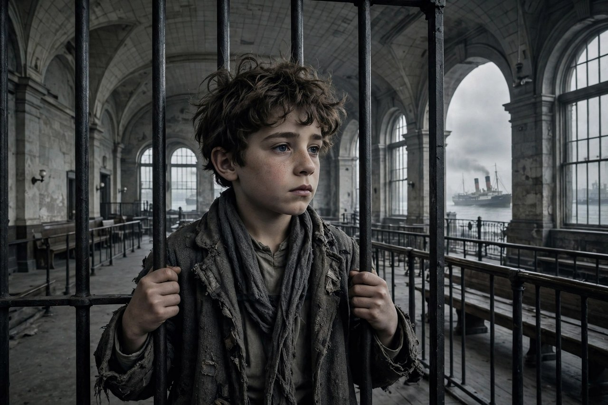
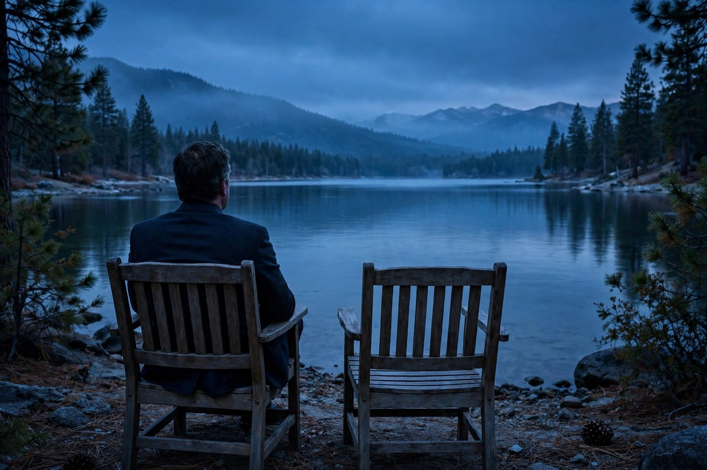

前作结尾，书房的门在凯伊面前关上了。1974年续集从门里开始讲。迈克尔已经坐在书房里了，位置坐稳了，仇也报了，可这部片子要讲的不是他怎么赢，是他怎么一步步把身边的人都弄丢的。

1974年续集是科波拉导演的，1974年12月上映，片长200分钟。它用了两条线并在一起讲：一条是1958年迈克尔当教父之后的事，另一条是年轻的维托怎么从西西里孤儿变成纽约教父。两条线剪在一起，不是为了好看，是为了对照：父亲怎么把家族立起来，儿子怎么把家族守下去，守到最后只剩一个人。

下面一段一段把这部续集讲清楚。

前作讲的是一个人怎么走进书房，续集讲的是一个人坐在书房里之后，怎么把身边的人一个一个推出去。两条线一对照，味道就出来了：父亲那条线越往上走越暖，儿子这条线越往下走越冷。

## 关上的门后面

续集开场是1958年，太浩湖。迈克尔的儿子安东尼办圣餐礼，宅子里摆着酒席，宾客进进出出，场面和前作开场的婚礼很像，只是主角换了人。维托不在了，坐在主位上的是迈克尔。

来见他的人一个接一个。参议员吉尔里开口要钱，话里还带着对意大利血统的羞辱，迈克尔不给。罗斯的人奥拉来谈拉斯维加斯的赌场。彭坦杰利要迈克尔帮他保住布朗克斯的地盘，对付罗斯手下的罗萨托兄弟，迈克尔拒绝了。夜里，枪手朝书房扫射，迈克尔和怀孕的凯伊趴在地上，逃过一劫。

迈克尔没有慌。他把汤姆留下看家，自己动身去查内鬼。前作里维托倒下之后，全家乱成一团，续集里迈克尔遇刺之后，先把家里安排好再出门。他比父亲更冷静，也更不信任人。这就是续集的起点：一个不再相信任何人的人，怎么守住一个靠人情起家的家族。

吉尔里这个人值得多说一句。他是参议员，管着赌场牌照，开口就要钱，还要迈克尔对他感恩戴德。迈克尔一口回绝，吉尔里当场翻脸，话说得很难听。可没过多久，吉尔里就在旅馆房间里醒来，身边躺着一个死去的姑娘，汤姆站在门口，告诉他这件事可以摆平，也可以见报。吉尔里从那天起就成了柯里昂家的人。迈克尔对付政客的办法，和维托对付房东的办法，本质上是一回事：先让你知道代价，再让你自己选。只是维托让人选的是减租，迈克尔让人选的是身败名裂。

## 1901年，一个孩子上船

1901年，西西里科尔莱奥内镇。九岁的维托·安多里尼，父亲得罪了当地黑手党头子唐·西西奥，被杀了。哥哥保罗去报仇，也死了。母亲带着维托去求西西奥，母亲也被杀了。维托连夜逃走，藏在船上，漂到了美国。

在埃利斯岛，移民官登记的时候，按家乡地名把他的姓写成了柯里昂。一个九岁的孩子，举目无亲，不会说英语，身上只剩一个家乡的名字，和满腔的仇。

这段戏没有一句多余的台词。镜头里的孩子不哭不闹，只是看着。他看着母亲倒下，看着船，看着埃利斯岛的铁栅栏。观众这个时候如果记住这个孩子的眼神，后面维托做的每一件事，就都有了来处。

船上的日子，片子没有细拍，只给了几个镜头：孩子缩在船舱里，甲板上全是人，海风吹得人睁不开眼。到了埃利斯岛，一个孩子在铁栅栏后面等着，不知道自己会被送到哪里。名字是别人给的，命是自己挣的，这就是维托一生的起点。

## 杂货店与收账人

到了1917年，维托住在纽约小意大利，在杂货店打工，娶了卡梅拉，生了桑尼。日子过得紧巴，但还算安稳。直到街区里的黑手党收账人范努奇找上门，杂货店老板被迫辞退了维托。

维托没有去求人。他和邻居克莱门扎开始偷东西卖，日子慢慢有了进项。范努奇找上门来，要每人200块。维托只给100块，范努奇勉强收下了。维托从这件事里看明白了：范努奇根本没有真靠山，他就是靠着一身行头吓唬人。

节日那天，街上炮仗响成一片，维托在楼道里结果了范努奇。没有谈判，没有警告，没有多余的动作。从那天起，街坊开始来找维托办事。被房东欺负的寡妇，被混混勒索的小贩，维托不收钱，收人情。

这就是维托做事的路子：先稳住对方，再摸清底细，最后才动手。动手之前，他永远比对方多想一步。

## 人情怎么立起来

维托帮人，从来不先谈价。寡妇被房东赶，维托去谈，房东减了租。邻居被混混盯上，维托出面，混混走了。他帮人，人欠他，人越攒越多，地盘越来越大。他和克莱门扎、泰西奥一起做起了橄榄油生意，日子越过越体面。

1922年，维托带着生意和体面回了西西里，去见老年的西西奥。他先求祝福，再亮明身份，一刀结果了西西奥，报了二十多年前的仇。这一刀不是冲动，是等了二十多年的账。

维托的权力是别人求来的。他帮人，人欠他，人心就聚在他手里。他从来不先动手，动手是讲道理讲不通之后的事。这套规矩，就是柯里昂家起家的本钱。父亲这条线讲到这里，观众才明白：维托不是天生就是教父，他是被人一件事一件事求上去的。

寡妇那件事，片子拍得很细。寡妇养着一条狗，房东嫌狗吵，要赶她走。维托去找房东谈，房东开始很横，维托只说了一句话，房东就改口了，租金也减了。片子没有拍维托说了什么狠话，只拍了他进门和出门。观众都明白：维托不需要放狠话，他站在那里，房东就知道拒绝的代价。这就是人情立起来的样子：不需要天天喊打喊杀，只需要在关键时刻站在那里。

## 太浩湖的圣餐礼

回到1958年。安东尼的圣餐礼办完，迈克尔在太浩湖的宅子里见各路人。奥拉代表罗斯谈拉斯维加斯的赌场，话说得客气，条件却不客气。彭坦杰利要迈克尔帮他保住布朗克斯的地盘，迈克尔拒绝了，他不想为了一个手下得罪罗斯。

夜里枪手扫射之后，迈克尔怀疑家里有内鬼。他把汤姆留下看家，自己动身，分别去见彭坦杰利和罗斯，对两个人说了一样的话：我怀疑是对方下的手。他让彭坦杰利和罗萨托兄弟坐下来谈和，谈和的桌上，罗萨托兄弟动手要勒死彭坦杰利，警察突然闯进来，兄弟俩跑了，彭坦杰利捡回一条命，却从此恨上了迈克尔。

这段戏值得反复看。维托当年是被人求着办事，迈克尔现在是被人围着要好处。位置越高，围着你的人越多，真心越少。迈克尔对两个人说一样的话，不是糊涂，是试探。他想看看，谁先沉不住气。

迈克尔想的是大局，彭坦杰利想的是自己。这就是组织里最常见的裂缝：上面想的是盘子，下面想的是地盘。

## 古巴除夕夜

罗斯请迈克尔去哈瓦那投赌场，迈克尔心里不踏实。革命军已经打到门口了，巴蒂斯塔政府眼看撑不住。可罗斯的盘子铺得太大，生日蛋糕都切好了，各路人马都在等着分古巴的赌场。

除夕夜派对上，迈克尔当面问罗斯：罗萨托兄弟杀彭坦杰利，是谁下的令。罗斯提醒他：你让我杀莫·格林的时候，我可没问你为什么。弗雷多在派对上假装不认识奥拉，转头又说漏嘴，说自己早就认识奥拉。迈克尔全明白了，抱住弗雷多亲了一口，说：你伤了我的心。

夜里，巴蒂斯塔逃亡，革命军进城，迈克尔、弗雷多、罗斯各自逃出古巴。派去医院杀罗斯的杀手失手，被罗斯的保镖打死。古巴这段讲的是大势：政权一夜之间换了人，赌场再大也大不过时代。罗斯算了一辈子，没算到革命军进城的速度。迈克尔看懂了这一点，所以他从古巴回来之后，再也没有提过哈瓦那的盘子。

## 听证会上的翻供

罗斯用关系推动参议院成立调查委员会查柯里昂家。彭坦杰利被保护起来，答应作证指认迈克尔。听证会那天，汤姆把彭坦杰利的哥哥文森佐从西西里带来，坐在旁听席上。彭坦杰利一看见哥哥，话全变了。他说自己以前的证词是编的，调查委员会当场散了。

这段听证会取材于现实里的瓦拉奇听证会，科波拉把现实里的证人翻供搬进了电影。迈克尔没有在法庭上赢，他在法庭外赢了。真正的权力不在证词里，在证人看见哥哥的那一瞬间。

听证会之后，汤姆去军营看彭坦杰利，讲了罗马人的故事：失势的罗马人可以自己体面地了断，家人就能保全。没过多久，彭坦杰利死在浴缸里，手腕割开了。罗斯从国外回来，在机场被洛可扮成记者打死，洛可自己也被警察打死。彭坦杰利这个人物，本来是克莱门扎的位置，演员谈不拢才新造了这个人。可这个新造的人物，反而成了续集里最让人唏嘘的一笔：他不是被敌人杀死的，是被自己人用一句话送走的。

组织里的人，一旦被推到证人席上，结局往往早就写好了：要么开口，要么闭嘴，闭嘴的办法只有一个。

## 弗雷多与湖

弗雷多回来之后，向迈克尔喊：我不是没用，我是被排除在外，家里大事从来不让我沾边。迈克尔说：母亲在世的时候，我不动你。这句话既是承诺，也是缓刑。

母亲去世之后，葬礼上弗雷多抱着迈克尔哭，带安东尼去钓鱼，好像被原谅了。阿尔·内里陪弗雷多上船钓鱼，湖上枪响，迈克尔站在岸边看着。没有争吵，没有告别，枪声过后，湖面又平静了。

弗雷多不是坏人，他是扶不起来又不甘心的人。前作里他掉枪，续集里他泄密，两次都是同一个毛病：嘴不严，心不稳。迈克尔杀弗雷多不是泄愤，是立规矩。家里出了内鬼，位置再高也得办。可办完之后，迈克尔身边又少了一个兄弟。立规矩的人，最后往往是被规矩反噬的人。

迈克尔站在岸边，没有哭，也没有走开。办完之后，人还得站在原地看着。

## 凯伊离开

凯伊告诉迈克尔：她流掉的不是意外，是她自己做的决定，她不想再给这个家生孩子。迈克尔动手打了她，把她赶出家门。后来凯伊在康妮帮助下回来看孩子，迈克尔一句话不说，把门关上了。

对照前作结尾：门关了两次，关的是同一个人。凯伊从门外看进去，和前作结尾一模一样，只是这回她连争辩都不争了。迈克尔守住了家规，代价是妻子走了，孩子没了妈。他保住了家族的体面，丢掉了家里最后一点温度。

凯伊这条线，是续集里最安静的一刀。没有枪声，没有追杀，只有一扇关上的门。可这扇门关上之后，迈克尔的家里就再也没有一个敢跟他说真话的人了。

## 湖边的空椅子与1941年的生日

结尾没有枪战，只有一个镜头：迈克尔一个人坐在太浩湖边。闪回到1941年12月7日，维托生日那天，全家等着维托回家切蛋糕。迈克尔宣布自己退学参军，桑尼大发脾气，只有弗雷多说好样的。维托进门，众人涌上去给他惊喜，迈克尔一个人留在桌边。整场闪回里，维托始终没有露脸，只听见他进门的声音。

切回现在：湖边只剩迈克尔一个人，椅子空着。1941年那桌人全在，桑尼、弗雷多、汤姆、康妮都在，凯伊还没进门。到了1958年，桑尼死了，弗雷多死了，凯伊走了，汤姆也快要离心。迈克尔得到了整个家族，代价是桌边再也没有人。

这个结尾比任何枪战都狠。它没有告诉你迈克尔赢了还是输了，它只给你看一张空椅子。赢的人坐在湖边，输的人也在湖边，区别只在于，赢的人身边没有人了。

## 两代人，两种接班

维托线和迈克尔线对照着看才明白。维托靠人情立起来：别人求他，他帮人，人情越攒越多，权力是别人送上门的。迈克尔靠清洗守下去：杀罗斯、杀彭坦杰利、杀弗雷多、赶走凯伊，地盘守住了，人心散了。维托临死是花园里和孙子玩，身边全是人。迈克尔最后是湖边一个人，身边全是空椅子。

对照现在，任何组织、公司、大家族都会遇到这个问题：接班人上台之后，是先收人心还是先立威。收人心慢，立威快，可立威立过头，底下的人就不敢说话了。不敢说话的组织，离散伙就不远了。维托和迈克尔就是两种答案，两种代价。一个答案让人越聚越多，一个答案让人越走越少。

还有一点很少有人提：维托的规矩是帮人，迈克尔的规矩是清洗。帮人需要耐心，清洗只需要决心。耐心慢，决心快，可组织靠耐心活得久，靠决心只活得狠。迈克尔不是不懂这个道理，他是被位置逼到了只能用决心的那一边。位置越高，选择越少，这是续集最冷的一句潜台词。

维托和迈克尔的差别，还可以从身边人看出来。维托身边的人，克莱门扎、泰西奥、汤姆，都是跟了他一辈子的人。迈克尔身边的人，彭坦杰利死了，弗雷多死了，凯伊走了，汤姆也快要离心。一个组织走到最后，身边还剩几个人，就是最真实的成绩单。地盘可以守住，赌场可以开张，可身边没有人了，守住的只是一个空壳子。很多公司、大家族走到这一步的时候，掌门人往往还觉得自己赢了，因为账面还好看。可账面好看，桌边没人，这样的赢，和输也没有多大分别。

## 为什么续集能拿最佳影片

这部片子在奥斯卡拿了11项提名，中了6项：最佳影片、最佳导演、最佳男配角、最佳改编剧本、最佳配乐、最佳艺术指导。它是史上首部拿最佳影片的续集，到今天也只有它和另一部魔幻史诗做到过这一点。

德尼罗演年轻维托，在西西里住了几个月学方言，片子里几乎全程说西西里话，拿了最佳男配角。白兰度演老年维托拿了最佳男主角，同一个角色让两个人拿了奥斯卡，影史头一回。德尼罗当年还去试过前作里桑尼的角色，没选上，科波拉记住了他，续集里把年轻维托给了他。

罗塔的配乐也有一段公案。前作同旋律因为早年在喜剧里用过，被取消了提名资格。续集同旋律拿了最佳配乐。规矩有时候就是这么不讲道理，好东西不会因为一次资格风波就贬值。

拍摄从1973年10月到1974年6月，跑了纽约、西西里、内华达太浩湖、佛罗里达迈阿密、多米尼加首都圣多明各。哈瓦那的戏是在圣多明各拍的，因为没法去真的哈瓦那拍。预算1300万美元，北美约4700万美元，是派拉蒙当年最卖座的片子。200分钟，不短，可没有一段是废的。

还有两处幕后值得一提。白兰度本来答应回来拍生日闪回，结果当天没到场，科波拉当天改写了这场戏，维托始终没有露脸，反而成了神来之笔。詹姆斯·卡恩回来演桑尼，只拍了一场，片酬和前作整部一样，制片方也认了。这两件事放在一起看，就明白续集的份量：连只露一面的角色，都值得花整部的价钱请回来。

## 给还没看过的人

我的建议是：先看1972年那部，再看1974年续集，留出一个完整的晚上，200分钟不要倍速。续集的节奏比前作更慢，前面很长一段都是谈话、吃饭、走路、开会。可正是这些慢的地方，埋下了后面所有的翻供、泄密和枪声。

看的时候可以留意几样东西：橙子、门、光影，还有两条线的对照。维托线越往上走，迈克尔线越往下掉，两条线剪在一起，看到最后会明白：这不是两部电影，这是一部电影的上下两半，一半讲怎么立起来，一半讲怎么散掉。

续集不热闹，不讨好，不给你廉价的爽感。如果只想看黑帮火拼，这部不适合。如果想知道权力是怎么把一个人掏空的，这部就是答案。看完1974年续集，再看1990年终章，家族的故事才算收尾。终章拍得不如前两部，但作为这个家族的收尾，可以一看。

