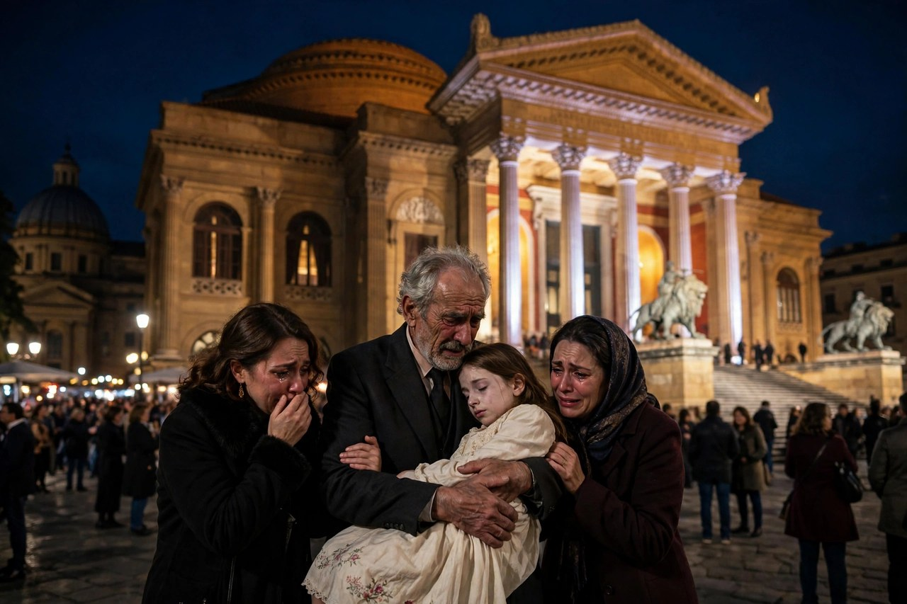
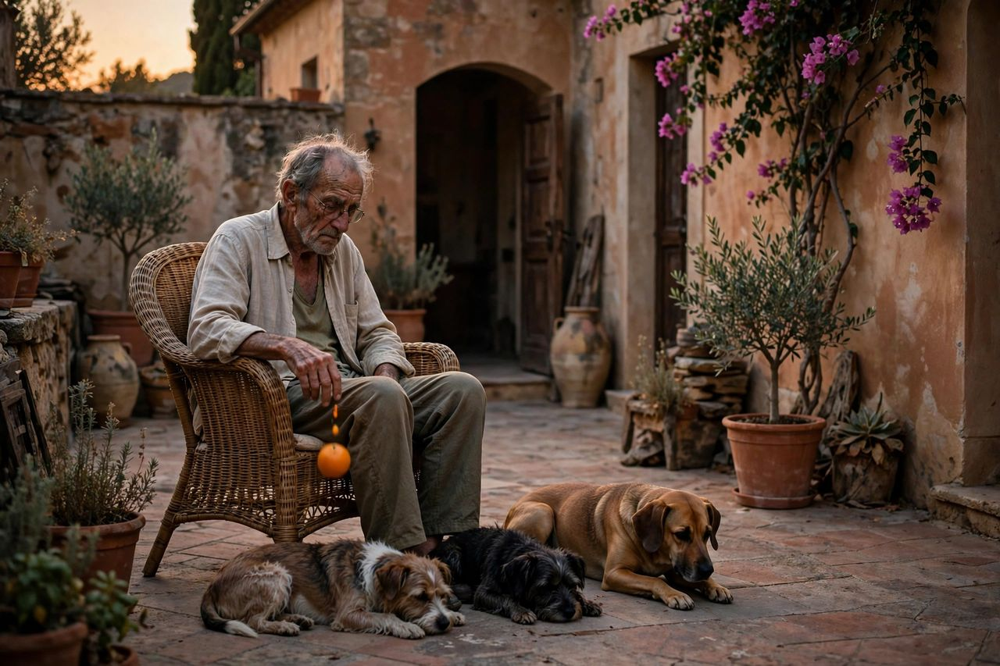

很多人问过我，终章值不值得看。我的答案是：值得，但别抱着看前作的心态去看。1990 年终章不是来续写传奇的，是来收账的。它讲的是一个走到晚年的人，怎么把一辈子欠下的账一笔一笔还掉，还到最后发现，能还的都还了，还不掉的那笔落在了女儿身上。

这部片子是 1990 年上映的，导演还是弗朗西斯·科波拉，剧本是他和马里奥·普佐一起写的。片长约 162 分钟，派拉蒙出品，预算约 5400 万美元，全球票房约 1.37 亿美元。奥斯卡给了 7 项提名，包括最佳影片、最佳导演和最佳男配角，一项也没中。故事时间是 1979 年，迈克尔快六十了。

1974 年续集之后，隔了十六年才出终章。科波拉是顶着派拉蒙的档期和资金压力拍的，演员也没凑齐，汤姆·哈根的扮演者因为片酬没谈拢直接缺席。这些先天不足，后面会一一应验。

下面把终章拆开，一部分一部分讲清楚。

## 晚年的教父

1979 年，迈克尔快六十岁了，头发白了，身体也不行了，糖尿病缠着他。他和凯伊早就离了婚，儿女跟着凯伊生活。安东尼大了，玛丽也大了。

他以父亲维托的名义办了基金会，到处做慈善，在教堂接受教廷授勋，场面体面得很。他想让所有人相信，柯里昂家已经上岸了。授勋后的招待会上，安东尼当众告诉父亲，自己不读法学院了，要去唱歌剧。玛丽站在旁边，场面一时很僵。迈克尔笑着圆了场，可谁都看得出来，他心里那块最想体面的地方，儿子先不认了。

可体面是做给外人看的。他心里清楚，基金会的钱从哪儿来，授勋的门从哪儿开。洗白这件事，从一开始就不是换块招牌那么简单。

还有一层：他累了。1972 年那部里那个穿军装的年轻人，1974 年续集里那个冷静清算的人，到了终章，只剩下一个想把日子过干净的老头。可他越想干净，过去越不放过他。他和凯伊的关系也早就断了。离婚之后，儿女跟着凯伊生活，迈克尔见孩子都得约时间。歌剧院那晚凯伊也在场，玛丽倒下去的时候她哭着扑过去。两个人离了婚，孩子还是共同的，血缘断不掉。迈克尔一辈子都在家人和家族之间选，选到最后，家人没了，家族也没了，只剩他一个人选无可选。

## 洗白这笔账

迈克尔的办法很直接：卖掉拉斯维加斯的产业，拿卖产业的钱把各家老板打发走，让委员会那帮人拿钱走人，别再沾 Immobiliare 这笔交易。他要的是交易干干净净，不带黑帮味。

扎萨一分钱没拿到，当场翻脸，宣布迈克尔是他的敌人，摔门走了。这就是洗白的难处：你想散伙，别人不想散；你想买断，别人觉得你独吞。迈克尔坚持交易不能沾黑帮的钱，委员会那帮人拿钱走人是条件。可条件越干净，越没人信。黑帮世界里，不带脏钱的交易本身就很可疑：你连自己人都不分钱，这笔交易到底是给谁做的。

对照现在看：公司想转型、家族想漂白，道理都一样。钱能换名头，换不掉记忆。你过去的交易对象还在，仇人还在，账本还在。你以为签了合同就上岸，可合同只管新账，不管旧账。旧账不认，新账没法立。这就是迈克尔这盘棋从一开始就输的地方：他以为上岸是一次交易，其实上岸是一次清算，而清算要所有人点头才行。

## 梵蒂冈的钱

交易本身是这样的：梵蒂冈银行账上七亿多美元的窟窿，银行总裁吉尔代大主教找上迈克尔。迈克尔出六亿美元，买教廷手里房地产公司 Immobiliare 的股份，名义上两亿，暗中又汇入四亿。成了，他就是大股东，十三人的董事会里能拿七个席位。

可交易卡住了：银行的瑞士管家基恩齐格反对，病重的教宗保禄六世迟迟不批。股东会上，大多数股东因为柯里昂家的犯罪历史，反对迈克尔进来。基恩齐格是账目的经手人，窟窿怎么来的，他最清楚，可他偏偏不签字。教宗病重，批文悬在半空，交易拖一天，窟窿就大一天。迈克尔这才明白，他买的不是股份，是别人的窟窿。窟窿填不上，股份就是一张纸。

这段影射了两件真实事件：1978 年教宗若望保禄一世骤逝，1981 年到 1982 年的教廷银行丑闻。电影把它们揉进了迈克尔的交易里，点到为止，不展开阴谋论。顺带说一句背景：现实里那家安保信银行被查出来给政客献金、给黑手党洗钱、给梵蒂冈当金融管道。电影没把这些拍成纪录片，只是借了个壳。看的时候别去对号入座，对上号也没用，电影讲的是迈克尔，不是银行史。看的时候记住一点就行：迈克尔想借教会的体面给自己的钱正名，可教会的钱本身也不干净。想借别人的干净洗自己的脏，借来的干净迟早要还。

## 告解室里的旧账

迈克尔去见拉贝托枢机，谈 Immobiliare 的事。枢机劝他告解。迈克尔三十年没进过告解室了，头一回开口，说出来的就是最重的那句：他下令杀了自己的兄弟弗雷多。

枢机没有给他廉价的原谅，只告诉他，真正的赎罪是往后不再过那样的日子。可这话说起来容易，做起来难。迈克尔后半辈子都在这句话里打转。

枢机后来当选教宗，就是若望保禄一世，刚批了交易，没多久就被人用毒茶害死。迈克尔好不容易等来的批文，转眼就成了废纸。拉贝托和吉尔代是两个人，两种教会：一个清廉正直，一个把教会银行当提款机。迈克尔找错了门，才会以为吉尔代的门就是教会的门。告解之后，他以为放下了，可玛丽死的那天他才明白，放下不是一句话的事，是余生每天都要还的账。

人到晚年才肯认的账，往往是最重的那笔。迈克尔认了弗雷多这笔，可认账不等于还账。告解室里说出来的话，走出门还得用命去还。告解这场戏为什么重要：全系列里，这是迈克尔头一回说实话。1972 年那部里他对凯伊撒谎，1974 年续集里他对所有人撒谎，到了终章，他对神父说了实话。一个撒了一辈子谎的人，头一回说实话居然是在告解室里，对着一个几个月后就要死的人。这就是终章的调子：真话来得太晚，晚到只能在没人的地方说。

## 儿子唱歌，侄子来了

安东尼不接班，法学院也不读了，要去唱歌剧。迈克尔嘴上不乐意，心里其实松了一口气：儿子不沾这个，是好事。安东尼后来去巴勒莫马西莫剧院唱《乡村骑士》，算是彻底走上了另一条路。

侄子文森特来了，是桑尼的私生子，安迪·加西亚演的。脾气像桑尼，火爆，讲义气，下手狠。在授勋晚会上，他和扎萨起冲突，一口咬掉了扎萨半只耳朵。

迈克尔一开始不想要他。这个孩子太像桑尼了，而桑尼是怎么死的，迈克尔比谁都清楚。接班人选错的代价，迈克尔在桑尼身上已经付过一回了。文森特和扎萨的过节早就结下了：扎萨接管了柯里昂家旧地盘，还派人半夜去杀文森特，没得手。授勋晚会上咬耳朵那一下，看着是冲动，其实是西西里老习俗：决斗之前咬对方耳朵见血，意思就是不死不休。歌剧《乡村骑士》里也有同样的习俗，科波拉把这个细节埋在文森特身上，等于提前告诉观众，这个孩子和他舅舅走的是一条路。

可没人了。安东尼不接，汤姆·哈根不在，身边只剩下文森特。迈克尔只能一边提防他，一边用他。文森特和玛丽相恋，表兄妹，迈克尔坚决反对：文森特过的日子，会把玛丽的命搭进去。这句话后来应验了。

## 大西洋城上空的直升机

各家老板聚在大西洋城开会，迈克尔分钱买断。扎萨没拿到钱，翻脸走人。阿尔托贝洛假装去调解，前脚刚走，直升机就悬在会议室外面开火，子弹从天窗打进来，老板们死伤大半。

迈克尔、文森特和保镖尼瑞逃了出来。迈克尔这才明白，阿尔托贝洛就是内鬼。打击太大，他糖尿病发作，中风住院，迷糊里喊着弗雷多的名字。

对照现在看：退场本身就是最危险的时候。你以为散伙饭吃完就没事了，可散伙饭的桌子底下，刀子早就摆好了。迈克尔想体面退场，别人只等他露出后背。

文森特趁迈克尔住院，带人报复，在街头节庆上扮成骑警，当街打死了扎萨。迈克尔知道后大骂他，可骂归骂，人已经死了，仇已经结下了。暴力这台机器，一旦重新发动，就停不下来。报复的许可，是康妮和尼瑞趁迈克尔住院给的。迈克尔躺在病床上，家里已经有人替他做了主。这就是退场的真相：你人还在，权已经不在了。等你出院，局面早就按别人的意思走下去了。迈克尔后来有句人人都会背的感慨，大意是自己以为已经脱身，可他们又把他拉了回去。这句话不是台词漂亮，是他一辈子的写照。

## 康妮的毒药

康妮变了。1972 年那部里她是被丈夫打得哭着找哥哥的小女儿，到了终章，她成了迈克尔身边最冷静的执行者，家里的大事她都经手。

阿尔托贝洛是她的教父。歌剧院包厢里，她递上一盒生日奶油卷。阿尔托贝洛怀疑有毒，让她先吃。她咬了一口没毒的那块，阿尔托贝洛这才放心吃下毒死的那块，死在包厢里，康妮透过歌剧望远镜看着他死。

这一段值得单独讲：家族里活到最后的女人，往往比男人更冷静。男人靠枪和脾气，康妮靠一盒奶油卷。她不是变坏了，她是看明白了：这个家里，讲情面的人都死了，活下来的都得自己动手。康妮的转变不是一天成的。丈夫卡洛死后，她接手家族事务，成了迈克尔的非正式军师。以前她是家里最需要保护的人，如今她是家里最能下手的人。男人靠枪和脾气的日子过去了，剩下的事，得靠她这样的人办。

## 歌剧院之夜

巴勒莫马西莫剧院，安东尼唱《乡村骑士》，马斯卡尼的歌剧，讲西西里复仇，和台下要发生的事对得严丝合缝。台上唱复仇，台下搞复仇，科波拉这个对位做得狠。

歌剧唱着，暗杀同步进行：基恩齐格被文森特的人勒死，吊在桥上伪装成自杀；卡洛用眼镜腿捅死了卢凯西；尼瑞跑到梵蒂冈，一枪打死了吉尔代。

这场多线并行，让人想起洗礼日那场。可洗礼日那场是立威，是新教父上位；歌剧院这场是收账，是旧教父清账。同一个手法，意思全反了：当年迈克尔用这招坐上位置，如今他用这招给自己收尾。手法没变，人变了。《乡村骑士》讲的也是西西里的事：图里杜和旧情人萝拉旧情复燃，未婚妻桑图扎告发，萝拉的丈夫阿尔菲奥和图里杜决斗，图里杜死了。台上唱到间奏曲的时候，台下正杀到最密的时候。歌剧里为情复仇死的是图里杜，歌剧外为家族复仇死的却是玛丽。科波拉让安东尼在台上唱别人的悲剧，台下演自己家的悲剧，这个对照比任何台词都狠。

## 台阶上的枪声

杀手莫斯卡扮成神父，一路摸进来，先杀了西西里的老托马西诺。莫斯卡是阿尔托贝洛请来的老杀手，扮成神父混进西西里，连老托马西诺认出他都没来得及喊出声。歌剧院里，文森特的人搜捕他，没拦住。歌剧散场，一家人走出剧院，莫斯卡在台阶上朝迈克尔开枪。迈克尔中枪之后，先看的不是自己的伤口，是女儿倒下去的地方。

迈克尔中枪，子弹穿过去打中了玛丽。玛丽倒在父亲怀里，文森特打死了莫斯卡。迈克尔抱着女儿，嘴张得大大的，却发不出声音。那声无声的嘶喊，是整部片子最狠的镜头。

凯伊和康妮在旁边哭。迈克尔一辈子怕的事终于发生了：他总说罪不及妻儿，可子弹不认这个理。你造的孽，账迟早要算到你最亲的人头上。玛丽不是死于暗杀，她是死于她父亲的一生。

还有一句要讲：迈克尔给文森特接班的条件，是文森特和玛丽断掉。条件提了，断也断了，可断掉关系断不掉子弹。迈克尔以为把女儿和家族隔开就能保住她，可女儿就站在他身边，站在台阶上。

## 椅子上的晚年

影院版结尾跳到多年后：西西里一栋别墅，迈克尔一个人坐在椅子上，老了，身边只有几条狗。他手里拿着一个橙子，橙子从手里掉下来，人从椅子上栽下来，就这么死了。

橙子又出现了。1972 年那部里，橙子出现的地方总要出事；到了终章，橙子从他手里掉下来，等于说：不用别人动手了，时间自己会收账。

算算他最后剩下什么：帝国没了，基金会和交易都成了空文；儿子唱歌去了，不再回来；女儿死了；妻子离了；兄弟是自己下令杀的；教父的位置交给了文森特，可文森特接过去的只是一个空壳和一堆仇人。他得到了教父的名头一辈子，最后只剩下一把椅子。

很多人说这个结尾太潦草，像喜剧。我倒觉得，潦草本身就是意思：一个叱咤一生的人，死的时候没有仪式，没有枪声，没有送行的人，只有一把椅子和一个掉下来的橙子。这就是权力最后的样子，不是轰然倒塌，是悄无声息地没人管了。影院版在死之前还闪回了一组画面：凯伊、玛丽、阿波罗妮亚。他一辈子最重要的三个女人，最后只剩下画面。拿这个结尾和 1972 年那部的关门结尾对照着看：关门是把人隔在外面，椅子是只剩自己一个人。门关上还有门外的人，椅子上连门外的人都没了。再拿维托的死对照着看：维托死在番茄地里，孙子在身边，是安详的死；迈克尔死在椅子上，身边只有狗，是孤独的死。父子两代人，一个死在家人中间，一个死在没人的地方，这就是两代教父最后的差别。

## 索菲亚那场风波

选角风波要实事求是地讲。玛丽这个角色先定了朱莉娅·罗伯茨，她因为档期退出，去了《风月俏佳人》。换上薇诺娜·瑞德，临开拍又因神经衰弱退出。科波拉没时间再找，让十九岁的女儿索菲亚顶上。

索菲亚没经验，也不想当演员。片子上映后，骂声全冲她来了，还有裙带关系的指控。她拿了两座金酸莓：最差女配角和最差新人。

公道话要讲两句：她的表演确实生涩，台词念得像背书，哭戏也撑不住。可把整部片子的毛病全算到她头上，不公平。梵蒂冈那条线绕，节奏前松后紧，是剧本和剪辑的问题，不是她一个人的问题。她后来当导演拍出了好片子，算是后话，至少证明她不是没才华，只是当时不该站在那个位置。这部片子在口碑上一直排在系列最后，算是公认的短板。可短板不等于废品：它的毛病在结构和节奏，不在立意。立意恰恰是它最值得讲的部分，一个教父怎么老、怎么还账，前作都没讲到这个地步。

还有一个人缺席：汤姆·哈根没出现。杜瓦尔片酬没谈拢，片方只给一百万，他觉得和帕西诺的五百万、基顿的一百五十万差太多，不接。军师不在，片子确实少了一块：迈克尔身边没有一个能说真话、能拦他的人了。少了汤姆，迈克尔的孤独又多了一层。索菲亚顶上，与其说是任人唯亲，不如说是救场。开拍在即，换谁都来不及背词走位，导演只能用自己家里的人。可救场归救场，观众买票看的是电影，不是剧组的难处。难处可以理解，表演不能因此加分。

## 重剪版改了什么

2020 年，终章上映三十周年，科波拉出了重剪版，名字改成《马里奥·普佐的教父 终曲：迈克尔·柯里昂之死》，12 月 4 日有限上映，8 日上线流媒体和蓝光。

开头改了：删了弗雷多闪回、内华达空房子、教堂授勋那场，改从吉尔代向迈克尔要钱那场开始，文森特出场提前，玛丽阳台那场生硬的台词剪掉了一些。节奏顺了一点。

结尾改了：迈克尔不死在椅子上。改成他坐在椅子上的特写，画面黑下来，出字卡，大意是西西里人祝你百年长寿，意思是长命百岁，而西西里人从不忘记。科波拉的意思是：迈克尔受的不是肉体死亡，是比死更重的惩罚，活着记一辈子。

片长 158 分钟，比影院版短约 4 分钟。科波拉说，这是他和普佐本来想拍的样子，也想为女儿的表演正名。重剪版上映后，评价褒贬不一，但有一点是公认的：它比影院版顺。删掉的几场戏都是累赘，改掉的结尾也比原来狠：原来是死给你看，现在是活着给你看。死是一下子，活着记一辈子是每一天。科波拉晚年改这个结尾，等于承认了一件事：对迈克尔这种人，死是解脱，不死才是惩罚。实话实说：重剪顺了一些，值得一看，但救不了结构问题。梵蒂冈线还是绕，索菲亚的表演还是生涩。重剪版不是翻案，是给终章一个体面一点的收尾。

## 为什么洗不干净

这是终章最值得讲的一层：洗白为什么洗不干净。迈克尔的办法是换名头：卖产业，分钱，买教廷股份，办基金会，拿授勋。名头全换了，可三样东西换不掉。

一样是记忆：所有人都记得他是谁。股东会上，人家反对他的理由不是钱不够，是他的历史。历史这东西，合同洗不掉。

一样是关系：他过去的交易对象还在，仇人还在，教会银行的窟窿还在。你想退出，别人不退。你签了合同，别人不认合同。

一样是自己：他心里那笔弗雷多的账，告解了也没还掉。洗白最大的障碍不是外人，是他自己过不去的那道坎。

对照现在：公司想转型、家族想漂白、一个人想换个活法，道理都一样。漂白不是换块招牌，是把旧账一笔一笔还清。还不清就别谈上岸，谈上岸就是给自己挖坑。迈克尔最大的错不是心狠，是以为时间能把账抹掉。时间抹不掉，时间只会把账算到下一代头上。玛丽就是那笔账。维托和迈克尔的区别也在这里：维托从不谈洗白，只谈规矩和人情。他知道自己是什么人，不装。迈克尔谈洗白，谈上岸，谈基金会，谈得越多，越被这些词拖垮。一个人最怕的不是脏，是脏着还想装干净。装干净的人，最容易在干净的地方摔跟头，梵蒂冈就是那个地方。

## 给还没看过终章的人

如果你还没看过终章，我的建议是：先把 1972 年那部和 1974 年续集看完再看终章，不然人物关系接不上，弗雷多、桑尼、凯伊、汤姆这些名字听着都空。

终章节奏慢，梵蒂冈那条线绕，别倍速，倍速看会把本来就绕的线看得更碎。重点看三场：告解室、大西洋城、歌剧院。这三场看懂了，终章就看懂了大半。

看完影院版，可以再看重剪版对比结尾：一个是死在椅子上，一个是活着记一辈子。两个结尾，两种惩罚，你更信哪一种，看完自己会有答案。终章不适合只想看黑帮火并的人。火并场面有，大西洋城那场就够劲，可终章真正的主角不是枪，是账。想看一个人怎么老、怎么还账、怎么到最后只剩一把椅子的人，才会觉得终章值得。只想看爽的人，看到梵蒂冈那条线就会走神，走神不是你的错，是片子没把那条线讲利索。看完终章再回头看 1972 年那部开场的婚礼，会有新感觉：婚礼阳光里的那个年轻人，怎么一步一步走到了椅子上。这条线走完了，整个系列才算讲完。

最后一句收束：1972 年那部开头，迈克尔说那是我的家族，不是我；1974 年续集结尾，他自己就是家族本身；到了终章，他只剩自己一个人。终章的价值不在它拍得多好，在它把这句话讲完了。一个系列能把主角从局外人写到教父，再写到孤家寡人，就算后两部有毛病，这个收束也值得看。
