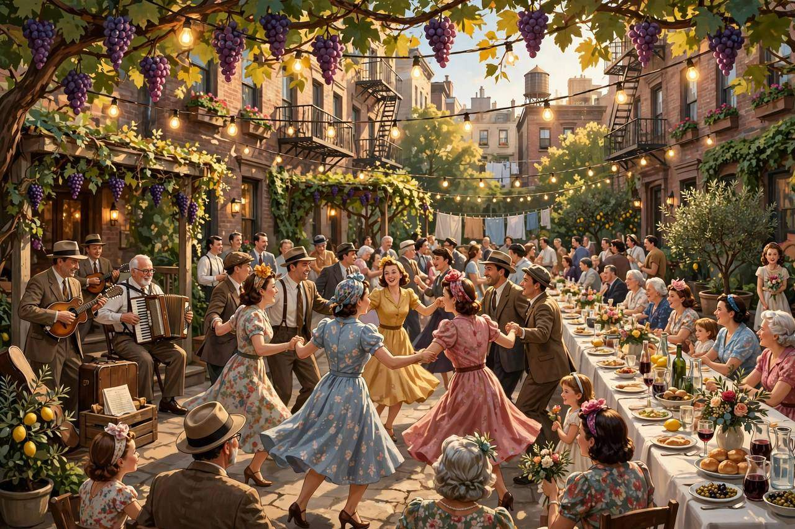
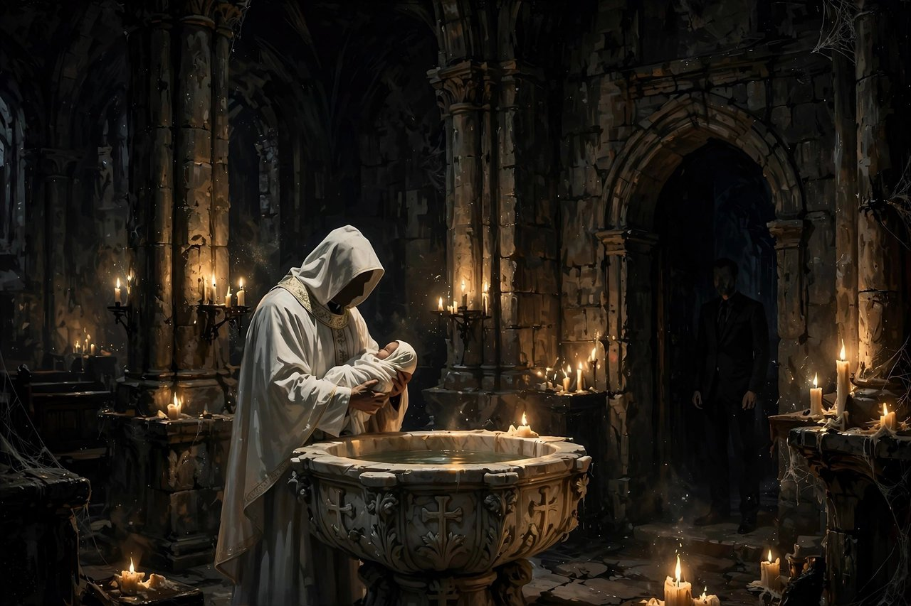

很多人问过我，黑帮片到底哪部最值得看。我的答案从来没变过，就是《教父》。不是因为它名气大，而是因为它根本不只是一部黑帮片。它讲的是一个家族怎么接班，一个组织怎么立规矩，一个人怎么在责任面前把原来的自己一点点交出去。半个世纪过去了，后来的黑帮片拍得再狠、再花哨，都没有越过它立下的那条线。

这部片子是1972年上映的，导演弗朗西斯·科波拉，改编自马里奥·普佐1969年的同名小说。片长175分钟，派拉蒙出品，预算只有六七百万美元，票房最后冲到了两亿五千万美元以上，拿了奥斯卡最佳影片、最佳男主角、最佳改编剧本。马龙·白兰度演老教父维托·柯里昂，阿尔·帕西诺演小儿子迈克尔。这两个人的表演，后来成了电影史的标杆。

下面把这部片子拆开，一部分一部分讲清楚。

## 婚礼上的美国梦

故事从1945年夏天的一场婚礼开始。柯里昂家的小女儿康妮出嫁，地点在长岛的宅子里。院子里摆着长桌，乐队在演奏，宾客跳着舞，桌上堆满了吃的喝的。表面上看，这就是一场体面的意大利裔美国人婚礼，热闹，喜庆，合家欢。

可镜头一转，气氛就变了。宅子里的书房安安静静，老教父维托坐在椅子上，一个一个接见来求他办事的人。外面是婚礼，里面是权力。同一座宅子，同一天，两副面孔。这就是整部片子要讲的东西：美国梦的光鲜外表，和它底下那套真正的运行规则。

小儿子迈克尔是穿着军装来的。他刚从战场回来，身边带着女朋友凯伊。凯伊是盎格鲁撒克逊裔的新教徒，在这个全是西西里人的场合里显得格格不入。迈克尔给她讲家里的事，讲父亲怎么帮人，怎么收人情，语气轻松得像在讲别人的故事。凯伊问他，你家里是不是就是传说中的那个样子。迈克尔说，那是我的家族，不是我。

这句话是全片的起点。迈克尔这个时候真心相信，自己和家族不是一回事。他受过大学教育，当过兵，谈着一个体面的美国姑娘，前途在正道上。他站在婚礼的阳光里，以为自己这辈子都不会走进那间书房。观众这个时候如果信了他的话，后面才会明白这部片子到底有多狠。

## 书房里的规矩

书房那场戏，是电影史上最有名的开场之一。殡仪馆老板邦纳萨拉站在老教父面前，开口就是，我相信美国。他的女儿被人欺负了，法律没有给他公道，他来找教父。他愿意出钱，只求对方付出代价。

维托没有马上答应。他先纠正了一件事：你从来不肯叫我一声教父，出了事才想起我。他不要钱，他要的是人情。你今天欠我一个人情，往后我找你的时候，你不能拒绝。这就是柯里昂家的运行方式：不谈价格，谈人情。人情不用写在纸上，比合同还牢，因为还不上的代价谁都清楚。

接着是教子约翰尼的事。这个歌星想在好莱坞拿一个角色，制片人沃尔茨不肯给。维托派养子兼军师汤姆去谈，谈不拢，第二天早上，沃尔茨在自己的床上醒来，发现心爱的种马的头被砍下来放在被子里。这一段后来成了影史名场面，很多人只记得血腥和震撼，却忽略了它真正的含义：维托从来不先动手，他先讲道理，道理讲不通，才让你明白拒绝的代价。

书房里的规矩还有一条，就是维托对毒品的态度。毒枭索洛佐带着大生意上门，条件非常丰厚，连长子桑尼都动心了。维托拒绝了，理由说得很明白：赌场和酒色是人偶尔的消遣，毒品会毁掉人的一生，而且他供养的那些政客也不会支持他碰这个。很多人把这段理解成老教父有道德洁癖，其实不是。这是生意人的算账：有些钱赚了会断掉你所有的关系，有些钱不能碰，碰了就是自断后路。

## 一句拒绝惹来的战争

维托拒绝索洛佐，等于给自己判了死刑。索洛佐背后站着塔塔利亚家族，更后面还有巴西尼家族。维托心里清楚，他派杀手卢卡·布拉西去索洛佐那边卧底，想摸清对方的底。卢卡这个人对维托忠心到了愚忠的地步，一个人去送死，连眼睛都不眨一下。可惜对方早有防备，卢卡刚去就被杀了。

然后就是街头那场枪击。维托在一个水果摊前买橙子，杀手从身后开枪。维托身中数枪倒在地上，次子弗雷多就在旁边，手里拿着枪，却慌得连枪都掉了，蹲在地上哭。这一幕把弗雷多这个人物钉死了：他不是坏人，他是扶不起来的人。一个家族里最怕的不是外敌，是关键时刻掉链子的人。

维托进了医院，家族一下子失去了主心骨。更狠的是，医院里的警察被人调走了，杀手半夜摸进来想补刀。是迈克尔识破了，他和一个来探病的糕点师傅安索，两个人空着手站在医院门口，装成持枪守卫的样子，把杀手吓走了。接着，收了索洛佐钱的警察队长麦考斯基赶到，当众打了迈克尔一拳。迈克尔脸上肿着，嘴里流着血，从这一刻起，他不再是那个穿军装的局外人了。

这段戏值得反复看。维托倒下之后，家族里每个人是什么成色，全都露出来了。桑尼暴怒，弗雷多无能，汤姆被扣在对方手里当传话人，迈克尔这个从来不沾边的人，反而是唯一冷静的。很多家族企业出事的时候，情形都差不多：平时看着最体面、最有前途的那个，不一定是能扛事的人；真正能扛事的，往往是那个平时不声不响、关键时刻不慌的人。

## 餐厅里的枪声

迈克尔决定动手，是全片最重要的转折。索洛佐约了谈判，条件是停战，但谈判地点、时间都由对方定，身边还带着警察队长麦考斯基当保镖。所有人都明白，这场谈判是个局。迈克尔说，让我去。他是家族里唯一没有案底、对方愿意接受的人选。

动手之前，老杀手克莱门扎教他怎么做：枪事先藏在餐厅厕所的水箱后面，进门先冷静吃饭，谈几句，借口上厕所，拿到枪出来就打，打完把枪扔下，慢慢走出去，外面有人接应。克莱门扎还交代了一句后来很有名的话：离开的时候把枪留下，把奶油卷带走。意思是现场不要留任何能证明你来过的东西，生活还得继续过。

迈克尔照做了。他在餐桌前听着索洛佐说话，听着麦考斯基用意大利语骂人，然后起身上厕所，拿到枪，回来的时候手都在抖。他开枪打死了两个人，转身走出餐厅，坐上接应的车，整个人瘫在后座上。这个时候的迈克尔不是冷血杀手，他是一个第一次杀人的年轻人，强撑着没有吐出来。

这场戏的厉害之处在于，它没有把迈克尔写成突然黑化的人。他动手不是因为喜欢暴力，而是因为父亲躺在医院里，家族没有别人能去。他替家族担了最脏的一件事，代价是他再也回不去了。杀警察在黑帮世界里是大忌，家族花了大力气在报纸上揭麦考斯基收黑钱的老底，才把这件事的影响压下去。迈克尔本人则连夜逃往西西里，开始了流亡。

现实里很多接班的故事都是这样开始的。不是一场隆重的交接仪式，不是一纸任命，而是一件没有人愿意干、却必须有人干的事。谁在那个时候站出来，谁就再也摘不掉身上的担子。迈克尔从餐厅走出来的那一刻，婚礼上那个说那是我的家族不是我的年轻人，就已经不存在了。

## 西西里的阳光与炸弹

西西里这段拍得非常美，美到让人不安。阳光、山坡、石头的村子、集市上的叫卖声，迈克尔在保镖的陪同下躲在这里，像一个回乡探亲的年轻人。他在这里遇到了阿波罗妮亚，一个眼睛很大的本地姑娘。两个人相爱，结婚，办了一场小小的西西里婚礼。那段时间是迈克尔一生里少有的、真正平静的日子。

可平静底下全是算计。保镖里有人被对方买通了，迈克尔的身份早就暴露了。一天早上，阿波罗妮亚先上了车，想帮丈夫把车开到门口，结果汽车炸弹爆炸，迈克尔眼睁睁看着新婚妻子在自己面前被炸死。阳光还是那么好，村子还是那么安静，可是一个人就这么没了。

这一段和前面的婚礼形成了对照。康妮的婚礼是热闹的、公开的、所有人都在场的；阿波罗妮亚的婚礼是安静的、躲藏的、见不得光的。迈克尔在美国失去的只是一个局外人的身份，在西西里失去的是一个活生生的人。从这天起，他心里那点对平静生活的念想，彻底断了。

还有一个细节值得注意。迈克尔在西西里期间，凯伊在美国给他写信、打电话，全都石沉大海。家族为了保护他，对外宣称他下落不明，连凯伊都不能知道他在哪里。等他几年后回到美国，凯伊还在等他。两个人后来结了婚，生了孩子，可他们之间从西西里那天起就隔了一层东西。迈克尔有些事永远不会告诉她，而凯伊也永远不可能真正走进他的世界。

## 收费站前的长子

桑尼是维托的长子，也是家族原来的接班人。这个人性格火爆，讲义气，护短，脑子不算慢，但脾气永远比脑子快。维托活着的时候还能压着他，维托一倒下，桑尼就成了家族里最危险的人：对自己人讲义气，对敌人下手狠，可就是沉不住气。

妹夫卡洛是个窝囊又阴损的人，在家里对康妮动手。桑尼知道后当街把卡洛打得满地找牙，围观的人全都看着。这一顿打出了气，却也把家族的规矩丢了：家事变成了街头表演，仇家正好可以拿这件事做文章。卡洛后来果然成了内应，先是故意再打康妮，逼她打电话向哥哥哭诉，再把桑尼的行踪卖给对方。

桑尼接到妹妹的电话，怒火攻心，一个人开车就往妹妹家赶，连保镖都没带。车开到收费站，前面有车挡着，后面有车堵着，枪手从四面八方冒出来，几十发子弹把他打成了筛子。他死的时候连车门都没打开。

桑尼的死是家族由盛转衰的拐点，也是整部片子最让人难受的一段。殡仪馆老板邦纳萨拉还了当年的人情，半夜被叫去给桑尼整容。桑尼的遗体被打得不成样子，邦纳萨拉花了一整夜，才把他恢复成生前的模样，让母亲能看他最后一眼。开头那个人情，在这里还上了。维托的规矩就是这样：人情可以欠很多年，但到了该还的时候，谁都不能含糊。

桑尼这个人物，放在今天的公司里也到处都是。有能力，有冲劲，护着自己人，可就是管不住脾气，别人一激就上头。这样的人能打江山，但守不住江山。维托心里其实一直明白这一点，所以他从来没有真正把家族交给桑尼。长子死了，维托反而松了一口气，因为他终于可以把位置交给那个真正合适的人，虽然那个人是他最不想拖下水的小儿子。

## 花园里的告别

维托伤愈之后，和五大家族开了一次会。他在会上做了很大的让步：不再追究桑尼的死，同意各家一起做毒品生意，换取各家承诺不再追杀迈克尔，让迈克尔平安回国。这场会开得窝囊，却是维托一生中最有智慧的一次出手。他用面子换了里子，用暂时的退让换了儿子的命。真正的大人物不是从不低头，而是在该低头的时候低得下去。

迈克尔回国之后，维托把他叫到花园里长谈。维托说，我本来想让你走正道，当参议员，当州长，做体面人。我供你读书，送你去打仗，就是不想让你沾这个。可惜天不从人愿，我没有把你保护好。这段话是全片最动人的地方之一。一个黑帮教父临到老了，最大的遗憾不是地盘丢了，而是没能让儿子过上干净的生活。

维托还告诉迈克尔一件事：他在开会的时候就看出来了，桑尼的死是巴西尼家族在背后主使的。而且他留下了一句遗言式的提醒：如果将来家族里有人跑来告诉你，说巴西尼想跟你见面，那这个人就是叛徒。说完这些，维托就像卸下了一副担了几十年的担子。

没过多久，维托在花园里和孙子玩耍，追着孩子跑，突然心脏病发作，倒在了番茄地里。他的死没有枪声，没有追杀，安安静静，像一个普通老人的离世。值得注意的是，片子里每次出现橙子，附近总会有人死。维托买橙子的时候遇刺，和孙子玩的时候身边也放着橙子。这个细节是导演埋的暗线：越是日常的东西，越可能藏着结局。

维托的葬礼来了很多人，五大家族的人全都到了，黑白两道争着向巴西尼示好，好像江湖马上就要换主人了。迈克尔站在人群里，和汤姆一起冷冷地看着。他已经知道叛徒是谁了，也已经想好了要怎么做。老教父走了，新教父还没有真正立起来，中间这段空档，是最危险的时候，也是迈克尔证明自己的时候。

## 洗礼日的清算

全片的高潮，是康妮孩子的洗礼。迈克尔当了孩子的教父，站在教堂里，神父问他，你是否弃绝撒旦和他的一切罪行。迈克尔面无表情地回答，我弃绝。与此同时，画面交叉剪到城里的五个地方，暗杀正在同步进行。

斯特拉奇从电梯里走出来，被克莱门扎带人堵住打死。库尼奥在旅馆的旋转门里被困住，乱枪打死。塔塔利亚在旅馆房间里和情人在一起，被破门而入的枪手打死。拉斯维加斯的莫·格林躺在按摩床上，子弹从眼睛里打进去。巴西尼在法院台阶前被假扮警察的杀手追杀，连同司机一起倒在街上。

教堂里的仪式越是神圣，门外的杀戮就越是冷酷。迈克尔嘴里念着信仰，手下的人正在替他清账。这种剪法后来被无数电影模仿，可没有一部能达到这个效果。因为科波拉拍的不是暴力本身，而是权力的仪式感：新教父不是在某一天突然上位的，他是在一场洗礼里，借着宗教的名义，把旧时代一次性埋葬掉的。

仪式结束之后，迈克尔又处理了两个人。泰西奥是家族的老臣子，维托的老朋友，他跑来告诉迈克尔，说巴西尼想见面。迈克尔一听就明白了，维托的提醒应验了。泰西奥被带走的时候很平静，只说了一句，这只是生意，不是私人恩怨。迈克尔没有回头。

妹夫卡洛也被带到了迈克尔面前。迈克尔哄他坦白，说只要说实话就放他去拉斯维加斯享福。卡洛承认了是他出卖了桑尼。话一说完，卡洛坐进车里，后座的克莱门扎用绳子把他勒死了。迈克尔连自己的妹夫都没有放过。从这一天起，没有人再敢把他当成那个穿军装的年轻人，也没有人再敢质疑他是不是教父。

## 关上的那扇门

片子的结尾只有一场戏，却比前面所有的枪战都狠。凯伊质问迈克尔，你是不是杀了卡洛。迈克尔先是不想谈，被逼到没办法了，才说，没有。凯伊松了一口气，转身要走。就在这个时候，门外的人一个一个走进来，单膝跪下，吻迈克尔的手，叫他教父。

凯伊站在门口看着，迈克尔的手下走过来，把书房的门关上了。门这边是凯伊，门那边是教父。镜头停在凯伊的脸上，门越关越小，最后只剩下一条缝。这个结尾没有一句台词解释，可所有人都看懂了：凯伊这辈子都不可能再走进那间书房了，而迈克尔也永远不可能再回到婚礼上那个阳光明媚的下午了。

很多人看完这部片子会问，迈克尔到底是赢了还是输了。从家族的角度看，他赢了，而且赢得干净利落：仇报了，地盘稳了，叛徒清了，位置坐稳了。可从一个人的角度看，他输得一干二净：他失去了妻子阿波罗妮亚，失去了哥哥桑尼，失去了父亲想让他过的那种生活，最后连自己的妻子凯伊都被关在了门外。他得到了一个帝国，代价是他再也没有办法做一个普通人。

这就是《教父》最狠的地方。它没有把黑帮拍成浪漫传奇，也没有拍成简单的善恶故事。它讲的是一个道理：每一次选择都有代价，而最大的代价往往不是你失去什么，是你变成什么。迈克尔一开始说那是我的家族不是我，到了结尾，他自己就是家族本身了。

## 为什么半个世纪过去，它还是教父

这部片子拍出来的时候，几乎没有人看好它。派拉蒙一开始就不想要科波拉，觉得他不够稳；也不想要白兰度，觉得他过气又难搞；更不想要帕西诺，觉得他个子矮、没名气。科波拉自己当时欠着四十万美元的债，是硬着头皮接下这部片子的。开拍之后，派拉蒙天天想换导演，觉得他进度慢、花钱多、不听话。科波拉顶着被换掉的压力，把自己想要的演员一个一个保了下来。

白兰度为了演维托，试镜的时候往嘴里塞棉花，让两颊鼓起来，后来又戴上牙医专门做的口腔器具，才有了维托那种含混的、像牛头犬一样的说话方式。帕西诺是科波拉以辞职相威胁才保住的。两个人的表演后来都成了电影学院的教材。白兰度拿了奥斯卡最佳男主角，却拒绝上台领奖，让印第安原住民演员萨切恩·利特尔费瑟代他上台，抗议美国电影行业对印第安人的歧视。这是电视转播的颁奖礼上头一次出现政治声明。

配乐也有一段公案。尼诺·罗塔写的主旋律优美得让人过耳不忘，可奥斯卡发现这段旋律他早年在一部喜剧里用过，于是取消了它的提名资格。有意思的是，到了1974年的续集，同样的旋律又拿了最佳配乐。规矩有时候就是这么不讲道理，好东西不会因为一次资格风波就贬值。

拍摄只用了77天，比原计划还少。预算六七百万美元，票房最后冲到两亿五千万美元以上，打破了当时的纪录。美国电影学会后来把它评为黑帮片的头名，国家影片登记部也把它和续集一起收进了典藏。影迷评分网站上，它常年排在最前面，续集紧随其后。

可这些荣誉都不是它长青的真正原因。真正的原因是，它讲的东西从来没有过时。任何一个组织、任何一家公司、任何一个大家族，都会遇到柯里昂家的问题：老人要退了，谁来接；规矩立了，谁来守；人情欠了，怎么还；仇结了，是马上报还是等十年。维托和迈克尔父子两代人，其实就是两种接班方式：一个靠恩威并施立规矩，一个靠冷静清算立权威。看这部片子的时候，很多人看到的不是黑帮，是自己身边的权力场。

还有一点很少有人提：这部片子对暴力非常克制。175分钟里，真正血腥的镜头不多，导演把力气都花在了谈话、眼神、关门、点烟这些日常动作上。暴力在这里不是看点，是代价。每一次枪声响起，前面都有很长的人情铺垫，后面都有很长的沉默收尾。这就是它和后来那些只比谁更狠的黑帮片最大的区别。

## 给还没看过的人

如果你还没看过这部片子，我的建议是：留出一个完整的晚上，175分钟，不要倍速，不要一边看手机一边看。它的节奏是慢的，前面一个小时几乎没有大场面，全是婚礼、谈话、吃饭、走路。可正是这些慢的地方，埋下了后面所有的伏笔。倍速看这部片子，等于把一顿讲究的饭吃成了快餐。

看的时候可以留意几样东西：橙子出现的地方，附近往往要出事；门开合的地方，往往意味着两个世界在分隔；光影的变化，往往比台词更早告诉你这个人要变了。这些细节看一遍未必全能注意到，看第二遍的时候会发现更多。

看完这一部，如果还想往下看，可以接着看1974年的续集。那部把两条线并在一起讲：一条是年轻的维托怎么从西西里孤儿变成纽约教父，另一条是迈克尔坐稳位置之后怎么一步步失去所有亲近的人。两部连起来看，才是一个完整的、关于权力代价的故事。至于1990年的终章，拍得不如前两部，但作为这个家族的收尾，也可以一看。

这部片子不适合所有人。它不热闹，不讨好，不给你廉价的爽感。可如果你想知道，一部电影怎么做到半个世纪都不褪色，怎么做到让黑帮片这个类型都以它为标准，答案就在这175分钟里。看完之后，你会明白为什么大家都叫它教父：不是因为它拍了黑帮，而是因为它给后来的所有同类电影都立了规矩。
