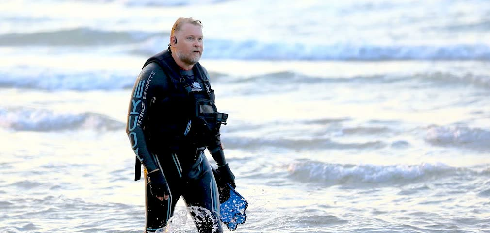

2026年11月2日，星期一，英国赫尔。

57岁的卡尔·布什比推着一辆装满行李的两轮小车，走进维多利亚女王广场。几百人等在市政厅门口，街道上挂着米字旗、气球和欢迎回家的牌子。他穿过人群，朝着萨顿公园方向走去，停在妈妈安吉拉家门口。门楣上挂着一条横幅，上面写着欢迎儿子回家。他笑着跟人群打招呼，说了句对不起，让你们久等了。

他出门的时候29岁。回来的时候57岁。中间隔了28年零1天。

## 两条规矩

1998年11月1日，他从智利南端的蓬塔阿雷纳斯出发，兜里揣着500美元，一顶帐篷，一台便宜的塑料相机，还有一辆手推车。他管这趟远征叫歌利亚远征。

出发之前，他给自己立了两条规矩，28年里一条也没破。往前走只能靠自己的力气，不许坐任何交通工具。没走完之前，不许回家。

这两条规矩听起来简单，执行起来是要命的。路上有海，海不能走，那就游过去。路上有国界，国界不放行，那就等着，等到放行为止。路上有战争和匪帮，那就绕着走、藏着走、硬着头皮走过去。规矩立在那里，人就不能给自己找台阶下。

## 出发

他是英国陆军伞兵团出身，在部队里待了十多年。念头来自爸爸在90年代中期寄来的一张生日卡。爸爸也是老兵，卡里提到特种部队战友之间的一场争论：人能不能从伦敦一路走到纽约，经过白令陆桥。这场争论在他心里扎了根。29岁那年，他决定干一件没人干过的事：从南美洲南端出发，用双脚走回英国老家，路线连起来正好绕地球一圈。

他往北走，穿过巴塔哥尼亚，翻过安第斯山，穿过中美洲地峡的达连隘口。那地方是走私贩和武装分子出没的地带，地图上看着只是一小段，脚走起来全是危险。过了中美洲是墨西哥，再往北是美国，一路走到阿拉斯加。

2006年，他和同伴迪米特里·基弗踏着漂移的浮冰走过白令海峡，从美洲走进了亚洲。脚底下是裂开又合拢的冰面，海水在冰缝里翻上来，掉下去就没命。那是整趟远征里最险的一段，也是他离家最远的一段。

进了俄罗斯之后，签证和官僚手续把他拖了很多年。有整整十年时间，他是在跟一纸批文较劲，走走停停，停停走走。西伯利亚的冬天能把人的骨头冻透，他就在那种天气里接着往前挪。蒙古、中亚，一段一段往前啃。

## 海是游过去的

里海那一段，他下水游了288公里。不是坐船，不是绕岸，是穿着潜水服一段一段游过去，补给船在旁边跟着，坐标一点一点往前推。

欧洲隧道方面不让他走海底隧道的检修通道，他就用同样的办法对付英吉利海峡。穿上潜水服，跟着一艘保障船，花3天游过海峡，2026年10月5日在多佛附近的莎士比亚海滩上岸。那时候离家只剩400公里。

这趟远征里，他游过两片海，走过一片结冰的海。规矩没有给他留任何可以坐船的借口，他就用身体把规矩补上了。

## 欧洲尾声

土耳其、保加利亚，2025年10月他走进罗马尼亚的时候，离家还有2213公里。匈牙利、奥地利、德国、比利时、法国，一段一段往北收。28年里攒下的路，到这时候已经只剩一个零头，可他还是按每天往前走的节奏走，不赶路，不抄近道。

## 数字

美联社的口径是约5万公里，远征队自己的算法接近5.8万公里，步数按远征队的算法约7500万步。路线跨过四大洲，约30个国家，七条山脉，六片沙漠。他后来还写过一本书，叫《巨人脚步》。

他出发时算过这趟路大概5年能走完，后来觉得12年打底，加号后面还很大，没想到最后是28年。

多说一句公道话：吉尼斯世界纪录到他到家那天还没有认证这一项。纪录认证是一回事，人走完了是另一回事。脚印不会因为没盖章就消失。

## 到家那天

2026年11月1日，他走过亨伯桥，正好是出发28年整的日子。11月2日，他走进赫尔。市政厅门口的欢迎仪式上，市长、家人、几百名市民都在，纪录片导演沃纳·赫尔佐格也在人群里，他正在拍这趟远征的纪录长片。

妈妈安吉拉75岁了。母子俩有将近十年没见过面。儿子亚当这些年只见过几次，12岁的孙女是头一回见面。他跟人群说，这是最后一个星期：最后一天住帐篷，最后一天在路上。28年之后，还能要求什么比这更多。他推着小车走进萨顿公园那条街，街上挂满了米字旗和气球，邻居们站在门口鼓掌。他停在老家门口，横幅就在头顶上。

28年里，世界变了很多。路线关闭，规则改写，国家换了模样。他脚下的规矩没变：不许坐车，不许回家，直到走完。

## 尾声

这篇不是鼓吹每个人都去走28年。普通人没有28年可以押在一件事上，家里还有日子要过。这篇想说的是另一层意思：一个人真能把一件看起来不可能的事，用每天往前走一点的方式走完。

28年，每天往前走一点。走到冰面裂开的地方，走到签证卡住的地方，走到海水没过肩膀的地方，走到离家只剩400公里的地方，走到妈妈家门口。

他出门的时候，兜里只有500美元。他回来的时候，兜里还是没有多少东西，多的是7500万步，和一条从智利南端连到英国赫尔老家门口的线。

那条线，就是人类群星闪耀时的样子。

文内照片均为公开报道中的实拍图片，版权归原摄影者与发布媒体所有。
