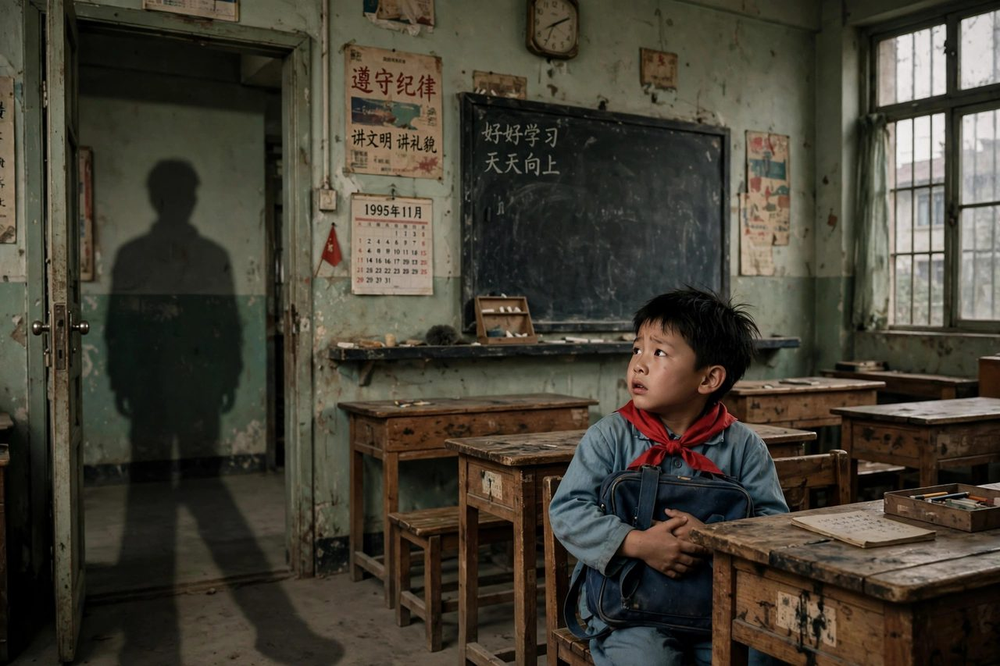

咱们中国人，就是从小被吓大的。

这话不是夸张，是实话。你回想一下自己小时候，怕过多少东西？怕红领巾没带，怕作业没写完，怕假期作业没写完，怕开家长会，怕考试考砸了。桩桩件件，在大人嘴里都是天大的事。

## 红领巾

小学的时候，你上学没带红领巾，你完蛋了。

就那么一条红布条，早上忘在家里了，进校门就跟做贼一样，恨不得把脖子缩进衣领里。值周生站在门口，眼睛跟探照灯似的。被逮住了，扣分，通报，老师再当着全班的面说你一顿。那感觉，就跟犯了多大的罪一样。

晚上作业没写完，或者假期作业没写完，那你完蛋了。开学那天，老师一个一个检查作业，没写完的站起来。那一排站着的孩子，头都不敢抬。开家长会，那就更天塌了。尤其像我们这种学习差的，家长过去挨顿屌，回来就干你。考个试，成绩考砸了，那完蛋了。

你发现没有，小时候吓唬你的东西，全是这个套路：把一件小事说成天大的事，把一次失误说成一辈子的污点。

## 档案

最离谱的就是那个档案。

老师吓唬你：这个档案呢，可得跟你一辈子。

我现在活了三十多岁了，我也不知道那档案具体长什么样。我可能这辈子也用不上档案。我不知道你们找工作的时候都看不看档案啊，反正我没见谁家招工先翻档案袋的。

档案这个东西，它是真的存在，但吓唬是假的。按现在的规矩，档案只能放在县里以上的人才中心，个人自己拿着就是死档，拆开了直接作废。真正用得上档案的时候，就那么几件事：考公务员政审、进国企事业单位、评职称、办退休。绝大多数私企根本没有保管档案的资格，你去入职，人家连收都不收，只登记个个人信息。

也就是说，你怕了半辈子的东西，一辈子躺在人才中心的架子上落灰，只在你办退休那天才可能被翻出来看一眼。你小时候老师拿它吓唬你的时候，可没告诉你这些。

还有什么三年连带，考不了这个，考不了那个。倒点水搁地上，你照照你看看从上到下，你们这一大家子有一个像能考那个似的吗？你能找那工作吗？有几个有资格的呀？有资格能轮得着你吗？

听听，这话说的。还没考呢，先把你全家都否定了。你说一个孩子，天天听这种话长大，他能不怕吗？他敢想吗？他连想都不敢想。

## 长大了，还是怕

长大了，吓唬换了个说法，怕还是那个怕。

做点生意还没做呢，先怕赔了。赔了就赔了呗，赔了再干嘛？三百六十行呢。我们人类的容错率我觉得是很高的，千万不要给自己那么大的压力啊，放平心态。

可有的人就是放不平。那心理素质差到什么程度呢？考个驾照，考个科目二、科目三晕倒了。考个试，上学时候考个试，知道自己可能考不好，当时就晕倒了。哎呀，就这种人挺多的。你说这种人他怎么可能成功呢？

还没做呢，就吓得他妈晚上都睡不着觉了，你怎么可能成功得了啊，对不对？

## 怕丢人

其实怕赔钱是假的，怕丢人才是真的。

生意赔了，钱没了可以再挣，可面子没了，觉得在亲戚面前抬不起头，在同学面前抬不起头。人家一问，你最近干嘛呢？你都不知道怎么张嘴。这才是很多人不敢动手真正的坎。

可你想想，人家真的天天盯着你吗？没有。大家都忙着怕自己的事，谁有空天天笑话你？你以为全世界都在看你，其实根本没人看你。这一关过不去，一辈子都得在原地怕着。

## 成功的人什么样

因为我看人家每一个成功的人，就是做事情一定都是胸有成竹，失败了也无所谓，一定要这种状态才有的。

你就得做到天不怕地不怕啊，就得有这种心态，你做事才有成功的概率。

这话听着像鸡汤，其实是实话。怕，是干不成事的。你手里攥着一把牌，还没出呢，先把自己吓死了，牌再好有什么用？成功的人不是没失败过，是失败了不当回事，爬起来接着干。天塌不下来，顶多就是摔一跤，摔了再爬起来就是了。

## 太阳照常升起

如果实在是没的事做呢，也要放平心态。因为不管你怎么样，明天太阳都会照常升起。

所以说一定要开开心心的过日子。不管是做事也好，还是对你的身体也好，心情是能够影响你的一切。

怕了一辈子，够了。从今天起，天不怕地不怕，该怎么做就怎么做，成不成都先干了再说。太阳明天照常升起，你也一样。

加油。
