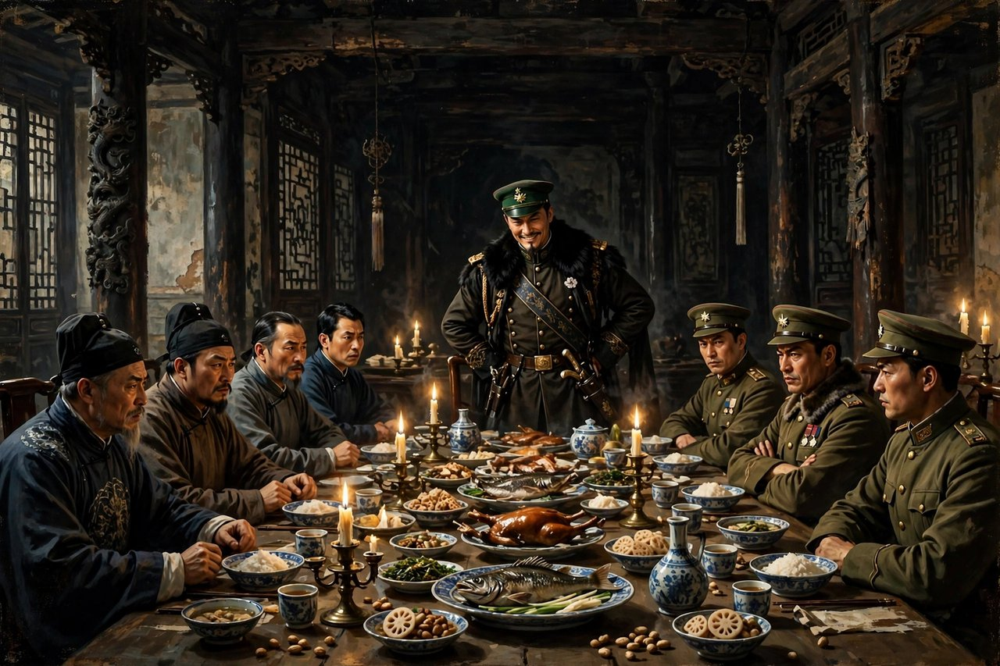
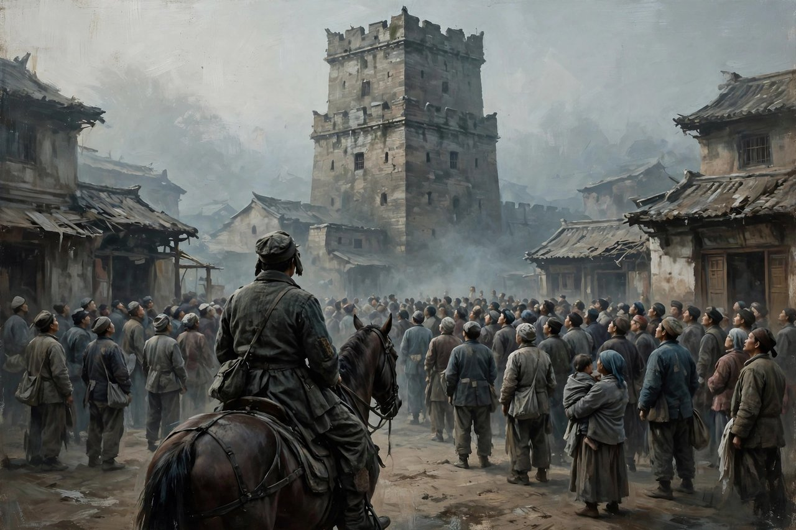

## 开篇：先把故事讲清楚

《让子弹飞》是姜文执导的电影，二零一零年十二月十六日上映，改编自马识途《夜谭十记》里的《盗官记》，主演是姜文、周润发、葛优、刘嘉玲、陈坤。内地票房六点五九亿，首周一点七亿，打破了当时的国产片首周纪录，十一天就拿了四个亿。故事背景放在一九二零年北洋年间的南方，虚构了一个叫鹅城的地方。

故事的开头就够荒诞。一列马拉的火车，吃着火锅唱着歌，花钱买了县长官职的马邦德正要去鹅城上任。半路杀出一伙麻匪，头领叫张麻子。火车脱轨坠河，真正的汤师爷和护送的新军全死了。马邦德为了活命，谎称自己就是汤师爷。张麻子一听，计上心来：你不是懂当官的门道吗，那就跟我进城，我来当这个县长。

于是电影从第一分钟就立了规矩：这里的身份全是假的。县长是土匪冒充的，师爷是买官的县长冒充的。真假一开始就乱了套，后面所有的戏，都是在这个乱套的基础上往下演。

张麻子进了鹅城，撞上本地的土皇帝黄四郎。黄四郎有碉楼，有钱，有枪，有替身。县长想收税，黄四郎想保住自己的地盘，百姓夹在中间，大气不敢出。张麻子说了一句全片最有名的话：我是想站着，还把钱挣了。这句话，就是整部电影的魂。

## 鹅城的三方分赃：官、匪、绅

鹅城的权力结构，汤师爷一句话就讲透了。马邦德冒充的汤师爷给张麻子传授县长经：县长上任，得巧立名目，拉拢豪绅，缴税捐款。他们交了，才能让百姓跟着交钱。得钱之后，豪绅的钱如数奉还。百姓的钱三七分成。

你品品这个分赃链条。县长要钱，豪绅要权，百姓出钱。豪绅先交钱，是做样子，事后如数奉还，一分不少。百姓跟着交的钱，才是真金白银，三七分账，县长拿三成，豪绅拿七成，还是百姓买单。所谓收税，根本不是取之于民用之于民，而是官和绅合伙，从百姓口袋里掏钱，再分掉。

更狠的是，前任县长已经把税预征到九十年后了。汤师爷一算账，苦笑着说：不好，我们来晚了，前任县长已经把税预征到九十年后了，都到二零一零年了。税收到九十年之后，这是什么概念？就是把子孙后代的钱都提前花光了。透支未来，古已有之，今天听着也不陌生。

张麻子不想按这个规矩玩。他要发钱给百姓，要让百姓站起来，要剿黄四郎的匪——其实黄四郎自己就是最大的匪。县长和豪绅的斗争，表面上是剿匪，实际上是分赃不均。张麻子要的不是换个县长继续分赃，他要的是把桌子掀了。

## 张麻子：土匪的名字叫牧之

张麻子这个人物，最妙的是他的名字。人们不愿意相信一个土匪的名字叫牧之，人们更愿意相信叫麻子，人们特别愿意相信，他的脸上应该他妈长着麻子。这句台词，把偏见讲透了：人只愿意相信自己想象中的样子。土匪就该满脸麻子，县长就该道貌岸然，名字和脸，都得符合刻板印象，否则大家不接受。

张麻子原名张牧之。牧之，是个读书人的名字。他当土匪的理由，电影里一句话就交代了：我就是腿脚不利索，跪不下去。汤师爷问他，那你是想站着，还是想挣钱啊？他说，我是想站着，还把钱挣了。

这句话为什么能流传十五年？因为它戳中了所有打工人的膝盖。挣钱和站着，在鹅城是二选一。你想挣钱，就得跪着，跪豪绅，跪规矩，跪分赃链条。你想站着，就别想挣钱，站着的人分不到钱。张麻子偏要两者都要，这就是他跟所有人都不一样的地方。

但张麻子不是圣人。他也要钱，也要女人，也讲兄弟义气，也会耍心眼。他不是来当清官的，他是来砸场子的。他的公平，不是圣人的公平，是土匪的公平：我拿枪指着你，你就得跟我讲公平。这一点，电影一点没美化他。张麻子的公平，是靠枪撑起来的。枪一放下，公平就没了。这也是电影最诚实的地方：它没有假装公平可以凭空存在。

## 汤师爷：最懂规则的人

汤师爷这个人物，分两层看。真汤师爷开场就死了，死在劫火车的那场戏里。活下来的汤师爷，是马邦德冒充的。马邦德花钱买官，本想去鹅城捞一笔，结果官没当成，成了土匪的师爷。他一辈子都在钻营，买官、攀附、见风使舵，样样精通。

马邦德冒充的汤师爷，是全片最懂规则的人。他懂分赃，懂拉拢，懂什么时候该跪，什么时候该跑。他的生存哲学就是：别跟赢家作对，跟着赢家分钱。他劝张麻子别跟黄四郎硬碰硬，劝张麻子拿钱走人，劝张麻子别为了百姓搭上自己。他说的每一句话，从个人保命的角度看，全是对的。

可他最后还是死了。马邦德得知妻小遇难，驾着马车想回山西，被黄四郎预先埋下的地雷炸死。临死前，他把多张县长委任状赠给张麻子，还有两个秘密没来得及说出口。最懂规则的人，死在规则手里。规则从来不保护懂规则的人，规则只保护制定规则的人。马邦德一辈子都在别人的规则里找缝隙，最后发现，缝隙也是别人留给他的陷阱。

## 黄四郎：躲在替身后面的人

黄四郎是鹅城真正的皇帝。他不住县衙，住碉楼。碉楼高高在上，墙厚枪多，易守难攻。百姓在碉楼下面仰头看，黄四郎在碉楼上面俯视百姓。碉楼这个意象，电影用得极准：权力从来不住在平地上，权力住在高处，住在墙后面，住在普通人够不着的地方。

黄四郎最厉害的本事，是替身。他有个替身杨万楼，长得跟他一模一样。张麻子想杀黄四郎，杀到的永远是替身。替身死了，真身还在。真身死了，还有没有下一个替身，谁也不知道。替身政治的精髓就在这里：责任永远找不到真人。出了事，死的是替身，活的是本尊。本尊永远有退路，永远有白手套，永远躲在墙后面。

黄四郎的结局，是自己引爆地雷自杀。张麻子攻进碉楼，给了他一把枪，他抛出说要送给张麻子的帽子，然后引爆了地雷，把黄府给炸了。黄四郎死没死透？电影结尾留了个钩子：片尾的火车上，车尾出现一个白袍身影，不知是黄四郎还是马邦德。张麻子骑着白马追火车，电影就这么结束了。

这个结尾，是全片最狠的一笔。黄四郎这个人可能死了，但黄四郎这个位置没死。碉楼炸了，位置还在。只要位置还在，就会长出新的黄四郎。火车尾的白袍身影，就是在说：旧势力会借尸还魂，会换个身份重新上车。你以为你赢了，其实人家只是换了个座位。

## 六子：一碗凉粉的荒诞

六子之死，是全片最让人难受的一段，也是最荒诞的一段。黄四郎指派武智冲、胡万、孙守义陷害六子，说六子吃了两碗凉粉只给了一碗的钱。六子不服，胡万步步紧逼，话赶话赶到绝路上，六子为了自证清白，剖开自己的肚子，证明腹中确实只有一碗凉粉。证明成功了，人也死了。围观群众一看事情闹大了，迅速散去。胡万笑着说，他早就知道六子只吃了一碗，六子是上了当。

这段戏荒诞在哪？荒诞在自证这个行为本身。六子要证明的，是一件本来不需要证明的事：他吃了几碗粉。可一旦有人指控他，一旦围观的人开始起哄，一旦公平两个字被喊出来，他就退无可退了。他给再多的钱都没用，因为在围观者眼里，他给钱就是心虚，就是被迫的。他不给钱，就是仗势欺人。他说什么都是错的，只剩下一条路：剖开肚子。

自证的陷阱就在这里：自证的前提，是默认指控有道理。你一开始自证，就等于承认了对方有资格审问你。而审问你的人，根本不在乎真相。胡万在乎的不是六子吃了几碗粉，他在乎的是借六子打张麻子的脸，借公平两个字，拆县长的台。六子的肚子剖开了，真相大白了，可真相大白之后呢？没有人在乎。群众散了，胡万笑了，六子死了。真相赢了，人输了。

## 百姓：谁赢他们帮谁

鹅城的百姓，是全片最真实的一群人，也是最让人五味杂陈的一群人。张麻子发钱给他们，他们不敢捡。张麻子让他们拿枪攻碉楼，他们不敢动。直到张麻子抬出黄四郎的替身游街斩首示众，百姓以为黄四郎真的死了，自己不会遭到报复，才纷纷举枪追随张麻子，把黄府攻陷。

百姓的逻辑，一点都不难理解。谁赢他们帮谁。这不是道德问题，这是生存问题。黄四郎在的时候，帮张麻子就是找死。黄四郎死了，帮张麻子就是分胜利果实。百姓不是不想站起来，百姓是怕站起来之后没人撑腰，最先倒下的是自己。枪打出头鸟，出头椽子先烂，这个道理，鹅城的百姓比谁都懂。

张麻子最大的困境就在这里。他想发动百姓，可百姓只在胜利之后才出现。他想让百姓站起来，可百姓站起来的前提，是他先把黄四郎打倒。而他打倒黄四郎，又需要百姓帮忙。这是个死循环。革命的经典困境，电影用鹅城讲得明明白白：没有群众，革命赢不了；没有胜利，群众不跟你。张麻子破局的办法，是用替身斩首制造黄四郎已死的假象，让百姓以为胜利已经来了，百姓这才敢动手。说白了，百姓帮的不是张麻子，帮的是胜利本身。

## 现实对照：鹅城照见今天

电影是虚构的，鹅城是虚构的，可鹅城里每一出戏，都能在今天找到对照。这不是巧合，这是姜文厉害的地方：他拍的不是一九二零年，他拍的是人性里一直没变的那部分。

买官与寻租，古今同款。马邦德花钱买官，今天叫权力寻租，叫花钱买路，叫用资源换位置。税预征到九十年后，叫透支未来，叫把子孙后代的钱提前花光。分赃链条换了个名字，逻辑没变：制定规则的人先分，执行规则的人后分，买单的人永远是沉默的大多数。

鸿门宴与饭局政治，同款也一直在上演。黄四郎请张麻子吃饭，根本不是吃饭，是划线，是试探，是交易。席上每一句话都是刀，散宴前送的两颗宝石是行贿，马邦德趁张麻子酒醉偷走宝石，是黑吃黑。今天的饭局、酒桌、谈判桌，逻辑一模一样：表面上吃吃喝喝，实际上摸底、站队、分利。饭局上谈成的事，会议室里谈不成。饭局上送出去的东西，发票上不会写。黄四郎的鸿门宴从来没有过时，它只是换了个地方，换了瓶酒，继续摆着。

自证清白，六子的困境今天到处都是。网络上被人指控，本能反应就是自证：贴聊天记录，贴转账截图，贴时间线。可自证的前提，是默认对方有资格审问你。你越自证，对方越来劲，围观的人越兴奋。最后真相大白了，围观的人早就散了，没人给你道歉，没人记得你曾经被冤枉过。六子剖开肚子证明只吃了一碗粉，今天的人剖开自己的生活证明清白，代价不一样，荒诞一模一样。

替身政治，今天叫白手套，叫临时工，叫责任外包。出了事，永远先推出一个替身顶罪。本尊躲在墙后面，换个身份重新上车。黄四郎的碉楼，今天不一定是砖头砌的，也可能是层层嵌套的公司架构，可能是永远找不到的实际控制人。墙的形式变了，墙的功能没变：让责任找不到真人。

沉默的大多数与站队，今天叫热点围观。每一个热点出来，都有人急着站队，急着表态，急着把事情定性。可张麻子早就说了：别急，让子弹飞一会儿。子弹刚出膛，你根本不知道它会打中谁。急着站队的人，往往站错队。等真相飞一会儿再看，很多人当初的义愤填膺，都会变成不好意思提的黑历史。让子弹飞一会儿，不是和稀泥，是给真相留出飞行的时间。

站着挣钱，是所有打工人膝盖的痛。张麻子有枪，所以他能站着挣钱。普通人有什么？普通人只有一份工作，一个月的房租，一家老小的开销。跪着挣钱不是选择，是生计。这才是电影最扎心的地方：它喊出了所有人都想喊的话，可喊完之后，观众走出电影院，还是得回去跪着挣钱。张麻子能站着，是因为他有枪。普通人想站着，得先问问自己手里有什么。这不是电影的错，这是现实的骨感。

黄四郎死了还有下一个，是电影留给现实最冷的一盆水。反腐如果只反人，不反结构，杀了一个黄四郎，碉楼还在，位置还在，下一个黄四郎迟早会长出来。火车尾的白袍身影，就是在提醒观众：别急着庆祝胜利，旧势力最擅长的，就是借尸还魂。

## 结尾：为什么十五年后还在聊

《让子弹飞》上映十五年了，还在被一遍遍解读，还在出新的梗，还在被拿出来对照现实。为什么？因为它不是一部给答案的电影，它是一面镜子。镜子不会告诉你该怎么办，镜子只会照出你现在的样子。

姜文说过，导演永远在拍自己的内心。这部电影里，姜文把自己对公平、对权力、对百姓、对革命的全部困惑，都拍进去了。他没有假装自己有答案。张麻子赢了黄四郎，可兄弟们都走了，老二死了，六子死了，夫人死了，马邦德死了。胜利的代价，是身边的人一个个离开。片尾张麻子独自骑着白马，追着载着兄弟们的火车，追得上吗？电影没给答案。追不上，才是常态。理想主义者最后的姿势，往往就是一个人骑着马，追着一列已经开走的火车。

鹅城没有赢家。张麻子赢了战斗，输了同伴。黄四郎输了性命，赢了位置——他的位置还在火车上。百姓赢了分钱，输了六子。每一个人都有得有失，每一个人都不干净。这就是这部电影最诚实的地方：它不给你英雄，不给你圣人，不给你大团圆。它给你一座鹅城，让你自己照镜子。

十五年过去，鹅城还在。碉楼还在，替身还在，沉默的大多数还在，税预征到九十年后的账单还在。唯一变了的，是看电影的人。刚看的时候笑台词，看懂之后笑荒诞，等到笑不出来的时候，才算真看懂了。因为你发现，鹅城不是一九二零年的南方，鹅城就是你每天生活的世界。而张麻子那句话，依然是所有人想说又不敢说的话：我是想站着，还把钱挣了。
