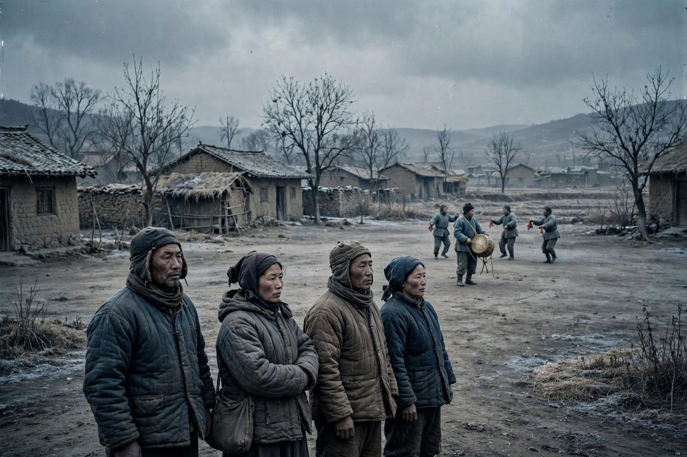
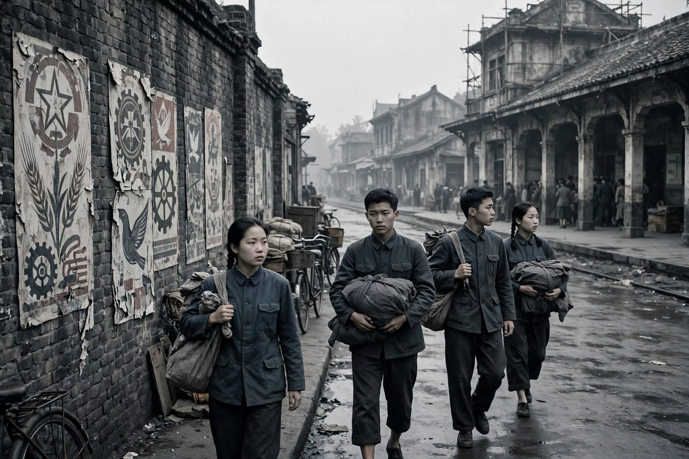

11月13日，有网友发现，张爱玲的两部长篇小说《秧歌》和《赤地之恋》，在豆瓣上找不到了。搜书名，没有结果；点开以前收藏的链接，页面只剩一句话：这个页面不在了。

下架之前，《秧歌》在豆瓣上有9.4分，1837个人打过分；《赤地之恋》8.5分，783个人打过分。分数、书评、摘录、想读在读读过的标记，一夜之间全没了。豆瓣没有发任何公告，没有给任何理由。一本书在最大的中文读书社区里消失，就是这么安静，安静到如果不是网友偶然发现，可能都没人知道它曾经在那儿。

## 这两本书，写的是什么

先说这两本书写了什么。《秧歌》写的是1951年年底，上海附近一个村子里，农民金根一家在新年前一两个月的日子。土改刚过，村里敲锣打鼓扭秧歌，庆祝翻身得解放，可地里没粮，锅里没米，人饿得站不稳。胡适1955年给张爱玲写信，说这本书"从头到尾，写的是『饥饿』……真有『平淡而近自然』的细致功夫"。

《赤地之恋》写的是一个大学毕业生刘荃，分配到农村当干部，经历土改，回到上海赶上三反，再被卷进抗美援朝。整本书分三段，农村、城市、朝鲜前线，写的全是新政权建立头几年里，一个普通人怎么被时代碾过去。

这两本书都是1954年在香港《今日世界》上连载的。张爱玲1952年离开大陆，在香港给美国新闻处做翻译，夜里通宵写这两本书。美国新闻处一份稿子给两千四百港币，是当时正常稿费的六倍。后来学界考证得很清楚，这两本书是美国新闻处译书计划里的委托之作，是冷战时期反共文宣的一部分。《秧歌》一开始是张爱玲自己动笔写的，写到一半被纳入计划；《赤地之恋》更直接，是按别人拟好的大纲接续写成的。

张爱玲写这两本书，不是凭空想象。1950年，夏衍安排她跟着上海文艺代表团去苏北农村参加土改，她在村里住过，看过土改是怎么进行的。据夏衍后来回忆，1949年周恩来点名要把她留在上海，她留下了，写了《十八春》，又待了三年，1952年走了。这一走，就再也没回来。

这两本书在文学上什么地位？夏志清在《中国现代小说史》里给了极高的评价，认为张爱玲写这两本书的成就了不起。反对的人也有，柯灵当年就骂，情节不实，"描写的人、事、情、境，全都似是而非"。一本书同时被捧上天和踩进地，恰恰说明它写到了痛处。

## 为什么偏偏是这两本

张爱玲写了那么多书，《金锁记》《倾城之恋》《半生缘》在大陆到处都是，为什么偏偏是《秧歌》和《赤地之恋》不能留？

因为这两本是她作品里仅有的两部政治小说。别的书写男女、写家庭、写人性，这两本写的是土改、饥饿、三反、抗美援朝，写的是新政权头几年的阴暗面。更要命的是它们的出身，美国新闻处出钱、冷战文宣体系里出来的，头上顶着"反共文学"四个字。这个标签一旦钉死，文学价值多高都没用，9.4分也保不住。

还有一层更现实的原因：这两本书从来就没有在大陆正式出版过。学者陈子善2020年说过，"中国大陆至今没有出版她被视为反共小说的《秧歌》和《赤地之恋》"。大陆出过好几种《张爱玲全集》，没有一种收这两本。唯一的一次例外是1996年，大连出版社出16卷本《张爱玲全集》，把这两本偷偷收进去了，书一出来就被查禁，印了一万册，真正流到市面上的没几本。

一本书，七十年没能在大陆出版，词条在豆瓣上挂了几年，现在连词条也没了。这不是什么新政策，是老规矩的延续。只不过以前是"不许出书"，现在是"不许讨论"。

## 为什么是现在

时间点上，有一件事值得一提。柴静不久前在YouTube上讲了一期张爱玲，讲1949年周恩来为什么没留住她，讲她在新政权下的处境，还公开了一段张爱玲的录音。视频出来没多久，这两本书就从豆瓣消失了。

这两件事有没有因果关系？没人证实得了。豆瓣不会说，柴静不会说，官方更不会说。但网友都看得见这个时间线。平台对热度最敏感，一本书平时安安静静待在角落里没人管，一旦有人讲它、有人搜它、有人讨论它，风险就来了。最省事的处理办法，就是让它消失。

当然，也可以说，不需要什么导火索。这种书在今天的架子上，本来就是借住的，迟早的事。热度只是让"迟早"变成了"现在"。

## 下架这件事，说明了什么

一本书被下架，本身不可怕。可怕的是下架的方式：没有文件，没有公告，没有理由，没有申诉的入口。页面上只剩"这个页面不在了"，好像这本书从来就没存在过。正式的查禁至少还留一个"被禁"的记录，可以讨论，可以反对，可以记住。静默删除连"被禁"这个事实都不留，只留一片空白。空白是没法反驳的。

再一个，经典没有豁免权。张爱玲是大陆最畅销的现代作家之一，她的书印了一版又一版，她的金句满天飞。但一本书只要踩了线，作者的名气、读者的评分、文学史的地位，全都保不住它。9.4分，1837个人打分，在删除面前就是一个数字，清零只需要一秒钟。

删掉的也不只是书。书本身在台湾照常出版，想看的人总有办法弄到，网上也到处都是电子版。豆瓣删掉的，是围绕这两本书形成的公共记忆：评分、书评、摘录、讨论。一本书在豆瓣上消失，等于在大陆的公共阅读空间里消失。以后再有人想了解《秧歌》，搜到的只有一片空白，好像这本书从来没人读过。

吊诡的是，下架本身成了新闻。词条安安静静待着的时候，只有读过的人知道它；一删，全网都知道了。想让人忘记一本书，最好的办法就是别碰它。一碰，所有人都想起来了，都去找，都去问，都去传。这大概是删书的人没算到的一笔账。

说到底，这件事划出了一条线：土改、饥饿、三反、抗美援朝，这些词在今天只能有一种写法。张爱玲写的是另一种写法，而且写得太好，好到七十年后还有人给它打9.4分。写得好，本身就是问题。一本书写得越好，越能让人记住另一种说法，越不能留。

本站之前写过这两本书的专文，《秧歌》和《赤地之恋》各一篇，分析得都很细：[《秧歌》：月香和金根，饿肚子的人没有爱情](https://blog.8818618.xyz/p/yangge-zhangailing/)、[《赤地之恋》](https://blog.8818618.xyz/p/chidi-zhilian/)。豆瓣的词条可以消失，书不会。评分可以清零，读过的人记得。
