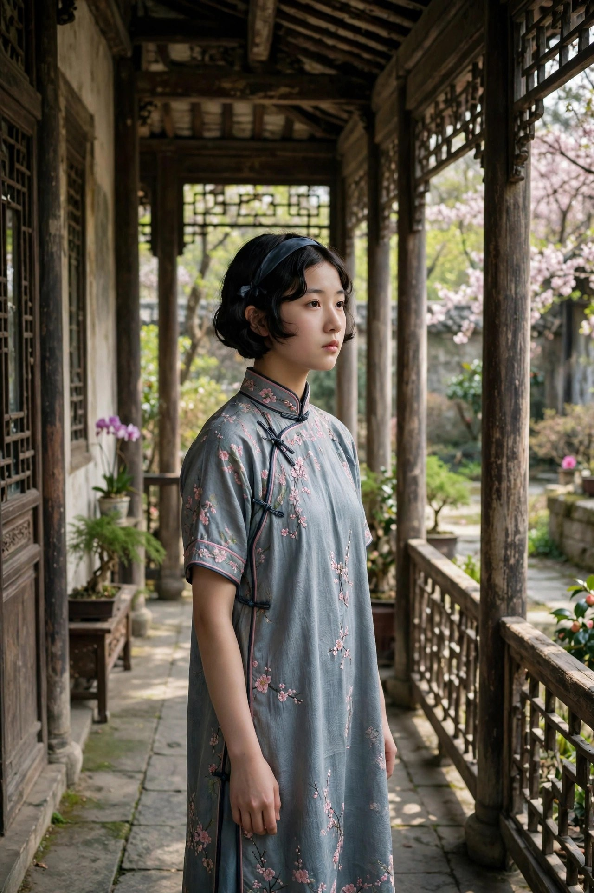

《春》是一九三八年由开明书店出版的长篇小说，是激流三部曲的中间一部，上承《家》的悲剧，下启《秋》的崩塌。书里的时间过去了，高公馆的灯火还在，可灯火底下的人心已经变了：觉慧走了，留下的人还在熬，熬出了一点新的盼望，也熬出了新的悲剧。这本书的主线，是三房姑娘淑英怎样从害怕到坚定、从想死到想活、从困在宅子里到奔向上海的故事。淑英的出走，是《春》里最亮的一笔，也是巴金给青年读者的一句鼓励：春天不是等来的，是自己推开门走出去的，门外纵然有风有雨，也比闷死在屋里强。这篇文章就顺着淑英的路，把《春》里的人和事讲清楚，也讲讲它跟今天的关系。

### 淑英面前的婚事

淑英是高家三房的女儿，年轻，聪慧，读过新书，心里有自己的想法，可她的婚事照样由父亲做主。父亲要把她许配给品行不端的纨绔子弟，对方游手好闲，名声很坏，淑英一听就心里发凉。她不是不知道反抗的代价，她见过鸣凤的死，见过梅芬的死，见过瑞珏的死，知道在这个家里，姑娘说不的代价可能就是命。可她也不愿意就这样认命，把自己的一辈子交给一个不值得托付的人，关进另一座宅子里熬到老死。淑英的害怕是真实的，她的犹豫也是真实的，她曾经想过效仿鸣凤去死，觉得死了就干净了，就不用再面对这桩婚事了。这种念头，放在今天看，会让人心疼：一个姑娘被逼到想用死来解决问题，说明她面前的路已经被堵死了，堵死她的不是一个人，是整套把姑娘当成物件的规矩。

淑英的处境，比《家》里的姑娘更复杂的地方在于，她身边有了榜样，也有了帮手。觉慧已经出走了，觉民已经抗婚成功了，琴已经在外面读书、参加运动了，这些例子摆在面前，让淑英知道，出走不是传说，是有人真的走通过的路。同时，淑英自己也在学本事：她跟着淑华学划船，向淑英借阅翻译小说，在琴的引导下一点点开眼界，一点点明白，外面的世界不是书上的空话，是真实存在的，是可以去的。巴金写淑英的成长，写得很细，不是让她一下子变成女英雄，而是让她在害怕里慢慢攒勇气，在读书里慢慢长见识，在跟姐妹的谈话里慢慢想清楚，自己到底要什么。这种慢，恰恰是真实的成长的样子：勇气不是天上掉下来的，是在小事上一点点练出来的，是在每一次小的选择里，把自己往前推一点，推到最后，就推开了那扇大门。

淑英的父亲代表的是高公馆里最顽固的那股力量：父权至上，说一不二，女儿的意愿不值一提。他觉得把女儿嫁出去就是尽了父亲的责任，嫁给什么人并不重要，重要的是门当户对，是体面，是家里的规矩不能破。这种父亲在今天也不少见，只是换了说法：有的父亲用彩礼衡量女婿，用房子衡量婚姻，用稳定衡量幸福，女儿说喜欢一个人，父亲先问对方家里有没有钱、有没有房、有没有编制，喜欢本身反而不重要。淑英的故事提醒今天的父母，嫁女儿不是交差，女儿的人生不是父亲的面子工程，把女儿推进一桩她不愿意的婚姻，等于亲手把她推进火坑。淑英最后没有认命，她的出走，是对这种父权最直接的回答：我的命，我自己说了算。

### 蕙的葬礼

蕙是《春》里另一个让人心碎的人物。她是觉新的表妹，聪明美丽，本来有大好年华，却同样落入婚姻制度的牢笼，被许给荒淫的人家。婚后她过得不幸，很快患病，婆家不肯请西医医治，耽误了病情，她就这样默默死去。蕙的死，跟梅芬的死、瑞珏的死连成了一串：高公馆里的姑娘，一个接一个地死，死法不同，死因却相同，都是被包办婚姻、被礼教、被婆家的冷漠和娘家的无力，一点点逼到绝路上的。蕙死后，觉新心里受到了很大的刺激，他在蕙身上看到了梅芬和瑞珏的影子，看到了自己一次次顺从换来的结局。他开始明白，自己如果继续作揖，继续当和事佬，淑英就是下一个蕙，下一个瑞珏，下一个梅芬。

蕙和觉新之间，还有一段含蓄的感情。觉新在蕙身上，重新燃起了一点对生活的希冀，觉得这个姑娘的聪慧和温柔，像一道光，照进了他已经灰暗的生活。可这道光很快就灭了，蕙成了传统旧制度的牺牲者，觉新既无法挽回这条青春的葬礼，也没有能力改变淑英的未来，除非他自己先改变。巴金写蕙和觉新的关系，写得很克制，没有写成俗套的三角恋，而是写成一种映照：蕙的死，照出了觉新的懦弱，也照出了觉新心里还没有完全熄灭的良心。一个还有良心的人，看到身边的人一个个死去，不可能永远无动于衷，蕙的死，就是压垮觉新顺从心理的一根稻草，让他从旁观者变成了支持者，从作揖的人变成了帮淑英出走的人。

蕙的葬礼场景，巴金写得细致而悲凉。众人送她最后一程，轿子里带走的不光是几枝桂花，还有几个少女的爱和同情，还有觉新的一颗心。桂花这个意象，在《春》里反复出现，香，清，短暂，像蕙的一生，也像高公馆里所有姑娘的青春：开得好看，谢得很快，没有人真正珍惜过。读者读到这里，会明白巴金为什么要花那么多笔墨写蕙：蕙不是淑英故事的陪衬，她是淑英出走的理由，是觉新醒悟的契机，是整本书里最沉痛的警示。放在今天，蕙的故事依然有对照：那些因为婆家迷信、因为娘家不敢撑腰、因为所谓家丑不可外扬而耽误了治病、耽误了求救的姑娘，换了个年代，依然存在。蕙的死提醒所有人，姑娘的命不是可以耽误的东西，拖延、迷信、体面，都可能变成杀人的帮凶。

### 觉新的转变

觉新在《春》里的变化，是这本书最值得细看的线。他在《家》里是作揖主义的代表，到了《春》里，他经历了丧子之痛：他唯一的儿子因脑膜炎离世，这对他的打击极大，让他对生活更加没有信心，也让他开始重新想，自己一辈子的顺从到底换来了什么。儿子死了，妻子死了，表妹死了，爱过的人死了，身边的人一个个走，他守住的高公馆的体面，到底守住了什么。这个问题，觉新在《春》里反复问自己，问得越多，他心里的裂缝就越大。他不再像以前那样，一味地劝弟弟妹妹忍耐，他开始在心里站在弟弟妹妹那一边，开始觉得，觉民抗婚是对的，觉慧出走是对的，淑英想走也是对的。

觉新的转变不是一下子完成的，巴金写得很耐心。觉新受尽长辈的闲话，对人生本不太抱有方向，可蕙的出现和蕙的死，让他心里那点火苗重新燃起来，又很快被现实浇灭。他帮不上蕙，救不了淑英，这种无力感让他痛苦，也让他清醒：原来光靠良心发现是不够的，光靠心里同情也是不够的，必须要行动，必须要站在年轻人那一边，帮他们把路走通。到了《春》的后半段，觉新开始支持觉民和琴的计划，开始为淑英的出走打掩护，开始在长辈面前装糊涂、拖时间。这些小动作，看起来不起眼，对觉新来说却是翻天覆地的变化：一个一辈子作揖的人，开始学会说谎、学会拖延、学会暗中帮忙，这说明他的心已经不在高公馆的规矩那一边了，而在年轻人那一边了。

觉新的转变，对今天的读者有很大的启发。很多中年人都像觉新：年轻时有过理想，中年时被生活磨平了，成了家里的和事佬，单位里的老好人，习惯了忍，习惯了劝别人也忍。可当身边的人因为忍而出事的时候，他们心里也会疼，也会问自己，是不是该换一种活法。觉新的故事告诉他们，醒悟不分早晚，只要还愿意帮年轻人一把，只要还愿意在关键时刻站在对的一边，就不算太迟。他最后帮助淑英出走，等于把自己年轻时没有走成的路，交到了淑英手里，让淑英替他走下去。这种交接，是《春》里最温情、也最有力量的一笔：上一代人的遗憾，可以变成下一代人的勇气，只要上一代人肯承认自己的错，肯松手，肯帮忙。

### 琴的引路

琴在《春》里的作用，是引路人。她像一位长姐那样，暗暗地指导淑英、淑华这些姑娘，爱护她们，带着她们读书，带着她们看世界，带着她们参加学生运动。琴的到来，常常像朝阳一样，光明了这些忧愁的青年男女。她不是用大道理压人，而是用自己的生活做榜样：她读书，她独立，她敢爱敢恨，她敢跟长辈讲道理，她敢在关键时刻站出来。这种榜样的力量，比任何说教都强。淑英、淑华、芸这些姑娘，本来都为自己的前途暗淡而几乎放弃了希望，可一见到琴，就觉得生活还有另一种可能：姑娘不一定非要嫁人，不一定非要困在宅子里，也可以读书，也可以工作，也可以自己选择人生。

琴和觉民的感情，在《春》里继续发展，他们一起参加学生运动，一起策划帮助淑英出走，一起在高公馆的压抑里，守住一点新生活的火种。他们的爱情，不是风花雪月，是并肩作战的爱情：两个人有共同的信念，有共同的目标，愿意一起扛事，一起冒险。这种爱情，跟觉新和梅芬那种被拆散的爱情形成对照，也跟蕙那种被牺牲的爱情形成对照。巴金写琴和觉民，是想告诉读者，好的爱情不是互相消耗，是互相成全，是两个人一起变得更勇敢、更清醒、更有力量。放在今天，这句话依然成立：一段好的关系，应当是让彼此都能长大，而不是让一个人为另一个人牺牲全部人生。

琴对淑英的帮助，具体而耐心。她教淑英读书，教她思考，教她怎样在长辈面前保护自己，教她怎样在出走之前做好准备。她没有催淑英立刻出走，而是等淑英自己想清楚，等淑英自己下决心。这种耐心很重要：真正的帮助，不是替别人做决定，是帮别人长出做决定的能力。淑英最后能够出走，离不开琴的引导，也离不开她自己的成长。琴的形象，在今天的女性互助里依然有影子：一个走出来的女性，拉着后面的姐妹一起走，不嘲笑她们的害怕，不催促她们的脚步，就是陪着，就是引导，就是在关键时刻推一把。这种拉一把的力量，常常能改变一个人的一生。

### 淑英的出走

淑英的出走，是《春》的高潮，也是全书的题眼。出走之前，她经历了漫长的挣扎：她害怕父亲的怒火，害怕长辈的责骂，害怕外面的世界不像想象中那么好，害怕自己到了上海会无依无靠。她甚至想过死，觉得死了就不用再挣扎了。可在觉民、琴、觉慧等人的鼓励下，她逐渐变得坚强起来，逐渐明白，死不是解脱，活着走出去才是解脱。出走的那一天，她的心是抖的，脚步却是坚定的。她告别了高公馆，告别了从小长大的宅子，告别了那些疼她也压她的长辈，奔向上海，去找觉慧，去找新的生活。这个背影，跟觉慧当年的背影叠在了一起，成了激流三部曲里最动人的画面：一个青年走了，又一个青年走了，春天就是这样，一个人一个人走出来的。

出走的过程，巴金写得紧张而细致。觉民和琴联手策划，安排路线，安排接应，安排怎样瞒过长辈，怎样在关键时刻不露馅。觉新在暗中帮忙，他虽然表面上还是那个顺从的长孙，可心里已经站到了淑英那一边，他用自己的方式，为淑英的出走争取时间。这种全家人心照不宣的配合，说明高公馆内部已经不是铁板一块了，年轻人的力量已经渗透进来了，连觉新这样的人都开始倒戈了。淑英到了上海以后，给家里写来信，信中倾吐了她获得自由后的幸福。这封信，是《春》结尾最亮的光：它证明出走不是毁灭，是新生，证明上海不是传说中的洪水猛兽，是真实存在的、可以安身的地方，证明姑娘的人生，真的可以自己说了算。

淑英的出走，放在今天看，依然有现实意义。今天的出走，不一定是离家出走，也可以是离开一段消耗自己的关系，离开一个压抑自己的环境，离开一种一眼看到头的生活。出走需要勇气，也需要准备：淑英出走之前，是读过书的，是有人接应的，是有目标的，不是盲目逃跑。今天的年轻人想换一种活法，同样需要准备：学一门本事，攒一点积蓄，找几个靠谱的朋友，想清楚自己到底要什么，再迈步。盲目出走容易碰壁，有准备的出走才能走得远。巴金写淑英，不是教人赌气出走，是教人清醒出走：想清楚了，准备好了，就走，不要被害怕拖住，不要被体面绑住，不要把一辈子交给别人的安排。

### 高公馆的暮气

《春》里的高公馆，比《家》里的高公馆更暮气沉沉。叔叔们犹如放荡浪子，嫖妓娶妾又挥霍无度，并且和女仆有暧昧关系；妯娌之间勾心斗角，时有勃谿，争吵打闹已是常态；大宅院呈现一种暮气沉沉的感觉，好像一座房子已经老了，墙皮在掉，梁柱在朽，只剩一个空架子在硬撑。巴金写这些，不是为了猎奇，是为了说明，高公馆的衰落不是从外面打进来的，是从内部烂掉的。长辈们自己不争气，子孙们有样学样，规矩还在，里子早就空了。一个靠体面撑着的家，体面越讲，里子越空，空到最后，连体面都撑不住了。

这种暮气，跟年轻人的朝气形成了鲜明的对照。淑英、淑华、芸、剑云这些年轻人，虽然为自己的前途暗淡而几乎放弃希望，可他们心里还有火，还有读书的劲，还有互相扶持的情谊。他们在园子里划船，在屋子里读书，在琴的引导下谈论外面的世界，这些场景，写得清新、明亮，跟高公馆的暮气完全是两种气息。巴金用这种对照告诉读者，新旧交替，不是靠喊口号喊来的，是靠年轻人的生活方式一点点顶出来的。老的一辈再顽固，也挡不住年轻人读书、交朋友、想问题，挡不住他们心里长出新的盼望。暮气再重，也压不住春天，因为春天不是高公馆给的，是年轻人自己带来的。

高公馆的暮气，在今天也有对照。有的家庭、有的单位、有的圈子，表面上规矩齐全，实际上暮气沉沉：老人讲资历，新人不敢说话；领导讲体面，下属不敢提意见；家里讲规矩，孩子不敢讲真话。暮气最怕的，就是有人带来新气：一个敢读书的年轻人，一个敢提问题的员工，一个敢说不的孩子，都能把暮气撕开一个口子。巴金写《春》，就是写这个口子是怎样被撕开的：不是靠一个人单打独斗，是靠一群年轻人一起读书、一起运动、一起互相打气，把口子越撕越大，撕到春天真的进来为止。

### 淑华与芸的成长

淑英的故事不是孤立的，她身边还有淑华、芸这些姑娘，她们的成长，构成了《春》里另一条温暖的线。淑华是三房的姑娘，性格活泼，思想也比较不受旧制度束缚，她跟着琴读书，跟着淑英划船，在园子里说笑，在屋子里谈论外面的世界。她的成长没有淑英那样惊心动魄，却同样真实：一个姑娘从只知道听话，到开始想问题，到开始敢说话，到开始帮姐妹出主意，这个过程本身就是春天的一部分。巴金写淑华，写得轻松明亮，像春日里的阳光，照在园子里，照在姑娘们的笑脸上，让人觉得，高公馆再暮气，也挡不住年轻人的笑声。

芸是更小的一个姑娘，她跟着淑华学习划船，又向淑英借阅翻译小说，常常天真地笑着，她的笑容甚至引起了淑贞嘴边的微笑。芸的笑，在《春》里是一个很动人的细节：一个小姑娘的笑，能让一个长期压抑的姑娘也跟着笑，这说明希望是有传染性的。巴金写芸，不是为了凑人数，是为了说明，春天不是从大人物那里开始的，是从最小、最不起眼的人心里开始的。一个小姑娘开始读书，开始笑，开始对未来有盼望，就是春天发芽的样子。今天的家长和老师，应当从芸身上学到一点：不要小看孩子的笑，不要小看孩子读的一本书，不要小看孩子交的一个朋友，这些小事，都是他们心里春天的种子，种子需要的是阳光和耐心，不是压制和责骂。

淑华和芸的成长，还说明了一个道理：改变不是一个人单打独斗的事，是一群人互相带动的事。淑英出走，离不开淑华的陪伴，离不开芸的笑声，离不开琴的引导，离不开觉民的策划，离不开觉新的暗中帮忙。一个人的勇气是有限的，一群人的勇气是可以互相借的。今天的年轻人想改变自己的生活，也常常需要同路人：几个朋友一起读书，一起跑步，一起换工作，一起创业，互相打气，互相兜底，路就好走得多。巴金写《春》，写的不光是淑英一个人，写的是高公馆里一群年轻人怎样互相拉着，往春天里走。这种群像，比单个人物的出走更有力量，因为它告诉读者，你不是一个人在战斗，你的身边，总有人愿意陪你走一段。

### 剑云的影子

剑云在《春》里，是一个让人惋惜的人物。他也是青年，也受过新思想的影响，也为自己的前途暗淡而几乎放弃希望，可他没有像觉民、淑英那样走出来，而是困在高公馆的暮气里，越陷越深。剑云的影子，提醒读者，不是所有年轻人都能够顺利出走的，有的人会被环境拖住，会被习惯拖住，会被自己的软弱拖住。巴金写剑云，不是为了批评他，是为了写出成长的另一种可能：有人走出去了，有人留下来了，留下来的人不一定是坏人，他们只是没有找到出路，或者没有勇气迈出那一步。写出这种复杂性，《春》才显得真实，才不像一本简单的励志书。

剑云的处境，跟觉新有点像，又不完全像。觉新是被长孙的身份绑住的，剑云是被自己的迷茫绑住的。他知道旧制度不对，可不知道新生活应该是什么样子，他想反抗，却找不到反抗的目标，想出走，却不知道出走以后去哪里。这种迷茫，在今天的年轻人身上也很常见：很多人知道现在的生活不对，知道工作不喜欢，知道关系不健康，可就是不知道该往哪里走，于是就在原地打转，打转久了，就变成了认命。巴金写剑云，是想告诉这些年轻人，迷茫不是罪过，是成长的必经阶段，关键是不要在迷茫里停太久，要像淑英那样，先读书，先交朋友，先找引路人，先把一个小目标定下来，再一步步往前走。迷茫的时候，最怕的是一个人闷着，最好的办法是找人聊聊，找书读读，找事做做，动起来，路才会显出来。

剑云的影子，还照出了高公馆对年轻人的另一种伤害：不是直接压死，而是慢慢磨掉。暮气沉沉的宅子，最擅长的就是磨人：每天重复同样的生活，每天听同样的训话，每天看同样的脸色，时间长了，人的棱角就被磨平了，人的梦想就被磨没了，人就变成了宅子的一部分。剑云就是被磨平的那一个。他的故事，是对所有年轻人的警告：不要在暮气里待太久，待久了，人会习惯暮气，会觉得暮气就是正常，会把出走的念头当成不切实际的幻想。保持清醒的办法，就是像琴、像淑英那样，不断给自己输入新的东西：新书，新朋友，新想法，新体验，让心里始终有一点活水，活水不干，人就不会被暮气完全淹没。

### 《春》的语言与气息

《春》的语言，跟《家》一脉相承，直白，滚烫，不绕弯子。巴金写园子里的划船，写得清新；写蕙的葬礼，写得悲凉；写淑英的挣扎，写得细腻；写长辈的吵闹，写得入木三分。他的语言不追求华丽的比喻，不追求拗口的句式，就是把事情说清楚，把情绪写到位。读者读起来不费劲，情绪却很容易被带进去：读到蕙死，会难过；读到淑英出走，会激动；读到觉新帮忙，会松一口气。这种语言风格，在今天依然值得写作者学：不要把简单的话写复杂，不要把真情写成套话，不要为了显得有学问而把读者挡在门外。写作的最高境界，有时候就是把话说清楚，把人写活。

《春》的气息，是明暗交织的。暗的是高公馆的暮气，是蕙的死，是长辈的堕落，是姑娘们面前的婚事；明的是园子里的笑声，是琴的到来，是淑英的读书，是年轻人互相扶持的情谊。明暗交织，才像真实的生活：生活从来不是全暗，也不是全明，是暗里透着光，光里带着影。巴金把握这种气息，把握得很准，他没有把高公馆写成地狱，也没有把年轻人的生活写成天堂，他写的是地狱里透进来的光，是天堂门口的风雨。读者在这种气息里，能感到希望，也能感到沉重，感到希望才不会绝望，感到沉重才不会轻飘。这种平衡，是《春》作为一部成熟小说的标志。

《春》的结构，也值得一说。它不靠离奇的情节取胜，靠的是人物的成长线：淑英从怕到不怕，觉新从忍到帮，蕙从活到死，琴从引路到并肩，几条线交织在一起，织成了一幅高公馆春天的图景。图景的中心，是淑英的出走，所有的线，最后都汇到这条线上：蕙的死推动了觉新，觉新的转变帮助了淑英，琴的引导成就了淑英，淑华和芸的陪伴温暖了淑英。这种结构，像一条河，支流众多，主流清晰，读起来不乱，有劲。今天的写作者写长篇，常常犯的毛病是线太多、主流不清，读完不知道到底要讲什么。巴金写《春》，给后来人做了一个示范：线可以多，但主流必须清楚，主流就是人物的成长，就是春天怎样一步步争来的。

### 园子里的笑声

《春》里的园子，是高公馆里少有的明亮地方。姑娘们在园子里划船，在园子里读书，在园子里说笑，在园子里谈论外面的世界，园子里的笑声，跟高公馆大厅里的训话声、吵闹声，完全是两种声音。笑声是年轻的，是自由的，是不受规矩束缚的，是姑娘们在压抑里，给自己留的一点喘气的空间。巴金写园子里的笑声，写得清新，写得明亮，写得让人心里一暖：原来高公馆再暮气，也挡不住年轻人的笑，原来姑娘们再压抑，也能在园子里笑出来，笑出来了，希望就还在，春天就还在。今天的年轻人，同样需要一个园子：一个可以笑、可以说真话、可以做自己的地方，这个地方，可以是一个朋友圈，可以是一个社团，可以是一个书房，可以是一个周末的公园，只要在那里，人能笑出来，能说真话，能做自己，园子就在，春天就在。

园子里的笑声，还说明了一个道理：改变不是从大厅里开始的，是从园子里开始的。大厅是长辈的地盘，讲的是规矩，讲的是体面，讲的是服从；园子是年轻人的地盘，讲的是读书，讲的是朋友，讲的是未来。年轻人先在园子里长出新的想法，长出新的勇气，长出新的朋友，再把园子里的想法，带到大厅里去，带到家里去，带到社会上去，大厅才会被改变，家才会被改变，社会才会被改变。淑英出走之前，就是先在园子里读书，先在园子里划船，先在园子里跟琴、跟淑华、跟芸谈心，谈到最后，谈出了勇气，谈出了决心，谈出了出走的路。园子是春天的温室，温室里长出来的苗，移栽到外面去，才能长成大树。不要小看园子里的笑声，笑声里藏着春天，笑声多了，春天就来了。

### 春天是争来的

《春》这个书名，本身就是一个宣言。春天不是季节，是希望，是新生活，是年轻人心里那股不肯熄灭的劲。巴金把书名定为《春》，是想告诉读者，哪怕是在高公馆这样暮气沉沉的地方，春天也是会来的，来的办法不是等，是争。淑英争了，她争到了自由；觉民争了，他争到了爱情；觉新虽然争得晚，可他最后也站到了争的那一边，帮淑英争到了出走的机会。争的方式各不相同，有出走的争，有抗婚的争，有暗中帮忙的争，有读书的争，有办杂志的争，争到最后，高公馆的墙就松动了，春天的光就透进来了。

春天是争来的这句话，放在今天依然成立。很多年轻人觉得生活没有春天，工作没有春天，爱情没有春天，觉得一切都定死了，觉得再怎么努力也没有用。巴金会告诉他们，春天不是别人给的，是自己争的。争不一定是惊天动地的大事，可以是每天多读一点书，可以是跟长辈好好谈一次，可以是拒绝一桩不愿意的安排，可以是换一个城市、换一份工作、换一种活法。争的每一步都很小，可小步积累起来，就是大路。淑英出走之前，也是从读一本书、学一次划船、跟琴谈一次心开始的，没有这些小步，就没有最后的大步。不要小看小步，小步就是春天的种子。

《春》结尾，淑英从上海来信，说自己获得了自由后的幸福。这封信，是巴金留给读者的希望：出走的人没有死在外面，他们活下来了，而且活得比在高公馆里更好。这封信也回答了《家》里留下的疑问：觉慧出走以后怎么样了，淑英出走以后怎么样了，答案是，他们都找到了自己的春天。春天不是一个地方，是一个人终于可以为自己做主的状态。合上《春》，读者应当带走这句话：不要等春天，要去争春天，争的办法就是像淑英那样，先把自己武装起来，先找到同路人，先想清楚自己要什么，然后推开门，走出去。门外有风，有雨，有未知，可门外也有光，有路，有真正属于自己的人生。
