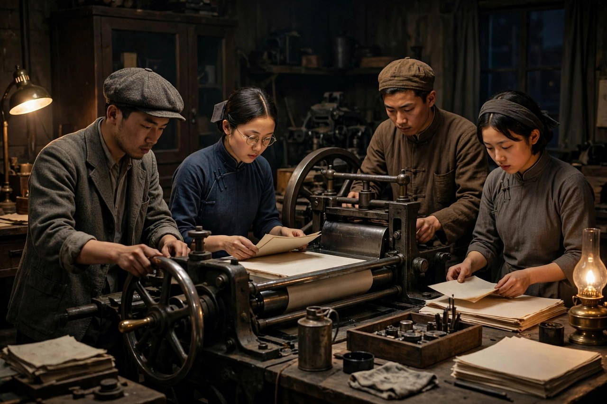
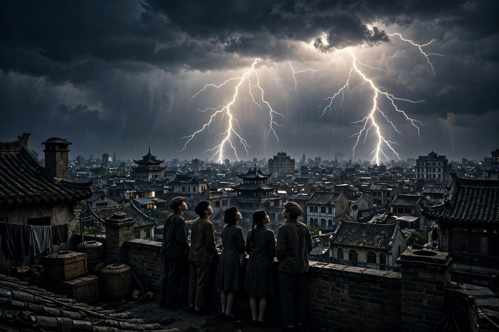

《电》是一九三五年三月由上海良友图书印刷公司出版的中篇小说，是爱情三部曲的最后一部。一九三六年四月，《雾》《雨》《电》合刊，以爱情三部曲命名，由上海良友图书印刷公司出版。巴金说，《电》的主人公有几个，他姑且拿李佩珠做代表，她比前面的两个人进步多了。这句话，点明了《电》的核心：这本书不再是一个人的故事，而是一群人的故事；不再是爱情纠葛的故事，而是斗争的故事；不再是雾和雨的故事，而是电的故事。电是什么，是光，是火，是闪电划破夜空的力量，是青年们在黑暗里点亮的火光。读《电》，读者会感到，巴金的笔，从《雾》的犹豫、《雨》的迷茫，走到了《电》的坚定，走到了群像的壮阔，走到了斗争的现场。

### 李佩珠的成长

李佩珠是《电》里的代表人物，也是巴金笔下进步最多的女性。她在《雾》里还是一个影子，在《雨》里开始崭露头角，到了《电》里，已经成长为革命活动的指导者。她不再是围着爱情打转的姑娘，她把个人的幸福，变成了对革命理想的追求，把个人的小爱，变成了对同志、对群众的大爱。她以工会、妇女协会、报馆、学校为阵地，同反动统治者展开英勇斗争，组织妇女，宣传思想，联络同志，做着最危险、也最有意义的工作。她的成长，不是突然的，是在《雾》《雨》的铺垫里，一点点长出来的：从迷茫到清醒，从清醒到坚定，从坚定到带头，路走得扎实，走得可信。

李佩珠的形象，放在今天看，依然有力量。她不是那种靠美貌、靠爱情、靠男人成就自己的女性，她是靠自己的信念、自己的能力、自己的担当成就自己的女性。她做妇女工作，不是喊口号，是实实在在地组织妇女，教她们读书，教她们认字，教她们明白自己的权利，教她们敢为自己说话。这种工作，在当时是危险的，是会被查封、会被逮捕、会被杀害的，可她没有退缩，她知道，妇女不解放，社会就不会真正解放，妇女不站出来，斗争就少了一半的力量。巴金写李佩珠，是想告诉读者，女性不是革命的点缀，是革命的主力，是电光里最亮的那一道。今天的女性，同样不需要做点缀，做主力，做自己人生的指导者，做别人眼里的光，靠的不是运气，是信念和本事。

李佩珠和吴仁民的关系，在《电》里也变了。在《雾》里，吴仁民还是周如水的朋友，在《雨》里，吴仁民还是在感情里打转的青年，到了《电》里，吴仁民已经成熟了，热情中增强了理智，把对个人幸福的追求，转变为对革命理想的追求，获得了青年们的拥戴，成了一个受人尊敬的最年长的革命家形象，成了一个新人。李佩珠和吴仁民，不再是三角恋爱里的纠葛，而是并肩作战的同志，是互相尊重、互相支持的战友。这种关系的转变，是巴金对爱情的重新定义：好的爱情，不是互相消耗，是互相成全，是两个人一起变得更坚定、更勇敢、更有力量。放在今天，这句话依然成立：一段好的关系，应当是让彼此都能长大，而不是让一个人为另一个人牺牲全部人生。

### 群像的斗争

《电》写了许多人，许多事。巴金说，小说中的人物全是主人公，都占同样重要的地位。这句话，不是客套，是《电》的结构特点：这本书没有一个绝对的主角，它写的是一个群体，写的是工会里的人，妇女协会里的人，报馆里的人，学校里的人，他们以这些阵地为舞台，同反动统治者展开斗争。斗争的方式，是多样的：办报纸，宣传思想；办学校，教育青年；办工会，组织工人；办妇女协会，组织妇女。每一条线，都是一条战线，每一条战线，都有人在流血，有人在牺牲，有人在坚持。巴金写群像，写得热烈而真实，没有把青年写成完美的英雄，他们也会害怕，也会争吵，也会犯错，可他们有一个共同点：不肯向黑暗低头，不肯把日子过成行尸走肉，愿意为光明的将来，付出代价。

群像的斗争，在《电》里有一个残酷的结局：活动地点被查封，一部分同志不幸牺牲，大部分人撤向农村，去开始新的斗争。这个结局，不是失败，是转移，是保存力量，是为下一次斗争做准备。巴金写牺牲，写得克制而沉重：同志死了，没有大段的煽情，就是一句话，一个场景，一个空下来的座位，读者却能感到疼，感到重，感到斗争的代价是真实的。牺牲不是为了感动人，是为了告诉活着的人，路还没有走完，活着的人要接过死者的路，继续走下去。撤向农村，不是逃跑，是战略转移，是把斗争的火种，带到更广阔的地方去，让火种在农村生根，发芽，长成燎原之势。这种写法，让《电》的结尾，不是绝望的，是带着希望的，是带着电光的余烬的。

群像的意义，在今天依然很大。现在很多人习惯单打独斗，习惯一个人扛，习惯把成功归于个人，把失败也归于个人，可真实的改变，从来不是一个人做成的，是许多人一起做成的。办一件事，需要有人写文章，有人组织，有人联络，有人兜底，有人坚持，有人牺牲，每个人做一点，事情才能成。巴金写《电》的群像，就是写这个道理：电光不是一个人发出来的，是一群人一起发出来的，一个人是火柴，一群人是闪电。读者读《电》，不应当只记住李佩珠一个人，应当记住那一群人，记住他们是怎样互相支持、互相掩护、互相接力的，记住改变从来不是孤胆英雄的事，是群体的事。

### 吴仁民的成熟

吴仁民在《电》里的成熟，是三部曲里最完整的一条成长线。在《雾》里，他是周如水的朋友，有幸福的家庭，有热情，也有浮躁；在《雨》里，他丧妻，丧友，陷进三角恋爱，浮躁到了顶点，迷茫到了顶点；在《电》里，他终于成熟了，热情还在，可热情里多了理智，浮躁少了，稳重多了，个人的小爱，变成了对革命的大爱，个人的小圈子，变成了对群体的责任。他获得了青年们的拥戴，成了一个受人尊敬的最年长的革命家形象，成了一个新人。这个新人，不是天上掉下来的，是用《雾》《雨》的教训换来的，是用死者的血换来的，是用自己的错误换来的。巴金写吴仁民的成熟，写得很可信：成熟不是突然的，是在一次次打击里磨出来的，是在一次次错误里改出来的，是在一次次选择里选出来的。

吴仁民的成熟，还体现在他对青年的态度上。他不再是《雨》里那个只会批评别人、自己也不动手的人，他开始带青年，开始教青年，开始把自己的经验，毫无保留地交给年轻人。他知道，年轻人会犯他犯过的错，会走他走过的弯路，可他不嘲笑他们，他陪着他们走，帮他们少走弯路，帮他们早一点醒悟。这种带青年的态度，是《电》里最温暖的一笔：一个成熟的人，不是高高在上地指责年轻人，而是蹲下来，陪着年轻人走一段，拉他们一把，推他们一下，让他们少摔几个跟头。今天的中年人，同样应当学吴仁民：不要只会骂年轻人不行，不要只会怀念自己年轻的时候，要像吴仁民那样，把自己的教训变成年轻人的养分，把自己的路，变成年轻人的桥。

吴仁民的成熟，对今天的读者还有一个启发：成熟不是变得圆滑，不是变得世故，不是变得不再热情，而是热情里多了理智，理想里多了办法，冲动里多了稳重。很多年轻人怕成熟，怕成熟就是向现实低头，就是放弃理想，吴仁民的故事告诉他们，成熟不是低头，是抬头，是把理想落到实处，是把热情用在正地方，是把个人的小爱，变成对事业的大爱。成熟的人，依然有电光，电光不是灭了，是更稳了，更亮了，更持久了。吴仁民在《电》里，就是这样一道稳而亮的电光，照着青年们往前走，照着读者往前走。

### 电光的意义

电这个书名，本身就是一个象征。雾是看不清，雨是淋透，电是划破夜空，是光，是火，是力量，是黑暗里最亮的一下。巴金把三部曲的最后一部定为《电》，是想告诉读者，青年们的路，是从雾到雨，再到电的路：从看不清，到淋透，到划破夜空，这条路虽然难走，可走过去了，就能看到光。电光不是永久的，它闪一下，就灭了，可闪的那一下，足够照亮前路，足够让黑暗里的人，看到方向，看到希望，看到彼此的脸。巴金写电，不是写永久的光明，是写闪一下的光明，闪一下，就够了，就能让青年们继续走下去，走到天亮为止。

电光的意义，在今天依然成立。现在很多人觉得，自己的努力像电光一样，闪一下就灭了，改变不了什么，做了一点事，好像没有用，喊了一句话，好像没有人听。巴金会告诉他们，电光的意义，不在于永久，在于闪的那一下，照亮了别人，照亮了前路，照亮了自己。一个人做了一件好事，帮了一个人，说了一句真话，办了一份小报，组织了一次活动，这些事看起来小，可它们都是电光，电光多了，夜空就亮了，夜空亮了，天就快亮了。不要小看电光，不要因为电光短暂，就不去发光，发光的人多了，黑暗就待不住了。

### 报馆与学校

报馆和学校，是《电》里最重要的两个阵地。报馆是发声的地方，青年们在报馆里写文章，印报纸，把斗争的消息，把反动统治者的罪行，把工人的苦难，把妇女的遭遇，一点点印出来，散出去，让更多人看见。印报纸在当时是危险的，报馆会被查封，印报的人会被逮捕，报纸会被没收，可青年们还是印，还是写，还是散，因为他们知道，黑暗最怕的，就是有人说话，就是有人把真相说出来。报馆的灯，常常亮到深夜，青年们在昏暗的灯下，连夜印报，印的手上沾满油墨，心里却亮堂堂的。巴金写报馆，写得热烈而真实：报馆不是一个抽象的阵地，是一个具体的地方，有油墨味，有纸张味，有青年们的汗味，有他们熬夜的眼睛，有他们不肯低头的骨头。

学校是育人的地方，青年们在学校里读书，教书，宣传思想，组织学生，把新思想的种子，种进年轻人的心里。学校在《电》里，不光是上课的地方，更是斗争的据点：学生在学校里集会，在学校里演讲，在学校里互相打气，在学校里商量下一步该怎么办。反动统治者最怕学校，因为学校里的人最年轻，最有朝气，最不肯向黑暗低头，最愿意为光明的将来付出代价。巴金写学校，写得明亮而坚定：学校里的青年，虽然也会害怕，也会争吵，也会犯错，可他们有一个共同点，就是不肯把日子过成行尸走肉，愿意为光明的将来，付出代价。今天的学校，同样应当是这样的地方：不是只教考试的地方，是教做人的地方，是教青年敢说话、敢做事、敢为社会负责的地方。报馆和学校加在一起，就是《电》里最亮的两盏灯，灯亮着，黑暗就待不住。

### 妇女协会的力量

妇女协会，是《电》里另一条重要的线。李佩珠以妇女协会为阵地，组织妇女，教她们读书，教她们认字，教她们明白自己的权利，教她们敢为自己说话。妇女在旧社会里，是最受压迫的一群人：她们没有受教育的权利，没有工作的权利，没有婚姻自主的权利，没有说话的权利，她们的命，常常由父亲、丈夫、婆婆说了算。妇女协会的工作，就是把这些被压住的女性组织起来，让她们明白，自己不是物件，自己有权利，自己可以站出来，可以为自己说话，可以为别的女性说话。这种工作，在当时是危险的，是会被查封、会被逮捕、会被杀害的，可李佩珠和她的同志们没有退缩，她们知道，妇女不解放，社会就不会真正解放，妇女不站出来，斗争就少了一半的力量。

妇女协会的力量，放在今天看，依然很大。现在很多女性，同样需要组织起来，互相支持，互相帮助，互相打气：职场上的歧视，家庭里的不公，社会上的偏见，都需要女性自己站出来说，站出来争，站出来改。一个女性站出来，声音很小，一群女性站出来，声音就大了，大了，就有人听了，听了，就有人改了。巴金写妇女协会，就是写这个道理：女性的力量，不是靠一个人单打独斗，是靠组织起来，靠互相扶持，靠像李佩珠那样，带头往前走，带着后面的姐妹一起走。今天的女性互助，道理也是一样的：一个走出来的女性，拉着后面的姐妹一起走，不嘲笑她们的害怕，不催促她们的脚步，就是陪着，就是引导，就是在关键时刻推一把。这种拉一把的力量，常常能改变一个人的一生，也能改变一个社会的样子。

### 牺牲与撤退

《电》里的一部分同志不幸牺牲，这个情节，是全书最沉重的一笔。牺牲不是为了感动人，是为了告诉活着的人，斗争是有代价的，代价是真实的，是血，是命，是再也回不来的人。巴金写牺牲，写得很克制，没有大段的煽情，就是一句话，一个场景，一个空下来的座位，读者却能感到疼，感到重，感到斗争的代价是真实的。牺牲的人，没有留下豪言壮语，只留下了自己的位置，留下了自己的工作，留下了自己的同志，活着的人要接过他们的位置，接过他们的工作，接过他们的路，继续走下去。接过来了，牺牲就没有白费；接不过来，牺牲就真的白费了。这种接力，是《电》里最动人的地方：一个人倒下了，另一个人站起来，站起来的人，不是为了出名，是为了让倒下的人没有白倒，让斗争的火种没有灭。

撤向农村，是《电》结尾的战略转移，不是失败，不是逃跑，是保存力量，是为下一次斗争做准备。大部分人撤向农村，去开始新的斗争，这个决定，是冷静的，是理智的，是把斗争的火种，带到更广阔的地方去，让火种在农村生根，发芽，长成燎原之势。撤退的时候，青年们的心是沉重的，他们离开了熟悉的城市，离开了报馆和学校，离开了牺牲的同志，可他们的脚步是坚定的，因为他们知道，撤退不是结束，是新的开始，是把电光带到更远的地方去，让更多人看见电光，让更多人加入斗争。这种撤退，在今天依然有启发：做一件事，遇到挫折的时候，不要硬拼，不要死撑，要学会保存力量，学会转移阵地，学会换一个地方、换一种办法，继续做下去。硬拼到底，有时候是勇敢，有时候是愚蠢；保存力量，换个地方再战，有时候才是真正的勇敢。

### 电与火的对比

电和火，在《电》里是两种不同的光。火是暖的，是慢慢烧的，是家里炉子里的火，是冬夜里取暖的火；电是亮的，是突然闪的，是划破夜空的火，是黑暗里最刺眼的一下。巴金把书名定为《电》，而不是定为《火》，是有深意的：火是旧生活的暖，是高公馆里的灯火，是重庆小屋里的煤油灯，火虽暖，却也容易灭，容易被风吹灭，容易被雨浇灭；电是新生活的光，是青年们在黑暗里发出来的光，光虽短暂，却足够刺眼，足够照亮前路，足够让黑暗里的人，看见彼此的脸，看见前路的方向。青年们需要的，不是一团慢慢烧的火，而是一道划破夜空的电，电闪过了，天就快亮了，火烧着，夜还是夜。

电和火的对比，放在今天依然有对照。现在很多人，过的是火的生活：慢慢熬，慢慢烧，慢慢取暖，慢慢等天亮，等着等着，火就灭了，天还是没有亮。巴金会告诉他们，火的生活虽然舒服，虽然暖和，可它改变不了夜，改变夜的办法，是发电，是闪一下，是说一句真话，是做一件实事，是帮一个人，是办一份小报，是组织一次活动，这些事看起来小，可它们都是电，电多了，夜空就亮了，夜空亮了，天就快亮了。不要满足于火的暖，要追求电的亮，暖只能让自己舒服，亮才能让别人看见，才能让更多人跟着走，跟着走的人多了，夜就过去了，天就亮了。

### 青年们的夜话

《电》里的青年们，常常在夜里谈话，谈斗争，谈牺牲，谈未来，谈爱情，谈生活。夜话的场景，写得热烈而真实：青年们围坐在昏暗的灯下，你一言，我一语，争论着，商量着，互相打气，互相提醒，夜越深，话越真，心越近。夜话不是空谈，是斗争的准备，是行动的商量，是把白天想不明白的事，在夜里想明白，把白天不敢说的话，在夜里说出来，把白天不敢做的决定，在夜里定下来。巴金写夜话，写得细致：有人激动，有人冷静，有人害怕，有人坚定，有人哭，有人笑，哭和笑加在一起，就是青年们的真实样子，就是斗争的真实样子。夜话的意义，在于让青年们知道，自己不是一个人在战斗，身边还有同志，还有朋友，还有愿意陪自己熬夜、陪自己冒险的人。

夜话放在今天，依然是青年们成长的重要方式。现在的青年，同样需要在夜里谈话：跟朋友谈，跟同志谈，跟老师谈，把白天不敢说的话说出来，把白天想不明白的事想明白，把白天不敢做的决定定下来。夜话不一定是在昏暗的灯下，可以是在宿舍里，可以是在咖啡馆里，可以是在电话里，可以是在群聊里，只要话是真的，心是近的，夜话就是有用的。不要小看夜话，夜话里藏着方向，藏着勇气，藏着同志情谊，藏着明天的行动。巴金写《电》里的夜话，就是写给今天的青年看的：多谈谈，多商量，多互相打气，谈着谈着，方向就清楚了，勇气就来了，电光就闪了。

### 电光下的青年

《电》里的青年们，是巴金笔下最有光的一群人。他们年轻，有朝气，有信念，有行动，愿意为光明的将来，付出代价，愿意在黑暗里，点亮自己的电光。他们的电光，不是天生的，是在《雾》《雨》的教训里，一点点磨出来的：从犹豫到坚定，从迷茫到清醒，从个人的小爱到集体的责任，从三角恋爱的漩涡到斗争的现场，每一步，都是用眼泪、用错误、用牺牲换来的。青年们的电光，照在工会里，照在妇女协会里，照在报馆里，照在学校里，照在农村的路上，照在每一个愿意跟着走的人心里。电光虽然短暂，却足够刺眼，足够让黑暗里的人，看见前路，看见彼此，看见希望。

青年们的电光，放在今天，依然是一句鼓励。现在的青年，同样需要在黑暗里发光：工作里的黑暗，家庭里的黑暗，社会上的黑暗，都需要有人点灯，点灯的人，不一定是大人物，可以是一个普通青年，可以是一个写文章的人，可以是一个组织活动的人，可以是一个敢说真话的人。点灯的办法，不一定是惊天动地的大事，可以是每天做一件实事，可以是帮一个人，可以是说一句真话，可以是组织一次活动，这些事看起来小，可它们都是电光，电光多了，夜空就亮了，夜空亮了，天就快亮了。不要怕自己的光太小，光再小，也是光，光多了，就是闪电，就是黎明。巴金写《电》里的青年，就是写给今天的青年看的：发光吧，哪怕只闪一下，也要闪，闪了，就有人看见，看见了，就有人跟着走，跟着走的人多了，天就亮了。

青年们的电光，还有一个更深的意义：它说明，改变不是靠一个人，是靠一群人。一群青年，一起发光，光就大了，大了，就能划破夜空，就能照亮前路，就能让黑暗待不住。一个人发光，是火柴；一群人发光，是闪电。读者读《电》，不应当只记住李佩珠一个人，不应当只记住吴仁民一个人，应当记住那一群人，记住他们是怎样互相支持、互相掩护、互相接力的，记住改变从来不是孤胆英雄的事，是群体的事。群体的电光，是最亮的光，是最持久的光，是巴金留给读者的全部希望：只要青年们还在发光，天就一定会亮，亮的那一天，就是电光变成阳光的那一天。

### 电光与阳光

电光和阳光，在《电》里是两种不同的光。电光是突然的，是刺眼的，是划破夜空的一下；阳光是持久的，是温暖的，是天亮以后的光。巴金写《电》，写的是电光，不是阳光，因为他知道，青年们的斗争，还没有到天亮的时候，还处在夜里，还需要电光来照路。电光闪过了，夜还是夜，可电光闪过的地方，人已经看见了方向，看见了彼此，看见了希望，看见了下一步该往哪里走。电光的意义，不在于永久，在于闪的那一下，照亮了前路，照亮了人心，照亮了斗争的方向。阳光会来的，阳光来的时候，电光就不需要了，可阳光来之前，电光是必需的，是黑暗里唯一的希望。青年们发光，就是发阳光来之前的电光，发着发着，阳光就来了，天就亮了。

电光与阳光的对比，放在今天，依然是一句鼓励。现在很多人，觉得自己的努力像电光一样，闪一下就灭了，改变不了什么，做了一点事，好像没有用，喊了一句话，好像没有人听。巴金会告诉他们，电光的意义，不在于永久，在于闪的那一下，照亮了别人，照亮了前路，照亮了自己。一个人做了一件好事，帮了一个人，说了一句真话，办了一份小报，组织了一次活动，这些事看起来小，可它们都是电光，电光多了，夜空就亮了，夜空亮了，阳光就快来了。不要小看电光，不要因为电光短暂，就不去发光，发光的人多了，黑暗就待不住了，阳光就来了。电光是阳光的前奏，前奏奏响了，阳光就不远了。

### 闪电之后

闪电之后，天还是黑的，可人已经看见了方向，看见了彼此，看见了下一步该往哪里走。巴金写《电》，写的不光是闪电本身，更是闪电之后的人：闪电闪过了，青年们没有散，没有跑，没有放弃，而是聚在一起，商量下一步，商量怎样保存力量，商量怎样把电光带到农村去，带到更广阔的地方去。闪电之后的工作，比闪电本身更重要：闪电是一下，工作是长久，闪电照亮了方向，工作才能沿着方向走下去。青年们在闪电之后，没有停下来庆祝，没有停下来感叹，而是立刻行动，立刻转移，立刻开始新的斗争，这种行动力，是《电》里最可贵的东西：光不是用来看的，是用来走路的，看见了方向，就要走下去，走下去，天才会亮。

电光里的青年，不是一道孤独的光，是一群光聚在一起的光。一个人发光，是火柴；一群人发光，是闪电。青年们聚在一起，互相照亮，互相取暖，互相把电光传下去，传到农村去，传到学校去，传到报馆去，传到每一个愿意跟着走的人心里。电光传出去了，夜就亮了，夜亮了，天就快亮了。

### 电光里的信

《电》里的青年们，常常互相写信，信上写斗争，写牺牲，写未来，写爱情，写生活。信是电光的另一种形式：信写出来了，光就传出去了，传到农村去，传到学校去，传到报馆去，传到每一个愿意跟着走的人心里。信虽然短，却很有力：短短几句话，就能让一个迷茫的人清醒过来，就能让一个害怕的人勇敢起来，就能让一个想放弃的人重新站起来。巴金写《电》里的信，写得很动人：信不是客套，是同志之间的真话，是青年之间的鼓励，是黑暗里的光，是闪电之后的余烬。余烬虽然小，却没有灭，灭了，就真的黑了，亮着，就还有希望。今天的人，同样需要写信：给朋友写信，给同志写信，给自己写信，把心里的话写出来，把方向写清楚，把鼓励写进去，写出来了，光就传出去了，传出去了，就有人看见，看见了，就有人跟着走，跟着走的人多了，天就亮了。

### 电光里的路

电光里的路，是青年们用脚走出来的路。路不是现成的，是电光照出来以后，青年们一步一步走出来的：从工会走到妇女协会，从报馆走到学校，从城市走到农村，每一步，都是在黑暗里走出来的，每一步，都有人牺牲，有人坚持，有人接力。路走出来了，后面的人就好走了，后面的人顺着路走，走到农村去，走到更广阔的地方去，走到光明的将来去。路的意义，就在这里：不是一个人走出来的，是许多人一起走出来的，一起走，路就宽了，宽了，就能走更多的人，走更多的人，天就亮得更快了。

《电》的结尾，大部分人撤向农村，去开始新的斗争。这个结尾，是巴金留给读者的希望：斗争没有结束，电光没有灭，火种还在，路还在，青年们还在走。撤向农村，不是失败，是新的开始，是把电光带到更广阔的地方去，让电光在农村生根，发芽，长成燎原之势。合上《电》，读者应当带走这句话：不要怕黑暗，黑暗再长，也长不过电光；不要怕牺牲，牺牲再重，也重不过希望；不要怕自己的光太小，光再小，也是光，光多了，就是闪电，就是黎明。巴金写《电》，就是写给所有还在黑暗里的人的一封信：信上说，发光吧，哪怕只闪一下，也要闪，闪了，就有人看见，看见了，就有人跟着走，跟着走的人多了，天就亮了。

合上书页再想想，电光的好处不在响亮，而在照得远。照得远的光，照进工会的小屋，照进报馆的灯下，照进学校操场的暮色里，照进农村土路的尽头。光照到的地方，人心里就多了一点底气，底气多了，人就不怕黑了。巴金写电光，写的就是这点底气：人心里有了光，脚下就有了路，路边就有了同行的人，同行的人多了，黑暗就站不住脚了。
