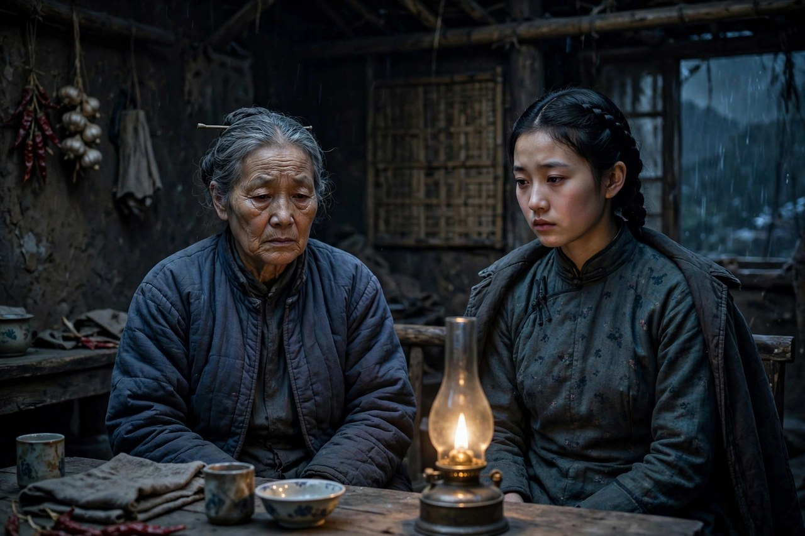
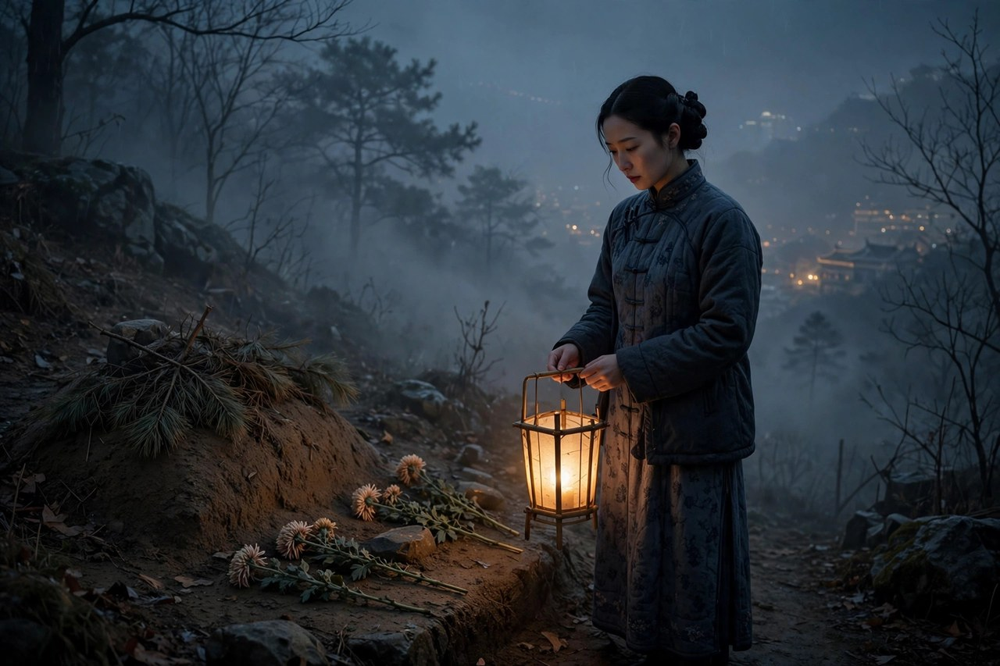

《寒夜》是巴金于一九四七年出版的长篇小说，写于一九四四年冬至一九四六年底，部分章节曾载于一九四六年一月至三月上海《环球》杂志，全文于一九四六年八月到一九四七年一月载于《文艺复兴》，一九四七年三月由上海晨光出版公司初版。这是巴金在新中国成立前创作的最后一部长篇小说，被业内评价为巴金艺术表现上最为成熟的一部作品。小说以抗战时期的陪都重庆为背景，围绕汪文宣、曾树生、汪母三人展开故事情节，描写一个自由恋爱的知识分子家庭，如何在内忧外患、贫穷、困顿、软弱、矛盾、新旧冲突等现实生活的重压下，一步步走向毁灭。巴金自己说，写《寒夜》的时候，他同情书里的三个人，不把他们写成正面人物，也不写成反面人物，罪在当时的社会，不在个人。这句话，点明了《寒夜》的核心：这本书不是要审判谁，是要控诉那个把好人逼死的寒夜。

### 重庆的两间旧屋

汪文宣在一家半官半商的图书出版公司当校对，肺病缠身，靠一份他自己都不信还有意义的稿纸把日子拖下去。妻子曾树生在商业银行做事，受过新式教育，常出入战时陪都的银行与咖啡馆，那是一种和老屋里完全不同的光。汪母从乡下来到重庆，疼儿子，恨儿媳，守着一盏煤油灯与一只熬药的老砂锅。孩子还小，已经学会看大人脸色的男孩小宣，夹在三个人中间，成了这个家最无辜的见证者。一家几口，挤在租来的两间旧屋里，屋子小，矛盾大，贫穷像寒夜里的风，从门缝、窗缝里往里灌，灌进每一个人的心里。

重庆的寒夜，在小说里不光是天气，更是生活的写照。抗战时期物价飞涨，工资不够糊口，汪文宣的薪水很低，生活艰难，身体越来越差。曾树生为了减轻丈夫的负担，在银行找到工作，她一向持身严谨，可为了生活，对银行中人也不得不作些委婉的应付。汪母看不惯曾树生现代知识女性的做派，觉得儿媳整天出门上班、回家还顶嘴，是不懂事，是不孝。曾树生不喜汪文宣凑合过日子的生活态度，觉得丈夫没有出息，没有骨气，只会忍，只会熬。三个人的矛盾，不是大吵大闹的矛盾，是冷战的矛盾：谁先倒一盆水，谁先上桌吃饭，儿子发烧时谁来定主意，都能变成一场几天不说话的对峙。冷战比吵架更伤人，吵架还有和好的可能，冷战是把话憋在心里，憋久了，心就凉了，家就寒了。

巴金写重庆的小屋，写得细致入微：煤油灯的光，熬药的味，潮湿的被子，漏风的窗户，楼下的嘈杂，楼上的脚步声，全都写出来了。读者跟着汪文宣走进这间屋子，能感到冷，能感到闷，能感到那种看不见的压抑。压抑的来源，不光是贫穷，更是希望的落空：汪文宣和曾树生年轻时，曾经有过兴办教育的理想，曾经想过要为社会做一番事情，可战争来了，理想碎了，他们只能做个小职员维持生计，只能在寒夜里硬撑。理想碎了，人就容易变得软弱，变得互相埋怨，变得把生活的苦，算到对方头上。巴金写这一点，写得很清醒：寒夜压垮一个家，不是一夜之间的事，是贫穷、疾病、矛盾、失望，一点点加起来的事，加到最后，家就塌了。

### 婆媳的冷战

婆媳矛盾，是《寒夜》里最核心的矛盾，也是最让人心疼的矛盾。汪母认定儿媳是外人，她一个乡下老太太千里赶来照顾儿子，媳妇却整天出门上班、回家还顶嘴，她觉得儿媳抢走了儿子，抢走了这个家的话语权。曾树生认定婆婆是旧时代留下来压她的影子，她忍得了贫穷，忍不了老屋里的灯油味、药味、一开口就是你们读书的女人就是这样的念叨。两个女人抢的不是别的，是这间租来的两间旧屋到底谁说了算，是这个家的规矩到底听谁的，是儿子、丈夫的心到底向着谁。抢来抢去，抢走的不是胜利，是这个家的温度，是汪文宣的健康，是小宣的童年。

汪文宣夹在母亲和妻子中间，是最难受的人。他敬母爱妻，可他身心交瘁，懦弱无能，没有能力调和两个女人的矛盾，只能和稀泥，只能拖，只能忍。他让妻子暂住宿舍，想缓和矛盾，可缓和的结果，是妻子离家更远了，是母亲更觉得儿子向着媳妇了，是他自己更孤独了。他失业以后，生活困苦，吐血更甚，可他一直没有告诉树生，怕她担心，怕她更想离开，怕这个家散得更快。这种隐瞒，是善良的，也是软弱的：善良是不想让妻子担心，软弱是不敢面对现实，不敢把家里的真实处境摊开来说。摊开了，也许还有办法，不摊开，就只能一个人扛，扛到最后，扛出肺病，扛出吐血，扛出一条命。

婆媳冷战放在今天看，依然有对照。现在很多家庭，婆媳矛盾换了样子，可道理还是一样的：婆婆觉得儿媳抢走了儿子，儿媳觉得婆婆干涉了自己的生活，丈夫夹在中间和稀泥，和来和去，家就寒了。解决婆媳矛盾的办法，不是让一方完全让步，也不是让丈夫完全站队，而是要分清边界：婆婆有婆婆的生活，儿媳有儿媳的生活，儿子、丈夫有自己的责任，要立规矩，要讲道理，要给彼此留空间。汪文宣的悲剧，就是没有立规矩，没有讲道理，没有给彼此留空间，只会忍，只会拖，只会和稀泥，和到最后，家散了，人死了，婆婆带着孙子走了，妻子回来了，人去楼空，只剩寒夜。读者读到这里，应当记住一句话：家里的矛盾，拖是拖不好的，拖久了，矛盾就变成了寒夜，寒夜来了，人就活不下去了。

### 曾树生的出走

曾树生最后随人去了兰州，这个决定，是《寒夜》里最让人争议的决定，也是最让人同情的决定。她不是不爱汪文宣，她深爱丈夫，可她受不了这个家了，受不了贫穷，受不了婆媳冷战，受不了丈夫凑合过日子的态度，受不了自己每天在银行里委婉应付、回家还要面对冷脸的生活。她想飞，她想摆脱目前的困境，她想换一个环境，换一种活法，这种想飞的念头，是人之常情，是任何一个被压抑的人都会有的念头。巴金写曾树生出走，没有把她写成坏女人，没有把她写成抛夫弃子的负心人，而是写成一个在寒夜里想活下去的人：她走了，不是为了享福，是为了喘气，是为了不被寒夜冻死。

曾树生去了兰州，跟随的是银行的陈主任，一个追求她的人。她对陈主任的感情，是复杂的：她需要陈主任的帮助，需要一份工作，需要一个出路，可她心里爱的人，始终是汪文宣。她屡拒陈主任的追求，可生活逼着她，不得不接受陈主任的帮助，不得不跟着他走。这种无奈，是《寒夜》里最真实的一笔：一个女人，在寒夜里想活下去，有时候不得不做出自己并不愿意的选择，不得不接受自己并不爱的人的帮助，不得不把尊严打个折，换一口喘气的机会。巴金写这一点，写得很同情：他不责备曾树生，他责备的是那个把曾树生逼到这一步的社会，是那个让好女人不得不打折的社会。

曾树生从兰州回来的时候，抗战已经胜利了，可她回来看到的，是人去楼空：汪文宣死了，婆婆与儿子小宣也离开了重庆，去了乡下。她独自来到丈夫墓前哭祭，悲痛欲绝，最后形单影只地消失在凄迷的寒夜里。这个结尾，是《寒夜》里最冷的一笔：胜利来了，可胜利没有救活汪文宣，没有救回这个家，没有让曾树生过上好日子。胜利只是一个日子，日子过去了，寒夜还在，穷人还在穷，病人还在病，家破了就是破了，补不回来了。巴金用这个结尾告诉读者，胜利不是万能药，制度不改，寒夜不散，胜利来了，穷人的日子也不会自动变好。放在今天，这句话依然成立：不要以为换一个环境、换一份工作、换一个城市，日子就会自动变好，日子变好的办法，是改变让日子变坏的根源，是给自己留尊严，给家人留空间，给生活留希望。

### 汪文宣的死

汪文宣死在抗战胜利的那一天，这个安排，是巴金最冷峻的一笔。他吐尽血痰而死，死的时候，胜利的鞭炮声就在窗外，庆祝的人群就在街上，可他的死，没有换来任何人的同情，没有换来任何制度的改变，只换来了母亲和儿子的离去，换来了妻子的哭祭，换来了寒夜里的又一声叹息。他的死，象征着小知识分子的命运：善良，正直，忠厚，老实，敬母爱妻，可这些美德，在寒夜里一文不值，换不来一口饱饭，换不来一点药费，换不来一个温暖的家。他的死，不是偶然，是必然：贫穷、肺病、失业、婆媳矛盾、理想破灭，加在一起，就是一条死路，走着走着，就走到了头。

汪文宣的死，还揭示了五四时期个人主义价值观的虚妄性。他和曾树生年轻时，相信个人奋斗，相信教育救国，相信自由恋爱就能带来幸福，可现实告诉他们，个人的理想，抵不过最低的生存压力；个人的爱情，抵不过婆媳的冷战；个人的奋斗，抵不过物价的飞涨。巴金写汪文宣，不是要否定个人奋斗，是要告诉读者，个人奋斗需要制度的支撑，需要社会的温暖，需要家人的理解，没有这些支撑，个人奋斗就是寒夜里的烛光，风一吹就灭了。今天的年轻人，同样面临这个问题：一个人再努力，也努力不过房价，努力不过内卷，努力不过一个不讲道理的家庭和单位。努力当然重要，可努力之外，还要想想，怎样改变让努力白费的环境，怎样给自己留一个不被寒夜冻死的空间。

汪文宣死后，汪母带着小宣离开了重庆，启程返乡。这个离去，是《寒夜》里最无奈的一笔：母亲失去了儿子，孙子失去了父亲，妻子失去了丈夫，一个家，就这样散了，散得干干净净，散得没有一点余温。巴金写这个离去，没有煽情，就是一句话，一个背影，一辆车，一个寒夜，读者却能感到疼，感到冷，感到这个社会的寒夜，是真的会冻死人的。合上《寒夜》，读者心里会留下一个问题：汪文宣的死，到底是谁的错，是母亲的错，是妻子的错，是他自己的错，还是社会的错。巴金的回答是，三个人都不是正面人物，也都不是反面人物，每个人有事也有非，他全同情，他想说，不能责备他们三个人，罪在当时的社会，他们都是无辜的受害者。这句话，是《寒夜》的灵魂，也是巴金留给今天的忠告：不要轻易责备寒夜里的人，要先想想，寒夜是谁造成的，要先想想，怎样才能让寒夜散去，让小人物活下去。

### 对照今天的寒夜

《寒夜》写的是抗战时期的重庆，可它照见的是今天的许多家庭。现在没有抗战了，可寒夜还在：有的家庭，丈夫失业，妻子加班，老人带孩子，孩子看脸色，贫穷、疾病、矛盾、失望，加在一起，就是今天的寒夜。有的年轻人，在大城市里租着小房子，工资刚够交房租，生了病不敢请假，累了不敢休息，家里老人催婚，单位领导催活，自己夹在中间，像汪文宣一样，只能忍，只能熬，只能把血往肚子里咽。寒夜的形式变了，寒夜的本质没有变：都是小人物在制度的重压下，硬撑着活下去，撑到最后，撑不住的，就倒下了，撑得住的，也脱了一层皮。

对照今天，《寒夜》还提醒读者，婆媳矛盾、夫妻矛盾，拖是拖不好的，要讲道理，要立边界，要给彼此留空间。汪文宣的悲剧，就是拖出来的悲剧：婆媳矛盾拖着，夫妻矛盾拖着，失业拖着，肺病拖着，拖到最后，拖出一条命。今天的家庭，同样不能拖：有了矛盾，要说出来，要商量，要解决，不要冷战，不要憋着，不要把话都咽回去，咽回去的话，会变成病，会变成寒夜，会变成压垮一个家的最后一根稻草。曾树生的出走，也提醒今天的女性：想飞不是错，想换一种活法不是错，错的是那个把女性逼到不得不打折的社会，是那个不给女性留尊严、留出路的社会。给女性留出路，就是给家庭留出路，给社会留出路。

### 小宣的眼睛

小宣是《寒夜》里最无辜的人，也是最让人心疼的人。他年纪小，已经学会看大人脸色的男孩，夹在母亲、父亲、奶奶三个人中间，成了这个家最沉默的见证者。他看得懂大人的脸色，看得懂母亲的不高兴，看得懂奶奶的冷脸，看得懂父亲的叹气，可他看不懂，为什么大人之间不能好好说话，为什么家里总是冷冷的，为什么父亲总是咳嗽，为什么母亲总是要出门。他不敢问，问了也没有人认真回答他，回答他的，只有大人的敷衍，只有奶奶的念叨，只有母亲的叹气。小宣的眼睛，是《寒夜》里最干净的一面镜子：镜子里照出来的，不是孩子的错，是大人的错，是寒夜的错，是贫穷、矛盾、疾病，加在一起，压在一个孩子心上的错。

小宣最后跟着奶奶离开了重庆，启程返乡。这个离去，是《寒夜》里最无奈的一笔：孩子失去了父亲，失去了完整的家，失去了在重庆的生活，只能跟着奶奶，回到一个他并不熟悉的乡下，开始一种新的、同样艰难的生活。他走的时候，有没有回头，有没有哭，有没有想母亲，巴金没有细写，可读者能想象，一个孩子在寒夜里离开家，心里会有多害怕，会有多不舍，会有多想问，为什么父亲不跟我们一起走，为什么母亲不回来，为什么家就这样散了。这些问题，没有人回答他，回答他的，只有寒夜，只有车轮声，只有奶奶的叹气。小宣的故事，放在今天看，依然有对照：很多孩子，同样夹在父母、爷爷奶奶的矛盾中间，同样学会了看大人脸色，同样不敢问，不敢说，不敢哭，只能把委屈咽回去，把害怕藏起来。给孩子一个温暖的家，不是给孩子买多少东西，是给孩子一个不冷战、不吵架、不互相埋怨的家，是给孩子一个敢说话、敢问问题、敢哭出来的家。

小宣的眼睛，还提醒今天的父母，夫妻矛盾、婆媳矛盾，最受伤的，永远是孩子。大人吵架，孩子在旁边听着；大人冷战，孩子在旁边看着；大人离婚，孩子在旁边站着，站到最后，孩子就学会了，大人之间是不能好好说话的，家是不能信任的，爱是会消失的。这种学会，比任何一门功课都可怕，因为它会跟着孩子一辈子，会影响孩子长大以后，怎样谈恋爱，怎样组建家庭，怎样对待自己的孩子。巴金写小宣，不是为了凑人数，是为了让大人读者明白，家里的寒夜，最先冻伤的，是孩子。保护孩子最好的办法，不是给孩子买东西，不是送孩子上最好的学校，是给孩子一个温暖的家，一个大人之间能好好说话的家，一个孩子敢哭、敢问、敢笑的家。

### 汪文宣的校对桌

汪文宣的校对桌，是《寒夜》里一个很动人的意象。他在一家半官半商的图书出版公司当校对，每天的工作，就是对着稿纸，一个字一个字地校，校别人的文章，校别人的思想，校别人的错误，可他自己的生活，却没有人给他校，没有人帮他改，没有人告诉他，哪里错了，哪里该改。他的校对工作，薪水很低，生活艰难，身体越来越差，可他还是每天去，还是每天校，还是把稿纸上的错误，一个个挑出来，改过来。这种认真，是他身上最后一点尊严：生活再苦，工作再没有意义，他还是认真地做，还是不肯马虎，还是相信，文字是有意义的，校对是有价值的。巴金写校对桌，不是为了写一个职业，是为了写一个小知识分子的最后一点体面：体面不在工资里，不在地位里，在认真里，在每天把一件事做好的坚持里。

校对桌的故事，放在今天看，依然有对照。现在很多年轻人，同样坐在格子间里，做着自己都不信还有意义的工作，每天对着电脑，对着表格，对着稿纸，机械地重复，重复到最后，怀疑自己工作的意义，怀疑自己的人生是不是就这样了。汪文宣的故事告诉他们，怀疑是正常的，怀疑不是罪过，可怀疑之后，要怎么办，才是关键。汪文宣的办法，是忍，是熬，是把怀疑咽回去，咽到最后，咽出肺病，咽出一条命。今天的年轻人，不应当学他的忍，应当学他的认真，再学一点他的反面：认真工作是好的，可认真之外，还要想想，自己的生活是不是也需要校对，是不是也需要把错误挑出来，改过来。生活的校对，不是别人帮你校，是自己帮自己校：哪里错了，哪里该改，哪里是贫穷的问题，哪里是矛盾的问题，哪里是健康的问题，校出来了，改过来了，生活才有希望。

校对桌还有一个更深的意义：它象征着小知识分子的处境。他们有文化，有理想，有认真，可他们没有权力，没有地位，没有话语权，只能在别人的文章里挑错，不能在自己的生活里挑错，只能在稿纸上改错，不能在制度里改错。这种处境，是寒夜里最冷的一笔：有文化的人，活得最无力；有理想的人，活得最憋屈；有认真的人，活得最苦。巴金写校对桌，就是写给这些小知识分子看的：你们的认真没有错，错的是那个不给认真留活路的社会，是那个让校对员只能校稿纸、不能校生活的社会。改变这个社会，靠的不是一个校对员的忍，靠的是许多校对员一起站出来，一起说话，一起把生活的错误，也挑出来，改过来。

### 曾树生的银行生涯

曾树生在商业银行做事，这份工作，是《寒夜》里一条很值得细看的线。她受过新式教育，有能力，有见识，本来可以靠自己的本事，过一种独立的生活，可在战时陪都的银行里，独立是要付出代价的：她要出入银行与咖啡馆，要跟银行中人打交道，要作些委婉的应付，要忍受别人的眼光，要忍受婆婆的责骂，要忍受丈夫的不理解。她一向持身严谨，可为了生活，对银行中人也不得不作些委婉的应付，这种应付，不是她愿意的，是生活逼她的，是寒夜逼她的。巴金写曾树生的银行生涯，写得很同情：他不责备曾树生在银行里的应付，他责备的是那个让一个持身严谨的女性，不得不应付的社会，是那个让独立女性不得不打折的社会。

银行生涯还让曾树生看到了两种光：一种是银行里的光，是明亮的，是现代的，是咖啡馆里的灯光，是新式女性的光；一种是老屋里的光，是昏暗的，是煤油灯的光，是旧时代的光。两种光对照在一起，就是曾树生内心的对照：她向往银行里的光，向往独立，向往现代生活，可她又放不下老屋里的丈夫，放不下老屋里的孩子，放不下老屋里的责任。她在两种光之间摇摆，摇摆到最后，摇摆出了兰州，摇摆出了出走，摇摆出了人去楼空的结局。巴金写两种光，不是为了让读者选一种光，是为了让读者明白，一个女性在两种光之间摇摆，本身就是一种痛苦，痛苦的根源，不是女性自己，是那个不给女性留一条完整出路的社会。今天的女性，同样在两种光之间摇摆：一种是事业的光，一种是家庭的光，两种光都想要，两种光都难全，摇摆的时候，最需要的是家人的理解，是社会的支持，是丈夫的体谅，是婆婆的宽容，没有这些支持，摇摆就会变成出走，出走就会变成破裂。

曾树生在银行里的工作，还说明了一个道理：女性独立，不是一句口号，是要付出代价的，是要在银行里应付，是要在家里忍受冷脸，是要在社会上忍受眼光，是要在丈夫的不理解里，硬撑着走下去。独立的代价，在《寒夜》里写得很清楚：独立换来了工资，换来了出走的资本，也换来了婆媳矛盾的升级，换来了丈夫的失落，换来了家庭的破裂。代价这么大，还要不要独立，巴金的回答是，要，因为不独立，代价更大，不独立，就是像汪母那样，守着煤油灯，守着老砂锅，守着旧时代的光，守到最后，守出一个寒夜。独立虽然难，虽然要付出代价，可独立换来的是尊严，换来的是选择，换来的是在寒夜里，还能为自己点一盏灯的权利。这盏灯，虽然微弱，虽然最后消失在寒夜里，可它亮过，亮过的灯，就不会白亮。

### 寒夜里的药味

《寒夜》里的药味，是汪文宣生活的味道，也是这个家的味道。汪母守着一只熬药的老砂锅，每天给儿子熬药，药味弥漫在两间旧屋里，弥漫在每一个人的心里。药味是苦的，是涩的，是让人闻了就想叹气的味道，可药味也是爱的味道：母亲熬药，是疼儿子，是想让儿子好起来，是想用一碗药，换儿子的一条命。母亲的爱，藏在药味里，藏在煤油灯的光里，藏在半夜起床看儿子的脚步声里。巴金写药味，写得很细致：药味不是背景，是人物，是母亲的爱，是儿子的病，是这个家的苦，是寒夜的味道。药味越浓，家越寒，寒到最后，药也救不了命，爱也救不了家，药味就变成了丧事的味道，变成了墓前的味道，变成了寒夜里最后的味道。

药味放在今天，依然有对照。现在很多家庭，同样有药味：老人长期吃药，孩子生病吃药，丈夫加班熬夜吃药，妻子焦虑吃药，药味弥漫在家里，弥漫在每一个人的心里。药味的背后，是贫穷，是疾病，是压力，是看不起病，是买不起药，是生了病不敢请假，是累了不敢休息。巴金写《寒夜》里的药味，就是写给今天的人看的：药味不是一个人的事，是一个社会的事，是一个制度的事，是一个让小人物看不起病、买不起药、熬不起夜的社会的事。改变药味的办法，不是多熬一碗药，是改变让人生病的环境，是给小人物留一条活路，是给病人留一点尊严，是给家庭留一点温暖。药味散了，寒夜就暖了，寒夜暖了，家就活了。

寒夜里的哭祭，是曾树生最后的告别，也是她对汪文宣最后的爱。胜利来了，可爱的人已经不在了，家已经散了，哭祭的时候，没有旁人，只有寒夜，只有墓碑，只有她一个人站在冷风里。哭祭不是软弱，是一个人对另一个人最后的体面，是把没有说完的话，在墓前说完，把没有流完的眼泪，在寒夜里流完。流完了，人还要走，还要活，还要在寒夜里，给自己留一盏灯。

### 寒夜里的煤油灯

寒夜里的煤油灯，是汪母守着的光，也是这个家最后的光。汪母守着一盏煤油灯，守着一只熬药的老砂锅，守着儿子，守着孙子，守着这个家最后的温度。煤油灯的光，是昏暗的，是摇曳的，是风一吹就会灭的光，可汪母守着它，守了一夜又一夜，守到儿子死了，守到孙子走了，守到自己也要离开重庆了，灯还是亮着的，亮着的灯，是母亲的爱，是母亲的不舍，是母亲对儿子最后的牵挂。巴金写煤油灯，写得很动人：灯是小的，是旧的，是穷人家的灯，可灯里藏着的爱，是大的，是深的，是一个母亲一辈子的爱。爱藏在灯里，灯灭了，爱还在，爱还在，寒夜就不是完全黑的，寒夜里还有一点暖，还有一点光，还有一点让人活下去的理由。

### 寒夜里的叹气

寒夜里的叹气，是汪文宣最常做的事。他叹气的时候，不是在抱怨，是在硬撑，是在把心里的苦，用一口气叹出来，叹出来了，心里就轻一点，轻一点，就能再撑一天。叹气不是软弱，是小人物在寒夜里，唯一的发泄方式：不能哭，不能闹，不能走，只能叹气，叹一口气，再撑一天，再叹一口气，再撑一天，撑到最后，撑出肺病，撑出吐血，撑出一条命。巴金写叹气，写得很动人：叹气是无声的控诉，是小人物对寒夜的控诉，是善良的人对不讲道理的社会的控诉。控诉虽然无声，却是真实的，是寒夜里最真实的声音。今天的人，同样在叹气：工作累了叹气，家里难了叹气，前途暗了叹气，叹气之后，还要撑，还要走，还要活。叹气不是认输，是撑下去的前奏，叹完了，就要想办法，就要找光，就要给自己留一盏灯，灯亮着，寒夜就过去了。

### 寒夜里的早晨

寒夜里的早晨，是最难熬的时候，也是最有希望的时候。早晨来了，夜还没有完全过去，冷还在，风还在，药味还在，可天边已经有了一点亮，亮虽然微弱，却说明夜快过去了，说明寒夜不是永久的，说明再难熬的夜，也会过去。汪文宣没有等到寒夜里的早晨，他死在了胜利的那一天，死在了寒夜还没有过去的时候，可曾树生等到了，她从兰州回来，虽然看到的是人去楼空，虽然心里还是寒夜，可她还在走，还在哭祭，还在想念，还没有完全放弃。早晨的意义，就在这里：不是天一下子就亮了，是天边先亮一点，亮一点，就够了，够让人撑下去，够让人走下去，够让人等到天完全亮的时候。今天的人，同样在等寒夜里的早晨：工作难了，等早晨；家里难了，等早晨；前途暗了，等早晨。等早晨的办法，不是躺着等，是走着等，是做着等，是给自己留一盏灯，等着等着，天边就亮了，亮了，寒夜就过去了。

合上《寒夜》，读者应当带走一句话：寒夜再长，也要给自己留一盏灯。汪文宣的灯灭了，曾树生的灯还在寒夜里亮着，虽然亮得很微弱，虽然最后消失在寒夜里，可她还在走，还在哭祭，还在想念，还没有完全放弃。读者合上书以后，不应当只感到冷，还应当感到一点暖：暖来自巴金的同情，来自他对小人物的疼，来自他那句罪不在个人、罪在社会的控诉。控诉不是为了泄愤，是为了改变，是为了让下一个汪文宣，不必死在胜利的那一天，让下一个曾树生，不必在寒夜里独自哭祭，让下一个小宣，不必在寒夜里学会看大人脸色。寒夜会过去的，只要有人愿意点灯，愿意讲道理，愿意给小人物留一条活路。
