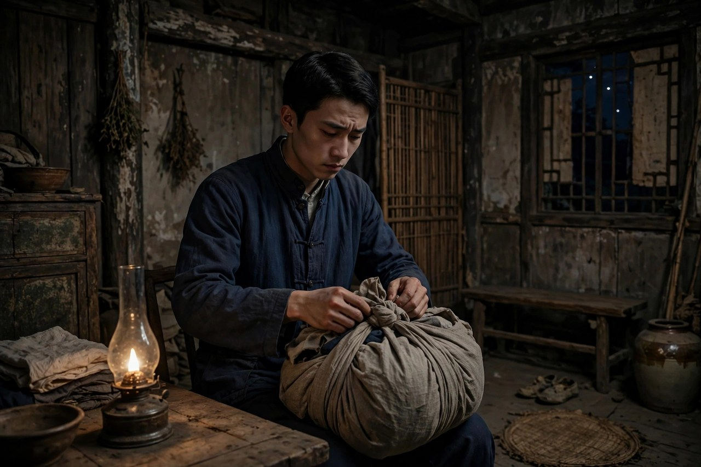

说起巴金，绕不开《家》。这本书一九三一年在上海《时报》上连载，起初叫《激流》，一九三三年由开明书店出单行本，改名《家》。它写的是成都一个官僚地主大家庭高公馆的衰落，写的是三兄弟在旧制度里不同的活法，写的是几个年轻姑娘被同一套规矩碾碎的命。书出版后激动了几代青年读者，很多人就是读了它，才敢跟家里讲道理，才敢拒绝包办婚姻，才敢走出家门。这本书的力量不在于情节多曲折，而在于它写得太真：高公馆的灯火、饭桌、礼节、吵闹、哭声，都像是从生活里直接搬来的，读者一翻开，就觉得自己也住过这样的宅子，或者正在这样的宅子里熬着。

### 高公馆的灯火

高公馆是一座大宅子，屋多人多，规矩更多。高老太爷是这个家的权威，一句话就能定儿孙的婚事，定丫头的去留，定一家人怎么过日子。他创下了这份家业，也想用自己的意志把家业永远维持下去，四世同堂，子孙满堂，听起来风光，实际上是把所有人的命都攥在自己手里。宅子里白天讲礼法，晚上讲体面，可体面底下藏着不少龌龊：长辈嫖妓、纳妾、挥霍、弄小公馆，嘴上照样讲道德，照样训斥晚辈不懂事。这种表里不一，是高公馆最让人窒息的地方。年轻人在这样的屋子里长大，呼吸都带着压抑，抬头是祖训，低头是规矩，往前走一步，就有人说你忘本，往后退一步，就把自己退没了。

巴金写高公馆，不写成一个抽象的封建符号，而是写成一个会喘气的地方。过年过节的排场，办丧事的繁文缛节，请道士做法、请巫师捉鬼的闹剧，长辈们为了一点家产勾心斗角的嘴脸，丫头仆人们在角落里的小声议论，全都写得细致入微。读者跟着觉慧走进高公馆，能闻到霉味，能听到半夜的哭声，能感到那种看不见的墙。墙不是砖砌的，是礼教、是孝道、是长辈的权威、是所谓家丑不可外扬的体面，一层层糊上来，把年轻人的路糊死了。巴金的高明之处在于，他没有把高公馆写成铁板一块，他写出了它的裂缝：长辈们自己也在堕落，家业也在掏空，所谓森严的威势，其实早就千疮百孔，只剩一个空壳在硬撑。

### 梅芬的忧郁

觉新年轻时爱过梅芬，两个人情投意合，本来可以成一对好夫妻。可父母之命横在中间，觉新被安排另娶了瑞珏，梅芬嫁到别家不久，丈夫就去世了，她成了寡妇，回到成都，在忧郁里寂寞地死去。梅芬的死，没有一个人拿刀杀她，杀她的是礼教，是包办婚姻，是那种把姑娘当成物件、由长辈随意调配的制度。她活着的时候不敢争，死了以后也没有人为她讨一个说法，家里人只会说她命苦，仿佛命苦就是答案。巴金写梅芬，写得克制，越克制越疼：一个活生生的人，就这样被一句父母之命轻轻推下了悬崖，连一声喊都没有喊出来。

觉新对梅芬的感情，是他一生都放不下的心结。他爱妻子瑞珏，也忘不了梅芬，这种矛盾把他撕成两半。他不是没有良心，他恰恰是太有良心，才会被良心折磨。他知道梅芬的死跟自己有关，知道自己当初如果硬气一点，结局可能不一样，可他当初没有硬气，他选择了顺从，选择了作揖，选择了把自己的幸福交出去。这种后悔，比别人的指责更折磨人。梅芬的故事放在今天看，依然刺人：现在没有父母包办婚姻的明文了，可还有很多变相的安排，彩礼、家境、门当户对、长辈的面子，照样能把两个相爱的人拆散。拆散的方式变了，拆散的逻辑没有变，都是把人的感情放在秤上称，称不过体面和利益，就得让路。

### 瑞珏的城外之夜

瑞珏是觉新的妻子，温柔、善良、懂事，是那种放在任何家里都会被夸的好媳妇。她没有做错任何事，却落得最惨的结局。高老太爷去世，办丧事的时候，陈姨太以避血光之灾为由，把即将临盆的瑞珏赶到城外去生产。觉新明明知道这样做危险，明明心疼妻子，却因为礼教和习俗，不敢违抗，不敢把妻子留在家里。瑞珏在城外难产而死，觉新连她最后一面都没有见到。这个情节，是《家》里最让人愤怒的一段：一个好端端的人，就因为一句迷信、一套丧事规矩，活活被送上了死路，而送她上路的人，还觉得自己是在为全家避灾。

瑞珏的死，把觉新的懦弱写到了顶点，也把封建礼教的吃人本质写到了顶点。礼教吃人，不是拿刀吃，是拿规矩吃，拿体面吃，拿所谓为你好、为全家好来吃。瑞珏死后，觉新才真正醒过来一点，才明白自己一辈子的顺从换来了什么：换来了梅芬的死，换来了瑞珏的死，换来了自己心里的空洞。巴金写这一段，没有煽情，没有大段议论，就是把事情一件件摆出来，让读者自己看，自己气，自己疼。这种写法比喊口号有力得多，因为读者看到的不是道理，是命。放在今天，瑞珏的故事依然有对照：那些以习俗、体面、为你好为名，把孕妇、产妇、病人往危险里推的做法，那些把迷信放在人命上面的做法，换了个样子还在。读到瑞珏，读者应当记住一句话：任何规矩，凡是以人命为代价的，都不配叫规矩。

### 鸣凤的湖水

鸣凤是高公馆里的丫头，年轻、善良，跟觉慧互有好感。她没有家世，没有地位，没有说话的权利，她的命在高公馆里是最轻的。高老太爷要把她送给冯乐山做小老婆，这在长辈看来是赏赐，是丫头的福气，可在鸣凤看来是羞辱，是把她当成一件东西送人。她不愿意，又没有路可以走，告状没有人听，反抗没有人帮，逃走也没有地方去。在新婚的前夜，她投湖自尽，用死守住了自己的尊严。鸣凤的死，是《家》里最干净、也最惨烈的一笔：她没有大段控诉，没有长篇议论，就是纵身一跃，把一辈子的不甘都交给了湖水。

觉慧听到鸣凤死讯的时候，心被彻底震碎了。他爱鸣凤，却没有能力保护她，他空有一腔新思想，到了关键时刻，却连一个丫头都救不下来。这种无力感，成了他后来出走的直接动力。鸣凤的故事讲清了一个道理：在等级森严的宅子里，底层人的命是最不值钱的，他们的意愿从来不在考虑范围之内，长辈做决定，只问合不合规矩，不问当事人愿不愿意。今天的社会没有丫头小老婆了，可等级和轻视还在：保姆、护工、外卖员、流水线工人，他们的意愿常常也被忽略，他们的尊严常常也被当成可以打折的东西。鸣凤投湖提醒读者，尊严不是有钱有地位的人才配有的东西，一个丫头也有尊严，而且她愿意用命来守，这种尊严比高公馆所有的体面都重。

### 觉新的作揖主义

觉新是长房长孙，是高家未来的顶梁柱，也是《家》里最让人又气又怜的人物。他受过新思想的熏陶，读过新书，知道旧制度不对，可他偏偏不敢反抗。他的处世哲学被觉慧讥为作揖主义：遇事作揖，退让，忍耐，把一切都推给命运，推给孝道，推给长辈的权威。他不是坏人，他对弟弟妹妹好，对妻子好，对下人也不苛刻，可他的好全是软的好，没有骨头的好。他明明知道弟弟们没有错，却因为自己是长孙，因为不敢违抗礼教，不得不站在爷爷那一边，亲手把弟弟往火坑里推。这种好，比坏更让人难受，因为坏人害人是明着害，好人害人是帮着制度害，还觉得自己是不得已。

觉新的悲剧，在于他把忍耐当成了美德，把顺从当成了孝顺。他以为忍一忍就过去了，忍到最后却发现，忍过去的不是风波，是自己的人生。梅芬死了，他忍了；瑞珏死了，他忍了；弟弟要出走，他一开始还想拦，到最后才醒悟。巴金对觉新是同情多于批判，他写觉新，是写给所有在家庭和单位里习惯忍耐的人看的：忍耐不是没有代价的，代价就是你的人生被一点点拿走，等你想拿回来的时候，可能已经拿不回来了。觉新最后支持觉慧离家，是他一生里少有的硬气时刻，也是巴金留给读者的一线希望：再软的人，只要还剩一点良心，就还有醒过来的可能。

### 觉民的抗婚

觉民跟觉新不一样，他性格沉着，认准的事不轻易松手。他爱上了表妹琴，爷爷却要给他定一门包办亲事。觉民没有像大哥那样作揖，他选择了离家出走，躲起来抗婚。这个举动在高公馆里是惊天动地的：一个孙子敢违抗爷爷，敢不认长辈定的亲事，这在当时就是大逆不道。觉新奉爷爷之命去找觉民，嘴上说要把弟弟找回来，心里却明白弟弟没有错。爷爷勃然大怒，威胁要跟觉民断绝祖孙关系，可觉民没有回头。抗婚的胜利，不光是觉民个人的胜利，更是给高公馆所有年轻人看的一个榜样：原来爷爷的话不是圣旨，原来离家出走不会天塌下来，原来坚持自己的选择是可能活下来的。

琴在这个过程里也很重要。她不是躲在后面的弱女子，她有主见，有学识，敢陪着觉民一起扛。她后来在《春》里继续帮助淑英出走，成了高家年轻姑娘们的引路人。觉民和琴的爱情，跟觉新和梅芬的爱情形成对照：同样面对包办婚姻，一个忍了，一个抗了，结果天差地别。巴金用这对照告诉读者，命运不是天定的，是争来的，争的办法不一定是吵架，不一定是翻脸，有时候就是咬住牙不松手，拖到对方先松手。今天的年轻人面对长辈安排的人生，也常常需要这种咬住牙的劲：不吵，不闹，但就是不交出自己的选择权，时间长了，长辈反而会重新考虑。

### 觉慧的出走

觉慧是三兄弟里最小的一个，也是思想最进步的一个。他参加学生运动，创办杂志，抨击封建制度，嘲笑大哥的懦弱，跟爷爷当面顶撞。他对家里的腐败看得最清楚，对新思想接受得最彻底。他爱鸣凤，鸣凤死后，他对这个家彻底失望了。他看到叔叔辈的堕落，看到长辈们在道德礼法的掩盖下干的龌龊事，看到爷爷用权威压人、用迷信害人，他明白，这个家已经没有办法从内部改好了，留下来只能跟着一起烂下去。高老太爷去世，象征着这个封建大家庭顶梁柱的倒塌，觉慧抓住这个机会，毅然离家出走，奔向上海，奔向新的生活。

觉慧的出走，是《家》的结尾，也是巴金给青年读者的一封信。信上说：不要怕出走，出走不是不孝，不是忘本，是给自己找一条活路。家如果成了牢笼，离开不是背叛，是自救。巴金自己就是这样走出来的，他写觉慧，等于把自己的影子写进了书里。很多青年读者读到结尾，哭了，也燃了，他们觉得觉慧替他们把不敢说的话说了，把不敢走的路走了。今天的出走，形式变了：有的人离开控制欲强的家庭，有的人离开消耗自己的圈子，有的人离开一眼看到头的工作，这些出走都需要勇气，也都需要准备。觉慧出走之前，是有思想准备的，是有朋友接应的，是有目标的，不是盲目逃跑。这一点值得今天的年轻人学：出走不是赌气，是清醒的选择，选好了路，再迈步，步子才稳。

### 高公馆的女人们

《家》里女人的命，是一条特别值得细看的线。除了梅芬、瑞珏、鸣凤，还有蕙、琴、淑英、婉儿等人，她们的处境各不相同，压在她们头上的东西却是同一套：女人的婚事由长辈定，女人的去留由长辈定，女人的名声由长辈定，女人自己的意愿，从来不在议事日程上。蕙聪明美丽，却被许给品行不端的人家，婚后过得不幸，很快病倒，婆家不肯好好医治，她就这样默默死去。婉儿被逼出嫁，命运同样凄惨。她们的故事加在一起，就是一部高公馆女人的受难史：每一个姑娘都曾经有过笑声，有过梦想，有过对未来的盼望，可一到谈婚论嫁的年纪，就被推进一个由别人写好的剧本里，剧本的结局早就定好了，是忍，是熬，是死，没有别的选项。

琴是这条线上的例外，也是巴金特意留下的光。琴出身不错，读过新书，有自己的主见，她不满足于做一个听话的媳妇，她要读书，要参加学生运动，要帮助觉民抗婚，要帮助淑英出走。她的存在说明，女人不是天生就该忍，忍是被教出来的，也是可以被新思想改过来的。琴对淑英姐妹的影响，像长姐对妹妹的引导，耐心，温和，不居高临下。她不喊口号，就是带着姑娘们读书，带着她们看外面的世界，带着她们一点点明白，自己的人生可以自己说了算。这种引导，比任何大道理都管用，因为它不是从书本上掉下来的，是从生活里长出来的。

巴金写女人的时候，笔触格外温柔，也格外愤怒。温柔是对着受难的姑娘，愤怒是对着压迫她们的制度。他写丫头鸣凤，写她怎样爱，怎样怕，怎样在绝望里守住最后一点尊严；写瑞珏，写她怎样温顺，怎样体贴，怎样到死都没有怨恨丈夫一句，只怨自己的命不好。这种写法，让读者对制度的恨，转化成对人的疼。疼到极处，读者自然会问：为什么好人没有好报，为什么温顺反而成了被欺负的理由，为什么一个家的体面，要用姑娘的命来换。这些问题，巴金没有直接回答，他把问题留给读者，让读者在合上书以后，自己去想，自己去答。放在今天，女人的处境变了很多，可变相的压迫还在：催婚、催生、彩礼攀比、职场歧视、家务全包，这些东西换了名字，道理还是老的：女人的价值不应当由婚事定义，不应当由生育定义，不应当由别人的眼光定义。读《家》里的女人，就是读这条还没有走完的路。

高公馆里的女人们还有一个共同点：她们之间的情谊很动人。梅芬和瑞珏之间，没有争风吃醋的俗套，只有互相体谅的温情；琴和淑英之间，是姐妹般的扶持；丫头们之间，也有彼此通风报信、互相遮掩的小义气。巴金写这些情谊，是想说，压迫再重，人和人之间的温情也不会完全熄灭。温情是火种，火种不灭，出走才有希望，抗争才有力量。今天的女性互助，道理也是一样的：一个人扛不住的时候，有姐妹拉一把，有朋友递一句话，有人愿意陪着走一段路，路就好走得多。巴金笔下的女人，不是等着被拯救的弱者，她们在互相拉扯着往前走，这种互相拉扯，本身就是一种力量。

### 觉慧的杂志与学生运动

觉慧不光在家里反抗，他还把反抗带到了外面。他参加学生运动，创办杂志，写文章抨击封建制度，把高公馆里见不得光的事，拿到阳光底下说。这种做法，在长辈看来是离经叛道，在青年读者看来却是痛快。杂志是当时青年发声的重要渠道，没有网络，没有社交平台，一本小杂志就是一个广场，青年们在上面吵架，在上面议论，在上面互相打气。觉慧办杂志，不是为了出名，是为了让更多人看到，高公馆的墙不是天经地义，是可以被议论、被质疑、被推倒的。他写的文章，语言直白，情绪饱满，读起来像檄文，也像求救信，救的是自己，也是所有被压住的年轻人。

学生运动在《家》里不是背景板，是推动情节的力量。觉民和觉慧参加游行，参加集会，参加抵制运动，这些活动让他们接触到外面的世界，也让他们在家里的反抗有了底气。一个人在家里跟爷爷吵架，容易被说成不懂事；一群青年在外面一起喊口号，就成了一股力量。巴金写学生运动，写得真实，没有把青年写成完美的英雄，他们也会害怕，也会争吵，也会因为经验不足而犯错。可正是这种不完美，让他们的成长显得可信：觉慧从一开始的冲动，到后来的坚定，是在一次次活动里磨出来的；觉民从一开始的温和，到后来的不妥协，也是在抗婚和运动里练出来的。运动不是万能药，可它确实能让人长见识，长胆量，长出原来没有的骨头。

高公馆的长辈对学生运动恨之入骨，因为他们明白，青年一旦见过外面的世界，就再也关不回去了。爷爷骂觉慧是过激派，骂觉民不孝，骂杂志是坏东西，这些骂声恰恰说明，杂志和运动戳到了痛处。一个制度最怕的，不是有人在家里小声抱怨，而是有人在外面大声说话，并且有人听，有人应，有人跟着走。巴金写这一点，写得很清醒：改变从来不是一个人关起门来想出来的，是许多人一起走出来的。今天的年轻人发声的渠道多了，写文章、拍视频、做播客，形式变了，道理没有变：把真实的处境说出来，让更多人看见，就是改变的开始。觉慧的杂志在当时是油印的小册子，今天的发声工具再先进，核心还是一样的：说真话，讲真事，不怕被骂过激。

学生运动也让觉慧明白了一个道理：反抗不是为了出气，是为了建设。他和朋友们办杂志，不光骂旧制度，还谈新生活应该是什么样子：人应当自由，婚姻应当自主，学习应当为了长见识，不是为了混饭碗。这些想法在当时很新，在今天看也不过时。一个只会骂的人，走不远；一个知道自己要建设什么的人，才能走得稳。觉慧出走上海，不是一走了之，是去找更大的舞台，去把在高公馆里想明白的事，拿到更大的世界里去实践。巴金把觉慧的路写成这样，就是告诉青年读者：出走不是终点，是起点，真正的考验在出走之后，在你能不能把新生活过出来，能不能把理想落到实处。

### 高老太爷的黄昏

高老太爷是《家》里最复杂的人物，不能简单地把他写成一个坏老头。他年轻时创下家业，靠精明和手腕把高家撑起来，他对子孙有过真心的疼爱，对家业有过真心的操持。他想维持四世同堂的局面，想让每一个儿子、孙子都按照他定的路走，这份心思里，有私心，也有对家族的责任感。可是他维持家族的办法，是专制，是包办，是用祖训压人，用体面捆人。他越是想把家捏紧，家就越是从指缝里漏出去：儿子们阳奉阴违，孙子们离心离德，丫头仆人们口服心不服，整个高公馆表面上还是森严的，里子早就散了。巴金写高老太爷的黄昏，写得既有批判，也有同情：批判的是他的专制，同情的是他的徒劳。

高老太爷晚年的几个场景，特别值得细看。他病倒的时候，家里请道士做法，请巫师捉鬼，折腾得鸡飞狗跳，他自己也被吓得不轻。临死之前，他似乎醒悟了一点，同意年轻人接受新思想，可已经太迟了，梅芬死了，瑞珏死了，鸣凤死了，觉慧的心也已经走了。醒悟来得太迟，跟没有醒悟，结局差不了多少。巴金写这一笔，是想告诉读者：一个制度的掌权者，哪怕在最后时刻良心发现，也补不回已经被制度碾碎的人命。制度的罪，不会因为掌权者的个人善意就一笔勾销。放在今天，这句话依然管用：一个家庭、一个单位，如果只靠掌权者一时的开明，而不改规矩本身，好日子是靠不住的，风一吹就倒。

高老太爷死后，高公馆办丧事的闹剧，把封建礼教的荒唐写到了极致。丧事本该是悼念死者，可在高公馆里，丧事成了一场表演：讲排场，讲规矩，讲避血光，讲谁该哭、谁不该哭，活人的命反而不如死人的体面重要。瑞珏就是在这场表演里被牺牲的。巴金用丧事这一段，把礼教的吃人本质挑明了：礼教不是为了让人活得更好，是为了让活着的人更听话，哪怕听话的代价是死人。读者读到这里，会明白《家》为什么叫《家》：家本该是遮风挡雨的地方，可在高公馆里，家成了吃人的地方，成了年轻人最想逃离的地方。巴金写高老太爷的死，不是写一个老人的死，是写一个时代的死，写一个靠专制维持的大家庭，怎样从内部烂掉，怎样在自己的丧事里露出最后的荒唐。

高老太爷的形象，对今天的长辈也是一面镜子。很多长辈跟高老太爷一样，出发点是好的，想让孩子好，想让家完整，可办法是错的：用权威代替沟通，用安排代替尊重，用体面代替真心。结果往往是，越想捏紧，孩子走得越远；越讲体面，家里越没有真话。巴金不是要年轻人恨长辈，他是要长辈明白，爱不是控制，权威不是靠压人立起来的，是靠理解和尊重挣来的。高老太爷到死都没有完全明白这一点，他的悲剧，一半是时代的悲剧，一半是他自己的悲剧。读懂了高老太爷，读者就读懂了《家》的一半：旧制度不是一个抽象的名词，它就活在这样一个具体的人身上，活在他的好心、他的专制、他的徒劳里。

### 读《家》的方法

读《家》不必先背理论，最好的办法是跟着人物走，跟着觉慧走进高公馆，跟着觉新坐在饭桌上，跟着鸣凤走到湖边，跟着瑞珏走到城外。人物走过的路，就是小说的路，路上的每一个岔口，都是巴金想让读者停下来想一想的地方：换成是你，你会作揖还是抗争，你会忍还是走，你有没有勇气为一个丫头说一句话，为自己的婚姻争一次。带着这样的问题读，书就不再是课本上的篇目，而是一面能照见自己的镜子。很多人读完《家》会哭，哭的不是小说，是哭自己家里也有过类似的压抑，哭自己也曾经像觉新那样忍过，哭自己也曾经想出走却没有走成。哭完以后，人会清醒一点，会想想自己接下来该怎么办，这就是《家》的作用：它不光让人疼，还让人醒。

读《家》还可以对照着读，把觉新、觉民、觉慧三兄弟放在一起看，就能看出三种活法的结局：忍的结局是失去，抗的结局是争到，走的结局是新生。三种活法没有一种是轻松的，忍要付出心死的代价，抗要付出被骂不孝的代价，走要付出离家的代价，可代价不同，换来的东西也不同。巴金没有给读者一个标准答案，他只是把三种活法摆出来，让读者自己选，自己承担。放在今天，三兄弟的活法依然有对照：职场里有忍的人，有抗的人，有走的人，家庭里同样有这三种人。读《家》的时候，不妨问问自己，自己是哪一种，自己想变成哪一种，自己愿意为变成那一种付出什么代价。问清楚了，路就清楚了。

读《家》还有一个好处，是学会分清什么是爱、什么是控制。爱是给人空间，控制是收走空间；爱是希望对方好，控制是希望对方听话。高公馆的长辈常常把控制说成爱，把安排说成疼，把压制说成体面，可读者看得清楚，那不是爱，是控制。分清了这一点，年轻人在家里就不会那么容易被道德绑架，长辈在管孩子的时候，也会多问自己一句，我这样做，到底是为孩子好，还是为自己省心。问清楚了，家里的空气就会好很多。

读《家》还有一个好处，是学会珍惜身边那个愿意帮你的人。觉民帮觉慧，琴帮淑英，觉新最后帮淑英，这些帮忙，看起来小，可在高公馆里，帮忙是要付出代价的，是会被长辈骂的，是会被说成不懂事的。愿意付出代价帮你的人，才是真正对你好的人。今天的年轻人，身边如果有这样的人，一定要珍惜，一定要感激，一定要等自己有能力的时候，也去帮别人一把。帮忙是会传染的，一个人帮一个人，一个人再帮一个人，帮来帮去，家里的空气就变了，社会的空气就变了，高公馆的墙，就松动了。

### 对照今天的家

《家》写的是民国的高公馆，可它照见的是今天的许多家庭。现在没有高老太爷了，可高老太爷的影子还在：有的长辈用孝顺压人，孩子选专业要听话，找对象要听话，工作要听话，生孩子要听话，稍有不同就说你翅膀硬了、不懂感恩。有的家庭用体面压人，家里出了事要捂着，孩子受了委屈要忍着，家丑不可外扬，扬了就是不懂事。这些话跟高公馆里的祖训，道理是一样的，都是把家庭的面子放在个人的命上面。巴金的书提醒今天的父母：爱孩子不是替孩子做主，是给孩子留做主的空间；提醒今天的孩子：孝顺不是交出人生，是在敬重长辈的同时，守住自己的选择权。

《家》还提醒读者，制度的崩塌从来不是一夜之间的事。高公馆的衰落，是从内部开始的：长辈堕落，子孙挥霍，规矩还在，里子早就空了。一个家庭、一个单位、一个圈子，如果只剩规矩和体面，没有真心和活力，衰落就是迟早的事。反过来，一个家庭要想活得健康，就要允许不同的声音，允许年轻人有自己的想法，允许犯错，允许出走再回来。觉慧出走了，可他没有恨整个家，他恨的是压人的制度；觉民抗婚成功后，也没有跟家里断绝关系，他只是争到了自己的婚姻自由。这种分寸，是巴金留给今天家庭的一份智慧：反抗不是为了毁家，是为了让家变得更像家，让每个人在家里都能喘气，都能做人。

合上《家》，读者心里会留下几个人影：梅芬的忧郁，瑞珏的眼泪，鸣凤的湖水，觉新的作揖，觉民的坚持，觉慧的背影。这些人影不是古董，是镜子。照一照，就能看到自己家里有没有高公馆的影子，看到自己有没有在忍不该忍的事，看到自己有没有勇气为自己争一次。巴金写《家》，不是为了让读者恨过去，是为了让读者在今天活得更清醒。只要还有人被家里的规矩压得喘不过气，只要还有姑娘的命被体面和习俗轻轻拿走，《家》就不会过时，它会一直站在那里，等着每一个想出走、想争气、想活得像个人的年轻人，推开门，走进去，再走出来。
