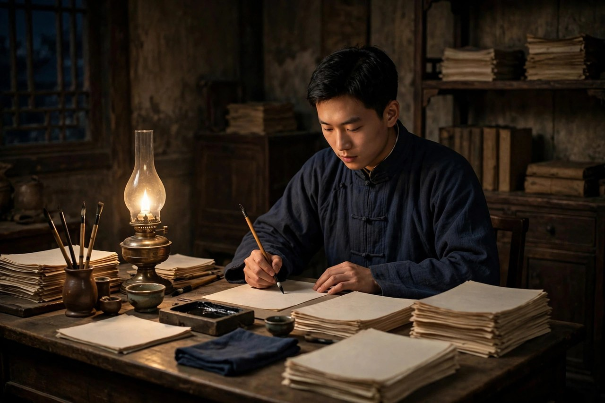

巴金这个名字，今天很多年轻人只在语文课本里见过，觉得他是远处的一尊像。其实把他的书翻开，扑面而来的不是高高在上的说教，而是一个人贴着地面写出来的疼。他写大家庭里被压弯的年轻人，写穷街上饿着肚子还想活得像个人的小职员，写老了以后回头看自己一生、敢把错处摊开给人看的老头子。他一辈子没有离开过普通人，笔尖始终对着那些说不出话的人。这篇文章就讲他这个人：他从哪里来，经历过什么，笔路是怎样变的，为什么到了今天，他的书还是能戳中人心。

### 成都大宅里长大的孩子

巴金原名李尧棠，字芾甘，生于一九〇四年十一月二十五日，成都正通顺街的一座大宅子里。李家是当地有名的官僚地主家庭，屋子大，房多，人更多，长辈、子侄、丫头、仆人挤在一处，规矩比砖墙还密。孩子在这样的宅子里长大，饭桌上有座次，说话有分寸，走路有样子，稍有出格，立刻就有人拿家法和祖训压下来。巴金后来写高公馆，写得那样逼真，根子就在这里：他不是凭空想出来的，他就是在那样的屋檐下长大的，他闻过那屋子里的霉味，听过半夜里丫头的哭声，也见过长辈当面一套背后一套的做派。

他的童年并不安稳。母亲在他年纪还小的时候就去世了，祖父后来也走了，宅子里撑着门面的人一个接一个倒下，留下孩子们面对越来越空的大房子。家里请过先生教书，孩子们读旧书，也偷偷读新书。五四运动的风吹到成都的时候，少年巴金的心被点着了。他开始明白，宅子里的规矩不是天经地义，人的命不该由长辈一句话就定死。后来他离开成都，到上海、南京求学，再到法国留学，路越走越远，心里那团火却越烧越旺。他早年受无政府主义思想影响很深，相信人应当自由、平等、互助，相信旧制度必须被推倒。这份信念后来成了他全部写作的底色：他写书不是为了炫技，是为了给被压住的人出气。

### 出走与远行

一九二三年，巴金离开成都出走，到上海和南京的中学读书。一九二七年，他赴法国留学，在异乡写成了处女作《灭亡》，一九二九年在《小说月报》上发表，开始用巴金这个笔名。笔名的来历有多种说法，流传较广的一种说法是取自他敬佩的两位人物姓氏的组合，具体细节不必深究，重要的是从这时起，一个青年作家的名字开始被读者记住。《灭亡》写一个青年在绝望里寻找出路，文字坦率，情绪滚烫，立刻引起了强烈反响。巴金从此把写作当成一生的事，不再回头。

一九二八年底，他回到上海，从事创作、翻译和编辑工作。此后将近十年，是他创作最旺盛的时期。《家》《春》《秋》陆续写出来，《雾》《雨》《电》陆续写出来，还有《春天里的秋天》《砂丁》《新生》《火》等长篇中篇，加上大量短篇和散文。那时候的上海，书店、报馆、杂志社林立，青年读者渴望新思想，巴金的书正好对上了他们的心。他的小说印了一版又一版，读者来信雪片一样飞来。很多青年说，是读了巴金的书，才敢跟家里讲道理，才敢拒绝一桩包办婚姻，才敢走出家门去找自己的路。这种影响不是虚的，是实实在在改变了许多人的人生选择。

巴金不光自己写，还办刊物、做编辑、搞翻译。他主编过《文学季刊》，担任过文化生活出版社总编辑，推出过不少青年作家的作品。他翻译过屠格涅夫的《父与子》《处女地》，翻译过赫尔岑的回忆录《往事与随想》，把外国文学的好东西搬进中国，让读者眼界更宽。一个人又写又译又编，精力旺盛得惊人。他晚年回忆那段日子，说自己像一台不知疲倦的机器，白天编稿，夜里写作，常常写到天亮。这种拼命不是为了名利，是心里有一股气：旧的东西不倒，新的人就活不出来，他要用笔把旧东西的墙推倒一角，让光透进来。

### 笔是怎样炼成的

巴金的笔有几个鲜明的特点，读过他的书的人一摸就知道。头一个特点是真。他不绕弯子，不玩花样，爱就是爱，恨就是恨，疼就是疼。他写觉新忍气吞声，写得让人恨不得冲进书里摇醒他；他写鸣凤投湖，写得让人胸口发堵；他写汪文宣吐血，写得让人觉得寒夜真的就压在自己屋顶上。他的语言不华丽，甚至有时候显得粗糙，但正因为不修饰，情绪才直接撞到读者心里。有人批评他的文字不够精致，他自己也承认这一点，可读者偏偏吃这一套：因为生活本身就是粗糙的，疼起来不会先打扮好再疼。

再一个特点是，他笔下的人不是纸片。好人身上有软弱，坏人身上也有可怜处。高老太爷专制冷酷，可他也有慈祥温和的时候，也有想维持大家庭完整的苦心；觉新懦弱妥协，可他对弟弟妹妹、对妻子都有真心；汪文宣窝囊，可他善良正直，从没有害过人；曾树生虚荣摇摆，可她对丈夫的感情也是真的。巴金晚年说，写《寒夜》的时候，他同情书里三个人，不把他们写成正面人物，也不写成反面人物，罪在制度，不在个人。这种写法让他的书经得起时间考验：制度会变，人性里的软弱、挣扎、善良、摇摆却一直都在，读者在任何年代都能在书里找到自己。

还有一个特点是，他的书总有一股向前冲的劲。哪怕写的是悲剧，结尾也常常留一线光。《家》结尾觉慧离家出走，奔向上海，奔向未知的前途；《春》结尾淑英到了上海，来信说自己获得了自由；《秋》结尾觉民说没有一个永久的秋天，秋天或者就要过去了。巴金相信，旧的东西再顽固，也挡不住年轻人往前走。他自己就是这样走出来的，所以他写年轻人出走，写得格外有底气。这股劲在今天读起来依然提气：人活着，总要给自己留一个往前走的口子，哪怕口子很小，也比闷死在屋里强。

### 控诉与温情并存

巴金最有名的姿态，是控诉。他在《家》的扉页上写过，他要向一个垂死的制度叫出我控诉。这句话后来成了他的标签，也成了许多读者记住他的理由。他控诉封建大家庭，控诉包办婚姻，控诉礼教吃人，控诉一切把人当成物件、把青春当成祭品的东西。这种控诉不是空喊口号，是拿一个个人物的血泪堆出来的。梅的忧郁而死，瑞珏的难产而死，鸣凤的投湖，蕙的病死，淑贞的跳井，每一个名字背后都是一条被制度碾碎的命。读者读到这里，不可能无动于衷。

可是只讲控诉，就把巴金讲窄了。他的书里还有很浓的温情。他写兄妹之间的扶持，写朋友之间的仗义，写夫妻之间哪怕在穷困里也没有完全熄灭的体贴。他写觉慧对鸣凤的怜惜，写琴对淑英姐妹的耐心引导，写汪文宣和曾树生在破屋里还想给孩子留一点好东西。这些温情不是粉饰，是巴金相信人心里本来就有光，只是被制度蒙住了。把温情写出来，读者才明白他控诉的到底是什么：他控诉的不是人，是把好人逼成坏人、把相爱的人逼成分离的东西。没有温情的控诉容易变成泄愤，有了温情，控诉才有了分量。

对照今天看，巴金的控诉一点也不过时。现在没有高公馆了，可高公馆的影子还在很多地方活着。有的家庭还在用孝顺的名义替孩子定人生，选专业要听长辈的，找对象要看家境的，工作要图安稳的，孩子稍有不同想法，就被扣上不懂事的帽子。有的单位还在用资历和规矩压新人，有想法先憋着，有委屈先忍着，忍到最后把自己忍没了。有的年轻人嘴上说自由，实际上被房贷、彩礼、攀比、面子捆得死死的，活得比高公馆里的少爷小姐还累。巴金的书像一面镜子，照出这些新瓶装旧酒的压迫：换了个名字，道理还是那个道理，人还是要为自己争一口气，争一个能说不的权利。

### 晚年随想录的坦白

巴金晚年最动人的作品，是《随想录》。那是他年过七旬以后陆续写的散文，结集为五卷，后来又有《再思录》。写《随想录》的时候，巴金已经是德高望重的老作家，本可以舒舒服服地接受赞誉，什么都不说。可他偏偏选择了坦白：坦白自己早年怎样随波逐流，怎样在压力下说过违心的话，怎样对不起朋友，怎样在关键时刻没有站出来。他写自己心里有愧，写自己夜里睡不着，写自己想把真相留给后人，让年轻人知道，一个人曾经怎样被时代推着走，又怎样想把自己找回来。

这种坦白在当时需要很大的勇气。很多同辈人选择沉默，他却选择开口。他说过，讲真话是他晚年最大的愿望。他不为自己辩解，不把责任全推给时代，也不把自己打扮成受害者。他把自己放在解剖台上，让读者看一个普通知识分子在风浪里的真实样子。这种诚实，比他早年的小说更难得。小说可以借人物说话，散文坦白只能用自己的名字，错了就是错了，躲不掉。巴金晚年因此赢得了更多人的敬重：人们敬重的不是他的地位，而是他到了老还敢说真话的骨头。

巴金的晚年还做了一件大事：倡议和主持筹建中国现代文学馆。一九八一年，他提出这个倡议，一九八四年被聘为名誉馆长。他想给现代文学留一个家，把作家的手稿、书信、藏书保存下来，让后人能摸到文学的实物。这个心愿背后，还是他一贯的想法：文学不是摆设，是人活过的证据，留下来，才对得起写过书的人和读过书的人。他还担任过中国作家协会主席、全国政协副主席等职务，一九八二年获得意大利但丁国际奖，一九八三年获得法国荣誉军团勋章，二〇〇三年被国务院授予人民作家荣誉称号。这些荣誉他都领了，但他最看重的，还是读者心里那杆秤。

### 为什么今天还要读巴金

有人问，巴金写的是民国的事，今天读他有什么用。答案很简单：他写的问题没有过去，只是换了衣服。包办婚姻变成了包办人生，封建大家庭变成了控制欲强的家庭关系，礼教变成了各种不成文的规矩和面子文化，穷困的小职员变成了在大城市里熬夜加班、工资刚够交房租的年轻人。巴金书里的人，换上今天的衣服，立刻就能在地铁里、地铁口的出租屋里、写字楼的格子间里找到原型。读巴金，不是读古董，是读自己。

读巴金还有一个用处，是学一种态度：不把忍耐当成美德。觉新忍了一辈子，忍到妻子死了，忍到自己心死了，才明白忍耐救不了人。汪文宣忍了一辈子，忍到吐血死了，也没有等来好日子。巴金不是教人去闹事，是教人分清什么是该忍的、什么是不该忍的。生活里的难处要扛，可扛不等于把自己交出去；对长辈要敬，可敬不等于把人生选择权交出去；对工作要负责，可负责不等于把健康和尊严都押上。这条线划不清，人就容易活成觉新和汪文宣的样子：表面上过得去，心里早就空了。

巴金还教人一种温柔的坚定。他笔下的觉慧、淑英、觉民，不是靠吵架赢的，是靠一步步把路走出来的。觉慧先是看清，再是反抗，最后是出走；淑英先是害怕，再是学本事，再是下决心，最后是离开。他们没有一夜之间变成英雄，都是在小事上一点点攒勇气。今天的年轻人也一样，不必一下子跟全世界翻脸，可以先把一件事想明白，先把一个选择握在自己手里，先给自己留一个能喘气的空间。勇气不是天生的，是练出来的，巴金的书就是一本练勇气的书。

### 书桌之外的巴金

很多人只知道巴金写小说，不知道他把同样多的心血花在了翻译和编辑上。翻译在他那里不是副业，是另一种写作。他译屠格涅夫，译赫尔岑，译克鲁泡特金，译很多俄国和欧洲作家的作品，译笔朴素，尽量贴着原文的情绪走，不卖弄文采。他相信，一个民族要长见识，不能只靠自己写，还要把外面的好书搬进来，让读者直接摸到另一种生活的气息。年轻时候的巴金，正是靠读外国书打开眼界的，他后来做翻译，就是想把这条路给后来的年轻人再铺一遍。他的译文到今天读起来，依然顺畅，没有那种隔着一层纱的别扭感，这是因为他译的时候心里想着读者，想着那个坐在灯下、想知道世界是什么样子的青年，而不是想着向同行炫耀学问。

编辑工作更能看出巴金的为人。他办刊物、管出版社，眼光毒，性子急，见不得好稿子被埋没。青年作者把稿子寄给他，他常常认真看，认真回信，指出哪里写得虚，哪里情绪不到位，哪里可以再往深处挖一层。有的青年作家就是靠他的提携才走上文坛的。他自己已经成名，却愿意把版面让给新人，把时间花在改稿、写信、联系出版这些琐事上。这种甘当铺路石的劲头，跟他小说里写的那种利他精神是一脉相承的。他不是站在高处向下看的文学老爷，他是蹲在路边给后来人递水的人。他深知，一个作家的价值不光看自己写了多少，还看有没有帮这个行当留住生气，留住下一代人。

巴金做编辑还有一个特点：不摆架子。作者来信谈创作上的苦恼，他不拿腔调压人，不讲大道理，而是讲自己的失败，讲自己怎样写砸过，怎样被退过稿，怎样在稿纸面前发过愁。这种坦诚让很多年轻人心里踏实：原来大作家也卡过壳，也怀疑过自己，也是一点点熬出来的。文学这条路最怕的就是神话，神话一立起来，新人就不敢动手了，总觉得自己不够格。巴金用自己的经历拆神话，告诉年轻人，写作没有捷径，就是坐下来，一个字一个字写，写不好就改，改不好就再写，写到自己心里过得去为止。这种话听起来朴素，做起来却最难，也最管用。

他的家庭生活同样朴素。他和萧珊结婚后，日子过得并不奢华，家里来往的朋友多是文艺界的人，谈的多是书、是稿子、是朋友的难处。抗战时期生活艰难，他照样写，照样编，照样给朋友帮忙。妻子去世后，他在文章里多次写到对妻子的怀念，语气克制，感情却很深。他不是那种把私生活拿出来炒作的人，写到家人，总是点到为止，留给读者去体会。他把更多的笔墨留给了公共的事：留给了被压迫的青年，留给了说不出话的普通人，留给了文学的未来。这种分寸感，恰恰是他的人格魅力所在：不拿私情博同情，不拿苦难换掌声，只把作品交出来，让作品自己说话。

### 读者心里的巴金

巴金在读者心里的位置，是靠一封封来信堆起来的。早年《家》出版后，大量青年读者给他写信，讲自己的家事，讲自己怎样被包办婚姻捆住，讲自己怎样想出走又不敢出走。巴金认真读这些信，有的还认真回。他从信里知道，自己的书不是写在纸上的空话，是真的有人拿它当救命稻草。这种反馈反过来又推着他写下去：他知道笔下的人物不是虚构的游戏，背后站着成千上万个活生生的人，他们等着在书里看到自己的影子，看到一条出路。一个作家能有这样的读者缘，是福气，也是责任，巴金把这份责任扛了一辈子。

到了晚年，巴金和读者的关系变得更深。很多中年读者带着自己年轻时读《家》的记忆去看他，告诉他当年是怎样偷偷读他的书，怎样因为他的书而改变了人生轨迹。巴金听了，常常很动容，他说自己没有想到，一本写于青年时代的书，能陪伴几代人走那么远。这种陪伴不是单向的灌输，是双向的取暖：读者从书里借勇气，作家从读者那里借信心。文学到了这个份上，就不再是作者一个人的事，而成了一代代人共同的心事。巴金晚年写《随想录》，很大程度上也是写给这些读者的：他想对他们讲真话，想把自己一生里没有说透的话说透，不让读者带着一个被粉饰过的巴金离开。

对照今天的阅读环境，巴金和读者的这种关系尤其值得想想。现在书多，信息多，爆款多，可真正能陪一个人走很远的书并不多。很多书读完就忘，因为它只挠了痒痒，没有碰到疼处。巴金的书不一样，它碰的是人心里最不肯示人的地方：对家庭的爱与恨，对长辈的敬与怕，对自由的渴与惧，对命运的不甘与无奈。这些东西不会过时，因为每一代人都要重新面对一次。父母和子女的关系，个人和集体的关系，理想和饭碗的关系，永远是新的考题，巴金把旧考题的答案写得很诚实，后人读了，至少知道这条路有人走过，知道走过去虽然难，却不是不可能。

还有一点值得今天的写作者学：巴金不追热点，不赶风口。他写《家》，写的是自己熟悉的成都大宅；写《寒夜》，写的是自己在重庆见过的小职员生活；写《随想录》，写的是自己的愧疚和反思。题材都不时髦，可都写得扎实，因为都是从生活里长出来的。现在有些写作，追着热点跑，今天写这个，明天写那个，看起来热闹，读完却留不下什么。巴金提醒后来人，写作的根在生活里，在自己真正疼过、爱过、恨过的地方，不在热搜榜上。把一个自己熟悉的世界写透，比把十个陌生的世界各写一笔更有力量。这句话对今天想写东西的年轻人，依然是一句实在话。

### 一生里的几道坎

巴金的一生不是顺风顺水的坦途，坎一道接一道，关键看他是怎样迈过去的。早年出走成都，看起来潇洒，实际上是把安稳日子扔了，换一条不知道通向哪里的路。那时候家里有房子，有田产，有仆人伺候，留在家里可以过得很舒服，可他偏偏不肯舒服。他心里清楚，舒服的代价是把自己交出去，交出婚姻，交出选择，交出说话的权利。这种清醒在少年人身上很难得：很多人到了中年才明白，舒服有时候是陷阱，巴金在青年时代就明白了，并且立刻行动。这种行动力，后来成了他一生的底色：想明白了就做，做的时候不瞻前顾后，不算计得失。

抗战时期是另一道坎。巴金在后方写作，生活清苦，物价飞涨，稿费常常不够糊口，可他没有停笔，也没有写应景的空话。他写《火》，写《寒夜》，写《憩园》，把后方小人物的日子写得细致入微。那时候写东西不光是谋生，更是记录：记录普通人在战争里怎样吃饭，怎样生病，怎样吵架，怎样相爱，怎样在看不到头的日子里硬撑着活下去。这些记录在当时看来不起眼，时间长了就成了史料，成了后人了解那个年代最生动的材料。巴金的可贵之处在于，他没有因为时代大就只写大人物，他始终盯着小人物，因为他知道，时代的重量最后都压在小人物的肩膀上。

晚年的病痛又是一道坎。帕金森病让他手抖，写字困难，说话也不利索，可他还是坚持口述、坚持修改、坚持把《随想录》写完。身边人劝他休息，他不肯，他说心里有话不说出来，憋着难受。这种坚持不是逞强，是一个写作者对自己最后的负责：趁着还能说话，把该说的话说完，趁着还能思考，把该想明白的事想明白。很多作家晚年封笔，巴金晚年反而写出了最坦诚的文字，这不是偶然，是他一生性格的自然结果：年轻时敢控诉制度，老了就敢解剖自己，刀口向外的时候锋利，刀口向内的时候也不手软。

回头看巴金的几道坎，有一条线始终没有断，那就是对人的信任。他相信青年人，相信普通人心里有善良，有勇气，有改变生活的可能。哪怕写了那么多悲剧，他也没有变成一个愤世嫉俗的人，没有说人性本恶、没救了。他始终相信，只要给人一点光，人就能往光的方向挪一挪。这份信任在今天尤其珍贵：现在很多人动不动就说年轻人不行了、世道坏了、人心凉了，巴金如果在世，大概会摇头。他会说，人心从来不是一下子凉的，是被一次次失望冻住的，解冻的办法也不是喊口号，而是实实在在给人留出路、留尊严、留说话的机会。他的书，就是留出路的一种方式。

把巴金放在中国现代文学的长河里看，他的位置也很清楚。他不是最讲究技巧的作家，不是语言最精致的作家，可他是最能打动普通读者的作家。鲁迅的笔像匕首，巴金的笔像火把：匕首是用来剖开的，火把是用来照路的。两种笔都需要，一个民族的文学不能只有匕首，也不能只有火把。巴金拿火把的那一面，照亮了无数青年出走的路，也照亮了无数家庭内部的暗角。火把的光不刺眼，暖和，持久，风吹不灭，这正是他的书到今天还被人翻开的原因。一个人能用一辈子举着火把，本身就是一种了不起的坚持。

### 读巴金的方法

读巴金不必从理论入手，最好的办法是顺着人物走。读《家》的时候，跟着觉慧走，看他怎样从一个听话的少爷变成敢出走的青年；跟着觉新走，看他怎样一步步把自己逼到墙角；跟着鸣凤走，看一个丫头怎样用死来守住尊严。人物走过的路，就是小说的路，路上的每一个岔口，都是巴金想让读者停下来想一想的地方：换成是你，你会怎么选，你敢不敢说不，你有没有勇气承担选择的后果。带着这样的问题读，书就不再是课本上的篇目，而是一面能照见自己的镜子。很多人读完《家》会哭，哭的不是小说，是哭自己家里也有过类似的压抑，哭自己也曾经像觉新那样忍过，哭自己也曾经想出走却没有走成。

读巴金的散文，可以慢一点。他的散文不追求漂亮句子，追求的是把话说清楚，把心掏出来。读《随想录》，不必一口气读完，可以每天读一两篇，读完放下，想想自己有没有过类似的时刻：有没有在压力下说过违心的话，有没有在朋友需要帮助的时候退缩过，有没有把责任推给时代而忘了自己那一份。这样的阅读不是考试，是自省，是一个人对着另一个坦诚的灵魂，照一照自己的样子。巴金晚年写这些，不是为了让读者崇拜他，是为了让读者敢于面对自己。一个人敢面对自己，才有可能改变自己，这句话说起来容易，做起来需要一辈子的练习。

读巴金的作品，还可以对照着读。把《家》和《寒夜》放在一起读，就能看出巴金笔路的变化：早年写大家庭的崩塌，情绪滚烫，控诉直接；晚年写小家庭的破裂，情绪克制，笔触细腻。把《雾》《雨》《电》放在一起读，就能看出青年从迷茫到坚定的成长线：周如水还在犹豫，吴仁民还在摸索，李佩珠已经能带头往前走了。把小说和《随想录》放在一起读，就能看出一个作家从控诉别人到解剖自己的完整轨迹。这种对照读法，能让读者看到的不是一本孤立的书，而是一个人一生的思想变化，看到文学怎样陪着一个人长大，也陪着一个时代长大。

读巴金最终读到的是一个朴素的道理：人活着，要对得起自己的心，要在还能说话的时候把真话说出来，要在还能选择的时候为自己选一条站得住的路。巴金一生写了那么多书，译了那么多书，编了那么多刊物，归根到底就是在践行这句话。他对不起朋友的时候会愧疚，对不起读者的时候会反省，对不起自己的时候会坦白，这种对得起心的执着，让他的文字有了重量。重量不是来自地位，不是来自荣誉，是来自一个写作者始终没有放下对人的责任。今天的读者合上他的书，带走的不应该只是几个故事情节，而应该是这种重量：做人要讲真话，做事要留尊严，对别人要温柔，对自己要诚实。巴金一生写了那么多书，译了那么多书，编了那么多刊物，归根到底就是在践行这句话。他对不起朋友的时候会愧疚，对不起读者的时候会反省，对不起自己的时候会坦白，这种对得起心的执着，让他的文字有了重量。重量不是来自地位，不是来自荣誉，是来自一个写作者始终没有放下对人的责任。今天的读者合上他的书，带走的不应该只是几个故事情节，而应该是这种重量：做人要讲真话，做事要留尊严，对别人要温柔，对自己要诚实。

### 留给普通人的灯

巴金活了一百零一岁，从一九〇四年走到二〇〇五年十月十七日，在上海逝世。他的一生跨过晚清、民国、抗战、新中国成立后几十年，见过太多大风大浪。他晚年患病，行动不便，说话困难，可心里那盏灯一直没有灭。他留下的《巴金文集》《巴金全集》《巴金译文全集》，卷帙浩繁，够后人读很久。他留下的不只是书，还有一种精神：作家要对普通人负责，要讲真话，要敢于控诉，也要敢于自省。

今天再读巴金，不必把他供起来，也不必把他当成考试要点。把他的书当成一个老朋友的来信来读，就够了。信里说：别怕家里那套规矩，别怕别人说你不懂事，别把一辈子交给别人安排；疼要说出来，爱要争取，错了要认，路要自己走。一个人能把这些话用一辈子写出来，本身就是一件了不起的事。巴金把灯点给了普通人，灯到今天还亮着，照着每一个还想活得像个人的人。只要还有人被压着、被捆着、被逼着忍气吞声，巴金的书就不会过时，他的控诉就还有回声，他的温情就还有去处。这就是他为什么重要，也是这篇文章想说清的全部道理。
