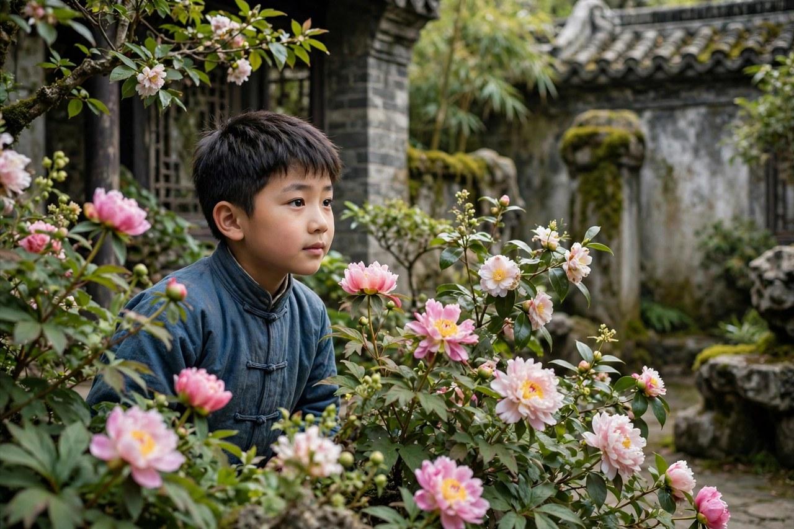
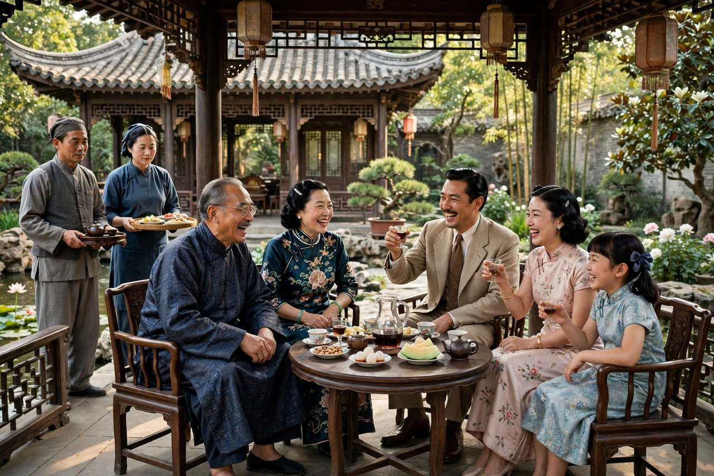

《憩园》是巴金于一九四四年写成的中篇小说，以作家黎先生的亲历口吻叙事全篇，讲述他在抗战中回到大后方的家乡，住进朋友姚国栋家的憩园写小说，结识了姚国栋的续弦万昭华、前妻的儿子小虎以及一众仆人。作品通过一位作家寄居憩园时的所见、所闻、所感，展示了这所大公馆新旧两代主人共同的悲剧命运。旧主人杨老三败光了家产，新主人姚国栋纵容儿子小虎，小虎最后溺死，杨老三最后狱中死去，一座园子，照见了两代人的败落，照见了传财不传德的家风，照见了封建地主阶级的寄生生活对人的腐蚀。巴金写《憩园》，没有像《家》那样大声控诉，而是用一种冷静的、细腻的笔调，一点点剥开园子的真相，让读者自己看，自己疼，自己想。

### 住进憩园的作家

黎先生是《憩园》的叙述者，也是一个作家。他回到家乡，住进朋友姚国栋家的憩园写小说，本来是想找一个安静的写作环境，可他很快发现，憩园并不安静，园子里住着许多人，藏着许多故事，旧主人的影子还在园子里晃，新主人的麻烦也在园子里闹。姚国栋资产丰厚，对作家礼敬有加，温柔善良并崇敬作家的万昭华，有很高文学修养，安静秀丽的憩园，一帮照顾周到的仆人，没有比这更为理想的写作环境了。巴金在《憩园》中对作家生活有一种乌托邦想象：一个作家，如果能住在这样安静秀丽的园子里，有人照顾，有人敬重，有书可读，有故事可写，那该多好。可惜的是，憩园的安静是表面的，园子里的故事，是悲剧的故事，是败落的故事，是让人写不下去、也停不下来的故事。

黎先生在憩园里，结识了姚国栋的续弦万昭华。万昭华温柔善良，有很高文学修养，崇敬作家，对小虎的管教也很用心，可她在这个家里，处境是尴尬的：她是续弦，不是亲生母亲，小虎是前妻的儿子，外婆和父亲都过分宠爱小虎，她的话，小虎不听，她的苦劝，常常无果。她看着小虎一天天骄纵顽劣，看着姚国栋一天天纵容儿子，心里着急，却没有办法。黎先生看着万昭华，看着小虎，看着姚国栋，看着园子里的仆人，看着时常潜入故园偷花的寒儿，一点点揭开了憩园的真相：这座园子，旧主人败了，新主人也在败，败的方式不同，败的根子却相同，都是传财不传德，都是只给孩子留钱，不给孩子留德行，不给孩子立规矩，不给孩子教做人。

黎先生作为叙述者，视角是冷静的，也是同情的。他同情万昭华，同情寒儿，同情杨老三，也同情姚国栋，可他的同情不是和稀泥，是看清了每一个人的局限，看清了每一个人的无奈，看清了制度和家风，是怎样把好人也拖下水的。他写憩园，不是站在高处审判，而是蹲在园子里，听园子里的人说话，看园子里的人做事，把听到的、看到的，原原本本地写下来，让读者自己判断。这种写法，比直接控诉更有力量：读者跟着黎先生走进憩园，跟着他揭开一层又一层的真相，揭到最后，读者自己会明白，憩园的悲剧，不是偶然，是必然，是家风的必然，是寄生生活的必然，是传财不传德的必然。

### 杨老三的败家

杨老三，本名杨梦痴，是憩园的旧主人，是典型的大家庭中的纨绔子弟。他养尊处优，对外界的变化丝毫不关心，终于在吃喝嫖赌中败光祖传的遗产，沦落为乞丐。他年轻时风流自赏，无所事事地靠着父荫度日，年过中年便落魄不堪。他不但花光了父亲留给他那一房的财产，进而拐骗太太的私房钱，还在外面金屋藏娇，让那个姨太太骗光了所有的钱财。他不事生产，过着荒唐糜烂的生活，养姨太太，花光父亲留给他的家产和太太的私房钱，使家人经济陷入困境，妻子和长子为此与他翻脸，家人都看不起他，在决定卖掉憩园时，认为他不配反对卖憩园。长子清儿擅自作主代签，妻儿离他而去，他外出流浪，去吃自己种下的苦果，以减轻自己的罪过。

杨老三的败家，不是一夜之间的事，是一点点败掉的：今天花一点，明天赌一把，后天养个姨太太，大后天再挥霍一把，家底再厚，也经不起这样折腾。他的父亲留给他的是钱，不是德行，留给他的是园子，不是做人的道理。他从小就没有学过怎样挣钱，怎样管家，怎样做人，只学过怎样花钱，怎样享受，怎样摆阔。这种教育，就是传财不传德的教育：只传钱，不传德，钱传下去了，德没有传下去，钱很快就会被败光，人很快就会被败坏。杨老三后来醒悟了，他说自己种的是苦果，自己就得去吃自己的苦果，他拒绝同情，坚决不接受别人的恩惠，他觉得应该要受更大的苦，才对得起死去的老太爷，也才能对得起自己的良心。这种醒悟，来得太迟了，迟到他已经没有办法补救了，迟到他只能用受苦来赎罪，用流浪来惩罚自己，用死亡来结束自己的败落。

杨老三落魄以后，住在一座破庙里，靠着李老汉和小儿子寒儿的接济过日子。他在街上偷面包，被人打得半死；他在大仙祠里装哑巴，躲避别人的同情；他以前的下江姨太太老五给他一张五千块钱的支票，他毅然将支票撕得粉碎，说自己自作自受，心甘情愿地吃自己种的苦果。他后来因为偷窃被下到牢狱，装病不去工作，先是被狱卒毒打，后被送进病房，染上霍乱而死。黎先生重遇杨老三，想向他伸出援手时，他却已经去世了，只留下一个让寒儿盼望、让昭华同情、让读者心疼的影子。杨老三的故事，是《憩园》里最沉痛的一条线：一个曾经风光的少爷，败光了家产，败光了亲情，败光了自己的人生，最后死在狱中，连一个体面的葬礼都没有。他的死，不是偶然，是传财不传德的必然结局，是寄生生活的必然结局，是一个只会花钱、不会做人的人的必然结局。

### 寒儿的寻找

寒儿是杨老三的小儿子，是《憩园》里最让人心疼的人物。他年纪小，却懂事，知道父亲败了家，知道父亲在外面受苦，知道父亲想吃苦果赎罪，可他始终不放弃父亲，苦苦寻找，痴心盼望父亲的自新与归来。他时常潜入故园偷花，不是为了偷东西，是为了看看父亲曾经住过的园子，是为了离父亲近一点，是为了在园子里，找到一点父亲的影子。姚国栋不让寒儿进入憩园，怕他带坏姚家少爷小虎，于是赵青云和李文看到他便要把他撵出去。寒儿被撵，被骂，被赶，可他还是来，还是偷花，还是找父亲，这种坚持，是一个孩子对父亲最朴素的爱：父亲再坏，也是父亲；父亲再落魄，也是父亲；父亲不肯回家，孩子就去找父亲，找遍了园子，找遍了破庙，找遍了大街小巷，也要把父亲找回来。

黎先生和昭华，是寒儿的同情者，愿意帮助和抚慰他，最后却只能无奈地向寒儿隐瞒了杨老三狱中死去的消息，给他留一线希望。这个隐瞒，是善良的，也是无奈的：告诉一个孩子，父亲已经死了，孩子的心会碎；不告诉他，孩子还会继续找，继续盼，继续在希望里活着。黎先生和昭华选择了隐瞒，选择了给孩子留一线希望，这份希望，虽然是假的，却是温暖的，是人性的。巴金写这个隐瞒，写得很克制，没有大段议论，就是一句话，一个眼神，一个没有说出口的真相，读者却能感到疼，感到暖，感到这个世界对孩子，还是有一点温柔的。寒儿的故事，放在今天看，依然有对照：很多孩子，父母犯了错，父母落魄了，父母不在了，孩子还在找，还在盼，还在等父母回来。给孩子留一线希望，不是骗孩子，是保护孩子的心，让孩子在希望里长大，长大了，再慢慢明白真相，慢慢接受现实。

寒儿和姚小虎的对照，是《憩园》里最鲜明的一组对照。寒儿穷，却懂事，知道心疼父亲，知道寻找父亲，知道在苦里坚持；小虎富，却骄纵顽劣，被外婆和父亲过分宠爱，继母苦劝无果，最后溺死在水里。一个穷孩子，活得有情有义；一个富孩子，死得糊里糊涂。对照的背后，是家风的对照：杨家传财不传德，败了；姚家同样传财不传德，也在败。寒儿的穷，没有让他变坏，反而让他长出了担当；小虎的富，没有让他变好，反而让他长出了骄纵。巴金用这组对照告诉读者，钱不是教育的全部，德才是教育的根本，没有德，钱越多，祸越大；没有德，园子越大，败得越快。

### 姚国栋的纵容

姚国栋是憩园的新主人，受过现代西洋教育，做过教授，可在教育儿子的问题上，他却是一个粗人，一个典型的纵容者。他对儿子小虎，纵容溺爱，百依百顺，外婆也过分宠爱小虎，继母万昭华难以管教，苦劝无果。姚国栋喜爱高谈阔论，却从来不曾认真做过一件对人、对社会有益的事，是个典型的二世祖，漫无目的的生活态度，是那个时代中的悲剧人物。他自命不凡，自命清高，自号涌诗，却没有半点诗的韵味，他平日喜欢发几句无关痛痒的牢骚，批评别人，却宽待自己，他凡事都认为很有把握，却把握不了对儿子的管教。黎先生责备姚国栋教子不当，姚国栋却没有意识到自己的错误，反而强词夺理，为自己找借口，正因为这样的态度，所以当赵老太太再度派人来接小虎去游泳时，他始终未加以劝阻，为小虎溺毙这一下场种下了前因。当姚国栋接到小虎的噩耗时，他说自己也该负责，确实是如此，可负责的话，说得太迟了，迟到儿子已经死了，迟到园子已经成了悲剧的现场。

姚国栋的纵容，不是偶然，是家风的延续。他自己就是从寄生生活里长大的，自己就没有受过严格的教育，自己就没有学会怎样做人，怎样负责，怎样管教孩子，他把自己的纵容，当成了疼爱，把自己的放任，当成了开明，把自己的不管，当成了尊重。结果是，小虎越长越骄纵，越长越顽劣，越长越不知道天高地厚，越长越不知道危险在哪里，最后在一次游泳中溺死，死得糊里糊涂，死得让人惋惜，也让人愤怒。巴金写姚国栋的纵容，写得很冷静，没有大骂，没有嘲笑，就是把事情一件件摆出来，让读者自己看，自己气，自己想：一个父亲，怎样把自己的儿子，一步步推向死亡，推的时候，还觉得自己是在疼儿子。这种疼，比恨更可怕，因为恨是明着害，疼是暗着害，害的时候，还打着爱的旗号。

姚国栋的纵容，放在今天看，依然有对照。现在很多父母，同样在纵容孩子：孩子要什么给什么，孩子犯了错不批评，孩子闯了祸给兜底，孩子不学习不管，孩子不讲理不教，美其名曰爱孩子，实际上是在害孩子。纵容的孩子，长大了不知道规矩，不知道责任，不知道危险，不知道别人的感受，走到社会上，会碰壁，会闯祸，会付出更大的代价。巴金写姚国栋，就是写给今天的父母看的：爱孩子不是纵容孩子，爱孩子是管教孩子，是给孩子立规矩，是教孩子做人，是让孩子知道，什么能做，什么不能做，什么是危险，什么是责任。管教的时候，孩子可能会哭，可能会闹，可能会恨父母，可管教的疼，是短暂的疼，纵容的疼，是长久的疼，是像小虎那样，用命来疼的疼。

### 传财不传德

传财不传德，是《憩园》的主题，也是巴金对封建地主阶级家风最深刻的解剖。杨家传财不传德，杨老三败了；姚家传财不传德，小虎死了；两代人，两个家，同一个根子，同一个结局。传财，就是只给孩子留钱，留房子，留园子，留田产，不给孩子留德行，不给孩子留本事，不给孩子留做人的道理。传德，就是给孩子留德行，留本事，留责任心，留同情心，留面对困难的勇气，留做人的底线。钱会花光，园子会卖掉，田产会败掉，德行不会花光，本事不会卖掉，底线不会败掉。巴金写《憩园》，就是写这个道理：一个家，要想传下去，靠的不是钱，是德；一个孩子，要想立起来，靠的不是园子，是德行。

传财不传德的家风，在今天依然存在。有的家庭，给孩子留了房子，留了存款，留了公司，可没有给孩子留德行，没有教孩子怎样做人，怎样负责，怎样体谅别人，怎样面对失败。孩子长大了，有钱，却没有德，有园子，却没有心，有学历，却没有担当，走到社会上，碰壁了，闯祸了，败家了，父母才后悔，才明白，钱传下去了，德没有传下去，传下去的钱，反而成了祸。巴金写《憩园》，就是写给这些家庭看的：留钱之前，先留德；盖园子之前，先立规矩；给孩子买东西之前，先教孩子做人。德行不是空话，是每天的生活：吃饭的时候讲规矩，做事的时候讲责任，对人的时候讲体谅，犯错的时候讲担当。这些小事，加在一起，就是德，就是一个家真正能传下去的东西。

《憩园》的结尾，是悲凉的，也是温暖的。悲凉的是，杨老三死了，小虎死了，园子还在，人却散了，悲剧已经发生了，补不回来了。温暖的是，寒儿还在找，还在盼，还在希望里活着；黎先生还在写，还在记录，还在把憩园的故事写下来，让后人知道；昭华还在同情，还在抚慰，还在给孩子留希望。这些温暖，虽然微弱，却是巴金留给读者的光：家风败了，可以改；园子败了，可以重建；孩子错了，可以再教；只要还有人愿意讲德，愿意管教，愿意同情，愿意记录，憩园的悲剧，就不会重演。### 万昭华的处境

万昭华是《憩园》里最让人同情的女性。她温柔善良，有很高文学修养，崇敬作家，对小虎的管教也很用心，可她在这个家里，处境是尴尬的：她是续弦，不是亲生母亲，小虎是前妻的儿子，外婆和父亲都过分宠爱小虎，她的话，小虎不听，她的苦劝，常常无果。她看着小虎一天天骄纵顽劣，看着姚国栋一天天纵容儿子，心里着急，却没有办法。她想管，管了会被说成后妈心狠；她不想管，不管又会被说成后妈不管事。进退两难，就是续弦母亲的处境，就是万昭华的处境。巴金写万昭华，写得很温柔，也很愤怒：温柔是对着万昭华这个人，愤怒是对着那个把续弦母亲逼到进退两难的家风，是对着那个只讲血缘、不讲道理的家庭观念。

万昭华和寒儿的关系，是《憩园》里最温暖的一条线。她同情寒儿，愿意帮助和抚慰他，愿意给寒儿留一线希望，愿意在寒儿找父亲的时候，递一句话，递一点温暖。她对寒儿的好，不是出于血缘，是出于同情，是出于一个善良的人，对另一个苦命的孩子的本能的好。这种好，比血缘更可贵，因为它是不求回报的好，是明知帮不上大忙、还是要帮的好。今天的继父母，同样面临万昭华的处境：管孩子，会被说成心狠；不管孩子，会被说成冷漠；对孩子好，会被说成讨好；对孩子不好，会被说成虐待。进退两难的时候，最好的办法，就是像万昭华那样，凭良心做事，凭善良做事，不求所有人理解，只求自己问心无愧。问心无愧了，孩子长大了，自然会明白，自然会感激，自然会把这份好，记在心里。

万昭华的文学修养，也是《憩园》里一盏微弱的灯。她读过书，有修养，崇敬作家，喜欢跟黎先生谈文学，谈文章，谈外面的世界。她的修养，在憩园这个暮气沉沉的园子里，像一缕清风，吹进来一点新的气息。可惜的是，修养在憩园里，是没有用的：修养管不了小虎，修养改不了姚国栋，修养救不了杨老三，修养只能让万昭华自己，在园子里多一点清醒，多一点痛苦，多一点无奈。巴金写万昭华的修养，不是为了炫耀，是为了说明，个人的修养，在一个败坏的家风里，是无力的，家风不改，修养再高的人，也只能看着悲剧发生，看着孩子溺死，看着园子败落。改变家风，靠的不是一个人的修养，靠的是一家人的觉醒，靠的是父亲、母亲、外婆、孩子，一起改，一起立规矩，一起讲德行。

### 憩园的园子

憩园这座园子本身，就是《憩园》里最重要的意象。园子安静秀丽，有花，有树，有水，有亭子，有回廊，是一个让人想住下来、想写东西、想过安静生活的地方。旧主人杨老三住在这里的时候，园子是风光的，是体面的，是杨家门面的象征；新主人姚国栋住在这里的时候，园子还是秀丽的，还是安静的，可园子里的气息已经变了：旧主人的影子还在，新主人的麻烦也在，园子的秀丽，掩盖不住园子里的悲剧，园子的安静，掩盖不住园子里的哭声。巴金写园子，写得细致而冷峻：花还是开的，树还是绿的，水还是清的，可住在园子里的人，心已经不在园子里了，心在别处，在败落里，在纵容里，在寻找里，在溺死里。园子越美，悲剧越疼，美和疼对照在一起，才是《憩园》的味道。

园子的买卖，也是《憩园》里一条暗线。杨家卖园子，卖的是祖产，卖的是体面，卖的是一个家的根；姚家买园子，买的是风光，买的是门面，买的是一个新家的开始。卖园子的人，觉得卖掉园子，就能还清债务，就能重新开始，可卖掉园子以后，杨老三还是落魄了，还是流浪了，还是死了，园子卖了，根还是断了，人还是败了。买园子的人，觉得买下园子，就能过上体面的生活，就能给孩子一个好的环境，可买下园子以后，姚国栋还是纵容了，小虎还是溺死了，园子买了，祸还是来了。园子的买卖告诉读者，园子不是家的根本，德行才是家的根本，没有德，园子再美，也会败；有了德，没有园子，也能过好日子。今天很多家庭，拼命给孩子买房子，买学区房，买大园子，却忘了给孩子立德，忘了教孩子做人，结果房子买了，孩子还是败了，园子买了，家还是散了。巴金写园子，就是写给这些家庭看的：园子重要，德行更重要，德行没有了，园子就是一座空壳，空壳再美，也住不下人心。

园子的花，还有一个特别的意象：寒儿时常潜入故园偷花。偷花不是偷东西，是偷一点父亲的影子，是偷一点过去的美好，是偷一点园子里的温情。花在园子里开着，开给旧主人，也开给新主人，开给寒儿，也开给小虎，可花开的时候，旧主人已经流浪了，新主人的儿子已经溺死了，花还在开，人已经散了。花的意象，是《憩园》里最诗意的一笔，也是最悲凉的一笔：花无情，人有情，花年年开，人却回不来了。读者读到偷花，应当明白，园子里的花，是留不住人的，留得住人的，是德，是爱，是管教，是同情，是像寒儿那样，在苦里还不放弃希望的心。

### 李老汉的善良

李老汉是《憩园》里一个不起眼、却很动人的人物。他照顾落魄的杨老三，接济寒儿，给杨老三一个栖身的地方，给寒儿一点温暖，一点吃的，一点住的，一点人情味。他的善良，不是大善，是小善，是每天的一点饭，一点水，一点地方住，一点不嫌弃，一点不赶走。小善加在一起，就是大善，就是一个落魄的人，在寒夜里还能活下去的理由。巴金写李老汉，写得很简洁，没有大段铺陈，就是一句话，一个场景，一个接济的动作，读者却能感到暖，感到这个世界对落魄的人，还是有一点温柔的。李老汉的善良，放在今天，依然值得学：善良不一定是捐大钱，不一定是做大事，可以是给一个人一口饭，给一个孩子一点温暖，给一个落魄的人一个不嫌弃的眼神，这些小善，加在一起，就能救一个人，就能暖一个园子。

李老汉和杨老三的关系，也值得细看。杨老三曾经是园子的主人，是风光的少爷，李老汉曾经是园子里的下人，是伺候主人的人，可杨老三落魄以后，主仆关系倒过来了：下人成了接济主人的人，主人成了靠下人接济的人。这种倒置，是《憩园》里最讽刺、也最温暖的一笔：讽刺的是，曾经风光的主人，落魄到要靠下人接济；温暖的是，下人没有记仇，没有落井下石，没有把主人赶走，而是接济他，照顾他，给他留一点尊严。李老汉的善良，没有讲大道理，没有谈家风，没有谈德行，就是凭良心做事，凭善良做事，凭一个人对另一个人的本能的好。这种好，比任何家风都管用，比任何园子都持久，因为它是不求回报的好，是明知对方还不起、还是要帮的好。今天的人，同样需要李老汉式的善良：对落魄的人，不嫌弃，不赶走，不落井下石，给一点饭，给一点地方，给一点尊严，善良虽然小，却能救人，救了人，善良就没有白费。

### 憩园的仆人们

憩园里的仆人们，是《憩园》里一条暗线，平时不显眼，到了关键时刻，全都站出来了。赵青云和李文，看到寒儿便要把他撵出去，是听姚国栋的话，是怕寒儿带坏小虎，他们的撵，是执行命令，是保住饭碗，是无奈，也是冷漠。仆人们的冷漠，不是天生的，是被家风教出来的：主人让撵，就撵；主人让赶，就赶；主人让闭嘴，就闭嘴。仆人们没有说话的权利，没有选择的权利，只能听主人的话，听来听去，就听成了冷漠，听成了麻木。巴金写仆人们，不是为了批评他们，是为了说明，家风败了，仆人也会跟着败，园子败了，仆人也会跟着冷，冷到最后，园子里就没有一点人情味了，就只剩规矩和命令了。

仆人们的故事，放在今天，依然有对照。现在很多单位、很多家庭，同样有仆人式的员工、仆人式的下属：领导让做什么，就做什么；领导让撵谁，就撵谁；领导让闭嘴，就闭嘴。做久了，人就麻木了，就冷漠了，就失去了自己的判断，失去了自己的善良。巴金写憩园的仆人，就是写给这些人看的：听话不是美德，盲目听话是帮凶，真正的好下属、好员工，是有自己的判断的，是敢在关键时刻说一句公道话的，是敢给寒儿留一点同情的。仆人们如果都像李老汉那样，有一点善良，有一点判断，憩园的悲剧，也许就不会那么冷，也许寒儿就不会被撵得那么惨，也许杨老三就不会死得那么孤独。善良不是主人的专利，是每一个人的权利，是每一个仆人、每一个下属、每一个普通人，都可以有的权利，有了善良，园子才有温度，没有善良，园子再美，也是一座空壳。

### 憩园的夜

憩园的夜，是安静的，也是悲凉的。夜里，园子里的花还在开，树还在绿，水还在清，可住在园子里的人，心已经不在园子里了：姚国栋在为小虎的死后悔，万昭华在为管教的无力叹气，黎先生在为杨老三的死难过，寒儿在为父亲的下落盼望，仆人们在为明天的饭碗发愁。夜越深，园子越安静，安静里藏着的悲剧，就越疼。巴金写憩园的夜，写得很冷静，没有大段渲染，就是一句话，一个场景，一个夜里没有睡着的人，读者却能感到疼，感到冷，感到这个园子，虽然美，却已经是一座空壳了，空壳里住着的人，心都散了，散了的园子，再美，也只是一座园子，不再是一个家了。夜会过去的，天会亮的，园子里的悲剧，虽然发生了，却不会重演，只要还有人愿意讲德，愿意管教，愿意同情，愿意记录，憩园的夜，就不会永远黑下去。

### 憩园的花

憩园的花，是园子里最美的风景，也是寒儿最喜欢的东西。寒儿时常潜入故园偷花，偷的不是花，是父亲的影子，是过去的美好，是园子里的温情。花在园子里开着，开给旧主人，也开给新主人，开给寒儿，也开给小虎，可花开的时候，旧主人已经流浪了，新主人的儿子已经溺死了，花还在开，人已经散了。花的意象，是《憩园》里最诗意的一笔，也是最悲凉的一笔：花无情，人有情，花年年开，人却回不来了。读者读到偷花，应当明白，园子里的花，是留不住人的，留得住人的，是德，是爱，是管教，是同情，是像寒儿那样，在苦里还不放弃希望的心。花会谢的，人会走的，德不会谢，爱不会走，德和爱留下来了，园子就还在，家就还在，希望就还在。

### 憩园的门

憩园的门，是开着的，也是关着的。开着的时候，寒儿可以潜入偷花，黎先生可以住进来写小说，姚国栋可以带着朋友回家，园子里的故事，可以流进来，也可以流出去。关着的时候，寒儿被撵出去，小虎被关在园子里宠坏，杨老三被关在园子外面流浪，园子里的悲剧，就被关在园子里，关到最后，关出溺死，关出狱死，关出一座园子的败落。门的开合，决定了园子的命运：门开着，园子就有生气，就有外面的风，就有新的想法；门关着，园子就只有暮气，只有旧的规矩，只有传财不传德的家风。今天的家庭，同样有一扇门：门开着，孩子就能出去见世界，就能交朋友，就能长见识；门关着，孩子就只能在园子里长大，长到最后，长成小虎那样，骄纵顽劣，不知道危险，不知道责任。开门吧，让孩子出去，让风进来，让园子活起来，活起来的园子，才不会败。

合上《憩园》，读者应当带走一句话：留给孩子最好的东西，不是园子，不是钱，是德，是做人的道理，是面对苦果的勇气，是像寒儿那样，在苦里还不放弃希望的心。

