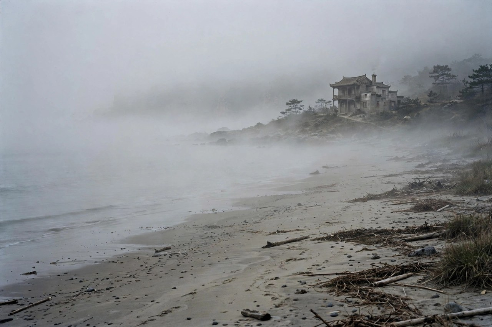
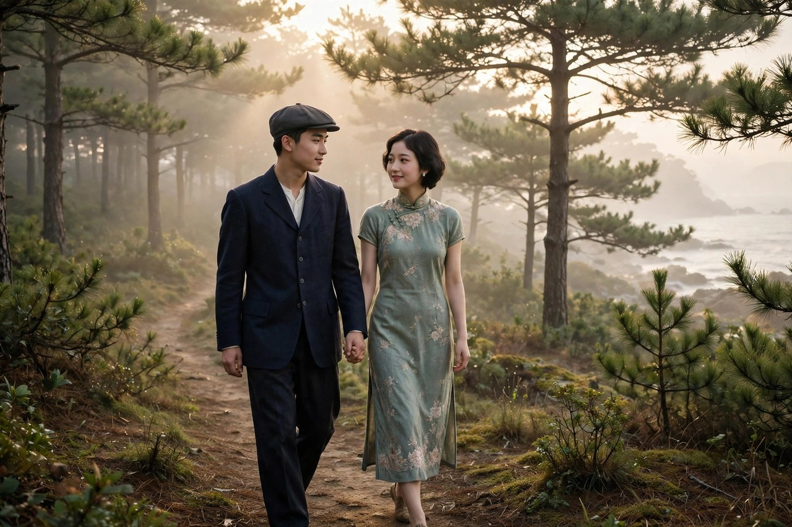

《雾》是一九三一年在《东方杂志》上连载的中篇小说，同年十一月由上海新中国书局出单行本，是爱情三部曲的开篇。巴金自己说，三部曲里写的，主要是人，是性格，他想用恋爱来表现一些人的性格。《雾》的主人公周如水，就是一个软弱的、优柔寡断的人。他的故事不复杂，却让人读完心里发堵：一个人在海滨旅馆里，遇见了真正喜欢的人，两个人情投意合，谈思想，谈文章，一起看日出，一起散步，眼看就要走到一起了，可他偏偏因为家里的旧牵绊，因为自己的软弱，把爱情亲手推开了。推开以后，他后悔，他重游故地，可喜欢的人已经嫁作他人妇了，留下他一个人在海边独自悔恨。雾这个书名，取得很准：周如水的人生，就是一场雾，雾里看不清自己，也看不清前路，走着走着，就走丢了。

### 海滨旅馆的相遇

周如水从日本留学归来，住在一家海滨旅馆里，准备从事童话创作。他思想倾向革命，信奉一种土还主义，认为所有觉悟了的人都应当离开都市，到乡村去工作，去办农场，办学校，办合作社，去教导农民，帮助农民，这是将来新社会的萌芽。可是他又怕到乡村被人捉去，说他们是共产党，把他们砍了头，所以从来也没有真正去过乡村。他的思想，就是这样停在嘴上，停在雾里，想得多，做得少，谈得多，走得少。这种停在嘴上的理想，成了他一生的写照：他什么道理都懂，什么路都指得出来，就是自己不走。

在海滨旅馆里，他遇见了张若兰，一个美丽温柔的女大学生，学教育的，跟他志趣相投。两个人一见钟情，在一起谈思想，谈文章，一起到海滨观日出，一起到树林里散步，情投意合，十分愉快。若兰是那种小资产阶级女性，温柔，娇美，有自己的想法，也敢表达自己的感情。她对周如水有好感，也愿意主动一点，愿意给这段感情一个机会。可周如水心里有一个结，解不开：他在十七岁那年，由父母包办结婚，娶了一个他不爱的妻子，次年有了个男孩。随后是五四运动，他去日本留学，七年间，他从未收到不识字的妻子的一封信，他在家信中也从不提到妻子。然而每当他同一个女子接触时，便会想起家中还有一个他所不爱的妻子和一个不认识的儿子。为此，他甚至宁愿看着他所爱的一个日本姑娘同别人订婚，而不敢接受她的爱情。回国后，面对若兰，他又陷入了同样的困境。

周如水和若兰的相遇，写得清新而悲凉。海滨的风，旅馆的灯，日出的光，树林的静，都是美的，可美的东西，放在一个软弱的人手里，也会变凉。巴金写这段相遇，没有写成俗套的才子佳人，而是写成一种映照：若兰的勇敢，照出了周如水的软弱；若兰的主动，照出了周如水的退缩；若兰的真心，照出了周如水的犹豫。读者读到这里，会替若兰着急，也会替周如水着急：话都到嘴边了，为什么不说出来，感情都到这一步了，为什么不迈出一步。答案是，周如水被旧家庭、被良心、被舆论压住了，他怕对不起父母，怕对不起妻儿，怕被人说不负责任，怕来怕去，就把自己的幸福怕没了。

### 陈真的直话

周如水的两个朋友来看望他，一个是叛离了温暖富裕的家庭，以一种苦行式的生活为事业献身的陈真，另一个是有着幸福家庭生活的吴仁民。陈真这个人，性格直，说话不绕弯子，他看出了周如水的心结，直接问他，你究竟需要不需要女人。陈真还告诉若兰真相，鼓励她主动向周如水表白，帮助他摆脱家庭束缚。陈真的直话，像一把刀，剖开了周如水心里的雾：你到底要什么，你到底敢不敢要，你到底是被家庭绑住了，还是被自己的软弱绑住了。陈真自己就是摆脱了家庭束缚的人，他叛离了富裕的家庭，过着苦行的生活，为事业献身，他用自己的行动告诉周如水，家庭不是不能摆脱的，关键看你敢不敢摆脱，愿不愿意付出代价。

吴仁民跟陈真不一样，他有着幸福的家庭生活，他看周如水，更多的是同情，是劝慰，是希望他能从狭窄的爱情中挣脱出来。两个朋友，两种态度，加在一起，就是周如水面前的两条路：一条是陈真那样的，彻底摆脱，彻底献身；一条是吴仁民那样的，守住家庭，守住幸福。周如水哪一条都没有选，他选了另外一条路：什么都不选，拖着，耗着，等着，等到若兰走了，等到自己后悔了，才明白自己选错了。巴金写两个朋友，不是为了凑人数，是为了让读者看到，周如水的软弱，不是因为没有人帮他，不是因为没有路给他选，是因为他自己不敢选。帮他的人有了，路也摆在他面前了，他就是不敢迈步。

陈真告诉若兰真相的举动，在当时是很大胆的。他把周如水家里的情况，原原本本地告诉若兰，让若兰自己判断，自己选择。这种坦诚，在今天看也很值得学：感情里最怕的，就是瞒着，瞒着自己的婚史，瞒着自己的家庭，瞒着自己的真实处境，瞒到最后，瞒出一个大窟窿，害人害己。陈真的做法，是把真相摊开，让若兰在知道真相的情况下，还愿意主动表白，还愿意给周如水一个机会。这份主动，是若兰的勇敢，也是陈真的仗义。可惜的是，周如水辜负了这份勇敢和仗义，他在若兰主动表白的时候，欣喜若狂，可一想到家中的父母、妻儿，他又陷入了痛苦的深渊，父母、良心和社会舆论的压力使他无法解脱自己，最后，他伤心地对若兰说，自己是一个懦弱的人，今生是没有缘份了，自己应该回家去，责任是在那里。

### 父亲的来信

父亲的来信，是压垮周如水的最后一根稻草。父亲在信里说，母亲生病，要他马上回去，并且已经替他在省财政厅谋到了一个职位。周如水既不愿违拗父母的意愿，更舍不得离开若兰，可他最后还是选择了回家，选择了责任，选择了那个他并不爱的家庭。父亲的来信，代表的是旧家庭的权威，代表的是父母之命，代表的是那种用亲情绑架选择的逻辑：母亲病了，你就应当回去；父亲给你谋了职位，你就应当接受；家里有妻儿，你就应当回去尽责任。这些话听起来都有道理，可合在一起，就是把周如水的人生选择权收走了：他不是在为自己选，是在为父母选，为家庭选，为舆论选。选来选去，他选了一个自己不想要的人生。

周如水回家的决定，放在今天看，依然有对照。现在很多年轻人，同样面临父亲的来信式的压力：父母生病了，你就应当回老家；父母给你安排了工作，你就应当接受；家里给你定了婚事，你就应当认命。这些压力，打着亲情的旗号，实际上是在收走年轻人的选择权。亲情不是这样用的，亲情应当是支持，不是绑架；应当是商量，不是命令；应当是给年轻人留空间，不是把年轻人推进一个他不想要的人生。周如水的悲剧，就是没有分清亲情和绑架的区别，把绑架当成了责任，把顺从当成了孝顺，结果害了自己，也害了若兰。读者读到这里，应当记住一句话：孝顺不是交出人生，责任不是牺牲幸福，一个真正爱你的父母，不会希望你用一辈子的不幸来换他们的安心。

周如水回家以后，过得并不好。他没有真正去乡村，没有真正去实现自己的土还主义，没有真正去从事童话创作，他只是在家里熬着，在旧家庭的规矩里熬着，在对若兰的怀念里熬着。熬了一年，他又回到海滨旅馆，故地重游，想寻觅失去的爱情，可若兰已经同别人结婚了，父亲在来信中说，妻子已于两年前患病身故，因恐他在外伤心，故未早告。周如水读完父亲的信后，叹息着，承认自己错了，并且拔步向前走。这个结尾，是巴金留给周如水的希望，也是留给读者的希望：错了不要紧，要紧的是承认错了，并且向前走。周如水向前走的背影，虽然孤独，却比站在原地犹豫要强。向前走，才有可能遇见新的生活，站在原地，只会一直站在雾里。

### 雾里的人生

雾这个意象，在小说里反复出现，不光是海滨的雾，更是周如水心里的雾。他心里有雾，所以看不清自己要什么，看不清若兰的心，看不清家庭的真相，看不清前路的方向。他谈理想，谈得头头是道，可一落到行动上，就雾了；他谈爱情，谈得情真意切，可一落到选择上，就雾了；他谈乡村，谈得宏大，可一落到去乡村的路上，就雾了。这种雾，不是天气的雾，是性格的雾，是软弱的雾，是优柔寡断的雾。巴金用雾做书名，就是用雾做周如水的性格写照：一个活在雾里的人，走不出雾，就走不出自己的人生。

雾里的人生，在今天也很常见。很多人活在雾里：不知道自己喜欢什么，不知道自己要什么，不知道自己该往哪里走，每天重复同样的生活，每天说同样的话，每天做同样的梦，梦醒了，还是不知道该怎么办。雾里的人，最怕的不是没有路，是不敢走路，是怕走错路，是怕被人笑话，是怕付出代价，于是就站在雾里，等着雾自己散。雾是不会自己散的，雾散的办法，是走起来，是迈出一步，是像周如水最后那样，拔步向前走。走起来，风就来了，风来了，雾就散了。周如水的教训，就是站在雾里等雾散的教训：等了一年，若兰走了，妻子死了，机会没了，雾还在。等，是等不来春天的，等来的，只有后悔。

巴金写《雾》，不是为了嘲笑周如水，是为了提醒读者，不要活成周如水。他在序言里说，三部曲里写的，主要是人，是性格，他想用恋爱来表现性格。周如水的性格，就是软弱，就是优柔寡断，就是想得多、做得少。巴金把这种性格写出来，是想让读者照照镜子：自己身上有没有周如水的影子，有没有在感情里犹豫过，有没有在选择面前退缩过，有没有把本该说出来的话咽回去过。照见了，就改，改了，就还有机会。周如水最后向前走了，读者也应当向前走，不要在雾里站太久，站久了，人会习惯雾，会觉得雾就是正常，会把错过当成命运。错过不是命运，是选择，选择错了，可以再选，只要人还愿意向前走。

### 若兰的勇敢

若兰在《雾》里，是最值得敬重的人物。她温柔，娇美，学教育，有自己的想法，也敢表达自己的感情。她对周如水有好感，就愿意主动一点，愿意给这段感情一个机会，愿意在陈真告诉她真相以后，还主动向周如水表白，还愿意帮助他摆脱家庭束缚。这种主动，在当时是很大胆的：一个女大学生，主动向一个有妻室的男人表白，主动说出自己的心意，主动承担被拒绝的风险，这份勇敢，比周如水的犹豫，不知道要强多少倍。巴金写若兰，不是把她写成一个等待被拯救的弱女子，而是写成一个敢爱、敢说、敢承担的女性，她的勇敢，照出了周如水的软弱，也照出了当时很多女性的处境：女性不是没有勇气，是勇气常常被男人的软弱辜负了。

若兰最后嫁作他人妇，这个结局，让很多读者惋惜，也让很多读者愤怒：好好的一个人，为什么就嫁给别人了，为什么不等周如水，为什么不继续等下去。答案很简单：若兰等过了，等的时间够长了，等到周如水回家了，等到周如水选择了责任、选择了家庭、选择了回家，她再等下去，等来的也只是失望。她嫁给别人，不是背叛，是清醒，是一个女性在看清对方不敢承担以后，为自己做出的选择。她没有错，她只是不再把自己的幸福，押在一个不敢承担的人身上了。这种清醒，在今天依然值得学：爱情里最怕的，就是一个人一直在等，等对方长大，等对方勇敢，等对方做出选择，等着等着，自己的青春就等没了。若兰的故事告诉读者，等要有期限，期限到了，对方还不敢承担，就应当像若兰那样，转身离开，去找一个敢承担的人，去过自己的生活。

若兰的勇敢，还体现在她对真相的态度上。陈真把周如水家里的情况告诉她，她没有被吓跑，没有立刻翻脸，没有骂周如水是骗子，而是认真听，认真想，认真判断，判断以后，还愿意给周如水一个机会。这种态度，是成熟的，是理性的，是把感情建立在真相上的，而不是建立在幻想上的。今天的感情，同样需要这种态度：谈恋爱之前，要把真相摊开，要把婚史、家庭、经济、打算，都摊开来说，摊开了，还愿意在一起，那才是真心；瞒着，还假装在一起，那是迟早要爆的雷。若兰给后来人做了一个示范：勇敢不是盲目，勇敢是知道真相以后，还敢选择，还敢承担，还敢在对方退缩的时候，为自己转身。这种勇敢，比周如水的犹豫，更值得读者记住。

### 周如水的童话梦

周如水准备从事童话创作，这个细节，在《雾》里很有意思。童话是给孩子看的，是美好的，是纯真的，是相信善良终将战胜邪恶的。周如水想写童话，说明他心里还有美好，还有纯真，还有对新世界的向往，可他写童话的计划，也停在了嘴上，停在了雾里，从来没有真正写出来过。他的童话梦，跟他的土还主义一样，都是想得多、做得少，都是停在理想里，没有落到行动上。巴金写这个细节，是想告诉读者，一个人的理想，如果只停在嘴上，只停在梦里，就永远只是童话，永远不会变成现实。童话要变成现实，靠的不是做梦，是动手，是像陈真那样，叛离家庭，苦行献身，是像若兰那样，主动表白，敢于承担，是像吴仁民后来那样，从雾里走出来，从雨里走出来，走到电里去。

周如水的童话梦，放在今天看，也很有对照。很多年轻人，同样有一个童话梦：想写书，想创业，想环游世界，想过一种自由的生活，可梦做了很多年，行动却很少，总是说等有钱了再说，等有时间了再说，等条件成熟了再说，等着等着，梦就老了，人也老了，童话就变成了笑话。巴金写周如水，就是写给这些年轻人看的：梦不是等来的，是做出来的，做不出来，梦就是雾，雾散了，梦也就没了。做出来的办法，不一定是惊天动地的大事，可以是每天写一点，可以是先迈出一小步，可以是先把话说清楚，先把路选定，先把一个小目标完成。小步积累起来，童话就慢慢变成现实了。周如水最后向前走，就是从童话梦里醒过来，开始走路的起步，虽然晚了，却是他一生里最有力的一步。

童话梦还有一个更深的意义：它说明周如水心里，本来是有光的，本来是有美好的，本来是有希望的，只是这光被雾遮住了，被软弱遮住了，被旧家庭遮住了。光被遮住，不等于光灭了，只要人愿意走起来，愿意把雾拨开，光就会重新亮起来。周如水最后向前走，就是拨开雾的起步，拨开了一层，后面还有很多层，可只要开始拨，雾就会越来越薄，光就会越来越亮。读者读到这里，应当明白，自己的童话梦，也是一样的：梦还在，心里就还有光，光还在，就不要放弃，就要走起来，拨开雾，走到晴天里去。巴金写《雾》，不是要熄灭读者的童话梦，是要提醒读者，童话梦要靠行动来实现，行动起来了，雾就散了，童话就成真了。

### 雾散的方法

雾散的方法，巴金在《雾》里写得很清楚：不是等，是走，是说，是选。等雾散的人，雾永远不会散；走起来的人，风就来了，风来了，雾就散了。走的方法，不一定是出走上海，不一定是叛离家庭，不一定是惊天动地的大事，可以是先把话说清楚，先把路选定，先把一个小目标完成，先跟一个人谈谈心，先读一本书，先做一件实实在在的事。小步积累起来，雾就薄了，薄到最后，雾就散了。周如水最后向前走，就是雾散的开始：他承认自己错了，他拔步向前走，这一步虽然晚了，却是他一生里最有力的一步。晚一步，总比不走要好，走一步，总比站着要好，站着的人，雾会越积越厚，走着的人，雾会越走越薄。

雾散的方法，还包括坦诚。周如水的雾，很大程度上是瞒出来的：瞒着若兰自己的婚史，瞒着家里自己的真实想法，瞒着朋友自己的软弱，瞒来瞒去，雾就越积越厚，厚到自己也看不清自己了。陈真把真相告诉若兰，就是拨开雾的一层：真相摊开了，雾就薄了一层；若兰主动表白，就是拨开雾的另一层：真心说出来了，雾就薄了另一层；周如水承认自己错了，就是拨开雾的末一层：错认了，雾就散了。坦诚不是万能的，坦诚之后，还有很多事要做，还有很多路要走，可坦诚是雾散的前提，没有坦诚，雾是散不了的。今天的人，同样需要坦诚：对爱人坦诚，对朋友坦诚，对自己坦诚，坦诚了，雾就散了一半，路就显了一半，剩下的路，走起来就容易多了。

雾散的方法，最后是选择。周如水的悲剧，就是不敢选择，拖着，耗着，等着，等到机会没了，才后悔。选择的办法，不是选一个完美的答案，完美的答案是不存在的，选择的办法，是选一个自己能承担的答案，选了，就承担，承担了，就走下去，走下去，才知道选得对不对，选错了，可以再选，再选的时候，人已经比上一次更清醒了。不要怕选错，怕的是不敢选，不敢选的人，永远站在雾里，永远看不清前路，永远在后悔里打转。巴金写《雾》，就是写给不敢选的人的一封信：信上说，选吧，选一个，承担它，走下去，走出雾，就是晴天。

### 雾里的朋友

《雾》里的朋友，是周如水生命里最亮的光。陈真直言不讳，吴仁民温和同情，两个人，两种态度，加在一起，就是朋友的全部：一个敢说真话，一个敢陪着走。陈真敢说，你究竟需要不需要女人，敢把真相告诉若兰，敢鼓励若兰主动表白，敢用自己的行动告诉周如水，家庭不是不能摆脱的。吴仁民敢陪着，陪周如水在海滨旅馆里谈心，陪他在失落里叹气，陪他在后悔里重游故地，陪他一起面对失去的爱情。朋友的意义，就在这里：一个敢说真话，一个敢陪着走，真话虽然刺耳，却能拨开雾；陪伴虽然无言，却能暖人心。周如水有这样的朋友，是幸运的，可惜的是，他辜负了朋友的好意，辜负了陈真的直话，辜负了吴仁民的陪伴，辜负了若兰的勇敢，辜负到最后，只剩下自己一个人在海边独自悔恨。

朋友的故事，放在今天，依然有对照。现在很多年轻人，同样有陈真式的朋友，敢说真话，敢指出你的软弱，敢告诉你，你到底要什么；也有吴仁民式的朋友，温和同情，愿意陪你谈心，愿意陪你熬夜，愿意陪你面对失落。有这样的朋友，是福气，福气来了，要珍惜，要听真话，要接受陪伴，不要像周如水那样，把朋友的好意推开，把真话当成耳旁风，把陪伴当成理所当然。推开了，朋友还会再来吗，推久了，朋友也会累，也会走，走了以后，雾里就只剩下自己一个人了。珍惜朋友的办法，就是听真话，就是接受陪伴，就是在朋友需要的时候，也敢说真话，也敢陪着走。朋友是互相的，你对朋友真，朋友才对你真，你推开朋友，朋友就走远了，走远了，雾就更浓了。

### 雾后的晴天

雾后的晴天，是《雾》留给读者的希望，也是周如水向前走的方向。雾散了，天就晴了，晴天里，海滨的风是清的，旅馆的灯是亮的，日出的光是暖的，树林的路是清楚的，周如水走在晴天里，虽然孤独，虽然带着后悔，可他走着，走着，脚步就稳了，心就清了，路就显了。晴天不是一下子来的，是雾散了以后，才慢慢显出来的，是走起来以后，才慢慢亮起来的。巴金写雾后的晴天，写得很简洁，没有大段铺陈，就是一句话，一个背影，一个拔步向前走的动作，读者却能感到希望，感到周如水虽然错过了若兰，虽然失去了妻子，虽然辜负了朋友，可他还没有完全输，他还在走，还在向前走，向前走的人，就还有机会，就还有晴天。晴天不是别人给的，是自己走出来的，走出来了，雾就散了，天就晴了。

雾后的晴天，放在今天，依然是一句鼓励。很多年轻人，正处在人生的雾后：雾刚散，天刚晴，心里还凉，前路还看不清楚，不知道该往哪里走。巴金会告诉他们，晴天来了，就要走起来，就要把话说清楚，就要把路选定，就要把一个小目标完成，走着走着，晴天就稳了，走着走着，路就清楚了。不要怕晴天里的孤独，孤独是走路的常态，走着走着，就会遇见新的人，遇见新的事，遇见新的晴天。周如水的晴天，虽然来得晚，虽然带着后悔，可它还是来了，来了，就比不来要好，来了，就说明雾不是永久的，雾散了，天就晴了，你的雾，也会散的，你的晴天，也会来的，只要你愿意走起来，愿意向前走。

### 雾里的日出

雾里的日出，是《雾》里最美的一个场景。周如水和若兰，一起到海滨观日出，一起看太阳从海平面升起来，一起看雾被阳光一点点拨开，一起看世界从模糊变得清楚。日出的时候，雾还在，可阳光已经来了，阳光来了，雾就薄了，雾薄了，世界就清楚了。巴金写日出，写得很美：海是静的，风是轻的，光是暖的，两个人的心，是近的，近到好像雾都不存在了，近到好像未来是可以一起走的。可惜的是，日出过后，雾又回来了，周如水又犹豫了，若兰又走了，日出就变成了回忆，变成了周如水后来重游故地时，最疼的一段记忆。日出虽然美，却留不住，留不住的日出，提醒读者，美好的时刻，是要抓住的，抓住了，就是一辈子的光，抓不住，就是一辈子的疼。抓住的办法，就是像若兰那样，主动一点，勇敢一点，坦诚一点，不要等雾散了再说，不要等日出落了再后悔。

雾里的散步，是周如水和若兰最美的记忆。两个人一起到海滨观日出，一起到树林里散步，谈思想，谈文章，谈未来，谈得情投意合，谈得好像雾都不存在了。散步的时候，雾还在，可两个人的心是近的，近到好像可以一起走很远，近到好像未来是可以一起走的。可惜的是，散步过后，周如水又犹豫了，若兰又走了，散步就变成了回忆，变成了周如水后来重游故地时，最疼的一段记忆。散步虽然短，却留下了光，光虽然短，却足够让周如水后来向前走，足够让读者明白，美好的时刻，是要抓住的，抓住了，就是一辈子的光。

### 雾里的灯

雾里的灯，是海滨旅馆里的灯，是周如水和若兰谈话时的灯，是陈真直话时的灯，是吴仁民陪伴时的灯。灯在雾里亮着，亮得微弱，亮得摇曳，可亮着，就说明雾里还有人，还有话，还有心，还有希望。灯灭了，雾就真的黑了，灯亮着，雾就不是完全黑的，雾里还有光，还有路，还有向前走的可能。巴金写雾里的灯，写得很温柔：灯是小的，是旅馆里的灯，是海滨夜里的灯，可灯里藏着的，是若兰的勇敢，是陈真的直话，是吴仁民的陪伴，是周如水最后向前走的决心。灯亮着，雾就散了一半，路就显了一半，剩下的路，走起来就容易多了。今天的人，同样需要雾里的灯：需要一个敢说真话的朋友，需要一个愿意陪着走的朋友，需要一个敢爱敢承担的爱人，需要一个向前走的决心。有了灯，雾就不可怕了，雾再浓，灯还在，灯还在，路就在，路在，晴天就不远了。

### 对照今天的软弱

周如水的软弱，放在今天，有很多新的样子。有的年轻人在感情里软弱：喜欢一个人，不敢表白，怕被拒绝，怕丢面子，怕破坏朋友关系，拖着拖着，对方就跟别人走了，自己就后悔了。有的年轻人在工作里软弱：不喜欢现在的工作，不敢辞职，怕没有收入，怕父母担心，怕别人说不稳定，熬着熬着，几年就过去了，自己就变成了当初最不想变成的样子。有的年轻人在家庭里软弱：不认同长辈的安排，不敢说不，怕被骂不孝，怕被说翅膀硬了，忍着忍着，就把自己的人生忍没了。这些软弱，跟周如水的软弱，道理是一样的：都是怕付出代价，都是怕承担责任，都是把选择权交给了别人，交给了时间，交给了命运。

软弱的代价，巴金在《雾》里写得很清楚：代价就是错过。错过爱情，错过机会，错过人生，错过以后，后悔是没有用的，后悔换不回若兰，换不回时间，换不回已经走远的人。避免错过的办法，不是变得强硬，不是变得无情，是变得坦诚，变得果断，变得敢为自己的选择负责。喜欢就说出来，不喜欢就拒绝，想走就准备好再走，不想走就好好留下来，不要拖着，不要耗着，不要让雾越积越厚。坦诚和果断，是雾的克星：话说清楚了，雾就散了一半；路选定了，雾就散了另一半。周如水最后向前走，就是从坦诚和果断开始的：他承认自己错了，他拔步向前走，这一步虽然晚了，却是他一生里最有力的一步。

合上《雾》，读者心里会留下一个海滨的画面：雾，旅馆，日出，树林，若兰的背影，周如水的叹息。这个画面不是用来伤感的，是用来提醒的：提醒每一个还在雾里的人，赶紧走起来，赶紧把话说清楚，赶紧把路选定，不要等到一年以后，故地重游的时候，才发现喜欢的人已经走了，机会已经没了，雾还在，自己还在原地。雾会散的，只要你走起来；爱情会来的，只要你敢要；人生会亮的，只要你敢向前走。巴金写《雾》，就是写给还在雾里的人的一封信：信上说，别怕，别拖，别软弱，向前走，走出雾，就是晴天。
