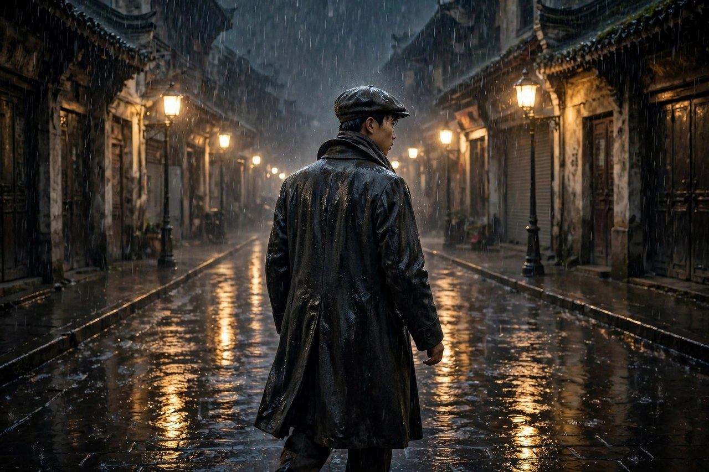
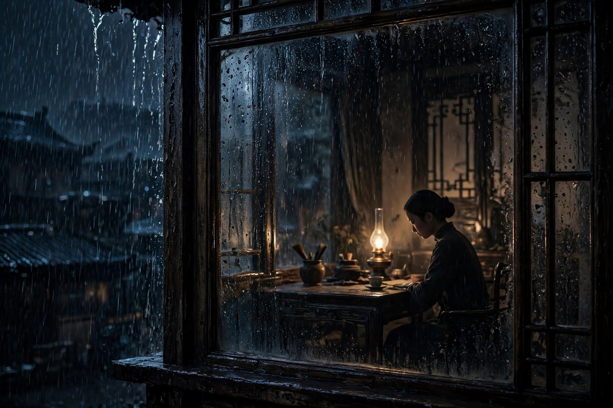

《雨》是一九三三年一月由上海良友图书印刷公司出版的中篇小说，是爱情三部曲的中间一部，上承《雾》的犹豫，下启《电》的斗争。巴金说，《雨》的主人公吴仁民，是一个热情的、有点粗暴、浮躁的人。他的故事，比周如水的故事更激烈，也更沉重：妻子瑶珠病死了，好友陈真不幸被汽车轧死了，身边的人一个接一个倒下，他在悲哀里，在仇恨里，在三角恋爱的纠葛里，跌跌撞撞地走，走到最后，才从爱情纠葛中清醒过来，决心摆脱烦恼，轰轰烈烈地做一番事情，去追求那光明的将来。雨这个书名，取得很准：吴仁民的人生，就是一场雨，雨里看不清路，淋得浑身湿透，可淋透了，人反而醒了，知道自己该往哪里走了。

### 瑶珠病死之后

吴仁民的妻子瑶珠病死了，这件事，是《雨》开篇就压在他心头的石头。瑶珠的死，让吴仁民莫名悲哀：他爱妻子，妻子死了，家里空了，心里也空了，空出来的地方，很快就被仇恨和迷茫填满了。他知道被压迫者联合起来，可以砸碎旧世界，可他又脱离群众，陷入孤立，知道道理，却没有行动，热情很多，办法很少。这种状态，是很多青年都会经历的状态：道理都懂，书都读了，可一落到生活里，就不知道该怎么办，只能在悲哀里打转，在愤怒里打转，在爱情里打转。巴金写吴仁民的悲哀，写得很真实，没有把他写成一个完美的革命者，而是写成一个有血有肉、有弱点、有挣扎的青年。

瑶珠的死，还让吴仁民对旧社会有了更深的恨。他觉得，妻子的死，不光是病死的，更是被旧社会逼死的：旧社会没有好的医疗，没有好的生活，没有给普通人留活路，穷人生了病，只能等死，富人却可以请最好的医生，住最好的医院。这种恨，是朴素的，也是真实的，可恨如果没有出路，就会变成空转，变成对身边人的伤害，变成在三角恋爱里的纠缠。吴仁民在瑶珠死后，陷入三角恋爱的漩涡，一边是玉雯，一边是别的感情，剪不断，理还乱，越理越乱。巴金写这段纠葛，不是为了写风流韵事，是为了写一个青年在悲哀和仇恨里，是怎样把自己弄丢的：他把对旧社会的恨，误当成了对爱情的渴，把对亡妻的思念，误当成了对新人的爱，把对生活的迷茫，误当成了感情的纠葛。误来误去，人就越陷越深。

放在今天看，瑶珠病死之后的吴仁民，像很多经历过失去的人。失去亲人以后，人会有一段时间是懵的，是乱的，是不知道该怎么办的，有的借酒消愁，有的沉迷感情，有的拼命工作，有的干脆躺平。这些反应，都是正常的，都是人在悲哀里的自我保护，可保护久了，就会变成逃避，逃避久了，就会变成新的问题。巴金写吴仁民，是想告诉读者，悲哀不是终点，是起点，起点之后，要往哪里走，才是关键。吴仁民最后走了出来，走向了斗争，走向了光明，这个走向，是他用很多眼泪、很多错误、很多教训换来的。读者读到这里，应当明白，失去以后，最重要的不是立刻坚强，而是不要在悲哀里一直待下去，要给自己一个走出来的方向，哪怕方向一开始很模糊，也比一直待在原地强。

### 陈真惨死

陈真在《雾》里，是周如水的朋友，是叛离富裕家庭、为事业献身的苦行者。到了《雨》里，陈真不幸被汽车轧死了。这个消息，对吴仁民的打击极大：好友死了，死得突然，死得毫无道理，死在一个本不该死的地方。陈真的死，激起了吴仁民对旧社会的仇恨，让他更加明白，旧社会不光压迫穷人，也压迫一切想改变它的人。陈真没有做错任何事，他只是想为事业献身，只是想过一种苦行的、有意义的生活，可旧社会连这样的生活都不给他留，连这样的人都不放过。吴仁民听到陈真死讯的时候，顺从地跟着陈真走，并不反抗，一路上喃喃地唤着两个女人的名字，除了他的瑶珠外还有一个玉雯。这个细节，写得悲凉而真实：一个人在巨大的打击面前，是懵的，是说不出整话的，只能喃喃地念着最亲的人的名字，念着念着，眼泪就下来了。

陈真的死，还让吴仁民开始反思自己的生活。他瞧不起躲进书斋著书立说的革命家李剑虹，憎恶高唱教育救国的洋绅士张小川，可他自己却没有参加实际斗争的行动。他批评别人，自己也没有好到哪里去，这种自我反思，是吴仁民成长的关键一步。一个青年，只有敢批评自己，才有可能真正成长；只会批评别人的人，永远长不大。吴仁民在陈真死后，开始问自己：我到底做了什么，我到底在为什么而活，我的热情到底用在了哪里，是用在了斗争上，还是用在了感情纠葛上。这个问题，问得越深，他离醒悟就越近。巴金写陈真的死，不是为了煽情，是为了给吴仁民一个当头棒喝：朋友死了，你还想在感情里耗到什么时候，你还想在空谈里待到什么时候，时间不等人，死神也不等人。

陈真的形象，在三部曲里是一个标杆。他叛离家庭，苦行献身，不图享受，不图名利，只图一个信念。这种标杆，在今天看，依然有力量：一个真正为信念活着的人，不怕苦，不怕穷，不怕死，只怕自己的信念是假的。陈真死了，可他的标杆没有倒，吴仁民后来能够振作起来，很大程度上就是因为陈真的标杆还在他心里，还在提醒他，还在推着他向前走。今天的年轻人，同样需要标杆：一个真正做事的人，一个真正为信念活着的人，一个不图虚名、只图实干的人，标杆立在那里，年轻人就知道，路该往哪里走，人该怎样活。陈真死了，可他的路没有死，吴仁民接过了他的路，李佩珠后来也接过了他的路，一代人接一代人，路就越走越宽了。

### 三角恋爱的漩涡

吴仁民在《雨》里的三角恋爱漩涡，是这本书最让人揪心的一部分。他在瑶珠死后，又陷进了新的感情纠葛里，一边是玉雯，一边是别的牵绊，剪不断，理还乱。他热情，浮躁，容易动情，也容易冲动，动了情就收不住，收不住就伤人，伤了人又后悔，后悔了又动情，循环往复，越陷越深。巴金写这段漩涡，写得很细腻，没有把吴仁民写成一个花心的人，而是写成一个在悲哀里找安慰、在迷茫里找寄托的人。他找错了寄托，把爱情当成了救命稻草，可爱情不是救命稻草，爱情救不了迷茫的人，迷茫的人只会把爱情也弄成迷茫。玉雯自杀的消息传来，吴仁民受到了很大的打击：他终于明白，自己在感情里的浮躁，是会死人的，是会害人的，是不能再这样下去了。

玉雯的死，跟熊智君的选择连在一起。熊智君为了保护吴仁民，抱病嫁给了玉雯的丈夫，一个军阀，并留信鼓励他追求事业。这个举动，是《雨》里最让人动容的牺牲：一个女人，用自己的婚姻做代价，换一个男人的安全和觉醒。熊智君的信，写得简短而有力：信上说，你不要再在感情里耗了，你要去追求事业，你要去做一番事情，你的命不应当浪费在三角恋爱里。吴仁民读到这封信的时候，悲愤交加，可悲愤过后，他终于振作起来了。他明白了，身边的人为了他，付出了多大的代价，他再在感情里耗下去，就是对不起死去的玉雯，对不起牺牲的熊智君，对不起死去的陈真，对不起死去的瑶珠。振作，不是嘴上说的，是从漩涡里爬出来的，是把感情放下，把事业拿起来的，是把个人的小爱，变成对事业的大爱的。

三角恋爱的漩涡，放在今天看，依然有对照。很多年轻人在感情里打转，打转的原因，常常不是爱情本身，而是生活的迷茫：工作不顺，就在感情里找安慰；前途暗淡，就在感情里找寄托；心里空虚，就在感情里找填补。找来找去，感情也被找乱了，人也被找累了，最后两头都落空。巴金写吴仁民的漩涡，是想告诉读者，感情不是生活的全部，更不是生活的解药，生活的解药，是找到自己的事业，找到自己的方向，找到自己愿意为之奋斗的东西。找到了方向，感情自然会清楚；没有方向，感情只会越理越乱。吴仁民最后从漩涡里爬出来，靠的不是换一个恋人，靠的是换一个方向：从爱情纠葛，转向事业追求，从个人的小圈子，转向更大的世界。这个转向，是《雨》的核心，也是巴金给青年读者的忠告。

### 李剑虹与张小川

吴仁民瞧不起两个人：一个是躲进书斋著书立说的革命家李剑虹，一个是高唱教育救国的洋绅士张小川。李剑虹的毛病，是只说不做，只写不干，躲在书斋里谈革命，谈得头头是道，可从来没有真正参加过斗争。张小川的毛病，是高唱教育救国，觉得只要办教育，就能救中国，可教育救不了被军阀和旧制度压迫的中国，教育救国的口号，喊得再响，也救不了穷人的命。吴仁民瞧不起他们，是有道理的，可他自己也没有好到哪里去：他批评李剑虹空谈，自己也在空谈；他批评张小川脱离实际，自己也在脱离群众，陷入孤立。巴金写这两个人，不是为了凑数，是为了让吴仁民照镜子：你批评的人，身上有你的影子，你笑话的人，走的路你也在走。

李剑虹和张小川，在今天也有影子。书斋里的空谈家，今天变成了键盘上的空谈家：每天在网上谈道理，谈得头头是道，可从来没有真正做过一件事，没有真正帮过一个人，没有真正改变过一点现实。教育救国的口号，今天变成了读书改变命运的鸡汤：读书当然重要，可光读书，不改变制度，不改变环境，不动手做事，命运是很难只靠读书改变的。吴仁民的故事提醒今天的年轻人，不要做李剑虹，不要做张小川，也不要做只会批评李剑虹和张小川的吴仁民，要做就做真正动手的人：参加实际的斗争，做实际的事情，帮实际的人，改变实际的一点东西。动手，哪怕只动手一点点，也比空谈一万句强。

吴仁民对李剑虹和张小川的批评，还有一个更深的意义：革命不是喊口号，不是写文章，不是办学校，而是要跟群众在一起，要跟被压迫的人在一起，要做实实在在的斗争。吴仁民一开始脱离群众，陷入孤立，所以他的热情用不上力，他的仇恨找不到出口，他的爱情也理不清。后来他开始明白，要跟群众在一起，要跟同志们在一起，要把个人的热情，变成集体的力量，这个明白，是他走向《电》里成熟革命者的关键一步。巴金写这一点，写得很清醒：个人的热情是宝贵的，可个人的热情如果脱离了群众，就会变成空转，就会变成浮躁，就会变成三角恋爱里的纠缠。热情要找到组织，要找到方向，要找到落点，落点找到了，热情才有力量。

### 雨里的醒悟

吴仁民在《雨》结尾的醒悟，是全书的高潮，也是巴金留给读者的希望。他从爱情纠葛中清醒过来，决心摆脱烦恼，轰轰烈烈地做一番事情，去追求那光明的将来。这个醒悟，不是突然的，是用瑶珠的死、陈真的死、玉雯的死、熊智君的牺牲，一点点换来的。每一个死者，都像一记耳光，打在吴仁民脸上，打醒了他，打疼了他，也打清醒了他。他终于明白，个人的悲哀再大，也大不过时代的悲哀；个人的爱情再纠结，也纠结不过民族的命运；个人的烦恼再多，也多不过被压迫的人的苦难。明白了这一点，他就不再在个人的小圈子里打转了，他要走出去，走进更大的世界，走进斗争，走进光明。

雨里的醒悟，放在今天，依然是一句鼓励。很多年轻人，正处在人生的雨里：工作不顺，感情不顺，家里不顺，前途暗淡，好像雨永远停不下来。巴金会告诉他们，雨会停的，停的办法，不是等雨停，是走起来，是在雨里走起来，是像吴仁民那样，先把个人的小纠葛放下，先找一个大的方向，先做一件实实在在的事。做起来了，雨就小了；做多了，雨就停了；做成了，天就晴了。醒悟不是一夜之间的事，是在雨里走着走着，突然明白过来的事。明白过来了，就不要再回头，不要再陷进原来的漩涡里，要向前走，走到《电》里去，走到斗争里去，走到光明里去。

### 玉雯与熊智君

玉雯和熊智君，是《雨》里两个让人心疼的女性。玉雯自杀的消息传来，吴仁民受到了很大的打击，他终于明白，自己在感情里的浮躁，是会死人的。玉雯的死，不是偶然，是吴仁民在三角恋爱里打转的直接后果：他给了玉雯希望，又没有给玉雯承诺，给了玉雯热情，又没有给玉雯方向，让玉雯在希望和失望之间，反复煎熬，煎熬到最后，煎熬出一条绝路。巴金写玉雯的死，写得很克制，没有大段渲染，就是一句话，一个消息，一个让吴仁民悲愤交加的打击，读者却能感到重，感到疼，感到感情里的浮躁，原来是有代价的，代价原来是人命。放在今天，这句话依然成立：感情不是游戏，玩弄感情，是会伤人的，伤得重了，是会出人命的，是会让一个人一辈子都活在愧疚里的。

熊智君的选择，跟玉雯的死连在一起，更加让人动容。她为了保护吴仁民，抱病嫁给了玉雯的丈夫，一个军阀，并留信鼓励他追求事业。这个举动，是用自己的婚姻做代价，换一个男人的安全和觉醒。熊智君抱病嫁人，病着，还要嫁给一个自己不爱的人，还要面对军阀家庭的压迫，还要忍受病痛和屈辱，这份牺牲，比玉雯的死更沉重，因为它是活着的牺牲，是每天都要忍受的牺牲，是把自己的一辈子，押在一个男人的觉醒上的牺牲。她的信，写得简短而有力：信上说，你不要再在感情里耗了，你要去追求事业，你要去做一番事情。吴仁民读到这封信，悲愤交加，可悲愤过后，他终于振作起来了。振作的代价，是熊智君的婚姻，是玉雯的命，是陈真的死，是瑶珠的死，这些代价加在一起，才换来吴仁民的醒悟。醒悟来得太贵了，贵到让人心疼，可醒悟来了，总比一直不醒要好。

玉雯和熊智君的故事，放在今天看，依然有对照。现在很多女性，同样在为男人的成长付出代价：有的女性，用自己的青春，陪一个男人长大，长大了，男人走了；有的女性，用自己的婚姻，换一个男人的安全，换来了，男人却不珍惜；有的女性，在感情里被浮躁的男人伤透了心，伤到最后，再也不相信爱情了。巴金写玉雯和熊智君，是想告诉男性读者，女性的牺牲不是理所当然的，女性的付出不是免费的，男性在感情里浮躁，是要付出代价的，代价可能是别人的命，可能是别人的婚姻，可能是别人的一辈子。男性读者读到这里，应当想想，自己在感情里，是不是也曾经浮躁过，是不是也曾经给过希望又没有给过承诺，是不是也曾经让一个人，在希望和失望之间煎熬过。想清楚了，就改，改了，就还有机会，不改，代价迟早会来。

### 雨的意象

雨在《雨》里，不光是天气，更是吴仁民心里的状态。雨是连绵的，是阴冷的，是看不清前路的，是淋得人浑身湿透的。吴仁民在雨里走，雨淋着他，他淋着雨，雨没有停，他也没有停，雨和他，就这样耗着，耗到他醒过来，耗到他明白，雨不是敌人，雨是洗礼，淋透了，人就清醒了。巴金用雨做书名，就是用雨做吴仁民的性格写照：一个热情而浮躁的人，像雨一样，来得急，去得也急，下得大，停得也快，雨停了，地上还是湿的，心里还是凉的，要等太阳出来，地上才会干，心里才会暖。吴仁民的醒悟，就是雨停之后，太阳出来的那一刻：他不再在雨里打转了，他要去追求光明的将来，他要去做一番事情，他要把雨里的教训，变成晴天里的力量。

雨的意象，在今天依然很好懂。很多人的人生，正处在雨里：工作不顺，感情不顺，家里不顺，前途暗淡，好像雨永远停不下来。巴金会告诉他们，雨会停的，停的办法，不是等雨停，是走起来，是在雨里走起来，是像吴仁民那样，先把个人的小纠葛放下，先找一个大的方向，先做一件实实在在的事。做起来了，雨就小了；做多了，雨就停了；做成了，天就晴了。雨不是用来恨的，是用来醒的，淋透了，人就醒了，醒了，就去追求光明的将来。不要怕雨，怕的是在雨里认命，认命了，雨就真的变成永久的了。雨会停的，只要你愿意走起来，愿意醒过来，愿意把热情用在正地方。

### 雨后的路

雨后的路，是《雨》留给读者的希望，也是吴仁民走向《电》的路。雨停了，地上还是湿的，可路已经显出来了，吴仁民顺着这条路走，走进了斗争，走进了光明，走进了《电》里的成熟。雨后的路，不是平坦的路，是泥泞的路，是要小心走的路，是要一步一个脚印走的路，可泥泞的路，总比没有路要好，总比在雨里打转要好。巴金写雨后的路，写得很简洁，没有大段铺陈，就是一句话，一个决心，一个方向：摆脱烦恼，轰轰烈烈地做一番事情，去追求那光明的将来。这句话，听起来像口号，实际上是吴仁民用很多眼泪、很多错误、很多教训换来的决心，决心虽然简单，却是真实的，是从雨里走出来的人，才能说出来的决心。

雨后的路，放在今天，依然是一句鼓励。很多年轻人，正处在人生的雨后：雨刚停，地上还湿，心里还凉，前路还看不清楚，不知道该往哪里走。巴金会告诉他们，雨后的路，不必一下子看清楚，只要先迈出一步，先做一件实实在在的事，先找一个方向，先跟一群同志走在一起，走着走着，路就清楚了，走着走着，天就晴了。不要怕路泥泞，泥泞的路，踩过去了，脚印就深了，脚印深了，后面的人就好走了。吴仁民的路，就是这样走出来的：从雨里走出来，从漩涡里爬出来，从个人的小圈子里走出来，走进更大的世界，走进斗争，走进光明。读者合上《雨》，不应当只记住雨，还应当记住雨后的路，记住路虽然泥泞，却是通向光明的路，记住只要愿意走，雨后的路，就在脚下。

雨后的路，还有一个更深的意义：它说明，醒悟不是终点，是起点。吴仁民在《雨》结尾醒悟了，醒悟了以后，他还要走很长的路，还要经历《电》里的斗争，还要经历牺牲，还要经历撤退，还要经历很多考验。醒悟只是开始，开始之后，还有很长的路要走，还有很多的雨要淋，还有很多的电要发。读者读到雨后的路，不应当觉得，醒悟了就万事大吉了，应当觉得，醒悟了，才刚刚开始，开始之后，要坚持走，要一直走，走到天亮为止。这种坚持，是《雨》留给读者的全部：雨会停的，路会显的，只要你愿意走，只要你不回头，只要你把雨里的教训，变成晴天里的力量。

### 雨中的同志

《雨》里的同志情谊，是吴仁民醒悟的重要支撑。陈真死了，可陈真的精神还在，还在吴仁民心里，还在同志们心里，还在推着吴仁民向前走。熊智君牺牲了，可熊智君的信还在，还在吴仁民手里，还在提醒他，不要再在感情里耗了，要去追求事业，要去做一番事情。同志不是一个抽象的词，是具体的人，是陈真，是熊智君，是玉雯，是瑶珠，是那些为了吴仁民，付出代价、付出生命、付出婚姻的人。他们的付出，换来了吴仁民的醒悟，换来了吴仁民从雨里走出来，换来了吴仁民走向《电》里的成熟。同志情谊的意义，就在这里：一个人倒下了，另一个人站起来，站起来的人，不是为了出名，是为了让倒下的人没有白倒，让斗争的火种没有灭，让雨后的路，有人继续走。

雨中的同志，放在今天，依然是一句鼓励。现在的年轻人，同样需要同志：需要敢说真话的朋友，需要愿意陪着走的朋友，需要在你迷茫的时候，推你一把的朋友，需要在你犯错的时候，指出你的错误的朋友。有这样的同志，是福气，福气来了，要珍惜，要听真话，要接受陪伴，不要像吴仁民在《雨》里那样，把同志的好意推开，把真话当成耳旁风，把陪伴当成理所当然。推开了，同志还会再来吗，推久了，同志也会累，也会走，走了以后，雨里就只剩下自己一个人了。珍惜同志的办法，就是听真话，就是接受陪伴，就是在同志需要的时候，也敢说真话，也敢陪着走。同志是互相的，你对同志真，同志才对你真，你推开同志，同志就走远了，走远了，雨就更冷了。

雨中的同志，还有一个更深的意义：它说明，改变不是一个人单打独斗的事，是许多人一起做的事。吴仁民一个人，在雨里打转，打了很久，也没有打出来；有了同志的提醒，有了同志的牺牲，有了同志的信，他才打出来了，才醒过来了，才走向了光明。今天的年轻人，想改变自己的生活，同样需要同志：几个朋友一起读书，一起跑步，一起换工作，一起创业，互相打气，互相兜底，路就好走得多。不要一个人扛，一个人扛，扛久了，人会累，会倒，会在雨里迷路；一群人扛，扛着扛着，雨就停了，天就晴了，路就显了。巴金写《雨》里的同志，就是写给今天的青年看的：找同志，珍惜同志，陪着同志走，走到雨停，走到天晴，走到光明的将来。

雨夜里的读信，是吴仁民醒悟的时刻。熊智君的信，虽然短，却很有力：信上说，不要再在感情里耗了，要去追求事业，要去做一番事情。吴仁民读到这封信，悲愤交加，可悲愤过后，他终于振作起来了。读信的时候，雨还在下，灯还亮着，信上的字，虽然不多，却像电光一样，划破了吴仁民心里的雨，划破了他心里的雾，划破了他心里的纠葛。信读完了，雨就小了，雨小了，路就显了，路显了，吴仁民就走向了《电》里的成熟，走向了光明的将来。

### 雨夜的灯

雨夜的灯，是《雨》里最温暖的意象。雨夜里，灯还亮着，灯下有人在写信，有人在读书，有人在谈话，有人在想念死去的人，有人在为活着的人打算。灯虽然微弱，却没有灭，灭了，就真的黑了，亮着，就还有希望。吴仁民在雨夜里，常常看着灯发呆，发呆的时候，他在想瑶珠，在想陈真，在想玉雯，在想熊智君，在想自己到底该往哪里走。灯下的发呆，不是浪费时间，是醒悟的前奏，是雨停之前的安静，是电光闪之前的黑暗。巴金写雨夜的灯，写得很温柔：灯是小的，是昏暗的，是雨夜里唯一的暖，可暖虽小，却足够让一个人在雨夜里，不至于完全绝望，不至于完全放弃，不至于在雨里冻死。灯亮着，人就还在，人还在，路就还在，路还在，雨后的路，就在脚下。

雨夜的灯，放在今天，依然是一句鼓励。很多年轻人，正处在人生的雨夜：工作不顺，感情不顺，家里不顺，前途暗淡，好像灯随时都会灭。巴金会告诉他们，灯不要灭，灭了，就真的黑了，亮着，就还有希望。守住灯的办法，不是硬撑，不是死熬，是像吴仁民那样，找同志，找朋友，找方向，找一件实实在在的事做，做起来了，灯就亮了，做多了，灯就稳了，做成了，天就亮了。雨夜的灯，虽然微弱，却是真实的，是巴金留给读者的全部：不要怕雨夜，怕的是在雨夜里灭了灯，灭了灯，雨就真的变成永久的了。

### 雨停之后

雨停之后，地上还是湿的，可路已经显出来了，吴仁民顺着这条路走，走进了斗争，走进了光明，走进了《电》里的成熟。雨停之后的工作，比雨停本身更重要：雨停了，天还没有完全晴，心里还凉，前路还看不清楚，可只要走起来，走着走着，天就晴了，走着走着，路就清楚了。不要在雨停之后，还站在原地等天晴，等天晴的人，天永远不会晴，走起来的人，天才会晴。吴仁民在雨停之后，没有站在原地等，而是立刻行动，立刻摆脱烦恼，立刻去追求光明的将来，这种行动力，是《雨》留给读者的全部：雨停了，就走，走起来，天就晴了。

### 雨后的阳光

雨后的阳光，是《雨》留给读者的最后一点暖。雨停了，阳光出来了，地上还是湿的，可阳光照在湿地上，照出了一点亮，亮虽然微弱，却说明雨过去了，说明天晴了，说明吴仁民的路，已经从雨里走出来了，走进了阳光里，走进了《电》里的斗争里。阳光不是一下子就来的，是雨停了以后，才慢慢显出来的，是走起来以后，才慢慢亮起来的。巴金写雨后的阳光，写得很简洁，没有大段铺陈，就是一句话，一个决心，一个方向：摆脱烦恼，轰轰烈烈地做一番事情，去追求那光明的将来。这句话，听起来像口号，实际上是吴仁民用很多眼泪、很多错误、很多教训换来的决心，决心虽然简单，却是真实的，是从雨里走出来的人，才能说出来的决心。阳光来了，就不要再回雨里去了，就要向前走，走到阳光里去，走到光明的将来去。

合上《雨》，读者心里会留下一个雨夜的画面：雨，街道，吴仁民的背影，玉雯的死讯，熊智君的信，陈真的墓，瑶珠的笑。这个画面不是用来伤感的，是用来提醒的：提醒每一个还在雨里的人，赶紧醒过来，赶紧把方向找清楚，赶紧把个人的小爱，变成对事业的大爱，赶紧从三角恋爱的漩涡里爬出来，去做一番事情。雨会停的，天会晴的，只要你愿意醒过来，愿意走起来，愿意把热情用在正地方。巴金写《雨》，就是写给还在雨里的人的一封信：信上说，别怕雨，别恨雨，雨淋透了，人就醒了，醒了，就去追求那光明的将来。
