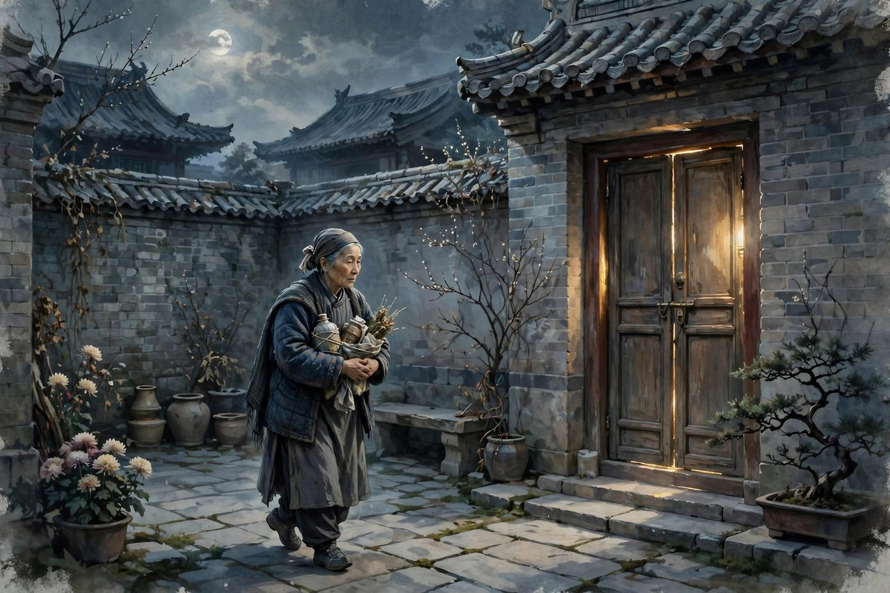
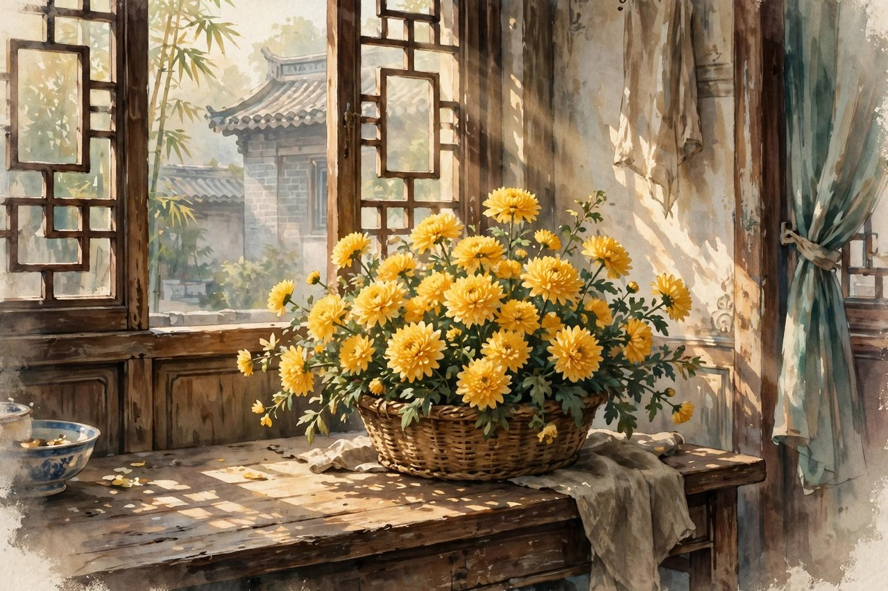

## 冷心肠的青年何彬

超人是冰心一九二一年发表的小说，收在同名小说集里，也是她问题小说里很有名的一篇。小说的主人公叫何彬，是一个冷心肠的青年，从来没有人看见他和人有什么来往，他认为世界是空虚的，人生是无意识的，人和人，和宇宙，和万物的聚合，都不过如演剧一般，上了台是父子母女，亲密得不得了，下了台，摘了假面具，便各自散了。哭一场也是这么一回事，笑一场也是这样一回事，与其互相牵连，不如互相遗弃，而且爱和怜悯都是恶。这种想法，在二十世纪二十年代初很有代表性，在五四的启蒙下，许多青年都投奔到社会变革的洪流里，可是现实面前，到处碰壁，因而悲观厌世，觉得什么都没有意义，觉得人活着就是演戏，觉得爱就是负担。何彬就是这种青年的代表，他表面上很冷，他不与任何人交际，凡带有一点生气的东西他都不爱，他的心里很痛苦，常常叨念着，世界是空虚的，人生是无意识的。他这种冷，不是天生的冷，是受过伤之后的冷，是理想碰壁之后的冷，是看多了社会黑暗之后的冷。他觉得，既然世界是空虚的，既然爱是恶的，既然人迟早要散，那不如一开始就不要牵连，不要爱，不要怜悯，这样就不会失望，就不会痛苦。他这种逻辑，听起来有点道理，可是它把人推向了孤独，推向了冷漠，推向了跟世界隔绝的地方。他住在院子里，院子里有其他人，有老妈子，有孩子，可是他跟他们没有来往，他把自己关在屋子里，关在自己的想法里，屋子里的窗是关着的，心里的窗也是关着的。

## 夜里的呻吟声

故事的转折，是从夜里的呻吟声开始的。何彬夜里听到一个孩子的呻吟，断断续续的，在沉寂的黑夜里只管颤动，叫得他睡不着，叫得他想起许多幼年的事情，慈爱的母亲，天上的繁星，院子里的花。这些回忆，是他极力想拒绝的，可是无论如何也不能拒绝，因为回忆是真实的，是长在他心里的，是他再冷也冷不掉的东西。他听了两夜的呻吟，看了两夜的月，想了两夜的往事，爱至高无上的威力，终于打开了他关闭的心扉。到了第七天头上，他终于向程姥姥打听，原来是厨房跑街的十二岁孩子禄儿摔坏了腿，每夜在呻吟，无钱治病，痛苦难忍。他听到这个消息，心里动了一下，动了一下，就是转变的开始。他走到门边，却慢慢地从袋里拿出一张钞票来，给那禄儿吧，叫他请大夫治一治。这句话，说得很轻，可是分量很重，因为这是他头一回向别人伸手，头一回把自己的钱给一个陌生孩子，头一回打破自己不牵连、不怜悯的原则。他给钱的时候，心里还在挣扎，还在想，自己这样做，是不是荒唐，是不是违背了自己的哲学，可是他还是给了，给了，就说明他心里的爱没有死，只是睡着了，呻吟声把爱吵醒了。禄儿这个孩子，在小说里是一个很关键的人物，他年纪小，家境穷，腿摔坏了，夜里疼得呻吟，可是他没有抱怨，没有恨社会，他只是疼，疼得叫出来，叫出来，就把何彬的心叫醒了。孩子的呻吟，比大人的道理更有力量，因为孩子的疼是真实的，是直接的，是不加掩饰的，何彬听见真实的疼，就无法再坚持虚假的冷。

## 禄儿的一篮花与母亲的名义

禄儿的腿治好了之后，一直想找机会报答何彬，可是何彬不接受，不愿意被感谢，不愿意被牵连。到了何彬搬家的时候，禄儿以母亲与母亲是好朋友为由，送给他一篮金黄的花儿。禄儿信里的意思很清楚，世界上的母亲和母亲都是好朋友，世界上的儿子和儿子也都是好朋友，都是互相牵连，不是互相遗弃的。这句话，是小说里爱的哲学的核心，也是冰心爱的哲学的核心。她觉得，母爱是爱的起点，人人有母亲，所以人人有母爱，母亲和母亲是好朋友，儿子和儿子也应该是好朋友，人和人之间，不是互相遗弃的，是互相牵连的。禄儿用母亲的名义送花，是很聪明的做法，因为母亲的名义，是何彬无法拒绝的，何彬可以拒绝一个孩子的感谢，可是他无法拒绝母亲，无法拒绝自己母亲的爱，无法拒绝天下母亲的爱。他收到花，心里被深深打动了，他想起自己的母亲，想起母亲对自己的爱，想起自己曾经也是一个被母亲疼爱的孩子，想起自己现在怎么变成了冷心肠的人。他悔罪认错，成了有感情的人，从一个人的孤冷世界里踏了出来，走到窗外，看到窗外的世界，看到窗外的人，看到窗外的花，心里亮堂了。小说的结尾，写的是窗内窗外的描写，窗内是何彬的心，窗外是世界，窗内窗外呼应起来，说明何彬的心打开了，世界进来了，他不再是一个超人，不再是一个超脱于人世之外的人，他重新成了一个人，一个有爱、有感情、会牵连、会怜悯的人。

## 超人这个题目的反讽

超人这个题目，取得很有意思，带着反讽。何彬自以为是超人，自以为超脱了人世的爱恨，超脱了牵连和怜悯，可是他其实不是超人，他只是一个受伤的普通人，一个把自己关起来的人。真正的超人，不是没有感情的人，是有感情还能坚持爱的人，是看见痛苦还能伸手的人，是心里有光还能照亮别人的人。何彬最后成为的人，才是真正的超人，不是超脱于人之上，是超脱了自己的冷漠，超脱了自己的孤独，超脱了自己的哲学，重新回到人中间去。冰心用超人这个题目，是想告诉读者，尼采说的超人，不是冷漠，不是无情，不是遗弃，真正的超越，是超越冷漠，是超越孤独，是超越只顾自己的小我，走向爱人的大我。她写这篇小说的时候，中国青年里流行尼采，流行超人哲学，好多青年把超人理解成冷漠，理解成不爱，理解成遗弃，她写何彬，就是要纠正这种理解，要告诉青年，超人不是这样的，超人是要有爱的，要有母亲的爱，要有孩子的天真，要有对人类的同情。她这种纠正，在当时很有针对性，很能打动人，因为她不是用理论来纠正，是用一个故事来纠正，故事里的孩子，故事里的花，故事里的母亲，比理论更有说服力。今天的人，读超人，也会有共鸣，因为今天也有好多人，把冷漠当成酷，把孤独当成独立，把不爱当成强大，把遗弃当成自由，这些想法，跟何彬当年的想法很像，都是把受伤包装成哲学，把冷漠包装成超脱。冰心告诉你，真正的强大，不是冷漠，是有爱还能坚持，真正的独立，不是孤独，是心里有爱还能跟人牵连。

## 爱的哲学从这里长出来

超人是冰心爱的哲学的起点，也是她后来所有作品的根。她后来写繁星、写春水、写寄小读者、写小桔灯，写的都是爱，都是母爱、童真、自然的爱，都是从超人里长出来的。超人里的爱，还比较简单，就是母爱和童真，就是母亲和母亲是好朋友，儿子和儿子也是好朋友，就是人和人要互相牵连，不要互相遗弃。后来她的爱，越来越复杂，越来越深，写到了对穷人的同情，对底层女人的体贴，对祖国的爱，对人类的爱，可是根没有变，根还是母爱和童真。她写超人，是想给那个时代的青年一个出路，青年厌世了，青年碰壁了，青年觉得世界空虚了，该怎么办，她给的答案是，回到母亲身边，回到孩子身边，回到自然身边，回到爱里去。爱不是解决所有问题的万能药，可是爱能让人重新有力气，能让人重新相信世界，能让人重新走下去。她这种答案，今天看来可能有点软，觉得对付不了真刀真枪的社会问题，可是你要想想，青年厌世的时候，最需要的不是更硬的道理，是更软的安慰，是有人告诉他，世界还有爱，还有母亲，还有孩子，还有花，还有星星，还有值得活下去的理由。超人给青年的，就是这个理由，就是夜里的一声呻吟，就是一篮金黄的花，就是母亲的名义，就是重新做人的勇气。

## 窗内窗外的结尾

超人的结尾，写的是窗内窗外的描写，这个结尾，很有讲究。小说开头，何彬把自己关在窗内，窗是关着的，心是关着的，世界在窗外，他在窗内，窗内窗外是隔绝的。小说结尾，何彬的心打开了，窗也打开了，窗内的他，看见了窗外的世界，看见了窗外的花，看见了窗外的人，看见了窗外的光，窗内窗外连起来了，隔绝没有了，爱进来了，人也出来了。这个结尾，呼应了前文对回忆母亲和禄儿送花的描写，使小说结构更加严谨，也完成了人物的塑造，何彬由一个冷漠、内心灰暗的人，转变成了一个有爱心、心灵亮堂的人。窗这个意象，在小说里很重要，窗是心和世界的界限，窗关着，心就关着，窗开着，心就开着。何彬的转变，就是窗从关到开的转变，就是心从关到开的转变。今天的人，心里也有一扇窗，窗关着的时候，人会觉得孤独，会觉得世界空虚，会觉得爱是恶的，窗开着的时候，人会觉得世界有光，有花，有母亲，有孩子，有值得爱的东西。你今天如果觉得心里暗，不妨把窗打开，打开窗，看看外面的世界，看看外面的人，看看外面的花，看看外面的星星，窗打开了，心就打开了，心打开了，爱就进来了，爱进来了，人就不再孤单了。超人的结尾，告诉你的，就是这个道理，窗要打开，心要打开，爱要进来，人要出去，出去到世界里去，出去到人群里去，出去到生活里去。

## 今天的何彬在哪里

今天的何彬在哪里，他在每一个觉得世界空虚、觉得人生无意义、觉得爱是负担的年轻人心里。他可能在写字楼里加班，可能在出租屋里熬夜，可能在手机里刷着短视频，心里却越来越空。他可能觉得，人和人都是演戏，上了台亲密，下了台就散，哭一场笑一场都是假的，不如不牵连，不如不爱，不如一个人待着。这种想法，跟何彬当年的想法很像，都是受伤之后的冷，都是碰壁之后的厌世，都是把孤独包装成哲学，把冷漠包装成强大。可是超人告诉你，这种包装是假的，冷不是强大，孤独不是独立，不爱不是自由，真正的强大，是有爱还能坚持，真正的独立，是心里有爱还能跟人牵连，真正的自由，是心里有光还能照亮别人。你今天如果觉得自己是何彬，不妨学何彬，听听夜里的呻吟声，看看身边的孩子，看看身边的母亲，看看身边的花，看看身边那个需要你伸手的人，伸手了，你的心就打开了，心打开了，你就不再是冷心肠的青年了，你就成了一个有爱的人。超人这篇小说，写于一九二一年，讲的是一个青年的转变，可是它的道理，今天还在，讲给每一个心里发冷的年轻人听，讲给每一个觉得世界空虚的人听，讲给每一个想把自己关起来的人听。听进去，窗就打开了，窗打开了，路就亮了。

## 程姥姥与院子里的人

超人里除了何彬和禄儿，还有一个很重要的人物，就是程姥姥。程姥姥是院子里的老妈子，是照顾大家生活的人，是知道院子里所有事的人。何彬向程姥姥打听，才知道夜里呻吟的孩子是禄儿，才知道禄儿摔坏了腿，才知道禄儿无钱治病。程姥姥在小说里，话不多，可是她的话很关键，她是何彬和禄儿之间的桥梁，是何彬了解真实世界的窗口。何彬平时不跟人来往，可是他跟程姥姥说话，因为程姥姥是长辈，是照顾他生活的人，是他无法完全拒绝的人。程姥姥代表的是院子里普通人的世界，是生活本身的世界，是柴米油盐的世界，是孩子生病、老人照顾、邻里帮忙的世界。何彬的哲学，是书本里的哲学，是尼采的哲学，是空虚的哲学，程姥姥的世界，是生活的世界，是真实的世界，是孩子疼了会叫、母亲爱了会疼、邻里有了难会帮忙的世界。何彬从书本的哲学里走出来，走进程姥姥的世界里，才真正开始转变，才真正开始理解爱，才真正开始做人。院子里的人，除了程姥姥和禄儿，还有其他人，有做饭的人，有打扫的人，有来来往往的人，这些人，在小说里都是背景，可是背景里藏着生活，生活里藏着爱。何彬以前看不见这些人，觉得这些人跟自己没有关系，觉得自己是超人，是超脱于这些人之上的，可是呻吟声让他看见了，看见了，他就无法再假装看不见了，看见了，他就必须伸手了，伸手了，他就变了。这就是超人的故事，就是一个超人怎么从书本里走出来，走进院子里，走进生活里，走进爱里去的故事。

## 何彬的母亲与回忆

超人里写何彬想起母亲，写得很动人，也很关键。他夜里听到呻吟声，想起许多幼年的事情，慈爱的母亲，天上的繁星，院子里的花。这三个意象，母亲、繁星、花，是连在一起的，是他童年里最美的东西，是他心里最干净的东西，是他再冷也冷不掉的东西。他极力想拒绝这些回忆，可是无论如何也不能拒绝，因为回忆是真实的，是长在他心里的，是他小时候母亲给他的爱，是他小时候看过的星星，是他小时候院子里的花。这些回忆，是他转变的种子，种子在心里，呻吟声是雨水，雨水一浇，种子就发芽了，发芽了，心就打开了。他想起母亲，想起母亲对自己的爱，想起自己曾经也是一个被母亲疼爱的孩子，想起自己现在怎么变成了冷心肠的人，这种对照，让他悔罪，让他认错，让他想重新做人。母亲在超人里，没有直接出场，可是母亲的影子，到处都在，在何彬的回忆里，在禄儿送花的名义里，在爱的哲学的根里。母亲是爱的起点，是所有爱的源头，是何彬心里最后的防线，防线没有破，何彬就还有救，防线破了，何彬就真的成了冷心肠的人。可是防线没有破，母亲的爱还在，母亲的爱在，何彬就能回来，就能从冷漠里回来，从孤独里回来，从超人的幻觉里回来，回到人中间去。今天的人，心里也有这样一扇防线，防线里是母亲的爱，是童年的回忆，是看过的星星，是院子里的花，防线在，人就不会完全冷，不会完全孤独，不会完全绝望。你今天如果觉得心里冷，不妨想想母亲，想想童年，想想星星，想想花，想想，心里就会暖一点，暖一点，就够了，暖一点，你就能重新做人，重新爱人，重新走进世界里去。

## 超人与爱的实现对照

超人这篇小说，常常被人拿来跟冰心同期的另一篇小说爱的实现对照，因为两篇小说都写爱，都写母爱和童真，都写爱的哲学，可是路子不一样。超人写的是一个冷心肠的青年怎么被爱唤醒，爱的实现写的是一个少女怎么在爱里实现自己，怎么在爱里找到人生的意义。两篇小说合起来，就是冰心爱的哲学的两个面，一个面是唤醒，一个面是实现，唤醒是让人从冷漠里醒来，实现是让人在爱里长大。超人的何彬，醒来了，醒来了之后，他要怎么活，要怎么爱，要怎么跟人相处，小说没有细写，可是读者能想象，他醒来了，就会像正常人一样生活，一样爱母亲，一样爱孩子，一样爱自然，一样爱世界。爱的实现的少女，实现的是在爱里找到自己，找到人生的方向，找到活下去的理由。这两篇小说，都是冰心早期的代表作，都是她爱的哲学的起点，都是她后来所有作品的根。她后来写繁星、写春水、写寄小读者、写小桔灯，写的都是爱，都是从超人和爱的实现里长出来的爱，都是母爱、童真、自然的爱，都是让人心里变软、变善、变暖的爱。今天的人读超人，可以对照着读爱的实现，两篇合起来读，会更完整，会更理解冰心的爱，会更理解她为什么一辈子写爱，为什么一辈子相信爱，为什么一辈子把爱当成世界观，当成人生观，当成人生的主题。她相信爱，不是因为她不知道世界有恨，不知道社会有黑暗，不知道人生有痛苦，她知道，她都知道，可是她还是相信爱，因为她觉得，爱是黑暗里唯一的光，是痛苦里唯一的药，是冷漠里唯一的暖。相信爱，不是天真，是勇气，是看透了黑暗还相信光的勇气，是看透了痛苦还相信爱的勇气。

## 超人留给今天的提醒

超人留给今天的提醒，有三句很简单的话，头一句是，不要把冷漠当成酷，冷漠不是酷，冷漠是受伤之后的壳，壳虽然能保护你，可是壳也会把你关起来，关久了，你就出不来了，出不来了，你就真的成了孤岛。还有一句是，不要把孤独当成独立，孤独不是独立，孤独是心关起来的结果，独立是心打开之后，还能自己站住，还能自己走路，还能自己做决定，独立的人，心里有爱，心里有光，心里有人，孤独的人，心里只有自己，只有自己的哲学，只有自己的空虚。再有一句是，不要把不爱当成自由，不爱不是自由，不爱是心的贫穷，是爱的能力丢了，是母亲给你的爱、孩子给你的天真、自然给你的美，都被你丢了，丢了，你就穷了，穷到只剩下自己，只剩下自己的冷，只剩下自己的空。这几句话，是超人用一个故事告诉你的，是何彬用自己的转变告诉你的，是禄儿用一篮花告诉你的，是母亲用回忆告诉你的。你今天如果觉得自己有点像何彬，有点冷，有点孤独，有点不想爱，不妨听听这几句话，听进去，窗就打开了，窗打开了，爱就进来了，爱进来了，人就不再孤单了，人不再孤单了，世界就不再空虚了，世界不再空虚了，人生就有了意义，有了意义，你就能走下去，走到天亮，走到好日子，走到下一个春天。超人这篇小说，写于一九二一年，讲的是一个青年的转变，可是它的道理，今天还在，讲给每一个心里发冷的年轻人听，讲给每一个觉得世界空虚的人听，讲给每一个想把自己关起来的人听。听进去，你就能从超人的幻觉里醒来，醒来，你就能重新做人，重新爱人，重新走进世界里去，重新成为一个有血有肉、有爱有痛、有笑有泪的人。

## 超人与尼采的误读

超人这个题目，跟尼采的超人学说有关系，可是冰心写的超人，跟尼采的超人并不一样，甚至是反着的。尼采说的超人，是超越常人的人，是强者，是创造新价值的人，是不受传统道德束缚的人，好多青年读了尼采，把超人理解成冷漠，理解成不爱，理解成遗弃，理解成高高在上，看不起普通人。何彬就是这样理解超人的，他觉得，爱和怜悯都是恶，觉得人和人都是演戏，觉得不如互相遗弃，觉得自己是超人，是超脱于人世之外的人。可是冰心告诉你，这不是超人，这是误读，真正的超人，不是冷漠，不是遗弃，不是高高在上，真正的超人，是有爱的人，是能超越自己的冷漠、超越自己的孤独、超越自己的小我，走向爱人的大我的人。何彬最后的转变，就是从误读的超人，走向真正的超人，从冷漠走向爱，从孤独走向牵连，从遗弃走向互相帮助。他收到禄儿的花，想起母亲，悔罪认错，重新做人，这才是超人，这才是超越，超越的不是别人，是自己，是自己的冷，是自己的孤独，是自己的哲学。冰心写超人，是想纠正当时青年对尼采的误读，是想告诉青年，不要把超人理解成冷漠，不要把强大理解成无情，强大是有爱还能坚持，超人是有情还能超越。今天的人，读尼采，读超人，也容易误读，容易把冷漠当成酷，把孤独当成独立，把不爱当成自由，冰心提醒你的，就是不要误读，超人不是冷，是暖，超人不是孤独，是牵连，超人不是遗弃，是爱。爱，才是真正的超越，爱，才是真正的强大，爱，才是真正的超人。

## 超人与今天的青年

今天的青年，读超人，会觉得何彬很像自己，很像身边的人，很像那些在社交媒体上说世界空虚、人生无意义、爱是负担的人。这些话，今天在网络上很多，在短视频里很多，在评论区里很多，说的人多了，听的人也多了，听多了，就容易信，信了，就容易冷，就容易孤独，就容易不想爱。可是超人告诉你，这些话是何彬当年的老话，是受伤之后的话，是碰壁之后的话，是把痛苦包装成哲学的话，包装得再漂亮，里面还是痛苦，还是孤独，还是冷。你今天如果也说这些话，不妨想想何彬，想想他夜里听到呻吟声，想想他想起母亲，想想他收到一篮花，想想他怎么从冷漠里走出来，想想，你的心里就会暖一点，就会觉得，世界不是空虚的，人生不是无意义的，爱不是恶的，爱是好的，是值得的，是能救人的。你今天如果身边有朋友像何彬，有点冷，有点孤独，有点不想爱，不妨学禄儿，学孩子，学母亲，学一篮花，给他一点爱，给他一点温暖，给他一点真实的疼，给他一点真实的关心，爱给到了，他的心就打开了，心打开了，他就不再是何彬了，他就成了一个有爱的人。超人这篇小说，写于一九二一年，讲的是一个青年的转变，可是它的道理，今天还在，讲给每一个心里发冷的青年听，讲给每一个觉得世界空虚的人听，讲给每一个想把自己关起来的人听。听进去，窗就打开了，窗打开了，路就亮了，路亮了，人就能走下去，走到天亮，走到好日子。

## 超人与母亲节的信

超人这篇小说，读到最后，会想起母亲，会想给母亲写信，会想给母亲打电话，会想回家看看母亲。因为小说里的爱，是从母亲那里来的，是母亲给何彬的爱，是母亲给禄儿的爱，是天下母亲给天下孩子的爱。母亲节到了，你可以给母亲写一封信，信不需要写得多好，只需要写得真，写你记得母亲做的事，写你记得母亲说的话，写你现在想对母亲说的话，写完寄出去，母亲读了，心里会暖。母亲要的，就是这份暖，就是孩子还记得她，就是孩子还爱她，就是孩子从冷漠里走出来了，从孤独里走出来了，从超人的幻觉里走出来了，重新成了一个有爱的人。你今天如果觉得自己有点像何彬，有点冷，有点孤独，有点不想爱，不妨在母亲节，给母亲写一封信，写信的时候，心里就会暖，暖了，窗就打开了，窗打开了，爱就进来了，爱进来了，人就不再孤单了。超人这篇小说，写于一九二一年，讲的是一个青年的转变，可是它的道理，今天还在，讲给每一个母亲节的人听，讲给每一个想给母亲写信的人听，讲给每一个心里发冷的人听。听进去，你就能从何彬变成一个有爱的人，变成一个心里有光的人，变成一个能给别人做灯的人。

## 超人与今天的夜

今天的夜，跟何彬当年的夜很像，都是安静的，都是深的，都是容易让人想很多的。夜里，你躺在床上，睡不着，想工作，想房子，想孩子，想未来，想人生有没有意义，想世界是不是空虚，想爱是不是恶的，想人和人是不是演戏，想着想着，心里就冷了，就孤独了，就不想爱了。这个时候，你不妨想想何彬，想想他夜里听到呻吟声，想想他想起母亲，想想他想起繁星，想想他想起院子里的花，想想他怎么从冷漠里走出来，想想，你的心里就会暖一点，暖一点，就够了，暖一点，你就能睡着，就能隔天起来，重新做人，重新爱人，重新走进世界里去。夜不是用来想空虚的，夜是用来想母亲的，是用来想孩子的，是用来想星星的，是用来想花的，是用来想那些让你心里暖的东西的。想暖的东西，心就暖了，心暖了，夜就不长了，夜不长了，天就亮了，天亮了，你就能重新出发，重新去爱，重新去生活，重新去做一个有血有肉的人。超人这篇小说，写的是夜里的转变，写的是一个青年怎么在夜里被唤醒，怎么从冷漠里走出来，怎么重新做人，这个转变，今天的夜里也可以发生，发生在你的夜里，发生在你想起母亲的时候，发生在你听见孩子哭声的时候，发生在你看见一篮花的时候，发生在你心里暖起来的时候。暖起来了，你就不再是何彬了，你就成了一个有爱的人。

超人这篇小说，写的是一个青年怎么在夜里被唤醒，怎么从冷漠里走出来，怎么重新做人，怎么重新爱人，怎么重新走进世界里去。这个转变，不是靠大道理，不是靠口号，不是靠理论，是靠夜里的一声呻吟，是靠母亲的回忆，是靠繁星和花，是靠禄儿的一篮花，是靠母亲的名义，是靠真实的疼，是靠真实的爱。真实的疼，比理论更有力量，真实的爱，比口号更有力量，真实的花，比空话更有力量。你今天如果心里冷，不妨想想这些真实的东西，想想母亲，想想孩子，想想花，想想星星，想想身边那个需要你伸手的人，伸手了，心就打开了，心打开了，爱就进来了，爱进来了，人就不再孤单了，人不再孤单了，世界就不再空虚了，世界不再空虚了，人生就有了意义，有了意义，你就能走下去，走到天亮，走到好日子，走到下一个春天，走到下一个夜里，夜里还有星，星里还有光，光里还有爱，爱里还有你。

爱在，心就在，心在，路就在，路在，人就能走下去。
