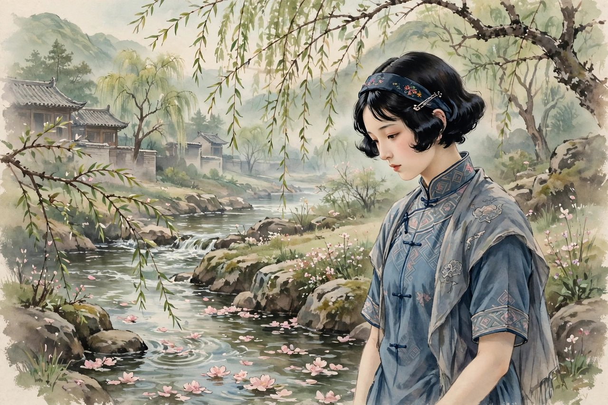
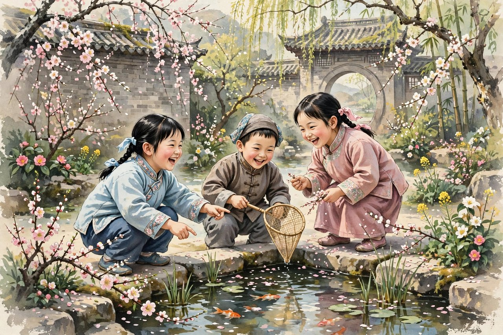

## 姊妹篇是怎么来的

春水是繁星的姊妹篇，这个说法，是冰心自己和读者都认的。繁星在晨报副刊连载完了，还不到一个月，读者还想看，作者也觉得心里还有零碎的想法没有写完，于是从一九二二年三月五日起，春水开始连载，一直连载到六月三十日，一共一百八十二首，比繁星多了十八首。春水这个名字，取得很妙，繁星是夜里的光，春水是白天的水，光和水，都是柔的东西，都是能给人安慰的东西。繁星写的是夜里的感想，春水写的是春天里的感想，季节换了，心情也换了，可是根没有换，根还是母爱、童真和自然。春水出版的时候，新潮社出了单行本，跟繁星一起，成了冰心最有名的两本小诗集。读者读繁星，读到的是夜里的星光，读春水，读到的是春天的水声，水声比星光更近，更日常，更贴着生活。你读春水，会觉得像在春天里散步，路边有花，水里有倒影，风里有暖意，心里有话，可是话不急着说出来，慢慢流，慢慢淌。春水的诗，比繁星的诗更柔，更细，更像水。水的好处是，它不跟你争，它绕着走，它浸润，它渗透，它不声不响地把干涸的地方变湿润。冰心写春水，就是想用这种水的力量，去浸润那个时代年轻人的心。那个时代，年轻人心里有很多火，有很多不平，有很多找不到出路的焦虑，水能灭火，能让人静下来，能让人重新想清楚。春水就是这样一股水，它不激烈，可是它持久，它流过的地方，草会绿，花会开，心会软。

## 春水里的水意象

春水这个名字，本身就是一个意象。水在冰心笔下，不是大江大河的壮阔，不是瀑布的轰鸣，是小溪，是春水，是潺潺流动的清水。她写水，写水怎么流，写水里的倒影，写水边的花，写水声怎么在夜里听起来特别清楚。她觉得，水跟人的心很像，人的心也应该像水一样，清澈，流动，不被污染，不停滞。她写春水，常常把水和母亲连在一起，母亲的爱就像春水，静静地流，流到孩子心里，孩子心里就有了滋润。她把水和童真连在一起，孩子的心就像春水，清澈见底，没有杂质，没有算计。她把水和自然连在一起，春天的水，解冻了，流动了，带来了生机，带来了希望。她这种用水来写爱、写童真、写自然的路子，比直接说爱、说童真、说自然，更动人，因为水是有画面感的，你读到水，就能想起自己见过的水，想起家乡的小河，想起春天里的一条溪，想起水声，想起水光。这些画面，会把你带回自己的生活里，让你觉得诗不是远方的东西，是身边的东西。今天的人，生活里离水也很远，住在高楼里，用的是自来水，看见的是水龙头，很少有机会站在小溪边听水声。可是你读春水，会想起小时候见过的水，想起夏天在河边玩水的日子，想起母亲在河边洗衣服的样子，这些回忆，会把你心里那个干涸的地方重新湿润。春水的价值，就在这里，它不是给你讲大道理，它是给你一股水，让你心里干涸的地方重新有水。

## 比繁星更深的地方

春水跟繁星比，有相同的地方，也有不同的地方。相同的是主题，都是母爱、童真、自然，都是短小、清丽、自由体的小诗。不同的是，春水写得更深，更细，更有生活的气息。繁星的诗，有点像夜里的感想，是抬头看星的时候想到的，比较空灵，比较理想。春水的诗，有点像白天里的感想，是走在路上、坐在水边、跟人说话的时候想到的，比较贴地，比较具体。繁星写母亲，写的是母亲的爱像星光，春水写母亲，写的是母亲的手怎么温暖，母亲的话怎么贴心，母亲在生活里怎么照顾孩子，这些细节，比星光更近，更能碰到人。繁星写孩子，写的是孩子的天真像星星，春水写孩子，写的是孩子怎么笑，怎么闹，怎么问大人问题，大人怎么回答不上来，这些场景，比星星更活，更有烟火气。繁星写自然，写的是星星、花、海洋，春水写自然，写的是春水、柳枝、燕子、春天的风，这些东西，都是春天里常见的，都是人人见过的。春水这种更贴地的写法，说明冰心写诗的路子在长进，她不再只写理想中的美，她开始写生活里的美，生活里的美，比理想中的美更耐看，更经得起时间。你今天读春水，会觉得它比繁星更亲切，因为它写的东西，离你的生活更近，你不需要抬头看星，你只需要在春天里走一走，就能碰到春水里的东西。

## 春水体的温柔力量

春水出版后，跟繁星一起，被茅盾叫做繁星格、春水体，意思是冰心开创的小诗体裁，有了自己的名字，有了自己的样子。春水体的样子，就是短小，自由，清丽，真挚，不讲究格律，不讲究押韵，讲究感情真，意境美，语言干净。这种体裁，在当时很受欢迎，好多年轻人学着写，报纸上、杂志上，春水体的小诗到处都是。跟风的东西，有好有坏，好的地方是让更多人开始写诗，开始用诗表达感情，坏的地方是跟风的东西往往只有形式，没有真心，读起来空洞。冰心自己很清醒，她知道，春水体好不好，不看形式，看心里有没有真东西。她写春水，是因为心里真有春天的感想，真有对母亲、对孩子、对自然的爱，不是为了赶时髦。她这种清醒，让她没有被春水体的成功框住，她后来还写小说、写散文、写儿童文学，路子越走越宽。春水体的温柔力量，在于它不跟你硬碰硬，它用柔来化刚，用水来灭火，用爱来抵抗冷漠。这种力量，在今天看来还是有用的。今天的社会，戾气很重，网络上吵架，职场上内卷，生活里焦虑，人和人之间很容易变得又硬又冷。春水提醒你，柔不是弱，水不是软，水能穿石，水能灭火，水能浸润干涸的心。你不需要跟所有人吵架，不需要用恨来对抗恨，你可以用温柔来化解，用耐心来等待，用爱来留住人心。这种温柔的力量，看起来不激烈，可是它持久，它能穿过一个世纪，还能打动今天的人。

## 春天与青年的心

春水是写给青年的，青年读春水，最容易有共鸣，因为青年心里有春天，有生机，有对未来的向往，也有对现实的困惑。冰心写春水的时候，自己也是青年，才二十出头，她写的东西，就是青年心里的话。她写青年怎么在春天里想未来，怎么在困惑里找方向，怎么在失望里留希望。她写青年，不把青年写成只会喊口号的人，而是写成有血有肉的人，会笑，会哭，会迷茫，会想家，会想母亲，会看星星，会听水声。这样的青年，才是真实的青年，才是值得人去爱的青年。今天的青年，读春水，也会有共鸣，因为今天的青年，心里也有春天，也有困惑，也有对未来的向往，也有对现实的失望。你今天在春天里走一走，看看柳枝，听听水声，想想自己的未来，想想自己的母亲，想想自己的童年，心里会不会软一点，会不会静一点。春水给你的，就是这点软和静，它不负责解决你的工作问题、房贷问题、婚恋问题，它负责让你在解决这些问题的时候，心里不至于完全枯竭。它告诉你，春天年年会来，水年年会流，母亲的爱年年都在，孩子的天真年年都在，自然的美年年都在，这些东西，是你的底气，是你不管遇到什么困难，都能重新站起来的底气。你有了底气，困难就不再那么可怕，你就能慢慢走，慢慢想，慢慢找到自己的路。

## 读春水的方法与今天的春天

读春水，最好的方法，是在春天里读。你找一个春天的下午，坐在公园里，或者坐在水边，翻开春水，读几首，读完抬头看看柳枝，看看水，看看天，你会发现，诗里写的东西，就在你眼前，诗和生活对上了，这种感觉，比在屋子里读诗要好得多。你也可以在夜里读，夜里安静，水声虽然听不见，可是心里能听见，你读到写母亲的诗，想起母亲，你读到写孩子的诗，想起自己的童年，你读到写水的诗，想起家乡的河，这些想念，会把你带回一个安静的地方。读春水，不用一口气读完一百八十二首，你可以每天读几首，读完想一想，想想这首诗说中了你心里的哪句话，想想这首诗里的水、柳枝、燕子，跟你生活里的哪个人、哪件事对得上。你可以把喜欢的诗抄下来，抄在笔记本上，抄在手机里，春天来了，翻出来读一读，秋天来了，也翻出来读一读，不同季节读，味道不一样。春天的诗，秋天读，会想起春天；秋天的诗，春天读，会想起秋天。诗就是这样，它不挑季节，它只挑人心里的那一点真。今天的春天，跟一百年前的一样，柳枝还是绿的，水还是流的，燕子还是飞的，母亲还是在家里等你的电话，孩子还是在院子里笑。你读春水，就是把一百年前春天的感觉，接到今天的春天里来，接上了，你的春天就更完整了。

## 春水里的母亲与孩子

春水里写母亲的诗，比繁星里写得更具体，更生活化。她不再只说母亲的爱像星光、像大海，她开始写母亲在春天里做的事，母亲在水边洗衣服，母亲在院子里晒被子，母亲在门口等孩子放学，母亲在孩子远行的时候，把一包东西塞到孩子手里，叮嘱孩子路上小心。这些细节，都是生活里天天见的，可是被她写进诗里，就有了光。她写孩子，也写得更具体，孩子在春天里放风筝，孩子在水边捡石子，孩子问大人，春天为什么会来，燕子为什么会飞，大人回答不上来，孩子就自己想，想出一个天真的答案，大人听了，反而觉得孩子的答案比大人的答案更有道理。她这种写母亲和孩子的路子，是把大道理藏在小细节里，细节到了，道理自然就到了。今天的人，带孩子，陪母亲，往往想着要做大事，要买贵的东西，要安排大的活动，其实孩子和母亲要的很简单，就是陪伴，就是一起在春天里走一走，一起看看水，一起说说话。春水提醒你的，就是这个简单的道理，它用诗的语言告诉你，陪伴比礼物重要，细节比口号重要，生活里的爱，比节日里的爱更真实。你今天如果有空，陪母亲在春天里走一走，陪孩子在水边玩一玩，你就是在实践春水里的爱，你就是在把诗变成生活。诗变成生活了，诗才算活了，诗只停在书上，诗就是死的，诗走到生活里，诗就是活的。

## 春水的语言与今天的写作

春水的语言，有一个很明显的特点，就是干净、短小、亲切，像水一样清澈，像春天一样明亮。她写诗，不用生僻词，不用拗口的句子，不用堆砌的词藻，都是日常话，可是日常话被她一组合，就有了诗意。她写水，不说水多么伟大，说水怎么流，怎么清，怎么映出柳枝的倒影；她写柳枝，不说柳枝多么高贵，说柳枝怎么垂下来，怎么在风里摆；她写燕子，不说燕子多么自由，说燕子怎么飞回来，怎么在屋檐下筑巢。这种把大的东西写小、把远的东西写近的本事，是她最厉害的地方。今天写东西的人，好多人喜欢把简单的话说复杂，喜欢用大词压人，喜欢先立一个高深的姿态，再慢慢往下讲。冰心反过来，她把复杂的心情说简单，把深的道理说浅，把远的爱说近。她不是不会说复杂的话，她是故意不说。她觉得，文章写给人看的，人看懂了，文章才算活了。她这种朴素的文学观，今天的写作者值得学一学。你写朋友圈，写短文，写给孩子的话，都可以学春水的路子，用最简单的话，说最真的话，话说真了，人就听进去了，话说假了，句子再华丽，人也听不进去。春水的语言，到今天还是干净的，没有过时的油滑，没有堆砌的词藻，放在今天的文章里比，好多文章反而显得浮躁。她的语言，读一遍有味道，读两遍还有味道，隔几年再读，又能读出新的东西，这就是好语言的标志。

## 春水留下的清流

春水留下的东西，合起来就是一股清流。这股清流，流过了一百年，还在流，还在浸润今天读者的心。你读春水，读的不是一百年前的古董，读的是一个年轻姑娘在春天里写给心看的话，这些话，今天的心还是能听懂的。她写水，水今天还在流，只是你很少去水边看了；她写柳枝，柳枝今天还在绿，只是你很少抬头看了；她写母亲，母亲今天还在家里，只是电话少了；她写孩子，孩子今天还在身边，只是长大了。春水的诗，像一封写给所有时代的信，信的收件人是你，是我，是每一个春天里还愿意走出去的人。你把这封信读完，心里会清一点，清一点就够了，清一点，你就能看清楚自己想要什么，就能想清楚下一步该往哪里走。冰心用春水告诉你的，就是这个道理，春天会来，水会流，爱会在，路不会全黑。你今晚如果睡不着，不妨翻开春水，读上几首，读完想想春天，想想水，想想母亲，想想自己的童年，心里那股燥意，兴许就能慢慢沉下去，沉到一个安静的地方去。那个安静的地方，就是春水给你留的地方，就是你心里的一股清水，清水在，你就能走下去，走过春天，走过夏天，走过秋天，走过冬天，走到下一个春天。

## 春水与繁星的对话

把春水和繁星放在一起读，会发现它们像一对姐妹在对话。繁星说，夜里有光，心里不要怕；春水说，白天有水，心里不要干。繁星是夜里的安慰，春水是白天的滋润，夜里安慰了，白天滋润了，人的一天就完整了。繁星的诗，读起来像抬头，春水的诗，读起来像低头看水，抬头和低头，都是看世界的方式，都是需要的。一个人，只抬头不低头，容易飘，只低头不抬头，容易闷，抬头看看星，低头看看水，心就平衡了。冰心写这两本诗集，就是想给年轻人一个平衡的心，夜里有星光，白天有水声，心里有爱，生活里有细节，这样的心，才能在动荡的年代里站住，才能在平静的年代里不空虚。今天的人，读这两本书，也是在找平衡，工作忙的时候，读繁星，夜里静下来；生活燥的时候，读春水，白天静下来。两本书合起来，就是一个完整的心灵处方，处方不复杂，就是星光加水声，就是母亲加孩子，就是自然加爱。你把这个处方放在心里，什么时候心乱了，拿出来用一用，心就能慢慢平下来。平下来，不是没有追求了，不是躺平了，是追求的时候，心里不慌，脚步不乱，知道自己为什么走，知道自己要往哪里去。

## 春水里的希望

春水这个名字，本身就带着希望。春天来了，水解冻了，冰化了，河开始流了，柳枝开始绿了，燕子开始飞回来了，这些都是希望的信号。冰心写春水的时候，中国正处在变化里，旧的东西在倒塌，新的东西还没有完全长出来，年轻人心里有希望，也有失望。她写春水，就是想告诉年轻人，希望是存在的，春天是会来的，水是会流的，你不要因为冬天长，就以为春天不会来。冬天再长，春天也会来，这是自然的规律，也是人生的规律。你今天遇到的困难，看起来像冬天，看起来很长，可是冬天过去了，春天就会来，春天来了，水就会流，花就会开，心就会暖。她写春水，不是盲目乐观，不是闭着眼睛说好话，她是看着自然的规律，看着春天的到来，看着水解冻的样子，从中悟出来的希望。这种希望，是有根的，是从生活里长出来的，不是凭空喊出来的。今天的人，遇到困难，也需要这种有根的希望，不是鸡汤式的打气，不是口号式的鼓励，是看着春天、看着水、看着母亲、看着孩子，从中生出来的信心。你今天如果觉得冬天太长，不妨去水边走走，看看水是不是开始流了，看看柳枝是不是开始绿了，看看燕子是不是飞回来了，看见了，你的心里就会有一点希望，有一点希望，就能撑下去，撑下去，就能等到春天。

## 给春天的一封信

写到这里，想把春水当成一封信，写给每一个在春天里的人。信的内容很简单，就是春天来了，水流了，花开了，你要走出去看看，不要整天待在屋子里，不要整天盯着手机，不要整天想着焦虑的事。走出去，看看柳枝，听听水声，闻闻花香，给母亲打个电话，陪孩子玩一会儿，这些小事，做起来不难，可是做完了，心里会不一样。冰心写春水，就是想让你做这些小事，就是想让你在小事里找到大爱，在细节里找到希望。她这封信，写了一百年，今天还在寄，收件人是你，是我，是每一个还愿意在春天里走出去的人。你收到这封信，读完它，走出去，看看春天，看看水，你就是在回信，你的回信，就是你的生活，就是你的爱，就是你的希望。春天年年会来，水年年会流，信年年会寄，你年年都可以回信，回信的方式，就是好好生活，好好爱人，好好看看这个世界。这样，春水就不是一本书了，春水就是你的生活，就是你的春天，就是你心里的一股清水，清水在，你就能走过一年四季，走到下一个春天，再下一个春天，一直走下去。

## 春水里的四季与人生

春水虽然叫春水，可是它写的不只是春天，它写的是四季里的人生。春天的水，夏天的水，秋天的水，冬天的水，都是水，都是流动的，都是清澈的，人生也是这样，年轻的时候像春水，活泼，清澈，充满生机；中年的时候像夏水，深沉，有力，能扛事；晚年的时候像秋水，平静，明亮，能看透很多事；遇到困难的时候像冬水，表面结了冰，可是冰下面还在流，还在等春天。冰心写春水，就是想告诉你，人生不管在哪个季节，心里都要有一股水，水在，人就活着，水干了，人就枯了。你今天处在哪个季节不重要，重要的是心里有没有水，有没有爱，有没有对母亲的感恩，有没有对孩子的耐心，有没有对自然的喜欢。这些东西，就是你心里的水，水在，你就能过四季，就能从春天走到冬天，再从冬天走到春天。你读春水，读的不只是一个季节的诗，读的是一辈子的水，是一辈子的爱，是一辈子的希望。这股水，流过了一百年，还在流，还在等你来接，你接住了，你的人生就有了水，就有了光，就有了走下去的力气。

## 春水与母亲节的信

每年到了母亲节，好多人会翻出春水里写母亲的诗，读给母亲听，或者抄下来发给母亲。这种做法，很好，因为春水里的母亲诗，本来就是写给母亲的信。信里没有华丽的词，只有真心话，真心话比华丽的词更有力量。你给母亲写信，不需要写得多好，只需要写得真，写你记得母亲做的事，写你记得母亲说的话，写你现在想对母亲说的话，写完寄出去，母亲读了，心里会暖。母亲要的，就是这份暖，就是孩子还记得她，就是孩子还爱她。你今天如果还没有给母亲写过信，不妨借着春水，写一封，写得短一点也行，写得朴素一点也行，只要是真的，母亲就会喜欢。母亲喜欢的，不是信写得多漂亮，是信里有没有孩子的心。春水教你写信的方法，就是用细节说话，用生活说话，不用大道理，不用口号，细节到了，爱就到了。你写母亲在春天里晒被子，写母亲在水边洗衣服，写母亲在门口等你回家，这些细节，母亲一看就知道，孩子记得，孩子心里有她。这份记得，比任何礼物都贵，比任何节日都重要。母亲节一年只有一天，可是对母亲的爱，天天都应该有，春水提醒你的，就是天天都要记得母亲，天天都要把爱说出来，天天都要给家里打电话。

## 春水尾声水还在流

写到这里，春水这篇也要收尾了，可是春水本身没有尾，水还在流，流过了一百年，还在流向今天。冰心写春水的时候，没有想过一百年后的人还会读她，她只是把春天里的感想写下来，写给母亲，写给孩子，写给水边的柳枝。没想到，这些感想穿过了一百年，还能碰到今天的心。这就是好作品的命，它不靠宣传，不靠热点，靠的是真心，靠的是人心里的共鸣。你读完这篇，再去读春水的原诗，会读得更亲切，因为你已经知道了这些诗是怎么来的，是谁在什么心情下写出来的，是春天里的水声，是母亲的手，是孩子的笑，是柳枝的绿。这些背景，知道了，诗就更活了，不知道，直接读诗也行，诗本身就够动人了。春水这本书，很薄，读起来很快，可是它留给你的东西，可以很久。你把它放在书架上，放在床头，放在手机里，什么时候心里干了，翻开读几首，心里就能湿润一点。湿润一点，就够了，湿润了，你就能重新长出绿来，就能重新开花，就能重新往前走。冰心用春水告诉你的，就是这个道理，春天会来，水会流，爱会在，路不会全干。

## 春水里的柳枝与燕子

春水里写柳枝和燕子，写得很亲切，也很春天。柳枝垂下来，在风里摆，在水边照出倒影，燕子飞回来，在屋檐下筑巢，在天上划出好看的弧线，这些东西，都是春天里常见的，都是人人见过的，可是被冰心写进诗里，就有了诗意，就有了生命。柳枝不是死的植物，是活的，是会摆的，是会照影子的，是会跟水说话的；燕子不是死的鸟，是活的，是会飞的，是会回来的，是会把春天带来的。冰心写柳枝和燕子，是想告诉读者，春天不是一个抽象的概念，春天是具体的，是柳枝绿了，是燕子回来了，是水流了，是花开了，是风暖了，这些具体的变化，合起来就是春天。你今天在春天里走一走，看看柳枝，看看燕子，看看水，看看花，你就能感觉到春天，感觉到春水里的诗，感觉到冰心写诗时候的心情。她写柳枝和燕子，不是用大词，不是用华丽的句子，就是老老实实写，写柳枝怎么垂，写燕子怎么飞，写完了，读者自己心里就有了春天，有了诗，有了希望。这种老老实实的写法，比华丽的写法更有力量，因为老实里藏着真，真里藏着美，美里藏着春天。你今天写东西，也可以学这种老实的写法，写你看到的柳枝，写你看到的燕子，写你看到的水，写完了，文章自然就有了春天，有了诗意，有了生命。

## 春水与今天的城市春天

今天的城市，春天跟一百年前不一样了，城市里有高楼，有马路，有公园，有人工湖，柳枝还是绿的，燕子还是飞的，水还是流的，可是城市里的春天，往往被忙碌盖住了，被工作盖住了，被手机盖住了，人们在春天里，还是待在屋子里，还是盯着屏幕，还是想着焦虑的事，很少有人走出去看看柳枝，看看燕子，看看水。春水提醒你的，就是走出去，春天来了，要走出去看看，不要整天待在屋子里，不要整天盯着手机，不要整天想着焦虑的事。走出去，看看公园里的柳枝，看看人工湖里的水，看看天上的燕子，看看路边的花，你的心里就会软一点，就会静一点，就会觉得，春天真的来了，生活真的还有美，日子真的还有希望。城市里的春天，虽然不如乡下的春天那么自然，那么野，可是它还是春天，还是有柳枝，还是有燕子，还是有水，还是有花，还是值得你走出去看看的。你今天如果有空，不妨在春天里走一走，走进公园，走进水边，走进花丛里，走完，你的心里就会有一股清水，就会有一股春水，就会有一股冰心写诗时候的感觉。感觉到了，你就懂了春水，懂了春天，懂了生活，懂了爱。

春水这本书，很薄，可是它装的东西并不薄，它装了一个年轻姑娘对母亲的爱，对孩子的喜欢，对春水的向往，对人生的困惑，对世界的温柔。这些东西，合起来就是一个人心里最干净的部分，就是一股清水，就是春天里的一条小溪。你读春水，就是在读一个人心里最干净的部分，读完，你心里最干净的部分也会被唤醒，唤醒了，你就能带着这份干净，继续往前走。往前走的路上，风浪会有，黑暗会有，焦虑会有，可是你心里有水，水在，路就在，水在，心就不干，心不干，人就能走下去，走到天亮，走到好日子，走到下一个春天。春天年年会来，水年年会流，爱年年会在，你年年都可以读春水，年年都可以走出去看看柳枝，看看燕子，看看水，看看花，看看母亲，看看孩子，看看这个世界。看完了，你的心里就会有一股清水，清水在，你就能过四季，就能从春天走到冬天，再从冬天走到春天，一直走下去。

春水留给你的，不只是一本书，不只是一百八十二首小诗，不只是一个春天的名字，春水留给你的，是一股清水，是一条小溪，是一年四季里都能流的水，是一年四季里都能想起的爱。你把这股清水放在心里，什么时候心里干了，拿出来想一想，心里就能湿润一点，湿润了，你就能重新长出绿来，就能重新开花，就能重新往前走。往前走的路上，春天会来，夏天会来，秋天会来，冬天也会来，可是水一直在，水在，你就能过四季，就能从春天走到冬天，再从冬天走到春天，一直走下去，走到下一个春天，再下一个春天。
