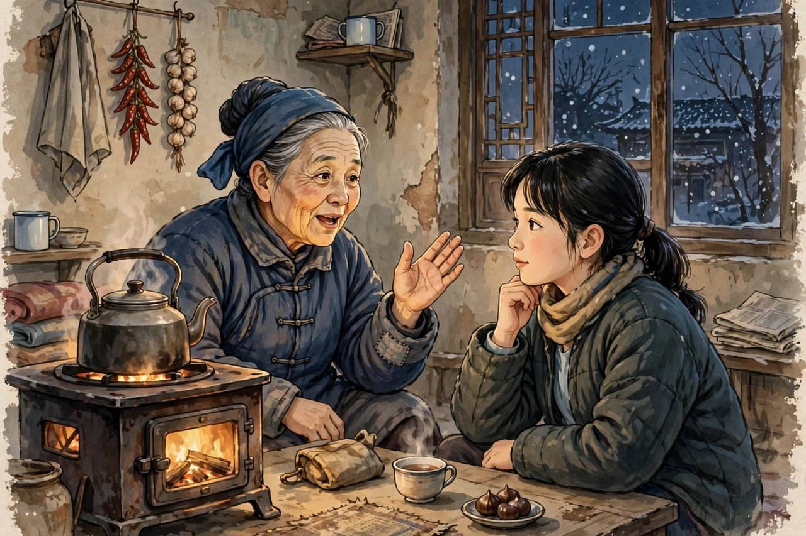
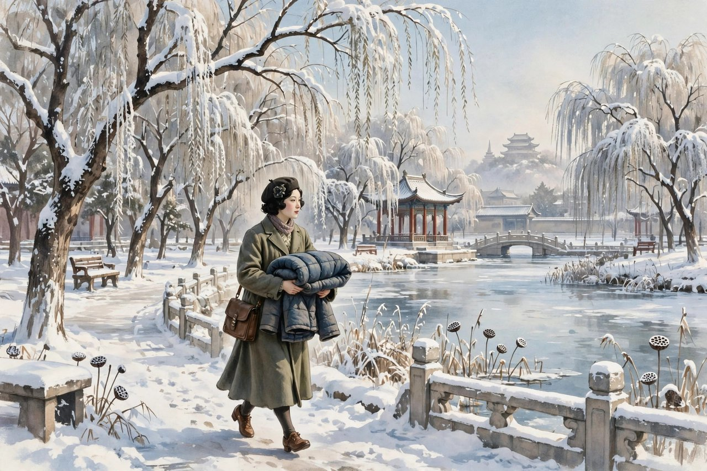

## 立冬那天生的姑娘

冬儿姑娘是冰心一九三四年左右写的小说，收在一九三五年北新书局出版的同名小说集里。小说的讲故事的人，是冬儿的母亲，一个在北海养病的太太家做工的老妈子，她讲起冬儿，讲得有声有色，讲得满是骄傲，也满是心疼。冬儿是立冬那天生的，家里就这么一个孩子，她爸爸本来在内务府当差，什么杂事都能做，糊个棚呀干点什么的，也都有碗饭吃。自从前清没有了，家里就没了落脚的地方，十几年的夫妻，没红过脸，到了实在穷的时候，才有时急得彼此抱怨几句，谁知道这就把他逼走了呢。父亲走了，母亲一个人拉扯冬儿，日子过得苦，可是冬儿没有被苦日子压垮，她从小就是大男孩似的，四五岁的时候，就满街上和人抓子儿，押摊，耍钱，输了就打人，骂人，一街上的孩子都怕她。可是有一样，虽然蛮，她还讲理，还有一样，也还孝顺，母亲说什么，她听什么，母亲只有她一个，也轻易不说她。她常说，妈，我爸爸撇下咱们娘儿俩走了，你还想他呢，你就靠着我得了，我卖鸡子，卖柿子，卖萝卜，养活着你，咱们娘儿俩厮守着，不比有他的时候还强么，你一天里淌眼抹泪的，当得了什么呀。真的，她从八九岁就会卖鸡子，上清河贩鸡子，卖柿子，卖萝卜，养活着母亲，养活着自己，养活着这个家。冬儿这个人物，在冰心笔下，不是一个可怜的穷孩子，是一个有劲儿、有主意、有孝心的姑娘，她的倔强，是穷日子里长出来的，是生活逼出来的，也是她自己天性里的。

## 卖货声里的体面

冬儿卖货，不是低三下四地求人，不是可怜巴巴地讨饭，她卖货卖得有体面，有规矩，有讲理的劲儿。她卖鸡子，鸡子要新鲜，价钱要公道，称要准，不能短斤少两，不能坑人。她卖柿子，柿子要甜，要软，要让买的人觉得值。她卖萝卜，萝卜要水灵，要干净，要让买的人愿意再来。她这种做生意的态度，就是她的体面，就是她的尊严。穷人也可以有体面，穷人也可以有尊严，体面不是靠有钱，尊严不是靠地位，是靠做事公道，是靠待人讲理，是靠不坑人、不骗人、不占便宜。冬儿就是这样，她虽然蛮，虽然爱打架，虽然说话直，可是她讲理，她孝顺，她做生意公道，她对母亲好，她对邻居好，她对太太家的人也好。太太在北海养病，冬儿给太太送棉袄，太太记得，傻大黑粗的，眼梢有点往上吊着，可是这孩子可是利害，从小就是大男孩似的，一直到大也没改。太太喜欢冬儿，不是因为冬儿长得好看，是因为冬儿有劲儿，有孝心，有体面。冬儿后来有了主儿，姑爷在清华园当茶役，年下就要娶，姑爷岁数也不大，家里也没有什么人，可是母亲说的，冬儿有了归着，心里就踏实了，也不枉吃了十五年的苦。母亲这句话，听起来简单，可是里面装了十五年的辛苦，十五年的拉扯，十五年的盼望，盼望女儿有个好归宿，盼望女儿不再受苦，盼望自己的苦没有白吃。冬儿的归宿，不是大富大贵，不是高官厚禄，是一个普普通通的茶役，是一个能过日子的家，可是母亲觉得踏实，觉得够了，觉得这就是幸福。幸福的标准，在穷人家里，就是这么简单，就是有个归着，有个家，有个人能一起过日子。

## 爱的哲学落到柴米油盐里

冬儿姑娘这篇小说，在冰心创作里有一个很重要的位置，就是它标志着爱的哲学从理想落到了现实，从抒情落到了生活。早年的冰心，写爱，写得比较理想，写母爱像星光，写童真像清水，写自然像花海，美是美，可是离生活有点远。冬儿姑娘里的爱，落到了柴米油盐里，落到了卖鸡蛋的吆喝声里，落到了送棉袄的雪天里，落到了母亲十五年的苦里，落到了女儿给母亲的承诺里。这种爱，更结实，更耐看，更经得起时间。你读冬儿姑娘，不会觉得爱是空话，你会觉得爱就是卖货养活母亲，就是给太太送棉袄，就是有了归着让母亲踏实，就是穷日子里还讲理、还体面、还孝顺。这种爱，今天的人读了，也会觉得亲切，因为今天的人，爱也是落在柴米油盐里的，爱就是给母亲打电话，就是给孩子做饭，就是给爱人分担家务，就是给老人买药，就是给朋友帮忙，这些小事，就是爱，就是冬儿姑娘里的爱。冰心写冬儿姑娘，是想告诉读者，爱不是只会说好听话，爱是要能扛事的，是要在穷日子里扛住的，是要在苦日子里还保持体面的。她这种爱的深化和突破，在一九三一年写分、一九三四年写冬儿姑娘的时候，就已经表现出来了，她不再只写理想中的爱，她开始写爱落到现实里怎么磕磕绊绊，怎么在磕磕绊绊里还保持住。这种写爱的方法，比早年的抒情更成熟，更有力量，更能打动今天的人。

## 母亲讲故事的口吻

冬儿姑娘还有一个很妙的地方，就是它的叙述口吻，是母亲讲故事的口吻。小说不是冰心直接讲，是冬儿的母亲对太太讲，讲自己家的事，讲冬儿的事，讲父亲走的事，讲卖货的事，讲冬儿有了主儿的事。母亲讲故事的口吻，是家常的，是絮叨的，是带着方言味儿的，是带着母亲特有的骄傲和心疼的。她讲冬儿，讲得眉飞色舞，讲冬儿小时候怎么蛮，怎么讲理，怎么孝顺，讲冬儿卖货怎么能干，讲冬儿有了归着自己怎么踏实。这种口吻，让小说读起来特别亲切，特别真实，像在听邻居老太太讲自己家的事，听着听着，你就进了故事里，成了太太，成了听故事的人，你也会为冬儿高兴，为母亲心疼，为这个家的苦和甜感动。冰心用母亲的口吻讲故事，是很聪明的选择，因为母亲是最了解冬儿的人，母亲讲冬儿，讲得最真，讲得最动人，讲得最有感情。她用这种口吻，还避免了作者直接说教的毛病，作者不出来讲道理，道理长在母亲的话里，长在冬儿的事里，读者自己去悟，悟出来的道理，记得更牢。今天写小说的人，也可以学这种口吻，让人物自己讲故事，让生活自己说话，不要作者跳出来讲大道理，大道理讲多了，读者会烦，生活讲透了，读者自己会懂。冬儿姑娘的成功，有一半要归功于这个口吻，归功于母亲那张会讲故事的嘴。

## 今天的冬儿姑娘在哪里

今天的冬儿姑娘在哪里，她们还在，在菜市场里，在小吃摊上，在快递站里，在家政公司里，在每一个靠自己的手养活家人的人身上。她们可能不叫冬儿，可能叫小芳，叫小丽，叫大姐，叫阿姨，可是她们的劲儿，跟冬儿是一样的，都是在穷日子里、在难日子里，靠卖货、靠打工、靠手艺，养活母亲，养活孩子，养活自己，还保持体面，还讲理，还孝顺。你今天在菜市场里，看见一个卖鸡蛋的大姐，她称准，不短斤少两，对顾客客气，对母亲孝顺，她就是今天的冬儿姑娘。你今天在小区里，看见一个做家政的阿姨，她干活认真，不偷懒，不抱怨，挣了钱先给家里寄去，她就是今天的冬儿姑娘。冬儿姑娘的故事，讲了一百年，今天还在讲，还在被读，还在被想起，说明它的道理没有过时，说明穷日子里保持体面、保持倔强、保持孝心的道理，永远不会过时。你今天如果觉得日子难，不妨想想冬儿，想想她八九岁就卖鸡子养活母亲，想想她在穷日子里还讲理、还体面，想想她有了归着让母亲踏实，想想，你的心里就会有一点劲儿，有一点不服输的劲儿，有一点要把日子过好的劲儿。这股劲儿，就是冬儿姑娘留给你的，就是冰心留给你的，就是穷日子里长出来的倔强，倔强在，你就能把日子过下去，过下去，就能等到好日子。

## 冬儿的婚事与母亲的心

冬儿姑娘的结尾，写的是冬儿有了主儿，姑爷在清华园当茶役，年下就要娶，姑爷岁数也不大，家里也没有什么人，可是母亲说的，冬儿有了归着，心里就踏实了，也不枉吃了十五年的苦。这个结尾，听起来平淡，可是里面装的东西很满。母亲吃了十五年的苦，拉扯冬儿长大，盼的就是这一天，盼女儿有个好归宿，盼女儿不再受苦，盼自己的苦没有白吃。冬儿的婚事，不是大富大贵，不是高官厚禄，是一个普普通通的茶役，是一个能过日子的家，可是母亲觉得踏实，觉得够了，觉得这就是幸福。幸福的标准，在穷人家里，就是这么简单，就是有个归着，有个家，有个人能一起过日子，有口饭吃，有件衣服穿，有个地方住，这就是幸福。今天的人，讲幸福，讲得越来越复杂，讲房子，讲车子，讲票子，讲地位，讲得越多，幸福越远。冬儿母亲讲幸福，讲得很简单，就是女儿有了归着，就是心里踏实了，就是十五年的苦没有白吃。这种简单的幸福观，今天的人值得学一学，幸福不是越多越好，幸福是够了就好，是踏实就好，是心里安稳就好。你今天如果觉得不幸福，不妨想想冬儿母亲，想想她十五年的苦，想想她盼女儿归着的心，想想她觉得踏实就是幸福的心，想想，你的心里就会静一点，就会觉得，自己现在的日子，其实也不算太差，其实也有值得珍惜的东西。珍惜眼前的人，珍惜眼前的日子，珍惜眼前的家，这就是冬儿母亲教你的幸福观，这就是冬儿姑娘留给你的东西。

## 冬儿与今天的女孩

今天的女孩，读冬儿姑娘，会有两种感觉，一种是觉得冬儿苦，一种是觉得冬儿了不起。苦，是因为冬儿家穷，父亲走了，母亲一个人拉扯她，她从小就要卖货养活家；了不起，是因为冬儿在这么苦的日子里，还能保持倔强，还能保持体面，还能保持孝顺，还能给母亲带来踏实。今天的女孩，生活条件比冬儿好得多，可是她们也有自己的困难，有学习压力，有职场压力，有婚恋压力，有家庭压力，她们读冬儿，会学到在困难里怎么保持倔强，怎么保持体面，怎么孝顺母亲，怎么用自己的手，把日子过好。冬儿不是一个完美的女孩，她蛮，她爱打架，她说话直，可是她讲理，她孝顺，她做生意公道，她对母亲好，她对邻居好，这些优点，比完美更真实，比完美更值得学。今天的女孩，不需要学冬儿的蛮，不需要学冬儿的打架，可是要学冬儿的倔强，学冬儿的讲理，学冬儿的孝顺，学冬儿在穷日子里还保持体面的劲儿。这股劲儿，是女孩安身立命的本钱，是不管遇到什么困难，都能站住的本钱。冬儿姑娘这篇小说，写于一九三四年，讲的是一个底层姑娘的故事，可是它的道理，今天还在，讲给每一个女孩听，讲给每一个在困难里的女孩听，讲给每一个想把日子过好的女孩听。听进去，女孩的心里就会有一股劲儿，有一股不服输的劲儿，有一股要把日子过好的劲儿。

## 冬儿的父亲与家的散

冬儿姑娘里写冬儿的父亲，写得很含蓄，也很痛。父亲本来在内务府当差，什么杂事都能做，糊个棚呀干点什么的，也都有碗饭吃，自从前清没有了，家里就没了落脚的地方，十几年的夫妻，没红过脸，到了实在穷的时候，才有时急得彼此抱怨几句，谁知道这就把他逼走了呢。父亲走了，不是他不爱家，不是他不想养家，是他穷到没有办法了，是他觉得自己没有用了，是他被抱怨的话伤到了，是他一时想不开，就走了。走了之后，家里只剩下母亲和冬儿，母亲一个人拉扯冬儿，日子过得更苦了，可是母亲没有抱怨，没有放弃，她靠着冬儿，靠着卖货，靠着邻居的帮忙，把日子撑下来了，把冬儿拉扯大了。父亲的走，是那个年代好多家庭的缩影，是社会变革里，普通人家的散，是旧制度倒了，新制度还没有来，普通人没有地方去，没有饭吃，没有活干，只能散，只能走，只能各奔东西。冰心写父亲的走，写得很克制，没有大讲政治，没有大讲社会，只是通过母亲的话，轻轻提了一句，可是这一句，里面装了那个年代的残酷，装了普通人家的苦难，装了一个孩子失去父亲的痛。今天的人，家里有变故，有人走了，有人散了，也会觉得痛，也会觉得家散了，可是冬儿母亲告诉你，家散了，还能再聚，人走了，还能靠剩下的人撑下去，撑下去，日子就能过下去，过下去，就能等到好日子。她这种在散里撑下去的劲儿，是冬儿姑娘里最动人的地方，也是今天的人最需要学的地方，家散了不要怕，人走了不要绝望，剩下的人，还要好好活，还要好好过，还要给孩子一个家，给母亲一个依靠。

## 冬儿与太太家的情

冬儿姑娘里写冬儿和太太家的情，写得很温馨，也很真实。太太在北海养病，冬儿的母亲在太太家做工，冬儿给太太送棉袄，太太记得冬儿，记得冬儿傻大黑粗的，记得冬儿眼梢有点往上吊着，记得冬儿从小就是大男孩似的，记得冬儿一直到大也没改。太太喜欢冬儿，不是因为冬儿长得好看，是因为冬儿有劲儿，有孝心，有体面，有讲理的劲儿。太太家和冬儿家，是主仆关系，可是冰心写出来的，不是冷冰冰的主仆关系，是有人情味的关系，是太太关心冬儿，冬儿关心太太，是母亲在太太家做工，太太也关心母亲的身体，关心冬儿的婚事，关心这个家的日子。这种人情味，在那个年代的主仆关系里，是很少见的，也是很珍贵的。冰心写这种人情味，是想告诉读者，人和人之间，不管身份高低，不管贫富贵贱，都可以有真情，都可以互相体贴，互相帮助，互相尊重。太太是富人，冬儿是穷人，可是太太没有看不起冬儿，冬儿也没有巴结太太，她们之间的关系，是平等的，是互相尊重的，是有人情味的。今天的人，家里有保姆，有阿姨，有钟点工，这些人，跟冬儿母亲很像，都是靠做工养活家的人，他们和雇主之间的关系，也可以有人情味，也可以互相体贴，互相尊重，不要把他们当成工具，不要把他们当成外人，要把他们当成家里人，要感谢他们的付出，要体贴他们的辛苦。冬儿姑娘提醒你的，就是看见这些付出，看见这些人情，看见这些在主仆关系里还能保持的温情，看见了，感谢了，世界就暖了。

## 冬儿姑娘的语言与今天

冬儿姑娘的语言，有一个很明显的特点，就是口语化，就是母亲讲故事的口吻，就是家常的，就是絮叨的，就是带着方言味儿的，就是带着母亲特有的骄傲和心疼的。这种语言，读起来很亲切，很真实，很像在听邻居老太太讲自己家的事，听着听着，你就进了故事里，成了太太，成了听故事的人，你也会为冬儿高兴，为母亲心疼，为这个家的苦和甜感动。今天写小说的人，也可以学这种语言，让人物自己讲故事，让生活自己说话，不要作者跳出来讲大道理，大道理讲多了，读者会烦，生活讲透了，读者自己会懂。冬儿姑娘的语言，到今天还是生动的，还是亲切的，还是能打动人的，因为它写的是生活本身，是母亲的话，是冬儿的事，是卖货的吆喝声，是送棉袄的雪天，是有了归着让母亲踏实的心。这些东西，今天还在，母亲的话今天还在，卖货的吆喝声今天还在，送衣服的雪天今天还在，有了归着让母亲踏实的心今天还在。你今天读冬儿姑娘，读的不是一百年前的古董，读的是一个母亲讲自己女儿的故事，故事里的女儿，今天还在，故事里的母亲，今天还在，故事里的爱，今天还在。爱在，故事就活着，爱在，冬儿姑娘就不会过时，爱在，你读完，心里就会有一股劲儿，有一股要把日子过好的劲儿。

## 尾声穷日子里的光

写到这里，想跟每一个在穷日子里、在难日子里的人说一句话，穷日子并不可怕，难日子并不可怕，可怕的是穷日子里丢了体面，难日子里丢了倔强，丢了体面，人就矮了，丢了倔强，人就垮了。冬儿没有丢体面，没有丢倔强，她在穷日子里还讲理，还孝顺，还做生意公道，还给太太送棉袄，还让母亲踏实，她这种体面和倔强，就是穷日子里的光，就是难日子里的灯。光不大，可是亮着，亮着，就能照亮脚下的路，就能走到好日子，就能等到女儿有了归着，就能等到母亲心里踏实。你今天如果觉得日子难，不妨学冬儿，学她的体面，学她的倔强，学她的讲理，学她的孝顺，学她在穷日子里还保持的劲儿。劲儿在，你就能把日子过下去，过下去，就能等到好日子，好日子来了，你就会觉得，过去的苦没有白吃，过去的难没有白熬，过去的日子，都是值得的。这就是冬儿姑娘留给你的全部，也是冰心留给你的全部，很苦，很真，很倔强，很体面，很值得今天的人记住，记住冬儿，记住她的卖货声，记住她的孝顺，记住她在穷日子里长出的倔强。

## 冬儿的卖货与做人

冬儿卖货，卖的不只是鸡蛋、柿子、萝卜，卖的还是做人的道理。她卖货，称要准，价钱要公道，东西要新鲜，不能短斤少两，不能坑人，不能骗人，这种做生意的态度，就是做人的态度，就是不管穷富，都要讲理，都要公道，都要体面。她卖货的时候，跟顾客说话，语气直，可是讲理，顾客觉得她虽然蛮，可是她不坑人，觉得她值得信任，觉得下次还要来她这里买。这种信任，是做生意的本钱，也是做人的本钱，是穷人安身立命的本钱。今天做生意的人，做小买卖的人，也可以学冬儿，称准，价公道，东西新鲜，不坑人，不骗人，这样，生意就能长久，信任就能积累，日子就能过下去。冬儿卖货，还卖出了孝顺，卖货挣的钱，先给母亲买药，先给母亲买衣服，先让母亲吃好穿暖，自己苦一点不要紧，母亲好一点才重要。这种孝顺，不是口头上的孝顺，是行动上的孝顺，是用卖货的钱换来的孝顺，是用自己的辛苦换来的母亲的安稳。今天的人讲孝顺，讲得很多，讲买礼物，讲打电话，讲回家看看，可是真正的孝顺，是像冬儿一样，用行动来孝顺，用挣来的钱让母亲过好日子，用自己的辛苦换母亲的安稳，用自己的体面换母亲的踏实。冬儿卖货，卖出了体面，卖出了孝顺，卖出了做人的道理，卖出了穷日子里的光，光不大，可是亮着，亮着，就能照亮脚下的路，就能走到好日子，就能等到女儿有了归着，就能等到母亲心里踏实。

## 冬儿与北海的雪

冬儿姑娘里写北海的雪，写得很美，也很冷。去年北海不是在霜降那天下了雪么，冬儿给太太送棉袄来了，太太记得，傻大黑粗的，眼梢有点往上吊着，可是这孩子可是利害，从小就是大男孩似的，一直到大也没改。雪天送棉袄，这个细节，很动人，很温暖，雪很冷，棉袄很暖，冬儿的心更暖。她冒着雪，给太太送棉袄，不是为了讨好太太，不是为了巴结太太，是因为她惦记太太，怕太太冷，怕太太病，怕太太在北海养病的日子不好过。她这种惦记，是穷人对富人的惦记，是晚辈对长辈的惦记，是人与人之间的真情，是不分贫富贵贱的真情。太太记得这个细节，记得雪天，记得棉袄，记得冬儿的样子，记得冬儿的利害，记得冬儿的孝顺，记得冬儿的体面，这种记得，就是对冬儿最好的肯定，就是对冬儿最好的回报。今天的人，雪天给别人送衣服，送温暖，送关心的事，越来越少了，人与人之间，越来越冷，越来越疏远，越来越只顾自己，冬儿姑娘提醒你的，就是雪天要给别人送棉袄，要惦记别人，要体贴别人，要在别人冷的时候，给别人一点暖。暖给到了，别人心里就暖了，别人心里暖了，世界就暖了，世界暖了，雪就不那么冷了，日子就不那么难了。冬儿在雪天送棉袄，送的不只是一件衣服，送的是一颗心，送的是人与人之间的温情，送的是穷日子里的光，光不大，可是亮着，亮着，就能照亮雪天里的路，就能走到春天，就能等到雪化了，花开了，日子好起来了。

## 冬儿与今天的母亲

今天的母亲，读冬儿姑娘，会觉得冬儿母亲很像自己，很像身边的人，很像那些一个人拉扯孩子长大的人。她们可能在菜市场里卖货，可能在工厂里打工，可能在家里做家务，可能在夜里想孩子的事，想得睡不着，想得心里酸，可是她们没有放弃，没有抱怨，她们靠着孩子，靠着邻居，靠着自己的手，把日子撑下来了，把孩子拉扯大了。冬儿母亲吃了十五年的苦，拉扯冬儿长大，盼的就是女儿有个好归宿，盼女儿不再受苦，盼自己的苦没有白吃。今天的母亲，吃的苦也不少，拉扯孩子也不容易，盼的也是孩子有个好归宿，盼孩子不再受苦，盼自己的苦没有白吃。这种盼望，古今都是一样的，时代变了，母亲的心没有变，母亲的苦没有变，母亲的盼望没有变。冬儿姑娘提醒你的，就是要体贴母亲，要感谢母亲，要在母亲老了的时候，给母亲一个依靠，给母亲一个踏实，给母亲一个好日子。母亲老了，不要觉得母亲唠叨，不要觉得母亲过时，要记得母亲十五年的苦，记得母亲拉扯你的辛苦，记得母亲盼你归着的心，记得了，感谢了，母亲的心里就踏实了，踏实了，母亲的苦就没有白吃，母亲的日子就有了光，光不大，可是亮着，亮着，就能照亮母亲的晚年，就能照亮你的心。

## 冬儿与今天的菜市场

今天的菜市场里，还有冬儿，还有卖鸡蛋的大姐，还有卖柿子的大妈，还有卖萝卜的阿姨，她们称准，价公道，东西新鲜，不坑人，不骗人，对顾客客气，对母亲孝顺，对家里负责，她们就是今天的冬儿姑娘，就是今天的穷日子里长出的倔强，就是今天的体面和孝顺。你今天去菜市场，买鸡蛋的时候，不妨看看卖鸡蛋的大姐，看看她称准不准，看看她对顾客客不客气，看看她挣了钱先给家里寄去没有，看看，你就会觉得，冬儿还在，冬儿没有走，冬儿活在今天的菜市场里，活在今天的小吃摊上，活在今天的快递站里，活在今天的家政公司里，活在每一个靠自己的手养活家人的人身上。她们可能不叫冬儿，可能叫小芳，叫小丽，叫大姐，叫阿姨，可是她们的劲儿，跟冬儿是一样的，都是在穷日子里、在难日子里，靠卖货、靠打工、靠手艺，养活母亲，养活孩子，养活自己，还保持体面，还讲理，还孝顺。你今天如果觉得日子难，不妨去菜市场走走，看看冬儿们，看看她们怎么卖货，怎么讲理，怎么孝顺，怎么把日子过好，看看，你的心里就会有一点劲儿，有一点不服输的劲儿，有一点要把日子过好的劲儿。这股劲儿，就是冬儿姑娘留给你的，就是冰心留给你的，就是穷日子里长出来的倔强，倔强在，你就能把日子过下去，过下去，就能等到好日子。

## 冬儿与今天的女儿

今天的女儿，读冬儿姑娘，会觉得冬儿很像自己，很像身边的女孩，很像那些在困难里长大的女孩。她们可能在学校里努力，可能在职场里打拼，可能在家里照顾母亲，可能在夜里想未来的事，想得睡不着，可是她们没有放弃，她们靠着自己的手，靠着自己的倔强，靠着自己的体面，把日子过下来了，把母亲照顾好了，把自己活成了冬儿的样子。冬儿不是一个完美的女孩，她蛮，她爱打架，她说话直，可是她讲理，她孝顺，她做生意公道，她对母亲好，她对邻居好，这些优点，比完美更真实，比完美更值得学。今天的女儿，不需要学冬儿的蛮，不需要学冬儿的打架，可是要学冬儿的倔强，学冬儿的讲理，学冬儿的孝顺，学冬儿在穷日子里还保持体面的劲儿。这股劲儿，是女孩安身立命的本钱，是不管遇到什么困难，都能站住的本钱，是不管遇到什么风浪，都能扛住的本钱。冬儿姑娘这篇小说，写于一九三四年，讲的是一个底层姑娘的故事，可是它的道理，今天还在，讲给每一个女孩听，讲给每一个在困难里的女孩听，讲给每一个想把日子过好的女孩听。听进去，女孩的心里就会有一股劲儿，有一股不服输的劲儿，有一股要把日子过好的劲儿，有一股要让母亲踏实的劲儿，劲儿在，日子就能过下去，过下去，就能等到好日子。

冬儿姑娘的故事，讲了一百年，今天还在讲，还在被读，还在被想起，说明它的道理没有过时，说明穷日子里保持体面、保持倔强、保持孝心的道理，永远不会过时。你今天如果觉得日子难，不妨想想冬儿，想想她八九岁就卖鸡子养活母亲，想想她在穷日子里还讲理、还体面，想想她有了归着让母亲踏实，想想，你的心里就会有一点劲儿，有一点不服输的劲儿，有一点要把日子过好的劲儿。这股劲儿，就是冬儿姑娘留给你的，就是冰心留给你的，就是穷日子里长出来的倔强，倔强在，你就能把日子过下去，过下去，就能等到好日子，好日子来了，你就会觉得，过去的苦没有白吃，过去的难没有白熬。

倔强在，日子就能过下去，过下去，就能等到好日子，好日子来了，苦就没有白吃。
