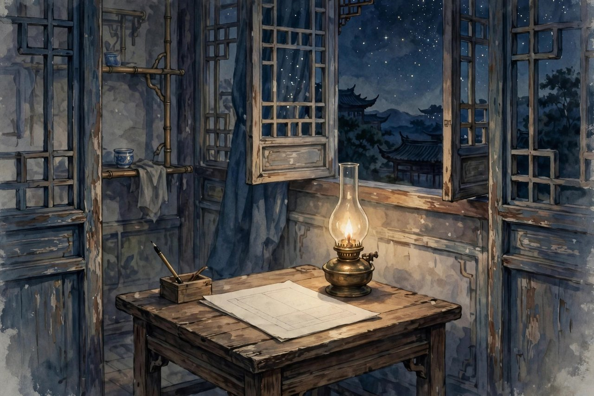
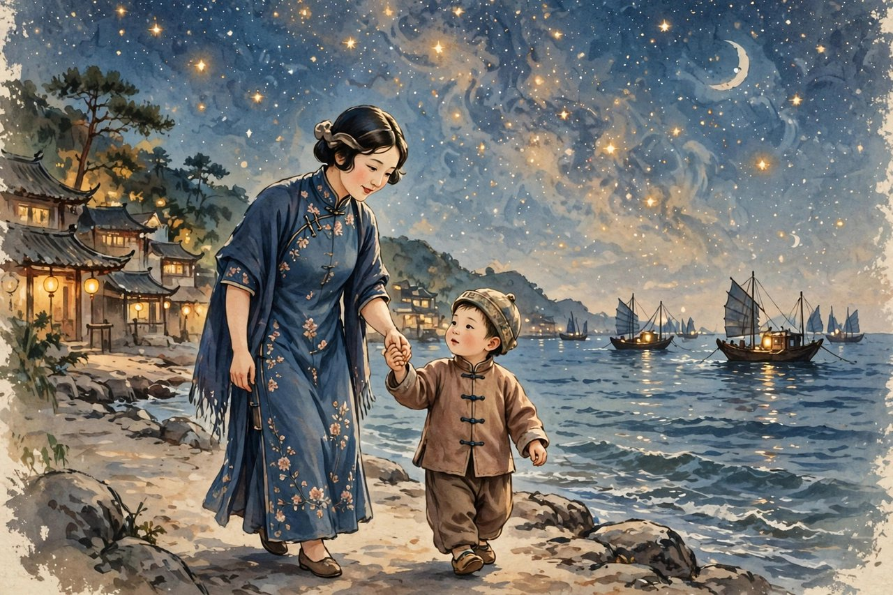

## 火炉边的提议

繁星的来历，要从一个冬夜讲起。那年冬天，冰心和弟弟围着火炉读书，读的是印度诗人泰戈尔的迷途之鸟。那些诗都很短，短到一句话就是一首，意思却很满，像一颗一颗小石子，扔进心里能起涟漪。弟弟听了就说，姐姐，你平时不是总说自己的想法太零碎，写不成大篇幅吗，其实也可以这样收集起来，零碎的想法，收集起来就是一本书。冰心听进去了。她平时确实有好多零碎的感想，关于母亲，关于孩子，关于星星，关于大海，关于人生里的困惑，这些感想单独拿出来都不够写一篇长文章，可是放在心里不写出来，又觉得可惜。弟弟这句话，像给她推开了一扇门。她开始把这些零碎的感想写成小诗，一首一首，写在纸上，攒多了就寄给报纸。晨报副刊登了出来，读者一看就喜欢上了，觉得这种诗新鲜，短小，清丽，读起来不费劲，可是读完心里有东西。编辑起初还问她，这繁星到底是什么，是诗还是杂感，她回答说是小杂感一类的东西，编辑也就先放在新文艺栏目里登着，登了几天，反响很好，读者认定那就是诗，是新诗，编辑就把它挪到了诗栏里。从一九二二年一月一日起，连载到一月二十六日，一共一百六十四首，中间还被上海的时事新报学灯转载。繁星就这样从火炉边的一句话，变成了文坛上的一件大事。她后来把这些诗结集出版，商务印书馆一九二三年出了单行本，繁星这个名字，从此跟冰心连在了一起，谁提起冰心，谁就会想起繁星，想起夜里的星星，想起母亲，想起孩子。

## 短诗为什么能打动人

繁星的诗，短是它的命。有的诗只有两三行，有的诗只有一句话，可是这一句话里装的东西并不少。她写母亲，写的是母亲的爱怎么像星星一样，不声不响地亮着，你平时不觉得，夜里抬头一看，才发现它一直在那里。她写孩子，写的是孩子的天真怎么像清澈的水，能把大人的心洗干净。她写自然，写的是星星、花、海洋、夜色，这些东西在她笔下不是死的风景，是活的、有感情的伙伴。她写人生，写的是人在困惑里怎么寻找出路，怎么在黑暗里留一点光。她这种写法，跟当时流行的长诗不一样，长诗讲究铺陈，讲究气势，讲究把一个道理讲透，她反过来，讲究点到为止，讲究留白，讲究让读者自己去想。读者读到一首小诗，觉得好像说中了自己心里的话，可是又觉得话没有说尽，剩下的部分要自己去补，这种参与感，是长诗给不了的。繁星的语言也很干净，没有生僻词，没有拗口的句子，都是日常话，可是日常话被她一组合，就有了诗意。她写星星，不说星星多么伟大，说星星在夜里眨眼睛；她写花，不说花多么高贵，说花在墙角静静地开；她写母亲，不说母亲多么伟大，说母亲的手怎么温暖。这种把大的东西写小、把远的东西写近的本事，是她最厉害的地方。今天的人读繁星，可能会觉得它太简单，太温柔，不够深刻，可是你要想想，那个年代的年轻人，正处在五四的余波里，心里有火，有困惑，有找不到出路的焦虑，他们需要的不是更复杂的理论，而是一点能安慰人心的东西。繁星给他们的，就是这点安慰，就是夜里的一盏小灯。

## 母爱是诗里的根

繁星里写得最多的，是母爱。冰心自己说过，母爱是她爱的哲学的起点。她觉得，人和人之间的爱，都是从母爱里长出来的，母亲爱孩子，孩子爱母亲，这种爱是最自然、最不用教的。推开去，母亲和母亲是好朋友，孩子和孩子也是好朋友，世界上的爱，就是这样一层一层推出去的。她在繁星里写母亲，写母亲的笑，写母亲的泪，写母亲在灯下缝衣服的样子，写母亲在病中还惦记孩子的话。这些诗，读起来不煽情，不掉眼泪，可是读完心里会软。她写母亲，不是把母亲写成圣人，而是写成一个具体的人，一个会累、会担心、会默默付出的人。这种写实里的深情，比空洞的赞美更有力量。她写母爱，还写到了对祖国的爱，对同胞的爱，她觉得祖国就像母亲一样，值得人去爱，去守护。她在异国他乡的时候，想起母亲，也想起祖国，两种想念交织在一起，诗里就有了乡愁的味道。她写母爱，不只是写给自己的母亲看，也是写给所有母亲看，写给所有孩子看，让孩子懂得珍惜母亲，让母亲懂得自己的爱有多重要。今天的人读这些诗，可能会想起自己的母亲，想起母亲做的饭，母亲说的话，母亲在电话里的叮嘱。这些细节，今天和一百年前并没有太大差别，母亲的爱，古今都是一样的。所以繁星里的母爱诗，到今天还不过时，还能打动人，还能在母亲节、在深夜里被人翻出来读。

## 童真与自然的光

繁星里除了母爱，还有童真和自然，这两个主题跟母爱是连在一起的。她写孩子，觉得孩子的心是最干净的，没有算计，没有伪装，孩子看世界，看到的是真的东西，大人看世界，看到的常常是被利益、被面子、被成见挡住的东西。她觉得，大人要向孩子学习，要把心洗干净，回到天真里去。她写孩子，不是把孩子当成不懂事的小东西，而是把孩子当成老师，当成一面镜子，照出大人的问题。她写自然，也是这个意思，她觉得自然里的星星、花、海洋，都是干净的，都是美的，都是值得人去爱的。她写星星，说星星在夜里不说话，可是它亮着，亮着就是一种安慰。她写花，说花开在墙角，没有人看，它还是开，开就是它的本分。她写海洋，说海洋大，大到能装下人的烦恼，人在海边站一站，心就宽了。她把童真和自然放在一起写，是因为在她心里，孩子和自然是一样的，都是没有被污染的，都是美的源头。她这种想法，在今天看来可能有点理想化，觉得孩子也有烦恼，自然也有风浪，可是她的意思不是说孩子没有烦恼、自然没有风浪，而是说，孩子和自然里有一种本真的东西，值得大人去守护。她写这些诗，是想给那个动荡的年代留一点干净的东西，让年轻人在看多了社会黑暗之后，还能相信世界上有美好的东西，还愿意去守护美好。

## 繁星格是怎么传开的

繁星出版后，在文坛上引起了很大的反响，茅盾把这种写法叫做繁星格、春水体，意思是冰心开创了一种新的小诗体裁。这种体裁，短小，自由，没有严格的格律，不讲究押韵，不讲究对仗，讲究的是感情真挚，意境隽永。好多年轻人学她写，报纸上一下子冒出好多小诗，都是两三行，都是写母爱、写自然、写人生感想。这种跟风，有好有坏，好处是让更多人开始写诗，开始用诗来表达感情，坏处是跟风的东西往往学到了形式，没有学到真心，写出来的诗空洞、肉麻，读起来让人起腻。冰心自己对此很清醒，她知道，形式好学，真心难学，她写小诗，是因为心里真有那些感想，不是为了赶时髦。她后来也说过，小诗不是随便写两句就是诗，诗里要有思想，要有感情，要有画面，要让人读完有所得。她这种清醒，让她没有被跟风带偏，没有一辈子只写小诗，她后来还写小说、写散文、写儿童文学，路子越走越宽。繁星格传开的意义，不只是多了一种诗体，更是让中国新诗多了一种可能，就是诗可以很短，可以很日常，可以写给母亲，写给孩子，写给夜里的星星，不必总是写大道理，不必总是写国家大事。这种可能，对后来的新诗发展影响很大，后来的好多诗人，写短诗、写抒情诗，都受过繁星的影响。今天的人写朋友圈，写短句，写三言两语的心情，其实跟繁星的路子有点像，都是用最短的话，说最真的话。繁星提前了一百年，告诉人们，短不是浅，短也可以深，短也可以动人。

## 对照今天的夜晚

今天的人，夜里很少抬头看星了。城市里灯太多，星星被灯光盖住了，手机屏幕太亮，眼睛被屏幕占住了，心里也很少有安静的时候。你问一个年轻人，昨晚看见星星了吗，他可能想半天，想不起来。你问他最近有没有给母亲打电话，他可能说忙，改天再打。你问他最近有没有静下来想一想自己的人生，他可能说没有时间，想了也没有用。这种状态，跟一百年前年轻人读繁星时的状态，其实有点像，那时候的年轻人也在焦虑，也在找不到出路，也在被时代推着走。繁星给他们的安慰，今天的人同样需要。你不需要真的跑到乡下去看星，你只需要在夜里，把手机放下，走到窗边，抬头看一眼天，哪怕只能看见一两颗星，心里也会静一点。你不需要给母亲写一首诗，你只需要在电话里，跟母亲多说两句，问问她身体怎么样，饭吃得好不好，觉睡得好不好，这就是今天的母爱诗。你不需要写出传世的作品，你只需要在心里留一点童真，留一点对自然的喜欢，留一点对美好事物的耐心，这样，你的心就不会被焦虑完全占住。繁星的价值，在今天不是文学史上的一个名词，而是一种生活的提醒，提醒你在忙、焦虑、内卷的日子里，别忘了抬头，别忘了给家里打电话，别忘了心里要留一点光。这点光，看起来很小，可是关键时刻，它能让你不至于完全迷失。

## 读繁星的方法

读繁星，不用一口气读完一百六十四首，那样读会累，会腻。最好的读法，是每天读几首，读完想一想，想想这首诗说中了你心里的哪句话，想想这首诗里的母亲、孩子、星星，跟你生活里的哪个人、哪件事对得上。你可以把喜欢的诗抄下来，抄在笔记本上，抄在手机备忘录里，睡前翻一翻。你也可以把诗念给孩子听，念给母亲听，念给朋友听，念出来比默读更有味道。读繁星，也不用先做学问，不用先查作者生平，不用先背文学史的评价，你就直接读诗，诗本身会说话。你读到写母亲的诗，想起母亲，你就懂了；你读到写星星的诗，想起夜里看过的星，你就懂了；你读到写人生的诗，想起自己的困惑，你就懂了。繁星的诗，就是这样直接，不绕弯子，不卖关子，它相信读者，相信读者的心能接住诗里的意思。你读的时候，也别怕读不懂，有的诗，你年轻的时候读不懂，到了中年再读，就懂了；有的诗，你顺境的时候读不懂，到了逆境里再读，就懂了。诗是这样，时间会帮你读懂它。冰心写繁星的时候，才二十出头，可是她写的东西，到了九十多岁的人读起来，还是能懂，还是能感动，这就是好诗的本事，它不挑年龄，不挑时代，只挑人心里的那一点真。

## 繁星留下的东西

繁星留下的东西，有两样东西最实在。一样是语言，一样是态度。语言上，它给中国新诗留下了一套干净、短小、亲切的表达方式，后来的诗人写短诗，都可以从它这里找到路子。态度上，它给中国读者留下了一种温和而坚定的看世界的方式，就是不管世界多乱，心里要留一点爱，留一点对母亲的感恩，留一点对孩子的耐心，留一点对自然的喜欢。这种态度，不是软弱，不是逃避，是在乱世里给自己留一个安身的地方。你今天读繁星，读的不是一百年前的古董，读的是一个年轻姑娘在夜里写给心看的话，这些话，今天的心还是能听懂的。她写星星，星星今天还在天上，只是被灯光挡住了；她写母亲，母亲今天还在家里，只是电话少了；她写孩子，孩子今天还在身边，只是长大了。繁星的诗，像一封写给所有时代的信，信的收件人是你，是我，是每一个夜里还愿意抬头的人。你把这封信读完，心里会亮一点，亮一点就够了，亮一点，你就能走下去。

## 星空下的母亲

繁星里写母亲的诗，读起来最让人心里发软，因为它写的不是抽象的母爱概念，而是母亲在日常生活里的样子。母亲在灯下做针线，母亲在门口等孩子回家，母亲在孩子生病的时候整夜不睡，母亲在孩子远行的时候站在门口望了又望，这些画面，谁家里没有呢。你读到这些诗，就会想起自己的母亲，想起她做过的饭，她说过的话，她在你出门时塞到你手里的东西。冰心写母亲的高明之处，在于她不把母亲写成完美无缺的神，她写母亲的辛苦，写母亲的担心，写母亲也会累，也会老，也会因为孩子的一句话而难过。这样的母亲，才是真实的母亲，才是值得人去爱的母亲。她写母亲，还写母亲对孩子的信任，母亲相信孩子能长大，能走好自己的路，这种信任，给了孩子很大的力量。好多年轻人读繁星，读到母亲的诗，会给家里打电话，会想回家看看，这种效果，是文学评论讲不出来的，是诗直接碰到人心才有的效果。母亲这个主题，在繁星里不是点缀，是根，是整本诗集的底色，没有母亲，繁星的星光就会暗一半。你把繁星里写母亲的诗挑出来，单独读一遍，会发现它们合起来就是一封写给母亲的长信，信里没有华丽的词，只有真心话，真心话比华丽的词更有力量。今天的人给母亲尽孝，往往想着买贵的东西，送大的礼物，其实母亲要的很简单，就是孩子的一句问候，一次回家，一顿一起吃的饭。繁星提醒你的，就是这个简单的道理，它用诗的语言告诉你，别等到母亲老了、病了，才想起要珍惜，现在就打电话，现在就回家，现在就把爱说出来。爱说出来，才是爱，爱藏在心里，母亲是感觉不到的，母亲感觉不到的爱，跟没有爱没有太大差别。繁星的母亲诗，就是教你把爱说出来，把爱做出来，把爱放在日常生活里，而不是放在节日里，放在口号里。

## 大海与夜色的陪伴

繁星里写自然的诗，写得最多的是星星、大海和花，这三样东西，在冰心心里是连在一起的。星星在天上，大海在地上，花在人间，三样东西都是美的，都是安静的，都是能给人安慰的。她在烟台海边长大，看惯了大海，大海的潮声，是她童年的摇篮曲。她写大海，写大海的宽广，写大海能装下人的烦恼，写人在海边站一站，心就宽了，烦恼就小了。她写星星，写星星在夜里不说话，可是它亮着，亮着就是一种陪伴，你夜里睡不着，抬头看看星星，心里就不会那么孤单。她写花，写花开在墙角，没有人看，它还是开，开就是它的本分，不需要掌声，不需要赞美。这种对自然的态度，今天的人特别需要学。今天的人活在城市里，离自然很远，离星星很远，离大海很远，心里装的全是工作、房贷、孩子上学、手机里的消息，时间长了，心就变得又硬又燥。繁星告诉你，偶尔要去看看自然，去海边走走，去公园看看花，去夜里抬头看看天，哪怕只有半个小时，心也会软下来，也会静下来。自然不会跟你讲道理，自然只是静静地在那里，可是它在那里，就能治愈你。冰心写自然，不是为了写风景作文，她是把自然当成朋友，当成母亲一样的存在，她觉得自然里的爱，跟母亲的爱是一样的，都是无私的，都是不求回报的。你读她的自然诗，会觉得自己不是孤单的，天上有星星，地上有花，海边有潮声，这些东西都在陪着你，你不需要害怕黑暗，黑暗里有星光，星光虽然小，可是它亮着，就够你走夜路了。

## 困惑里的一点光

繁星里还有一类诗，写的是人生的困惑，写的是年轻人在寻找出路时的迷茫。她自己年轻的时候，也迷茫过，也不知道该学医还是该写文章，也不知道中国的出路在哪里，也不知道自己的感情该往哪里放。她把这些迷茫写成诗，不是为了解决迷茫，而是为了把迷茫说出来，说出来，迷茫就轻了一半。她写困惑的诗，语气很温和，不抱怨，不愤怒，不骂社会，不骂别人，只是静静地讲，我心里有困惑，我在寻找光，我相信光是存在的。这种温和的困惑，比激烈的控诉更有力量，因为它让读者觉得，原来不只我一个人困惑，原来冰心也困惑过，原来困惑是正常的，是成长的一部分。今天的年轻人，困惑更多，找工作难，买房难，结婚难，带孩子难，职场里卷，网络上吵，心里装了好多解不开的结。繁星给你的，不是解开这些结的钥匙，而是告诉你，结可以慢慢解，不用着急，不用一夜之间全解开，你可以在夜里看星，在白天做事，在困惑里保持一点耐心，耐心本身就是一种力量。她写人生诗，常常把人生比作航行，把人比作在海上行船的人，船会遇到风浪，会迷失方向，可是只要心里有星光，有灯塔，船就不会沉。这种比喻，今天读起来还是管用，你的人生也是一条船，风浪是免不了的，关键是心里有没有星光。星光不是别人给你的，是你自己要留住的，是你读诗、想母亲、看自然的时候，一点一点攒起来的。攒够了星光，你的船就能在风浪里稳住，就能找到方向。

## 小诗与大时代的张力

有人会问，繁星这么温柔，这么短小，放在五四那个大时代里，是不是太软了，是不是回避了时代的大问题。这个问题，问得有道理，可是答案没有那么简单。五四时代，确实有好多作家写得很激烈，写反抗，写革命，写打倒旧制度，那些作品很有力量，很能鼓动人。冰心不是那个路子的，她写的是温柔的力量，是爱的力量，是让人心里变软、变善的力量。这两种力量，不是对立的，是互补的。一个时代，既需要有人喊醒大家，也需要有人安慰大家，既需要有人指出问题，也需要有人给受伤的心上药。冰心就是上药的那个人。她写繁星的时候，中国社会问题很多，军阀混战，贫富悬殊，妇女受压迫，孩子没学上，这些问题，她在小说里写过，在散文里也提过，她不是不知道。她在诗里选择写爱，是因为她觉得，光指出问题不够，还要给人希望，给人继续走下去的理由。没有希望，人就会绝望，绝望的人什么都做不了。有了爱，有了希望，人才能有力气去面对问题，去改变社会。她这种想法，今天看来还是有道理的。今天的社会问题也不少，焦虑、内卷、贫富差距、教育压力，这些问题，靠骂是骂不完的，靠恨是恨不完的，还需要有人给社会留一点暖意，留一点人与人之间的信任。繁星的温柔，不是逃避，是另一种战斗，是用爱来战斗，用温柔来抵抗冷漠。她这种战斗方式，看起来不激烈，可是它持久，它能穿过一个世纪，还能打动今天的人。激烈的口号，喊过一阵就过去了，温柔的诗，却能留下来，被一代一代人读下去。

## 跟风者与真心话

繁星火了之后，跟风的人很多，报纸上、杂志上，一下子冒出好多小诗，形式跟繁星很像，都是两三行，都是写星星、写花、写母亲，可是读起来味道不对，空洞，肉麻，像是套公式写出来的。这种跟风，在文学史上很常见，一种新形式出来，总有人学样子，不学里子。冰心对此看得很清楚，她没有因为跟风多就得意，也没有因为跟风的东西不好就否定小诗这种形式。她知道，小诗好不好，不看长短，不看形式，看心里有没有真东西。心里有真东西，两行也是诗，心里没有真东西，写两百行也是空话。她后来写文章，也谈过这个问题，说写诗要真诚，要从生活里来，不能为了写诗而写诗，不能为了显得有才华而堆词。她这种态度，对今天写东西的人很有启发。今天写短文、写朋友圈、写短视频文案的人也很多，跟风的也很多，一个句子火了，马上就有一堆人模仿，模仿样子容易，模仿真心难。你写的东西，要先问自己，这是不是我心里真想说的话，是不是我生活里真看到的东西，如果是，哪怕句子不完美，也能打动人，如果不是，哪怕句子再华丽，也是空的。繁星给今天写作者的启示，就是真诚比技巧重要，生活比形式重要，心里有光，笔下才有光。她自己就是这样做的，她写繁星，不是为了开创一个流派，不是为了出名，是因为心里真有那些感想，不写出来难受，写出来就舒服了。这种从心里长出来的写作，才是最经得起时间的。

## 繁星在今天的书架上

今天，你走进书店，或者打开购书网站，搜繁星，还是能找到好多版本，有单行本，有合集，有注释本，有给孩子看的绘本版。这说明，繁星没有过时，它还在被读，还在被卖，还在被老师推荐给学生。老师推荐它，是因为它好讲，好读，好背，适合孩子。家长买它，是因为它干净，适合孩子读，不用担心里面有不好的东西。年轻人买它，是因为它短，适合睡前读，适合在地铁上读，适合在心情不好的时候翻两页。它这种跨越年龄、跨越时代的生命力，是很多大部头作品没有的。大部头作品，需要时间，需要耐心，需要一定的文学修养，繁星不需要，它只需要你有一颗愿意安静下来的心。你读繁星，不需要做笔记，不需要写读后感，不需要考试，你只需要读，读完想一想，想完就放在心里，时间长了，它会在你心里生根，会在你遇到困难的时候，突然冒出来一句，给你一点安慰。这种安慰，是悄悄的，不张扬的，可是它管用。好多成年人回忆起来，都说小时候读过繁星，当时不觉得有什么，长大了，遇到挫折了，突然想起里面的一句诗，心里就暖了一下。这种迟来的安慰，是繁星最珍贵的地方。它不是当下给你一个答案，它是给你埋一颗种子，种子在心里，等到合适的季节，自己会发芽。你今天读繁星，就是在给未来的自己埋种子，种子埋下去，未来的你在困难里，就能想起星光，就能想起母亲，就能想起自己心里还有光。

## 尾声抬头看看天

写到这里，想跟你说一句很简单的话，今晚如果有空，抬头看看天。城市里的天，可能看不见太多星，可是你用心看，还是能看见一两颗。那一两颗星，就是繁星留给你的东西，就是冰心在一百年前写下的光。她写繁星的时候，没有想过一百年后的人还会读她，她只是把心里的感想写下来，写给母亲，写给孩子，写给夜里的星星。没想到，这些感想穿过了一百年，还能碰到今天的心。这就是好作品的命，它不靠宣传，不靠热点，靠的是真心，靠的是人心里的共鸣。你读完这篇，再去读繁星的原诗，会读得更亲切，因为你已经知道了这些诗是怎么来的，是谁在什么心情下写出来的，是火炉边的弟弟一句话，是烟台海边的童年，是对母亲的想念，是对人生的困惑。这些背景，知道了，诗就更活了，不知道，直接读诗也行，诗本身就够动人了。繁星这本书，很薄，读起来很快，可是它留给你的东西，可以很久。你把它放在床头，放在书架上，放在手机里，什么时候心里乱了，翻开读几首，心里就能静一点。静一点，就够了，静下来，你才能听见自己心里的声音，才能想清楚下一步该往哪里走。冰心用繁星告诉你的，就是这个道理，夜里有星，心里有光，路就不会全黑。

繁星这本书，很薄，可是它装的东西并不薄，它装了一个年轻姑娘对母亲的爱，对孩子的喜欢，对星星的向往，对人生的困惑，对世界的温柔。这些东西，合起来就是一个人心里最干净的部分。你读繁星，就是在读一个人心里最干净的部分，读完，你心里最干净的部分也会被唤醒，唤醒了，你就能带着这份干净，继续往前走。往前走的路上，风浪会有，黑暗会有，焦虑会有，可是你心里有星光，星光在，路就在。星光不大，可是够你看清脚下的路，够你不摔倒，够你走到天亮。天亮了，星星会淡去，可是星光留给你的感觉不会淡去，那种感觉，会变成你做人的底色，变成你看人的眼光，变成你爱人的方式。这就是繁星留给你的全部，也是冰心留给你的全部，很简单，很干净，很持久。

你把繁星放在床头，夜里翻一翻，白天想一想，时间长了，它会变成你心里的一盏小灯，灯不大，可是亮着，亮着，你就不会在黑暗里完全迷路。黑暗里迷路的人，最怕的不是黑暗本身，是心里没有光，心里有光，黑暗就不可怕，心里没有光，白天也会迷路。繁星给你的，就是心里这点光，这点光，是冰心用一辈子验证过的，是母亲给她的，是星星给她的，是孩子给她的，是大海给她的，她把这点光写成诗，传给你，你接住了，光就传下去了。传下去，光就不会熄灭，传下去，一代一代的人，心里都会有星光。

繁星的星光，今天还在天上，只是有时候被城市的灯光盖住了，被手机的屏幕挡住了，被心里的焦虑蒙住了。你只要愿意抬头，愿意放下手机，愿意静下来，星光就会重新出现，重新照亮你的心。星光出现的时候，你会想起母亲，想起孩子，想起童年，想起自己心里最干净的部分，想起，自己原来还可以这么安静，这么温柔，这么有希望。这就是繁星给你的最后一份礼物，一份不需要花钱、不需要排队、不需要预约的礼物，只需要你抬头，只需要你静下来，只需要你愿意相信，心里还有光。
