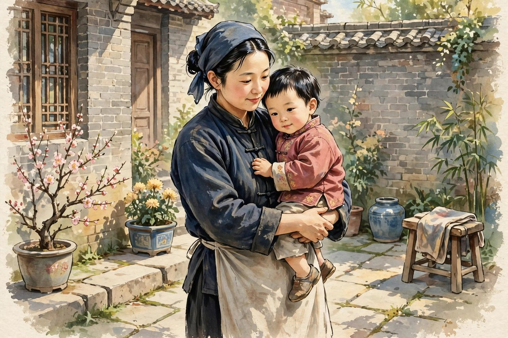
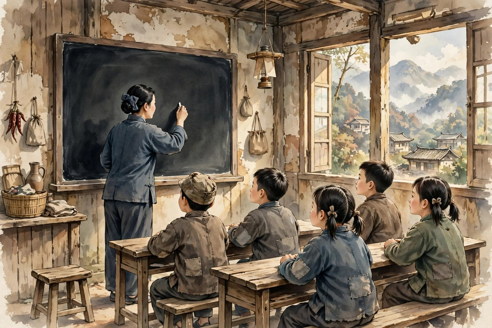

## 男士笔名的来历

关于女人这本书，来历很有意思。抗战年月，冰心跟着丈夫到了昆明、到了重庆，参加文化救亡活动，生活很苦，稿费很要紧。她给重庆版星期评论写文章，编辑向她索稿，她问，我用假名可不可以，编辑说，陌生的名字，不会引起读者的注意。她说，那么，我挑一个引人注意的题目吧。于是她写了关于女人，署名男士。男士这个笔名，取得很妙，一来引人注意，二来可以换个身份看女人。她在文章开头就把自己定位为男人，阐明以男人来写女人的理由，以一个男士而写关于女人的题目，似乎总觉得有些不太那个，人们会想，内容莫不是讥讽吧，莫不是单恋吧，仿佛女人的问题，只应该由女人来谈似的。其实，她以为女人的问题，应该是由男人来谈，因为男人在立场上，可以比较客观，男人的态度，可以比较客气。这段话，听起来像玩笑，可是里面有真意思，她想用男人的口吻，来写女人的好，来写女人的苦，来写男人平时看不见的东西。她用男士的笔名，先后在星期评论上发表了好多篇关于女人的文章，后来结集成书，一九四三年天地出版社出了单行本，后来开明书店又出了增订本。全书收了写女人的文章，其中有谈母亲、教师、弟媳、奶娘、同班、同学、朋友之太太、学生、房东、张嫂、朋友的母亲，几乎包括了所有的女性。她用一个男人的视角来审视女人，而自己又是女人，这种换位式的叙述，比用女人的眼光看女人更有可看性，因为男人看女人，看见的东西跟女人看女人不一样，男人看见的，是女人的好，是女人的韧，是女人的体贴，是女人平时不说出来的苦。

## 十几位女人的群像

关于女人这本书，写了十几位女人，有的说是十三个，有的说是十四个，数字上有点出入，可是人物是清楚的，有母亲，有奶妈，有女同学，有交际花，有乡下女子，有女教师，有朋友的太太，有房东，有张嫂，有朋友的母亲，每个人都有自己的故事，都有自己的性格，都有自己的命运。母亲喜欢头生的是姑娘，奶妈善良地看管小主人，少女对婚姻羞答答的态度，女同学间亲热得可以割头换颈，交际花逢场作戏，乡下女子把青春让劳作洗刷干净，这些描写，细腻，生动，让人读了，就像看见了这些女人站在自己面前。她写母亲，写母亲的慈爱，写母亲的辛苦，写母亲对孩子的牵挂；她写奶妈，写奶妈的善良，写奶妈对小主人的疼爱，写奶妈离开小主人时的不舍；她写女同学，写女同学之间的亲热，写女同学之间的义气，写女同学在学校里的日子；她写乡下女子，写乡下女子的勤劳，写乡下女子的朴素，写乡下女子把青春都给了劳作，可是还保持着善良和体面。她写这些女人，不是把她们写成完美的圣人，不是把她们写成可怜的受害者，她是把她们写成真实的人，有优点，有缺点，有苦，有乐，有韧性，有温柔。她这种写法，让关于女人成了一组群像，成了二十世纪四十年代中国知识女性的一组群像，也成了那个年代中国女性的缩影。读者读这本书，会看见自己的母亲，看见自己的奶妈，看见自己的女同学，看见自己的乡下亲戚，看见自己身边的女人，看见她们的苦，看见她们的韧，看见她们的好。

## 女人比男人多些颜色

冰心在关于女人里，表达了一个很重要的妇女观，就是女人比男人多些颜色，也多些声音。这个说法，听起来简单，可是里面有深意。她觉得，女人不是男人的附属品，不是家里的摆设，女人有自己的颜色，有自己的声音，有自己的性格，有自己的世界。男人的世界，往往是单色的，是灰的，是讲道理、讲事业、讲大局的，女人的世界，是多彩的，是讲感情、讲细节、讲生活的，是家里的一顿饭，是孩子的一件衣服，是朋友的一句问候，是邻居的一次帮忙。这些东西，看起来小，可是它们维持了这个世界，温柔了这个世界，没有这些东西，世界会变得又硬又冷。冰心写关于女人，就是想告诉男人，要看见女人的颜色，要听见女人的声音，要尊重女人的世界，不要把女人当成只会做饭、只会带孩子的工具。她用男士的笔名写这个观点，很有说服力，因为男人说女人好，比女人自己说女人好，更能让男人听进去。她这种换位思考，今天看来还是有用的，今天讲男女平等，讲尊重女性，往往是女性在讲，男性在听，听进去了多少，不一定，可是如果男性自己来讲女性的好，来讲女性的苦，来讲女性的颜色和声音，男性听进去的会更多。她这种用男人视角写女人的方法，是很聪明的，是很有策略的，也是很有诚意的，因为她是真心觉得女人好，真心觉得女人的世界值得被看见，被尊重，被珍惜。

## 从清丽到苍劲的笔法

关于女人这本书，在冰心创作里还有一个很重要的意义，就是它的笔法变了。她早年的笔法，是柔细清丽的，写母爱，写童真，写自然，文字像清水，像星光，像春水。关于女人里的笔法，是苍劲朴茂的，文字有了风骨，有了劲道，有了对人性的深刻体察。她写女人，不再只是抒情，不再只是赞美，她开始写女人的复杂，写女人的苦，写女人的无奈，写女人在社会里的处境，写女人在家庭里的挣扎。她写交际花，写交际花逢场作戏背后的无奈，写交际花也是人，也有感情，也有苦衷；她写乡下女子，写乡下女子把青春让劳作洗刷干净背后的辛酸，写乡下女子也是人，也有梦想，也有委屈；她写女教师，写女教师在学校里的认真，写女教师在生活里的孤独，写女教师也是人，也有自己的日子要过。她这种笔法上的转变，说明她长大了，说明她看人看得更深了，说明她不再只写理想中的女人，她开始写现实中的女人，写现实中的女人怎么活，怎么苦，怎么韧，怎么好。她这种转变，在当时文坛上引起了注意，有人说，冰心女士的作风改变了，她已经舍弃她的柔细清丽，转向着苍劲朴茂。这种评价，是准确的，也是对她的肯定，肯定她没有被早年的成功框住，肯定她敢于写新的东西，敢于写人性的复杂，敢于写社会的真实。她这种敢于转变的勇气，今天的写作者也可以学，不要被自己的成功框住，不要一辈子只写一种调子，要随着年龄、随着见识、随着时代，笔跟着长，笔长了，作品才能长。

## 今天读关于女人

今天读关于女人，会发现它一点也不过时。今天讲女性话题，讲男女平等，讲尊重女性，讲女性职场困境，讲女性家庭负担，讲女性生育压力，这些话题，关于女人里都已经讲到了，虽然时代不同，具体的困境不同，可是核心是一样的，就是女人要被看见，女人的颜色要被看见，女人的声音要被听见，女人的苦要被理解，女人的韧要被尊重。你今天读关于女人，会看见自己的母亲，看见自己的妻子，看见自己的女同事，看见自己的女性朋友，看见她们的苦，看见她们的韧，看见她们的好。你读完，会对身边的女人多一点理解，多一点体贴，多一点尊重，少一点偏见，少一点理所当然。理所当然是最伤人的，觉得女人做饭是理所当然的，觉得女人带孩子是理所当然的，觉得女人照顾老人是理所当然的，觉得女人的付出是不用感谢的，这些理所当然，都是对女人的不公平。关于女人提醒你的，就是不要理所当然，要看见付出，要感谢付出，要分担付出，要让女人的世界，也有颜色，也有声音，也有被尊重的位置。你今天如果是一个男人，读关于女人，会学到怎么看女人，怎么体贴女人，怎么尊重女人；你今天如果是一个女人，读关于女人，会学到怎么看自己，怎么珍惜自己，怎么在苦日子里保持体面和韧性，怎么在男人的世界里，留住自己的颜色和声音。这本书，写于抗战年月，可是它讲的道理，今天还在，讲给男人听，也讲给女人听，讲给所有愿意好好对待女人的人听。

## 奶妈与母亲的两种爱

关于女人里写奶妈和母亲，写得很动人，也很深刻。母亲的爱，是血缘的爱，是天生的爱，是不用教的爱；奶妈的爱，是养育的爱，是日夜相处的爱，是把小主人当成自己孩子来疼的爱。这两种爱，都是真的，都是深的，都是值得尊重的。奶妈善良地看管小主人，小主人长大了，奶妈离开的时候，心里不舍，小主人心里也不舍，这种不舍，是超越血缘的爱，是人与人之间用时间和付出换来的爱。冰心写奶妈，是想告诉读者，爱不只来自血缘，爱还来自付出，来自日夜的照顾，来自一口一口喂大的饭，来自一次一次哄睡的夜。母亲的爱，来自血缘和付出，奶妈的爱，来自付出和时间，两种爱，合起来，就是完整的爱，就是人世间最温暖的东西。今天的人，家里有保姆，有月嫂，有育儿嫂，这些人，跟奶妈很像，都是用时间和付出，来照顾孩子的人，他们对孩子也有爱，孩子对他们也有感情，这种感情，值得被尊重，值得被珍惜，不要把他们当成工具，不要把他们当成外人，要把他们当成家里人，要感谢他们的付出，要体贴他们的辛苦。关于女人提醒你的，就是看见这些付出，看见奶妈的爱，看见母亲的爱，看见所有照顾孩子的人的爱，看见了，感谢了，世界就暖了。

## 关于女人与今天的女性话题

今天讲女性话题，讲得很多，讲职场歧视，讲生育压力，讲家庭负担，讲容貌焦虑，讲年龄焦虑，这些话题，关于女人里虽然没有直接讲，可是它的核心讲到了，就是女人要被看见，女人的颜色要被看见，女人的声音要被听见，女人的付出要被感谢，女人的世界要被尊重。你今天如果是一个男人，读关于女人，会学到怎么体贴女人，怎么分担家务，怎么感谢妻子的付出，怎么尊重女同事的意见，怎么不把女人的付出当成理所当然。你今天如果是一个女人，读关于女人，会学到怎么珍惜自己，怎么在苦日子里保持体面，怎么在男人的世界里留住自己的颜色和声音，怎么在家庭和事业之间，找到自己的平衡，怎么在别人的眼光里，活出自己的样子。关于女人这本书，写于抗战年月，讲的是那个年代的女人，可是它讲的道理，今天还在，讲给男人听，也讲给女人听，讲给所有愿意好好对待女人的人听，讲给所有愿意好好对待自己的人听。它告诉你，女人不是弱者，女人是强者，是韧者，是维持世界的人，是温柔世界的人，没有女人，世界会变得又硬又冷，有了女人，世界才有了颜色，有了声音，有了温暖，有了希望。这就是关于女人留给你的全部，也是冰心留给你的全部，很简单，很真实，很持久。

## 女同学与割头换颈的亲热

关于女人里写女同学，写得很有意思，也很动人。女同学间亲热得可以割头换颈，这句话，听起来夸张，可是里面装的是女同学之间的义气，是女同学之间的亲热，是女同学之间不分彼此的感情。她写女同学，写女同学在学校里的日子，写女同学一起上课，一起吃饭，一起玩，一起吵架，一起和好，写女同学之间的秘密，写女同学之间的约定，写女同学之间的互相帮助。这些描写，读起来很亲切，很像你自己上学时候的事，你读到这些，会想起自己的女同学，想起自己上学时候的好朋友，想起那些一起哭、一起笑、一起熬夜、一起做梦的日子。女同学之间的亲热，是青春里最干净的东西，是没有算计的，是没有利益的，是纯粹的感情，是长大后很难再有的感情。冰心写女同学，是想告诉读者，女人之间的友谊，是很珍贵的，是值得珍惜的，是不比男人之间的义气差的。她写女同学，还写到了女人之间的互相扶持，写女同学在困难里怎么互相帮助，写女同学在失恋里怎么互相安慰，写女同学在找工作里怎么互相介绍，写女同学在结婚生子后怎么互相体贴。这些描写，让关于女人不只是一本写女人的书，还是一本写女人之间友谊的书，写女人怎么互相取暖，怎么互相照亮，怎么在男人的世界里，互相留住自己的颜色和声音。今天的女人，读到这些，会想起自己的闺蜜，想起自己的女同学，想起那些陪自己走过青春的人，想起，心里就会暖，就会想给闺蜜打电话，就会想约闺蜜出来坐坐，就会觉得，女人之间的友谊，是自己心里的一盏灯，灯亮着，人就不孤单。

## 乡下女子与劳作的青春

关于女人里写乡下女子，写得很真实，也很心疼。乡下女子把青春让劳作洗刷干净，这句话，听起来很美，可是里面装的是辛酸，装的是乡下女子一辈子都在干活，干农活，干家务，干重活，干得青春都没有了，干得手上都是茧，干得脸上都是皱纹，可是她们还保持着善良，还保持着体面，还保持着对生活的希望。她写乡下女子，写乡下女子的勤劳，写乡下女子的朴素，写乡下女子的善良，写乡下女子对家人的付出，写乡下女子对孩子的疼爱，写乡下女子在穷日子里怎么撑起一个家。她写乡下女子，不是把她们写成可怜虫，不是把她们写成受害者，她是把她们写成有尊严的人，有韧性的人，有爱的人，有值得尊重的人。今天的乡下女子，今天的农村妇女，今天的留守妇女，今天的打工妹，她们跟书里的乡下女子很像，都是在用自己的手，撑起一个家，都是在把青春给了劳作，可是还保持着善良，还保持着体面，还保持着希望。你今天如果看见乡下女子，看见农村妇女，看见打工妹，不要看不起她们，不要觉得她们土，不要觉得她们没有文化，要看见她们的勤劳，看见她们的善良，看见她们的付出，看见她们的韧性，看见了，尊重了，世界就暖了。冰心写乡下女子，是想告诉城里人，乡下女子也是人，也有青春，也有梦想，也有苦，也有爱，她们的青春，虽然被劳作洗刷干净了，可是她们的心没有被洗刷干净，心里还有爱，还有希望，还有对好日子的向往。这种向往，值得被尊重，值得被珍惜，值得被看见。

## 关于女人与冰心的晚年回望

关于女人这本书，冰心晚年回望的时候，讲过它的来历，讲过她当时急需稿费，讲过她当时不愿在那时那地用冰心的名字来写文章，讲过她用男士的笔名，讲过她本想写一系列的游戏文章，可是心情抑郁的她，还是游戏不起来，好歹凑成了一本书，就再也写不下去了。她晚年讲这些，语气很平和，很坦诚，不掩饰自己当时的苦，不掩饰自己当时的无奈，不掩饰自己写这本书的初衷。她这种坦诚，是她作为作家很可贵的地方，也是她作为一个人很可贵的地方。她晚年还说，她只愁活不过六十岁，那的确是实话，不料晚年欣逢盛世，居然让她活到八十以上，她是应当以有限的光阴，来写一本关于男人。她这种晚年的回望，让关于女人这本书，有了更深的意味，它不只是一本写女人的书，还是一本写冰心自己心路的书，写她在抗战年月的心情，写她在重庆山城的生活，写她对女人的理解，写她对男人的理解，写她对人生的理解。她晚年想写关于男人，可是病后行动不便，过的又是闭居不出的日子，接触的人事少了，回忆的光阴却又长了起来，她觉得她这一辈子接触过的可敬可爱的男人，远在可敬可爱的女人们之上，对于这些人物的回忆，往往引起她含泪的微笑。这里记下的都是真人真事，也许都是凡人小事，可是这些小事、轶事，总使她永志不忘。她这种晚年的回望，让关于女人和关于男人，连在了一起，成了一组写人、写情、写人生的书，写女人，也写男人，写人间所有的可敬可爱的人。

## 尾声看见身边的女人

写到这里，想跟你说一句很简单的话，今天回家，看看身边的女人，看看母亲，看看妻子，看看女儿，看看女同事，看看女性朋友，看看她们脸上的皱纹，看看她们手上的茧，看看她们为这个家、为这个社会付出了多少，看看，你的心里就会软一点，就会多一点感谢，就会少一点理所当然。理所当然是最伤人的，觉得女人做饭是理所当然的，觉得女人带孩子是理所当然的，觉得女人照顾老人是理所当然的，觉得女人的付出是不用感谢的，这些理所当然，都是对女人的不公平。关于女人提醒你的，就是不要理所当然，要看见付出，要感谢付出，要分担付出，要让女人的世界，也有颜色，也有声音，也有被尊重的位置。看见了，感谢了，分担了，世界就暖了，家庭就暖了，女人就笑了，女人笑了，世界就有了颜色，有了声音，有了温暖，有了希望。这就是关于女人留给你的全部，也是冰心留给你的全部，很简单，很真实，很值得今天的人记住，记住身边的女人，记住她们的颜色，记住她们的声音，记住她们的付出，记住要好好对待她们，好好对待自己，好好对待这个世界。

## 关于女人里的教师与学生

关于女人里写女教师和女学生，写得很真实，也很动人。女教师在学校里教书，教得很认真，讲课很清楚，对学生很耐心，可是她在生活里也很孤独，也有很多烦恼，也有自己的日子要过，也有自己的感情要处理。她写女教师，不是把女教师写成圣人，不是把女教师写成只会教书的机器，她是把女教师写成真实的人，有优点，有缺点，有苦，有乐，有韧性，有温柔。她写女学生，写女学生在学校里的日子，写女学生一起上课，一起吃饭，一起玩，一起吵架，一起和好，写女学生对未来的向往，写女学生对婚姻的羞答答，写女学生对老师的敬爱，写女学生之间的友谊。这些描写，读起来很亲切，很像你自己上学时候的事，你读到这些，会想起自己的老师，想起自己的同学，想起那些一起走过的日子。女教师和女学生之间的关系，是很特别的，是师生，也是朋友，也是母女，也是姐妹，老师疼学生，学生敬老师，老师把知识传给学生，学生把青春还给老师，这种关系，是教育里最美的东西，是学校里最暖的东西。今天的老师和学生，关系有时候变得很紧张，变得很功利，变得只讲分数，只讲升学，只讲成绩，关于女人提醒你的，就是师生之间，除了分数，还有感情，还有尊重，还有爱，还有互相的体贴，还有互相的理解。老师体贴学生，学生尊重老师，师生之间有了爱，教育就有了温度，有了温度，孩子就能长大，就能学会做人，就能学会爱人，就能走出学校，走进社会，还记得老师的好，还记得同学的情，还记得青春里的光。

## 关于女人里的房东与张嫂

关于女人里还写了房东和张嫂，写得很生活化，也很有人情味。房东是出租房子的人，张嫂是做工的人，她们都是普通人，都是生活里天天见的人，都是冰心在重庆生活里遇到的人。她写房东，写房东的精明，写房东的算计，写房东的善良，写房东在战乱里怎么过日子，怎么收房租，怎么跟房客打交道，怎么在困难里保持体面。她写张嫂，写张嫂的勤劳，写张嫂的朴素，写张嫂的善良，写张嫂怎么照顾家里，怎么照顾孩子，怎么在穷日子里撑起一个家。她写这些普通人，不是把她们写成配角，不是把她们写成背景，她是把她们写成主角，写成有故事、有性格、有命运的人，写成值得被看见、被尊重、被珍惜的人。今天的人，生活中也遇到房东，也遇到张嫂，也遇到各种各样的普通人，遇到的时候，不要只看见他们的身份，只看见他们是房东、是保姆、是钟点工，要看见他们是人，是有故事的人，是有感情的人，是有苦、有乐、有韧性、有温柔的人。看见了，尊重了，世界就暖了，社会就和谐了，人与人之间就不再只是交易，不再只是金钱，不再只是身份，而是有了人情，有了体贴，有了互相的理解。关于女人这本书，写了十几位女人，写了母亲、奶妈、女同学、乡下女子、女教师、房东、张嫂，写了几乎所有的女性，写完了，读者会发现，女人不是一种人，女人是很多种人，是母亲，是奶妈，是同学，是教师，是房东，是张嫂，是所有在生活里默默付出、默默坚强、默默温柔的人。她们合起来，就是这个世界的一半，就是这个世界的颜色，就是这个世界的声音，就是这个世界的温暖。

## 关于女人与今天的母亲

今天的母亲，读关于女人，会觉得书里的母亲很像自己，很像身边的母亲，很像那些为孩子操心、为家庭操心、为日子操心的人。她们可能在家里做饭，可能在学校门口接孩子，可能在医院里陪老人，可能在夜里想孩子的事，想得睡不着，可是她们没有抱怨，她们把青春给了家庭，把心给了孩子，把爱给了所有人，还保持着善良，还保持着体面，还保持着希望。关于女人里写母亲，写母亲的慈爱，写母亲的辛苦，写母亲对孩子的牵挂，写母亲在灯下缝衣服的样子，写母亲在门口等孩子回家的样子，这些描写，今天的母亲读了，会觉得，这就是我，这就是我的日子，这就是我的爱。母亲的爱，古今都是一样的，时代变了，母亲的心没有变，母亲的付出没有变，母亲的牵挂没有变。关于女人提醒你的，就是要体贴母亲，要感谢母亲，要在母亲老了的时候，给母亲一个依靠，给母亲一个踏实，给母亲一个好日子。母亲老了，不要觉得母亲唠叨，不要觉得母亲过时，要记得母亲的辛苦，记得母亲的付出，记得母亲盼你好的心，记得了，感谢了，母亲的心里就暖了，暖了，母亲的日子就有了光，光不大，可是亮着，亮着，就能照亮母亲的晚年，就能照亮你的心，就能照亮这个世界。

## 关于女人与今天的家

今天的家，跟关于女人里的家很像，都是女人撑起来的，都是母亲做饭，都是妻子带孩子，都是奶妈照顾孩子，都是女教师教书，都是房东收房租，都是张嫂做工，都是女人在默默付出，默默坚强，默默温柔。家没有女人，就不成家，家有了女人，才有了颜色，才有了声音，才有了温暖，才有了希望。关于女人提醒你的，就是回家看看，看看家里的女人，看看母亲，看看妻子，看看女儿，看看她们为这个家付出了多少，看看她们脸上的皱纹，看看她们手上的茧，看看她们夜里睡不着想的事，看看，你的心里就会软一点，就会多一点感谢，就会少一点理所当然。理所当然是最伤人的，觉得女人做饭是理所当然的，觉得女人带孩子是理所当然的，觉得女人照顾老人是理所当然的，觉得女人的付出是不用感谢的，这些理所当然，都是对女人的不公平。不要理所当然，要看见付出，要感谢付出，要分担付出，要让女人的世界，也有颜色，也有声音，也有被尊重的位置。看见了，感谢了，分担了，家就暖了，家暖了，世界就暖了，世界暖了，女人就笑了，女人笑了，世界就有了颜色，有了声音，有了温暖，有了希望。这就是关于女人留给你的全部，也是冰心留给你的全部，很简单，很真实，很值得今天的人记住，记住家里的女人，记住她们的颜色，记住她们的声音，记住她们的付出。

## 关于女人与今天的女儿

今天的女儿，读关于女人，会觉得书里的女人很像自己，很像身边的女人，很像那些在生活里默默付出、默默坚强、默默温柔的人。她们可能在学校里读书，可能在职场里打拼，可能在家里照顾孩子，可能在夜里想未来的事，想得睡不着，可是她们没有放弃，她们靠着自己的颜色，靠着自己的声音，靠着自己的韧性，把日子过下来了，把家撑起来了，把自己活成了值得尊重的人。关于女人里写母亲，写奶妈，写女同学，写乡下女子，写女教师，写房东，写张嫂，写了几乎所有的女性，写完了，读者会发现，女人不是一种人，女人是很多种人，是母亲，是奶妈，是同学，是教师，是房东，是张嫂，是所有在生活里默默付出的人。今天的女儿，也会成为母亲，成为教师，成为朋友，成为妻子，成为女儿，成为很多种人，不管成为哪种人，都要保持自己的颜色，保持自己的声音，保持自己的韧性，保持自己的体面，保持自己的善良。颜色在，声音在，韧性在，体面在，善良在，女儿就能在男人的世界里，留住自己的位置，就能在家庭里，留住自己的尊严，就能在社会里，留住自己的光。光在，女儿就能走下去，走到好日子，走到下一个春天，走到下一个人生阶段，一直走下去。

看见了，感谢了，分担了，家就暖了，家暖了，世界就暖了，世界暖了，女人就笑了，女人笑了，世界就有了颜色，有了声音，有了温暖，有了希望，有了爱。

颜色在，声音在，世界就暖了，暖了，就有了希望。
