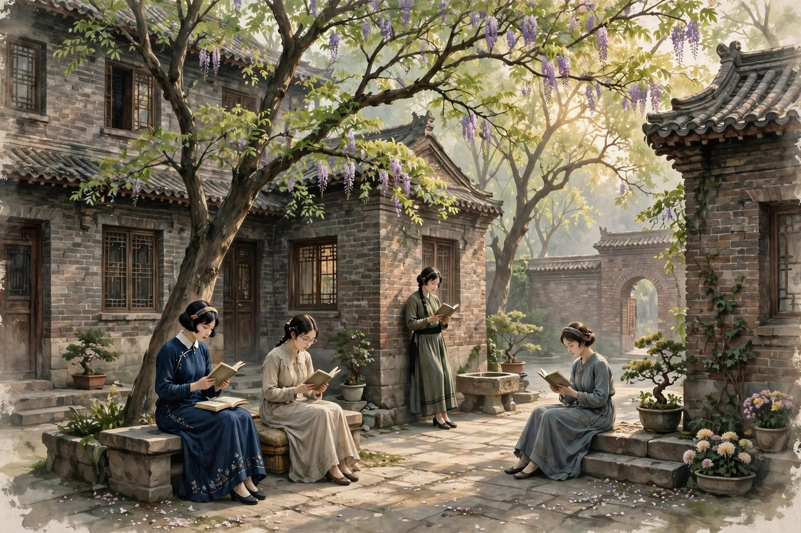
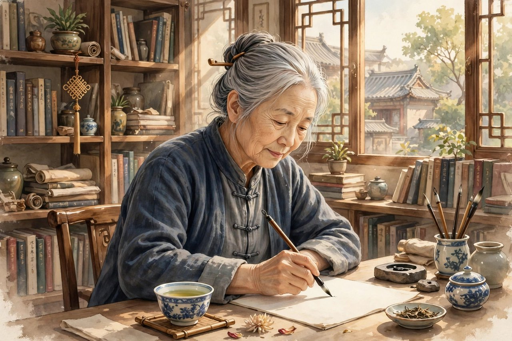

## 海边长大的姑娘

冰心原名谢婉莹，生在一九零零年，福州人，祖籍长乐。家里是读书做官的人家，父亲做过海军军官，母亲温厚持家。她很小就跟着父亲到了烟台，在海边长大。海对她不是风景，是童年的底色。潮声、星空、船影、贝壳，这些东西后来全进了她的诗里。她小时候爱读书，读中国旧小说，也读外国译来的故事，家里书多，她看得杂，看得快，心里装的东西比同龄孩子多得多。父亲讲海军的故事，讲海上风浪里的人怎么互相照应，这些话在她心里埋了根。她后来写母爱、写童真、写自然，根子都在这段海边童年里。那个年代女孩子读书不容易，能进学堂、能一路读下去的人不多。她偏偏一路读下去了，而且读出了自己的路子。烟台的八年时光，把她养成了一个眼睛亮、心肠软、又很有主见的姑娘。她不爱吵闹，不爱出风头，可是心里有杆秤，什么是真，什么是假，什么是装出来的好，她分得清。这种性子，贯穿了她一辈子的写作。

## 从学医转到写文章

她后来到了北京，进了教会办的女中，再进协和女子大学，起初学的是理科，心里想着当医生。那个年月，当医生是实实在在救人的路子，她也真动过这份心。可是五四那阵风一吹，整个北京的年轻人都被卷进去了，街上有游行，报上有争论，学校里天天讲新思想。她在学生会里做文书，参加学生运动，眼睛一下子打开了，看见了中国社会里好多以前在家里、在书本里看不见的问题。她开始写文章，写家庭里的问题，写女孩子受的委屈，写穷人过的日子。写着写着，她发现笔比药方更能碰到人心。医生治一个人，文章能碰到一群人。她就这样从理科转到了文学。这一步转得并不轻巧，家里人未必全懂，同学里也有人替她可惜。可是她自己心里清楚，她不是一时冲动，是看明白了自己更适合做什么。她写的东西不绕弯子，写家庭矛盾就写到饭桌上、卧房里，写社会不公就写到街面上、衙门口。那个年月，女作家敢这样直写的人不多，她敢，而且写得干净、写得稳当。报纸登出来，读者马上就认出来了，这个笔名叫冰心的姑娘，写的是真问题。

## 笔名里的一片冰心

冰心这个笔名，取自古人诗句里的一片冰心在玉壶。意思很明白，心要清，要亮，要装得下东西，又不能被脏东西染了。她选这个名字，不是装雅致，是给自己立了个规矩。她后来的文章，不管写诗还是写小说、写散文，都有这股清亮劲儿。文字不油腻，不卖弄，不堆词，读起来像清水洗过一样。她写母爱，不喊口号，不掉眼泪给你看，而是写一个细节，母亲的手、母亲的眼神、夜里的一盏灯，读者自己心里就软了。她写自然，也不写大山大河的空话，写星星怎么亮，写花怎么开，写海水怎么一层一层涌上来。她写孩子，更不把孩子写成小大人，孩子就是孩子，天真里带着道理，大人听了反而要低头想一想。她这种写法，在当时起了个名字，叫冰心体。说白了，就是文字清丽、感情真挚、不绕弯。好多人学她，报纸上一下子冒出好多短小的抒情诗，都是学她的路子。她自己倒不把这当回事，觉得写文章就是把心里的话老老实实说出来，说得让人听得懂、记得住，就够了。

## 爱的哲学是怎么来的

说到冰心，不能不说爱的哲学。她自己讲过，爱是她世界观的根。她觉得母爱是爱的起点，孩子是爱的样子，自然是爱的放大。母亲爱孩子，孩子爱母亲，推开去，人和人之间也能这样互相体贴，社会上的隔阂、仇恨、冷漠，就能慢慢化掉。这个想法，今天听起来可能觉得太软，觉得对付不了真刀真枪的社会问题。可是放在那个年月看，她不是不知道社会有硬问题，她写过问题小说，写过家庭压迫，写过留学生报国无门，写过穷孩子没钱治病。她知道问题在哪儿，她只是不信光靠恨能解决问题。她想给那个动荡的年代留一点暖的东西，留一点人还能互相相信的证据。她的爱不是糊涂的爱，不是看见什么都说好。她写母亲，也写母亲的辛苦；她写孩子，也写孩子的苦难；她写自然，也写自然里的风雨。她的意思是，爱不是闭着眼睛夸，是睁着眼睛还愿意伸手。你读她的东西，会觉得心里被轻轻推了一下，不是被打了一拳。她不跟你吵架，她把一盏灯放在你面前，让你自己看清楚路。这种温和，在吵吵嚷嚷的文坛里反而成了一种力量，好多年轻人就是读着她的书长大的，心里留了一块柔软的地方。

## 留洋三年与寄小读者

一九二三年，她拿了奖学金去美国留学，进了威尔斯利女子大学，读英国文学。去之前，她已经在国内出了名，诗集、小说集都出来了。到了大洋彼岸，她却病倒了，在疗养院里住了好几个月。那段日子不好过，离家远，身体弱，心里想家想得厉害。她就给国内的小读者写信，把旅途见闻、异国风光、病中的心情、想家的话，一封一封写下来，登在晨报的儿童世界栏目里。这些信后来结集，就叫寄小读者。一共二十九篇，写了三年，伴随了她整个留学生涯。信里没有大道理，都是身边事，湖边的光、楼里的静、病友的笑、朋友的信，还有她对母亲、对弟弟、对小朋友的想念。她把小读者当成自己人，不端架子，不说教，就像跟家里人拉家常。这一套信，开了中国儿童文学的先河。以前中国没有专门写给孩子看的、这么亲切又这么有文学味的通讯，孩子们读了，觉得远在美国的冰心阿姨就像住在隔壁。后来她又写了再寄小读者、三寄小读者，都是这个路子。她对孩子的态度，一直是平等的、尊重的，不把孩子当小摆设。她觉得孩子心里有真东西，大人要弯下腰去听。

## 回国教书与成家

一九二六年，她拿到硕士学位回国，先后在燕京大学、清华大学、北平女子文理学院教书。她教书认真，学生喜欢她，觉得这位先生讲课不摆架子，文章写得好，人也温和。一九二九年，她跟社会学家吴文藻结婚。吴文藻也是留学生，两个人志趣相投，婚后一起过日子，一起做学问，互相扶持了一辈子。她婚后的写作没有停，写小说、写散文，风格慢慢变了。早年那种纯粹的抒情、纯粹的爱，开始掺进了更多对人性的观察。她写分，写家庭里夫妻、母女之间的隔阂；写南归，写母亲去世后的思念，文字里有了更沉的东西；写冬儿姑娘，写底层女孩子的倔强和活法。她不再只写理想中的爱，也写爱落到现实里怎么磕磕绊绊。抗战年月，她跟着丈夫到了昆明、到了重庆，参加文化救亡活动，用男士的笔名写关于女人，写身边各种各样的女人，母亲、奶妈、女同学、乡下女子，写她们的苦、她们的韧、她们的好。她那个时候的文字，比早年苍劲多了，不再只是清丽，里面有了风骨。有人说她变了，她自己倒觉得，这是爱长大了，爱不是只会说好听话，爱也要能扛事。

## 晚年还在写

新中国成立后，她在日本待过几年，一九五一年回到北京，定居下来，继续写作，也做社会活动。她晚年写的东西，有写给孩子的，有回忆往事的，有讲新生活的。大家熟悉的小桔灯，就是她晚年写的，写抗战年月的重庆，写一个小姑娘给她做的桔灯。她年纪越大，写得越朴素，越不讲究花样。她活到了九十九岁，一九九九年二月去世，被人称为世纪老人。她从一九一九年开始发表作品，写到九十多岁还在写，创作生涯将近八十年，这在中国现代作家里面是极少见的。她经历了清末、民国、抗战、新中国，几乎把整个二十世纪都走了一遍。她晚年还翻译外国文学，译过泰戈尔的诗，译过黎巴嫩作家纪伯伦的先知，译文也很有名。她一生体裁很全，诗、小说、散文、儿童文学、翻译，样样都有代表作。她晚年住在北京，家里常有年轻人去看她，她跟年轻人说话还是那么亲切，不摆老资格。她给年轻人的忠告，翻来覆去就是那几句，要读书，要真诚，要有爱心。她自己就是这样活了一辈子，话和人对得上号。

## 为什么今天还要读冰心

今天读冰心，有人会说，她的爱太温和，解决不了今天的焦虑、内卷、房贷、加班、孩子上学这些硬问题。这话有一半道理，她确实不是来给你开药方的，她不负责解决你的具体难处。可是她负责另一件事，就是提醒你，人心里不能只剩下算计和防备。你每天刷手机，看见的全是吵架、带货、焦虑贩卖，心会变硬，变糙，变疲。她给你留了一个反方向的东西，就是慢下来，看看星星，看看孩子，看看母亲，看看身边那个默默扛事的人。她写的东西短，好读，不费劲，适合在地铁上、在睡前读一小段。你读她，不是为了考试，是为了让心里透透气。她的价值还在于，她是中国现代文学里少有的、从头到尾保持善意的人。文坛上好多作家后来变了，变尖刻了，变愤世了，变沉默了，她没有变。她变的是笔法，不是心肠。她到晚年还是相信，爱能让人好起来，能让社会好起来。这种相信，在今天反而成了一种稀缺品。你可以不同意她的全部想法，你可以觉得她的药方不够硬，可是你不能否认，她给中国读者留了一套干净的语言，一套温和的看人方式。这套东西，今天的孩子读了不亏，今天的大人读了也不亏。她不是高高在上的文学祖母，她更像一个一直坐在灯下写信的阿姨，信写给小读者，也写给每一个心里还想留一点光的人。

## 福州老宅与烟台海风

讲冰心的童年，不能只讲一个海字，还要讲她家里那股气。谢家在福州是有根的人家，祖父辈读书，父亲当海军，家里规矩不算严，可是读书的气氛很浓。她小时候跟着父亲在烟台，住的地方离海近，推开窗就能听见潮声，晚上能看见星星落在海面上。她父亲是海军军官，讲起海上事来有声有色，讲风浪，讲船上的兄弟怎么互相拉一把，讲一个人在海上不能只顾自己。这些话，小孩子听着是故事，长大了回想，才知道是做人的道理。她母亲是温柔又能干的人，家里上上下下都靠她张罗，孩子生病了，母亲整夜不睡，孩子受委屈了，母亲一句话就能把心抚平。她后来写母亲，写得那么动人，不是凭空想出来的，是家里天天看得见的东西。她在烟台读家塾，启蒙读旧书，七岁上下就读过三国演义、水浒传这类大部头，还读过商务印书馆出的说部丛书，里面有外国小说译本。她看书不挑，文言的看，白话的看，外国的也看，脑子里早早就装进了好多世界。她跟弟弟们关系好，姐弟几个一起玩，一起读书，一起看海，这种手足之情，后来也进了她的诗。她童年过得不算苦，家里有书，有海，有父母疼爱，可是她并没有因此变得娇气。她看见过海边的穷人，看见过船上做工的人手上的茧，看见过风浪里翻船的人家怎么过日子。童年的富足没有把她养成只看自己的人，反而让她更早懂得，幸福不是理所当然的，是有人撑着的。这份懂得，是她后来写穷孩子、写底层女人的底子。她不是站在岸上同情海里的人，她小时候就站在海边，看过海里的人怎么活。

## 文学研究会里的年轻人

她进文坛的时候，正赶上文学研究会成立。茅盾、郑振铎那批人提倡为人生而艺术，主张文学要碰社会问题，要写老百姓的日子。她参加进去，不是凑热闹，是真认同这个主张。她早期的作品，问题小说占了很大一块，写家庭，写婚姻，写留学，写穷人，写知识分子的苦闷。这些小说，今天读起来可能觉得笔法还嫩，人物还不算特别复杂，可是放在那个年月，敢写就是勇气。她写两个家庭，写新旧家庭的冲突，写一个人在两种道德之间左右为难。她写斯人独憔悴，写年轻人在旧家庭里憋屈、想反抗又找不到路。她写去国，写留学生满腔抱负回国，却发现没有地方施展，只能黯然再走。这些小说，都是把社会问题放到一个人身上去写，问题不是贴在墙上的标语，是长在人物心里的疼。她跟文学研究会的朋友们互相切磋，互相看稿子，互相提意见，文坛上那种互相砥砺的气氛，对她帮助很大。她后来写诗，也是在这个圈子里受到鼓励的。她不是一个人闷头写，她是在一群年轻人的中间写，写给报纸，写给读者，写给那个正在变化的中国。那个圈子里的年轻人，有的后来成了大作家，有的后来转了行，有的在战乱里失散了，可是那几年一起为文学较劲的日子，留在她记忆里很深。她晚年回忆起来，还说起那时候报社的灯、编辑的电话、读者来信的热情。她不是高高在上的名家，她是从报纸副刊的方格子里一步一步走出来的。

## 泰戈尔那盏小灯

冰心写短诗，跟泰戈尔很有关系。她跟弟弟围着火炉读泰戈尔的迷途之鸟，读到那些短小的、像格言一样的诗句，弟弟说，你心里那些零碎的想法，也可以这样收集起来。她听进去了，就把平时想到的、关于母亲、关于孩子、关于自然、关于人生的零碎感想，一首一首写下来，登在晨报副刊上。这就是繁星、春水的来历。她后来又翻译泰戈尔，译过吉檀迦利、园丁集，译文流传很广。她跟泰戈尔的缘分，不只是学了个形式，更是气味相投。泰戈尔写爱，写自然，写孩子，写神性里的温柔，她也写这些，可是她写得更中国，更家常。她不写玄妙的哲理，她写母亲的手，写孩子的笑，写星星和花，写海上的光。泰戈尔的诗像远方的钟声，她的诗像近处的灯火，钟声好听，灯火暖人。她学泰戈尔，没有学成外国腔，她把外国诗的形式，装进了中国人的感情。她这种化外国为中国的本事，是她作为作家很厉害的一点。她后来译纪伯伦的先知，也是这个路子，译文不生硬，读起来像中国人自己写的一样。她一生翻译了不少外国作品，翻译对她不是副业，是她跟世界对话的方式。她通过翻译，把外国的好东西带进来，也通过自己的创作，把中国人的感情写出去。她晚年还被人请去讲翻译，讲怎么把外国诗的味道译出来，又不丢中国话的味道。她讲得朴素，说翻译要先懂人心，再懂文字，文字是船，人心是水，水到了，船自然能走。

## 从清丽到苍劲的转弯

好多人以为冰心一辈子只会写清丽温柔的东西，这其实是误解。她早年确实清丽，可是她中年以后的笔，越来越有劲道。她写分，写一个家庭里分家的事，写亲人之间怎么因为钱、因为房子、因为面子，慢慢生分了，文字里有了冷静的观察，不再只是抒情。她写南归，写母亲去世，写自己从外地赶回来，站在母亲灵前的心情，那种痛，不是哭出来的，是压在字缝里的。她写冬儿姑娘，写一个底层姑娘怎么靠卖鸡蛋、卖柿子养活母亲，怎么在穷日子里保持倔强和体面，这篇小说里，爱的哲学没有丢，可是爱落到了柴米油盐里，落到了卖货的吆喝声里，变得更结实了。她写我们太太的客厅，写知识分子圈子里的应酬和心机，笔法带了讽刺，写得不动声色，却让人看完心里一紧。她到重庆写关于女人，干脆换了男士的笔名，用男人的口吻写女人，写母亲、奶妈、女教师、乡下女子，文字苍劲朴茂，跟早年的柔细清丽判若两人。这个转弯很重要，说明她不是只会一种调子的作家。她随着年龄、随着时代、随着见过的人越来越多，笔也跟着长了。她没有被早年的成功框住，没有一辈子只写小诗、只写母爱。她敢于写自己不熟悉的东西，敢于写人性的复杂，敢于写社会的阴影。她晚年写空巢，写老人独居的孤独，写社会变化里被落下的人，笔还是稳的，还是温和的，可是温和里有了更深的体察。你把她早年和晚年的东西放在一起读，会发现一个作家是怎么长大的，怎么从写理想，写到写现实，又没有丢掉理想。

## 在今天的课堂与书架上

冰心的书，今天还在中小学课本里，还在大学中文系的讲义里，还在好多家庭的书架上。孩子们读小桔灯，读寄小读者，读繁星春水里的短诗，老师讲她的爱，讲她的语言，讲她的儿童文学开创之功。大人读她，往往是在孩子读的时候，跟着翻两页，翻着翻着就自己读进去了。她的好处是门槛低，不需要文学博士才能读懂，小孩子能读，大人也能读，文化程度不高的人能读，读书多的人也能读出味道。她的语言，今天看来还是干净的，没有过时的油滑，没有堆砌的词藻，放在今天的公众号文章里比，好多文章反而显得浮躁。她写的东西，适合朗读，适合抄在笔记本上，适合在家长会上念给孩子听。她留下的，不只是一堆作品，还有一种写文章的态度，就是不说假话，不装腔，不为了显得深刻而把话说绕。她这种态度，今天特别缺。今天写东西的人，好多人喜欢把简单的话说复杂，喜欢用大词压人，喜欢先立一个高深的姿态，再慢慢往下讲。冰心反过来，她把复杂的心情说简单，把深的道理说浅，把远的爱说近。她不是不会说复杂的话，她是故意不说。她觉得，文章写给人看的，人看懂了，文章才算活了。她这种朴素的文学观，今天的写作者值得学一学。她也不是没有争议，有人批评她的爱太软，有人批评她回避尖锐问题，这些批评都有道理，读她的时候可以带着批评读，不必把她供起来。可是批评归批评，她给中国文学留下的干净语言和温和底色，是实实在在的，谁也抹不掉。

## 给年轻写作者的话

如果你是年轻写作者，读冰心，别只学她的句子，要学她的路子。她起步的时候，也不是天生就会写，她也是从报纸的小方格写起，从短诗写起，从给小读者写信写起。她写东西，先有真感受，再有真语言，感受是根，语言是叶，根不牢，叶再好看也立不住。她写母亲，不是先想一个主题，再找例子去套，而是先想起母亲的手、母亲的灯，再把话说出来。她写孩子，不是先想教育意义，而是先看见孩子的笑、孩子的眼泪，再写下来。她这种从生活里长出来的写法，比从理论里推导出来的写法，更经得起时间。她还有一个好处，就是耐心。她写了将近八十年，没有急着出名，没有急着跟风，风潮来了，她不跟着跑，风潮走了，她还在写。她早年红过，中年沉过，晚年又被重新发现，她都没有被红和沉带偏。她告诉年轻人，写作是一辈子的事，不是写一两篇爆款就完事的。她晚年给年轻人的信里，总是劝人多读书，多观察，多体贴人，少说空话，少追热闹。这些话听起来老套，可是做起来并不容易。今天写东西，诱惑多，流量多，热点多，写一篇追热点的东西，很容易拿到点赞，可是点赞过去了，东西还在不在，心里有没有留下一点真东西，只有自己知道。冰心给你的提醒就是，别只追热点，要留一点东西给时间。她自己留下的，就是时间筛过之后还剩下的东西。

## 一辈子的朋友与对手

冰心一辈子朋友很多，论敌也不少，可是她待人处事的方式，始终是温和的。她跟同时代的作家们，有交往，有切磋，有时也有分歧，可是她很少在文章里跟人撕破脸。她写文章批评社会问题，批评的是事，不是针对某个人去骂。她这种温和，不是软弱，是她心里有一条线，觉得文学争论可以激烈，伤人的话还是少说。她晚年回忆文坛旧事，讲起当年的论争，语气还是平和的，不翻旧账，不给人难堪。她跟读者之间的关系，更像是朋友。她收到小读者的信，总是认真回，信里写什么，她都放在心上。她给孩子写信，从来不摆名家的架子，信的开头总是亲切的称呼，信的结尾总是温柔的叮嘱。她对年轻人也是这样，年轻人拿稿子去请她看，她看得认真，提意见也温和，不打击人，也不敷衍人。她这种待人的方式，让她在文坛上活成了一个长辈，一个大家都愿意亲近的人。她不是没有脾气，她在原则问题上也很坚持，比如对假话、对抄袭、对伤害孩子的行为，她态度很明确。可是她的坚持，是用讲道理的方式表达的，不是用骂人的方式。她这种风格，在今天这个动不动就吵架、动不动就拉黑的年代，显得格外珍贵。她告诉我们，温和不是没有立场，温和是把立场说清楚，又不把对方推到对立面去。她一辈子就是这样做人，也是这样写文章，人和文是一致的，这一点最难得。好多作家，人和文是两张皮，文章里讲爱，生活里刻薄，文章里讲真诚，生活里算计，冰心不是这样，她的生活和文章互相印证，读她的人，见她的人，都会觉得这个人是真的。

## 她的语言为什么耐读

冰心的语言，有一个很明显的特点，就是口语里带着书卷气，书卷气里又不脱离口语。她写信给小读者，用的就是说话的语气，句子不长，意思清楚，读起来像听她在耳边说话。她写诗，句子更短，常常只有一两行，可是意思很满，读完要停一停，想一想。她写小说，叙述不赶时间，慢慢铺，慢慢讲，人物出场不着急，情节推进不催促，读者跟着她的节奏走，不会觉得累。她这种语言，今天读起来还是舒服的，因为她没有用太多那个年代特有的生造词，没有用太多翻译腔，句子结构是中国人习惯的，读起来顺。她写景，喜欢用具体的词，星星、花、海、灯、母亲的手，这些词谁都懂，不需要查字典。她写情，也喜欢用具体的细节，一盏灯、一封信、一个橘子、一个眼神，细节到了，情就到了。她不喜欢抽象地讲大道理，她觉得道理要长在细节里，细节活了，道理自然就活了。她这种写法，对今天写文章的人很有启发。今天好多人写文章，喜欢先抛一个概念，再举几个例子，概念讲了一大堆，例子却很干，读完记不住。冰心反过来，她先讲一个具体的人、具体的事，具体的事讲透了，概念自然就出来了，读者自己能悟出来，比作者直接告诉他，记得更牢。她这种以小见大的本事，是她语言耐读的根本原因。她的文章，读一遍有味道，读两遍还有味道，隔几年再读，又能读出新的东西，这就是好语言的标志。

## 结语灯下的人

讲冰心这个人，绕不开一盏灯。她年轻的时候，在海边看星，在灯下写诗，在给小读者的信里讲远方的事。她中年的时候，在战乱里写女人，在穷日子里写冬儿姑娘，在客厅的应酬里看人情冷暖。她晚年的时候，在北京的家里写回忆，写给孩子的信，写对新生活的感想。不管在哪个年纪，她手里都有一盏灯，灯的光不强，可是从不熄灭。她这盏灯，照亮过好多年轻人的路，好多孩子就是读着她的书，学会了怎么去爱母亲，怎么去看星星，怎么去体贴身边的人。她的书，今天放在书架上，可能不如一些畅销书显眼，可是你随手翻开一页，还是能感觉到那股暖意。那股暖意，不是煽情，不是鸡汤，是一个活了将近一个世纪的人，用一辈子验证过的东西。她验证过的东西很简单，就是人心里要留一点爱，留一点真，留一点对自然的敬意，留一点对孩子的耐心。这些东西，听起来简单，做起来却需要一辈子的功夫。她做到了，所以她的文字到今天还有力量。她不是一个完美的人，她的爱也有软弱的时候，她的笔也有跟不上时代的时候，可是她始终没有放弃，没有变成一个冷漠的人，没有变成一个只会抱怨的人。她选择了一条温和而坚定的路，一直走到了九十九岁。这条路，今天的人也可以走，不需要你成为作家，不需要你写出名篇，只需要你在生活里，对母亲好一点，对孩子耐心一点，对身边那个默默扛事的人体贴一点，对夜里的星星多看一眼。这样，冰心那盏灯，就在你心里也亮起来了。她写过小桔灯，写过夜里的星，写过母亲床头的灯，她自己就是一盏灯。她不刺眼，不晃人，就是稳稳地亮着，亮了将近一个世纪。你走近她，不会觉得被说教，只会觉得心里暖了一点，静了一点。她留下的书，今天还在书店里，还在课本里，还在好多人的书架上。读她，不需要做学问，只需要安静下来，翻开一页，听她跟你说话。她说话的声音很轻，可是传得很远，远到今天的我们还能听见。这就是她为什么重要，她不是一个时代的点缀，她是一个世纪里始终没有熄灭的、关于爱的证据。

她这辈子写下的东西，合起来是一部关于怎么好好爱人的书，书的封面不华丽，内页却很耐翻。你今晚如果睡不着，不妨翻开她的一首小诗，或者一封寄小读者的信，读上几行，心里那股燥意，兴许就能慢慢沉下去，沉到一个安静的地方去。

读冰心不必赶时间，不必一次读完她的全部作品，你可以从一首小诗开始，从一封给小读者的信开始，从一个小桔灯的故事开始，慢慢走进她的世界，走进去之后，你会发现，那个世界并不遥远，它就藏在你的家里，藏在你的童年里，藏在每一个夜晚的星光里。
