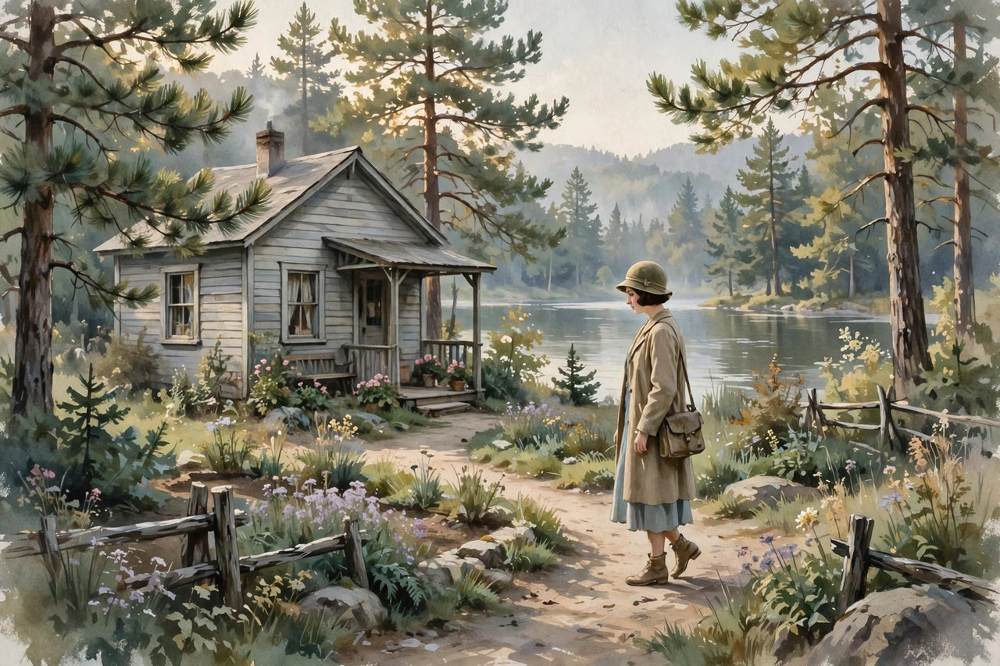
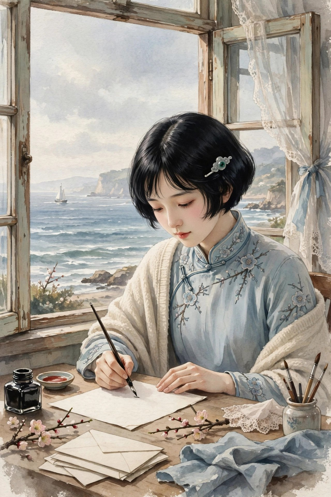

## 一封写了三年的信

寄小读者不是一本书一下子写出来的，是一封写了三年的信。从一九二三年七月开始，到一九二六年九月，冰心在留学的三年里，陆陆续续给国内的小读者写信，写旅途见闻，写异国生活，写病中的心情，写对家乡、对母亲、对弟弟的思念。这些信，先登在晨报的儿童世界栏目里，后来结集出版，一共二十九篇，北新书局一九二六年五月出了单行本，两年里就重印了七版，成了长销书，也成了冰心的代表作。信的开头，总是亲切的称呼，信的结尾，总是温柔的叮嘱，信的中间，写的都是身边事，湖边的光，楼里的静，病友的笑，朋友的信，还有她对往事的追忆和遥想。她把小读者当成自己人，不端架子，不说教，就像跟家里人拉家常。她在信里说过，不论走到哪里，都要把热爱小读者的心带到那里，要不断地写，好好地写，把看到听到想到的事情，只要觉得小读者会感兴趣、会对小读者有益的，都尽量倾吐出来。这种态度，就是寄小读者的魂。以前中国没有专门写给孩子看的、这么亲切又这么有文学味的通讯，孩子们读了，觉得远在美国的冰心阿姨就像住在隔壁，像一个大姐姐在给你写信，信里讲的故事，你都听得懂，信里的感情，你都感受得到。寄小读者开了中国儿童文学的先河，这个评价，一点也不夸张，它确实是后来好多儿童文学作品的起点，后来的儿童文学作家，写信体，写通讯，写给孩子看的散文，都受过它的影响。

## 海上的路与异国的光

寄小读者的开头，写的是旅途。冰心坐船去美国，海上风浪大，船摇晃，人晕船，可是她还是坚持写信，把海上的日出、海上的月亮、海上的风浪，都写给小读者。她写海上，不是写旅游攻略，不是写风景介绍，是写一个人在海上的心情，写离家的不舍，写对未来的向往，写在船上想起母亲、想起弟弟的时候，心里怎么酸。到了美国，她住在威尔斯利女子大学，后来因为生病，住进了疗养院，在沙穰疗养院住了好几个月。那段日子不好过，离家远，身体弱，心里想家想得厉害。她在信里写疗养院的生活，写湖边的慰冰湖，写安静的楼，写病友的故事，写朋友来看她的情景，写她在病中怎么读书、怎么写信、怎么想家。她写这些，不是为了诉苦，是为了告诉小读者，人在困难里也可以保持一颗安静的心，可以观察身边的美，可以把痛苦变成文字，变成给别人的安慰。她写异国的风光，写美国的湖，写美国的树，写美国的雪，写美国的孩子，写美国的学校，这些风光，在她笔下不是外国的奇观，是跟中国风光可以对照的东西，她写美国的湖，会想起中国的海，她写美国的雪，会想起中国的冬天，她写美国的孩子，会想起中国的小读者。这种对照，让信读起来既有异国情调，又有家乡味道，小读者读了，既开了眼界，又不会觉得陌生。她写旅途和异国，最打动人的地方，就是真诚，她不装，不夸，不把外国写成天堂，也不把中国写成地狱，她只是老老实实写自己看到的、感受到的，看到的好，就说好，看到的不好，也老实说，这种老实，在今天写游记的人里反而少见了。

## 病中的信与想家的心

寄小读者里最动人的部分，是病中写的信。她在疗养院里，身体弱，不能多走动，不能多说话，可是她的心没有闲着，她观察窗外的湖，观察楼里的静，观察病友的喜怒哀乐，观察护士的细心照顾，这些观察，都写进了信里。她写病，不是写病有多可怕，是写病里也有美，病里也有人情，病里也有思考。她写自己想家，想母亲，想弟弟，想北京的家，想烟台的海，想得厉害的时候，就给小读者写信，写信的时候，想家的心就轻了一点。她写想家，不喊口号，不掉眼泪给人看，而是写一个细节，想起母亲做的饭，想起弟弟说的话，想起家里的一盏灯，细节到了，想念就到了。她这种写想家的方法，今天的人也可以学，你想家的时候，不需要写长篇大论，只需要想起一个细节，想起母亲的一句话，想起家里的一顿饭，想念就真实了。她在病中还写到了对小读者的爱，她觉得，小读者是她在异国他乡的精神支柱，是她写信的动力，是她不至于完全孤单的原因。她给小读者写信，不是居高临下地教育孩子，是平等地跟孩子说话，把孩子当成朋友，把自己的脆弱、自己的想念、自己的困惑，都告诉孩子。这种平等，在那个年代很少见，大人给孩子写东西，往往是说教的口吻，是命令的口吻，冰心不是，她是商量的口吻，是分享的口吻，是朋友的口吻。孩子读了，不会觉得被说教，只会觉得被尊重，被信任，这种感觉，对孩子的成长很重要。

## 给孩子的平等与尊重

寄小读者开创中国儿童文学先河的意义，不只在于它是写给孩子看的散文集，更在于它确立了一种写给孩子看的态度，就是平等和尊重。她不把孩子当成不懂事的小东西，不把孩子当成需要灌输道理的空瓶子，她把孩子当成有心、有感情、有想法的人。她在信里，跟孩子讲自己的旅途，讲自己的病，讲自己的想家，讲自己的困惑，这些东西，大人往往不愿意跟孩子讲，觉得孩子不懂，冰心觉得，孩子懂，孩子的心比大人的心更干净，更能接住真话。她在信里，还跟孩子讲怎么做人，讲要爱母亲，讲要爱自然，讲要爱祖国，讲要诚实，讲要善良，可是她讲这些道理，不是板着脸讲，是讲故事讲出来的，是讲自己的经历讲出来的，孩子听了，不会反感，只会觉得，阿姨说得对，我也要这样做。她这种教育方法，今天的家长和老师也可以学，教育孩子，不是靠吼，不是靠命令，是靠讲故事，是靠分享，是靠以身作则。她自己就是这样做的，她写信给小读者，自己先做到了爱母亲、爱自然、爱孩子，她的话，才有说服力。她晚年又写了再寄小读者、三寄小读者，都是这个路子，都是给孩子写信，都是平等和尊重的态度。她一辈子给孩子写信，写了几十年，孩子换了一代又一代，可是她写信的态度没有变，变的只是孩子的年龄，不变的是她对孩子的爱。这种一辈子的坚持，在今天这个快餐文化的年代，显得格外珍贵。

## 今天读寄小读者

今天读寄小读者，有人会说，信里写的东西都过时了，船是老船，疗养院是老疗养院，美国的风光也变了，孩子读了，会不会觉得陌生。这话有一半道理，时代确实变了，可是信里的感情没有变，想家的心没有变，对母亲的爱没有变，对孩子的尊重没有变，对自然的喜欢没有变。你今天出国留学，或者去外地工作，离家远了，想家的时候，读寄小读者，会觉得冰心就是在写你，她写的那种想家，那种在异国他乡给家里写信的心情，你今天也有。你今天给孩子写信，或者给远方的朋友写信，也可以学寄小读者的路子，不用写得多好，只需要写得真，写你看到的，写你感受到的，写你想念的，写出来，对方读了，心里就会暖。今天的人，写东西喜欢用微信，喜欢用短句，喜欢用表情包，写长信的人少了，可是长信的价值没有少，长信能装下更多的感情，能把一个人的心完整地传过去。寄小读者提醒你的，就是别忘了写长信，别忘了给远方的人写信，别忘了把心里的真话写出来。真话写出来，人和人之间的距离就近了，距离近了，孤单就少了。你今天如果有远方的朋友，有在外地的孩子，有在老家的母亲，不妨学冰心，写一封长信，写你最近的生活，写你最近的想念，写你最近的困惑，写完寄出去，对方读了，会觉得，你心里有他，这份感觉，比任何礼物都贵。

## 信里的湖与楼

寄小读者里写得最多的地方，是疗养院的湖和楼。慰冰湖这个名字，听起来就很有意思，湖是安慰人的，冰是冰心的冰，湖的名字，就像冰心的心，湖水清澈，湖边安静，湖光能安慰病中的人。她在信里写湖，写湖边的光，写湖上的雾，写湖里的倒影，写湖边的树，写湖边的路，这些描写，读起来很安静，很慢，很适合病中的人读。她写楼，写疗养院的楼，写楼里的静，写楼里的窗，写楼里的人，写楼里的护士，写楼里的病友，这些描写，读起来也很安静，很细，很有生活气息。她写湖和楼，不是为了写风景作文，是为了告诉小读者，人在病中，也可以看见美，也可以在安静里找到力量，也可以在湖光里想家，也可以在楼静里写信。她这种在困难里看见美的本事，是她作为作家很厉害的一点，也是她作为病人很了不起的一点。她病着，还能写信，还能观察，还能安慰小读者，这种坚强，不是喊出来的，是静静地做出来的。今天的人，生病的时候，往往只想着自己的病，只想着自己的苦，很少有心思去观察窗外的湖，去写信给远方的人，可是冰心就是这样做的，她把病变成了写作的素材，把痛苦变成了给别人的安慰。她这种化痛苦为安慰的本事，今天的人也可以学，你遇到困难的时候，不妨也写下来，写给朋友，写给家人，写给自己，写下来，困难就轻了一半，安慰就多了一半。

## 信里的朋友与病友

寄小读者里还写了好多朋友和病友，有美国的朋友，有中国的朋友，有疗养院的病友，有学校的同学，有来看她的朋友，这些人，在信里都是活生生的，都是有名字、有性格、有故事的。她写朋友，写朋友怎么来看她，写朋友给她带什么，写朋友跟她说什么，写朋友离开的时候，她心里怎么不舍。她写病友，写病友的病，写病友的笑，写病友的坚强，写病友之间的互相安慰，写病友之间的友谊。她写这些人，不是为了炫耀自己朋友多，是为了告诉小读者，人在异国他乡，朋友是很重要的，朋友能给你温暖，能给你力量，能让你不至于完全孤单。她写朋友和病友，还写到了人与人之间的爱，写到了不同国家、不同文化的人，怎么互相理解，怎么互相帮助，怎么在困难里结成友谊。这种跨文化的友谊，在今天看来还是很有意义的，今天的人，出国留学，出国工作，也会遇到外国朋友，也会遇到不同文化的人，怎么跟他们相处，怎么互相理解，怎么互相帮助，寄小读者里都有例子。她写朋友，不写大道理，只写小事，写朋友带的一束花，写朋友说的一句话，写朋友的一个微笑，小事到了，友谊就到了。今天的人，交朋友，往往想着要利益，要人脉，要资源，可是冰心交朋友，想的是真心，想的是温暖，想的是互相安慰，这种交朋友的方法，今天看来反而更珍贵，更值得学。

## 再寄与三寄的延续

寄小读者之后，冰心又写了再寄小读者、三寄小读者，都是给孩子写信，都是写自己的生活，写自己的观察，写自己的想念。再寄小读者写于二十世纪六十年代，三寄小读者写于二十世纪七十年代，时间隔了好几十年，可是写信的态度没有变，还是平等，还是尊重，还是亲切，还是把孩子当成朋友。她写再寄、三寄的时候，自己已经老了，可是她给孩子写信的心没有老，她还是像年轻的时候一样，认真地写，认真地讲，认真地安慰孩子。她这种一辈子给孩子写信的坚持，在今天看来很了不起，今天的人，给孩子写信，写一封就不错了，写一辈子，写几十年，几乎没有人能做到。她做到了，因为她心里真的爱孩子，真的把孩子当成朋友，真的觉得，给孩子写信，是一件很重要的事，很快乐的事，很值得做的事。她晚年给孩子写信，写得更朴素，更直接，更像一个老奶奶给孙子孙女写信，信里没有华丽的词，只有真心话，真心话比华丽的词更有力量。孩子读她的信，不会觉得被说教，只会觉得被爱，被尊重，被信任，这种感觉，对孩子的成长，比任何说教都重要。她一辈子给孩子写信，孩子换了一代又一代，可是她写信的心没有变，变的只是孩子的年龄，不变的是她对孩子的爱。这种爱，穿过了一个世纪，还在，还在今天的书里，还在今天的课本里，还在今天的孩子心里。

## 信里的中国与美国对照

寄小读者里有一个很妙的写法，就是对照。她写美国的湖，会想起中国的海，她写美国的雪，会想起中国的冬天，她写美国的孩子，会想起中国的小读者，她写美国的学校，会想起中国的学校。这种对照，不是为了比谁好谁坏，是为了让小读者既开眼界，又不忘家乡。她在美国，看见好东西，会想，中国的小读者要是也能看见就好了，她看见不好的东西，也会想，中国的小读者要引以为戒。她这种对照的方法，今天出国的人也可以学，出国不是为了忘掉中国，是为了更好地看中国，是为了把外国的好东西带回来，把外国的教训也带回来。她在信里写美国的教育，写美国的孩子怎么上课，怎么玩，怎么跟老师说话，这些描写，小读者读了，会觉得新鲜，会觉得外国的孩子跟中国的孩子也不一样，可是又都一样，都是孩子，都是天真，都是喜欢玩，都是需要爱。她写美国的风景，写湖，写树，写雪，写花，这些风景，小读者虽然没有亲眼看见，可是通过她的文字，就像看见了一样，因为她写得具体，写得亲切，写得像在给家里人讲故事。她写对照，还写到了文化差异，写美国人怎么过节，怎么吃饭，怎么待客，这些差异，她写得不带偏见，不说美国好，也不说中国好，她只是老老实实写，写差异本身，写差异背后的原因，写差异里的人情。这种不带偏见的对照，是她作为一个留学生很可贵的地方，也是她作为一个作家很可贵的地方。今天的人写国外见闻，往往容易走极端，要么把外国写成天堂，要么把外国写成地狱，要么把中国写成天堂，要么把中国写成地狱，冰心不是这样，她写外国，也写中国，写好的，也写不好的，写得平和，写得真实，写得让人信服。她这种平和的对照，值得今天写游记、写留学见闻的人学一学，平和不是没有观点，平和是观点藏在事实里，事实讲透了，观点自然就出来了。

## 信里的母亲与弟弟

寄小读者里写母亲和弟弟的篇幅很多，因为母亲和弟弟是冰心在异国他乡最想念的人。她给小读者写信，常常会提到母亲，提到母亲做的饭，提到母亲说的话，提到母亲在灯下缝衣服的样子，提到母亲在她远行的时候站在门口望了又望。她提到弟弟，提到弟弟小时候跟她一起玩，提到弟弟围着火炉听她读诗，提到弟弟给她提议写小诗，提到弟弟在国内的生活，提到弟弟给她写信。她写母亲和弟弟，不是为了煽情，是为了告诉小读者，亲情是人心里最深的东西，是不管走到哪里都割不断的东西，是在异国他乡支撑人的力量。她在疗养院里病着，想母亲，想弟弟，想得厉害的时候，就给小读者写信，写信的时候，想念就轻了一点，写完信，心里就暖了一点。她这种把想念写成信的方法，今天的人也可以学，你想家的时候，不妨也写下来，写给母亲，写给弟弟，写给家人，写下来，想念就有了出口，有了出口，想念就不会把人压垮。她写母亲和弟弟，还写到了手足之情，写姐弟之间的亲热，写姐弟之间的互相扶持，写姐弟之间的小吵小闹，写姐弟之间长大后的牵挂。这些描写，读起来很亲切，很家常，很像你自己家里的事。你读到这些，会想起自己的兄弟姐妹，想起小时候一起玩的日子，想起长大后各奔东西的日子，想起逢年过节回家团聚的日子，想起这些，心里就会暖，就会想给家里打电话，就会想回家看看。这就是寄小读者给你的力量，它不讲大道理，它只讲家里的事，家里的事讲透了，道理自然就到了，爱自然就到了。

## 信里的病与坚强

寄小读者里写病，写得很真实，也很坚强。她在疗养院里住了七个月，七个月里，她不能多走动，不能多说话，不能像健康人一样生活，可是她没有自暴自弃，没有整天抱怨，她观察窗外的湖，观察楼里的静，观察病友的笑，观察护士的细心，观察朋友的来看望，把这些观察都写进了信里。她写病，不是写病有多可怕，是写病里也有美，病里也有人情，病里也有思考，病里也可以写信，病里也可以爱小读者。她这种在病中保持写作、保持观察、保持爱的能力，是很了不起的，是很多人做不到的。今天的人，生病的时候，往往只想着自己的病，只想着自己的苦，很少有心思去观察窗外，去写信给别人，可是冰心就是这样做的，她把病变成了写作的素材，把痛苦变成了给别人的安慰。她这种化痛苦为安慰的本事，值得今天的人学一学，你遇到困难的时候，不妨也写下来，写给朋友，写给家人，写给自己，写下来，困难就轻了一半，安慰就多了一半。她写病，还写到了对生命的思考，写人在病中怎么想人生，怎么想未来，怎么想自己活着的意义，怎么想自己要给世界留下什么。这些思考，读起来很深，可是她写得很浅，写得很亲切，写得很像跟朋友聊天，聊着聊着，道理就出来了。她病好了之后，回国教书，继续写作，继续给孩子写信，病没有把她打倒，反而让她更坚强了，更懂得珍惜生命了，更懂得爱了。病对她来说，不是终点，是一个转折点，是一个让她更深地理解人生、理解爱、理解孩子的转折点。

## 信里的教育观

寄小读者里还藏着冰心的教育观，这个教育观，今天看来还是很先进的。她觉得，教育孩子，不是靠灌输，不是靠命令，不是靠考试，是靠爱，是靠榜样，是靠讲故事，是靠分享。她在信里，从来不命令小读者要这样、要那样，她总是讲自己的故事，讲自己的经历，讲自己的感受，讲完，让小读者自己去悟，悟出来了，比命令记得更牢。她觉得，孩子的心是干净的，是能接住真话的，你跟孩子说真话，孩子就能听懂，你跟孩子说假话，孩子也能感觉出来，感觉出来了，孩子就不会信你了。她这种教育观，今天的家长和老师也可以学，教育孩子，先要真诚，先要尊重，先要把孩子当成朋友，当成有心、有感情、有想法的人，不要把孩子当成考试机器，不要把孩子当成实现自己梦想的工具。她在信里，还讲到了读书，讲到了要多读书，讲到了读书的好处，讲到了书里有世界，书里有朋友，书里有答案。她讲读书，不是板着脸讲，是讲自己读书的故事，讲自己小时候怎么读书，讲自己在疗养院里怎么读书，讲读书怎么安慰了她，讲读书怎么陪伴了她。孩子读了，会觉得读书是一件快乐的事，是一件值得做的事，而不是一件苦差事。她这种把教育藏在故事里的方法，比直接讲道理更有力量，因为故事是活的，道理是死的，活的故事能走进孩子心里，死的道理只能停在孩子耳朵边。她一辈子给孩子写信，一辈子讲教育，一辈子做孩子的朋友，这种坚持，是她作为儿童文学作家最可贵的地方，也是她作为一个人最可贵的地方。

## 尾声给远方写信的人

写到这里，想跟每一个在远方的人说一句话，如果你现在离家很远，如果你现在想家想得厉害，如果你现在心里有话想说，不妨学冰心，写一封信，写给母亲，写给弟弟，写给朋友，写给小读者，写给任何一个你在乎的人。信不需要写得多好，不需要写得多长，只需要写得真，写你看到的，写你感受到的，写你想念的，写你困惑的，写出来，寄出去，对方读了，心里就会暖，就会觉得，你心里有他，就会觉得，距离虽然远，心却很近。冰心写寄小读者的时候，离家万里，病在疗养院里，可是她写信的时候，心里不孤单，因为她知道，远方有小读者在等她的信，有母亲在等她的信，有弟弟在等她的信，有家在等她回去。她写信，就是在跟家保持联系，就是在跟爱保持联系，就是在跟希望保持联系。你今天写信，也是在跟家保持联系，跟爱保持联系，跟希望保持联系。信写完了，寄出去了，你的心里就会轻一点，就会暖一点，就会觉得，自己不是一个人在异国他乡，自己身后还有家，还有爱，还有一群等你信的人。寄小读者这本书，写了三年，讲了三年的旅途、异国、病中和思乡，可是它讲的道理，只有一句，就是不管走到哪里，都要记得给家里写信，都要记得把爱写出来，爱写出来了，家就近了，爱写出来了，人就不孤单了。这就是寄小读者留给你的全部，也是冰心留给你的全部，很简单，很亲切，很持久。

## 信里的夜与梦

寄小读者里还写了好多夜和梦，写夜里的湖，写夜里的月，写夜里的静，写夜里的想家，写梦里的母亲，写梦里的弟弟，写梦里的家乡，写梦里的海。这些夜和梦，读起来很安静，很柔，很适合夜里读。她在疗养院里，夜里睡不着，就会想家，想母亲，想弟弟，想北京的家，想烟台的海，想着想着，就睡着了，睡着了，就做梦，梦里回家了，梦里看见母亲了，梦里看见弟弟了，梦醒了，心里又酸又暖，酸是因为梦醒了，人还在异国他乡，暖是因为梦里回家了，心里还有家。她把这些夜和梦写进信里，告诉小读者，人在异国他乡，夜里会想家，会做梦，会梦里回家，这些都是正常的，都是人人都有的，都是不用害羞的。她写夜和梦，不是为了诉苦，是为了告诉小读者，想家不是软弱，做梦不是无用，想家是爱，梦是心的回家，夜里想家，白天才能有力气继续走。今天的人，离家在外，夜里也会想家，也会做梦，也会梦里回家，梦醒了，心里也会酸，也会暖，这种感觉，古今都是一样的，时代变了，想家的心没有变，梦里的家没有变，夜里的静没有变。寄小读者提醒你的，就是夜里想家的时候，不妨也写下来，写给家里，写给朋友，写给自己，写下来，想念就有了出口，有了出口，夜就不再那么长，梦就不再那么酸，心就不再那么孤单。夜长了，写信，梦酸了，写信，心孤单了，写信，信写完了，夜就短了，梦就暖了，心就不孤单了。

## 信里的春天与秋天

寄小读者里还写了春天和秋天，写春天的湖，写春天的花，写春天的风，写秋天的叶，写秋天的月，写秋天的静，这些季节的描写，读起来很美，很安静，很适合在病中读，在异国他乡读。她在春天里写信，信里有春天的气息，有花开的味道，有水流的声音；她在秋天里写信，信里有秋天的气息，有叶落的安静，有月明的清冷。季节在她信里，不是背景，是心情，是她在异国他乡的心情，是春天里的希望，是秋天里的思念，是夏天里的热烈，是冬天里的安静。她写季节，是想告诉小读者，季节年年会变，人年年会长，可是爱不会变，想念不会变，对母亲的爱不会变，对家乡的爱不会变，对小读者的爱不会变。你今天在春天里读寄小读者，会想起春天，会想起花，会想起水；你在秋天里读寄小读者，会想起秋天，会想起叶，会想起月；你在任何季节里读寄小读者，都会想起那个季节里的自己，想起那个季节里的家，想起那个季节里的爱。季节会变，爱不会变，信会旧，感情不会旧，这就是寄小读者留给你的全部，也是冰心留给你的全部，很简单，很亲切，很持久，很适合在任何季节里读，在任何心情里读，在任何离家很远的地方读。

## 信里的冬天与雪

寄小读者里还写了冬天和雪，写冬天的湖，写冬天的雪，写冬天的静，写冬天的想家，写雪落在湖边，雪落在树上，雪落在楼前，雪落在信纸上。她在冬天里写信，信里有冬天的气息，有雪的味道，有静的味道，有想家的味道。她写冬天，不是写冬天的冷，是写冬天里的暖，是写雪天里的一盏灯，是写雪天里的一封信，是写雪天里的一句问候。她写雪，写雪怎么落，写雪怎么白，写雪怎么安静，写雪怎么把世界盖上一层白，白下面，还是湖，还是楼，还是人，还是爱。她这种在冬天里看见暖的本事，是她作为作家很厉害的一点，也是她作为病人很了不起的一点。她病在冬天里，可是她的心没有冷，她的信没有冷，她给小读者的爱没有冷，她把冬天写成了春天，把雪写成了花，把静写成了歌。你今天在冬天里读寄小读者，会想起冬天，会想起雪，会想起静，会想起家，会想起母亲，会想起自己心里还有一盏灯，灯亮着，冬天就不冷，灯亮着，雪就不白得吓人，灯亮着，人就能走过冬天，走到春天。冬天会过去，春天会来，信会旧，感情不会旧，这就是寄小读者留给你的全部，也是冰心留给你的全部，很简单，很亲切，很持久。

信写完了，寄出去了，心里就轻了，暖了，近了，家就近了，爱就到了，人就不孤单了。
