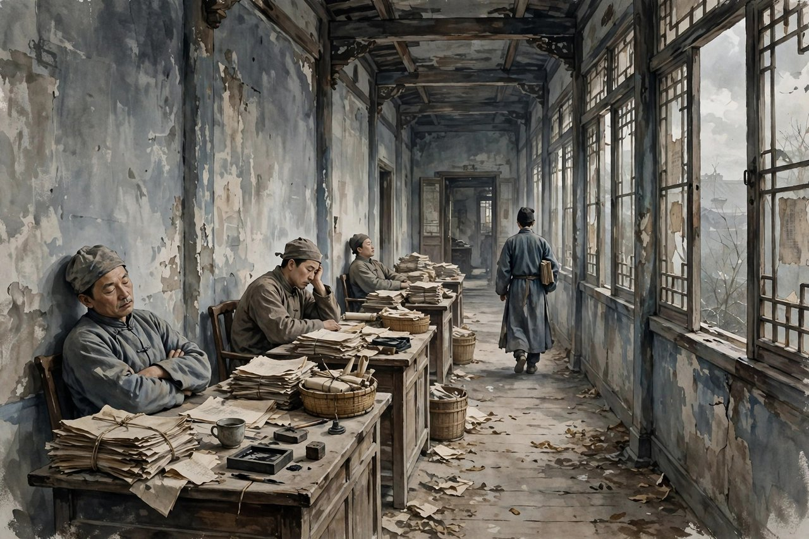
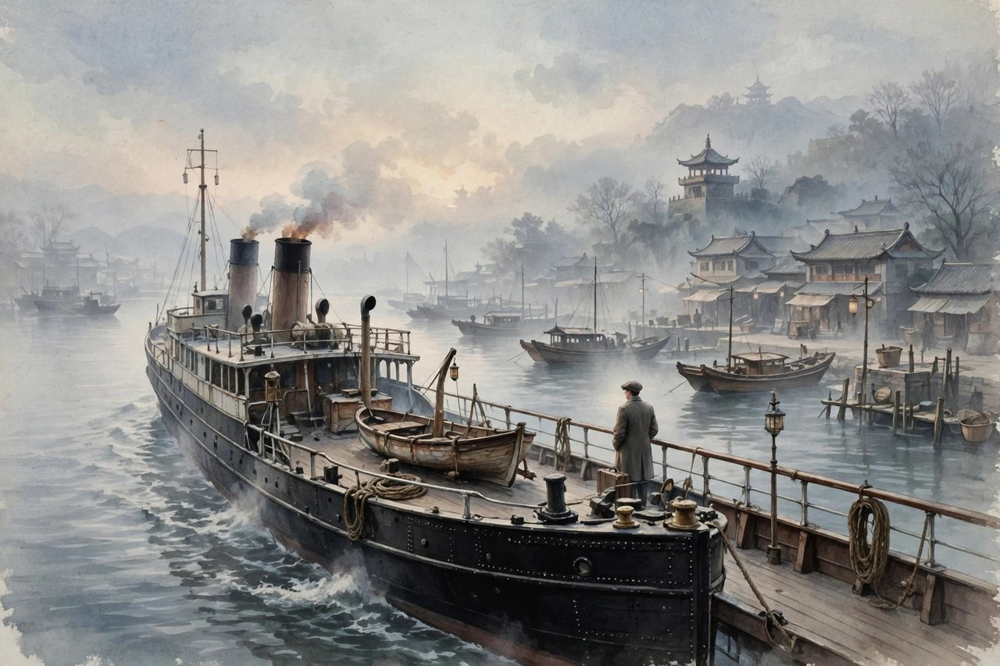

## 留美七年的英士

去国是冰心一九一九年发表的问题小说，写的是留美七年的英士学成归国，一心贡献所学，却面临了一个军阀混战、庸腐迂败的政局。英士有志难伸，只有怅然再度去国。他痛苦地喊出了，可怜呵，我的初志绝不是如此的，祖国呵，不是我英士弃绝了你，乃是你弃绝了我英士呵。这样的呼喊，跟同时期郁达夫沉沦的结尾，真有相互应合之处。英士这个人物，在当时很有代表性，清末以来，风气渐开，好多青年出国留学，学成归来，想把外国学到的东西，用到中国来，想把中国从落后里拉出来，可是回国一看，中国还是老样子，军阀打仗，官场腐败，有本事的人没有地方用，有关系的人占着位置不做事。英士在美国七年，苦学，省吃俭用，满怀抱负，想着一回国，立刻要把中国旋转过来，可是回国以后，政府只给他一个差遣员的缺，受着无功的俸禄，他的心已经灰了一大半。他的家庭又不能使他快乐，他就天天的拼酒，喝酒喝到身体垮掉，喝到心里绝望，喝到最后，只能再买一张船票，再渡回外国去。去国这个题目，取得很痛，去，不是去旅游，不是去留学，是去国，是离开祖国，是被祖国弃绝之后，不得不离开。英士去国，不是他不爱国，是他太爱国，爱到无法忍受祖国这个样子，爱到无法在祖国待下去，只能离开，离开的时候，心里还是爱着的，喊出来的话，还是爱国的喊声。

## 归国幽愤与人才外流

去国写的问题，今天看来一点也不过时，就是人才外流的问题。英士这样的人才，学成归来，没有地方用，只能再走，走了，祖国就少了一个人才，多了一个遗憾。这种问题，今天也有，好多留学生学成归来，想创业，想进体制，想做研究，可是发现，机会少，关系多，评价体系不合理，有本事的人不一定能出头，有关系的人反而占了先。于是有人选择再出国，有人选择在国内熬着，熬到心灰意冷，熬到才华磨没了。去国写于一百多年前，可是它写的问题，今天还在，这就是好作品的命，它写的是一个时代的问题，可是问题本身没有解决，作品就不会过时。冰心写去国，不是为了骂英士，不是为了骂留学生，她是同情英士的，她觉得英士的悲剧，不是英士个人的悲剧，是时代的悲剧，是国家的悲剧，是制度的悲剧。她写英士，不是把英士写成一个失败者，而是把英士写成一个有志难伸的人，一个被时代辜负的人，一个值得同情的人。她这种同情，比批评更有力量，因为她让读者觉得，英士不是活该，是可怜，是值得我们反思的。她写去国，还写到了家庭问题，英士回国后，家庭不能使他快乐，家庭里的人不理解他，觉得他留学回来就应该当大官、挣大钱，不理解他为什么郁闷，为什么喝酒，这种不理解，让他的痛苦更深了一层。家庭和社会，双重压力，把一个有抱负的青年，压垮了，压到了只能去国。

## 冰心自己的留学对照

冰心自己也是留学生，她一九二三年去美国留学，一九二六年回国，回国后在大学教书，教书教得很认真，学生喜欢她，她没有像英士那样去国，可是她理解英士，因为她也是从外国回来的，她也知道，从外国回来的人，心里会有一个落差，外国的秩序、外国的效率、外国的学术气氛，跟国内的混乱、腐败、人情，形成了鲜明的对照，这种对照，会让人失望，会让人痛苦。她写去国，是把自己的观察、自己的理解、自己的同情，都写进了英士这个人物里。她不是站在岸上写英士，她是站在英士身边写英士，她懂英士的痛，懂英士的喊声，懂英士为什么要去国。她这种懂，让去国读起来特别真，特别痛，特别能打动留过学的人，或者想留学的人，或者家里有留学生的人。今天的人读去国，会想起自己或者身边人的留学经历，想起学成归来之后的落差，想起在国内找工作、找位置的时候遇到的困难，想起那种有志难伸的感觉。这种感觉，古今都是一样的，时代变了，落差还在，困难还在，英士的喊声，今天的人听了，还是会心里一紧。冰心写去国，是想提醒社会，要珍惜人才，要给人才地方，要给有抱负的人机会，不要让人才来了又走，走了又后悔。她这种提醒，今天看来还是有用的，社会要发展，靠的就是人才，人才留不住，发展就难，人才来了又走，损失的是国家，是社会，是每一个普通人。

## 问题小说的痛与爱

去国是冰心问题小说的代表作，问题小说这个说法，是当时文坛对一类小说的称呼，就是把社会问题放到小说里去写，写家庭问题，写妇女问题，写留学问题，写穷人问题，写知识分子的苦闷。冰心的问题小说，跟鲁迅的问题小说不一样，鲁迅写问题，写得冷峻，写得深刻，写得让人看了心里发凉，冰心写问题，写得温和，写得同情，写得让人看了心里发软，可是软里也有痛，痛里也有爱。她写去国，痛的是英士的遭遇，爱的是英士这个人，爱的是祖国，爱的是人才，爱的是未来。她这种痛与爱交织的写法，是她问题小说的特点，也是她跟其他作家不同的地方。她不骂人，不喊口号，不把问题归结到某个人身上，她把问题归结到时代、归结到制度、归结到社会风气上，她觉得，问题要解决，靠的不是骂人，是改变制度，是改变风气，是给人才机会，是给青年希望。她这种想法，今天看来还是有道理的，骂人解决不了问题，改变制度才能解决问题，改变风气才能留住人才。她写去国，不是为了发泄情绪，是为了提醒社会，是为了给社会一个镜子，镜子里照出的问题，社会要自己去改。她这种温和而坚定的批评，比激烈的批评更持久，因为它不树敌，它只讲道理，讲道理讲得动人，社会就愿意听，社会愿意听，问题才有解决的可能。

## 今天读去国的启示

今天读去国，启示有很多。给留学生的启示是，回国之前，要做好心理准备，国内跟国外不一样，落差是免不了的，要有耐心，要有韧性，不要一碰壁就绝望，不要一失望就去国。给社会的启示是，要珍惜人才，要给人才公平的机会，要让有本事的人能出头，要让没有关系的人也能凭本事吃饭。给家庭的启示是，家里有留学生回来，不要只问他当了多大的官、挣了多少钱，要问他心里苦不苦，要理解他的落差，要给他时间，要给他支持。给年轻人的启示是，有抱负是好事，可是抱负要落地，要从小事做起，要从身边做起，不要想着一回国就把中国旋转过来，旋转中国，需要一代一代人的努力，需要从小事做起的耐心。英士的悲剧，有一部分是他自己太急了，太想一夜之间改变中国，太想立刻看到效果，效果看不到，就绝望了，就喝酒了，就去国了。今天的年轻人，也要警惕这种急，急着成功，急着出头，急着改变世界，急不来，急来了也是虚的，真正能改变世界的，是耐心，是坚持，是从小事做起的积累。去国这篇小说，读完心里会痛，痛完了，要想一想，痛的原因是什么，痛的教训是什么，痛之后该怎么办。想清楚了，痛就没有白痛，英士的去国，就没有白去，他的喊声，就没有白喊。他的喊声，今天还在，喊给每一个有抱负的青年听，喊给每一个珍惜人才的社会听，喊给每一个爱国的中国人听。

## 英士的酒与绝望

去国里写英士喝酒，写得很真实，也很痛。英士回国后，政府只给他一个差遣员的缺，受着无功的俸禄，他的心已经灰了一大半，他的家庭又不能使他快乐，他就天天的拼酒，喝酒喝到身体垮掉，喝到心里绝望，喝到最后，只能再买一张船票，再渡回外国去。酒在这里，不是享受，是逃避，是绝望的表现，是有志难伸的人，用酒来麻醉自己，用酒来忘记痛苦，用酒来打发日子。可是酒麻醉不了痛苦，酒醒了，痛苦还在，酒喝多了，身体垮了，心更绝望了，日子更难过了。冰心写英士喝酒，不是为了批判英士喝酒，是为了同情英士，是为了让读者看见，一个有抱负的青年，是怎么被现实逼到喝酒、逼到绝望、逼到去国的。她写酒，写得不动声色，可是读者读了，心里会痛，会觉得，英士不应该这样，社会不应该这样，人才不应该这样被糟蹋。今天的人，遇到困难，也有人用喝酒、用熬夜、用刷手机来逃避，逃避一时，痛苦还在，逃避多了，人就废了。去国提醒你的，就是不要用逃避来对付困难，要用面对来对付困难，面对虽然痛，可是面对才能解决问题，逃避虽然舒服一时，可是逃避解决不了任何问题，只会让问题更大。英士的悲剧，有一部分是他自己用酒逃避，有一部分是社会没有给他机会，两部分合起来，才是完整的悲剧，缺了哪一部分，悲剧都不完整。

## 去国与沉沦的对照

去国常常被人拿来跟郁达夫的沉沦对照，因为两篇小说的结尾，都有相似的呼喊，都是青年在绝望里的喊声，都是对祖国、对时代的控诉。沉沦里的青年，在日本留学，最后跳海自杀，喊出的是对祖国的绝望；去国里的英士，在美国留学归来，最后黯然去国，喊出的是祖国弃绝了我。这两种喊声，都是那个时代青年的心声，都是报国无门的痛，都是有志难伸的愤。可是两篇小说的路子不一样，沉沦写得更激烈，更绝望，更个人化，去国写得更温和，更同情，更社会化。冰心写去国，不是要青年去自杀，不是要青年去绝望，她是要社会反思，要社会给人才机会，要社会不要辜负青年。她这种温和的控诉，比激烈的控诉更持久，因为它不煽动情绪，它只讲道理，讲道理讲得动人，社会就愿意听，社会愿意听，问题才有解决的可能。今天的人读去国和沉沦，会发现，两篇小说讲的问题，今天还在，青年报国无门的问题，人才外流的问题，有志难伸的问题，今天还在，只是形式变了，变得更隐蔽了，变得更复杂了。可是核心没有变，核心还是，社会要珍惜人才，青年要保持希望，家庭要理解青年，国家要给青年机会。这些道理，一百年前的作家讲过，今天的作家还在讲，讲了一百年，还没有讲完，说明问题还没有解决，说明去国这样的作品，今天还要读，还要讲，还要让更多人听见英士的喊声。

## 英士的家庭与孤独

去国里写英士的家庭，写得很真实，也很痛。英士回国后，家庭不能使他快乐，家里的人不理解他，觉得他留学回来就应该当大官、挣大钱，不理解他为什么郁闷，为什么喝酒，为什么整天愁眉苦脸。家里人看他，眼光是功利的，是问他挣了多少钱，当了多大的官，给家里带来了多少好处，问不到这些，就觉得他留学白留了，觉得他无能，觉得他辜负了家里的期望。这种不理解，让英士的痛苦更深了一层，社会上没有地方用他，家里也没有人懂他，里外都是墙，墙把他夹在中间，夹得他喘不过气来，只能喝酒，只能绝望，只能去国。他在美国七年，学的是新思想，新知识，新眼光，回国一看，家里还是老样子，老思想，老规矩，老眼光，新旧之间，有一条很深的沟，沟跨不过去，人就掉进沟里去了。冰心写英士的家庭，是想告诉读者，留学生的悲剧，不只是社会的问题，也是家庭的问题，是家庭不理解留学生，是家庭用老眼光看新青年，是家庭把留学生当成挣钱的工具，而不是当成有思想、有抱负、有痛苦的人。今天的家庭，家里有留学生回来，也要警惕这种不理解，不要只问孩子挣了多少钱，当了多大的官，要问孩子心里苦不苦，要理解孩子的落差，要给孩子时间，要给孩子支持，要让孩子觉得，家是港湾，不是考场，不是交易所，不是只问结果不问过程的地方。家是港湾，孩子回来了，港湾要能让他靠岸，要能让他休息，要能让他重新有力气，再出去闯。英士的家，不是港湾，是另一个考场，是另一个让他的地方，考场里没有港湾，他只能再去国，再去找港湾，再去找能理解他的地方。

## 去国的语言与结构

去国这篇小说，语言很干净，结构很紧凑，情节不复杂，可是感情很深。小说开头，写英士归国，写他的抱负，写他的希望，写他想把中国旋转过来的豪情，读者读了，会觉得，这个青年有出息，有希望，有未来。小说中间，写英士碰壁，写他只得到一个差遣员的缺，写他受着无功的俸禄，写他家庭不快乐，写他天天拼酒，读者读了，会觉得，这个青年真可怜，真不容易，真被社会辜负了。小说结尾，写英士去国，写他痛苦的喊声，写他祖国弃绝了他的绝望，读者读了，心里会痛，会觉得，这个喊声，是那个时代所有有抱负青年的喊声，是所有报国无门的人的喊声。小说的结构，就是从希望到失望，从失望到绝望，从绝望到去国，一步一步，推着读者往下走，走到最后，读者也跟着绝望了，也跟着想喊了。这种结构，是问题小说的典型结构，是把社会问题放到一个人身上去写，问题不是贴在墙上的标语，是长在人物心里的疼，疼到最后，疼成了喊声，喊声喊出来，社会就要听见，就要反思。冰心写去国，语言不华丽，不堆词，不卖弄，就是老老实实讲故事，讲英士的事，讲英士的心，讲英士的喊声，讲完了，读者自己心里会痛，会想，痛完了，要怎么办，要怎么改变社会，要怎么留住人才，要怎么让英士这样的人，不再去国。这种老老实实的写法，比华丽的写法更有力量，因为老实里藏着真，真里藏着痛，痛里藏着爱，爱里藏着希望。

## 去国与今天的海归

今天讲海归，讲留学生回国，讲得很多，讲海归找工作难，讲海归薪资不如预期，讲海归水土不服，讲海归再出国，这些话题，去国里都已经讲到了，虽然时代不同，具体的困难不同，可是核心是一样的，就是学成归来的人，怎么在国内找到位置，怎么让自己的本事有用武之地，怎么让自己的抱负落地，怎么在落差里保持希望，不至于绝望，不至于去国。今天的海归，回国之前，要做好心理准备，国内跟国外不一样，落差是免不了的，要有耐心，要有韧性，不要一碰壁就绝望，不要一失望就再出国。今天的社会，要珍惜海归，要给海归公平的机会，要让有本事的人能出头，要让没有关系的人也能凭本事吃饭，要让海归觉得，回国是值得的，是有希望的，是有未来的。今天的家庭，家里有海归回来，不要只问孩子挣了多少钱，要问孩子心里苦不苦，要理解孩子的落差，要给孩子时间，要给孩子支持。去国这篇小说，读完心里会痛，痛完了，要想一想，痛的原因是什么，痛的教训是什么，痛之后该怎么办。想清楚了，痛就没有白痛，英士的去国，就没有白去，他的喊声，就没有白喊。他的喊声，今天还在，喊给每一个有抱负的青年听，喊给每一个珍惜人才的社会听，喊给每一个爱国的中国人听，喊给每一个想让中国更好的人听。听进去，社会就会变一点，变一点，人才就多留一点，人才多留一点，国家就好一点，国家好一点，英士的悲剧，就少一点。

## 尾声不要让英士再去国

写到这里，想跟社会说一句话，不要让英士再去国。英士这样的人才，学成归来，满怀抱负，想为国家做事，想为社会做事，可是社会没有给他地方，没有给他机会，没有给他理解，他只能再走，再走，国家就少了一个人才，多了一个遗憾，社会就少了一份力量，多了一份冷漠。不要让这种遗憾再发生，不要让这种冷漠再蔓延，要给人才地方，给人才机会，给人才理解，给人才时间，给人才一个能施展本事的舞台，舞台有了，人才就能留下来，留下来，就能为国家做事，就能为社会做事，就能让中国更好。英士的喊声，喊了一百年，今天还在喊，喊给每一个珍惜人才的人听，喊给每一个有权力给人才机会的人听，喊给每一个家里有留学生的人听。听进去，行动起来，人才就不会再去国，人才不会再去国，国家就会好起来，社会就会好起来，青年就会有希望，有希望，青年就不会绝望，不会喝酒，不会去国，不会喊出祖国弃绝了我的话。青年不喊这句话了，社会就真的变好了，真的值得青年留下来了，真的值得青年去爱了。这就是去国留给你的全部，也是冰心留给你的全部，很痛，很真，很值得今天的人记住，记住英士，记住他的喊声，记住不要让悲剧重演。

## 去国里的船与海

去国这篇小说里，船是一个很重要的意象，英士来的时候，坐船来，满怀抱负，想把中国旋转过来；英士去的时候，坐船去，满怀失望，只能黯然离开。船来船去，中间隔了七年留学，隔了回国碰壁，隔了家庭不快乐，隔了天天拼酒，隔了绝望，隔了喊声。船是希望的载体，也是失望的载体，希望来的时候，船是满的，失望去的时候，船是空的，空的是英士的心，空的是祖国对人才的辜负。海也是一个意象，海是宽的，是深的，是能装下人的烦恼的，可是海也是隔的，是把英士和祖国隔开的，是把留学生和家乡隔开的。英士站在船上，看着海，看着远去的祖国，心里喊，祖国呵，不是我弃绝了你，乃是你弃绝了我，这句喊声，是海上的喊声，是船上的喊声，是离别时的喊声，喊声喊出来，海听见了，船听见了，读者也听见了，听见了，心里就痛了。冰心写船和海，写得很克制，没有大写特写，只是轻轻提了一句，可是这一句，里面装了离别的痛，装了报国无门的愤，装了人才外流的憾。今天的人，出国留学，坐飞机来去，飞机比船快，可是离别的心情是一样的，回来的时候满怀希望，回去的时候满怀失望，希望和失望之间，隔的是社会的现实，隔的是机会的多少，隔的是理解的深浅。去国提醒你的，就是不要让希望变成失望，不要让船来的时候满，船去的时候空，要让回来的人留下来，留下来，就能为国家做事，就能为社会做事，就能让船来船去，都满载着希望，都满载着人才，都满载着未来。

## 去国与冰心的爱国

去国这篇小说，常常被人说成是悲观的，是绝望的，是唱衰祖国的，可是这其实是误读，冰心写去国，不是唱衰祖国，是爱国，是太爱国了，才写得这么痛，才喊得这么响。她爱国，爱到无法忍受祖国这个样子，爱到无法在祖国待下去，只能离开，离开的时候，心里还是爱着的，喊出来的话，还是爱国的喊声。她这种爱国，不是口号式的爱国，不是喊几句爱国就完事的爱国，是痛彻心扉的爱国，是看到祖国不好，心里痛，看到人才被辜负，心里痛，看到青年绝望，心里痛，痛到只能写小说，写小说来提醒社会，提醒社会要变，要给人才机会，要给青年希望。她这种爱国，今天看来还是有用的，今天讲爱国，讲得很多，讲口号，讲仪式，讲形式，可是真正的爱国，是看到问题，指出问题，推动改变，是让祖国变得更好，让人才留下来，让青年有希望，让社会更公平。冰心写去国，就是这样的爱国，是用小说来爱国，是用痛来爱国，是用喊声来爱国。她这种爱国，比口号更真实，比仪式更深刻，比形式更有力量。今天的人讲爱国，也可以学冰心，不要只喊口号，要看到问题，要推动改变，要让祖国值得爱，要让青年愿意留下来，要让人才愿意回来，回来，就能为祖国做事，就能让祖国更好，祖国更好了，爱国就不再是口号了，爱国就成了生活，成了日子，成了每一个普通人的幸福。

## 去国与今天的青年

今天的青年，读去国，会觉得英士很像自己，很像身边的人，很像那些学成归来、满怀抱负、可是碰壁的人。他们可能在找工作的时候碰壁，可能在创业的时候碰壁，可能在体制里碰壁，可能在家庭里不被理解，可能在社会上没有地方施展自己的本事，碰壁多了，心里就会灰，就会绝望，就会想再出国，就会想放弃。这种心情，跟英士当年的心情很像，都是有志难伸，都是报国无门，都是被现实辜负。可是去国提醒你的，就是不要绝望，不要放弃，不要用喝酒来逃避，不要用去国来逃避，要用面对来对付困难，要用耐心来等待机会，要用坚持来积累本事，本事积累够了，机会来了，你就能抓住，抓住了，你就能为国家做事，就能为社会做事，就能让自己的抱负落地。英士的悲剧，有一部分是他自己太急了，太想一夜之间改变中国，太想立刻看到效果，效果看不到，就绝望了，就喝酒了，就去国了。今天的青年，也要警惕这种急，急着成功，急着出头，急着改变世界，急不来，急来了也是虚的，真正能改变世界的，是耐心，是坚持，是从小事做起的积累，是从身边做起的努力。去国这篇小说，读完心里会痛，痛完了，要想一想，痛的原因是什么，痛的教训是什么，痛之后该怎么办。想清楚了，痛就没有白痛，英士的去国，就没有白去，他的喊声，就没有白喊，他的喊声，今天还在，喊给每一个青年听，喊给每一个珍惜人才的社会听，喊给每一个爱国的中国人听。

## 去国与今天的归来

今天讲归来，讲留学生回国，讲海归创业，讲海归进体制，讲海归做研究，讲得很多，可是归来的路，还是不好走，还是有很多墙，还是有很多沟，还是有很多不理解。去国提醒你的，就是归来的路要慢慢走，要有耐心，要有韧性，不要一碰壁就绝望，不要一失望就再出国，不要用喝酒来逃避，不要用去国来逃避，要用面对来对付困难，要用坚持来积累本事，本事积累够了，机会来了，你就能抓住，抓住了，你就能为国家做事，就能为社会做事，就能让自己的抱负落地，就能让英士的悲剧不再重演。社会也要珍惜归来的人，要给归来的人公平的机会，要让有本事的人能出头，要让没有关系的人也能凭本事吃饭，要让归来的人觉得，回国是值得的，是有希望的，是有未来的。家庭也要理解归来的人，不要只问孩子挣了多少钱，要问孩子心里苦不苦，要给孩子时间，要给孩子支持，要让孩子觉得，家是港湾，不是考场。归来的人，社会，家庭，三方面都努力了，归来的路就好走了，路好走了，人才就留下来了，人才留下来了，国家就好起来了，国家好起来了，英士的喊声就不再响了，英士的悲剧就不再重演了。这就是去国留给你的全部，也是冰心留给你的全部，很痛，很真，很值得今天的人记住，记住英士，记住他的喊声，记住不要让悲剧重演，记住要让归来的人留下来，留下来，就能为祖国做事，就能让祖国更好。

## 去国里的家与国

去国这篇小说，写家，也写国，家是小家，国是大家，小家和大家，是连在一起的，是互相影响的。英士的家，不能使他快乐，家里的人不理解他，觉得他留学回来就应该当大官、挣大钱，不理解他为什么郁闷，为什么喝酒，为什么整天愁眉苦脸，这种不理解，让他的痛苦更深了一层。英士的国，不能使他施展，政府只给他一个差遣员的缺，受着无功的俸禄，他的心已经灰了一大半，军阀混战，官场腐败，有本事的人没有地方用，有关系的人占着位置不做事，这种现实，让他的抱负落了空。家和国，双重压力，把一个有抱负的青年，压垮了，压到了只能去国，压到了只能喊出祖国弃绝了我的话。冰心写家和国，是想告诉读者，家和国是一体的，家好了，国才能好，国好了，家才能好，家不理解青年，国不珍惜人才，青年就只能去国，青年去了国，家就少了一个顶梁柱，国就少了一个人才，损失的是家，也是国。今天的家和国，也要互相理解，家要理解青年，国要珍惜人才，家理解了，青年心里就暖了，国珍惜了，青年就有地方施展了，青年有地方施展了，家就好了，国就好了，大家都好了。这就是去国留给你的道理，很简单，很真实，很值得今天的人记住，记住家，记住国，记住青年，记住人才，记住不要让英士再去国。

英士的喊声，今天还在，喊给每一个有抱负的青年听，喊给每一个珍惜人才的社会听，喊给每一个爱国的中国人听，喊给每一个想让中国更好的人听，喊给每一个家里有留学生的人听，喊给每一个想让人才留下来的人听。听进去，社会就会变一点，变一点，人才就多留一点，人才多留一点，国家就好一点，国家好一点，青年就更有希望，青年更有希望，就不会绝望，不会喝酒，不会去国，不会喊出祖国弃绝了我的话。青年不喊这句话了，社会就真的变好了，真的值得青年留下来了，真的值得青年去爱了。

人才留下来，国家就好起来。
