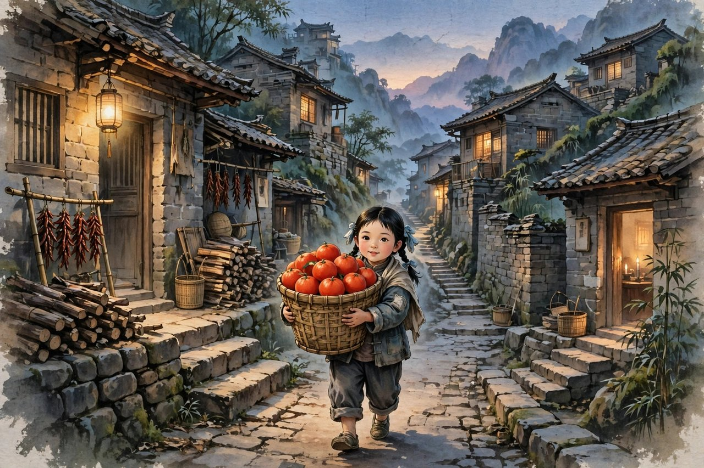
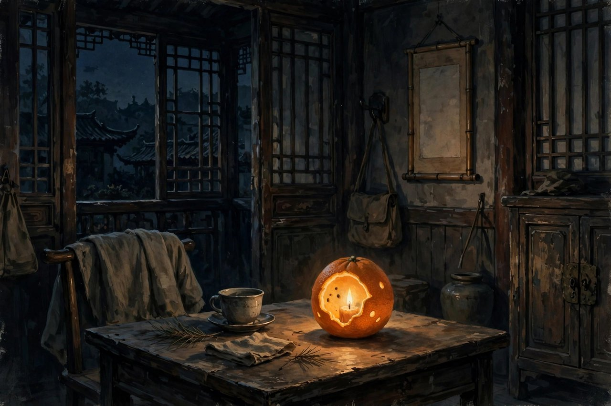

## 十几年前的重庆往事

小桔灯的开头就说，这是十几年前的事了，具体来说，是一九四五年的重庆。那年春节前后，中国少年报向冰心约稿，冰心看到四处都挂着彩灯，一派新年气象，就想起了那个遥远的故事，写下了小桔灯这篇散文。故事很简单，简单到可以用几句话讲完，可是简单里装的东西并不简单。冰心在重庆的时候，有一天，偶然遇到一个为母亲求医的小女孩，出于同情，买了几个大红橘子，跟着小女孩来到她家。小女孩的家里一贫如洗，母亲病倒在床，再没有其他亲人在家，年仅八九岁的小女孩，成了家里的支柱。冰心见此情景，心里难免感伤，小女孩见状，反过来安慰冰心说，爸爸一定会回来的，那时妈妈就会好了。直到离开女孩家，冰心才听说，小女孩的父亲因为被发现帮助共产党而失踪，再加上母亲的病，对于本就贫困的家庭而言，无疑是灭顶之灾。可是小女孩没有哭，没有闹，没有绝望，她给冰心做了一盏小桔灯，用红橘子的皮，挖空了，里面放上小灯芯，点上灯，提着送给冰心。小桔灯的光很小，小到只能照亮一小片地方，可是它的光很暖，暖到冰心一辈子都忘不了。她后来写这篇散文，就是想把这盏灯的光，传给小读者，传给所有在困难里的人。这篇散文，首发在一九五七年一月三十一日的中国少年报上，后来被选入小学语文教材，成了几代中国孩子都读过的课文。你问一个中国人，知不知道小桔灯，十有八九会说知道，知道那个小姑娘，知道那盏桔灯，知道那句爸爸一定会回来。

## 小姑娘为什么让人忘不了

小桔灯里的小姑娘，让人忘不了，不是因为她长得好看，不是因为她说了什么大道理，是因为她在穷日子里表现出来的那股劲儿。她年纪小，只有八九岁，可是她已经会照顾生病的母亲，会去镇上请医生，会跟陌生人打交道，会在家里一贫如洗的时候，还保持体面，还保持希望。她跟冰心说话，语气镇定，不慌不忙，像一个小大人，可是她毕竟还是孩子，孩子气还在，她做桔灯的时候，很认真，很细心，像在做一件很重要的事。她安慰冰心的话，爸爸一定会回来的，那时妈妈就会好了，听起来天真，可是天真里有信念，有希望，有对未来的坚信。这种信念，在大人看来可能有点傻，大人知道，失踪的人不一定能回来，病重的人不一定能好，可是孩子相信，相信本身就是一种力量。冰心被这种力量打动了，她在文章里写，自己从小姑娘家里出来，心里很感伤，可是手里提着小桔灯，心里又亮了一点。她这种感伤里带着亮的感觉，就是小桔灯给人的全部感觉。你今天读这篇散文，也会有这种感觉，一边觉得小姑娘可怜，一边又觉得小姑娘了不起，一边觉得生活真苦，一边又觉得生活还有希望。这种复杂的感觉，就是好作品给人的感觉，不是单一的同情，不是单一的赞美，是同情里带着敬佩，敬佩里带着心疼，心疼里带着希望。

## 一盏灯的象征与现实

小桔灯这盏灯，象征的东西很多，有人说它象征光明，有人说它象征希望，有人说它象征在黑暗里不熄灭的信念，这些说法都对，可是都只说了一半。小桔灯不只是一个象征，它归根结底是一个真实的东西，是一个小姑娘用红橘子皮亲手做的灯，灯芯是小小的，灯油是少的，光是暗的，可是它真实存在过，冰心提着它走过重庆山路的时候，它真的亮着，真的照亮了她脚下的路。这种真实，比象征更重要，因为象征可以有很多解释，真实只有一个，就是一个穷孩子，在穷日子里，给一个陌生人做了一盏灯，灯的光很小，可是心意很大。今天的人，讲象征讲得太多，讲真实讲得太少，讲大道理讲得太多，讲小细节讲得太少，小桔灯提醒你的，就是回到真实，回到细节，回到一个橘子、一盏灯、一个小姑娘的手这些具体的东西上。具体的东西，才是能打动人的东西，抽象的象征，讲多了会空，具体的细节，讲多了会满。你今天如果想给别人希望，不需要讲大道理，只需要像小姑娘一样，做一件具体的小事，给别人一盏灯，给别人一句话，给别人一个橘子，小事做到了，希望就到了。小桔灯的光，很小，小到只能照亮一小片，可是它照亮的那一小片，就是冰心当时最需要的那一小片，就是读者今天最需要的那一小片。光不需要很大，光只需要亮着，亮着，就够了。

## 为什么选入了课本

小桔灯被选入小学语文教材，是有道理的。它篇幅短，语言干净，情节简单，孩子读得懂，老师讲得清，家长也放心。它讲的东西，孩子能懂，穷日子，病母亲，小姑娘，桔灯，这些东西，孩子虽然不一定都经历过，可是都能想象，都能感受。它讲的道理，孩子也能懂，要坚强，要乐观，要在困难里保持希望，要体贴别人，要给别人温暖，这些道理，不需要老师多讲，孩子读完故事，自己就能悟出来。它还有一个好处，就是它不煽情，不卖惨，不把穷孩子写成可怜虫，它把小姑娘写成一个有尊严、有希望、有能力的人，孩子读了，不会觉得穷孩子就低人一等，只会觉得，穷孩子也可以了不起，也可以给别人带来光。这种教育，比直接讲道理更有力量。今天的孩子，生活条件比一九四五年的孩子好得多，可是他们也有自己的困难，有学习压力，有家庭变故，有跟同学的矛盾，有对未来的迷茫，他们读小桔灯，会学到在困难里怎么保持希望，怎么体贴别人，怎么用自己的小力量，给别人带来一点光。这种学习，比考试分数更重要，比知识更重要，是做人的学习。冰心写小桔灯，本来是想给小读者一盏灯，没想到，这盏灯照亮了几代孩子，照亮了几代中国人的童年，这就是好作品的命，它不只属于一个时代，它属于所有时代里需要光的人。

## 对照今天的困难与光

今天的人，困难跟一九四五年不一样了，没有战乱，没有那么穷，可是困难还是有的，工作难找，房贷难还，孩子难带，老人难照顾，心里难安静。这些困难，看起来没有小姑娘的困难那么苦，可是对当事人来说，一样难熬。你今天读小桔灯，会不会觉得，小姑娘都能在那么苦的日子里保持希望，我今天的困难，是不是也能熬过去。这种对照，不是让你觉得自己的困难不算什么，是让你觉得，希望是可以有的，光是可以亮的，哪怕光很小，小到像桔灯一样，也值得亮着。你今天如果心里暗，不妨学小姑娘，做一盏自己的桔灯，灯不需要大，不需要贵，只需要是你亲手做的，是你心里真想给别人的。比如给母亲打个电话，给朋友发个消息，给孩子讲个故事，给陌生人一个微笑，这些小事，就是你的桔灯，灯亮了，你的心里就亮了，别人的心里也亮了。小桔灯的故事，讲了一百年，今天还在讲，还在被孩子读，还在被大人想起，说明它的光没有熄，说明它的道理没有过时。道理没有过时，是因为人心里需要光的道理，永远不会过时，不管时代怎么变，人心里都需要一盏灯，需要在黑暗里看见一点亮，需要在困难里听见一句爸爸一定会回来的话。这句话，今天听起来可能有点天真，可是天真里有力量，力量里有希望，希望里有活下去的勇气。

## 橘子与灯芯的细节

小桔灯这篇散文，好就好在细节上。细节之一，是橘子。冰心买了几个大红橘子，橘子是红的，是大的，是新鲜的，是给小姑娘家带的礼物，是同情的表示，也是体贴的表示。她买橘子，不是买贵的东西，不是买大的礼物，就是买几个橘子，橘子虽小，可是心意大，橘子虽便宜，可是温暖大。小姑娘家里穷，母亲病着，橘子对她们来说，是很好的东西，是能吃的东西，是能带来甜味的东西。细节之二，是桔灯的做法。小姑娘把红橘子的皮挖空，里面放上小灯芯，点上灯，提着送给冰心。做法很简单，简单到孩子都会，可是做出来的灯，很有心，很有光，很有温暖。细节之三，是小姑娘的话，爸爸一定会回来的，那时妈妈就会好了。这句话，听起来天真，可是天真里有信念，有希望，有对未来的坚信。这句话，冰心记了一辈子，读者也记了一辈子，因为这句话，是穷日子里的希望，是黑暗里的光，是孩子给大人的安慰。细节之四，是冰心提着灯走夜路的情景。她提着小桔灯，走在重庆的山路上，灯的光很小，小到只能照亮脚下的一小片，可是她的心里亮了，亮到一辈子都忘不了。这些细节，合起来，就是小桔灯的全部，就是一篇好散文的全部，就是用细节说话，用生活说话，不用大道理，不用口号，细节到了，道理自然就到了。今天写散文的人，也可以学这种细节的写法，不要先想主题，先想细节，细节想透了，主题自然就出来了，细节写活了，文章自然就动人了。

## 小桔灯与今天的孩子

今天的孩子，读小桔灯，会有两种感觉，一种是觉得小姑娘可怜，一种是觉得小姑娘了不起。可怜，是因为小姑娘家穷，母亲病着，父亲失踪，年纪小小就要照顾家；了不起，是因为小姑娘在这么苦的日子里，还能保持希望，还能给别人做灯，还能安慰大人。这种两种感觉交织在一起，就是小桔灯给孩子的教育，就是让孩子懂得，生活有苦，可是苦里有希望，苦里有光，苦里有人情。孩子读完，会学到坚强，会学到乐观，会学到体贴别人，会学到在困难里给别人带来光。这些学习，比考试分数更重要，比知识更重要，是做人的学习。今天的孩子，生活条件好，可是他们也有自己的困难，有学习压力，有家庭变故，有跟同学的矛盾，有对未来的迷茫，他们读小桔灯，会学到在困难里怎么保持希望，怎么体贴别人，怎么用自己的小力量，给别人带来一点光。老师讲小桔灯，也不用多讲道理，只需要把故事讲清楚，把细节讲清楚，把小姑娘的话讲清楚，孩子自己就能悟出来，悟出来的道理，记得更牢。家长也可以陪孩子读小桔灯，读完跟孩子聊一聊，聊聊小姑娘，聊聊桔灯，聊聊希望，聊聊自己家里的困难和希望，聊完，孩子和家长的心就近了，近了，家庭就暖了。家庭暖了，孩子就能在困难里站住，就能像小姑娘一样，做一盏自己的灯。

## 桔灯的光没有熄

小桔灯这篇散文，写于一九五七年，讲的是一九四五年的事，中间隔了十几年，可是光没有熄，讲到今天，隔了将近八十年，光还是没有熄，还在课本里，还在书店里，还在孩子的心里，还在大人想起它的时候，心里亮一下。光没有熄，是因为它的道理没有过时，是因为人心里需要光的道理，永远不会过时。不管时代怎么变，人心里都需要一盏灯，需要在黑暗里看见一点亮，需要在困难里听见一句希望的话，需要在穷日子里看见一个小姑娘的倔强和体面。这盏灯，今天还在亮，亮在课本里，亮在孩子的心里，亮在每一个读过它的人心里。你今天如果心里暗，不妨再读一遍小桔灯，读完想想小姑娘，想想桔灯，想想那句爸爸一定会回来的话，想想，你的心里就会亮一点。亮一点，就够了，亮一点，你就能走下去，走到天亮，走到好日子，走到下一个春天。小桔灯的故事，就是这样一个简单的故事，简单到几句话就能讲完，可是它留给人的东西，一辈子都讲不完，一辈子都忘不了。这就是好作品的命，它不靠篇幅长，不靠道理大，靠的是一个真实的细节，一句真实的话，一盏真实的灯，灯亮着，作品就活着，灯亮着，读者心里就亮着。

## 重庆的山路与夜色

小桔灯的故事，发生在重庆，重庆是一座山城，山路弯弯，夜色深深，灯光点点。冰心提着小桔灯，走在重庆的山路上，灯的光很小，小到只能照亮脚下的一小片，可是她的心里亮了，亮到一辈子都忘不了。重庆的山路，不好走，石板路滑，坡陡，弯多，夜里走路，要小心，要提着灯，要看着脚下。可是小桔灯的光，虽然小，却够她看清脚下的路，够她不摔倒，够她走到家。这就是小桔灯的意义，光不需要很大，光只需要够你看清脚下的路，够你不摔倒，够你走到天亮。今天的人，走在人生的山路上，也会遇到夜色，也会遇到弯路，也会遇到滑坡，也会觉得脚下看不清，也会觉得心里发慌。这个时候，你需要一盏自己的桔灯，灯不需要大，不需要贵，只需要是你亲手做的，是你心里真想给别人的，是你在困难里还保持的希望。灯亮了，脚下的路就清楚了，路清楚了，人就能走下去，走下去，就能走到天亮，走到好日子。重庆的夜色，在小桔灯里不是背景，是心情，是那个年代中国的心情，是战乱里的心情，是穷日子里的心情，是黑暗里还想亮的心情。冰心写重庆的夜色，写得不动声色，可是读者读了，心里会紧，会觉得，那个年代的人，真不容易，真坚强，真了不起。她写夜色，不是为了写风景，是为了衬托灯光，夜色越暗，灯光越亮，夜色越深，灯光越暖，这种对比，让小桔灯的光，显得格外珍贵，格外动人。

## 小姑娘的父亲与母亲

小桔灯里的小姑娘，父亲失踪了，母亲病倒了，家里只剩下她一个人，撑着这个家。父亲为什么失踪，文章里没有明说，只是后来冰心才听说，父亲因为被发现帮助共产党而失踪。这个细节，文章里写得很含蓄，很克制，没有大讲政治，没有大讲斗争，只是轻轻提了一句，可是这一句，里面装了那个年代的残酷，装了普通人家的苦难，装了一个孩子失去父亲的痛。小姑娘的母亲，病倒在床，起不来，做不了事，只能躺着，看着女儿忙前忙后，心里又疼又无奈。母亲病着，还惦记女儿，还想女儿能过好日子，还想女儿不要太累，可是她病着，什么都做不了，只能靠女儿。女儿年纪小，只有八九岁，可是她已经会照顾母亲，会去镇上请医生，会跟陌生人打交道，会在家里一贫如洗的时候，还保持体面，还保持希望。她这种早熟，不是天生的，是生活逼出来的，是穷日子逼出来的，是父亲失踪、母亲生病逼出来的。可是她早熟里还有天真，天真里还有信念，信念里还有希望，希望里还有爱。她相信爸爸一定会回来，相信妈妈一定会好，相信日子一定会好起来，这种相信，在大人看来可能有点傻，可是对孩子来说，相信就是力量，相信就是活下去的勇气。冰心写小姑娘的父亲和母亲，写得很克制，没有煽情，没有卖惨，只是老老实实写，写父亲失踪，写母亲生病，写女儿撑家，写完了，读者自己心里会痛，会觉得，这个家真不容易，这个孩子真了不起，这种克制的写法，比煽情更有力量，因为克制里藏着尊重，尊重里藏着爱。

## 小桔灯与冰心的晚年

小桔灯写于冰心晚年，写的是她年轻时在重庆的往事，中间隔了十几年，可是她写的时候，记忆还是那么清楚，细节还是那么生动，橘子的红，灯的光，小姑娘的话，山路的夜色，都像昨天发生的一样。这说明，这盏灯在她心里亮了十几年，一直没有熄，一直在照亮她，一直在提醒她，人心里要留一点光，留一点希望，留一点对穷孩子的体贴。她晚年写小桔灯，不是为了怀旧，是为了给新中国的小读者一盏灯，是为了告诉新中国的孩子，过去的日子虽然苦，可是苦日子里有人情，有希望，有光，孩子要珍惜现在的日子，要记得过去的苦，要在好日子里还保持善良，还保持希望，还保持给别人做灯的心。她晚年写东西，越来越朴素，越来越直接，越来越不讲究花样，她写小桔灯，语言就是这么朴素，情节就是这么简单，可是朴素里有力量，简单里有深度。她晚年住在北京，家里常有年轻人去看她，她跟年轻人说话，还是那么亲切，还是讲小桔灯的故事，讲小姑娘，讲桔灯，讲希望，年轻人听了，心里会暖，会觉得，老奶奶讲的故事，虽然老，可是道理不老，道理今天还在。她晚年写小桔灯，是想把这盏灯传下去，传给小读者，传给年轻人，传给所有在困难里的人，传下去，灯就不会熄，传下去，光就一直在。

## 给今天做灯的人

今天，你也可以做一盏小桔灯，灯不需要用橘子皮做，灯可以用任何东西做，可以用一句话做，可以用一个电话做，可以用一次帮忙做，可以用一个微笑做。灯的形状不重要，灯的光才重要，灯的光，就是你心里对别人的好，就是你愿意在别人困难的时候，伸一把手，点一盏灯，照亮别人脚下的路。你今天如果看见身边有人困难，有人心里暗，有人走在夜路上，不妨学小姑娘，做一盏灯给他，灯亮了，他的心里就亮了，他就能走下去，就能走到天亮。你今天如果自己心里暗，也不要怕，不要觉得没有人给你做灯，你可以自己给自己做灯，灯做出来了，心里就亮了，心里亮了，就能走下去，就能等到天亮，就能等到好日子。小桔灯的故事，讲了一百年，今天还在讲，还在被孩子读，还在被大人想起，说明它的光没有熄，说明它的道理没有过时，说明人心里需要光的道理，永远不会过时。不管时代怎么变，人心里都需要一盏灯，需要在黑暗里看见一点亮，需要在困难里听见一句希望的话，需要在穷日子里看见一个小姑娘的倔强和体面。这盏灯，今天还在亮，亮在课本里，亮在孩子的心里，亮在每一个读过它的人心里，亮在你今天读完这篇之后，心里亮起来的那一小片地方。那一小片地方，就是小桔灯留给你的，就是冰心留给你的，就是你今天可以传下去的光。传下去，光就不会熄，传下去，一代一代的人，心里都会有灯，都会在黑暗里看见亮，都会在困难里保持希望，都会在穷日子里保持体面，都会在别人的夜路上，点一盏自己的灯。

## 尾声提灯走夜路的人

写到这里，想跟你说一句很简单的话，今晚如果你要走夜路，记得提一盏灯，灯可以很小，小到像桔灯一样，可是灯亮着，你就不会摔倒，不会迷路，不会害怕。灯亮着，你就能看清脚下的路，就能走到家，就能走到天亮。冰心提着小桔灯，走过重庆的山路，走了一辈子，灯一直亮着，亮到她晚年写这篇散文的时候，还在亮，亮到今天我们读这篇散文的时候，还在亮。这就是小桔灯的命，它不靠篇幅长，不靠道理大，靠的是一个真实的细节，一句真实的话，一盏真实的灯，灯亮着，作品就活着，灯亮着，读者心里就亮着。你读完这篇，再去读小桔灯的原文，会读得更亲切，因为你已经知道了这个故事是怎么来的，是谁在什么心情下写出来的，是重庆的山路，是小姑娘的手，是橘子的红，是灯的光，是那句爸爸一定会回来的话。这些背景，知道了，故事就更活了，不知道，直接读原文也行，原文本身就够动人了。小桔灯这篇散文，很短，读起来很快，可是它留给你的东西，可以很久，可以是一辈子。你把它放在心里，什么时候心里暗了，拿出来想一想，心里就能亮一点。亮一点，就够了，亮一点，你就能走下去，走到天亮，走到好日子，走到下一个春天。

## 小桔灯与课本里的童年

小桔灯被选入课本之后，成了几代中国孩子的共同记忆，孩子们在课本里读到小桔灯，读到小姑娘，读到桔灯，读到那句爸爸一定会回来的话，读完，老师会讲，家长会讲，孩子会记，记住了，一辈子都忘不了。这种共同记忆，是很珍贵的，是一个民族共同的童年，是一个国家共同的灯。孩子们长大了，离开了课本，离开了学校，可是小桔灯还在心里，还在记忆里，还在想起它的时候，心里亮一下。长大了的人，遇到困难的时候，会想起小桔灯，会想起小姑娘，会想起桔灯的光，会想起那句希望的话，想起来，心里就会有一点劲儿，有一点不服输的劲儿，有一点要把日子过好的劲儿。这种劲儿，就是课本给孩子的礼物，就是小桔灯给孩子的礼物，就是冰心给孩子的礼物。礼物不大，可是管用，管一辈子。今天的孩子，课本里还有小桔灯吗，有的版本里还有，有的版本里换了，可是小桔灯的故事，还在书店里，还在绘本里，还在老师的讲课里，还在家长的讲述里，还在孩子的心里。故事在，灯就在，灯在，光就在，光在，希望就在。希望在，孩子就能长大，就能走过困难，就能走到好日子，就能像小姑娘一样，在穷日子里保持希望，在困难里给别人做灯，在黑暗里点亮自己，也点亮别人。这就是小桔灯的命，它不只属于课本，它属于所有需要光的孩子，属于所有需要光的大人，属于所有在黑暗里还想亮的人。

## 小桔灯与冰心的爱

小桔灯这篇散文，合起来看，就是冰心爱的哲学的缩影，就是母爱、童真、自然的爱，落到一个具体的故事里，落到一个小姑娘身上，落到一盏桔灯上，落到一句希望的话上。母爱在哪里，在小姑娘照顾生病的母亲里，在母亲惦记女儿里，在冰心同情小姑娘里；童真在哪里，在小姑娘相信爸爸一定会回来里，在小姑娘认真做桔灯里，在小姑娘安慰大人里；自然的爱在哪里，在红橘子的颜色里，在灯的光里，在重庆山路的夜色里，在春天新年的气氛里。这些爱，合起来，就是小桔灯的全部，就是冰心一辈子写的东西的全部，就是她想传给读者的全部。她写小桔灯，不是为了写一个故事，是为了写爱，是为了让读者看见爱，看见爱在穷日子里的样子，看见爱在孩子身上的样子，看见爱在一盏灯里的样子。看见了，读者心里就会有爱，就会想去爱母亲，就会想去爱孩子，就会想去爱身边的人，就会想在困难里给别人做灯。爱传下去了，小桔灯就活下去了，爱传下去了，冰心就活下去了，爱传下去了，世界就暖下去了。世界暖了，孩子就能长大，大人就能走下去，老人就能安度晚年，所有人都能在黑暗里看见一点亮，看见亮，就能走下去，走到天亮，走到好日子，走到下一个春天。

## 小桔灯与新年的彩灯

小桔灯的故事，起因是新年的彩灯。冰心看到四处都挂着彩灯，一派新年气象，就想起了那个遥远的故事，想起了重庆的小姑娘，想起了桔灯，想起了那句希望的话。新年的彩灯，是大的，是亮的，是热闹的，是大家一起挂的；小桔灯，是小的，是暗的，是安静的，是一个小姑娘亲手做的。大的彩灯，照亮的是街道，是节日，是热闹；小的桔灯，照亮的是一个人的心，是一个陌生人的夜路，是一个穷孩子的希望。大的彩灯，过完年就摘下来了，小的桔灯，过了一百年还在亮，还在课本里，还在孩子的心里，还在大人想起它的时候，心里亮一下。这就是小和大的道理，光不在乎大，光在乎亮，灯不在乎贵，灯在乎心，心到了，灯就亮了，灯亮了，人就暖了。你今天过年，挂彩灯的时候，不妨想想小桔灯，想想那个小姑娘，想想那盏小灯，想想，彩灯再大，也不如一盏真心做的灯暖，节日再热闹，也不如一句真心的话暖。新年到了，你可以给家里挂彩灯，也可以给心里点一盏桔灯，灯点起来了，新年就有了光，有了光，新的一年就能走下去，就能走到好日子，就能走到下一个新年。彩灯会摘下来，桔灯不会熄，彩灯照亮的是街道，桔灯照亮的是人心，人心亮了，街道自然就亮了，日子自然就好了。

## 小桔灯与今天的春节

今天过春节，家家都挂彩灯，挂红灯笼，挂五颜六色的灯，灯很多，灯很亮，灯很热闹，可是小桔灯的故事，还在被讲，还在被读，还在被想起，因为小桔灯的光，跟彩灯的光不一样，彩灯的光是大家的，是节日的，是热闹的，小桔灯的光是一个人的，是一个小姑娘的，是安静的，是温暖的。大家的灯，过完年就摘下来了，一个人的灯，过了一百年还在亮，还在课本里，还在孩子的心里，还在大人想起它的时候，心里亮一下。你今天过春节，挂彩灯的时候，不妨也点一盏自己的桔灯，灯不需要用橘子皮做，灯可以用一句话做，可以用一个电话做，可以用一次回家做，可以用一顿团圆饭做，灯做出来了，春节就有了光，有了光，新的一年就能走下去，就能走到好日子，就能走到下一个春节。春节是团圆的日子，是回家的日子，是给家里人做灯的日子，你回家了，家里就亮了，你给母亲打电话了，母亲心里就亮了，你给孩子讲小桔灯的故事了，孩子心里就亮了，亮了，春节就完整了，亮了，新的一年就有了希望，有了希望，就能走过一年四季，走到下一个春节，再下一个春节，一直走下去。

灯亮着，作品就活着，灯亮着，读者心里就亮着，灯亮着，希望就一直在。
