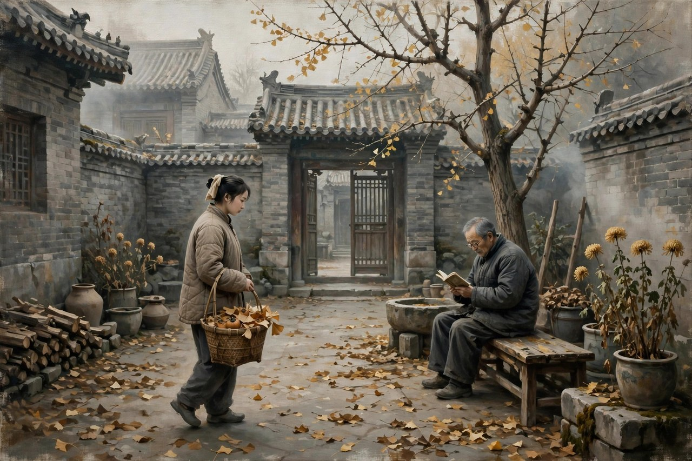
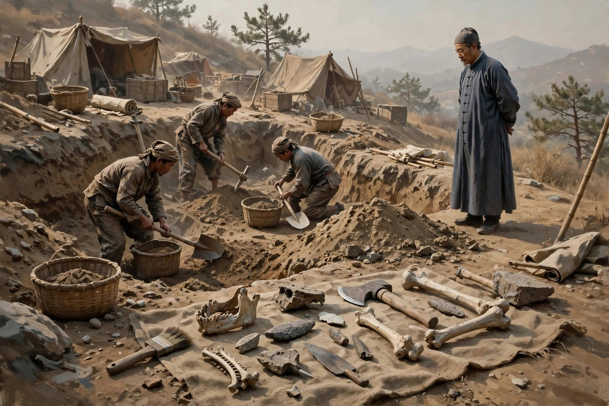

## 曾家大宅里的一天

《北京人》写于一九四〇年，首演于一九四一年在重庆，是曹禺的一部三幕话剧。戏写的是北平一个旧士大夫家庭曾家的生活，时间跨度是这个家庭走向衰落的最后一个阶段，地点就是曾家的大宅子。跟《雷雨》那种一天之内炸开的写法不一样，《北京人》的调子很慢，很静，很长，慢到观众一开始会觉得，怎么没有什么大事发生，怎么都是些家常话，怎么都是些吃药、看戏、吵嘴、发牢骚的小事。可看着看着，观众就会明白，大事不是没有发生，大事正在慢慢发生：这个家正在一点点冷下去，冷到最后，连体面都保不住了，人走茶凉，院子还站在那里，人心已经散了。这种慢悲剧，比炸雷更难写，因为炸雷靠的是冲突，慢悲剧靠的是观察，观察要细，要准，要狠，要把一个家庭怎么衰落的过程，一点点写出来，写得让观众感觉到，衰落不是一天发生的，是日复一日将就出来的。

曾家祖孙三代，活法各不相同，却都困在同一间宅子里。曾皓是家里的老太爷，年纪大了，糊涂了，整天抱着旧体面不肯撒手，家里没钱了，他还要摆谱，还要讲排场，还要靠着祖上的余荫过日子。他年轻时候也有过风光，也有过才华，可到了晚年，风光没了，才华也没了，剩下的只是一副空架子，空架子撑着一间大宅子，宅子越大，越显得空。曾文清是曾皓的儿子，有才华，有诗意，喜欢古玩，喜欢戏，喜欢安静的日子，可他被这个家磨得一点脾气都没有了：妻子曾思懿强势，爱管钱，爱算计，整天跟他吵；父亲糊涂，整天要他伺候；家里没钱，整天要他想办法。他想反抗，反抗不起来，想走，走不出去，想死，又舍不得死，最后只能靠着鸦片和幻想过日子，耗着耗着，就把自己耗尽了。曾霆是曾文清的儿子，年轻一代，身上有点新思想，有点想往外跑的劲，可他也被这个家拽着，拽来拽去，还是没有跑出去。祖孙三代，活法不一样，困法却是一样的：都被旧家庭的规矩困住了，都被体面困住了，都被不敢面对现实的心态困住了。

曾思懿是这个家里最会算计的人，也是最让人又气又怜的人。她是曾文清的妻子，管着家里的钱，管着家里的事，嘴上刻薄，手上精明，对愫方不好，对陈奶妈也不客气，对丈夫更是动不动就吵。可她也不是天生的刻薄，她的刻薄，是从日子的艰难里长出来的：家里没钱了，宅子要维持，体面要维持，儿子要养，老人要伺候，钱从哪里来？她只能算计，只能抠，只能跟丈夫吵，只能把气撒在比她更弱的人身上。她的算计，算来算去，算到的都是小钱，算不到的是这个家的大势：大势是衰落，是冷下去，是不管怎么算计，都算不回来了。她越算计，家里越冷，家里越冷，她越算计，恶性循环，转来转去，转到最后，她还是没有保住这个家。曹禺写曾思懿，写出了很多家庭里管钱人的困境：管钱的人，看起来最强势，实际上最焦虑，因为钱不够的时候，管钱的人要带头面对现实，要带头说出家里没钱了这句话，说出这句话，是要得罪全家人的，可不说，日子就过不下去。这种两难，放在今天依然能看到：很多家庭里管钱的人，都是这样，表面上说了算，实际上夜里睡不着，睡不着的原因，就是钱不够，体面还要撑，撑一天是一天，撑到最后，撑不住了，家就散了。

愫方是这出戏的灵魂人物，也是曹禺用全副心力塑造的人物。她是曾家的远房亲戚，从小在曾家长大，跟曾文清有过感情，可阴差阳错，没有嫁给曾文清，成了曾家的一个寄居者，一个帮忙的人，一个被所有人呼来喝去、却又离不开的人。她善良，隐忍，有诗意，有骨气，对曾家有感情，对曾文清有旧情，对曾霆有关心，可她心里明白，这个家已经没有她的未来了，她留下来，只能继续被消耗，继续被曾思懿挤兑，继续看着曾文清耗尽，继续在旧宅子里慢慢老去。戏的结尾，她抱着箱子，走出了曾家，走的时候很安静，没有大吵大闹，没有控诉，没有眼泪，就是抱着箱子，一步一步走出去。走出去的那一步，比任何大吵大闹都更有力量：她不是被赶走的，她是自己选择走的，走，是她对这个旧家庭最后的回答，是她对自己人生的最后一次负责。观众看到这里，很多人会掉眼泪：一个女人，忍了那么多年，忍到最后，终于不忍了，不忍的方式不是闹，是走，走得安静，走得决绝，走得让人心里一紧。

## 江泰和袁任敢的两种出路

江泰是曾思懿的弟弟，也是这个家里另一个有意思的人物。他游手好闲，爱喝酒，爱吹牛，爱占便宜，看起来是个混混，可他身上有一种曾家人没有的东西：他不装，他不讲体面，他饿了就说饿了，没钱了就说没钱了，想喝酒就去喝酒，想骂人就骂人。他的不装，在曾家这种处处讲体面的环境里，显得特别扎眼，也特别真实。曾家人讲体面，讲到最后，体面成了负担，成了枷锁，成了让所有人都喘不过气的规矩，江泰不讲体面，反而活得轻松，轻松到让人羡慕，也让人看不起。曹禺写江泰，不是为了写一个混混，而是为了写一种对照：体面和真实，到底哪个更重要？曾家人守着体面，守到最后，家散了，人也散了，江泰不守体面，活得虽然不体面，可至少活得真实，真实的人，至少知道自己饿了，知道自己想要什么，知道自己活不下去了该怎么办。这种对照，放在今天依然有意义：很多人为了面子，为了体面，为了朋友圈里的光鲜，硬撑着过日子，撑到最后，撑不住了，体面也没有了，真实也没有了，两头空。江泰的活法虽然不值得学，可他的不装，至少提醒人们：体面如果是靠硬撑撑出来的，那体面本身就是一种负担，负担越重，家散得越快。

袁任敢是研究北京猿人的人类学学者，带着女儿袁圆和考古队来到曾家附近，他的出现，给这出戏带来了一股新的空气。他代表的是科学，是新思想，是外面世界的变化，是跟曾家旧世界完全不一样的东西。他跟曾家人格格不入，可他的格格不入，恰恰说明了曾家的封闭：曾家的大门关着，窗户关着，人心也关着，外面的世界已经变了，科学已经来了，新思想已经来了，可曾家还是抱着旧的那一套不肯撒手。袁圆年轻，活泼，对世界充满好奇，她跟曾霆的交往，给这出戏带来了一点亮色，可亮色很短暂，短暂到让人觉得，曾家这个旧世界，连一点亮色都容不下，亮色一进来，就被旧宅子的冷气给冻住了。曹禺写袁任敢父女，写的是新旧两种力量的对照：新的力量来了，旧的力量还在，新的力量没有立刻胜利，旧的力量也没有立刻死去，两种力量在曾家的大宅子门口僵持着，僵持的结果，是旧家慢慢冷下去，新的人慢慢走出去，走出去的人，不一定能立刻改变世界，可走出去本身，就是一种希望。

戏里还有一个很有意思的人物，叫北京人，他是袁任敢考古队的工人，因为长得有点像北京猿人而得名。这个人物的出现，带着一种荒诞和诗意：几十万年前的北京猿人，和今天的北京人，放在同一个舞台上，观众会想：人活了这么多年，到底进步了没有？曾家的人，守着旧体面，守着旧规矩，活得还不如一个原始人真实，原始人至少知道饿了要找吃的，冷了要找火，累了要休息，曾家人却连这些基本的真实都丢了，丢了真实的人，还算不算人？这个设问，是曹禺留给观众的，观众看完之后，会想很久：我们今天的人，是不是也丢了什么真实的东西？是不是也在为了体面，为了面子，为了各种各样的规矩，把最基本的生活都丢了？丢了之后，人还剩下什么？剩下的是不是只是一副空架子，一间大宅子，和一堆讲不清楚的旧账？

## 慢火炖出来的悲凉

《北京人》的悲剧，跟《雷雨》完全不一样。《雷雨》是炸雷，是冲突，是秘密，是死亡，是疯狂，是在一夜之间把所有东西都炸掉；《北京人》是慢火，是冷气，是将就，是拖延，是在日复一日里把一个家炖空。炖空的过程，没有一声巨响，只有每天的冷一点，每天的一点空，每天的一点无奈。观众看《雷雨》，看的是心跳，看的是悬念，看的是什么时候炸；观众看《北京人》，看的是心凉，看的是无奈，看的是这个家怎么一步步走到今天这一步。心跳容易写，心凉难写，因为心凉要靠细节，要靠日复一日的积累，要靠观众在看戏的时候，慢慢感觉到，这个家已经没救了，没救的原因，不是某一个人坏，而是所有人一起，在将就，在拖延，在不敢面对现实。曾皓不敢面对家里没钱了，曾文清不敢面对自己的人生已经耗尽了，曾思懿不敢面对算计也算不回来了，曾霆不敢面对自己走不出去，愫方是唯一一个敢面对的人，所以她走了，走了之后，家就更冷了，冷到最后，连愫方走了之后留下的空，都没有人去填了。

这种慢悲剧的写法，是曹禺成熟的标志。年轻时候写戏，靠的是激情，靠的是冲突，靠的是把秘密抖出来的快感；年纪大一点写戏，靠的是耐心，靠的是观察，靠的是把生活一点点摊开的勇气。生活本来就是慢的，家庭的衰落本来就是慢的，人的耗尽本来就是慢的，慢的东西，要用慢的笔法去写，写快了，就不真实了，写慢了，观众又容易走神，容易觉得没意思。曹禺的本事，就是把慢写得不无聊：他写曾家人吃饭的样子，写他们喝茶的样子，写他们吵嘴的样子，写他们看戏的样子，写他们发牢骚的样子，每一个样子都是真的，真的样子合在一起，观众就不会走神，观众会觉得，自己不是在看戏，是在看自己家里的日子，是在看自己家里那个慢慢冷下去的客厅。这种真实感，是很多写家庭剧的人学不到的：学的人常常把家庭剧写成吵架剧，吵来吵去，吵到最后，观众只记得吵架，不记得这个家到底是怎么冷下去的。曹禺的家庭剧，吵架只是表面，表面底下，是冷，是空，是将就，是拖延，是所有人一起，把一个家慢慢炖空的过程。

对照现在看《北京人》，会发现这出戏写的东西，根本没有走远。今天很多家庭，照样在慢慢冷下去：老人守着旧观念不肯撒手，年轻人想往外跑又跑不出去，管钱的人整天算计，算来算去还是不够花，家里的气氛越来越冷，冷到最后，一家人坐在一张桌子边吃饭，饭吃着吃着就没话了，没话了就各自玩手机，玩手机的时候，家里就更冷了。冷下去的原因，跟曾家是一样的：不敢面对现实，不敢说出家里真正的问题，不敢承认体面已经撑不住了，不敢承认有些关系已经回不去了，只能将就，只能拖延，只能靠着过去的余荫过日子，过一天是一天，过到最后，过不下去了，家就散了。散的时候，没有一声巨响，没有一场大吵，就是一个人抱着箱子走了，走了之后，剩下的人坐在冷屋子里，面面相觑，不知道该说什么，不知道该怪谁，只能继续冷下去。

## 愫方走出去的那一步

愫方走出去的那一步，是全剧最动人的地方，也是全剧留给观众的最大启示。她在曾家待了那么多年，忍了那么多年，受了那么多委屈，按道理，她应该闹，应该哭，应该控诉，应该把曾家的丑事全抖出来，让所有人都难堪。可她没有，她就是抱着箱子，安安静静地走了。走的时候，她没有回头，没有留恋，没有眼泪，就是走。走，是一种最安静的反抗，也是最彻底的反抗：闹，是还想留下来，还想让对方改，还想让这个家变好；走，是不想留了，不想改了，不想再耗下去了，走，是把自己的未来，从这个旧家里拿回来，拿回来之后，自己去过。很多人在旧环境里待久了，待到最后，连走的勇气都没有了，走的勇气，是需要攒很久的，攒到最后，攒够了，才能抱着箱子走出去。愫方攒了那么多年，攒够了，所以她走了，走了之后，她的人生才真正开始，开始的时候，她已经不是年轻姑娘了，可开始就是开始，晚开始，总比不开始好。

今天很多人，照样需要愫方走出去的那一步。有人在一段消耗人的关系里待了很久，待到最后，人都耗尽了，还是不敢走，怕走出去之后更糟，怕走出去之后没人要，怕走出去之后对不起过去的感情。可待下去的结果，往往是继续耗尽，耗到最后，连走的力气都没有了。有人在一份消耗人的工作里待了很久，待到最后，人都麻木了，还是不敢走，怕走出去之后找不到工作，怕走出去之后收入下降，怕走出去之后被人笑话。可待下去的结果，往往是继续麻木，麻木到最后，连自己想要什么都忘了。有人在一个消耗人的圈子里待了很久，待到最后，人都变了，还是不敢走，怕走出去之后没朋友，怕走出去之后被孤立，怕走出去之后显得不合群。可待下去的结果，往往是继续变，变到最后，连自己都不认识自己了。愫方的故事，提醒这些人：走，不是一件丢人的事，走，是一种负责，是对自己的人生负责，是把自己的未来，从消耗人的环境里拿回来，拿回来之后，路可能不好走，可能很孤单，可能要从头开始，可从头开始，总比在旧地方耗尽要好。

《北京人》的演出史，也很有意思。这出戏首演于重庆抗建礼堂，导演是张骏祥，演愫方的是张瑞芳，演曾皓的是沈扬，演曾文清的是江村，阵容很强，反响也很好。可它不像《雷雨》那样，一演就炸，它是慢慢被人们认识的，慢慢被人们当成经典的。经典的地位，是在一九八〇年代之后，才真正确立起来的，确立的原因，是人们开始重新认识慢悲剧的价值，开始明白，一个家庭的衰落，不一定非要靠炸雷来写，靠慢火炖，也能炖出悲剧，炖出的悲剧，甚至更贴近真实的人生。真实的人生，本来就是慢的，是日复一日的，是将就和拖延堆出来的，写真实的人生，就要用慢的笔法，用耐心的观察，用对细节的敏感。曹禺写《北京人》，就是用这种慢的笔法，写出了一个家庭的衰落史，写出了一个时代的背影，写出了旧中国封建文化对人的戕害，戕害的方式，不是打，不是骂，是慢慢磨，磨到最后，人就没了，家也没了，只剩下一间冷屋子，和屋子里还没有散去的旧气息。

## 曾家的钱和体面

曾家的钱，是这出戏里一条暗线，暗到观众一开始注意不到，注意到了，才明白，这个家的衰落，跟钱有很大的关系。曾家祖上阔过，阔的时候，宅子大，排场大，古玩多，戏也多，钱花起来不心疼，花起来的时候，觉得钱是花不完的，觉得祖上的余荫是取之不尽的。可到了曾皓这一代，钱已经不够了，不够了，还要摆谱，还要讲排场，还要维持大宅子的体面，体面维持起来，是要花钱的，钱不够，体面就要靠借，靠典当，靠变卖古玩，靠抠门，靠算计，靠曾思懿整天跟丈夫吵，跟下人吵，跟亲戚吵，吵来吵去，吵到的都是小钱，小钱救不了大局，大局是宅子太大，人太多，开销太大，收入太少，收入少的原因，是曾家人没有一个人真正挣钱，没有一个人真正干实事，干实事的人，都被这个家的规矩磨没了，磨没了之后，家就只能靠祖上的余荫过日子，余荫吃完了，家就散了。吃余荫的日子，是很多旧家庭的通病：祖上阔过，自己没有本事挣钱，只能吃老本，老本吃完了，就只能借，借完了，就只能卖，卖完了，就只能散，散的时候，还要怪别人，还要怪时代，还要怪儿女不孝，怪来怪去，怪不到自己头上，自己头上的问题，是自己没有挣钱的本事，没有面对现实的勇气，没有放下体面的决心，体面放不下，钱就永远不够，钱不够，体面就永远撑不住，撑不住的体面，硬撑下去，只会让家散得更快。

曾思懿管钱的方式，也很有意思。她管钱，管得很细，细到每一文钱都要算，算来算去，算到的都是小钱，算不到的是大局，大局是这个家已经没有收入了，没有收入的家，算得再细，也是入不敷出，入不敷出的时候，管钱的人最难受，难受的是，她明明知道钱不够，明明知道体面撑不住了，可她还要撑，还要算，还要跟丈夫吵，还要把气撒在愫方身上，撒在陈奶妈身上，撒在比她更弱的人身上。撒气的原因，是她心里慌，慌的是，她管了这么多年钱，管到最后，家还是要散，散了之后，她这个管钱的人，要负责任吗？要被人骂吗？要被人说，是她把家管散的吗？怕被人骂，怕负责任，怕承认自己管不好，怕承认大局已经回不来了，怕的东西多了，人就刻薄了，刻薄了，家里人就更不喜欢她了，更不喜欢她，她就更刻薄了，恶性循环，转来转去，转到最后，她还是没有保住这个家。管钱的人，放在今天依然能看到：很多家庭里管钱的人，都是这样，表面上说了算，实际上夜里睡不着，睡不着的原因，就是钱不够，体面还要撑，撑一天是一天，撑到最后，撑不住了，家就散了，散了之后，管钱的人还要被人骂，骂完了，管钱的人心里更苦，苦到最后，连自己都觉得，自己是不是真的管错了，管错的地方，不在于算得细不细，在于没有勇气承认，家已经没有收入了，没有收入的家，算得再细，也是白算，白算的道理，管钱的人往往到最后才明白，明白的时候，已经晚了。

陈奶妈是曾家里的老人，是看着曾家人长大的人，是这个家里最没有地位、却最有感情的人。她没有钱，没有地位，没有话语权，可她对曾家有感情，对愫方有感情，对曾霆有感情，她的感情，是这个冷屋子里唯一暖一点的东西。暖的东西，在冷屋子里，是很难的，难到她自己也知道，自己暖不了这个家，暖不了曾皓的糊涂，暖不了曾文清的耗尽，暖不了曾思懿的刻薄，暖不了曾霆的迷茫，暖不了愫方的委屈，暖不了的东西，她还是暖着，暖着暖着，自己也老了，老了之后，她还是在这个家里待着，待着的原因，是她没有别的地方去，没有别的家可以回，曾家就是她的家，家冷了，她还是要待着，待着待着，家散了，她就更没有地方去了。这种没有地方去的人，在今天依然能看到：很多老人，在儿女家里待着，待着的原因，不是日子过得好，是没有别的地方去，没有别的家可以回，家冷了，还是要待着，待着待着，人就老了，老了之后，就更没有地方去了。陈奶妈的故事，提醒人们：一个家，不能只靠体面撑着，体面撑不住的时候，家里最弱的人，最先受苦，受苦的人，往往是没有地方去的人，没有地方去的人，值得家里人多想一想，多照顾一点，照顾一点，家就暖一点，暖一点，家散得就慢一点，慢一点，说不定，家就还有救。

## 曾霆和新一代的路

曾霆是曾家年轻一代的代表，他身上有点新思想，有点想往外跑的劲，有点对旧家庭的不满，可他的不满，还没有变成行动，不满停在心里，停在嘴上，停在跟袁圆交往的时候，那一点亮色里。亮色很短暂，短暂到让人觉得，曾家这个旧世界，连一点亮色都容不下，亮色一进来，就被旧宅子的冷气给冻住了。冻住的原因，是曾霆没有愫方的勇气，没有抱着箱子走出去的决心，没有把不满变成行动的力量。力量从哪里来？力量不是天生的，是攒出来的，是看着家里的冷，看着父亲的耗尽，看着母亲的算计，看着愫方的委屈，看着看着，心里攒够了，才有力量走出去。曾霆还没有攒够，攒不够，就走不出去，走不出去，就只能在旧家里待着，待着待着，就变成了下一个曾文清，变成了下一个被磨没了的人。被磨没了的人，在今天依然能看到：很多年轻人，心里对旧环境不满，对家里的规矩不满，对工作里的旧体制不满，可不满停在心里，停在嘴上，停在跟朋友抱怨的时候，抱怨完了，还是回去上班，还是回去过日子，还是按旧规矩活着，活着活着，就变成了自己曾经不满的那种人。变成那种人之后，再想走出去，就更难了，难到连不满都没有了，没有不满的人，就彻底变成了旧环境的一部分，变成了一块砖，砖砌在旧墙里，墙倒了，砖也碎了。曾霆的故事，提醒这些年轻人：不满不能只停在心里，不满要变成行动，行动不一定是立刻走出去，行动可以是先攒力量，先看清楚，先把自己的未来想清楚，想清楚了，攒够了，再走，走的时候，才有方向，才不会走到一半又回来，回来之后，就更难走了。

曾家的戏，在今天演的时候，观众常常会问：这个家，到底还有没有救？有救吗？没救吗？救的办法是什么？是愫方走出去吗？是曾霆走出去吗？是曾皓醒过来吗？是曾文清振作起来吗？是曾思懿不再算计吗？是江泰不再混日子吗？是袁任敢带来新思想吗？这些问题，每一个都有道理，每一个都问到了点子上，可问完了，答案还是没有，答案没有的原因，是这个家的病，不是某一个人的病，是全家人的病，是制度的病，是文化的病，是旧中国封建文化对人的戕害，戕害的方式，不是打，不是骂，是慢慢磨，磨到最后，人就没了，家也没了。磨的病，要治，就要从根子上治，根子上治，治的不是某一个人，是整个活法，是整个规矩，是整个对体面的看法，对钱的看法，对家庭的看法，对人生的看法，看法不改，治一个人，治好了，下一个人还是会病，病来病去，病到最后，家还是散了。散了之后，剩下的人，才能开始想，开始想新的活法，新的活法，想出来了，家才有可能重新建起来，重新建起来的家，不一定是曾家的大宅子，可能是愫方走出去之后的新家，可能是曾霆走出去之后的新生活，可能是每一个从旧家里走出去的人，自己建起来的新家。新家建起来了，旧家散了的意义，才算出来了，意义就是：旧的不散，新的不来，散，不是坏事，散，是为了新的来，新的来了，人才真正活过来了。

## 旧宅子散了之后

旧宅子散了之后，剩下的人，要去哪里？曾皓老了，老了之后，还能去哪里？曾文清耗尽了，耗尽之后，还能去哪里？曾思懿算计了一辈子，算计到最后，家散了，她还能去哪里？曾霆年轻，年轻的人，路还长，路长的人，走出去之后，还有可能建一个新家，新家建起来了，旧家散了的意义，才算出来了。陈奶妈老了，老了之后，没有地方去的人，最让人心疼，心疼的地方，是她一辈子都在曾家，家散了，她就没有家了，没有家的人，要去哪里？去哪里的问题，戏没有回答，戏把问题留给了观众，留给了每一个家里有老人的人：家里的老人，老了之后，要去哪里？去哪里的问题，想清楚了，家就暖一点，暖一点，家散得就慢一点，慢一点，说不定，家就还有救。愫方走出去之后，去了哪里？戏没有写，戏只写她抱着箱子走了，走了之后，她的人生才真正开始，开始的时候，她已经不是年轻姑娘了，可开始就是开始，晚开始，总比不开始好，开始之后，她要去的地方，是她自己选的地方，选的地方，不一定是好地方，可选的地方，是她自己的地方，自己的地方，住起来才踏实，踏实的日子，才是真正的日子。旧宅子散了，不是一件坏事，散，是为了新的来，新的来了，人才真正活过来了，活过来的人，建起来的新家，才是真正属于自己的家。

## 冷屋子里的一盏灯

冷屋子里，有没有一盏灯？曾家的屋子，冷是冷，可冷屋子里，还是有一点暖的，暖的地方，是愫方抱着箱子走出去的时候，那一步的决绝，是陈奶妈坐在角落里，那一点没有说出口的感情，是曾霆跟袁圆交往的时候，那一点亮色，是江泰不装的时候，那一点真实。暖的东西很少，少到只能照亮一小块地方，照亮一小块地方，也够了，够让观众看完之后，心里不是完全凉的，不是完全凉的心，才能继续想，继续想下去，家是不是还有救，救的办法，是不是就是愫方那一步，是不是就是把箱子抱起来，走出去，走出去之后，再建一个新家。新家建起来了，冷屋子就不再是全部了，冷屋子只是过去，过去过去了，未来就来了，未来来了，人就活过来了。曹禺写《北京人》，写的就是这个道理：旧家再冷，冷屋子里还是有一盏灯，灯很小，小到只能照亮一个人的脚，照亮脚，就够那个人走出去了，走出去的人多了，冷屋子就空了，空了之后，冷屋子就不再吓人了，不再吓人的冷屋子，拆了也不可惜，拆了之后，原地才能建新的，新的建起来了，人才真正有了家。

旧宅子真正散掉的那天，其实不是人走光的那天，而是没有人再惦记的那天。有人惦记，宅子就还活着，活在惦记里，活在陈奶妈的角落里，活在愫方抱着箱子走出去的那一步里。那一步走出去了，宅子的故事就没有讲完，没有讲完的故事，后来的人还可以接着想，接着想下去，家是不是还有救，救的办法，是不是就是走出去，再建一个自己的家。
