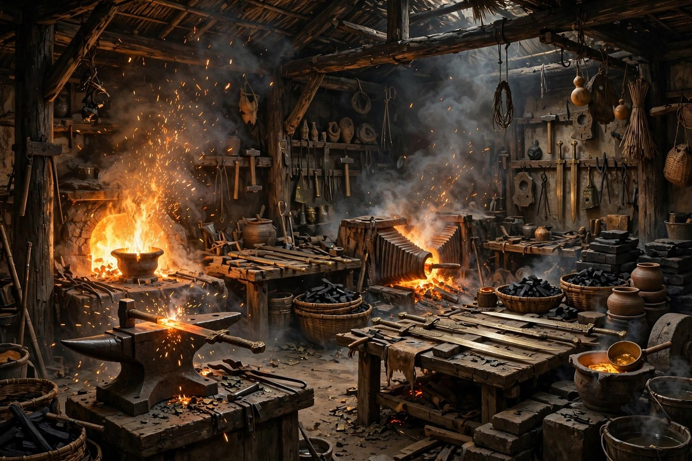
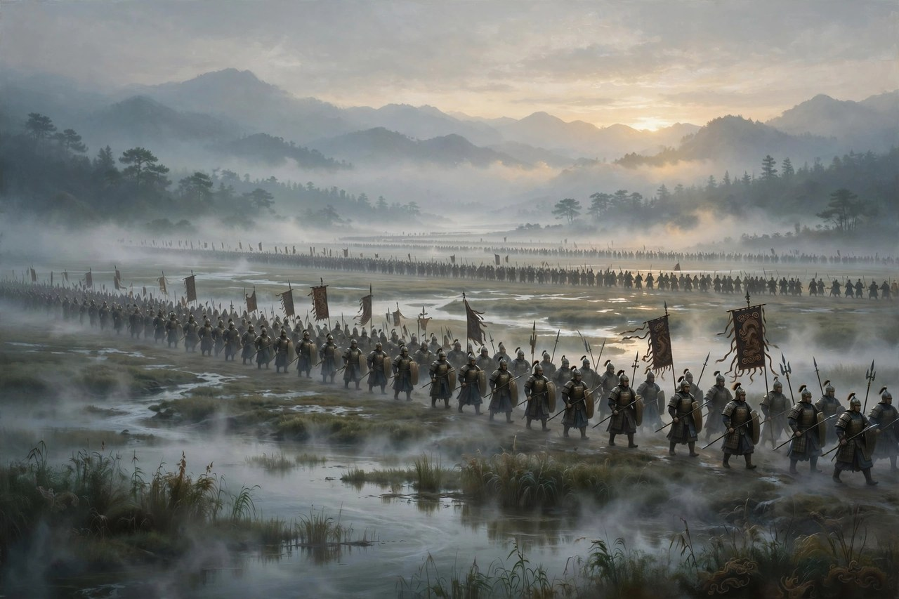

## 被困会稽的君臣

《胆剑篇》是曹禺跟于是之、梅阡合作写的一部历史剧，写于一九六〇年左右，演出于一九六一年前后。戏的题材，是大家都很熟悉的越王勾践卧薪尝胆的故事：春秋时候，吴国和越国争霸，越王勾践起兵伐吴，败于夫椒，带着残部五千人，被困在会稽山上，进退两难。吴王夫差带着大军围着他，灭越只在一念之间。勾践的谋臣范蠡和文种，给他出了主意：先求和，先称臣，先保住越国的根，先活下来，再图后事。勾践听了，派文种去吴营求和，一求再求，夫差身边有伍子胥力谏灭越，可夫差没有听，赦免了越国，勾践带着妻儿，到吴国给夫差当奴仆，当了三年，才被放回来。回来之后，勾践卧薪尝胆，跟百姓一起劳作，发展生产，积蓄力量，最后灭了吴国，成了霸主。这个故事，中国人从小就听过，听的是忍辱负重，听的是发愤图强，听的是小人物翻盘的痛快。可曹禺写这出戏，不光是写痛快，还写了忍的代价，写了复国之后的变味，写了胆和剑背后的两面。

戏的开头，写的是勾践被困会稽的绝境。绝境里的人，最容易走极端：要么玉石俱焚，要么跪地求饶，玉石俱焚痛快，可痛快完了，越国就没了，跪地求饶屈辱，可屈辱换来的是活下去的机会。勾践在戏里，拔剑大呼，誓死不愿降吴，范蠡却平静地告诉他：玉碎很痛快，可痛快完了，天下就再也没有越国了。这句话，是全剧最清醒的一句话：一个君王的痛快，不能拿整个国家的命运去换，一个人的尊严，不能拿所有百姓的命去换。勾践听进去了，沉重地接受了求和的计策，接受的时候，心里是苦的，苦到连剑都拿不稳了。可苦归苦，活下去才是最要紧的，活下去，才有后来卧薪尝胆的事，才有后来灭吴的事，活不下去，什么都没有了。这个道理，放在今天依然管用：很多人在绝境里，起初反应是硬刚，是玉石俱焚，是宁为玉碎，不为瓦全，硬刚的时候觉得痛快，痛快完了，才发现，刚没有解决问题，刚只是把自己也搭进去了。真正难的，不是硬刚，是忍，是在绝境里先活下来，活下来之后，再慢慢找机会，找机会的过程，可能很长，可能很屈辱，可能要给人当奴仆，可能要尝苦胆，可活下来，才有翻盘的可能，活不下来，翻盘只是空话。

范蠡和文种是这出戏里的两个谋臣，活法完全不一样。范蠡聪明，深沉，看得远，他知道勾践的性格，知道勾践在困难的时候能听人劝，在得势的时候容不下功臣，所以他在灭吴之后，功成身退，带着西施泛舟而去，留下一封信劝文种也走。文种没有走，他留下来，继续辅佐勾践，继续相信君臣之间的情义，结果勾践听信谗言，怀疑文种要作乱，赐给他一把剑，那把剑，正是当年夫差赐给伍子胥自刎的那把剑。文种接过剑，一下子就明白了，仰天长叹，后悔当初没有听范蠡的话，拔剑自刎了。两个谋臣，两种结局，放在一起，意思很明白：在权力面前，聪明和忠诚，有时候不是护身符，聪明的人要懂得退，忠诚的人要懂得看人，退得早的人活下来了，退得晚的人死了，死的原因，不是他不忠诚，是他太相信君王的情义，太相信功劳能保命，功劳在权力面前，往往是最不值钱的东西，权力一旦稳固了，功臣就从帮手变成了威胁，威胁不除，君王睡不着觉。这种道理，在历史上反复出现，在今天的职场和官场里，也常常出现：帮老板打下江山的人，打下江山之后，往往是被防着的那个人，防着防着，就被边缘化了，边缘化之后，还不懂得退，还要继续表忠心，表来表去，表到最后，连表忠心的机会都没有了。范蠡的退，是一种智慧，文种的留，是一种悲剧，悲剧的原因，不是他不够聪明，是他太相信人性里的情义，而权力场上，情义是最靠不住的东西。

## 卧薪尝胆的日子

卧薪尝胆，是这出戏里最有名的意象，也是最容易被简单化的意象。很多人讲这个故事，讲的都是：勾践睡在柴草上，吃饭的时候尝苦胆，提醒自己不要忘了耻辱，提醒自己要发愤图强，讲完之后，大家跟着感动一把，感动完了，该干什么还干什么。可曹禺写这出戏，写的不是感动，是卧薪尝胆背后的日子：睡柴草的日子，是苦的，尝苦胆的日子，是涩的，跟百姓一起劳作的日子，是累的，发展生产的日子，是慢的，积蓄力量的日子，是长的。长日子里，人最容易泄气，最容易怀疑，最容易想着算了，算了之后，前面受的苦就白受了。勾践能坚持下来，靠的不光是苦胆和柴草，靠的是范蠡和文种的辅佐，靠的是越国百姓的忍耐，靠的是吴国那边夫差的骄横和伍子胥的死，靠的是很多偶然和必然合在一起，才有了最后灭吴的结果。把卧薪尝胆讲成一个人睡柴草、尝苦胆就能翻盘，那就把历史讲简单了，讲简单了，听的人就会以为，只要自己够苦，就能成功，够苦就能成功，是最大的误解：苦，只是一个条件，不是成功的保证，苦完了，还要看方向对不对，还要看帮手在不在，还要看对手犯不犯错，还要看天时地利人和凑不凑得齐，凑不齐，苦白受了，人还是翻不了盘。

戏里写勾践回国之后，跟百姓同劳作，发展生产，结交齐楚晋，消耗吴国，这些情节，写的是复国的实在功夫：不是靠喊口号，不是靠睡柴草，是靠把地种好，把兵练好，把外交做好，把吴国的力量一点点耗掉。耗，是很慢的功夫，慢到让人着急，急到想立刻出兵，立刻报仇，可立刻出兵，往往就是送死，送死完了，前面十几年的苦就白受了。范蠡和文种在戏里，起的就是按住勾践的作用：按住他想立刻报仇的手，按住他想立刻出兵的心，按住他，让他等，等到吴国骄横了，等到夫差杀了伍子胥，等到吴国北上争霸、后方空虚了，再出兵，出兵的时候，胜算才大。这种按住的功夫，是谋臣最重要的功夫，也是今天很多人最缺的功夫：今天很多人，做事就是急，急着出成绩，急着翻盘，急着证明自己，急的结果，往往是把事情做砸了，做砸了之后，再回过头来后悔，后悔完了，下一次还是急。勾践的故事，提醒这些人：复国不是一天的事，翻盘不是一句话的事，真正的大事，都是耗出来的，都是等出来的，都是按住自己的手、等到时机成熟再出手的事，出手早了，是送死，出手晚了，是错失良机，早和晚之间，隔着的是谋臣的眼光，是君王的耐心，是整个国家的积蓄，这些东西，没有一样是靠睡柴草睡出来的。

灭吴之后的故事，是这出戏最值得深思的部分。勾践灭了吴国，成了霸主，本来应该高兴，应该了无忧虑，可他却忧心忡忡，怕的是国内大臣拥兵自重，怕的是范蠡和文种功高震主，怕的是自己好不容易打下来的江山，被功臣分了去。这种怕，是很多成功者的通病：困难的时候，能跟人同甘共苦，能听人劝，能容人，能忍，能等；成功之后，就变了，变得多疑，变得容不下人，变得怕别人分自己的光，变得要把功臣一个个除掉，除掉之后，自己是安稳了，可身边也没有能干的人了，没有能干的人，江山守起来就更难了。勾践赐死文种，就是这种怕的极端表现：文种没有反心，没有野心，只是因为功劳大，因为聪明，因为在朝中有威望，就成了威胁，威胁不除，勾践睡不着，睡不着，就只能除掉威胁，除掉之后，勾践是睡着了，可越国的朝堂上，也少了一个真正能干事的人。范蠡看明白了这一点，所以他早早走了，走了之后，勾践想除也除不到了，范蠡活下来了，文种死了，活和死之间，隔着的不是忠诚，是眼光，是对权力本质的看穿。看穿了权力的人，知道功成之后要退，不知道的人，还以为功劳能保命，保命的想法，是最天真的想法，权力场上，保命靠的不是功劳，是退，是早退，是在君王还没有开始怕你的时候，就先退了，退了，君王就没理由怕你了，没理由怕你，你就安全了。

## 胆和剑的两面

《胆剑篇》这个名字，本身就很有意思：胆，是苦胆，是卧薪尝胆的胆，是忍辱负重的胆；剑，是宝剑，是复仇的剑，是杀人的剑。胆和剑放在一起，就是忍和杀的两面：忍的时候，要尝胆，要睡柴草，要给人当奴仆，要把尊严先放下；杀的时候，要拔剑，要出兵，要灭吴，要把仇报回来。忍和杀，看起来是相反的，实际上是一体的：没有忍，就没有杀的机会，没有杀，忍就白忍了。可忍和杀之间，有一个度，度把握不好，忍就变成了懦弱，杀就变成了残暴。勾践的忍，把握得还算好，忍到了灭吴，忍出了结果；勾践的杀，把握得就不好了，灭吴之后，还要杀功臣，杀到最后，身边没有人了，杀就变成了自毁。胆和剑的两面，写的是一个人、一个国家，在忍和杀之间，怎么把握度，度把握好了，是霸主，度把握不好，是悲剧。这种度，今天的人也常常要把握：工作上，被人欺负了，是忍还是反击？忍多久？反击到什么程度？忍太久，别人以为你好欺负，反击太狠，别人以为你睚眦必报，忍和反击之间，隔着的是分寸，分寸把握好了，人才能在复杂的环境里活下去，把握不好，不是被人欺负死，就是被人防着死。勾践的故事，就是把这个分寸放大了写给你看：忍，要忍到有结果，杀，要杀到点为止，杀过了头，就是自毁，自毁完了，前面忍的苦，也白受了。

这出戏的创作背景，也值得一提。一九六〇年前后，正是国家需要振奋精神、自强不息、战胜困难的时候，曹禺跟人合作写《胆剑篇》，写卧薪尝胆，写忍辱负重，写发愤图强，演出的时机很好，观众反响热烈，各地报刊发表评论文章很多，对这出戏给予了充分肯定和热情赞扬。观众喜欢这出戏，是因为这出戏讲了一个大家都懂的道理：困难的时候，要忍，要等，要积蓄力量，要自强不息，忍过去了，等过去了，积蓄够了，就能翻盘。这种道理，在困难年月里，特别能鼓舞人，特别能让人觉得，天还没有塌，塌了还能撑起来，撑起来之后，还能往前走。曹禺写历史剧，不是为了写古人的事，是为了写今天的人，写今天的人需要的精神，写今天的人在困难面前应该有的态度。这种借古喻今的写法，是历史剧最常见的写法，也是最难的写法：写古人，要写得像古人，不能写成现代人穿古装；写今天，要写得让今天的人有感觉，不能写成古董，古董摆在那里，好看，可没用，有用的历史剧，是要让今天的人看完之后，心里有劲，脚下有路，知道困难面前该怎么办。曹禺的《胆剑篇》，在这方面做得不错：古人写得像古人，今天的人看完之后，也觉得有劲，觉得困难不可怕，可怕的是困难面前先泄了气，泄了气，什么都完了。

对照现在看《胆剑篇》，会发现卧薪尝胆这个成语，今天被用得太滥了，滥到很多人只记得睡柴草、尝苦胆，忘了后面的事，忘了范蠡的退，忘了文种的死，忘了灭吴之后的变味，忘了胆和剑的两面。只记得前半截的人，学到的只是忍，忍来忍去，忍成了习惯，忍成了懦弱，忍成了不敢出头，不敢反击，不敢为自己说话，忍到最后，连自己想要什么都忘了。完整地读《胆剑篇》，才能学到后半截：忍，是为了杀，杀，是为了活，活，是为了不被权力反噬，活下去之后，还要懂得退，懂得在功成之后先退一步，退一步，才能保住自己，保住自己，才能继续活下去。忍、杀、退，三步合在一起，才是完整的卧薪尝胆，缺了哪一步，都不完整，缺了退，前面忍的苦、杀的功，最后都会变成杀自己的刀，刀落下来的时候，后悔已经晚了。范蠡的信，文种的剑，勾践的怕，合在一起，就是一部完整的权力教科书，教科书不厚，道理却很重，重到今天的人读起来，依然会觉得后背发凉，发凉完了，才会想：自己在工作里，在生活里，是不是也该学学范蠡，早点退，退得漂亮，退得干净，退了之后，还能活得好好的，活得好好的，才是真的赢。

## 伍子胥的影子

伍子胥是这出戏里一个始终在场的影子，他没有像范蠡、文种那样站在勾践身边，可他的死，他的谏言，他的剑，一直笼罩着全剧。伍子胥是吴国的谋臣，是夫差的股肱，他力谏夫差灭越，力谏夫差不要赦免勾践，力谏夫差不要相信越国的求和，可夫差没有听，夫差听了伯嚭的谗言，杀了伍子胥，伍子胥死的时候，留下了遗言，要把他的眼睛挂在城门上，看着越国怎么灭吴。伍子胥的死，是吴国衰落的开始：一个国家，连真正说真话的人都容不下了，连真正为国家着想的人都杀了，国家离灭亡就不远了。夫差杀伍子胥，杀的是自己的眼睛，眼睛挖掉了，国家就瞎了，瞎了之后，越国打过来的时候，夫差连看都看不清楚，看不清楚，就只能等死。伍子胥的影子，在勾践的戏里，也是一个提醒：勾践灭吴之后，杀文种，杀的也是自己的眼睛，眼睛挖掉了，越国离衰落也不远了。两个君王，两个谋臣，两种死法，一个道理：君王容不下说真话的人，国家就离死不远了，说真话的人死了，国家就瞎了，瞎了之后，敌人打过来的时候，连抵抗都组织不起来，组织不起来，就只能等死。等死的君王，临死的时候，才会想起自己杀掉的谋臣，想起的时候，已经晚了，晚到连后悔的机会都没有了。

伯嚭是吴国那边的小人，是伍子胥的对立面，是靠谗言上位的人。他收了越国的贿赂，替越国说话，替勾践求情，把夫差哄得团团转，哄到最后，夫差放了勾践，杀了伍子胥，吴国的命运，就这样被一个小人给改写了。小人的力量，有时候比谋臣还大：谋臣说的是真话，真话不好听，不好听的话，君王不爱听；小人说的是好话，好话好听，好听的话，君王爱听，爱听了，就信了，信了，就按小人的意思办了，办完了，国家就完了。伯嚭的故事，放在今天依然能看到：很多单位、很多公司，都有伯嚭式的人物，靠拍马屁上位，靠说好话得宠，靠打小报告排挤真正干活的人，排挤完了，真正干活的人走了，留下来的全是说好话的人，说好话的人凑在一起，单位就完了，完了之后，老板还不知道为什么完了，还以为是市场不好，还以为是运气不好，实际上，是他自己把说真话的人赶走了，把说好话的人留下来了，留下来的人，只会说好话，不会干实事，干实事的人走了，单位拿什么活下去？拿好话活下去吗？好话不能当饭吃，好话不能当产品卖，好话说多了，单位就只能等死，等死的时候，老板才会想起被他赶走的伍子胥，想起的时候，已经晚了。

范蠡和文种的分歧，也是这出戏里值得深思的地方。范蠡主张退，文种主张留，退和留，看起来是两个选择，实际上是两种对权力的看法：范蠡看权力，看的是权力的本质，本质就是，权力容不下功臣，功臣不退，就会死；文种看权力，看的是权力的表面，表面就是，君王对我很好，君王信任我，君王不会杀我，表面看起来的好，往往是假的，假的好，信了，就会死。范蠡看本质，所以他活了，文种看表面，所以他死了，活和死之间，隔着的不是聪明，是眼光，是看本质还是看表面。看本质的人，活得清醒，清醒的人，知道什么时候该退，退了，才能保住自己；看表面的人，活得糊涂，糊涂的人，以为君王的好是真的，真的好，信了，就会死。眼光这个东西，不是天生的，是经历练出来的，经历多了，看本质的机会就多了，看本质的机会多了，人就清醒了，清醒了，就知道退了。范蠡经历多了，所以他清醒，文种经历也不少，可他还是糊涂，糊涂的原因，是他太相信君臣之间的情义，情义在权力面前，是最靠不住的东西，靠不住的东西，信了，就会死。信情义的人，往往死得最惨，惨到临死的时候，才明白，情义在权力面前，一文不值，一文不值的东西，信了一辈子，死的时候，才后悔，后悔已经晚了。

## 胆剑篇的舞台和今天

《胆剑篇》的舞台，是历史剧的舞台，舞台上的服装、道具、布景，都是春秋时候的样子，可舞台上的人，说的话，做的事，想的问题，都是今天的人能听懂的。历史剧的难，就难在这里：既要像古人，又要让今天的人有感觉，像古人，是形式上的要求，有感觉，是内容上的要求，形式和内容合在一起，历史剧才立得住。曹禺写《胆剑篇》，形式上是古人，内容上是今天的人在困难面前该怎么办，在成功之后该怎么办，在权力面前该怎么办，这些问题，今天的人，天天都在面对，面对的时候，历史剧就成了镜子，镜子照出来的是古人，照进去的是今天的人，今天的人看着古人，想着自己，想完了，心里就有了答案，答案不一定是对的，可答案是自己想出来的，想出来的答案，比别人告诉你的答案，更能让人记住，记住之后，下次遇到同样的问题，人就知道该怎么办了。历史剧的价值，就在这里：不是讲古人的故事给人听，是借古人的故事，让今天的人想自己的事，想自己的事，想清楚了，历史剧的作用就达到了。

今天的人，读《胆剑篇》，读的不光是卧薪尝胆的励志，读的还有卧薪尝胆之后的教训。励志的部分，大家都懂，教训的部分，很多人不懂，或者不愿意懂，不愿意懂的原因，是教训太残酷了，残酷到让人不舒服，不舒服的东西，人本能地想躲开，躲开之后，教训就学不到了，学不到教训的人，下次遇到同样的问题，还会犯同样的错，犯错完了，再后悔，后悔完了，下次还是犯，犯来犯去，犯到最后，人就老了，老了之后，才明白，教训早就摆在那里了，摆在《胆剑篇》里，摆在范蠡的信里，摆在文种的剑里，摆在勾践的怕里，摆在伍子胥的眼睛里，摆在伯嚭的好话里，摆在夫差的骄横里，摆在越国灭吴的故事里，故事讲完了，教训还在，教训在，人就要学，学了，才不会重蹈覆辙，重蹈覆辙的人，不是笨，是不愿意面对残酷的教训，不愿意面对，教训就永远学不会，学不会，历史就会重复，重复的时候，倒霉的还是自己。

## 勾践的怕和今天的怕

勾践灭吴之后的怕，放在今天看，特别真实。今天很多成功的人，成功之后，刚成功的时候感觉不是高兴，是怕，怕的是身边的人分自己的光，怕的是功臣功高震主，怕的是自己好不容易打下来的江山，被别人分了去，怕的东西多了，人就多疑了，多疑了，就开始防人了，防人防到最后，身边就没有能干的人了，没有能干的人，江山守起来就更难了，难到最后，江山还是守不住，守不住的时候，才会想起被自己防走的人，想起的时候，已经晚了。怕，是成功者的通病，通病的原因，是成功来得不容易，来得不容易的东西，人就格外珍惜，珍惜过了头，就变成了怕，怕过了头，就变成了防，防过了头，就变成了杀，杀过了头，身边就没有人了，没有人，成功就变成了孤家寡人，孤家寡人的成功，是最空的成功，空到连个说话的人都没有，连个商量的人都没有，连个提醒自己的人都没有，没有提醒的人，成功者就容易犯错，犯错完了，成功就没了。范蠡看明白了这一点，所以他早早走了，走了之后，勾践想怕也怕不到了，想防也防不到了，想杀也杀不到了，杀不到的人，活下来了，活下来之后，范蠡的日子，过得比勾践宽，宽到可以泛舟，可以经商，可以过自己想过的日子，过自己想过的日子，才是真的成功，真的成功，不是当霸主，不是灭吴国，是活得自由，活得宽，活得不用怕别人，活得不用防别人。自由和宽，是勾践没有的东西，勾践当了霸主，可他活得不自由，不宽，怕来怕去，怕到最后，连文种都杀了，杀了之后，他还是怕，怕的东西，是永远怕不完的，怕不完的怕，就是权力最大的代价，代价付完了，霸主还是霸主，可霸主的心里，已经空了，空了之后，霸主的日子，过得比普通人还难，难到连睡觉都要睁一只眼，睁一只眼睡觉的人，日子是过不好的，过不好的日子，再大的成功，也是空的。

今天的人，读勾践的怕，读的不是古人的事，读的是自己的事：自己在单位里，怕不怕被同事超过？自己在公司里，怕不怕被下属超过？自己在家里，怕不怕被孩子超过？怕，是正常的，怕说明你在乎，在乎说明你还没有麻木，可怕过了头，就要小心了，小心自己变成勾践，变成防人的人，变成杀功臣的人，变成身边没有能干的人的人。防人的办法，不是杀人，不是排挤人，不是把能干的人赶走，防人的办法，是把制度建起来，把规矩建起来，把大家的利益绑在一起，绑在一起之后，能干的人，就不用防了，不用防的人，才能真正帮你，帮你把江山守住，守住之后，你就不用怕了，不用怕的日子，才是真正的好日子。好日子不是没有怕，是怕的时候，知道该怎么办，怎么办的办法，就是范蠡的办法：退一步，退一步之后，天地就宽了，宽了之后，怕就小了，小了之后，人就活得踏实了。踏实的日子，是今天很多人最缺的东西，缺的原因，就是怕太多，怕太多的日子，过得不踏实，不踏实的日子，过久了，人就累了，累了之后，人就想退了，想退的时候，才明白，范蠡早就退了，退了之后，日子过得比谁都好，好到让勾践羡慕，羡慕完了，勾践还是没有退，没有退的人，只能继续怕，继续怕下去，怕到最后，连自己都怕自己了。

## 胆和剑留给今天的话

胆和剑留给今天的话，是一句话：忍，要忍到有结果，杀，要杀到点为止，退，要退得漂亮，退得干净，退了之后，还能活得好好的，活得好好的，才是真的赢。赢，不是当霸主，不是灭吴国，不是站在高处，不是让所有人都怕你，赢，是活得自由，活得宽，活得不用怕别人，活得不用防别人，活得晚上能睡个好觉，睡好觉的人，往后才能继续做事，继续做事的人，才能继续往前走，往前走的人，走着走着，路就宽了，路宽了，人就活过来了。勾践没有活过来，他当了霸主，可他活得不自由，不宽，怕来怕去，怕到最后，连文种都杀了，杀了之后，他还是怕，怕的东西，是永远怕不完的，怕不完的怕，就是权力最大的代价。范蠡活过来了，他退了，退了之后，日子过得比勾践宽，宽到可以泛舟，可以经商，可以过自己想过的日子，过自己想过的日子，才是真的赢，真的赢，不需要别人承认，不需要别人羡慕，只需要自己心里踏实，踏实的日子，才是好日子。好日子不是没有困难的日子，是困难来了，人不慌的日子，不慌的日子，过起来才长久，长久的日子，才是真正属于自己的日子。

## 苦胆的味道

苦胆的味道，是涩的，涩到让人皱眉，皱眉之后，人会想：为什么要尝苦胆？尝苦胆，是为了不忘耻辱，是为了提醒自己，曾经被困在会稽山上，曾经给人当过奴仆，曾经差一点就亡国了。提醒自己，是为了不重蹈覆辙，是为了在好日子来了之后，还记得坏日子是怎么来的，坏日子是怎么熬过来的，熬过来的日子，是靠忍，靠等，靠积蓄力量，靠范蠡和文种，靠越国百姓，靠很多人的努力，合在一起，才熬过来的。熬过来的日子，忘了，就容易骄横，骄横了，就容易杀伍子胥，杀文种，杀功臣，杀到最后，身边就没有人了，没有人，好日子也守不住，守不住的好日子，很快就会变成坏日子，坏日子来了，人又要重新尝苦胆，重新睡柴草，重新忍，重新等，循环转来转去，转到最后，人就老了，老了之后，才明白，苦胆的味道，是要一直记着的，记着苦胆的味道，人就不容易骄横，不骄横的人，才能守住好日子，守住好日子的人，才是真的赢了。曹禺写胆剑篇，写的就是这个道理：胆，要一直尝，剑，要一直磨，胆尝着，剑磨着，人才能清醒，清醒的人，才能在成功之后，还记得失败的味道，记得失败的味道，成功就不会变味，变味的成功，是最可惜的成功，可惜到让人想问：当初为什么没有一直尝着苦胆？一直尝着，成功就不会变味了。

## 剑磨好了给谁看

剑磨好了，是给谁看的？是给敌人看的，还是给自己看的？给敌人看，敌人怕了，仗就好打了；给自己看，自己心里有底了，底有了，人就不慌了，不慌的人，打起仗来，才稳得住。勾践的剑，磨了那么多年，磨好了之后，灭了吴国，剑就收起来了，收起来的剑，是不是就不用磨了？不用磨的剑，很快就会钝，钝了之后，下次再用，就不好用了。剑要一直磨，胆要一直尝，人要一直清醒，清醒的人，才不会在成功之后，忘了失败的味道，忘了失败的味道，成功就容易变味，变味的成功，是最可惜的成功。曹禺写胆剑篇，写的就是磨剑和尝胆的日子，日子很长，长到让人着急，急到想立刻出兵，立刻报仇，可立刻出兵，往往就是送死，送死完了，前面十几年的苦就白受了。等，等到时机成熟，等到吴国骄横，等到夫差杀了伍子胥，等到吴国后方空虚，再出兵，出兵的时候，胜算才大，胜算大了，剑磨好的意义，才算出来了。
