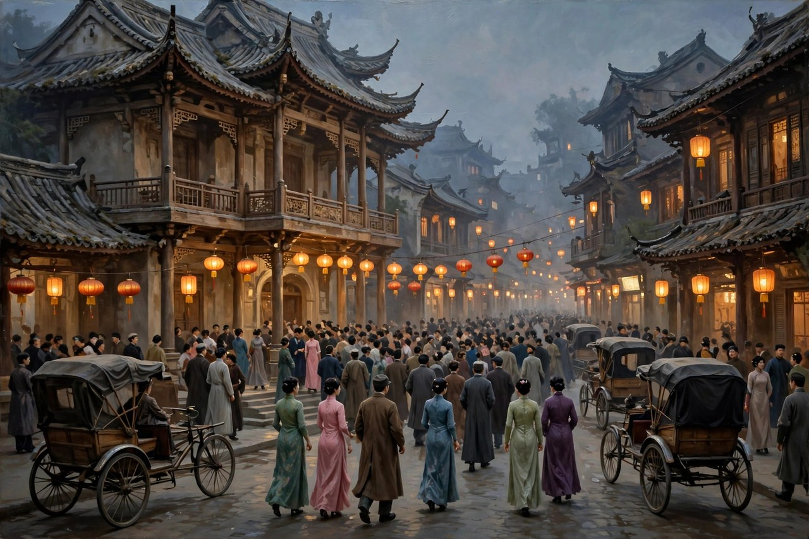
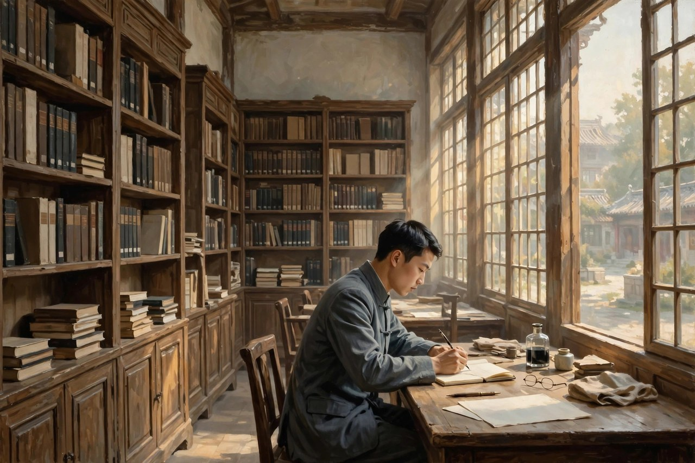

## 津门旧宅里的戏迷孩子

曹禺原名万家宝，祖籍湖北潜江，生在天津一个曾经阔过、后来慢慢败落的旧官僚家庭里。他出生没几天，生母就因产褥热去世，父亲后来娶了生母的孪生妹妹做续弦。这位继母是个十足的戏迷，闲下来就往戏园子里跑，小小的家宝常常被她抱在怀里，坐在台下看戏。台上锣鼓一响，台下人声一静，孩子的心就被勾住了。他后来回忆自己那段日子，说得直白：戏不是课本里教出来的，是从小在戏园子的板凳上坐出来的。

那个家很有意思，表面上还维持着旧式大家庭的体面，里头却已经空了。仆人、姨太太、账房、亲戚，各种人进进出出，各种心思藏在客气话后头。孩子在这种屋子里长大，耳朵特别灵，能听出大人话里的停顿，能看出笑脸后头的算计。他后来写戏，最厉害的地方就在这里：他不写口号，不写道理，他写一家人坐在一张桌子边吃饭，饭吃着吃着就吃出了杀机。很多人读曹禺觉得吓人，就是因为这种熟悉感：我们每个人的家里，或多或少都有这样一间客厅，体面是摆给外人看的，真相只在关上门之后才露出来。

家宝年纪稍大，进了南开中学，又进了南开大学，再转入清华大学西洋文学系读书。他在学校里不光读书，还上台演戏。南开新剧团的舞台给了他另一双眼睛：站在台上，他才明白戏不是写在纸上的，是要靠人的脚步、停顿、眼神和沉默撑起来的。一个角色站在门口迟迟不肯进来，观众的心就悬起来了；一句本来平常的话，被演员用颤抖的声音说出来，意思就全变了。这段演戏的经历，后来全进了他的剧本里。他的剧本读起来就跟看戏一样，舞台说明写得细，人的动作写得真，念出台词就能听见呼吸。

## 清华图书馆里的长夜

清华园的日子，是曹禺一生里最安静、也最用力的日子。他广泛读古希腊悲剧，读莎士比亚，读易卜生，读契诃夫，读奥尼尔。那些外国戏里的家庭、复仇、爱情、命运，跟他从小在天津旧宅里看见的东西，慢慢对上了号。他发现，不管是哪个国家，人一旦被困在旧规矩里，活法都差不多：想爱不敢爱，想走走不掉，想说真话又怕把天捅破。这种跨越国界的相通，让他心里有了一个很大的念头：中国的家庭悲剧，完全可以用现代话剧的方式写出来，而且要写得比外国戏更贴着中国人的筋骨。

《雷雨》的构思在他心里盘了好几年。他不是坐在书桌前凭空想出来的，而是一点点攒出来的：旧宅里的姨太太、被赶出门的女人、矿上的工人、家里那个威严又虚伪的父亲，这些人影在他脑子里走来走去，吵来吵去，直到吵成了一出戏。一九三三年夏天，清华图书馆里人很少，他跟妻子郑秀两个人，一个写，一个抄，从清晨写到闭馆，硬是把这出戏写完了。那一年他才二十出头，写出的东西却老辣得吓人。巴金主编的刊物发表《雷雨》之后，文坛一下子就炸了：原来中国话剧可以写成这样，人物可以这么复杂，冲突可以这么密，结尾可以这么惨烈。

很多人把曹禺叫作中国的莎士比亚，这个叫法有点夸张，但意思是对的：他让中国话剧从学舌、喊口号的阶段，一下子站到了成熟的台阶上。在他之前，话剧常常是道理在前、人物在后，人物像是举着标语牌走来走去。在他之后，大家才明白，戏要先把人写活，道理自然会从人的命运里长出来。他写的人没有一个是单纯的好人或者单纯的坏人，周朴园虚伪，可他对侍萍的怀念也不是全假的；繁漪疯狂，可她的疯狂是从长年被压抑的日子里逼出来的。好人坏人分不清，观众才会在看完戏之后睡不着觉，这才是戏的力量。

## 从旅馆到原野的眼睛

《雷雨》之后，曹禺没有停在原地重复自己。他接着写《日出》，把眼睛从一个大家庭的客厅，挪到了大旅馆的房间和下等妓院的后院。旅馆里住着交际花、银行家、留洋博士、富孀、面首，楼上楼下全是靠别人的血汗过日子的人；楼下的妓院里，却是被卖来卖去的小东西和老妓女翠喜，连活下去都要看人脸色。同一栋楼，上下两种人生，曹禺把它们放在一起写，意思很明白：上面人的醉生梦死，是用下面人的命换来的。这个写法在当时很新鲜，他不靠一个大阴谋推动剧情，而是像切开一个社会横断面，让观众自己看清楚，这个社会是怎么一层压着一层的。

写完城市，他又把眼睛投向原野。《原野》写的是农民仇虎的复仇，写的是宗法、土地、血债怎样把一个人逼成困兽。仇虎报了仇，却没有觉得痛快，反而被良心追得满林子跑，最后把自己逼上了绝路。这个结局在当时让很多人不舒服：复仇不是痛快事，杀人的人自己也活不成人。曹禺就是这样，他不给观众一个解气的结尾，他给的是一个更难的问题：当你用血去还血的时候，你到底是在报仇，还是在把自己也变成你恨的那种人？这个问题放在今天依然扎人，网上天天有人喊着要以牙还牙，要让对方付出代价，可真到了那一步，代价常常是两家人一起沉下去。曹禺早在几十年前就把这笔账算清楚了。

抗战爆发之后，曹禺跟着学校一路西迁，从南京到长沙，到重庆，到江安，一边教书，一边写戏，一边组织演出。他写《蜕变》，写后方医院的改革，写那些在腐败里混日子的人怎样被逼着变，写新力量怎样从艰苦里长出来；他写《北京人》，写北平一个旧士大夫家庭的慢慢散架，写那个家里的人怎样抱着旧体面不肯撒手，最后连体面也保不住。这两部戏的调子跟早期不一样了，早期是雷雨式的爆发，到了《北京人》这里，变成了慢火炖着的悲凉：没有一声炸雷，只有一天一天的冷，一点一点的空，最后人走茶凉，院子还站在那里，人心已经散了。这种慢悲剧更难写，也更贴近真实的人生：很多家庭不是被一场大祸打垮的，是被日复一日的将就、拖延和不敢面对，一点点拖垮的。

## 人艺院子里的掌灯人

新中国成立之后，曹禺把更多精力放在了戏剧事业的组织和教学上。他担任北京人民艺术剧院院长，担任中央戏剧学院的领导职务，担任文联和剧协的负责人，开会、讲话、出访、审稿，日子排得满满当当。他自己也还在写戏，写了《明朗的天》，写了跟人合作的《胆剑篇》，晚年又写了《王昭君》。实话实说，这几部戏的口碑，跟他年轻时候的几部比起来，要弱一些。不是他不用心，而是时代变了，戏要承担的任务变了，他心里那个自由自在写人的空间变小了。他想写新生活里的人，可他对新生活的了解，隔着一层；他想写历史里的人，又要顾着当下的要求，笔就放不开。这种拧巴，恰恰说明了一个道理：好戏是长在自由的土壤里的，笔被任务压住了，人就写不活。

晚年的曹禺，常常被人问起《雷雨》，问起他为什么后来写不出那样的戏了。他回答得很坦诚，没有给自己找借口。他说自己心里明白，年轻时候写戏是凭着一股真情实感在写，写的是自己亲眼见过、亲耳听过的人；后来事情多了，应酬多了，离生活远了，笔就钝了。这种坦诚比很多辩解都可贵。一个作家到了晚年，还能承认自己的局限，还能对着年轻人不装，这本身就是一种风骨。他去世之后，人们纪念他，纪念的不光是那几部戏，还有他这个人对待戏剧的态度：戏是认真的，人是认真的，观众是不能糊弄的。

他的一生，几乎就是中国现代话剧的一部简史。从天津旧宅的戏迷孩子，到清华图书馆里熬夜的青年，到名满天下的剧作家，到人艺院子里的掌灯人，他走过的路，正是中国话剧从引进、模仿，到成熟、到扎根的路。今天我们去剧场看《雷雨》，台下还是满满当当，年轻人还是会为繁漪掉眼泪，为四凤揪心，为周朴园的虚伪生气。这说明曹禺写的东西没有过时，他写的人性困境，换了衣服、换了房子、换了手机，内核还是一样的：人被旧规矩困住的时候怎么办，人被欲望推着走的时候怎么办，人明明知道前面是死路还往前走的时候，到底是谁在推他。

## 对照现在：客厅还没有拆掉

对照现在看曹禺，会发现他写的很多东西根本没有走远。今天的家庭群里，照样有周朴园式的人物：对外一套，对内一套，嘴上说着都是为你好，手上却把家里的门窗都关死了。今天的职场和饭局里，照样有《日出》旅馆里的那一套：靠关系吃饭，靠面子撑场，真正干活的人在楼下受气，真正出事的时候，上面的人先跑。今天的网上，照样有仇虎式的冲动：一腔血勇，以为报复就能解决问题，结果把自己也搭进去，最后留下一地鸡毛，连个说理的地方都没有。曹禺的价值就在这里：他不教你怎么赢，他让你看清楚，赢了之后要付出什么代价，输了之后又是谁在替你收拾残局。

读曹禺还有一个好处，是学会看人不要只看一面。周朴园不是一张脸谱，繁漪不是一个疯子，陈白露不是一个简单的交际花，仇虎不是一个简单的复仇者。每个人都有自己的苦衷，都有自己的算计，都有自己回不去的过去。这种看人的眼光，放在今天尤其重要：网上吵架常常是先贴标签，再开火，标签一贴，人就没了。曹禺教的是反过来的办法：先把标签撕掉，看这个人到底在怕什么，在要什么，在为什么事情夜里睡不着。看清楚了，你不一定会原谅他，但你至少不会被一句口号牵着走，不会把复杂的人生想得太简单。

所以，讲曹禺这个人，不能只讲他写了几部戏，拿了什么奖，当了什么官。要讲他是怎样从一个爱看戏的孩子，变成一个敢把自家客厅的丑事写上舞台的人；要讲他是怎样用一辈子证明，戏剧不是装饰，不是应景的东西，戏剧是让人照镜子的东西。镜子照出来不好看，人才会想着要改。曹禺一辈子做的，就是举着这面镜子，站在中国人的客厅门口，轻声说一句：你们看看，这屋子里的人，到底活成了什么样子。这句话，放在今天，依然没有过时，依然让人心里一紧。

## 留给后来人的话

后来的写戏的人，几乎没有一个能绕开曹禺。他留下的不光是几部可以反复上演的剧本，还有一套写人的方法：把人物放在一个关着门的空间里，让他们自己吵，自己撞，自己把秘密抖出来；把时间压得很短，让几十年的恩怨在一个夜里爆发；把结局写得惨烈，但不写成简单的报应，而是写成命运和人性一起作用的结果。这套方法，后来的电视剧、电影、话剧都在用，只是换了个样子。家庭剧里两家人坐在一桌吃饭吃出火药味，职场剧里一个会议室里的暗流涌动，悬疑剧里一个秘密被一层层剥开，骨子里都有曹禺的影子。

更重要的是，曹禺留下了一个标准：戏写得好不好，不看场面大不大，不看口号响不响，看的是人物站不站得住，观众走出剧场之后，心里是不是还留着那个人。繁漪站在雨里的样子，四凤跑出门的样子，陈白露坐在窗边的样子，仇虎在黑林子里的样子，愫方抱着箱子走出曾家的样子，这些画面过了几十年还留在观众心里，这就是标准。今天写东西的人，不管写什么体裁，都可以拿这个标准量一量自己：你写的人，读者合上书之后还记不记得他长什么样，还记不记得他说过哪句话。如果记不住，那多半是人物没有立起来，道理讲得再多也是空的。

曹禺去世的时候，很多人说，一个时代过去了。这话对，也不对。对的是，属于他的那个话剧黄金时代确实过去了；不对的是，他写的那些人，那些客厅，那些雷雨之夜，并没有跟着他一起走。他们还活在舞台上，还活在课本里，还活在每个中国家庭的饭桌边。只要还有人愿意坐下来，认认真真看一出戏，认认真真想一想自己家里那点事，曹禺就还活着。他的戏不是古董，是镜子，镜子不怕旧，怕的是没有人再愿意照。

## 戏里的人是怎么活过来的

曹禺写人，有一个很实在的办法：他不先给人物贴标签，而是先给人物一个回不去的过去。周朴园回不去的是年轻时候跟侍萍的那段日子，繁漪回不去的是出嫁之前的自由，四凤回不去的是不知道真相之前的单纯，陈白露回不去的是学生时代那个叫竹筠的自己，仇虎回不去的是全家还没散架的日子，愫方回不去的是还没进曾家的日子。每个人心里都藏着一个回不去的地方，戏就是从这个地方开始拧的。观众看着他们吵，看着他们哭，看着他们做错事，心里会明白：他们不是天生就坏，他们是被过去拽着走，越拽越紧，最后连自己都认不出自己了。

这种写法，比简单地骂一个人要难得多，也要诚实得多。骂一个人容易，写出一个人为什么会变成这样却很难。曹禺愿意花力气在难的地方下功夫。他写周朴园，会写他书房里还留着侍萍用过的旧家具，会写他每年都给侍萍留着一间屋子，会写他对着侍萍说起往事的时候，声音里有一种老年人特有的软弱。观众看到这里会愣住：原来这个专横的家长，心里也有一个放不下的角落。可紧接着，曹禺又会写他怎样用钱打发侍萍，怎样在谈判桌上对自己的亲生儿子冷酷到底。软弱和冷酷放在同一个人身上，这个人才立住了，才像真人。生活里的人就是这样，前一分钟还在怀旧，后一分钟就能为了一点利益翻脸，怀旧是真的，翻脸也是真的，两样都是真的，才叫人。

他写女人尤其见功夫。繁漪不是一个等着被拯救的可怜人，她有欲望，有脾气，有行动力，她敢爱，敢恨，敢把窗户关死，敢把大门锁上，敢当着全家人的面把丑事抖出来。她的悲剧不在于她不够勇敢，而在于她的勇敢没有出口，整个家就是一间闷屋子，她越挣扎，屋子越闷。陈白露也不是一个等着被同情的交际花，她聪明，看得透，嘴上刻薄，心里清醒，她知道太阳会升起来，也知道太阳不是她的。她拒绝跟方达生走，不是因为她不向往干净的日子，而是因为她太清楚，干净的日子不是靠跟一个人走就能换来的，她身上的债，她欠下的情，她在这个社会里的位置，都不是一场私奔能解决的。金子也不是一个柔弱的农村妇女，她泼辣，敢爱，敢跟仇虎走，敢在黑林子里往前闯。愫方也不是一个只会忍耐的旧式女性，她最后抱着箱子走出曾家，那一步走得安静，却比任何大吵大闹都更有力量。曹禺笔下的女人，每一个都有自己的骨头，这在当时的文坛上是很了不起的。

他写男人也不手软。周萍懦弱，喝酒，跳舞，逃避，靠女人的感情给自己洗灵魂，结果越洗越脏；周冲天真，善良，满脑子都是美好的想象，结果美好在现实面前撞得粉碎；焦大星善良却软弱，爱金子却护不住金子，夹在母亲和妻子中间，两头受气；曾文清有才华，有诗意，却被旧家庭磨得一点脾气都没有，最后连自己的命都保不住；方达生善良却天真，以为凭着一腔热情就能把陈白露拉出泥潭，结果他的到来反而把陈白露心里那层好不容易糊上的纸给捅破了。曹禺对男人没有偏袒，他写出了男人在旧社会里的各种活法：有的靠压迫别人活，有的靠逃避活，有的靠幻想活，有的靠忍耐活，没有一种活法是真正体面的。这种不偏袒，让他的戏有了分量，观众看完之后，不会只骂女人或者只骂男人，而是会想：这个社会到底把人都逼成了什么样子。

## 他的笔法藏在细节里

曹禺的舞台说明，是很多写戏的人学习的范本。他不写空话，他写天气，写屋子里的摆设，写人的衣着，写灯光的颜色，写雷声由远而近的过程。读《雷雨》的开头，观众还没看见人，先感觉到了闷热：空气潮湿，低气压压得人喘不过气，远处有雷声在滚动。这种闷热不光是天气，也是人心的状态。等到戏演到结尾，雷雨真的来了，电闪雷鸣，雨点砸下来，观众会觉得，这场雨憋了一整出戏，终于下下来了，人的命运也跟着这场雨一起塌了。这种天气和人心的呼应，不是装饰，是曹禺精心设计的结构：外面的天越闷，屋子里的人越喘不过气，冲突就越容易爆炸。

他写对话也很有讲究。他的台词不像文章，像人说话，有停顿，有重复，有说了一半又咽回去的地方。侍萍跟周朴园相认的那场戏，两个人明明是旧情人重逢，却一个字一个字地绕着圈子说，一个不敢认，一个不敢信，观众在台下急得直跺脚，可这正是真实的人在那种场合下的样子：真相太重了，重到谁都不敢一下子把它说出口。繁漪跟周萍吵架的时候，话说得又快又狠，每一句话都像刀子，可刀子底下藏着的却是求他留下来的哀求。陈白露跟方达生说话的时候，表面上轻描淡写，实际上每一句都在试探：你到底懂不懂我，你到底能不能救我，你到底是来救我的，还是来满足你自己的拯救幻想的。这种话里有话的写法，让他的戏经得起反复看，看一遍看的是剧情，看两遍看的是人心，看三遍看的是自己。

他对时间的处理也很厉害。《雷雨》把几十年的恩怨压在一天之内，从中午到午夜，时间越往后推，秘密抖得越多，观众的心越悬。这种压缩不是为了炫技，而是为了逼出真相：平时大家可以装，可以躲，可以用客气话把日子糊弄过去，可一旦被关在同一间屋子里，被逼着在一天之内把话说清楚，装就装不下去了。生活里也是这样，很多家庭的矛盾平时看着不大，一到过年过节，一家人关在屋子里吃一顿饭，旧账全翻出来了，平时藏着的话全说出来了，饭桌就变成了战场。曹禺把这个道理写成了戏剧结构，后来的很多家庭剧都在学他，只是学的人常常只学到了吵架的热闹，没有学到他那种把时间压紧、把秘密一层层剥开的耐心。

## 从舞台到生活的回声

曹禺的戏演了这么多年，为什么还能让今天的观众坐满剧场？原因很简单：他写的不是古代人，不是外国人，是中国人家里最常见的那种困境。家里有个强势的长辈，嘴上说为你好，实际上什么事都要按他的意思来；家里有个受了委屈的人，有苦说不出，只能在夜里自己掉眼泪；家里有个年轻人想往外跑，想过自己的日子，却被亲情、面子、房子、钱，一层层拽回来。这些事，换了时代，换了房子，换了说法，本质上没有变。观众坐在台下，看的不是别人的故事，看的是自己家的影子，影子照得越真，心里越不是滋味，可越不是滋味，越舍不得走。

今天很多人说，曹禺的戏太沉重了，太惨了，看完心里堵得慌。这种感觉是对的，但堵得慌恰恰是他的用意。他不是来哄观众开心的，他是来让观众醒一醒的。一个社会如果只看喜剧，只看团圆，只看皆大欢喜，那很多真实的问题就被盖住了。曹禺把盖子掀开，让观众看看盖子底下是什么：是被压抑的欲望，是被出卖的亲情，是被利益扭曲的人性，是明明知道不对却还要往下走的惯性。看完之后堵得慌，说明盖子掀对了，说明观众心里还有感觉，还有判断力，还没有麻木。一个对悲剧毫无感觉的社会，才是真正可怕的社会。

他的戏还有一个长处，是不给简单的答案。他不告诉观众，谁应该被原谅，谁应该被惩罚，他把所有人的苦衷都摆出来，让观众自己去掂量。周朴园该不该被原谅？繁漪该不该被同情？周萍该不该被骂？四凤的死到底是谁的错？这些问题没有标准答案，每个人看完都会有自己的答案，而且答案会随着年纪变。年轻的时候看《雷雨》，多半会同情四凤，骂周朴园；年纪大一点再看，会开始理解繁漪的绝望，理解侍萍的隐忍，甚至会理解周朴园那种老年人的孤独和恐惧。一部戏能让人随着年纪读出不同的东西，这就是经典的标志。经典不是供在架子上的古董，是可以陪着人一起长大的镜子。

讲到这里，曹禺这个人大概就清楚了：他是一个从小在戏园子里长大的孩子，是一个在图书馆里熬夜的青年，是一个敢把中国家庭的秘密写上舞台的作家，是一个晚年坦承自己局限的老人，是一个把一生都交给戏剧的人。他没有写过小说，没有靠别的体裁出名，他就是靠戏剧，靠一间客厅，一场雷雨，一栋旅馆，一片原野，一座旧宅子，把中国现代话剧推到了成熟的地步。后来的写戏的人，走的路不一样，写的东西不一样，但只要还在认真写人，还在认真写家庭，还在认真写命运，就都在他的影子里。这影子不是压迫，是光，是前面有人已经把路走通了，后来的人可以沿着这条路，继续往前走，继续写我们这个时代的客厅，继续写我们这个时代的雷雨。

## 晚年灯下的坦诚

曹禺晚年住在北京，日子过得并不清闲。开会、接见、审稿、出访，一桩接一桩，真正能安安静静坐在书桌前写东西的时间，反而比年轻时候少得多。他心里是明白的，写戏需要离生活近，需要有整块的时间去想一个人，去跟这个人待在一起，去听他说话。事情一多，人就浮在面上，看什么都是走马观花，笔下的人自然就立不住。他没有把这个原因藏着掖着，对着来访的年轻人和研究者，他直说自己后来写得不如从前，不是因为江郎才尽那种玄乎的说法，而是因为离生活远了，因为心被杂事占满了。这种说法，放在今天看依然有警示：一个写东西的人，如果天天都在开会、应酬、赶场子，写出来的东西多半是飘的，因为人没有真正沉下去，文字就沉不下去。

他对年轻戏剧工作者的态度，也值得一提。他不摆架子，不喜欢别人把他供起来。他更愿意跟年轻人聊具体的戏：这场戏的人物为什么要站在门口，那句台词为什么要停顿，那个结局为什么不能写成大团圆。他讲戏不讲大道理，讲的都是舞台上的实在事：灯光怎么打，脚步怎么走，沉默多长才合适。这种实在，是从他年轻时候演戏、写戏的经验里长出来的，也是他留给后人最实用的东西。很多理论书讲了一大堆，到了舞台上还是不知道该怎么办，曹禺讲的东西却可以直接拿去排，直接拿去演，这就是行家和空谈家的区别。

他去世之后，剧场里还在演他的戏，学校里还在讲他的戏，观众还在为他戏里的人流眼泪。这说明，一个作家真正的生命，不在于他活了多少年，当了多大的官，而在于他写的人是不是还活着。周朴园还活着，繁漪还活着，侍萍还活着，四凤还活着，陈白露还活着，仇虎还活着，愫方还活着，只要这些人还站在舞台上，曹禺就没有走远。他用一辈子告诉后来的人：写戏就是写人，写人就要写出人的复杂，写出人的软弱，写出人的挣扎，写出人在旧规矩和新欲望中间左右为难的样子。把这个道理记住了，再去写我们这个时代的人，写我们这个时代的家庭，写我们这个时代的客厅和旅馆，路就不会走偏。曹禺的灯，到今天还没有灭，还在人艺的院子里，还在各个剧场的舞台上，照着后来的人往前走。

## 曹禺和后来的观众

曹禺的戏，今天还在演，还在被年轻人看，还在被讨论，讨论的话题，常常是：周朴园到底是不是坏人？繁漪到底值不值得同情？陈白露到底能不能被救？仇虎到底该不该报仇？愫方走出去的那一步，到底对不对？这些问题，没有标准答案，没有标准答案的东西，才值得讨论，讨论来讨论去，讨论的其实不是戏里的人，是讨论的人自己：讨论的人把自己代入到戏里的人身上，代入之后，才会发现，自己在某些事情上，像周朴园，在某些事情上，像繁漪，在某些事情上，像陈白露，在某些事情上，像仇虎，在某些事情上，像愫方，像的地方越多，讨论越激烈，激烈完了，人对自己的认识就深了一点，深了一点，戏的作用就达到了。曹禺的戏，就是这样一面镜子，镜子照的不是古人，是今天的人，今天的人照镜子，照出自己的影子，影子不好看，也要照，照完了，才知道该改哪里，该改的地方改了，人就进步了，进步的人多了，社会就进步了。社会进步的路，就是这样一步步走出来的，走出来的路，曹禺在前面已经走过一遍了，后来的人沿着他的路，继续往前走，走的时候，要记得，路是他走出来的，路上的坑，也是他踩过的，踩过的坑，后来的人就不用再踩了，不用再踩的坑，就是曹禺留给后来的人最实在的东西。

## 一句话的曹禺

如果只能用一句话讲曹禺，那就是：他是一个敢把中国家庭的秘密写上舞台的人，写的时候不留情，写完了还让人心疼。心疼，是因为他写的人，不是脸谱，是活人，活人有苦衷，有算计，有回不去的过去，有走不出去的现在，有想走出去的未来，未来走不走得出去，要看人自己，要看环境，要看时代，要看很多东西合在一起，才知道。曹禺把这些东西都写进去了，写进去之后，观众看完，心里就有了自己的答案，答案不一样，戏的意义就不一样，意义不一样，戏就能活很久，活很久的戏，才是经典，经典的曹禺，到今天还没有走远，还在剧场里，还在课本里，还在每个中国家庭的饭桌边，饭桌边的人，吃饭的时候，想起曹禺，想起雷雨，想起客厅，想起自己家里那点事，想起之后，饭就吃得慢一点，慢一点，人就想得多一点，想得多一点，家就有可能暖一点，暖一点，雷雨就有可能晚一点来，晚一点来，人就有时间开窗户了。
