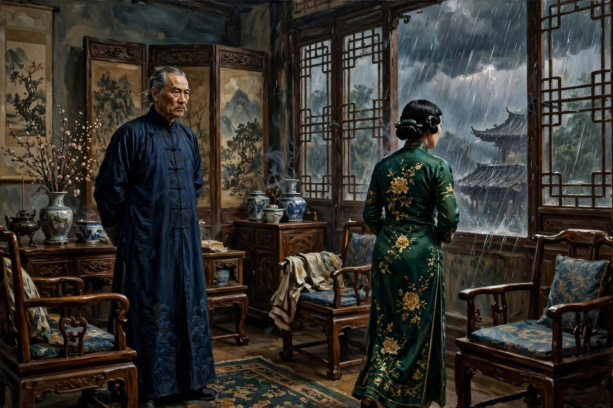
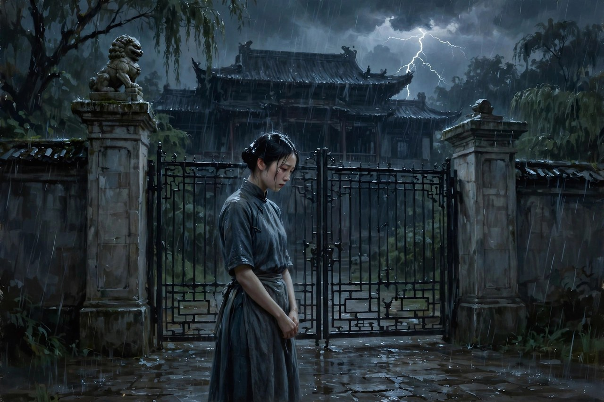

## 闷得喘不过气的客厅

《雷雨》写于一九三三年，发表于一九三四年，是曹禺的成名作，也是中国现代话剧成熟的标志。戏的时间压得很短，从一个闷热的午后写到午夜，地点主要就在周朴园家的客厅和鲁贵家的住房里。可就是在这短短的时间和窄窄的空间里，曹禺把两家人几十年的恩怨全抖出来了。周朴园年轻时候跟家里的女佣侍萍相爱，生了周萍，又怀了鲁大海，家里为了给他娶有钱有门第的小姐，在大年夜把侍萍赶出门。侍萍走投无路，抱着刚生下来没几天的孩子去投河，被人救起之后，嫁给了周家的仆人鲁贵，又生了女儿四凤。四凤长大之后，又进了周家当女佣，跟周萍相爱，还怀了身孕。周朴园的现任妻子繁漪，长年被丈夫的专横压着，跟继子周萍有了私情，周萍想摆脱她，她就越缠越紧。周朴园和繁漪生的儿子周冲，又在暗恋四凤。鲁大海在周朴园的矿上做工，成了罢工的工人代表，跑到周家来跟周朴园谈判，父子两个在客厅里正面撞上，却谁也不知道对方是谁。

这张关系网，放在今天看依然让人头皮发麻：兄妹相爱，母子相认，父子为敌，继母跟继子纠缠，丈夫跟妻子的旧情人重逢。曹禺把这些关系全拧在一起，不是为了猎奇，而是为了说明一个道理：一个靠压迫和虚伪撑起来的家，迟早会在某一天，把所有藏着的账一起算清楚。平时大家可以装，可以躲，可以用客气话把日子糊弄过去，可一旦侍萍走进周家客厅，一旦繁漪把窗户关死，一旦雷雨之夜所有人都聚在客厅里，装就装不下去了。戏的厉害之处就在这里：它不靠外来的灾难推动剧情，它靠的是这个家自己埋下的雷，雷埋了几十年，终于在同一个夜里一起炸了。

读这出戏，很多人会先骂周朴园。这个人物确实可恨：他年轻时候抛弃侍萍，年老之后又摆出一副怀念旧情的样子，书房里留着侍萍用过的旧家具，每年还给侍萍留着习惯，嘴上说着念旧，实际上却用钱打发人，用威严压人。他对工人冷酷，对儿子专横，对妻子冷漠，对侍萍虚伪，几乎把一个封建家长加资本家的毛病占全了。可曹禺没有把他写成一张脸谱，他写了周朴园的软弱，写了他年老之后的孤独，写了他面对侍萍的时候，那种想认又不敢认、想补偿又舍不得放下体面的拧巴。这种拧巴让周朴园变得真实：他不是天生的魔鬼，他是一个在旧规矩里活了一辈子的人，旧规矩教他，体面比真情重要，家产比人命重要，父亲的权威不容挑战。他按这套规矩活了一辈子，到最后，规矩反过来把他自己也困住了。他站在客厅里，看着自己的儿子、女儿、妻子一个个倒下，嘴里只能反复念叨着忏悔，可忏悔来得太晚了，晚到连他自己都不相信了。

## 侍萍归来的那扇门

侍萍是这出戏里最让人心疼，也最让人敬佩的人物。她年轻时候被抛弃，被赶出门，投河没死成，嫁了鲁贵，生了四凤，一辈子都在为孩子活着。她知道四凤跟周萍走得近，心里发慌，怕女儿重蹈自己的覆辙，就跑到周家来，想把女儿领走。结果一进门，就撞见了周朴园，撞见了几十年前的旧账。她跟周朴园相认的那场戏，是中国话剧史上最有名的场面之一：两个人明明是旧情人，明明一眼就认出了对方，却一个字一个字地绕着圈子说，一个装作在讲别人的故事，一个装作在听别人的故事，观众在台下急得恨不得替他们把话说出来。可这正是真实的人在那种场合下的样子：真相太重了，重到谁都不敢一下子把它说出口，说出口，几十年的体面就全塌了。

侍萍的厉害之处，在于她没有被仇恨带走。她有理由恨周朴园，有理由恨这个家，有理由把当年的事抖出来，让所有人都难堪。可她没有，她想的是怎么把孩子保住，怎么让四凤不要再往火坑里跳，怎么让大海不要再跟周朴园硬碰硬。她求周朴园，求繁漪，求自己的儿女，话说得卑微，心里却清醒得很：她知道这个家已经烂了，烂到没法修了，能做的就是把孩子往外拉，拉一个算一个。可命运偏偏不给她这个机会，四凤还是知道了真相，还是跑了出去，还是触电死了，大海还是走了，侍萍最后疯了。她的疯不是装出来的，是一个母亲眼睁睁看着自己的儿女相爱、相认、相继死去之后，心里那根弦彻底断了。观众看到这里，很难不掉眼泪：一个女人一辈子都在忍，一辈子都在为孩子打算，到最后还是什么都没保住，这才是真正的悲剧，比任何控诉都更有力量。

繁漪是另一个让人又怕又怜的人物。她嫁给周朴园之后，过的是枯寂的生活：丈夫常年在外，家里规矩森严，儿子周冲还小，她连个说话的人都没有。她抓住周萍，不光是出于欲望，更是出于一种求生的本能：在一间闷屋子里，她要抓住一点活着的感觉，哪怕这感觉是罪恶的，是见不得光的。周萍想摆脱她，想去矿上，想跟四凤过干净的日子，她就越缠越紧，越缠越疯。她叫侍萍来领走四凤，本来是想除掉情敌，结果却把侍萍引进了周家，把真相引爆了；她跟踪周萍去鲁家幽会，把窗户关死，本来是想抓住周萍，结果却把周萍跟四凤的关系暴露在鲁家人面前；她锁上周家的大门，喊来周朴园，本来是想阻止周萍和四凤出走，结果却逼着周萍当众认母，把四凤推上了死路。她每一步都想抓住点什么，每一步都把事情推得更糟。这种越挣扎越沉下去的写法，比简单的疯狂更有说服力：繁漪不是天生的疯子，她是被闷屋子闷疯的，是被一个不许女人有欲望、有脾气、有活路的家庭逼疯的。

## 四凤和周冲的单纯

四凤是这出戏里最干净的人物，也是死得最冤的人物。她善良，质朴，对周萍是真心的，对母亲是孝顺的，对周冲的追求是躲闪的，她不知道自己爱上的是自己的亲哥哥，不知道自己的母亲就是周家的旧人，不知道自己从小到大过的日子，其实一直踩在几十年的旧账上。她怀了周萍的孩子，还满心想着跟周萍远走高飞，想着到了矿上就能过上安稳日子。可真相一揭开，她的世界一下子就塌了：爱人变成了哥哥，母亲变成了旧情人，家变成了罪恶的源头。她跑出客厅，冲进雨里，触电死了，死的时候还怀着孩子。这种死法，让观众心里特别堵：她什么错都没有，错的是上一代人埋下的雷，可雷炸的时候，炸死的却是她这个最无辜的人。曹禺用四凤的死，写出了旧家庭最残酷的一面：上一代人造的孽，常常要下一代人拿命来还，账算不清楚，人却已经没了。

周冲也是一个干净的人物，他年轻，善良，满脑子都是美好的想象，爱四凤爱得单纯，觉得爱情就应该像诗一样。可他的单纯在周家这种环境里，根本活不下去。他不知道四凤的心在周萍身上，不知道自己的母亲跟哥哥之间有那种关系，不知道自己的父亲是个什么样的人。他跑出去找四凤，想把四凤拉回来，结果也触电死了。他的死，跟四凤的死放在一起，意思很明白：在一个烂透了的家里，单纯不是护身符，单纯是最先被牺牲掉的东西。很多人年轻的时候都像周冲，觉得只要自己够真诚，够善良，世界就会对自己好，可现实常常是反过来的：越是单纯的人，越容易被复杂的环境绞进去，越是把世界想得美好，摔下来的时候越疼。曹禺写周冲，不是为了写一个傻孩子，而是为了写一种理想在现实面前的脆弱，这种脆弱，放在今天依然能看到：很多年轻人怀着一腔热血走进社会，走进家庭，走进感情，结果发现，热血解决不了旧账，善良也挡不住雷雨。

周萍是这出戏里最复杂，也最让人恨不起来的人物。他跟繁漪私通，跟四凤相爱，喝酒，跳舞，逃避，懦弱，敢做不敢当。可他也不是天生的坏人，他是在周家这种环境里长大的孩子，从小看着父亲的专横，看着继母的压抑，看着家里的虚伪，打小就学会了逃避。他逃到繁漪那里，逃到四凤那里，逃到酒里，逃到矿上的幻想里，逃来逃去，还是逃不出这个家。他想跟四凤走，想过干净的日子，可干净的日子需要他先把过去的账认下来，需要他先面对自己跟繁漪的那段关系，需要他先承认自己是个什么样的人，他做不到，他只能继续逃。最后真相揭开，他知道四凤是自己的妹妹，知道自己一辈子都在乱伦的泥潭里打转，开枪自杀了。他的死不是解脱，是逃避的最后一步：活着要面对的东西太多了，死反而成了最容易的选择。曹禺写周萍，写出了很多男人的通病：出了事不想着解决，想着躲，躲不掉就想着用新的感情盖住旧的错误，结果错误越盖越多，最后把自己也埋进去了。

## 鲁贵和鲁大海的两种活法

鲁贵和鲁大海是鲁家的两个男人，活法完全不一样，放在一起看，特别有意思。鲁贵是周家的仆人，贪婪，无耻，见钱眼开，为了钱什么都肯干：他怂恿四凤去周家当女佣，是为了多拿点好处；他偷周家的东西，拿去换钱；他对侍萍也不好，动不动就发脾气。可他这样的人，在旧社会里活得反而滋润，因为他早就把脸皮扔了，把良心换成了钱，什么体面都不讲，什么规矩都不怕，见风使舵，见钱就捞。曹禺写鲁贵，不是为了骂一个小人，而是为了说明：在一个烂掉的环境里，最先适应的人，往往是最没有底线的人，底线越低，活得越顺，这种顺，本身就是一种讽刺。

鲁大海跟他父亲完全相反，他正直，粗犷，敢说话，敢斗争，是矿上的工人代表，跑到周家来跟周朴园谈判，一点都不怵。他不知道周朴园是自己的亲生父亲，不知道周萍是自己的亲哥哥，不知道自己谈判的对手，其实是自己的家人。他跟周朴园吵，跟周萍打，话说得硬，理占得足，可他越是硬，越是把自己往真相的刀口上推。等到真相揭开，他才明白，自己一直恨的人是自己的父亲，自己一直打的人是自己的哥哥，自己一直想保护的妹妹，早就跟哥哥有了孩子。这种打击，比任何谈判失败都更惨烈。他最后出走了，走得沉默，走得决绝，不是因为他不想报仇，而是因为他发现，仇恨的对象竟然是自己的血亲，报仇和认亲撞在了一起，怎么选都是错。这种两难，是曹禺给鲁大海出的最难的题，也是给观众出的题：当你发现，你一直斗争的对象，其实跟你有着割不断的关系，你该怎么办？是继续斗下去，还是转身走开？鲁大海选择了走开，走开不是认输，是他看明白了，这个家已经没法用斗争来解决了，能做的就是离开，离开这个烂摊子，保住自己最后一点清醒。

把鲁贵和鲁大海放在一起，曹禺其实在写两种底层人的命运：一种是彻底放弃底线，靠钻营活着；一种是死守着正直，靠斗争活着。可在这出戏里，两种活法都没有好下场：钻营的人最后还是要面对女儿的死，正直的人最后还是要面对亲情的撕裂。这说明，问题不在个人的选择上，而在整个环境上：环境烂了，个人怎么选都是错，选哪条路都会撞墙。这种写法，比简单的歌颂工人或者谩骂小人要深刻得多，也更接近真实的生活：很多时候，人不是不想选对的路，是所有的路都被堵死了，选哪条都是死路，只能在死路里选一条相对不那么难看的走法。

## 雷声为什么至今还响

《雷雨》的结构，是很多写戏的人研究的范本。它把时间压在一天之内，把地点压在两间屋子里，把人物压在两家人里，让所有的矛盾在同一个夜里爆发。这种压缩，让戏的张力拉到了最大：观众坐在台下，从开场就感觉到闷，感觉到有什么东西要炸，可不知道什么时候炸，不知道先炸哪一个。等到侍萍进门，秘密开始一层层剥开，观众的心就跟着一层层悬起来，等到雷雨之夜，所有人聚在客厅里，真相全抖出来了，观众的心也跟着塌了。这种结构，后来的家庭剧、悬疑剧都在学，只是学的人常常只学到了吵架的热闹，没有学到曹禺那种耐心：他不急着把秘密抖出来，他让秘密先在人心里发酵，让每个人都先说半句真话，藏半句假话，等到发酵到最浓的时候，再一下子全倒出来，效果就炸了。

这出戏的舞台说明也写得特别细，天气、灯光、摆设、人的动作，全都写进去了。开场就是闷热，空气潮湿，远处有雷声，屋子里的人心烦意乱，坐不住，站不住，话说着说着就吵起来。这种天气不是背景，是人心的外化：外面的天越闷，屋子里的人越喘不过气，冲突就越容易爆炸。到了结尾，雷雨真的来了，电闪雷鸣，雨点砸下来，观众会觉得，这场雨憋了一整出戏，终于下下来了，人的命运也跟着这场雨一起塌了。这种天气和人心的呼应，是曹禺从外国悲剧里学来的，又结合了中国人对雷雨的直觉：雷雨之前必有闷热，闷热越久，雨下得越猛，人心也是这样，压抑越久，爆发越惨。

对照现在看《雷雨》，会发现这出戏根本没有过时。今天的家庭群里，照样有周朴园式的人物：对外一套，对内一套，嘴上说着都是为你好，手上却把家里的门窗都关死了；照样有繁漪式的人物：长年被压抑，有苦说不出，只能用极端的方式引起注意，结果越闹越糟；照样有侍萍式的人物：一辈子为孩子打算，到最后还是什么都没保住；照样有四凤和周冲式的人物：单纯，善良，对世界充满幻想，结果被上一代人的旧账绞进去，成了最无辜的牺牲品；照样有周萍式的人物：出了事不想解决，想着躲，躲不掉就用新的感情盖住旧的错误，结果错误越盖越多。换了衣服，换了房子，换了手机，换了说法，内核还是一样的：一个家如果靠虚伪和压迫撑着，迟早会在某一天，把所有的账一起算清楚，算清楚的时候，倒霉的往往不是造孽的人，而是最无辜的人。

## 看完之后该想什么

很多人看完《雷雨》，会问一个问题：这出戏到底在骂谁？是在骂周朴园吗？是在骂封建家庭吗？是在骂命运吗？曹禺自己说过，他写这出戏，不是为了骂谁，而是为了写一种悲剧的情绪：人被命运和自己的欲望推着走，明明知道前面是死路，还是往前走，走一步错一步，最后谁也回不了头。这种情绪，比简单的控诉更有力量，因为它不给观众一个发泄的出口，观众骂完周朴园之后，还得回过头来想想自己：我家里有没有这样一间闷屋子？我有没有在什么事情上，像周朴园一样用体面盖住真相？我在感情里，有没有像周萍一样逃避过？我在愤怒的时候，有没有像繁漪一样，把事情越推越糟？这些问题，没有标准答案，可只要开始想，戏的作用就达到了。

还有一个问题，值得今天的人想想：四凤和周冲的死，到底是谁的错？是周朴园的错吗？是繁漪的错吗？是侍萍的错吗？是周萍的错吗？是命运的错吗？细究起来，每个人都有责任，每个人也都有苦衷。周朴园年轻时候抛弃侍萍，埋下了雷；繁漪把侍萍引进来，引爆了雷；周萍逃避，拖长了雷的引线；侍萍想保住孩子，却保不住；鲁贵贪婪，把女儿推进了周家；社会的大环境，让所有人都没法体面地活着。把责任推给一个人，容易，可容易的答案往往是错的。曹禺的高明之处，就是不给容易的答案，他把责任摊开，摊给所有人，摊给整个环境，让观众自己去掂量。掂量之后，观众会明白：悲剧不是一个人造成的，是很多人一起，一步一步走出来的，每一步看起来都不大，合起来就是一条死路。

所以，重读《雷雨》，不光是为了重温一出经典，更是为了照一照自己的家，照一照自己的感情，照一照自己处理问题的方式。家里有矛盾的时候，是不是还在用客气话糊弄过去？感情里出了问题的时候，是不是还在逃避，还在用新的关系盖旧的错误？面对一个明明已经烂了的局面，是不是还在抱着体面不肯撒手，非要等到雷雨之夜，所有人都聚在客厅里，把话说绝了，才肯认账？如果答案是肯定的，那这出戏就还没有过时，它的雷声，还在我们每个人的客厅上空滚动，提醒我们：闷热的日子不会一直闷下去，雷迟早会来，与其等到雷来的时候全家一起塌，不如趁着天还闷着的时候，先把窗户打开，先把话说清楚，先把该认的账认下来。窗户打开了，雷雨来了也不怕，怕的是窗户一直关着，人一直在屋子里互相憋着，憋到最后，谁都出不去。

## 这出戏在舞台上活了多久

《雷雨》发表之后，很快就被搬上舞台，从一九三五年在天津和上海等地演出开始，到今天，几乎没有从中国话剧舞台上下来过。几代演员演过周朴园，几代演员演过繁漪，几代观众在台下为四凤掉过眼泪。一出戏能演这么久，靠的不是运气，是人物立得住，是结构经得起反复看。年轻的时候看，看到的是剧情的紧张；年纪大一点再看，看到的是人心的复杂；有了自己的家庭之后再看，看到的是自己家里的影子。同一出戏，不同年纪看，看到的东西不一样，这就是经典的本事：它不是一成不变的古董，它是会跟着观众一起长大的镜子。

演《雷雨》最难的角色，很多人说是繁漪。繁漪的难，不在于台词多，不在于动作大，而在于她的情绪要一层层往上走，不能一开始就疯，一开始疯了，后面就没法走了。她要先压着，压着的时候观众能感觉到她心里的火，火越压越旺，旺到最后实在压不住了，才一下子烧起来。烧起来的时候，观众不能只觉得她可怕，还要觉得她可怜，还要觉得她走到这一步是有原因的。演得好的繁漪，观众看完之后会又怕又心疼，怕的是她的极端，心疼的是她被闷屋子闷了那么多年，连个透气的地方都没有。演不好的繁漪，就只剩下了疯，疯完了观众就忘了，忘了就说明人物没有立住。

周朴园也难演，难在不能演成一张脸谱。演成脸谱，观众一上来就知道他是坏人，后面就没意思了。演得好的周朴园，观众一开始会觉得他还挺有派头，挺讲体面，甚至有点可怜：一个老人，守着一间大屋子，守着过去的回忆，身边的人却一个个离他而去。等到戏演到后面，观众才慢慢发现，他的体面是假的，他的怀念是自私的，他的权威是靠压迫撑起来的。这种慢慢发现的过程，比一上来就骂他更有力量，因为观众是跟着剧情一起认清他的，认清之后，心里那种失望和愤怒，才是真实的。好的演员演周朴园，演的是一个人的两面：体面的一面是真的，虚伪的一面也是真的，两面合在一起，才是一个活生生的人。

侍萍的戏，难在克制。她不能哭得太厉害，哭得太厉害就成了卖惨；她不能骂得太狠，骂得太狠就成了复仇。她要忍着，忍着的时候观众能感觉到她心里的疼，疼到最后实在忍不住了，眼泪掉下来了，观众的心也跟着碎了。这种克制的演法，比大哭大闹更难，也更动人。生活里真正受过苦的人，往往就是这样：不轻易哭，不轻易骂，把苦都咽下去，咽到实在咽不下去了，才掉一滴眼泪，那滴眼泪比嚎啕大哭更有分量。曹禺写侍萍的时候，就是按这种真实的人来写的，所以侍萍这个人物，过了这么多年，依然能让观众心疼，依然能让观众在看完戏之后，想起自己家里那个默默忍耐的人。

## 雷雨留给写戏的人的功课

后来的写戏的人，从《雷雨》里学到的功课，至少有这么几条。头一条，是把人物放在一个关着门的空间里，让他们自己吵，自己撞，自己把秘密抖出来。关着门，人才会说真话，开着门，人都在装。家庭剧的饭桌，职场剧的会议室，悬疑剧的密室，骨子里都是周家的客厅：把一群有旧账的人关在一起，不给他们逃跑的出口，戏自然就来了。学到这一条的人很多，可学全的人不多：很多人只学到了关门吵架的热闹，没有学到曹禺那种把时间压紧、把秘密一层层剥开的耐心。吵架谁都会写，吵出层次，吵出真相，吵到最后让观众明白每个人为什么会这样吵，才是真功夫。

另一条功课，是不要给人物贴标签。周朴园不是单纯的坏人，繁漪不是单纯的疯子，周萍不是单纯的渣男，四凤不是单纯的受害者，鲁贵不是单纯的小人，鲁大海不是单纯的英雄。每个人都有自己的苦衷，都有自己的算计，都有自己回不去的过去。把标签撕掉，人物才能立起来，人物立起来了，戏才能立起来。今天很多影视剧的问题，恰恰就是标签贴得太死了：好人从头好到尾，坏人从头坏到尾，观众看一眼就知道谁是谁，后面就没悬念了。曹禺的办法是反过来的：先把标签撕掉，让观众跟着剧情慢慢认识这个人，认识到最后，观众会发现，自己一开始的判断可能是错的，这种反转，比任何剧情反转都更有意思，因为它反转的是观众对人的看法。

还有一条功课，是结局不要写成简单的报应。按照简单的报应逻辑，坏人应该受到惩罚，好人应该得到好报，可《雷雨》的结局不是这样：四凤死了，周冲死了，周萍死了，侍萍疯了，繁漪疯了，周朴园活着忏悔，鲁大海走了。好人死了，坏人活着，活着的人比死了的人更痛苦。这种结局，让观众走出剧场之后睡不着觉，因为观众会想：为什么会这样？为什么好人没有好报？想下去，观众就会明白，悲剧不是老天爷的安排，是人一步一步走出来的，是环境和人性一起作用的结果。写戏的人如果只会写好人有好报、坏人有坏报，那写出来的东西就是童话，不是悲剧，童话哄孩子可以，哄大人不行，大人要看的是真实的人生，真实的人生常常就是好人没有好报，坏人也没有立刻遭到报应，账算不清楚，人却已经没了。

最后一条功课，是天气、摆设、灯光这些细节，不是装饰，是戏的一部分。闷热的天气，潮湿的空气，远处的雷声，客厅里的旧家具，书房里留着的旧习惯，这些细节合在一起，营造出了一种压抑的氛围，观众一走进剧场，就能感觉到这种氛围，感觉到有什么东西要出事。很多写戏的人不重视细节，觉得细节是导演和舞美的事，跟剧本没关系，曹禺却把细节写进了剧本里，写进了舞台说明里，因为他明白，细节就是人物的生活，人物离开了生活，就是空的。今天写东西的人，不管写什么体裁，都可以学学这一点：不要只写人说了什么，还要写人站在什么样的屋子里，屋子里是什么味道，窗外是什么天气，桌子上摆着什么东西，这些细节写活了，人物就活了，人物活了，戏就活了。

## 雷雨夜之后的天

雷雨夜过去之后，天会亮吗？戏没有写天亮之后的事，戏停在了雷雨之夜，停在了四凤死了，周冲死了，周萍死了，侍萍疯了，繁漪疯了，周朴园忏悔了，鲁大海走了，停在了这个最惨的瞬间。停在这里，是很高明的：停在这里，观众走出剧场的时候，心里还是雷雨之夜，还是电闪雷鸣，还是雨点砸下来，还是客厅里的那群人，还是他们的哭声，还是他们的忏悔，还是他们的疯狂。雷雨之夜留在观众心里，观众回家之后，还会想，还会讨论，还会争论，争论完了，观众会明白：雷雨之夜不是结束，是开始，是让观众开始想，自己家里的雷雨之夜，是不是也快来了，是不是也该在天还闷着的时候，先把窗户打开，先把话说清楚，先把该认的账认下来。窗户打开了，雷雨来了也不怕，怕的是窗户一直关着，人一直在屋子里互相憋着，憋到最后，谁都出不去，出不去的时候，雷雨来了，屋子里的人，就只能一起塌了。一起塌的结局，是曹禺给观众的警告，警告的意思是：不要等到雷雨之夜，才想起开窗户，开窗户要趁早，趁天还闷着的时候，趁话还能说清楚的时候，趁账还能认下来的时候，趁人还活着的时候，趁一切还来得及的时候。来得及的时候开窗户，雷雨来了，人还能活，活着的人，才能继续过日子，过日子的时候，才有机会把过去的账，一点点还清，还清了，家就还有救。

## 给看戏的人留一句话

看《雷雨》的人，走出剧场的时候，心里常常会留一句话，话不一样，人不一样，留的话也不一样，有人留的是四凤，有人留的是繁漪，有人留的是侍萍，有人留的是周朴园，有人留的是雷声，有人留的是雨夜，有人留的是客厅，有人留的是那扇关死的窗户。留的话不一样，说明戏写到了不同的人心里，写到心里去了，戏就没有白演，白演的戏，观众走出剧场就忘了，忘了的戏，演一百场也是空的。《雷雨》没有白演，演了这么多年，观众还记得，记得的人，回家之后，还会跟家里人讲，讲的时候，家里人会想起自己家的事，想起之后，家里的话题就多了，话题多了，家里的窗户，就有可能打开一点，打开一点，雷雨就有可能晚一点来，晚一点来，人就有时间了，有时间的人，才能把话说清楚，把账认下来，把该走的一步走出去。
