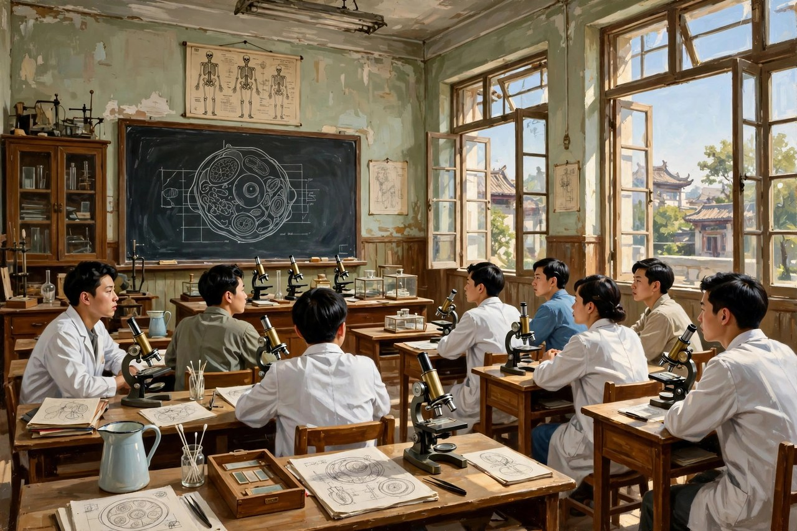
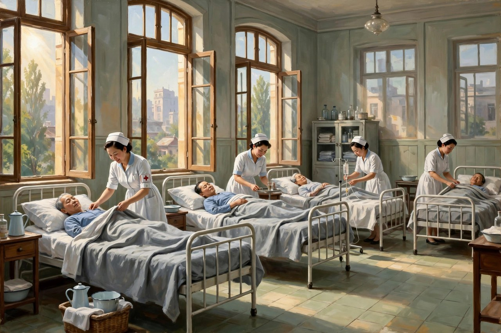

## 协和医学院里的一天

《明朗的天》写于一九五四年，是曹禺在新中国成立之后写的一部剧作，也是他探索表现新生活、新人物、新主题的一次尝试。写这出戏之前，曹禺到北京协和医学院深入生活，对那里的人和事作了认真细致的调查了解，积累了不少创作素材。他想写的是知识分子的改造，写一个心地善良的老实人，怎样从脱离政治、消极旁观的态度，转到积极参与、报名奔赴前线的态度。这个老实人，就是戏的主人公凌士湘。凌士湘是个医生，是个好人，是个业务上过得去、为人上没毛病的人，可他有个毛病：他不问政治，不问世事，觉得医生只要看好病就行了，别的都跟自己没关系。这种态度，在和平年月里，看起来没什么大问题，可在那个特殊的年月里，在抗美援朝的背景下，在细菌战的传闻和现实面前，他的态度就显得不够了，就显得脱离了，就显得需要转过身来了。

戏的中心情节，是凌士湘了解到两个事实之后，态度发生了转变：一个事实是细菌战确实存在，一个事实是工人赵树德的妻子，被外国人贾克逊拿去做试验害死了。这两个事实，对凌士湘的冲击很大：他原来以为，政治是别人的事，是报纸上的事，是跟自己这个医生没关系的事，可事实告诉他，政治已经走进了医院，走进了病房，走进了工人的家里，走进了他每天面对的人的命运里。他再也不能说跟自己没关系了，再也不能躲在医生的身份后面了，再也不能只看病、不看人了。于是，他报名去了抗美援朝的前线，报名这个动作，就是他转过身来的标志：从旁观者，转成了参与者；从只看病，转成了也看社会；从老实人，转成了有态度的人。这个转变，曹禺写得很用心，写出了一个老实人内心的挣扎，写出了他从不问世事到开始问世事的过程，写出了他从消极到积极的每一步。

戏里还有一个重要人物，是党的干部董观山。董观山是来帮助知识分子改造的，是来做思想工作的，是来把凌士湘这样的人拉到新生活里来的。可曹禺写董观山的时候，写得有点吃力，有点捉襟见肘，写出来的董观山，不像凌士湘那样活生生，更像是一个符号，一个任务，一个来完成改造任务的角色。这种吃力，曹禺自己后来也承认过：他对新的人物有隔膜，隔膜的原因，是他对新生活的了解，还隔着一层，还没有真正沉下去，还没有真正跟新人物一起生活过。隔着一层写出来的人物，就容易写成符号，符号立不住，戏就立不住。这出戏的口碑，不如他年轻时候的戏，原因就在这里：不是他不用心，是他写的人，跟他年轻时候写的人不一样了，年轻时候写的人，是他亲眼见过、亲耳听过的，是他从小在旧宅子里、在旅馆里、在原野上看见的，新生活里的人，是他后来去调查、去了解、去体验的，调查和体验，跟从小长在一起，是两回事，调查得再细，也隔着一层生活，隔着一层，笔就放不开。

## 老实人的转身难在哪里

凌士湘的转身，难在哪里？难在老实人的转身，不是换一件衣服，不是喊一句口号，是心里那套活法要换。老实人活了一辈子，靠的是不惹事，不出头，不问世事，只把自己的事做好，这套活法，在旧社会里，是保命的活法，是不得罪人的活法，是能活下去的活法。到了新社会，活法要换了，要问世事了，要参与了，要表态了，老实人心里会慌：问世事，会不会惹事？参与，会不会出错？表态，会不会站错队？慌，是正常的，慌说明老实人心里还在掂量，还在想，还没有被口号牵着走。曹禺写凌士湘的慌，写得比较真实：他不是一下子就转过来了，他是先听说，再怀疑，再了解，再震惊，再挣扎，再决定，一步一步转过来的。转过来的过程，写得越细，人物越真实，写得越快，人物越像符号。曹禺在这出戏里，尽量把过程写细了，写出了老实人转身的每一步，可即便如此，还是有观众觉得，转身还是有点快，还是有点像任务，还是有点像作者在推着人物走，而不是人物自己在走。推着走和自己走，区别就在这里：自己走的人物，观众会跟着他走，推着走的人物，观众只会看着他走，看着和跟着，差得很远。

对照现在看《明朗的天》，会发现老实人转身这个题目，根本没有过时。今天很多老实人，照样活在不问世事的态度里：上班就上班，下班就回家，家里的事管管，外面的事不管，社会上的事，觉得跟自己没关系，觉得问了也没用，觉得问了反而惹麻烦。这种态度，在太平日子里，看起来没什么问题，可一旦遇到大事，一旦遇到跟自己切身利益有关的事，一旦遇到需要表态的时候，老实人就会慌，就会发现，自己平时不问世事，到了关键时候，连怎么问都不知道，连该信谁都不知道。曹禺写凌士湘，就是写给这样的老实人看的：不问世事，不是保命的办法，不问世事，到了最后，世事还是会找上门来，找上门来的时候，你躲都躲不掉，还不如平时就多问一句，多看一眼，多想一想，问一句，看一眼，想一想，人就不至于在关键时候慌了手脚。老实人的转身，不是要变成激进的人，不是要变成天天喊口号的人，是要从完全不问，变成适当问，从完全旁观，变成适当参与，参与的度，要自己把握，把握住了，老实人还是老实人，只不过是一个睁着眼睛的老实人，睁着眼睛的老实人，比闭着眼睛的老实人，活得踏实。

这出戏还有一个值得说的地方，是它对新生活的热情。曹禺写这出戏的时候，是满怀热情的，他相信新生活，相信新人物，相信知识分子改造是有意义的，相信抗美援朝前线需要医生，相信一个老实人转过身来，是值得写、值得歌颂的。这种热情，是真实的，不是装出来的，热情写进戏里，戏就有了温度，有了亮度，有了明朗的天这个名字里的意思：天是明朗的，人心也是明朗的，明朗的天底下，人应该往亮处走。可热情也有它的副作用：热情一上来，笔就容易往歌颂上走，往表态上走，往完成任务上走，歌颂和表态一多，人物就容易变成符号，符号一多，戏的真实感就弱了。曹禺年轻时候写戏，靠的是冷静的观察，靠的是把人写复杂，靠的是不给简单的答案；到了这出戏，热情占了上风，观察退了后，复杂让位于明朗，答案变得简单了，简单了，戏的分量就轻了。这种变化，不是曹禺一个人的问题，是那个时代很多作家的共同问题：时代要求热情，要求歌颂，要求表态，作家想热情，想歌颂，想表态，可热情、歌颂、表态，跟写复杂的人，常常是冲突的，冲突的结果，就是戏写得不如从前自由，不如从前深刻，不如从前经得起反复看。

## 明朗的天留下的教训

《明朗的天》留给后来人的教训，至少有这么几条。头一条，是写新生活，不能只靠调查，不能只靠体验几天，就急着下笔。新生活里的人，要跟他们一起生活很久，要跟他们一起吃饭，一起上班，一起发愁，一起高兴，生活久了，人物才能活起来，生活不久，人物就是调查报告里的人物，就是符号。曹禺去协和医学院调查，是认真的，调查得也很细，可调查毕竟不是生活，生活是日复一日的，是柴米油盐的，是吵架和好的，是生病和看病的，调查是走马观花的，是问几个问题，记几页笔记，笔记记得再细，也记不住生活的味道，味道记不住，人物就立不住。后来的人写新题材，写新行业，写新人物，常常犯同样的毛病：去企业采访两天，去农村住三天，去医院跟班一周，就回来写，写出来的东西，看起来像那么回事，实际上隔着一层，隔着一层的东西，读者一眼就能看出来，看出来之后，就不信了，不信了，戏就死了。

另一条教训，是热情和冷静要平衡。写戏的人，对生活有热情，是好事，没有热情，写出来的东西是冷的，是没有温度的，可热情太满，冷静没了，写出来的东西就是烫的，是喊口号的，是表态的，烫的东西，观众一摸就缩手，缩手之后，就不看了。曹禺年轻时候的戏，热情和冷静是平衡的：他对人物有同情，可同情里有冷静，冷静里有解剖，解剖完了，观众自己去判断。到了《明朗的天》，热情占了上风，冷静退了后，判断的空间小了，观众只能跟着作者的热情走，跟着走，观众就成了被动的，观众被动了，戏就失去了让观众自己思考的力量。后来的人写戏，不管写什么题材，都要记住这个平衡：热情是油门，冷静是刹车，油门踩到底，没有刹车，车会翻，刹车踩到底，没有油门，车走不动，油门和刹车配合好了，车才能稳稳地往前走，走到观众心里去。

最后一条教训，是不要怕承认局限。曹禺后来承认，自己写董观山写得吃力，承认自己对新人物有隔膜，承认自己后来写得不如从前，这种承认，比很多辩解都可贵。很多作家，写砸了之后，往往先辩解，是说时代不好，是说观众不懂，是说审查太严，辩解完了，问题还是在那里，下一次还是写砸。曹禺的办法是反过来的：先承认自己隔膜，先承认自己写得吃力，承认了，才能想办法补，补的办法，就是离生活更近一点，就是少开会，少应酬，多跟人待在一起，多听人说话，听久了，隔膜就薄了，薄了，笔就活了。这种坦诚，放在今天依然值得学习：写东西的人，如果发现自己写的人物立不住，要做的事不是怪时代，不是怪观众，而是问问自己，是不是离生活远了，是不是靠调查代替了生活，是不是靠热情代替了冷静，问清楚了，改起来才有方向，改对了方向，下一部戏才有可能写得比上一部好。曹禺的《明朗的天》，虽然不如年轻时候的戏，可它留下的教训，比很多成功的戏还要宝贵，因为教训是真实的，是从一次不太成功的尝试里总结出来的，真实的教训，比假的成功，更能帮助后来的人。

## 凌士湘身边的那些人

凌士湘不是一个人转身的，他身边有一群人，有推他的人，有拉他的人，有看着他转身的人。推他的人里，有董观山，有医院里的同事，有工人赵树德一家，有前线传来的消息。赵树德的妻子被贾克逊拿去做试验害死，这件事，对凌士湘的冲击，比任何思想工作都大：思想工作讲的是道理，道理听起来是对的，可道理离生活还有一段距离；一个工人的妻子死了，死的原因是被外国人当成了试验品，这个事实，是血淋淋的，是摆在病房里的，是凌士湘作为医生，每天都能想起来的。医生救人的手，救不了被当成试验品的人，这种无力感，比任何批评都更能让一个老实人醒过来。醒过来之后，他才明白，医生不光要看病，还要看社会，看社会是怎么对待工人的，看工人是怎么被欺负的，看欺负工人的力量，是从哪里来的。看明白了，他才报名去前线，报名不是一时冲动，是看明白之后的决定，决定做出来了，人就转过来了。

拉他的人里，有他自己过去的习惯，有他那种不问世事的活法，有他那种只看病、不看人的职业惯性。习惯是最难改的东西，习惯改起来，比改一个制度还难：制度改了，文件发下来了，人还是按习惯办事，习惯不改，制度就是空的。凌士湘的习惯，是几十年养成的，是从旧社会里带过来的，是在旧的医学院里、旧的医院里、旧的生活里，一点点养成的。养成习惯的时候，他没有觉得习惯有问题，习惯帮他活下来了，帮他保住了饭碗，帮他不得罪人，帮他安安稳稳地过日子。到了新社会，习惯成了负担，负担不卸下来，人就转不过来。曹禺写凌士湘转身，写得最细的地方，就是写他怎么跟自己的习惯较劲：较劲的时候，他会犹豫，会反复，会今天想通了，明天又糊涂了，会报名了又想撤回，撤回了又觉得不应该撤回，反反复复，反复到最后，才真正转过来。反复的过程，写得越真实，人物越可信，可信的人物，观众才会跟着他走，跟着他走，观众才会明白，转身不是一件容易的事，转身是一场跟自己的仗，仗打赢了，人就新了，仗打输了，人就还是旧的。

看着他转身的人里，有医院里的年轻医生，有护士，有病人，有家属。年轻医生看着凌士湘转身，心里会想：连凌士湘这样老实的人都能转过来，我是不是也该转一转？护士看着他转身，心里会想：医生都报名去前线了，我们是不是也该多做一点？病人看着他转身，心里会想：医生都这么拼了，我们是不是也该配合治疗？家属看着他转身，心里会想：连医生都去前线了，我们在后方是不是也该支持？一个人的转身，带动的是一群人的转身，转身的人多了，医院的气氛就变了，气氛变了，医院就明朗了，明朗的天这个名字，就是从这里来的：天明朗，不是天气明朗，是人心明朗，是医院里的人心，从混日子、从不问世事、从各顾各的，变成了一起往亮处走，一起往前线想，一起为抗美援朝出力的状态。状态变了，戏的调子就变了，调子从压抑，变成了明朗，从灰暗，变成了亮堂，亮堂的戏，观众看完之后，心里是暖的，暖完了，观众会想：我是不是也该转一转？转一转，不一定是报名去前线，转一转，可以是多问一句，多看一眼，多做一点，多想一想自己在这个社会里的位置，位置想清楚了，人就活得踏实了。

## 协和医学院的调查和隔膜

曹禺写这出戏之前，到协和医学院深入生活，这件事本身，就值得今天的人学习。今天很多写东西的人，写医院题材，不去医院，写农村题材，不去农村，写工厂题材，不去工厂，全靠想象，全靠资料，全靠网上搜来的几篇文章，搜来的东西写进作品里，作品就是空的，空的东西，读者一眼就能看出来，看出来之后，就不信了。曹禺去协和医学院，是真的去，真的看，真的跟医生护士聊天，真的看他们怎么查房，怎么手术，怎么跟病人说话，怎么跟家属交代，真的把医院里的气味、声音、节奏，都记下来了。记下来之后，写进戏里，戏里的人物才有了医院的味道，味道对了，观众才信，信了，戏才立得住。这种深入生活的态度，在今天依然是最基本的功课：写什么，就去什么地方待着，待久了，待出味道了，再动笔，动笔的时候，笔下才有生活，生活里的人，才不是符号。

可即便去了，隔膜还是在。隔膜的原因，是曹禺跟协和医学院的人，毕竟不是一家人，毕竟不是从小一起长大的，毕竟不是一起吃过苦、一起熬过夜的同事。一起吃过苦的人，写起来是不用调查的，写起来是凭着记忆和感情的，记忆和感情写出来的人物，是活的；调查来的人物，写起来是凭着笔记和印象的，笔记和印象写出来的人物，是隔着一层的。隔着一层，不等于写不好，隔着一层，写的时候要更用心，要更耐心，要把笔记里的东西，变成自己心里的东西，变成自己能感觉到的东西，感觉到了，人物才能活起来。曹禺在这出戏里，就是在努力把隔膜变薄，努力把调查变成感觉，努力把董观山从符号变成活人，努力到最后，还是没有完全做到，没有完全做到，不等于努力白费了，努力的过程，本身就是一种态度，态度摆在那里，后来的人就能看到，看到之后，就能学到：深入生活，不是去一趟就完了，深入生活，是要把自己变成生活里的人，变成生活里的人，才算真正深入了，深入了，笔才能活，笔活了，戏才能活。

## 明朗的天和后来的戏

《明朗的天》之后，曹禺又写了《胆剑篇》，又写了《王昭君》，每一部戏，都在探索新的主题，新的人物，新的生活，每一部戏，都比年轻时候的戏，要多一层任务，多一层要求，多一层顾虑。任务多了，顾虑多了，笔就放不开了，放不开的笔，写出来的人物，就容易变成符号，符号多了，戏的分量就轻了。这种变化，不是曹禺一个人的问题，是那个时代很多作家的共同问题：时代变了，作家要跟着变，跟着变的过程中，自由的空间变小了，空间小了，笔就施展不开了，施展不开的笔，写出来的东西，就不如从前了。承认这一点，不是贬低曹禺，是尊重事实，尊重事实，才能学到东西，学到的东西是：好戏需要自由的空间，空间小了，戏就难写，难写的戏，写出来了，也要打折扣，打折扣的戏，观众还是能看出来，看出来之后，观众会怀念年轻时候的曹禺，怀念那个在清华图书馆里熬夜的青年，怀念那个敢把自家客厅的丑事写上舞台的人。怀念，不是怀旧，是怀念一种写戏的态度：态度就是，写人要写复杂，写社会要写真实，写结局不要写成简单的报应，写人物不要写成符号，态度在，戏就在，态度没了，戏就没了。

今天的人，读《明朗的天》，读的不是一部完美的戏，读的是一次真诚的尝试。尝试的价值，在于它告诉后来的人：作家到了一个新的时代，面对新的生活，新的任务，新的要求，该怎么办？曹禺的办法是：去生活里，去医院里，去跟新人物待在一起，待久了，写，写不好的地方，承认，承认了，再想办法，办法就是离生活更近一点，少开会，少应酬，多听人说话，听久了，隔膜就薄了。这个办法，放在今天依然管用：今天的人，面对新的题材，新的行业，新的生活，新的技术，新的社会变化，该怎么办？办法是一样的：去生活里待着，待久了，写，写不好的地方，承认，承认了，再改，改对了方向，下一部就能写得比上一部好。改方向的前提，是承认局限，承认局限，是需要勇气的，勇气不是每个人都有，曹禺有，他晚年承认自己写得不如从前，承认自己对新人物有隔膜，承认了之后，他还是在写，还在尝试，还在探索，探索到晚年，还写出了《王昭君》，写出了一个笑着出塞的女子，笑着出塞的女子，放在他的一生里，就是一次新的尝试，尝试的意义，不在于成功不成功，在于尝试本身，在于一个作家到了晚年，还愿意尝试，还愿意探索，还愿意离生活近一点，这种愿意，本身就是一种风骨，风骨在，戏就在，戏在，人就在。

## 老实人转身之后的路

凌士湘报名去前线之后，路是不是就好走了？戏没有写下去，戏停在了报名的地方，停在了转身的地方，停在了希望的地方。停在这里，是很高明的，也是很无奈的：高明的是，戏把最难的部分留给了观众去想，观众走出剧场之后，会想：到了前线之后怎么办？前线的情况，是不是比医院更复杂？前线的伤兵，是不是比后方的伤兵更难救？前线的环境，是不是比后方的环境更艰苦？这些问题，戏没有答案，答案要观众自己去找，找的过程，就是戏在起作用的过程；无奈的是，戏没有写下去，是因为曹禺自己也不知道答案，或者说，答案在当时还没有出现，转身之后的路，还很长，长到一部戏写不完，写不完，就只能停在开头，停在希望的地方。希望的地方，是明亮的，可明亮的地方后面，还有很长的路，路上有没有新的困难，有没有新的考验，有没有新的转身要转，戏没有说，戏把路留给了后来的人去走，后来的人走起来，才会明白，转身不是一次性的事，转身是天天都要做的事，天天做，才能守住，守不住，转身的成果就会倒退，倒退之后，又要重新转，重新转的时候，代价会更大，大到让人想问：当初为什么没有守住？守住的办法，就是把转身变成习惯，变成日常，变成每天多问一句，每天多看一眼，每天多做一点，每天多想一想自己在这个社会里的位置，位置想清楚了，转身就不是一次性的了，转身就成了生活的一部分，生活的一部分，才是最稳固的转身。

今天的老实人，照样需要转身，照样需要把转身变成习惯。今天很多老实人，平时不问世事，到了关键时候，才想起要问，问的时候，已经晚了，晚到连怎么问都不知道，连该信谁都不知道。问世事的习惯，是要平时养成的，养成的办法，就是每天多看一点新闻，多想一点社会上的事，多跟不同的人聊聊天，聊天的过程中，视野就宽了，视野宽了，判断力就强了，判断力强了，关键时候，就不会慌了。慌，是老实人最怕的东西，慌起来的时候，人最容易被带偏，被带偏之后，就容易做出错误的选择，选择错了，后悔就来不及了。曹禺写凌士湘，就是写给这样的老实人看的：转身要趁早，趁平时，趁太平日子，趁还没有遇到大事的时候，先把问世事的习惯养起来，养起来之后，遇到大事的时候，人就不慌了，不慌的人，才能做出清醒的选择，清醒的选择，做出来之后，人就活得踏实了。踏实的日子，是今天很多人最缺的东西，缺的原因，就是平时不问世事，关键时候才慌，慌来慌去，慌到最后，人就累了，累了之后，人就想躲了，躲来躲去，躲到最后，连自己想要什么都忘了。忘了自己想要什么的人，活着就是混日子，混日子的老实人，表面上很安稳，实际上心里很空，空到连自己都不知道，空的地方，该用什么来填，填的东西，曹禺已经写出来了：填的东西，就是问世事，就是参与，就是报名去前线那一步，报名不一定是去前线，报名可以是多做一点，可以是多问一句，可以是多想一想，报名的方式有很多种，重要的是报名的动作，动作做出来了，人就转过来了。

## 明朗的天到底有多明朗

明朗的天，这个名字，听起来很亮，很暖，很有希望，可戏里的天，到底有多明朗？戏里的医院，还是那个医院，戏里的医生，还是那些医生，戏里的病人，还是那些病人，戏里的困难，还是那些困难，天没有一下子就亮了，天是慢慢亮的，慢慢亮的过程，就是凌士湘转身的过程，就是医院里的人心，一点点变亮的过程。变亮的过程，是慢的，慢到观众一开始会觉得，天怎么还是灰的，怎么还是有那么多问题，怎么还是有那么多困难，困难还在，天怎么就明朗了？明朗的意思，不是困难没有了，是人心亮了，人心亮了，困难看起来就不那么可怕了，不可怕的困难，才有可能被解决，解决不了的困难，放在亮的心里，也能慢慢想办法，办法想出来了，困难就小了，小了之后，天就更亮了，亮了之后，办法就更多了，办法多了，困难就更小了，良性循环，转来转去，转到最后，天就真的明朗了。明朗的天，不是天气明朗，是人心明朗，人心明朗了，天气再不好，人也能往前走，往前走的人多了，天就真的亮了。曹禺用明朗的天这个名字，就是在告诉观众：不要等天自己亮起来，天不会自己亮起来，天要靠人心亮起来，人心亮起来了，天就亮了，人心不亮，天永远是灰的，灰的天底下，人活着也是灰的，灰的日子，过久了，人就灰了，灰了之后，人就更不想亮了，不想亮的人，天就永远亮不起来了。亮起来的办法，就是凌士湘的办法：先转身，转身之后，再带动身边的人转身，转身的人多了，天就亮了。

## 写给今天的老实人

今天的老实人，读《明朗的天》，读的不光是凌士湘的故事，读的是自己的故事：自己是不是也在不问世事？自己是不是也在只看病、不看人？自己是不是也在靠习惯过日子？自己是不是也在等着别人来推一把？这些问题，没有标准答案，答案要自己去找，找的过程，就是转身的过程，转身的过程，就是凌士湘走过的路，路上有犹豫，有反复，有挣扎，有决定，决定做出来了，人就转过来了，转过来之后，日子就明朗了，明朗的日子，不是没有困难的日子，是困难来了，人不慌的日子，不慌的日子，过起来才踏实，踏实的日子，才是真正的好日子。好日子不是等来的，是转来的，转来的日子，要自己去转，转的时候，要趁早，趁平时，趁太平日子，趁还没有遇到大事的时候，先把问世事的习惯养起来，养起来之后，遇到大事的时候，人就不慌了，不慌的人，才能做出清醒的选择，清醒的选择，做出来之后，人就活得明白了，明白的日子，才是明朗的日子。

## 天明朗的时候

天明朗的时候，医院里的气氛是不一样的，气氛不一样的地方，是人心亮了，人心亮了，医生看病的时候，就多了一点耐心，护士照顾病人的时候，就多了一点细心，病人配合治疗的时候，就多了一点信心，家属等待的时候，就多了一点安心，耐心、细心、信心、安心合在一起，医院就明朗了，明朗的医院，治起病来，效果也不一样，效果不一样的原因，不是药变了，是人心变了，人心变了，药的效果就更好了，好到让医生都觉得，明朗的天，真的能治病，治的不是身体的病，是心里的病，心里的病治好了，身体的病，也就好了一半。曹禺写《明朗的天》，写的就是这个道理：天明朗，不是天气，是人心，人心明朗了，什么事都好办了。
