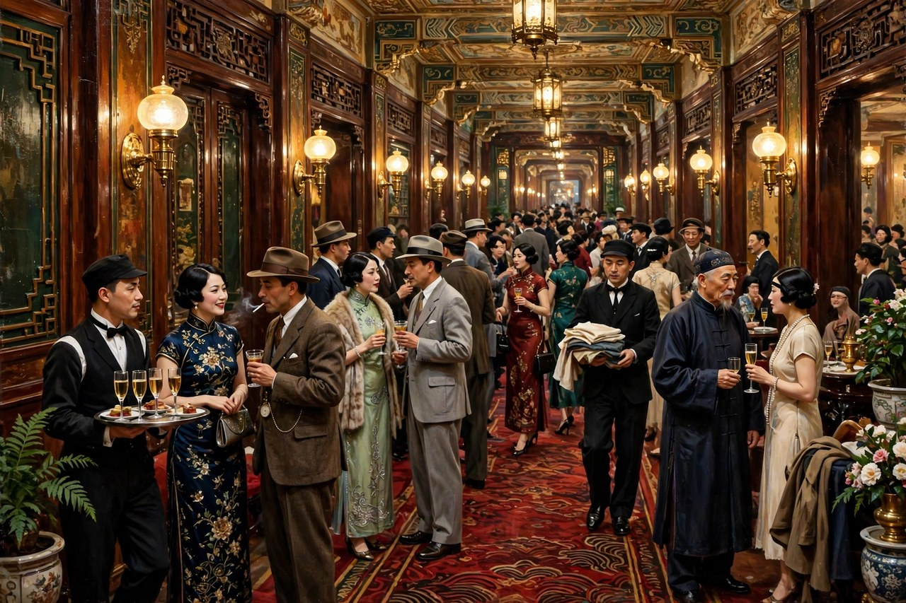
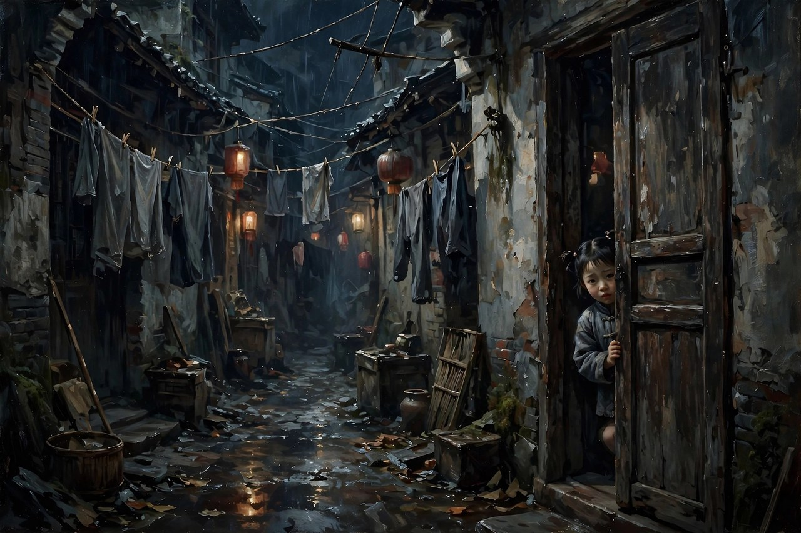

## 旅馆房间里的灯红酒绿

《日出》发表于一九三六年，是曹禺继《雷雨》之后的又一部代表作。戏的地点主要在一家大旅馆里陈白露的房间，和一家下等妓院宝和下处的翠喜房间里。时间同样压得很短，从黄昏写到天亮，写的是抗战前天津一带都市生活的横断面。曹禺在这出戏里换了一个写法：他不靠一个大家庭的秘密来推动剧情，而是像切开一个社会，让观众直接看到这个社会的上下两层是怎么互相咬合的。楼上是陈白露的客厅，沙发、地毯、留声机、酒杯，客人进进出出，有银行家潘月亭，有留洋博士张乔治，有富孀顾八奶奶，有面首胡四，有银行秘书李石清，有小职员黄省三，有交际场上的各色人等，大家喝酒，跳舞，打牌，说笑，话里全是钱和面子。楼下却是另一番景象：妓院的后院里，灯光昏暗，空气污浊，老妓女翠喜在硬撑着日子，小东西被人追着打，被人卖来卖去，连个藏身的地方都没有。同一栋楼，上下两种人生，上面人的热闹，是用下面人的血泪垫出来的，曹禺把这两层放在一起，观众一看就明白，这个社会是怎么一层压着一层的，上面越是光鲜，下面越是凄惨。

陈白露是这出戏的中心人物，也是最让人心疼的人物。她原名竹筠，出身书香门第，才貌双全，学生时代怀着美好的理想，谈过真挚的恋爱，做过电影明星，可家道中落之后，一步步走到了交际花的路上。她住在大旅馆里，靠银行家潘月亭的供养过日子，整天跟一群游手好闲的人周旋，嘴上刻薄，心里清醒。她厌恶周围的一切，厌恶潘月亭的算计，厌恶张乔治的虚情假意，厌恶顾八奶奶的做作，厌恶胡四的油滑，可她离不开这个圈子，因为她欠着债，因为她习惯了这种生活，因为她在这个社会里找不到别的活法。她不是不知道自己在堕落，她是太知道了，知道得清清楚楚，却没有力气爬出来。这种清醒的堕落，比糊涂的堕落更让人难受：糊涂的人还可以骗自己，清醒的人连骗自己的借口都没有，只能眼睁睁看着自己往下沉，沉到最后，连自己都认不出自己了。

方达生是陈白露学生时代的恋人，也是这出戏里唯一一个想往光明里走的人。他从家乡跑到旅馆来，听说陈白露堕落了，就想感化她，想跟她结婚，想带她回乡下过干净的日子。他的想法是善良的，也是天真的：他以为爱情可以救人，以为只要两个人真心相爱，过去的一切都可以一笔勾销。可他不了解陈白露现在的处境，不了解她身上的债，不了解她在这个圈子里的位置，不了解她心里那层早就结了痂的伤。他的到来，不是给陈白露带来希望，而是把陈白露心里那层好不容易糊上的纸给捅破了：他一遍遍提起过去，提起竹筠，提起学生时代的美好，每提一次，陈白露心里的疼就加重一分，因为过去越美好，现在越显得不堪。方达生越是真诚，陈白露越是痛苦，因为真诚提醒她，她已经回不去了。曹禺写方达生，写出了很多好心人的通病：以为凭着一腔热情就能救人，结果热情用错了地方，反而把人推得更远。救人不是喊口号，不是谈理想，是要先看清楚对方到底被什么困住了，困住她的东西不解决，光谈爱情，光谈回乡，都是空话。

潘月亭是这出戏里的银行家，也是上面那层人的代表。他靠储户的存款投机，买进公债，想着靠金八操纵的行情大赚一笔，结果金八暗中抛售，公债暴跌，他的银行倒闭了，他自己也垮了。潘月亭的垮，不是偶然的，是必然的：他靠的不是实业，不是劳动，是投机，是跟黑社会头子勾结，是拿别人的钱去赌。赌赢了，他风光，赌输了，他连累的是成千上万的储户。曹禺写潘月亭，写出了那个时代金融投机的真相：上面的人在牌桌上赌，下面的人在为他们的赌注买单。金八这个人物始终没有正面出场，可他的影子笼罩着全剧：他操纵股市，他霸占小东西，他挤垮潘月亭，他像一只看不见的手，攥着所有人的命运。不出场的人物反而最可怕，因为观众看不见他，就不知道该恨谁，不知道该防谁，只能眼睁睁看着身边的人一个个倒下。这种写法很高明：真正的黑手，往往是不露面的，露面的人不过是他的棋子，棋子倒了，黑手还在，游戏还会继续。

李石清和黄省三是银行里的小人物，写的是中层和小职员的悲哀。李石清是银行的小头目，靠巴结潘月亭往上爬，开除了小科员黄省三，自己后来也被潘月亭开除。黄省三被开除之后，走投无路，家里老婆孩子等着吃饭，他跑到旅馆来求情，求来求去，还是没有出路。两个人的命运放在一起，意思很明白：在上面人的游戏里，中层和小职员都是耗材，今天你开除别人，明天别人就开除你，今天你还在牌桌边陪笑，明天你就成了牌桌上的赌注。顾八奶奶和胡四、张乔治这些人，写的是寄生虫的生活：顾八奶奶是富孀，靠着钱养面首，追着胡四跑，胡四靠着女人的钱过日子，张乔治是留洋博士，嘴上全是新名词，实际上靠着虚情假意追求陈白露，想从她身上捞好处。这些人放在一起，就是一幅都市群丑图：每个人都在算计，每个人都在表演，每个人都在靠别人活着，没有一个人是靠自己的劳动站着的。曹禺把这些人写得活灵活现，观众看完之后会明白，所谓的上流社会，不过是一群寄生虫凑在一起互相吸血，吸到最后，谁也活不长。

## 楼下妓院里的另一面人生

小东西和翠喜是这出戏里最底层的人物，也是最让人揪心的人物。小东西还是个孩子，就被黑帮头子金八手下的人盯上，想霸占她，她逃出来，跑到陈白露的房间里求救，陈白露尽力救她，可最后还是没能救下来，小东西被卖到妓院里，不堪凌辱而死。一个孩子的死，在楼上那群人的酒杯和笑声里，几乎没有激起一点波澜：上面的人照样喝酒，照样打牌，照样谈生意，好像楼下死个人跟他们一点关系都没有。这种冷漠，比任何控诉都更有力量：一个社会如果对底层孩子的死毫无感觉，那这个社会就已经烂到根子上了。翠喜是宝和下处的老妓女，年纪大了，姿色没了，只能靠着过去的名声硬撑着，她看着小东西的遭遇，心里明白，自己年轻时候也是这样一步步走过来的，明白这个地方吃人不吐骨头，可她自己也出不去，只能在这个地方慢慢熬着，熬到老，熬到死。翠喜和小东西放在一起，就是底层女性的两头：年轻的被卖，老的被熬，中间没有一条活路。

陈白露救小东西的那场戏，是全剧最动人的地方之一。她平时对什么都是一副玩世不恭的样子，嘴上刻薄，心里冷漠，可一看到小东西，她心里的善良就冒出来了。她给小东西藏身的地方，给她钱，给她想办法，跑前跑后，一点都不含糊。这说明，陈白露的心还没有完全死，她心里还有一块干净的地方，还有一点人味。可是，她的善良救不了小东西，因为小东西面对的不是一个人，而是一整套吃人的制度：黑帮、金八、妓院、买卖人口的链条，这些东西合在一起，一个交际花的善良根本挡不住。陈白露救不了小东西，就像她救不了自己一样：她能看清楚问题，却没有力量改变问题，她的善良只能在小范围里闪一下光，闪完之后，黑暗还是黑暗。这种无力感，是《日出》最核心的情绪：好人不是没有，好人的心不是不善，可好人的力量太小了，小到连一个孩子都保不住，小到连自己都保不住。

陈白露最后的死，是全剧的结尾，也是全剧的点题。潘月亭破产了，她的供养人倒了，她欠着一身债，走投无路，在日出前夕，吃安眠药自杀了。她死的时候，天快亮了，窗外工人们的歌声传进来，方达生迎着日出走了出去。日出和死亡放在一起，对比特别强烈：太阳升起来了，可陈白露看不到了；新的一天开始了，可她已经不在了。曹禺在这里没有写成简单的希望，也没有写成简单的绝望，他写的是一个复杂的真相：太阳会升起来，黑暗也会留在后面，陈白露自己说过，太阳不是我们的，她看得穿，所以她选择了睡过去。她的死，不是软弱，是清醒到了极点之后的绝望：她太清楚这个社会给她的出路在哪里了，出路不在旅馆里，不在方达生的怀里，不在潘月亭的银行里，出路在别的地方，可那个地方离她太远了，远到她走不过去，只能在天亮之前，先睡了。

方达生走出旅馆的那一步，是全剧留给观众的最后一点光。他没有救下陈白露，没有带走她，可他自己没有跟着陈白露一起死，他听着工人们的歌声，走出了酒店，走向了日出。这个结局，有人说它是希望，有人说它是空洞，曹禺自己也说过，方达生不能代表这出戏的理想人物，他只是一个走向光明的人，至于光明到底在哪里，曹禺没有写清楚，也许他自己也不清楚。这种不清楚，恰恰是真实的：一个时代快要天亮的时候，人往往只能感觉到天边有一点光，却看不清光后面是什么。方达生走出去，不是胜利，是开始，是一个人决定不再待在旅馆里，不再跟着那群寄生虫混日子，决定去找一条新的路。路找不找得到，戏没有说，戏只说，他走出去了，走出去本身，就是一种态度。

对照现在看《日出》，会发现这出戏写的东西一点都没有过时。今天的城市里，照样有旅馆楼上楼下的人生：上面的人在高档餐厅里谈生意，在酒局上互相吹捧，在朋友圈里晒着光鲜的生活；下面的人在送外卖，在熬夜加班，在为房租发愁，在被各种套路贷、各种坑蒙拐骗压得喘不过气。上面人的风光，很多时候就是用下面人的辛苦换来的，只是换的方式更隐蔽了，不像戏里那么直接。今天的金融投机，换了个名字，叫理财，叫杠杆，叫风口，可本质上还是拿别人的钱去赌，赌赢了风光，赌输了储户买单。今天的交际场，换了个地方，叫饭局，叫圈子，叫资源对接，可本质上还是靠关系、靠面子、靠互相利用过日子。今天的好心人，照样会犯方达生的毛病：看到别人过得不好，就想凭着一腔热情去救，结果不了解对方的处境，不了解对方的债，不了解对方的难处，救来救去，反而把对方心里的伤口撕得更大。曹禺写《日出》，不是为了写一个过去的故事，是为了写一个一直都在重复的社会结构：只要上面靠寄生过日子，下面靠卖命过日子，只要黑手还躲在幕后不露面，只要好人的力量还小到保不住一个孩子，那《日出》里的旅馆，就还在我们身边，还在每天上演。

读《日出》还有一个好处，是学会看人不要只看表面。陈白露表面上是交际花，实际上心里比谁都清醒；潘月亭表面上是银行家，实际上是个赌徒；张乔治表面上是留洋博士，实际上是个骗子；顾八奶奶表面上是富孀，实际上是个空虚到只能靠养面首打发日子的人；黄省三表面上是个小职员，实际上是个被生活逼到绝路的父亲；小东西表面上是个不起眼的孩子，实际上是整个社会最无辜的受害者。把表面撕掉，看里面，才能看清楚一个人到底是怎么回事。今天网上看人，常常是看一张照片，看一句话，看一个标签，就给人定了性，定了性之后就开骂，骂完就忘了。曹禺教的是反过来的办法：先别急着定性，先看看这个人住在楼上还是楼下，先看看他的钱从哪里来，先看看他靠谁活着，先看看他心里那块干净的地方还在不在。看清楚了，你不一定会原谅他，但你至少不会被表面骗了，不会把寄生虫当成成功人士，不会把受害者当成活该的人。

这出戏的艺术成就，在于它用横断面的写法，写出了一个社会的全貌。它不靠一个大阴谋，不靠一个大秘密，它靠的是把各色人等放在同一个空间里，让他们自己说话，自己表演，自己把社会的真相暴露出来。这种写法，后来的很多作品都在学：写一个公司，写一个小区，写一个饭局，写一个群聊，把各种人放在一起，让他们互相咬合，社会的样子就出来了。学的人很多，学得好的不多，因为很多人只学到了把人凑在一起的热闹，没有学到曹禺那种对每个人都一视同仁的耐心：他对陈白露有同情，对小东西有同情，对黄省三有同情，对潘月亭也有一种冷静的解剖，对张乔治、顾八奶奶这些丑角，他也没有简单地丑化，而是写出了他们为什么会变成这样，写出了他们背后的空虚和寄生逻辑。这种不偏不倚的耐心，才是《日出》最值得学的地方：写社会，不是站队，不是骂街，是把楼上楼下的人都请到舞台上来，让观众自己看，自己想，自己判断。

最后说一句关于日出的意象。戏名叫《日出》，可全剧大部分时间都是黑夜，都是灯红酒绿，都是醉生梦死，日出只出现在结尾，只出现了一小会儿。这种安排很有意思：日出不是全剧的主角，日出是全剧的悬念，是观众等了一夜的东西。等到天亮的时候，陈白露死了，方达生走了，工人们的歌声传进来了，观众心里会有一种复杂的感觉：既觉得天亮了是好事，又觉得天亮得太晚了，晚到已经有人不在了。这种感觉，放在今天依然真实：很多改变来的时候，总是来得太晚，晚到有些人已经等不到了，有些人已经睡过去了。可即便如此，天还是会亮，歌声还是会传进来，走出去的人还是要走出去。曹禺没有给观众一个皆大欢喜的结尾，他给的是一个天亮之前的真实瞬间：有人死了，有人走了，有人还在楼下熬着，有人还在楼上醉着，可太阳毕竟升起来了，升起来本身，就是一种提醒：黑夜再长，也长不过天亮，旅馆里的日子再醉生梦死，也醉不到天亮之后。天亮之后该怎么办，戏没有说，戏把这个问题留给了走出剧场的每一个人。

## 写这出戏的那股气

《日出》的写作，跟一桩当时的社会新闻有关系。一九三五年，电影演员阮玲玉自杀，社会上一片哗然，曹禺心里很愤慨，觉得一个活生生的人，就这样被流言、被舆论、被周围的冷漠逼到了绝路。他把这股气带进了《日出》里，写陈白露，写小东西，写的都是同一种东西：一个人被周围的环境一点点逼到墙角，墙角后面没有路了，人就只能往绝路上走。阮玲玉的事，让曹禺看清楚了舆论和冷漠的杀伤力：杀人的不一定是刀子，流言、冷眼、看热闹的心态，合在一起也能杀人。陈白露的死，表面上看是她自己吃的安眠药，实际上推她一把的，是潘月亭的破产，是金八的黑手，是旅馆里那群人的冷漠，是整个社会给她留下的那条死路。把这个道理写清楚了，观众就不会只骂陈白露软弱，只骂她不争气，而是会想：她到底是被谁逼死的？这个问题，放在今天依然有现实意义：网上天天有人被网暴，被人肉，被流言围着打，打到最后，有人抑郁，有人退网，有人真的出了事，出事之后，大家又说一句可惜，然后继续去围观下一个人。曹禺在几十年前就写过这个循环，写过冷漠是怎么杀人的，写过看热闹的人是怎么成为帮凶的。

《日出》发表之后，很快就引起了轰动，一九三七年还获得了大公报的文艺奖。这个奖不是白给的，是因为这出戏写出了当时中国都市生活的真实面貌，写出了一个社会横断面的标本。以前写城市，多半是写一两个人的故事，写爱情，写家庭，写个人奋斗，曹禺却把一栋楼写成了一个社会，把楼上楼下的人都写进去了，让观众一眼就能看到，城市生活到底是由哪些人组成的，是由哪些关系撑起来的。这种写法，在当时是很超前的，后来的很多城市题材作品，都在沿着这条路走：写一个写字楼，写一个小区，写一个医院，写一个学校，把里面的人都写进去，社会的样子就出来了。学的人很多，学得好的不多，因为很多人只学到了把人凑在一起，没有学到曹禺那种对底层人物的同情，对寄生人物的冷静解剖，对好心人天真毛病的毫不留情。写城市，不是把高楼大厦写得多气派，是把楼里的人写得多真实，人真实了，城市就真实了，人不真实，楼写得再高也是空的。

跟《雷雨》比起来，《日出》的调子更开阔，也更冷静。《雷雨》是把几十年的恩怨压在一天里炸开，炸得惨烈，炸得让人喘不过气；《日出》是把一个社会的横断面摊开，让观众慢慢看，看着看着，心里就凉了。凉，不是冷漠，是看清楚之后的清醒：原来上面人的风光是这样来的，原来下面人的苦是这样熬的，原来好心人的热情是这样用错地方的，原来黑手是可以不露面的，原来太阳升起来的时候，有人已经不在了。这种凉，比炸更难写，因为炸靠的是冲突，凉靠的是观察，观察要细，要准，要狠，要把每个人都看透，还要把每个人都写活。曹禺在这出戏里，观察的功夫到了极点：他写潘月亭打电话的声音，写顾八奶奶追胡四的眼神，写张乔治说话的腔调，写黄省三求情的样子，写小东西躲在门后的样子，写翠喜坐在后院里的样子，每一个细节都是真的，真的细节合在一起，社会的样子就出来了，不需要作者站出来喊口号，观众自己就能看明白。

## 给今天写城市的人的提醒

今天写城市题材的人，可以从《日出》里学到不少东西。头一条，是不要只写楼上的人，也不要只写楼下的人，要把楼上楼下放在一起写。只写楼上，写出来的就是成功学，就是炫富，就是一群人在酒局上互相吹捧，看着热闹，实际上空洞；只写楼下，写出来的就是卖惨，就是博同情，就是一群人在苦难里打转，看着可怜，实际上单薄。把楼上楼下放在一起，写出他们之间的关系，写出上面人的钱从哪里来，写出下面人的苦是谁造成的，写出中间人是怎么两头受气的，城市的样子才完整，社会的结构才清楚。曹禺的旅馆，就是这样一个完整的结构：楼上离不开楼下，楼下被楼上压着，中间人两头跑，两头都不讨好。这种结构，放在今天的写字楼、小区、医院、学校里，依然成立，只是换了个样子。

另一条，是不要把好心人写得太完美。方达生是好心人，可他的好心用错了地方，反而加速了陈白露的死。今天很多作品里，好心人都是完美的，都是来拯救别人的，都是自带光环的，可真实生活里的好心人，常常是天真的，常常是不了解对方处境的，常常是凭着自己的想象去救人的。写出好心人的天真，写出好心人的局限，写出好心救人也可能救出坏结果，这个人物才真实，才有讨论的价值。观众看完之后，不会只感动，还会想：我平时帮人的时候，是不是也犯过方达生的毛病？是不是也凭着一腔热情，就去给别人出主意，结果把别人的伤口撕得更大？这种反思，比感动更有价值，因为感动是一时的，反思是长久的。

还有一条，是不要让黑手太好认。金八始终没有出场，可他的影子笼罩全剧，这种写法比让黑手站在台上骂人要高明得多。真实生活里的黑手，往往就是不露面的：操纵行情的人不露面，放高利贷的人躲在后面，搞灰色交易的人用中间人传话，观众看得见受害者，看不见加害者，看得见倒下的人，看不见推人的人。把黑手写成不露面，写成影子，写成一种制度，写成一种结构，作品的分量就上去了。反过来，如果把黑手写成一个站在台上大喊大叫的坏蛋，观众骂完就忘了，忘了就说明作品没有写到根子上。曹禺写金八，写的是根子：根子不是一个人，是一套吃人的玩法，玩法不改，换一个人上来，还是照样吃人。

最后一条，是结尾不要写得太满。陈白露死了，方达生走了，太阳升起来了，戏就停在这里，没有告诉观众，方达生走出去之后会怎么样，没有告诉观众，旅馆里剩下的人会怎么样，没有告诉观众，太阳升起来之后，黑暗是不是就没了。这种留白，是很高明的：留白给了观众思考的空间，观众走出剧场之后，还会想，还会讨论，还会争论，争论的过程，就是戏在继续发挥作用的过程。如果结尾写得太满，把什么都说清楚了，把希望写得明明白白，把绝望也写得明明白白，观众看完就散了，散了就忘了，忘了就说明戏没有留在观众心里。曹禺的结尾，留的是一个天亮之前的瞬间，瞬间里有死，有走，有歌声，有太阳，有希望，也有遗憾，遗憾和希望放在一起，才是真实的人生，真实的人生从来都不是满的，总是缺一块，缺的那一块，就是留给观众自己去补的。

## 天亮之前的歌声

戏的结尾，工人们的歌声从窗外传进来，这个细节很多人容易忽略，可它恰恰是全剧最有意味的地方。旅馆里的那群人，喝了一夜的酒，打了一夜的牌，吵了一夜的架，没有一个人唱歌，唱歌的是窗外的工人，是那些在天亮之前就已经开始干活的人。歌声传进来的时候，陈白露已经睡过去了，方达生正往外走，潘月亭已经垮了，楼上楼下的人还在各自的命运里打转。歌声和旅馆里的世界，是两个世界：一个世界是醉生梦死，一个世界是天亮干活；一个世界靠别人的血汗活着，一个世界靠自己的劳动活着；一个世界越往后越空，一个世界越往后越有盼头。曹禺把歌声放在结尾，不是为了给观众一个廉价的希望，而是为了提醒观众：旅馆之外，还有另一个世界，那个世界的人，才是真正活着的人，真正有未来的人。

这个提醒，放在今天依然管用。今天的城市里，照样有两种歌声：一种是酒局上的歌声，是饭局上的吹捧，是朋友圈里的炫耀，听着热闹，实际上空洞；一种是清晨的歌声，是早起干活的人的声音，是送外卖的电动车声，是菜市场开市的声音，是工地上开工的声音，听着不起眼，实际上踏实。两种歌声，两种人生，两种未来。旅馆里的人，听不见窗外的歌声，或者听见了也不在意，因为他们早就习惯了楼上的世界，习惯了靠寄生过日子，习惯了把窗外的世界当成背景。可方达生听见了，他跟着歌声走了出去，走出去之后会怎么样，戏没有说，可走出去这个动作本身，就已经说明，他不想再待在旅馆里了，他想去听另一种歌声，去过另一种人生。这种选择，在今天依然摆在每个人面前：是继续待在楼上的世界里，靠关系，靠面子，靠投机过日子，还是走出旅馆，去听窗外的歌声，去靠自己的劳动站着。这道选择题，曹禺在几十年前就出好了，答案要每个人自己去写。

重读《日出》，最后留下的感觉，不是绝望，而是一种复杂的清醒。清醒的是，社会的问题没有那么容易解决，好心不一定能救人，太阳升起来也不一定能照到每一个人；清醒的另一面是，天毕竟还是会亮的，歌声毕竟还是会传进来的，走出去的人毕竟还是存在的。陈白露死了，可她的清醒留下来了，她看穿了这个社会，看穿了太阳不是她的，这种看穿，本身就是一种力量，虽然这种力量没有救得了她，可它留给了观众，留给了后来的人。后来的人读到这里，会明白，看穿不是终点，看穿之后还要往外走，往外走的路可能很长，可能很黑，可能走着走着又回到了旅馆里，可只要还愿意往外走，愿意去听窗外的歌声，愿意去靠劳动活着，那《日出》里的太阳，就不只是戏里的太阳，也是每个人心里的太阳。天亮之前最黑的时候，歌声最值得听，因为歌声告诉你，天快亮了，亮了之后，该往哪里走，要你自己决定。

## 旅馆退房之后

旅馆里的房间，是要退房的，退房的时候，人要走，行李要拿，账要结，结账的时候，欠下的债，是要还的，还不上的债，是要背着走的。陈白露没有等到退房的时候，她在天亮之前，先睡过去了，睡过去之后，账就不用结了，债就不用还了，可不用结的账，不用还的债，留给了活着的人，活着的人里，有方达生，有潘月亭，有旅馆里的其他人，有楼下的翠喜，有被卖掉的小东西的影子，有所有在旅馆里待过的人。活着的人，结账的时候，会想起陈白露，会想起她坐在窗边的样子，会想起她嘴上刻薄、心里的清醒，会想起她救小东西的时候，那一点善良的光，光很小，小到只能照亮一个孩子的脸，照亮完了，光就灭了，灭了之后，旅馆还是旅馆，楼上还是楼上，楼下还是楼下，太阳还是升起来了，升起来之后，旅馆里的人，是不是会换一种活法？换不换，戏没有说，戏把问题留给了走出剧场的人，留给了每一个在城市里生活的人：你在楼上还是楼下？你靠谁活着？你的钱从哪里来？你心里那块干净的地方，还在不在？在，就还有救，不在，就要小心了，小心自己变成旅馆里的下一个陈白露，下一个潘月亭，下一个张乔治，下一个顾八奶奶，变成他们之后，天亮的时候，你是不是也看不见太阳了？
