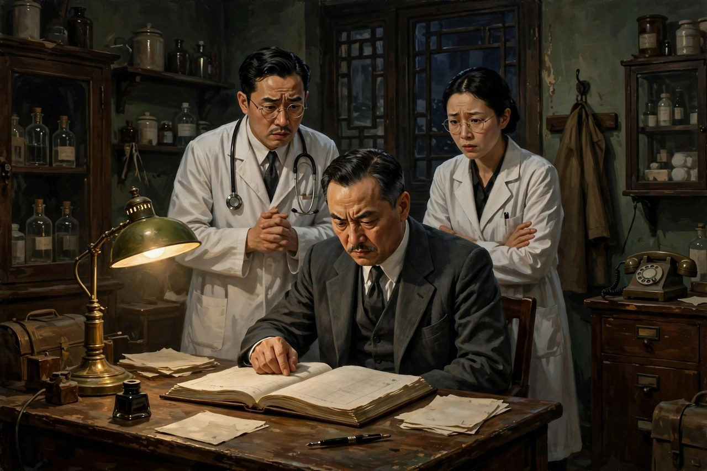
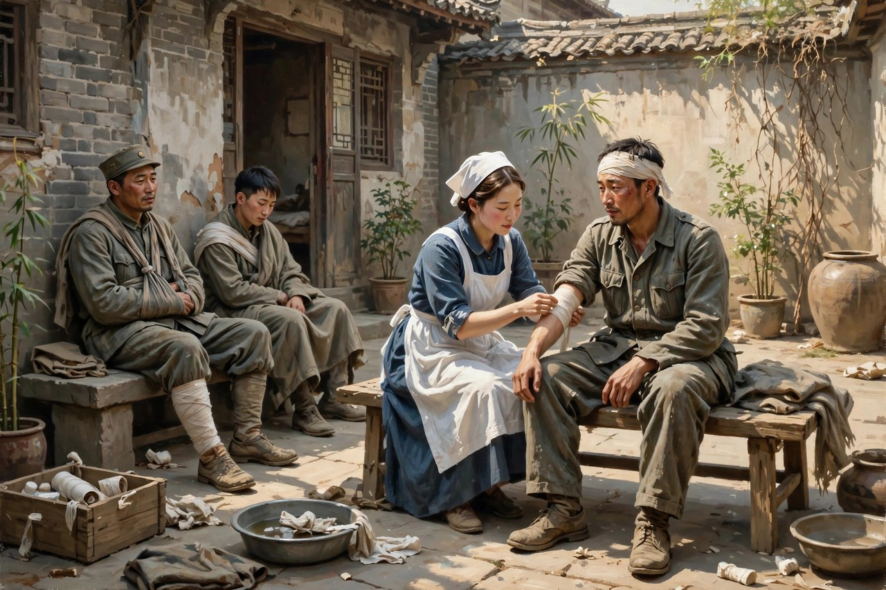

## 后方医院里的烂摊子

《蜕变》写于一九三九年左右，完成于一九四〇年初，是曹禺在抗战时期写的一部四幕话剧。戏的题材，来自他一九三七年冬天在长沙调查的一家伤兵医院，写的是抗战后方一家医院的改革过程。医院本来是救人的地方，可在这出戏里，医院成了腐败的窝：院长秦院长尸位素餐，管事的马登科贪污成风，药被倒卖了，钱被克扣了，伤兵没人管，病房脏乱差，医生护士混日子，真正想干活的人，被排挤，被打压，被边缘化。这种医院，放在抗战的背景下，特别刺眼：前线的人在流血，后方的人在发财，前线的人在拼命，后方的人在混日子，混日子的代价，是伤兵的命，是抗战的力量，是整个民族的元气。曹禺写这出戏，就是要把后方医院的烂摊子摊开，让观众看看，腐败是怎么吃人的，吃人的方式，不是拿刀杀人，是拿制度杀人，是拿贪污、克扣、推诿、混日子，一点点把人耗死，把医院耗垮，把抗战耗弱。

丁大夫是这出戏里的正面人物，是一个爱国知识分子的形象。他是医院里的外科医生，业务好，人正直，看不惯医院的腐败，看不惯马登科的贪污，看不惯秦院长的糊涂，可他一个人，力量太小了，小到他跟马登科正面交锋的时候，两个人谁也不肯让步，谁也战胜不了谁，形成了僵局。僵局的意思是：旧体制还在，新力量还弱，新力量想改，旧体制不让改，改不动，改不动的日子，就是医院里最难熬的日子：伤兵还在等着救命，药还在被倒卖，钱还在被克扣，医生还在混日子，丁大夫急得团团转，转来转去，还是转不出去。这种僵局，在今天依然能看到：很多单位、很多机构，都有丁大夫式的人物，想改革，想干实事，想把烂摊子收拾好，可旧体制、旧关系、旧利益盘根错节，改不动，改不动的时候，人就容易泄气，泄气之后，就变成了混日子的人，混日子的人一多，机构就更烂了，烂了之后，就更改不动了，恶性循环，转来转去，转到最后，只能等一个人来推一把，推一把的人来了，局面才能打开。

梁专员就是来推一把的人。梁公仰是政府派来的视察专员，到了医院之后，不听汇报，不看表面，直接看病房，直接问伤兵，直接查账，直接把马登科的贪污证据摆出来，直接把秦院长撤职，把马登科送交法办，旧官僚体制被摧毁于旦夕之间。梁专员的出现，是曹禺在戏里设计的一个陡转：前面僵持了那么久，僵持得观众都替丁大夫着急，梁专员一来，局面一下子就打开了，打开得干脆，打开得痛快，打开得让观众觉得，改革原来可以这么快，快到让人不敢相信。这种陡转，有人说好，说它写出了抗战时期人们对改革的渴望，写出了新力量战胜旧体制的希望；有人说不好，说它写得太容易了，太像天上掉下来一个救星，救星一来，问题全解决了，解决了之后，观众会以为，改革就是等一个救星，救星不来，就不用改了。这种批评，是有道理的：真实的改革，从来都不是靠一个救星一夜之间完成的，改革是靠很多人一起推，推很久，推得很慢，推得很艰难，才能推开一点，推开一点之后，还要守住，守住了，才能继续推。曹禺写梁专员，写的是人们对改革的渴望，渴望写得太急了，就变成了救星，救星写多了，观众就会养成等救星的习惯，等救星的习惯，是最要不得的习惯：等着等着，自己就变成了混日子的人，混日子的人等来的，往往不是救星，是更烂的摊子。

## 梁专员来了之后

梁专员来了之后，医院的局面打开了，可打开之后的日子，戏没有细写，戏停在了改革开始的地方，停在了旧体制被摧毁、新体制还没有完全建立的地方。停在这里，是很高明的，也是很无奈的：高明的是，戏把最难的部分留给了观众去想，观众走出剧场之后，会想：梁专员走了之后怎么办？丁大夫一个人能不能撑住？新的院长会不会变成旧的院长？新的制度能不能管住新的人？这些问题，戏没有答案，答案要观众自己去找，找的过程，就是戏在起作用的过程；无奈的是，戏没有写下去，是因为曹禺自己也不知道答案，或者说，答案在当时还没有出现，改革的路还很长，长到一部戏写不完，写不完，就只能停在开头，停在希望的地方。希望的地方，是明亮的，可明亮的地方后面，还有很长的路，路上有没有新的马登科，有没有新的秦院长，有没有新的贪污和克扣，戏没有说，戏把路留给了后来的人去走，后来的人走起来，才会明白，改革不是一次性的事，改革是天天都要做的事，天天做，才能守住，守不住，改革的成果就会被新的腐败吃掉，吃掉之后，又要重新改，重新改的时候，又要等一个人来推一把，推一把的人，不一定是梁专员，可能是丁大夫自己，可能是很多个丁大夫一起推，推的人多了，救星就不重要了，重要的是推的人，推的人在，改革就在。

这出戏的接受史，也很有意思。首演之后，在左翼文化界引起了较大的争议，有人质疑，把梁公仰这样一个政府视察专员塑造成正直无私的改革者，是不是在歌颂国民党，是不是应该批评；也有人认为，戏的主要思想倾向是爱国的，是鼓舞抗战的，应该肯定。周恩来当时说，这出戏总体上是歌颂抗战的，作者的爱国主义立场是十分鲜明的，国民党官员也不是铁板一块，里面有顽固派，有中间派，也有坚持抗战的爱国志士。这番话，把争议压下去了，也把戏的定位定下来了：戏不是歌颂某一个党，戏是歌颂抗战，歌颂改革，歌颂新力量，歌颂那些在艰苦里还想干实事的人。这种定位，放在今天看依然有意义：评价一部作品，不要先看它站哪边，不要先给它贴标签，要先看它写的人是不是真的，写的改革是不是真的，写的希望是不是真的，真的东西，经得起时间，经得起争论，经得起不同立场的人去看，看完之后，不同立场的人，可能会有不同的结论，可结论不同，不等于作品没有价值，价值就在于，它把一个真实的问题摆出来了，摆出来之后，争论本身，就是作品在起作用。

《蜕变》这个名字，本身就很有意思：蜕，是旧皮蜕掉，变，是新东西长出来。旧皮蜕掉的过程，是疼的，是慢的，是要流血的，新东西长出来的过程，也是慢的，也是要时间的，也是要很多人一起努力的。曹禺用这个名字，给这出戏定了调：调子不是控诉，不是歌颂，是蜕变，是旧的东西怎么蜕掉，新的东西怎么长出来。旧的东西，包括腐败的体制，包括混日子的态度，包括动摇分子的退缩，包括腐朽人物的没落；新的东西，包括丁大夫这样的新力量，包括梁专员带来的新气象，包括伤兵们重新燃起的希望，包括整个民族在抗战中一种蜕旧变新的气象。旧和新之间，隔着的是斗争，斗争不是一天能打完的，斗争打完了，旧皮不一定立刻蜕掉，新东西不一定立刻长出来，蜕变的过程，可能很长，长到一部戏写不完，长到一代人看不完，看不完，不等于没有蜕变，蜕变正在发生，正在医院里，正在后方，正在前线，正在每一个愿意干实事的人心里发生，发生的地方越多，蜕变的速度越快，快到最后，旧皮就真的蜕掉了，新东西就真的长出来了。

## 放在今天读蜕变

今天读《蜕变》，最容易引起共鸣的，是丁大夫的僵局。很多人今天的工作里，照样有丁大夫式的僵局：想干实事，可旧关系、旧利益、旧规矩挡在前面，改不动，推不动，急得团团转，转来转去，还是转不出去。转不出去的时候，人最容易走两个极端：一个极端是泄气，泄气之后，就变成混日子的人，混日子的人一多，机构就更烂了；另一个极端是等救星，等着上面派一个梁专员来，等着救星一来，问题全解决，等着等着，自己就什么都不干了，什么都不干的人，等来的往往不是救星，是更烂的摊子。曹禺写丁大夫和梁专员，就是写给这样的人看的：僵局不是靠等打破的，僵局是靠推打破的，推的人，不一定是救星，可能是你自己，可能是你和几个志同道合的人一起推，推一点，局面就松一点，松一点，就能再推一点，推来推去，推到最后，旧体制就松动了，松动了，改革就有希望了。希望不是等来的，是推来的，推的人多了，救星就不重要了，重要的是推，推的动作，本身就是改革的开始。

还有一个现实意义，是关于腐败的。医院里的腐败，写的是药被倒卖，钱被克扣，伤兵没人管，这种腐败，放在今天依然能看到，只是换了个样子：换成了回扣，换成了关系，换成了推诿，换成了形式主义，换成了真正干活的人被排挤，真正混日子的人被提拔。腐败的方式变了，可腐败的本质没有变：本质就是拿公共的资源，换个人的好处，换好处的人，换来换去，换到的都是小钱，换掉的却是机构的元气，是百姓的信任，是整个社会的希望。曹禺写马登科和秦院长，写的就是这种本质：马登科贪污，不是为了发大财，是为了在医院里站稳脚跟，是为了在旧体制里活下去，活下去的方式，就是贪，贪成了习惯，习惯成了制度，制度成了腐败的温床。温床不拆，新的马登科还会长出来，长出来之后，又要重新改，重新改的时候，又要付出代价，代价越大，改革越难，改革越难，腐败越深，深到最后，连丁大夫这样的人，都会被磨得没有脾气，没有脾气的人，机构就彻底完了。拆温床的办法，不是等救星，是把制度建起来，把监督建起来，把真正干活的人保护起来，保护起来的人多了，腐败的温床就薄了，薄了之后，改革才有希望。

最后说说这出戏留给写作者的功课。头一条，是写改革题材，不要只写救星，要写推的人。救星写多了，观众会养成等救星的习惯，等救星的习惯，是最害人的习惯；推的人写多了，观众会明白，改革是靠很多人一起推的，推的人多了，救星就不重要了，重要的是推，推的动作，推的艰难，推的代价，推完之后守住成果的艰难，这些东西写出来了，改革题材才有了深度，才有了真实感，才不会沦为一场廉价的欢呼。另一条功课，是写正面人物，不要写成符号。丁大夫写得好，是因为他有僵局，有急躁，有无力感，有跟马登科正面交锋也赢不了的时刻，赢不了的时刻，才是真实的人物，真实的人物，才经得起观众反复看。梁专员写得相对符号化，是因为他没有僵局，没有挣扎，一来就解决问题，解决问题的人，观众会鼓掌，鼓掌完了，就忘了，忘了就说明人物没有立住，立不住的人物，写得再正面，也是空的。写正面人物，要写出他的难，写出他的僵局，写出他的挣扎，挣扎完了，他还是选择往前推，推的动作，才有分量，分量有了，人物就立住了，立住了，戏就立住了。

## 伤兵眼里的医院

医院里的伤兵，是这出戏里最沉默的一群人，也是最有发言权的一群人。他们从前线下来，身上带着伤，心里带着对战争的记忆，到了后方医院，本来以为能好好养伤，能得到照顾，能重新站起来，可到了医院才发现，药被倒卖了，钱被克扣了，病房脏乱差，医生护士混日子，自己的伤，没人好好管，自己的命，没人当回事。伤兵的沉默，不是没有意见，是意见说了也没人听，说了之后，还会被骂，还会被扣药，还会被赶出病房，沉默久了，伤兵就学会了不说话，不说话，不等于没有感觉，感觉在心里憋着，憋到梁专员来了，憋到丁大夫顶上了，憋到马登科被法办了，感觉才一下子爆发出来，爆发出来的时候，伤兵的眼泪，比任何控诉都有力量：一个在前线流过血的人，在后方医院里流眼泪，流的不是伤口的疼，是心里的寒，寒的是后方的人，怎么能这样对待前线的人，寒的是自己拼了命保卫的国家，后方居然是这个样子。这种寒，比伤口更疼，疼到让人想问：抗战到底是为了谁？是为了前线的人，还是为了后方发财的人？问题问出来了，戏的意义就出来了：抗战不是口号，抗战是前线和后方一起的事，后方烂了，前线再拼命也是白拼，白拼的代价，是伤兵的命，是民族的元气，是整个抗战的力量。

伤兵和丁大夫的关系，也很有意思。丁大夫是医生，是想救伤兵的人，可他一个人，救不了所有的伤兵，救不了的时候，他会着急，会自责，会觉得自己对不起伤兵。伤兵看着丁大夫着急，心里会明白：这个医生是真心想救人的，真心想救人的人，在腐败的医院里，是很难的，难到连自己都保不住，难到跟马登科吵架也吵不赢，难到跟秦院长反映也反映不上去。明白了之后，伤兵对丁大夫，就不光是感激，还有同情，同情一个好医生，在烂医院里的无力感。这种同情，放在今天依然能看到：今天很多好医生，好老师，好公务员，照样在烂体制里无力，照样想干实事干不成，照样被旧关系、旧利益挡着，挡着挡着，就泄气了，泄气之后，就变成了混日子的人，混日子的人一多，机构就更烂了。丁大夫没有泄气，他坚持顶着，顶到梁专员来了，顶到局面打开了，顶的意义，就在这里：一个人顶着，顶久了，顶的人多了，局面就松动了，松动了，改革就有希望了。希望不是等来的，是顶来的，顶的人多了，救星就不重要了，重要的是顶，顶的动作，本身就是改革的开始。

医院里的护士和年轻医生，也是这出戏里值得注意的人物。他们年轻，有热情，想干活，可在腐败的医院里，热情被磨得差不多了，磨到最后，热情就变成了麻木，麻木变成了混日子，混日子变成了习惯，习惯变成了制度。制度一旦形成，年轻人的热情，就很难再冒出来了，冒出来一点，就会被旧体制压下去，压下去之后，年轻人就学会了不冒头，不冒头，就安全，安全了，就混日子，混日子，就成了旧体制的一部分。这种循环，是很多机构的老毛病：老毛病不改，年轻人进来了，也会被同化，同化完了，机构就彻底老了，老了之后，就只能等一个人来推一把，推一把的人来了，年轻人心里的那点热情，才有可能重新冒出来，冒出来之后，机构才有可能变新，变新的过程，可能很慢，可能很艰难，可能要很多人一起推，推来推去，推到最后，旧体制就松动了，松动了，新人就有了空间，有了空间，机构才有未来。曹禺写《蜕变》，写的就是这个循环，写循环的目的，不是让观众绝望，是让观众明白：循环不是天生的，循环是人造成的，人造成的循环，人就能打破，打破的办法，就是顶，就是推，就是不变成混日子的人，就是在烂摊子里，还保持一点热情，还保持一点想干实事的心，心在，改革就在。

## 蜕变这个名字的分量

蜕变这个名字，放在今天看，依然很有分量。蜕，是蛇蜕皮，是蝉蜕壳，是旧的东西脱落的过程，脱落的时候，是疼的，是要流血的，是要把自己身上那层旧皮，一点点撕下来的。撕下来的过程，没有人会觉得舒服，舒服的蜕变，不是蜕变，是换衣服，换衣服换完了，人还是旧的人，皮还是旧的皮。真正的蜕变，是疼的，是慢的，是要付出代价的，代价付完了，旧皮才算蜕掉，新东西才算长出来。新东西长出来的时候，也是慢的，也是要时间的，也是要很多人一起努力的，努力完了，新东西才能站稳，站稳了，蜕变才算完成，完成之后，人就新了，机构就新了，社会就新了。新，不是换一个名字，不是换一个牌子，不是换一批人，换名字、换牌子、换人，都很容易，容易的东西，往往不是真的蜕变，真的蜕变，是换一套活法，换一套制度，换一种对待人的态度，态度换了，活法换了，制度换了，蜕变才算真的发生了。曹禺用蜕变这个名字，就是在提醒观众：不要把换名字当成蜕变，不要把换人当成蜕变，不要把梁专员来了当成蜕变完成了，梁专员来了，只是蜕变开始了，开始之后，还有很长的路要走，路上有没有新的马登科，有没有新的秦院长，有没有新的贪污和克扣，要看后来的人怎么守，守住了，蜕变才算真的完成了，守不住，蜕变就会倒退，倒退之后，又要重新蜕，重新蜕的时候，代价会更大，大到让人想问：当初为什么没有守住？守住的办法，就是把制度建起来，把监督建起来，把真正干活的人保护起来，保护起来的人多了，蜕变才有保障，保障有了，旧皮才不会再长回来。

## 丁大夫的夜里

丁大夫夜里睡不着的时候，会想什么？会想医院里的伤兵，会想被倒卖的药，会想被克扣的钱，会想马登科的脸，会想秦院长的糊涂，会想自己跟马登科吵架的时候，为什么吵不赢，会想自己反映问题的时候，为什么反映不上去，会想自己一个人的力量，为什么这么小，小到连一个伤兵都保不住，小到连一间病房都管不好。想来想去，想到的都是无力感，无力感是最磨人的东西，磨来磨去，磨到最后，人就泄气了，泄气之后，就变成了混日子的人，混日子的人一多，医院就更烂了。丁大夫没有泄气，他坚持顶着，顶着的时候，他心里也很清楚，顶一个人的力量是不够的，不够的力量，顶久了，也会累，累了之后，也会想放弃，想放弃的时候，他会想起伤兵的眼泪，想起伤兵在前线流过的血，想起自己当医生的初心，初心这个东西，在烂医院里，是最容易被磨掉的东西，磨掉初心的人，就变成了马登科，变成了秦院长，变成了混日子的人，丁大夫没有磨掉初心，他守着初心，守着守着，梁专员就来了，梁专员来了，局面就打开了，打开之后，丁大夫才明白，自己顶了那么久，顶的意义，就在这里：顶，不是为了立刻胜利，顶，是为了等一个人来推一把，等推的人来了，顶的人和推的人合在一起，局面就打开了，打开之后，改革才有希望。希望不是等来的，是顶来的，顶的人多了，推的人来了，改革就开始了，开始之后，还要守住，守住的办法，就是把顶变成习惯，变成日常，变成每天多做一点，每天多管一点，每天多为伤兵想一点，想一点，医院就暖一点，暖一点，改革就稳一点，稳一点，旧体制就更难回来了，回不来的旧体制，才是真的被摧毁了。

今天的丁大夫，照样在夜里睡不着，照样在想，自己一个人的力量为什么这么小，照样在想，旧体制为什么这么难改，照样在想，自己顶了那么久，为什么局面还是没有打开。想这些问题的人，不是少数，是很多，很多人在夜里睡不着，睡不着的原因，就是想干实事干不成，想改革改不动，想为百姓做点事，做来做去，还是被旧关系、旧利益挡着。挡着挡着，人就容易走两个极端：一个极端是泄气，泄气之后，就变成混日子的人；另一个极端是等救星，等着上面派一个梁专员来，等着救星一来，问题全解决。两个极端，都是错的，错的原因，是改革不是靠一个人，也不是靠等救星，改革是靠很多人一起顶，一起推，顶的人多了，推的人来了，局面就松动了，松动了，改革就有希望了。希望不是等来的，是顶来的，顶的动作，本身就是改革的开始，开始之后，还要守住，守住之后，改革才算真的完成了。完成之后，夜里睡不着的人，才能睡个好觉，好觉睡好了，往后，才能继续顶，继续推，继续为伤兵、为百姓、为这个社会，多做一点，多做一点，社会就好一点，好一点，蜕变就真的发生了。

## 蜕变之后的守成

改革打开局面之后，最难的不是打开，是守住。打开的时候，有梁专员推一把，有丁大夫顶着，有伤兵的眼泪，有观众的掌声，掌声完了，梁专员走了，丁大夫一个人留下来了，留下来的日子，才是真正难的日子：新的院长来了，新的制度建了，新的药管起来了，新的钱算清楚了，可旧的习惯还在，旧的关系还在，旧的利益还在，旧的东西，换了一个名字，换了一个牌子，换了一批人，又回来了，回来之后，改革的成果，就一点点被吃掉了，吃掉的过程，是慢的，慢到让人注意不到，注意不到的时候，吃掉的东西，已经很多了，很多了之后，改革就倒退了，倒退之后，又要重新改，重新改的时候，代价会更大，大到让人想问：当初为什么没有守住？守住的办法，就是把制度建起来，把监督建起来，把真正干活的人保护起来，保护起来的人多了，旧东西回来的路，就被堵住了，堵住了，改革才有保障，保障有了，蜕变才算真的完成了。守成的道理，放在今天依然管用：今天很多改革，打开局面的时候很热闹，热闹完了，守成的时候就松了，松了之后，旧东西就回来了，回来之后，改革就白改了，白改的教训，是很多机构的老毛病，老毛病不改，改革就永远在打开局面，永远在重新开始，重新开始的时候，人就累了，累了之后，人就不想改了，不想改的人，机构就彻底老了，老了之后，就只能等下一个人来推一把，推一把的人来了，又是新一轮的打开局面，打开局面，守不住，再打开，再守不住，循环转来转去，转到最后，机构就彻底完了。打破循环的办法，就是守住，守住的办法，就是制度，就是监督，就是保护干活的人，保护的人多了，循环就打破了，打破之后，蜕变才算真的发生了。

## 蜕变没有完成时

蜕变这个词，是没有完成时的，蜕变不是一次性的事，不是梁专员来了就完成了，不是马登科被法办了就完成了，不是秦院长被撤职了就完成了，蜕变是天天都要做的事，天天做，才能守住，守不住，蜕变就会倒退，倒退之后，又要重新蜕，重新蜕的时候，代价会更大，大到让人想问：当初为什么没有守住？守住的办法，就是把制度建起来，把监督建起来，把真正干活的人保护起来，保护起来的人多了，旧东西回来的路，就被堵住了，堵住了，蜕变才有保障，保障有了，旧皮才不会再长回来。旧皮长回来的过程，是慢的，慢到让人注意不到，注意不到的时候，长回来的东西，已经很多了，很多了之后，蜕变就倒退了，倒退之后，又要重新开始，重新开始的时候，人就累了，累了之后，人就不想改了，不想改的人，机构就彻底老了，老了之后，就只能等下一个人来推一把，推一把的人来了，又是新一轮的蜕变，新一轮的蜕变，守不住，再蜕变，再守不住，循环转来转去，转到最后，机构就彻底完了。打破循环的办法，就是守住，守住的办法，就是天天做，天天做，蜕变就没有完成时，没有完成时的蜕变，才是真的蜕变，真的蜕变，发生在每一天，发生在每一个愿意干实事的人心里，发生在医院里，发生在后方，发生在前线，发生在整个社会里，社会里蜕变的人多了，社会就真的变了，变了之后，旧皮就真的蜕掉了，新东西就真的长出来了。

## 医院里的新芽

医院里的新芽，是在哪里长出来的？新芽长在丁大夫顶着的地方，长在伤兵的眼泪里，长在梁专员推一把的地方，长在年轻医生和护士心里，那一点还没有完全磨掉的热情里。热情磨掉了，就长不出新芽了，热情还在，新芽就能长出来，长出来之后，要小心呵护，呵护的办法，就是制度，就是监督，就是保护干活的人，保护的人多了，新芽就长大了，长大了之后，医院就变了，变了之后，伤兵的日子就好过了，好过了之后，抗战的力量就强了，强了之后，民族的元气就足了。元气足了，蜕变就真的发生了，发生的蜕变，不是换一个名字，不是换一个牌子，不是换一批人，是换一套活法，换一套制度，换一种对待人的态度，态度换了，活法换了，制度换了，医院就真的新了，新的医院，治起病来，效果也不一样，效果不一样的原因，不是药变了，是人心变了，人心变了，药的效果就更好了。曹禺写《蜕变》，写的就是新芽的故事：新芽很小，小到只能在烂摊子里，冒出一点绿，绿很小，小到让人注意不到，注意不到的新芽，很容易被旧体制踩死，踩死之后，医院就彻底老了，老了之后，就只能等下一个人来推一把，推一把的人来了，新芽才能重新长出来，重新长出来的新芽，要小心呵护，呵护好了，医院就真的蜕变了。

## 医院门口的路

医院门口的路，是通向哪里的？是通向前线的路，是通向后方的路，是通向伤兵家里的路，是通向整个社会的路。路通了，药就能送进来，钱就能算清楚，伤兵就能得到照顾，医生就能安心看病，护士就能安心照顾，医院就能慢慢变好，变好的医院，治起病来，效果也不一样，效果不一样的原因，不是药变了，是人心变了，人心变了，药的效果就更好了。路不通的时候，医院就是一座孤岛，孤岛上的医生，再想干实事，也干不成，干不成的日子，过久了，人就泄气了，泄气之后，就变成了混日子的人，混日子的人一多，医院就更烂了。路通的办法，就是改革，就是把制度建起来，把监督建起来，把真正干活的人保护起来，保护起来的人多了，路就通了，路通了，蜕变就真的发生了。曹禺写《蜕变》，写的就是这条路，路很长，长到一部戏写不完，写不完的路，要后来的人继续走，继续走下去，路就越走越宽，宽了之后，医院门口的路，就通向了整个社会，通向了所有需要改革的地方。
