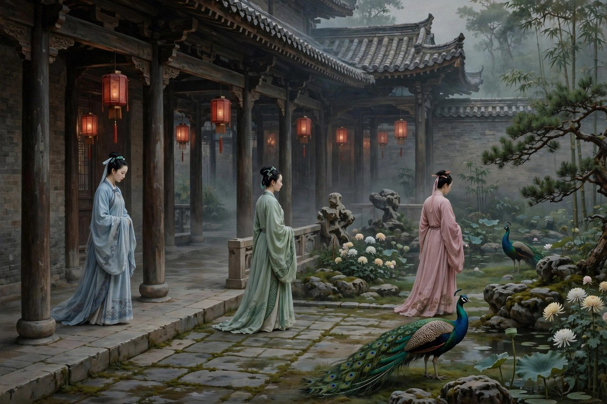
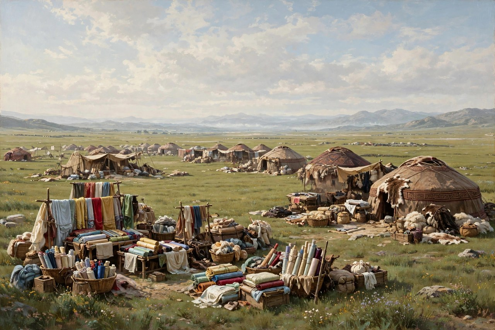

## 入宫数岁不得见的宫女

王昭君的故事，中国人从小就听过：汉代宫女，入宫数岁，不得见御，积了一肚子悲怨，听说匈奴单于来求亲，就主动请行，出了塞，嫁给了呼韩邪单于，做了阏氏，生了孩子，促进了汉匈之间的和睦。这个故事，在诗词里，在戏曲里，在小说里，讲了上千年，讲来讲去，讲的都是一个哭哭啼啼的女子，讲的都是红颜薄命，讲的都是被牺牲的女人。马致远的《汉宫秋》，写的就是这种调子：昭君是被牺牲的，是被皇帝和大臣推出去的，是哭着出塞的，出塞之后，还要投江自尽，还要让皇帝做梦梦见她，还要让大雁叫醒皇帝的梦。哭，是老版本的主调，哭完了，观众跟着掉眼泪，掉完眼泪，故事就完了，完了之后，昭君还是那个可怜的女子，还是那个被命运摆布的棋子。

曹禺的《王昭君》，写于一九七八年，发表的时候，曹禺已经年近古稀，搁笔十余年之后写出新作，一时传为美谈。他的版本，跟老版本最大的不一样，就是昭君不哭了，或者说，昭君不光是哭了，她笑了，她主动了，她有主意了，她不再是被推出去的棋子，而是自己选择出塞的人。曹禺在戏里，摈弃了老版本里毛延寿画美人图、索贿、丑化昭君的那套情节，摈弃了汉元帝跟昭君的爱情纠葛，突出了维护民族团结的主题，虚构了一个富有智慧和幽默感的老奴苦伶仃，让戏的调子从悲悲切切，变成了融和怡人，变成了笑中带泪，泪中带笑。这种改法，在当时引起了不少讨论：有人说好，说昭君终于不再是哭包了，终于成了一个有主见、有担当的女子；有人说不好，说这样改，把历史改得太干净了，把昭君的苦改没了，把宫廷的黑暗改淡了，改淡了，戏的批判性就弱了。两种说法，都有道理，曹禺的改法，确实有时代的印记，有当时民族政策的需要，有歌颂团结的任务，可即便如此，他把昭君从哭包改成主动的人，这个方向，放在今天看依然是对的：女人不是只能哭，女人也可以有主意，也可以自己选路，也可以为了一件比个人幸福更大的事，主动往前走。

戏里的昭君，是这样一个人：她出身农家，被征入宫，在宫里待了数年，没有见过皇帝，没有得到宠幸，按老版本的逻辑，她应该怨，应该恨，应该哭，应该等着皇帝来救她。曹禺的昭君不这样，她看明白了宫里的日子：宫里就是一座大牢笼，待在里面，待到老，也不过是个白头宫女，白头宫女的日子，是没有未来的，是熬着等死的。与其在宫里熬到老，不如主动请行，去塞外，去匈奴，去一个虽然遥远、虽然艰苦、却有可能活出新天地的地方。请行这个动作，是全剧的点睛之笔：请，不是被派，不是被赐，不是被牺牲，是自己开口要去的，要去，就要承担去的后果，承担后果的人，才是真正的主人。昭君请行的时候，心里是亮的，亮的是她知道自己在干什么，知道出塞意味着什么，知道塞外有风沙，有战争，有语言不通，有生活习惯不一样，可她还是请了，请了之后，她没有哭，她笑着出塞，笑着面对呼韩邪单于，笑着跟匈奴人打交道，笑着把汉匈之间的关系，一点点往好的方向推。笑，不是没心没肺，是看明白了之后的从容，是把悲怨留在汉宫、把豪情带到塞外的气度。

呼韩邪单于在曹禺的戏里，也不是一个简单的异族首领，他是一个有眼光、有担当的人，他来汉朝求亲，不是为了抢女人，不是为了炫耀武力，是为了匈奴的统一，是为了跟汉朝盟好，是为了让边境安宁，让百姓少打仗。他跟昭君的感情，也不是老版本里那种皇帝和宫女的爱情纠葛，是一种志同道合的感情：两个人都有一个共同的愿望，就是让汉匈之间不再打仗，让边境的百姓能过安稳日子，愿望相同了，感情就有了根，根扎实了，感情就经得起风沙，经得起时间，经得起各种各样的挑拨和离间。曹禺让呼韩邪在妻子亡故之后娶昭君为阏氏，成为一夫一妻制的典范，这个改法，是为了符合今天人的感情和观念，是为了让昭君的婚姻，看起来不再是被赏赐、被牺牲，而是一段平等的、互相尊重的婚姻。平等的婚姻，在汉匈之间，在那个年月里，本身就是一种象征：象征着两个民族之间，不再是谁压着谁，不再是谁赏赐谁，而是平起平坐，互相尊重，互相过日子。象征虽然有点理想化，可理想化的象征，在戏里是有力量的，力量就在于，它给观众一个希望：民族之间，是可以和睦相处的，和睦相处不是靠打仗打出来的，是靠像昭君和呼韩邪这样的人，一点点处出来的。

## 苦伶仃带来的笑声

苦伶仃是曹禺虚构的一个人物，一个老奴，一个跟在昭君身边的人，富有智慧，富有幽默感，常常在紧张的时候，说一句俏皮话，把气氛缓下来，在悲伤的时候，讲一个笑话，让观众笑中带泪。这个人物的出现，让戏的调子变了：以前的昭君戏，全是哭，全是悲，全是红颜薄命，观众看完之后，心里堵得慌，堵完了，什么都没有留下；有了苦伶仃，戏里有了笑声，笑声不是轻浮，是智慧，是在苦难里还能笑得出来的人生态度。苦伶仃的笑，笑的是宫廷的虚伪，笑的是大臣的糊涂，笑的是那些把昭君当成棋子的人，笑完了，观众会明白：原来在那么黑暗的宫廷里，还有人能保持清醒，还能用幽默来对抗荒唐，幽默不是逃避，是另一种反抗，反抗的方式不是哭，不是闹，是笑，笑着把荒唐揭穿，揭穿之后，荒唐就站不住了。曹禺晚年写戏，风格变得诗意了，抒情了，幽默了，这种风格，跟他年轻时候写《雷雨》那种惨烈的风格完全不一样，可风格变了，内核没有变：内核还是写人，写人的尊严，写人的选择，写人在大环境里怎么活出自己的样子。年轻时候写人，写的是被环境压垮的人；晚年写人，写的是在环境里还能笑着走出去的人，两种写法，两种人生，两种态度，放在一起看，就是曹禺一生的变化：从写悲剧，到写希望，从写压垮，到写走出去，走出去的人，不一定能立刻改变世界，可走出去本身，就是一种希望。

这出戏的创作过程，也很有意思。一九六一年初春，周总理同文艺工作者座谈，希望曹禺能写一个具有新意的王昭君，当年夏天，曹禺就到内蒙古去参观访问，体验生活，为创作搜集资料。可由于历史的原因，创作搁置了十七年，到了一九七八年，才终于写出来。十七年的搁置，搁置的不光是一部戏，还有一个作家的黄金岁月，还有一个时代对历史题材的态度。搁置之后再写，曹禺已经不是年轻时候的曹禺了，他的心境变了，笔法变了，对历史的看法也变了，变了之后写出来的昭君，自然跟年轻时候写出来的不一样：年轻时候的昭君，可能会更悲，更烈，更不肯妥协；晚年的昭君，更从容，更幽默，更愿意为了大局往前走。这种变化，有人说是进步，有人说是妥协，进步和妥协之间，隔着的是时代，时代变了，作家也得变，变了之后，还能写出东西来，还能让观众看完之后有所触动，这本身就是一种不容易。搁笔十余年之后，还能写出新作，还能让朋友们和读者观众热烈祝贺，还能让吴祖光写贺诗赞美，这说明，曹禺心里的那团火，还没有完全灭，火还在，只是火的形状变了，从年轻时候的烈火，变成了晚年的文火，文火不烈，可文火暖人，暖人的火，照样能照亮舞台。

对照现在看《王昭君》，会发现主动请行这个题目，依然有现实意义。今天很多女性，依然在面对各种各样的牢笼：家庭的牢笼，职场的牢笼，舆论的牢笼，年龄的牢笼，牢笼的方式变了，可牢笼的本质没有变：都是让人待在原地熬，熬到老，熬到白头，熬到没有未来。昭君的选择，提醒这些人：牢笼不是不能走出去的，走出去的方式，不是哭，不是闹，不是等着别人来救，是自己开口请行，是自己说，我要走，我要去一个新地方，我要去过一种新生活，我要为一件比个人幸福更大的事，往前走一步。走一步，可能很艰难，可能要面对风沙，可能要面对语言不通，可能要面对各种各样的不适应，可走一步，总比在牢笼里熬到老要好，熬到老，熬出来的只是白头，走出去，走出来的可能是新天地，可能是新人生，可能是像昭君那样，成为两个民族之间的桥梁，成为历史上留名的人。桥梁不是一天搭成的，是要靠像昭君这样的人，一点点走，一点点处，一点点把两个世界连起来，连起来之后，世界就变大了，大了之后，人就活得宽了。

## 老版本和新版本的对照

把曹禺的《王昭君》和老版本放在一起对照，会看得更清楚。老版本里，昭君是被毛延寿害的，是被画师丑化了的，是被皇帝忽视了的，是被单于索取去的，是被命运摆布的，每一步都是被动的，被动到最后，她只能投江自尽，只能让皇帝做梦梦见她，只能让大雁叫醒皇帝的梦。被动的昭君，观众看完之后，只会同情，只会掉眼泪，掉完眼泪，什么都不会改变，因为被动的人，是改变不了什么的，改变不了，悲剧就只能重复。曹禺的昭君，是主动的，是请行的，是笑着出塞的，是跟呼韩邪志同道合的，是为民族团结出力的，主动的昭君，观众看完之后，不光会同情，还会敬佩，敬佩完了，还会想：我是不是也可以主动一点？是不是也可以在自己的牢笼里，主动请行一次？主动和被动之间，隔着的不是运气，是选择，选择主动的人，命运就掌握在自己手里一点，选择被动的人，命运就掌握在别人手里一点，掌握在自己手里一点，总比掌握在别人手里要好，好一点，活得就宽一点，宽一点，人生就有可能不一样。

当然，曹禺的版本也有它的局限。有人批评说，这个版本把历史改得太干净了，把宫廷的黑暗改淡了，把昭君的苦改没了，把民族团结写得太容易了，容易到让人觉得，出塞是一件很轻松的事，轻松到让人忘了，塞外其实很苦，苦到很多人去了之后就回不来了，苦到昭君自己也要面对很多困难，困难写得太少，戏的真实感就弱了。这种批评，是有道理的：历史剧不能只写光明的一面，不写黑暗的一面，只写光明，观众会觉得假，觉得是在歌颂，觉得是在完成任务。曹禺的版本，确实有歌颂的任务，有时代的印记，有把昭君写成民族团结先驱的需要，需要写进戏里，戏就难免有点理想化，理想化了，批判性就弱了，弱了，戏的分量就轻了。可即便如此，曹禺把昭君从哭包改成主动的人，这个方向，依然值得肯定：方向对了，细节可以再打磨，细节打磨好了，戏就立住了；方向错了，细节再好，也是错的，老版本的方向，是把女人写成牺牲品，牺牲品写得再感人，也还是牺牲品，牺牲品的逻辑，是女人只能被牺牲，女人不能主动，这个逻辑，在今天已经站不住了，站不住的逻辑，写得再好，也要改，改的方向，就是曹禺指的方向：女人可以主动，女人可以有主见，女人可以为了一件大事，笑着往前走。

最后说说这出戏在曹禺一生里的位置。曹禺年轻时候写《雷雨》《日出》《原野》《北京人》，写的是悲剧，写的是被压垮的人，写的是旧社会怎么吃人；晚年写《王昭君》，写的是希望，写的是走出去的人，写的是新时代怎么团结人。悲剧和希望，放在一个人的一生里，就是一部完整的历史：年轻的时候，看得多的是黑暗，看得多的是压迫，看得多的是人怎么被环境逼到绝路；晚年的时候，看得多的是光明，看得多的是团结，看得多的是人怎么在绝路里找到新路。两种看法，两种笔法，两种人生，合在一起，才是完整的曹禺。完整的曹禺，告诉后来的人：写戏的人，一辈子都在变，变是正常的，不变才是不正常的，变的过程中，内核不能变，内核就是写人，写人的尊严，写人的选择，写人在大环境里怎么活，活出什么样子。内核不变，风格怎么变都可以，风格变了，戏还是曹禺的戏，还是能让观众看完之后，心里有所触动，有所思考，有所行动。行动不一定是立刻去出塞，行动可以是主动请行一次，可以是在自己的牢笼里，先把窗户打开，先把话说清楚，先把该走的一步走出去，走出去之后，天地就宽了，宽了之后，人才真正活过来了。

## 昭君出塞路上的风沙

昭君出塞的路，是一条很长的路，长到要走很多天，很多夜，很多风沙，很多寒冷，很多不适应。曹禺的戏，没有把这条路写成一路哭哭啼啼，没有把风沙写成折磨，没有把寒冷写成惩罚，而是把路写成了一次主动的选择之后，必须要走的路：路上有风沙，风沙是真的，路上有寒冷，寒冷是真的，路上有语言不通，语言不通是真的，路上有生活习惯不一样，不一样是真的，可这些真的困难，没有让昭君后悔，没有让她哭着要回来，没有让她觉得自己选错了。选了，就要走，走，就要面对困难，面对困难的时候，笑着面对，和哭着面对，结果是不一样的：笑着面对，困难就小了一点，小了一点，人就轻松一点，轻松一点，路就好走一点；哭着面对，困难就大了一点，大了一点，人就沉重一点，沉重一点，路就难走一点。昭君笑着面对，不是因为她没有困难，是因为她看明白了，困难是出塞必须付出的代价，代价付了，新天地才能来，新天地来了，困难就值得了。值得的东西，再苦也值得，不值得的东西，再轻松也不值得，昭君觉得出塞值得，所以她笑着走，笑着走的人，路再长，也走得到头。

塞外的人，对昭君的态度，也很有意思。匈奴人一开始看她，是看一个汉朝来的女子，是看一个被赏赐来的阏氏，是看一个外来人，外来人在一个陌生的地方，是很难的，难到连说话都要靠翻译，难到连吃饭的习惯都要重新学，难到连穿衣服都要重新适应。可昭君没有把自己当成外来人，她把自己当成了要在这里过日子的人，过日子的人，就要学这里的语言，就要学这里的习惯，就要跟这里的人打交道，打交道多了，外来人就变成了自己人，自己人了，日子就好过了。她的办法，不是端着汉朝宫女的架子，不是觉得自己高人一等，不是觉得匈奴人都是蛮夷，她的办法，是放下架子，是主动去学，是主动去处，是主动把汉匈之间的那道墙，一点点拆掉，拆掉之后，两个民族的人，才能真正过到一起去。拆墙的办法，放在今天依然管用：今天很多人，到了一个新的地方，新的单位，新的圈子，起初的反应是端着架子，是觉得自己原来地方好，是觉得新地方不如原来地方，端着架子的人，永远都是外来人，外来人永远都融不进去，融不进去，就只能抱怨，抱怨完了，还是外来人。昭君的办法是反过来的：放下架子，主动去学，主动去处，处久了，外来人就变成了自己人，自己人了，日子就宽了，宽了之后，人就活得踏实了。

昭君和呼韩邪的相处，也值得今天的人学学。两个人来自不同的民族，不同的文化，不同的生活习惯，放在一起过日子，肯定会有摩擦，摩擦是正常的，摩擦不可怕，可怕的是摩擦之后，不沟通，不理解，不让步，硬要对方按自己的习惯来，硬来的结果，就是吵架，吵架完了，就是冷战，冷战完了，就是分开。昭君和呼韩邪的相处，不是硬来，是互相尊重，是互相让步，是互相学对方的语言，学对方的习惯，学对方看问题的方式，学久了，两个人就找到了共同点，共同点就是，都希望边境安宁，都希望百姓少打仗，都希望两个民族能和睦相处，共同点找到了，摩擦就小了，小了之后，日子就好过了。好过的日子，不是没有摩擦的日子，是摩擦之后，还能坐下来谈，还能互相让一步，还能为了共同的目标，往前走一步的日子。昭君和呼韩邪的日子，就是这样过来的，过来的过程，写进戏里，观众看完之后，会明白：民族团结，不是口号，不是文件，不是会议上的表态，是两个人、两群人，在日常生活里，一点点处出来的，处出来的团结，才是真的团结，真的团结，经得起风沙，经得起时间，经得起各种各样的挑拨和离间。

## 昭君和今天的出走者

今天的人，照样在面对昭君面对过的选择：是待在牢笼里熬到老，还是主动请行，去一个新地方，过一种新生活。牢笼的方式变了，可牢笼的本质没有变：牢笼就是让人待在原地，不敢动，不敢选，不敢走，待着待着，人就老了，老了之后，就更不敢走了，不敢走的人，只能继续熬，熬到最后，连熬的力气都没有了。主动请行的人，刚开始的时候，日子不一定好过，新地方有风沙，有寒冷，有语言不通，有生活习惯不一样，有各种各样的不适应，不适应的时候，人最容易后悔，后悔当初为什么要走，后悔完了，又想回来，回来之后，牢笼还在，牢笼里的人，还在熬，熬着熬着，人就更后悔了，后悔当初为什么没有坚持走下去，坚持走下去的人，日子慢慢就好过了，好过的原因，不是新地方没有困难，是新地方的困难，是自己选的困难，自己选的困难，扛起来的时候，心里是亮的，亮着的心，扛困难的时候，就有劲，有劲的人，困难就小了，小了之后，日子就宽了。宽的日子，是昭君走出去之后的日子，是每一个主动请行的人，走出去之后的日子，日子宽了，人就活过来了，活过来的人，才真正明白，牢笼不是不能走出去的，牢笼是自己心里那道墙，墙拆了，路就出来了，路出来了，人就可以走了，走了之后，天地就大了，大了之后，人就不用再熬了。

昭君的故事，放在今天，还有一个意义，是关于女性的。老版本里的昭君，是被牺牲的，是被推出来的人，是哭着出塞的人，哭着出塞的女子，观众看完之后，只会同情，只会掉眼泪，掉完眼泪，什么都不会改变，因为被牺牲的人，是改变不了什么的。曹禺的昭君，是主动的，是请行的，是笑着出塞的，是为民族团结出力的，主动的女子，观众看完之后，不光会同情，还会敬佩，敬佩完了，还会想：我是不是也可以主动一点？是不是也可以在自己的牢笼里，主动请行一次？主动和被动之间，隔着的不是运气，是选择，选择主动的人，命运就掌握在自己手里一点，选择被动的人，命运就掌握在别人手里一点，掌握在自己手里一点，总比掌握在别人手里要好，好一点，活得就宽一点，宽一点，人生就有可能不一样。不一样的女生，放在今天依然能看到：很多女性，在家庭里，在职场里，在舆论里，依然在面对各种各样的牢笼，牢笼的方式变了，可牢笼的本质没有变，本质就是让人待在原地熬，熬到老，熬到白头，熬到没有未来。昭君的选择，提醒这些女性：牢笼不是不能走出去的，走出去的方式，不是哭，不是闹，不是等着别人来救，是自己开口请行，是自己说，我要走，我要去一个新地方，我要去过一种新生活，我要为一件比个人幸福更大的事，往前走一步。走一步，可能很艰难，可能要面对风沙，可能要面对语言不通，可能要面对各种各样的不适应，可走一步，总比在牢笼里熬到老要好，熬到老，熬出来的只是白头，走出去，走出来的可能是新天地，可能是新人生，可能是像昭君那样，成为两个世界之间的桥梁，成为历史上留名的人。

桥梁这个意象，在昭君的故事里，是很重要的。桥梁不是一天搭成的，是要靠像昭君这样的人，一点点走，一点点处，一点点把两个世界连起来，连起来之后，世界就变大了，大了之后，人就活得宽了。搭桥梁的人，是很辛苦的，辛苦的是，要学对方的语言，要学对方的习惯，要学对方看问题的方式，要放下自己的架子，要主动去处，处久了，桥梁才搭起来，搭起来之后，两个世界的人，才能真正过到一起去。过到一起去的日子，不是没有摩擦的日子，是摩擦之后，还能坐下来谈，还能互相让一步，还能为了共同的目标，往前走一步的日子。昭君和呼韩邪的日子，就是这样过来的，过来的过程，写进戏里，观众看完之后，会明白：民族团结，不是口号，不是文件，不是会议上的表态，是两个人、两群人，在日常生活里，一点点处出来的，处出来的团结，才是真的团结，真的团结，经得起风沙，经得起时间，经得起各种各样的挑拨和离间。挑拨和离间，在今天依然存在，存在的方式变了，可存在的本质没有变：本质就是有人想把两个世界分开，分开之后，好从中渔利，渔利的人，最怕的就是桥梁，桥梁搭起来了，渔利的人就没有市场了，没有市场的人，就会想办法拆桥，拆桥的办法，就是挑拨，就是离间，就是让两个世界的人互相怀疑，互相敌视，怀疑和敌视起来了，桥梁就摇摇欲坠了，摇摇欲坠的桥梁，要靠像昭君这样的人，继续守，继续处，继续把两个世界往一起拉，拉久了，桥梁就稳了，稳了之后，挑拨的人就没有办法了，没有办法的人，只能看着桥梁，看着两个世界的人，过到一起去。

## 昭君走过的路还长

昭君走过的路，还很长，长到要走很多天，很多夜，很多风沙，很多寒冷，很多不适应，不适应的日子里，人最容易后悔，后悔当初为什么要走，后悔完了，又想回来，回来之后，牢笼还在，牢笼里的人，还在熬，熬着熬着，人就更后悔了，后悔当初为什么没有坚持走下去，坚持走下去的人，日子慢慢就好过了，好过的原因，不是新地方没有困难，是新地方的困难，是自己选的困难，自己选的困难，扛起来的时候，心里是亮的，亮着的心，扛困难的时候，就有劲，有劲的人，困难就小了，小了之后，日子就宽了。宽的日子，是昭君走出去之后的日子，是每一个主动请行的人，走出去之后的日子，日子宽了，人就活过来了，活过来的人，才真正明白，牢笼不是不能走出去的，牢笼是自己心里那道墙，墙拆了，路就出来了，路出来了，人就可以走了，走了之后，天地就大了，大了之后，人就不用再熬了。不用再熬的日子，才是真正的日子，真正的日子，过起来才踏实，踏实的日子，才值得过，值得过的日子，是昭君用自己的脚，一步一步走出来的，走出来的路，没有哭哭啼啼，没有被牺牲的委屈，没有被命运摆布的无奈，只有笑着出塞的从容，只有主动请行的勇气，只有为民族团结出力的担当，担当扛在肩上，路就走得稳了，稳了之后，风沙来了也不怕，寒冷来了也不怕，语言不通也不怕，生活习惯不一样也不怕，怕的东西少了，日子就宽了，宽了之后，桥梁就搭起来了，桥梁搭起来了，两个世界的人，才能真正过到一起去。

## 琵琶声里的昭君

昭君出塞的时候，带着一支琵琶，琵琶声里，有汉宫的记忆，有塞外的风沙，有离别的愁，有出塞的豪情，愁和豪情放在一起，就是昭君的心：愁，是因为离开了故乡，离开了熟悉的生活，离开了汉宫里那些虽然压抑、却熟悉的日子；豪情，是因为她是自己选的路，选的路，再难走，也是自己的路，自己的路，走起来的时候，心里是亮的，亮着的心，弹出来的琵琶声，就不一样了，不一样的琵琶声，传到塞外，传到匈奴人耳朵里，传到呼韩邪耳朵里，听的人会明白：这个女子，不是被牺牲来的，不是哭着来的，是笑着来的，是主动来的，主动来的人，琵琶声里没有怨，没有恨，只有一种从容，从容的女子，在塞外过日子，过得再难，也能过下去，过下去的日子，慢慢就变成了两个民族之间的桥梁，桥梁搭起来了，琵琶声就变成了和平的歌，歌唱起来了，边境就安宁了，安宁的日子，是昭君用自己的脚，一步一步走出来的，走出来的路，留在了历史上，留在了诗词里，留在了戏曲里，留在了曹禺的戏里，戏里的昭君，笑着出塞，笑着弹琵琶，笑着面对风沙，笑着面对新生活，笑着的人，路再长，也走得到头。

## 昭君的琵琶还在响

昭君的琵琶，还在响吗？响，响在塞外的风沙里，响在汉匈之间的集市上，响在边境百姓的耳朵里，响在后来人的诗词里，响在戏曲的舞台上，响在曹禺的戏里，响在每一个主动请行的人心里。琵琶声里，有离别的愁，有出塞的豪情，有从容，有勇气，有担当，担当扛在肩上，路就走得稳了，稳了之后，风沙来了也不怕，寒冷来了也不怕，语言不通也不怕，生活习惯不一样也不怕，怕的东西少了，日子就宽了，宽了之后，桥梁就搭起来了，桥梁搭起来了，两个世界的人，才能真正过到一起去。过到一起去的日子，不是没有摩擦的日子，是摩擦之后，还能坐下来谈，还能互相让一步，还能为了共同的目标，往前走一步的日子。昭君的琵琶，就是这样一支歌，歌唱起来了，边境就安宁了，安宁的日子，是昭君用自己的脚，一步一步走出来的，走出来的路，留在了历史上，留在了今天的人心里，心里有了这支歌，人就有了主动请行的勇气，勇气有了，牢笼就不再是牢笼了，牢笼拆了，路就出来了。
