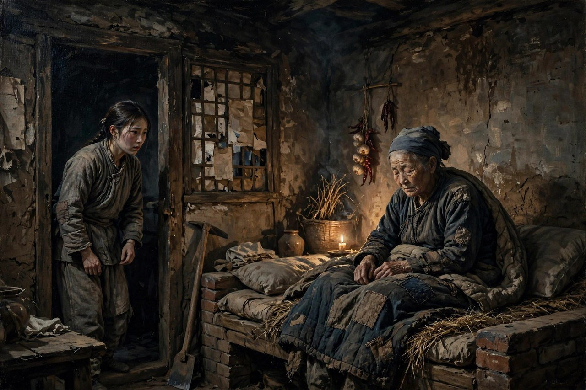
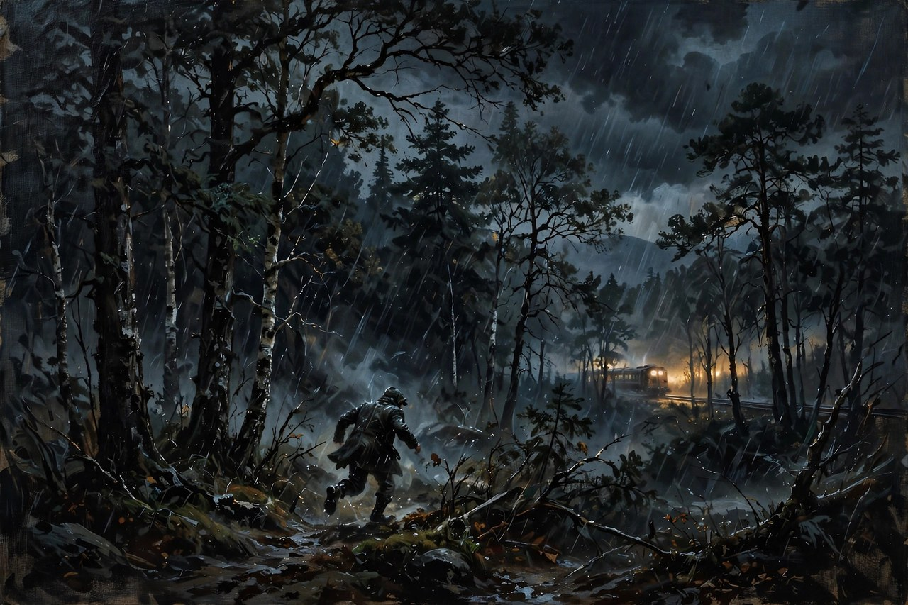

## 从牢里逃出来的仇虎

《原野》发表于一九三七年，是曹禺在《雷雨》和《日出》之后写的一部三幕话剧。戏的故事发生在民国初年北洋军阀混战的年月，地点是一片荒凉的原野和焦家的大宅子。仇虎的父亲被当地恶霸焦阎王活埋，家里的土地被抢占，房屋被烧毁，仇虎的妹妹被卖进妓院惨死，仇虎自己被诬陷为土匪，送进监狱，在狱中度过了八年，还被打瘸了一条腿。八年之后，他砸碎脚镣，从囚车上跳下来，逃回原野，要找焦阎王报仇。可他回来之后才发现，焦阎王已经死了，活着的是焦阎王瞎了眼的老婆子，和焦阎王的儿子焦大星。更让他心碎的是，他从小订了亲的恋人金子，已经被焦家强押了去，做了焦大星的妻子。仇虎要报的仇，仇人已经不在了，要娶的人，已经是仇人的儿媳妇了，要回的家，已经是一片废墟了。这种回来之后发现一切都变了的绝望，比在牢里的八年更难熬：牢里至少还有一个目标，出来之后，目标没了，人就空了，空了之后，仇恨就只能往自己身上烧。

仇虎这个人物，身上有两股劲在打架：一股是复仇的劲，一股是良心的劲。复仇的劲告诉他，父债子还，焦阎王死了，儿子就得还，杀了大星，才算对得起死去的父亲和妹妹；良心的劲告诉他，大星是无辜的，大星是他从小一起长大的好兄弟，大星对金子是真心的，大星对他也是真心的，杀一个无辜的人，跟焦阎王当年做的事有什么区别？这两股劲在他心里来回拉锯，拉得他夜里睡不着，拉得他几次想动手又下不了手，拉得他甚至想激怒大星，想让大星先动手，想让大星先对不起他，这样他杀起来心里能好受一点。可大星偏偏不还手，偏偏把他当兄弟，偏偏在他拿着刀走进卧室的时候，求他把匕首对准自己的心口。这种善良，比任何反抗都更让仇虎难受：你要杀的人不恨你，反而信任你，你下手的时候，杀的就不光是一个人，还有你自己心里的那点善良。曹禺写仇虎，写的就是这种两难：报仇是对的，不报仇也是对的，两个对撞在一起，人就被夹在中间，夹得粉身碎骨。

金子是这出戏里最有生命力的人物。她是野地里生、野地里长的农民女儿，从小就跟仇虎订了亲，泼辣，任性，敢爱敢恨，不肯受三从四德的礼教束缚，也不喜欢软弱无能的丈夫。她被焦家强押去做了大星的妻子，在焦家受尽了瞎眼婆婆的责难，受尽了规矩的压抑，心里的野性被压了又压，压到仇虎回来的时候，一下子就爆出来了。她爱仇虎，要跟仇虎走，要跟仇虎去那个金子铺地的地方，她把仇虎藏在家里，跟仇虎重叙旧情，在丈夫回来之后，忍受鞭打，发出控诉，最后跟仇虎一起逃进黑林子。金子的反抗，不是书本上的反抗，是从生活里长出来的反抗：她受够了婆婆的骂，受够了丈夫的软弱，受够了焦家的规矩，受够了被人当成一件东西抢来抢去的日子，她要自己选一次，选一次自己爱的人，选一次自己想过的日子。这种选，在当时的农村里，是要付出代价的，代价就是被追捕，就是被围剿，就是逃进黑林子也逃不出去。可她还是选了，选了之后，她没有像仇虎那样崩溃，她在侦缉队的围追里冲了出去，选择了艰难的生路。金子的生，和仇虎的死放在一起，对比特别强烈：同样是复仇，同样是逃亡，一个人被良心压垮了，一个人却朝着生的方向走了过去，生和死之间，隔着的不是运气，是心里那点东西到底还亮不亮。

焦大星和焦母是焦家的两个人，写的是加害者家里的人。焦大星善良，软弱，爱金子却护不住金子，怕母亲却又离不开母亲，夹在母亲和妻子中间，两头受气。他知道金子不爱他，知道金子心里有别人，可他还是爱金子，还是求金子别走，还是在真相大白之后，求仇虎别走，求金子别走。他的善良是真的，可他的善良没有力量，没有力量保护自己爱的人，没有力量反抗自己的母亲，没有力量改变焦家的规矩。这种没有力量的善良，在曹禺的戏里常常出现：好人不是没有，好人的心不是不善，可好人的力量太小了，小到连自己爱的人都保不住。焦母是另一面：她瞎了眼，心却比谁都狠，她是焦阎王在人世间的遗嘱执行者，竭力收紧套在金子心里的枷锁，用规矩，用骂声，用鞭子，把金子往死里压。她看不见，可她看得比谁都清楚：她知道仇虎回来了，知道金子心里有仇虎，知道焦家的大厦要塌了，所以她越压越狠，压到最后，竟然借她的手，杀死了自己的亲孙子小黑子。这个情节，是全剧最让人心寒的地方：一个老太太，为了保住焦家的体面，为了报复仇虎，竟然把自己的孙子也搭进去了，搭进去之后，她还不觉得自己错了，还觉得自己是在执行家法，是在替死去的焦阎王出气。这种狠，不是一般的狠，是被宗法思想泡透了的狠，狠到连亲情都不认了，狠到连自己的血脉都可以牺牲。

## 杀了人之后的日子

仇虎终于杀了大星，又借焦母之手杀了小黑子，复仇在形式上完成了，可他心里没有一点痛快，反而被恐惧、悔恨、内疚追得满林子跑。杀大星的时候，他的手是抖的，杀小黑子的时候，他的心是碎的，杀完之后，他开始出现幻象，开始听见死者的声音，开始觉得四面八方都是追捕的人，都是来索命的鬼。他跟金子逃向那个金子铺地的地方，可在黑林子里迷失了方向，走来走去还是走不出去，越走越黑，越走越怕，怕到最后，他催促金子逃走，自己用匕首自杀了。他死的时候，奋力扔掉了十天前砸碎的铁镣，喊着再也不会戴上它。铁镣扔出去了，人也倒下了，复仇的链条，到这里才算真正断了，可断的方式，是复仇者自己也死了。这种结局，让很多观众不舒服：复仇不是应该痛快吗？怎么报了仇，反而把自己也搭进去了？曹禺的回答是：复仇从来都不是痛快的，复仇是用血去还血，血还上了，债却没有清，因为杀人的手沾了血之后，血是洗不掉的，洗不掉的血，会一直跟着杀人的人，跟着他走进黑林子，跟着他走到天亮之前，跟着他走到死。仇虎的悲剧，不在于他没有报成仇，而在于他报成了仇，却发现报仇的代价，是把自己也变成了自己恨的那种人。

这出戏的主题，放在今天看依然扎人。今天网上天天有人喊着要以牙还牙，要让对方付出代价，要网暴回去，要报复回去，喊的时候觉得痛快，觉得解气，可真到了那一步，代价常常是两家人一起沉下去。一个人被人骂了，就去骂回去，骂回去之后，对方再骂回来，骂来骂去，最后谁也没有赢，谁都成了自己讨厌的样子。一个人被人坑了，就去坑回去，坑回去之后，自己也成了坑人的人，坑人的名声背上了，洗都洗不掉。仇虎的故事，就是把这个道理放大了写给你看：复仇的快感是短暂的，复仇的后遗症是长久的，快感过去之后，留下的是良心的煎熬，是幻象的追捕，是黑林子里的迷路，是走到最后发现，自己报复的对象已经死了，可自己心里的鬼还没有死。曹禺不是在反对正义，不是在说受了欺负就该忍着，他是在提醒：正义和复仇是两回事，正义是要让事情回到正轨上，复仇是要让对方也疼，疼完了，正轨还是没有回来，人却已经回不来了。分清楚这两件事，才不会把报复当成正义，才不会在报复的快感里，把自己也搭进去。

《原野》的舞台艺术，也很有特点。戏里用了大量的象征和幻象：黑林子象征着仇虎心里的黑暗和迷路，铁镣象征着他身上戴了八年的枷锁和仇恨，火车声象征着外面的世界和希望，金子铺地的地方象征着他和金子向往的美好生活，可美好生活越是向往，越是到不了，到不了的美好，反而成了最残酷的讽刺。戏的结尾，天将亮的时候，侦缉队追来了，金子朝着金色的、充满希望的远方走去，仇虎却在灰暗的原野中倒下了，生和死，亮和暗，希望和绝望，放在同一个画面里，对比特别强烈。这种象征的写法，让《原野》不光是一出复仇剧，还是一出关于人性的寓言：每个人心里都有一片原野，原野上有仇恨，有爱情，有良心，有恐惧，有希望，有绝望，这些东西在原野上打架，打到最后，有人走了出去，有人倒在了原野上，倒下的人不是输给了别人，是输给了自己心里的那片黑暗。

## 原野上的宗法和土地

《原野》写的不光是一个人的复仇，还写了一个地方的规矩。焦阎王当年为了抢仇家的一块好地，串通土匪活埋了仇虎的父亲，抢了地，烧了房，卖了妹妹，送仇虎进牢，一套动作做下来，干净利落，背后靠的是什么？靠的是宗法，靠的是势力，靠的是在那个地方，他就是王法，他说谁是土匪，谁就是土匪，他说谁的地是他的，地就是他的。仇虎在狱中八年，想的都是报仇，可他回来之后才发现，焦阎王死了，宗法却没有死，焦母还在，焦家的规矩还在，村里人对焦家的怕还在，侦缉队还在替焦家追捕他。仇人死了，仇恨的制度还在，制度不倒，报复一个人是没有用的，报复了一个人，还会有下一个人站出来，继续用同一套玩法压人。曹禺写《原野》，写到了这个层面：复仇的对象不光是一个人，还是一整套吃人的规矩，规矩不改，仇报不完，血还不尽，人只能在原野上转圈，转到最后，把自己也转进去了。

土地在这出戏里，也是一个重要的意象。仇家和焦家的仇，就是从一块地开始的，地是农民的命，是农民的根，是农民活下去的依靠。焦阎王抢地，抢的不光是一块田，抢的是仇家活下去的根，根断了，家就散了，人就只能去坐牢，去卖身，去逃亡。仇虎回来之后，站在原野上，看着自己家的地已经成了焦家的地，看着原野还是那片原野，可原野上的人已经换了一批，心里的感觉特别复杂：地还在，人没了，仇还在，地却回不来了。他想通过杀人把地夺回来，可杀了人，地还是焦家的，地还是回不来，因为地的问题不是靠一把匕首能解决的，地的问题要靠制度，要靠力量，要靠很多人一起改变，不是一个人单枪匹马能办到的。曹禺写土地，写出了农民命运的根子：农民的苦，往往是从地开始的，地被抢了，人就没了根，没了根的人，要么去复仇，要么去流浪，要么去死，没有一条路是好走的。

金子这个人物，放在今天看依然有现实意义。她不肯受礼教束缚，不喜欢软弱的丈夫，敢爱，敢走，敢跟仇虎逃进黑林子，这种泼辣和生命力，在当时的农村妇女形象里是很罕见的。很多作品写农村妇女，写的都是忍耐，都是贤惠，都是默默承受，金子却不是，她是野地里长出来的，她的野性就是她的生命力，她的反抗就是她的尊严。她被焦家压了那么多年，压来压去，还是没有压住她心里的那点野性，野性一冒头，她就敢跟仇虎走，敢把过去的一切都扔掉。这种人物，放在今天依然能引起共鸣：今天很多女性，依然在面对各种各样的压抑，家庭的压抑，职场的压抑，舆论的压抑，压抑的方式变了，可压抑的本质没有变，金子的选择，依然是一种提醒：人活着，不能只靠忍耐，忍耐到最后，忍出来的不一定是好日子，忍出来的可能是更深的压抑，压抑到最后，人就不是人了，是行尸走肉。金子没有变成行尸走肉，她选择了走，走了之后虽然前路茫茫，可走本身，就是一种活着的证明。

## 放在今天读原野

今天读《原野》，最容易引起共鸣的，是仇虎心里的那场拉锯。很多人心里都有过仇虎式的时刻：被人欺负了，被人坑了，被人冤枉了，心里恨得牙痒痒，想着要报复回去，想着要让对方也疼一次。可真到了要动手的时候，心里又会冒出另一个声音：这样做对吗？这样做跟对方有什么区别？这样做之后，我还能不能睡得着觉？这两个声音打架，打得越厉害，人越痛苦，越痛苦，越容易做出极端的事。曹禺把这场拉锯写成了戏，写成了仇虎在黑林子里的幻象，写成了他扔掉铁镣的那一声喊，观众看完之后，会明白：心里有拉锯是正常的，有拉锯说明良心还在，良心还在，人就还没有完全坏掉，真正可怕的，是心里一点拉锯都没有，是杀了人之后一点感觉都没有，是把报复当成理所当然，把伤害别人当成家常便饭。焦阎王就是这样的人，焦母也是这样的人，他们心里没有拉锯，所以他们能活得心安理得，能活得狠毒而平静，这种平静，比仇虎的崩溃更可怕，因为崩溃至少说明人还在挣扎，平静说明人已经彻底变成了制度的一部分。

《原野》的演出史也很有意思。这出戏发表的时候，正赶上抗战爆发，上海的戏剧家们还是及时排演了它，在卡尔登大戏院演出，观众反响强烈。可它的命运多舛，后来很长一段时间里，它不像《雷雨》那样常演不衰，有一段时间甚至很少上演，直到后来，才重新被人们重视起来。这种命运，跟戏本身的主题有关系：它写的东西太沉重了，太黑暗了，太不给观众解气了，观众看完之后，心里堵得慌，堵得慌的戏，剧场不爱排，观众也不爱再看一遍。可正是这种堵得慌，才是它的价值：它不哄观众，不给观众一个痛快的复仇结局，不给观众一个皆大欢喜的团圆，它给观众一个问题：复仇之后怎么办？问题没有答案，观众就得自己去想，想的过程，就是戏在起作用的过程。今天很多作品，怕观众堵得慌，怕观众不爱看，就把结局写得痛快，写得解气，写得坏人立刻遭到报应，好人立刻得到好报，写完之后观众是痛快了，可痛快完了，什么都没有留下，什么都没有想过，这样的作品，演一百场也是空的。曹禺的《原野》，宁可让观众堵得慌，也不肯给一个假的痛快，这种坚持，在今天尤其值得学习。

最后说说这出戏留给写作者的功课。头一条，是复仇题材不要写成爽文。爽文的逻辑是：主角受了欺负，然后一路开挂，把仇人一个个打倒，打到最后，主角站在高处，仇人跪在脚下，观众跟着爽一把，爽完就散了。这种写法，写的是幻想，不是人生，人生里的复仇，从来都不是爽的，复仇的每一步都要付出代价，代价越往后越大，大到最后，复仇者自己也成了受害者。曹禺写仇虎，就是按人生的逻辑写的：报仇之前，他是受害者，报仇之后，他还是受害者，只不过受害的原因变了，从被别人害，变成了被自己害。写出这个转变，复仇题材才有了深度，才有了讨论的价值，才不会沦为一场廉价的发泄。

另一条功课，是象征不要写成图解。黑林子、铁镣、火车声、金子铺地，这些象征在《原野》里，不是贴在人物身上的标签，是从人物的生活里长出来的：铁镣是仇虎真的戴过的，黑林子是仇虎真的逃进去的，火车声是原野上真的能听见的，金子铺地是仇虎和金子真的向往的。象征长在生活里，观众才能感觉到，感觉到了，象征才有力量。如果象征是硬贴上去的，是作者站在台上喊口号，观众一听就烦，一烦就出戏，出戏之后，戏就死了。曹禺的象征，写得自然，写得贴着生活，写得让观众在看完戏之后，脑子里还会浮现出黑林子的画面，还会听见铁镣扔出去的那一声响，响完了，人心里还会震一下，震一下，就是象征起作用了。写东西的人，不管写什么题材，都可以学学这一点：象征要长在生活里，不要长在口号里，长在生活里的象征，才经得起时间，长在口号里的象征，口号一过时，象征就死了。

## 仇虎和金子的爱情

仇虎和金子的爱情，是这出戏里唯一亮一点的东西，也是最让人心疼的东西。两个人从小订亲，青梅竹马，本来应该顺顺当当地过一辈子，可焦阎王一插手，亲事黄了，人散了，一个进了牢，一个进了焦家，八年之后再见面，两个人心里还是有对方，还是想跟对方走，还是想去那个金子铺地的地方。这种爱情，不是风花雪月，是在苦难里长出来的：苦难越深，爱情越显得珍贵，珍贵到两个人愿意为它冒死，愿意为它逃进黑林子，愿意为它跟整个焦家，跟整个村子，跟侦缉队对抗。可爱情再珍贵，也救不了仇虎，救不了金子，救不了这个被仇恨泡透了的原野。仇虎杀了人之后，心里的鬼比爱情更重，重到爱情都压不住了，重到他只能催金子走，自己留下来死。金子走了，爱情还在，可爱情的另一半已经不在了，活着的人要带着这份爱情，继续往前走，往前走的路，没有仇虎了，只有她自己一个人，和她肚子里可能有的未来，和她心里那点还没有灭的光。

这种爱情的写法，比很多爱情剧要诚实得多。很多爱情剧写的是：两个人相爱了，什么问题都解决了，爱情一到，仇恨就没了，困难就没了，生活就美满了。曹禺写的是反过来的：两个人相爱了，问题还在，仇恨还在，困难还在，爱情解决不了仇恨，爱情只能让仇恨显得更残酷，因为相爱的人，本来应该一起过好日子，可仇恨偏偏不让他们过好日子，偏偏要把他们往死路上推。爱情越真，悲剧越惨，惨到观众看完之后，会明白：爱情不是万能药，爱情治不了制度的病，治不了宗法的病，治不了土地的病，爱情能做的，就是在黑暗里给两个人一点光，光很小，小到只能照亮两个人的脸，照不亮整片原野，可就是这一点光，让金子在最后选择了生，选择了往前走，而不是跟着仇虎一起死。光小，不等于没用，光小，至少说明黑暗还没有完全赢，至少说明人心里还有一点东西，是仇恨压不垮的。

放在今天看，仇虎和金子的爱情，依然能给人提醒。今天很多人谈恋爱，谈的是条件，谈的是房子，谈的是收入，谈的是对方家里有没有矿，谈的是结婚之后谁管钱，谈来谈去，爱情变成了交易，交易谈成了，两个人就结婚，交易谈不成，两个人就分手。金子和仇虎的爱情，没有条件，没有房子，没有收入，只有从小一起长大的感情，只有在苦难里互相惦记的心，只有愿意为对方冒死的勇气。这种爱情，在今天看起来有点傻，有点不现实，可傻和不现实，恰恰是它的珍贵之处：它提醒人们，爱情本来不是交易，爱情本来是两个人在黑暗里互相取暖，是两个人明知道前面是黑林子，还是愿意牵着手往里走。走进去之后会怎么样，戏没有保证，戏只保证，牵着手走进去的人，心里是亮的，亮着的心，比什么都重要。

《原野》的结尾，金子朝着远方走去，仇虎倒在原野上，这个画面，很多人看完之后会记很久。记的不是仇虎的死，是金子的走：走，是一种选择，是一种态度，是一种在绝境里还不肯放弃的倔强。仇虎死了，可金子还活着，活着的人要把死去的人的那份也活下去，要把两个人向往的金子铺地的地方，继续往前找，找不找得到，戏没有说，戏只说，她走了，走了之后，天快亮了，火车声传来了，希望还在远方，还在等着她去找。这种结尾，比大团圆更有力量，因为它没有骗观众，它告诉观众：生活就是这样，有人倒下了，有人还要走，走的人很孤单，很艰难，可走本身，就是对黑暗的反抗，就是对仇恨的拒绝，就是对原野上那套吃人规矩的最后回答。原野还在，规矩还在，黑暗还在，可只要还有人愿意走，愿意朝着金色的远方走，原野就还没有完全输，输的只是仇虎一个人，赢的，是金子走出去的那一步。

## 原野上的火车声

火车声是《原野》里一个很重要的声音，声音从远方传来，传到原野上，传到仇虎的耳朵里，传到金子的耳朵里，传到观众的耳朵里。火车代表的是外面的世界，代表的是新生活，代表的是离开原野的可能，代表的是金子铺地的地方，代表的是仇虎和金子向往的未来。可火车声越是响亮，原野上的人越是走不出去，走不出去的原因，不是火车不停，是原野上的人，被仇恨拽着，被宗法拽着，被土地拽着，被过去拽着，拽着拽着，脚就迈不开了，迈不开脚，火车开过去了，人还是站在原野上，站在原野上的人，看着火车开过去，心里会想：火车上的人，是去哪里的？是去金子铺地的地方吗？是去没有仇恨的地方吗？是去能过上好日子的地方吗？想完了，人还是站在原野上，站着站着，天就黑了，黑了之后，黑林子就来了，黑林子来了，人就更走不出去了。火车声和黑林子放在一起，就是《原野》的核心意象：外面有希望，希望在火车上，可希望离原野上的人太远了，远到听得见，看不见，摸不着，摸不着的希望，比没有希望更让人难受，难受的是，明明知道外面有好日子，可自己就是去不了，去不了的原因，是自己心里的仇恨，是自己身上的铁镣，是自己过去八年的牢狱生活，是自己杀了人之后的心魔，心魔不除，火车来了也上不去，上不去，火车就只能开过去，开过去之后，原野上的人，还是站在原野上，站着站着，就倒下了。

金子最后朝着火车声走去，走去的方向，是希望的方向，是生的方向，是跟仇虎不一样的方向。仇虎倒下了，金子走了，走了之后，火车声还在，火车声还在，希望就还在，希望在，走的人就还有路，路在，日子就还有盼头。盼头这个东西，在《原野》里，是很珍贵的，珍贵到全剧只有金子一个人抓住了，抓住了之后，她就走了，走了之后，戏就结束了，结束的时候，天快亮了，亮了之后，原野上的黑暗，是不是就散了？散不散，戏没有说，戏只说，金子走了，走了之后，火车声还在，火车声还在，希望就还在，希望在，原野就还没有完全输，输的只是仇虎一个人，赢的，是金子走出去的那一步。走出去的一步，看起来很小，小到只是一个女人，在黑林子里，朝着火车声走去，可这一步，在全剧里，是最大的一步，大到超过了仇虎的复仇，超过了焦家的规矩，超过了原野上的仇恨，超过了所有吃人的制度，超过之后，人就活了，活了之后，日子就有可能不一样了，不一样的日子，是金子自己走出来的，是她用自己的脚，一步一步走出来的，走出来的路，没有仇虎了，没有焦家了，没有原野上的仇恨了，只有她自己，和她心里的那点光，光很小，小到只能照亮她自己的脚，照亮脚，就够了，够她往前走了，往前走，走着走着，天就亮了。

## 原野上的天亮之后

原野上的天亮之后，火车开过去了，金子走了，仇虎倒下了，焦家的大宅子还在，焦母还在，村子里的人还在，原野还是那片原野，可原野上的人，已经不一样了。不一样的地方，是金子走了，走了之后，原野上少了一个敢爱敢恨的人，少了一个野地里长出来的人，少了一个不肯受规矩束缚的人，少了之后，原野就更荒凉了，荒凉的原野上，剩下来的人，是焦母，是村子里那些怕焦家的人，是侦缉队，是那些还在按旧规矩过日子的人，旧规矩还在，旧规矩还在，原野上的仇恨，就还没有完全结束，结束不了的仇恨，会不会在下一代人身上，重新长出来？重新长出来的仇恨，会不会让下一个仇虎，再从牢里逃出来，再砸碎脚镣，再回到原野上，再报一次仇？报仇的循环，转来转去，转到最后，谁能打破？打破循环的人，不是仇虎，仇虎没有打破，他死在了循环里；打破循环的人，可能是金子，金子走了，走了之后，循环里少了一个人，少了一个人，循环就松动了一点，松动了一点，后来的人，就有可能走出去，走出去的人多了，循环就真的打破了，打破之后，原野上，才有可能长出新的东西，新的东西，可能是金子铺地的地方，可能是火车开去的地方，可能是外面世界里的新生活，新生活来了，原野就不荒凉了，不荒凉的原野，才是真正活过来的原野。

## 原野上最后的光

原野上最后的光，不是太阳，是金子走出去的时候，身上带的那点光，光很小，小到只能照亮她自己的脚，照亮脚，就够她往前走了，往前走，走着走着，天就亮了，天亮了之后，原野上的黑暗，是不是就散了？散不散，戏没有说，戏只说，金子走了，走了之后，火车声还在，火车声还在，希望就还在，希望在，原野就还没有完全输，输的只是仇虎一个人，赢的，是金子走出去的那一步，走出去的一步，看起来很小，小到只是一个女人，在黑林子里，朝着火车声走去，可这一步，在全剧里，是最大的一步，大到超过了仇虎的复仇，超过了焦家的规矩，超过了原野上的仇恨，超过之后，人就活了，活了之后，日子就有可能不一样了。

原野上的仇恨最难的地方，是它会借着旧规矩活下去，活在焦母的话里，活在村子里人的怕里，活在侦缉队的脚步声里。旧规矩不倒，仇恨就不断，不断的仇恨，只能等着后来的人走出去，走出去的人多了，旧规矩才松动，松动了的原野，才长得出新的东西。
