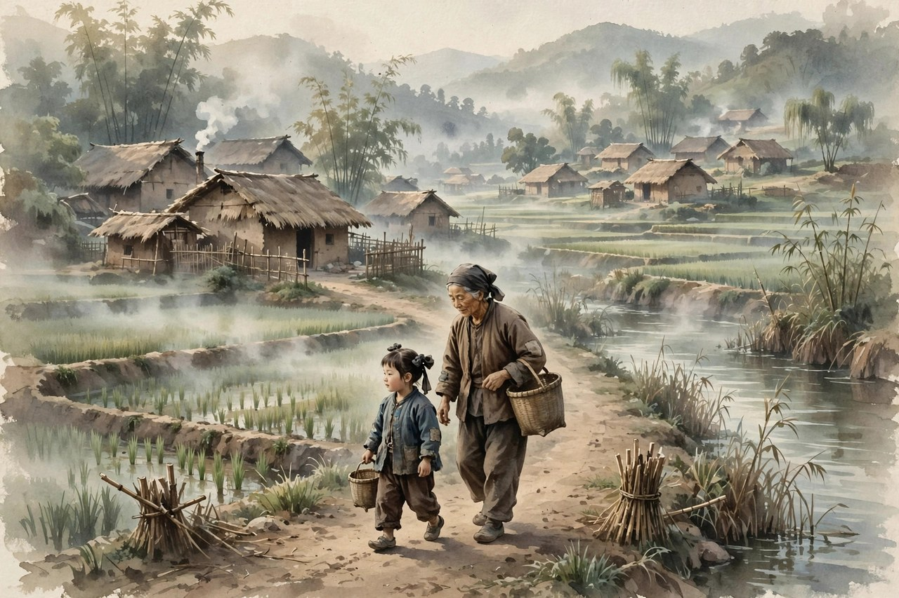
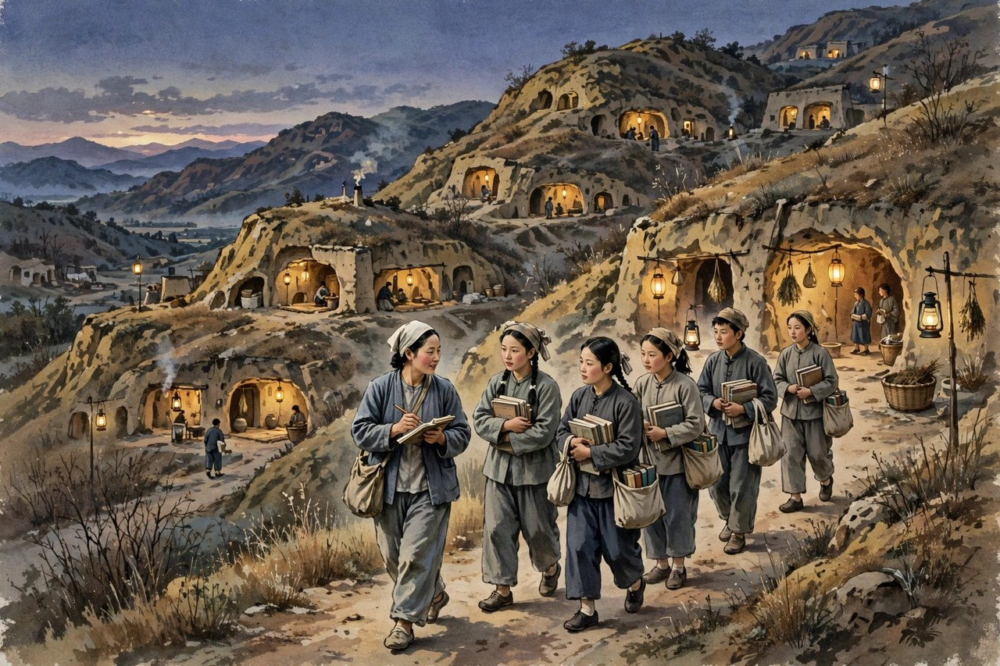

说起民国女作家，很多人脑子里浮现的是一副柔弱样子：坐在窗边写情写愁，写到动情处掉几滴眼泪。丁玲不是这副样子。她是湖南临澧乡间走出来的姑娘，父亲早早去世，母亲带着孩子借钱读书，硬是把日子过成了不低头的样子。丁玲后来写小说，写女人，写农民，写土改，写战争里的人，笔下从来没有那种躲在屋里自怜的腔调。她敢把女子心里最难说出口的欲望写出来，也敢把革命队伍里最难看的矛盾写出来，还敢在风浪里站着不改口。她这一生，笔没有软过，人没有趴下过。读她，就是读一个女子怎么在乱世里把自己活成一杆枪。

丁玲原名蒋伟，字冰之，生于一九零四年湖南临澧，卒于一九八六年北京。她家里本来是乡间有田有屋的人家，父亲是清末秀才，在她四岁那年去世。母亲余曼贞年轻守寡，带着一双儿女，借钱去读师范，毕业后当教员，还办过女子学校。这样的母亲，给丁玲留下的不是金银，而是一种骨气：女人不能只靠别人活着，日子再难，也要自己挣一条路。丁玲从小跟着母亲辗转常德、桃源、长沙等地读书，五四运动的风声传到学校里，她听进去了，也记住了。她后来回忆自己为什么提笔写小说，说是因为寂寞，对社会不满，自己生活没有出路，有许多话需要说出来，却找不到人听，很想做些事，又找不到机会，于是提起笔，要代替自己给这个社会一个分析。这话说得实在，没有半点装腔。她的写作起点，就是一个年轻女子在旧社会里撞墙撞出来的声音。

丁玲的求学路走得并不顺当。她去过上海，进过平民女校，读过上海大学中文系，又到南京和北京游学。她想过当电影演员，去试过镜，也到剧社试演过话剧。这段经历后来都进了她的小说，成为她写梦珂那篇处女作的底子。她不是坐在书斋里想象女子苦闷的人，她自己就在上海的弄堂和剧场里看过女子怎么被当成玩物，怎么在应酬里笑着，心里却发凉。她跟胡也频相识相恋，两个人从北京到上海，过过清贫的日子，也一起在文坛上闯。胡也频后来被国民党杀害，这件事像一把刀，割断了丁玲早年那种只写个人苦闷的路子，也把她推向了更硬的现实。她没有躲起来哭完就算了，她接过左联机关刊物《北斗》的主编担子，站在白色恐怖里继续说话。一个人能在爱人被杀之后还站出来办刊物，这不是书生气，这是骨头硬。

### 湘江边长大的硬骨头姑娘

丁玲的硬气不是装出来的，是从小在湖南乡间和母亲身边磨出来的。母亲守寡后没有认命，没有把女儿早早嫁出去换安稳，而是自己读书、教书、办学校。丁玲看在眼里，记在心里。她后来写《母亲》，写的就是母亲那一代女子怎么从封建大家庭里挣出来，怎么放开小脚，怎么走进学校，怎么自己处理自己的生活。这篇小说没有写完，却是丁玲心里最重的一块石头：她要写清楚，女子觉醒不是一句口号，是一个寡妇带着孩子、背着债、在亲戚的白眼里一寸一寸挪出来的路。读者今天看这段，会觉得特别亲切，因为今天的女子同样在问：我能不能不靠别人，能不能自己说了算。丁玲的母亲用一生回答了这个问题，丁玲用小说把这个回答传了下去。

丁玲年轻时到上海，到北京，不是去享福的。她住过简陋的房子，吃过苦，也看过世面。她在上海大学读书时接触到新思想，在剧社里看到女子在台上台下的两副面孔，在文坛上看到男人写女人多半是写花瓶。她不服气。她写《梦珂》，写一个从内地到上海求学的少女，因为看不惯美术教员对模特儿的侮辱而离开学校，寄住在姑母家，又受到表兄等人的感情侮慢，辗转去剧社当演员，结果在肉感的社会里越陷越深。这篇小说写于一九二七年，发表在《小说月报》上，主编叶圣陶看了很欣赏。丁玲从此进了文坛，但她进文坛的方式不是讨好，而是揭短：她揭的是旧社会给女子留的那条窄路，揭的是女子出走之后没有经济支撑、没有社会保障，只能在新的陷阱里打转的真相。今天的读者看《梦珂》，依然会心头一紧，因为出走之后怎么办，这个问题到今天还没有过时。

### 一本日记写出满城风雨

丁玲真正轰动文坛，是靠《莎菲女士的日记》。这篇小说写于一九二七年，发表于一九二八年二月的《小说月报》。小说用日记的形式，写一个患肺病的知识少女莎菲，在北京的日子里，面对两个青年男子：一个是虔诚求爱的苇弟，一个是仪表堂堂的南洋富家子凌吉士。莎菲不爱老实巴交的苇弟，却迷恋凌吉士，等到看清凌吉士的虚伪与轻浮，爱情和希望一起落空。小说最打动人的地方，不是三角恋的热闹，而是莎菲心里那种直白的、毫不掩饰的欲望和痛苦。她敢写女子想要爱，想要被理解，想要活得像个人，而不是当贤妻良母的摆设。这样的写法在当时是炸雷。茅盾后来称赞丁玲写女性心理，是中国新文坛上极可骄傲的成绩。这话不夸张，因为在丁玲之前，很少有男作家敢这样贴着女子的心跳写，很少有女作家敢这样不遮不掩地写。

莎菲的意义不只在文学技巧，更在她把女子的苦闷写成了时代的病症。莎菲有病，肺上有病，心里也有病。她的病一半是身体的，一半是社会给的：女子受了新教育，脑子里有了自由和平等的念头，脚下却还是旧社会的地面，爱情不能自主，职业没有保障，身体又不好，想往前走一步，四面都是墙。她在日记里发脾气，骂人，哭，笑，折腾，把自己折腾得精疲力尽，也把读者折腾得坐不住。今天的姑娘读莎菲，会觉得这个人一点都不遥远：明明很清醒，明明知道对方不靠谱，还是忍不住往火坑里凑；明明想要独立，还是会被一句温柔的话绊住脚。丁玲没有给莎菲安排一个圆满结局，也没有让她忽然觉悟、忽然革命。她让莎菲停在绝望里，让读者自己去想：这样的女子，到底需要什么才能活下去。这个不给答案的结尾，比给答案更有力量。

### 从写情爱到写洪水与土地

胡也频牺牲之后，丁玲的笔转了方向。她加入左联，主编《北斗》，一九三二年加入中国共产党。她写《水》，写一九三一年大水灾后农村的景象：洪水冲了堤，农民逃难，去找镇长、县长要赈济，等不到满意的答复，忍无可忍之下团结起来，汇成自己的声音。茅盾评价这篇小说，说它表示过去那种革命加恋爱的公式已经被清算。这个评价点得很准：丁玲不再只写屋子里男女那点事，她把眼睛投向了村口、堤上、逃难路上的一群人。她写农民不是写几个英雄，而是写一群绝望又坚强的人，他们对土地赤诚，誓死要把暴虐的水灾拦住，又天真得可怕，还在指望剥削者来救他们，等到希望落空，才真正觉醒。这种群像写法，在当时是新鲜的，在今天看依然有分量：灾难面前，个人的聪明没有用，群体的觉醒才是出路。

丁玲写《母亲》，也是这个转折里的一块大石头。她想写一部传记体长篇，从辛亥革命前后写起，一直写到大革命和农村的土地骚动，写几家豪绅地主的没落，写几代女子的挣扎。小说从一九三二年开始动笔，陆续发表，尚未写完，丁玲就在一九三三年被国民党特务绑架，押到南京囚禁，创作被迫中断。鲁迅当时建议马上出版这部未完成的长篇，还亲自安排把稿酬寄到丁玲母亲手里。这段往事很能说明丁玲在文坛上的分量：她不是靠一篇小说红极一时的人，她是被鲁迅、茅盾这些人认真对待的作家。她的《母亲》虽然没有写完，却把前一代女子怎么从封建重围里闯出来的路写得清清楚楚。曼贞这个人物，原型就是丁玲的母亲，她从一个不管闲事的少奶奶，变成一个敢自己拿主意、敢走进学校的女子，这个转变不是凭空喊出来的，是丈夫早逝、家境衰落、亲戚倾轧一步一步逼出来的。丁玲写母亲，就是写自己骨气的来处。

### 南京囚禁与奔赴陕北

一九三三年五月，丁玲在上海被国民党特务绑架，随后被押到南京幽禁。她在囚禁中没有认输，一直在寻找地下党组织，想办法脱身。到了一九三六年，她终于逃离南京，经上海、西安，转赴陕北保安县，成为到达陕北的知名作家，受到毛泽东、周恩来等人的欢迎。毛泽东赞誉她是昨天文小姐，今日武将军。这句话传得很广，因为它点出了丁玲的变化：她从一个写日记、写情爱的文小姐，变成了一个能带队伍、能办报纸、能到前线去的武将军。她在陕北担任过文艺协会主任、战地服务团团长、《解放日报》文艺副刊主编等职务，创作了《我在霞村的时候》《夜》等作品。这些作品写的是抗战里的农村女子，写的是边区农村干部在新旧交替里的矛盾，写得细，写得真，没有拔高，也没有回避难堪。

丁玲在延安时期的写作，最值得今天读者注意的，是她没有因为到了革命队伍里就只写好人好事。她写《夜》，写一个刚当上指导员的农民何华明，因为牛要生产而回家过夜，在家里和妻子、地主女儿、女干部之间，暴露出新旧两种生活意识的拉扯。何华明想干革命工作，又舍不得自家的土地和牛；想跟上新时代，又摆脱不了旧家庭的牵绊。丁玲把这种拉扯写得有血有肉，没有把何华明写成一个符号。她写《我在霞村的时候》，写农村姑娘贞贞被日军糟蹋后，又利用特殊身份给抗日队伍送情报，回到村里却受到村民的鄙视和厌弃。她没有回避贞贞身上的伤，也没有回避村民的愚昧和冷漠，而是让贞贞在流言里重新站起来，接受安排去延安治病学习。这样的写法在当时引起过争议，有人觉得不应当用同情的笔调写贞贞这样的女子。丁玲没有收回自己的笔。她相信，女子的尊严不是靠别人给面子挣来的，是靠自己在伤口上站起来挣来的。

### 桑干河上的高峰与晚年的风雨

一九四六年，丁玲到晋察冀边区参加土改。她跟着土改队伍下村，看农民怎么分地，怎么斗争，怎么在旧势力的反扑里站稳脚跟。她把这段生活写成了长篇小说《太阳照在桑干河上》。小说从一九四六年十一月开始写作，到一九四八年六月完稿，同年出版，写的是桑干河边暖水屯的土改故事。小说里没有抽象的概念，全是村子里的人：积极的农民，动摇的中间人物，顽固的地主，还有在土改里学会说话、学会做主的妇女。丁玲用心理描绘见长，把农民在土改里的心思写得细腻而真实。这部小说在一九五一年获得斯大林文学奖金二等奖，成为中国革命文学走向世界的一块招牌。冯雪峰称它是社会主义现实主义最初的比较显著的一个胜利。这话放在今天看，依然成立：土改这样的大题材，写得让农民自己觉得像，让外国读者也觉得真，不是靠口号，是靠丁玲在村里住下来、看下来、记下来的功夫。

新中国成立后，丁玲担任过《文艺报》主编、中国作家协会党组书记、《人民文学》主编等职务，工作繁忙，仍然写了不少散文、评论和小说。可惜的是，一九五五年和一九五七年，她接连被错误地定为反党小集团和右派集团的主要成员，一九五八年被下放到北大荒劳动改造，文化大革命期间又受迫害，被关进监狱。她失去了发表作品的权利，长达二十多年。直到一九七九年，她的错案得到平反，重返文坛，已经是七十多岁的老人。她没有躺下来养老，而是创办并主编大型文学期刊《中国》，提携后进，写散文，写回忆，出访美国、加拿大、法国、澳大利亚等地。她在晚年写《在严寒的日子里》《访美散记》等作品，笔触依然清醒，没有因为吃过苦就只写苦，也没有因为平反了就只写甜。她到一九八六年三月在北京病逝，享年八十二岁，一生著作四百余万字，作品被译成多国文字，在世界许多国家流传。

### 今天为什么还要读丁玲

今天读丁玲，不是为了怀旧，是为了照镜子。她写女子苦闷，写的是女子在爱情里、在家庭里、在职业里，怎么不被当成附属品。她写农民觉醒，写的是普通人在大变局里，怎么从指望别人救，变成自己站起来说话。她写革命队伍里的矛盾，写的是新旧交替从来不是一夜之间的事，人心里旧的东西不会因为换了旗帜就自动消失。这些问题，今天换了样子还在：姑娘在恋爱里患得患失，职场女子在家庭和事业之间拉扯，农村人进城打工又想回乡守土，年轻人在理想和现实之间摇摆。丁玲的书里没有现成的答案，但有一种态度：不要装，不要躲，不要把自己活成别人期待的样子。莎菲敢爱敢恨，贞贞敢在流言里抬头，曼贞敢自己拿主意，何华明敢在矛盾里挣扎，暖水屯的农民敢在土改里做主，这些人物身上的劲儿，就是丁玲留给今天读者的东西。

读丁玲还要读她的笔法。她早年写心理，细得像拿针挑灯芯，把女子心里一闪而过的念头都写出来。她中年写农村，笔触变得厚重，写洪水，写土地，写村口的争吵，写妇女在土改里的变化，画面感极强。她晚年写散文，笔触又变得平实、宽厚，不再逞强，却更有分量。一个作家能在三个阶段写出三种笔法，还都能写出代表作，这本身就是本事。今天很多写作者要么只会写自己，要么只会写概念，写不出丁玲那种既贴着人心、又贴着土地的劲儿。学丁玲，不是学她的句子，是学她下生活的功夫：她写土改，是真的在村里住过；她写霞村，是真的听过贞贞那样的人的故事；她写母亲，是真的看着母亲一步一步走过来的。没有生活的底子，笔再花哨也是空的。

丁玲的一生有光荣，也有伤口。她得过国际大奖，也被打成右派，下放过北大荒，坐过监狱。她没有因为得奖就把自己当成圣人，也没有因为受冤就把自己当成受害者卖惨。她平反后说的、写的，依然是文学，依然是后辈，依然是女子和农民怎么活得更好。这样的作家，值得今天的读者认真读一遍。她的九篇代表作，从《梦珂》到《太阳照在桑干河上》，就是一条完整的路：从女子个人的苦闷出发，走到一群人的觉醒，再走到一个村庄、一个时代的变革。把这条路走一遍，你会明白，中国现代文学里为什么不能没有丁玲，为什么她的名字到今天还硬气。

### 笔下女子从来不是摆设

丁玲写女子，有一个贯穿始终的特点：她不把女子写成等男人来救的花瓶，也不把女子写成只会喊口号的符号。她笔下的女子，有欲望，有脾气，有软弱，也有硬气。莎菲想要爱情，敢在日记里承认自己对凌吉士动了心，也敢在看清对方之后骂自己糊涂。梦珂想要出路，敢离开学校，敢去剧社，却也在肉感的社会里被磨得遍体鳞伤。贞贞想要活下去，敢在受辱之后还去给队伍送情报，敢在村民的白眼里抬起头。曼贞想要自立，敢在丈夫去世、亲戚欺负的时候走进学校，敢自己处理自己的生活。这些女子没有一个是完美的，她们有的虚荣，有的冲动，有的胆小，有的天真，可正是这些不完美，让她们像真人。今天的读者在她们身上能看到自己的影子：想要爱，又怕受伤害；想要独立，又怕被人说闲话；想要反抗，又不知道从哪里下手。丁玲不替她们遮丑，也不替她们喊冤，她把她们的挣扎原原本本地摆出来，让读者自己去掂量。

丁玲写女子还有一个狠劲：她不回避女子的身体和欲望。在莎菲的日记里，疾病、体温、失眠、心跳、看到心仪男子时的慌乱，都写得非常具体。这样的写法在当时招来不少非议，有人说她写得太露骨，有伤风化。丁玲没有理会这种指责。她心里清楚，女子不是没有欲望的圣人，欲望本身不是罪，罪在那个不给女子出路的社会。把欲望藏起来，女子的问题就永远说不清楚；把欲望写出来，读者才能看到女子活得有多拧巴。到了延安时期，她写贞贞，同样没有回避贞贞身上的伤。她写贞贞得病，写贞贞被人议论，写贞贞在夜里哭，写贞贞在白天强撑着笑。这样的笔法，比空喊女子解放要有力得多。女子解放不是一句标语，是一个受过伤的姑娘还能不能挺直腰板走路，是一个村子能不能不再用贞节那套老尺子量活人。丁玲把这个道理写进了故事里，没有写成讲义。

对照今天看，丁玲写女子的方式依然不过时。今天的社交平台上，女子的话题动不动就变成站队和吵架：有人说女子要独立，就得断情绝爱；有人说女子要温柔，就得忍气吞声。丁玲的女子不站这种队。莎菲爱过，错过，痛过，没有因此否定爱情本身；贞贞受过辱，没有因此否定自己做人的资格；曼贞守过寡，没有因此把自己活成一块碑。她们都在具体的生活里找自己的位置：爱的时候认真爱，错的时候认账，伤的时候治伤，站起来的时候不靠别人的掌声。这种活法，比任何口号都实在。读丁玲的女子篇章，读者会得到一种安慰：原来一百年前就有人把这些拧巴写清楚了，原来拧巴不是你一个人的毛病，原来走出拧巴的路，是在生活里一寸一寸挪出来的，不是靠喊一句口号就能跳过去的。

### 下生活得来的土改与农村

丁玲写农村，靠的不是想象，是脚力。她写《水》，是因为她真的关心水灾里的农民怎么活；她写《太阳照在桑干河上》，是因为她真的跟着土改队伍在村里住过、看过、记过。土改不是她从报纸上抄来的概念，是她每天在村口、场院、土屋里看到的人和事。农民分地时的高兴，地主反扑时的害怕，妇女头回在会上说话时的紧张，干部在政策和人情之间为难的样子，这些细节，没有在村里住过的人是写不出来的。丁玲的厉害之处，在于她把土改写成了一群活人的故事，而不是一场运动的说明文。暖水屯的农民，有的积极，有的动摇，有的观望，有的使坏，丁玲没有把他们分成好人和坏人两堆，而是写他们各自的心思、各自的算盘、各自在变局里的选择。这样的写法，让土改从历史书上的名词，变成了一段能摸得着的生活。

今天的人看土改题材，可能会觉得离自己很远。可是丁玲写的那种变局里的心态，到今天一点都不陌生。村里分东西，有人怕吃亏，有人怕出头，有人想占便宜，有人想讲公道，这种心思，在今天的拆迁、分红、征地、村里选干部的时候，换个样子还在。丁玲写农民，不是把农民写成只会喊口号的群像，而是写农民心里那杆秤：谁对我好，我记着；谁欺负我，我也记着；政策说得再好，落到我家门口的那一份是不是公道，我心里有数。她写妇女在土改里的变化，尤其动人：从前在家里不敢大声说话的妇女，到了土改会上敢站出来讲自己受过的欺负，敢要求分地，敢要求离婚，敢要求上学。这种变化不是上面发个文件就能变出来的，是妇女自己在斗争里发现自己原来也能说话、也能做主，才变出来的。丁玲把这个过程写得非常细，细到读者能听见妇女说话时声音发抖，又越说越稳。

丁玲写农村的另一个可贵之处，是她没有把农村写成田园诗。她笔下的农村有泥，有水，有争吵，有算计，有愚昧，有冷漠，也有温情和义气。她写洪水里的农民，既写他们的坚强，也写他们的天真；她写土改里的农民，既写他们的觉醒，也写他们的动摇；她写边区农村的干部，既写他的干劲，也写他的私心和拉扯。这样的农村，才是真的农村。今天有些作品写农村，要么写成苦情戏，要么写成风光片，都不像生活。丁玲的农村像生活，因为她没有站在农村外面看风景，她是蹲在村口和农民一起抽烟、一起吃饭、一起开会的人。她的小说里，土地不是背景，是命根子；牛不是道具，是家当；选举不是程序，是农民头回觉得自己能说了算的时刻。把这些写清楚了，农村题材才有了筋骨。

### 风浪里没有弯过的腰

丁玲晚年的遭遇，是很多读者心里最难受的一段。她曾经是文坛上的红人，得过国际大奖，当过主编，管过作协，可是在一九五五年之后，她被错误地扣上帽子，下放到北大荒劳动，在农场里干活，在寒冷里过日子，文化大革命期间又被关进监狱。二十多年的时间，她不能发表作品，不能公开说话。她没有写过卖惨的文章，也没有在平反之后报复谁。她平反之后做的事，是创办刊物，提携年轻人，写散文，写回忆，把自己的一生摊开来给后人看。她在病床上还坚持写作和审稿，直到去世前还在问文章能不能续下去。这样的晚年，比年轻时的轰动更有分量：一个人年轻时敢写，是血气；一个人受过冤屈、吃过苦之后还能平静地写，还能提携后人，那是修养，是骨头里长出来的东西。

今天的年轻人读丁玲的晚年，会得到一种特别的提醒：人生不是一条直线上升的路，风浪来的时候，谁都可能被拍倒。丁玲被拍倒过，倒得很重，倒了二十多年，可她没有在倒下的时候把自己活成怨妇，也没有在站起来的时候把自己活成英雄。她站起来之后，写的是文学，是后辈，是女子和农民怎么活得更好。她没有把自己的苦难当成资本到处兜售，也没有把自己的功劳当成盾牌不让人批评。这种态度，在今天这个动不动就卖惨、动不动就立人设的时代里，显得格外稀缺。丁玲用一生告诉读者：作家的本分是写，是看，是记，是把生活里的真东西留下来，不是把自己包装成一个符号。她的名字到今天还硬气，硬就硬在这里：笔没有为风浪弯过，腰没有为冤屈弯过，心没有为名利弯过。

把丁玲的一生连起来看，就是一部中国现代女子的成长史，也是一部中国现代文学的变迁史。她从写个人苦闷出发，写到一群人的觉醒，写到一个村庄的变革，写到一个时代的风浪。她走过的路，正是中国现代文学走过的路：从小资产阶级的情爱，到左翼的现实，到解放区的土地，到新中国的建设，再到晚年的反思。她每一步都走在时代的前面，也每一步都付出了代价。她留下的九篇代表作，就是这条路上的九个脚印。读者顺着脚印走一遍，会看到一个女子怎么把自己活成作家，一个作家怎么把自己活成时代的见证人。这条路不好走，但值得走。

### 给今天读者的几句实在话

读丁玲不必端着架子，不必先背文学史，不必先分派别。你可以直接从莎菲的日记读起，看看一个生病的姑娘怎么在爱情里折腾；也可以直接从暖水屯读起，看看一村人怎么在土改里吵吵闹闹又往前走；还可以直接从霞村读起，看看一个受过伤的姑娘怎么在流言里重新站起来。她的书没有门槛，门槛只在你愿不愿意静下心来，把人当人看。很多人读经典读不下去，是因为经典被讲成了概念，被供了起来。丁玲的书不怕这样读，因为她写的人本来就活在泥土里、屋子里、村口和病床边，你稍微贴近一点，就能闻到烟火气，就能听见争吵声，就能摸到人心的温度。

读丁玲还有一个好处：她能帮你把今天的烦恼放回一个更长的时间里看。恋爱里的患得患失，放在莎菲身上看，你会发现一百年前的人也这样折腾过，折腾不是你的错，也不是时代的错，是人心本来就这样。职场和家庭之间的拉扯，放在何华明身上看，你会发现新旧交替从来不是换个地方就能解决的，心里的旧东西要慢慢挪。村里分利益时的算计，放在暖水屯里看，你会发现公道不是喊出来的，是在一次次争吵和商量里磨出来的。把烦恼放长了看，人就不会那么焦虑，也不会那么容易被一句话带跑。丁玲没有给读者开药方，她只是把一百年前的人摊开来给你看，让你自己去认：原来人都是这样过来的，原来往前走的路，都是在具体生活里一步一步踩出来的。

如果你只想记住丁玲一句话，那就记住她的硬气：笔不为风浪弯，腰不为冤屈弯，心不为名利弯。她年轻时敢写女子欲望，中年时敢写农村真相，晚年时敢平静地写自己的伤口。她没有把自己活成受害者，也没有把自己活成圣人，她只是把自己活成了一个写作者该有的样子：看清楚，写清楚，不躲，不装，不卖惨。这样的作家，放在任何时代都不会过时。把她的九篇代表作读完，你手里就多了一面镜子，照别人，也照自己。

丁玲留下的不只是几部小说，更是一种写作者的站法：站在人中间写人，站在土地上写土地，站在风浪里写风浪。后来的人写女子，可以学她贴着心跳写；写农村，可以学她蹲在村口写；写时代，可以学她不拔高、不回避地写。把这套站法学会了，写什么题材都不会飘在半空。这就是丁玲到今天还值得读、还值得学的地方。

读完这九篇，你再回头看丁玲这个人，会觉得她不是书上的名字，而是一个在风雨里走过、笔始终没有放下的活人。
