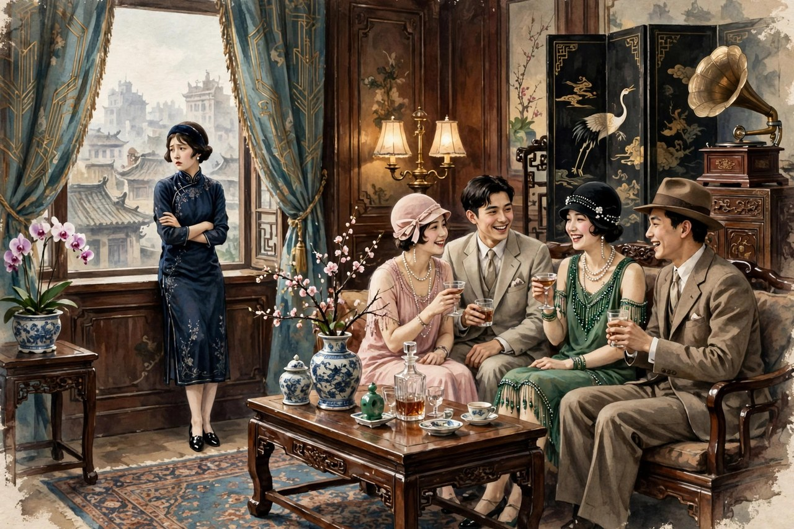
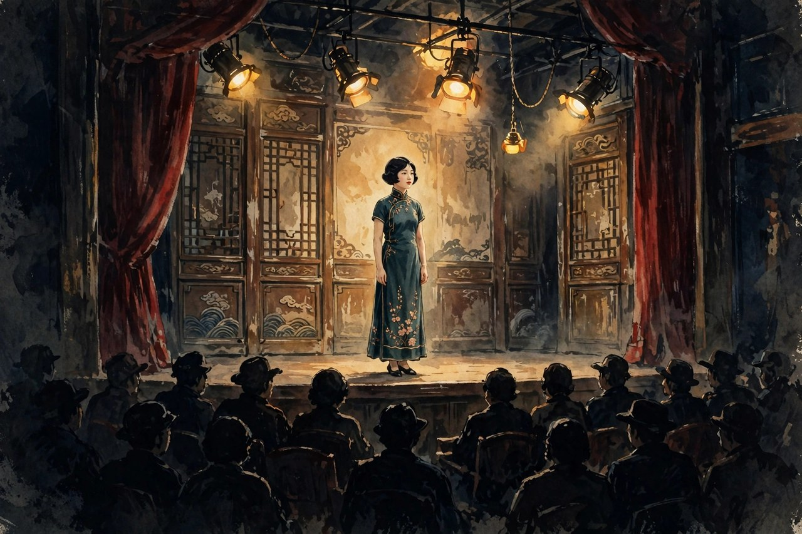

《梦珂》是丁玲公开发表的开篇小说，写于一九二七年秋，发表于一九二七年十二月十日的《小说月报》第十八卷第十二号。小说的主人公梦珂，是一个从内地到上海求学的少女，出生于没落官僚家庭，家里已经败落了，可她心里还有读书的梦，还有做人的梦。她在学校里，因为不满美术教员对模特儿的侮辱，离开了学校，住到姑母家。在姑母家，她又受到表兄等人感情上的侮慢，不得不再次出走，投奔剧社当演员。结果，在剧社那个纯肉感的社会里面，她直向地狱的深渊坠去。小说收在一九二八年开明书店出版的短篇小说集《在黑暗中》里，和《莎菲女士的日记》《暑假中》《阿毛姑娘》放在一起，成为丁玲早年写作的起点。主编叶圣陶看了《梦珂》，非常欣赏，主动向丁玲邀稿，丁玲才有了后来的《莎菲女士的日记》。可以说，没有《梦珂》，就没有丁玲的文坛起点；没有梦珂的出走，就没有丁玲后来写女子的全部路子。

梦珂这个人物，很多人读的时候会觉得她很可怜，也很可气。她可怜，是因为她一次次出走，一次次碰壁，一次次被人当成玩物；她可气，是因为她出走之后，没有找到更好的路，反而在姑母家学会了追求物质享受，学会了应酬，学会了在肉感的社会里打转。可是，丁玲写梦珂，不是为了可怜她，也不是为了骂她，而是为了写一个真实的问题：娜拉出走之后怎么办。易卜生写娜拉出走，写她离开家庭，离开丈夫，走向自由，可娜拉出走之后，住在哪里，吃什么，靠什么活，社会给她留了什么路，易卜生没有写。丁玲写梦珂，就是写娜拉出走之后的路：梦珂出走了，离开学校，离开姑母家，离开旧家庭，可她没有经济支撑，没有社会保障，没有可靠的朋友，没有能安身立命的职业，她只能在新的陷阱里打转，只能在剧社里被人观览，只能在肉感的社会里越陷越深。这样的出走，不是解放，是从一个陷阱跳进另一个陷阱。丁玲把这个道理写出来了，写得非常痛，写得非常真，写得让读者明白，出走不是终点，出走之后怎么办，才是真正的问题。

### 学校里的侮辱与出走

梦珂离开学校的原因，是她看不惯美术教员对模特儿的侮辱。模特儿是一个女子，在课堂上被人画，被人看，被人议论，被人当成物品。美术教员对模特儿的态度，是轻慢的，是侮辱的，是把女子当成玩物的。梦珂看到了，心里不舒服，觉得这样的学校，这样的教员，这样的风气，不值得她留下来。她离开学校，不是冲动，不是任性，是她心里有一杆秤：女子不能被当成物品，不能被当成玩物，不能在侮辱面前低头。她离开学校，就是对侮辱的反抗，就是对把女子当物品的风气的反抗。这样的反抗，在今天看依然有意义：女子在学校里、在职场里、在社会上，遇到侮辱，遇到把女子当物品的眼光，要敢离开，敢说不，敢不低头。梦珂的离开，就是这样一个敢说不的开始，她的开始是亮的，是硬的，是值得敬佩的。

可是，梦珂离开学校之后，并没有找到更好的地方。她住到姑母家，姑母家是上海的有钱人家，有应酬，有物质，有虚荣，有表兄等人的感情游戏。梦珂在姑母家，从一个纯洁、朴素的女孩子，变成了一个追求物质享受、善于应酬的小姐。她喜欢上了表哥晓淞，可她发现表哥和另一个女人鬼混，发现表哥的虚伪，发现姑母家的生活不过是一场感情游戏，一场把女子当成玩物的游戏。她在姑母家，险些陷入晓淞和澹明的爱情猎场，成为纨绔空虚富家公子们颓废生活中的鲜活玩物。她识破了他们的虚伪面孔，主动离开了这场狩猎游戏。她的离开，同样是反抗，同样是硬气：她看清了姑母家的虚伪，看清了表兄的游戏，看清了自己差点成为玩物的危险，她离开了，离开得非常及时，非常清醒。可是，离开姑母家之后，她又能去哪里呢？她没有钱，没有职业，没有可靠的人，她只能去剧社，只能去那个她原先十分憎恶的野鸡般的生活中。她的出走，从学校到姑母家，从姑母家到剧社，一次比一次难，一次比一次陷得深，这就是娜拉出走之后的困境：出走容易，找路难，找一条能安身立命的路更难。

梦珂在姑母家的变化，值得细说。她从纯洁朴素变成追求物质享受，变成善于应酬，这不是她变坏了，是环境把她磨成了这样。姑母家有钱，有应酬，有虚荣，有物质，梦珂住在这样的环境里，天天看着别人穿好的，吃好的，应酬，玩乐，她的心慢慢被磨动了，慢慢觉得物质享受也不错，应酬也不错，当小姐也不错。她喜欢上表哥晓淞，也是环境磨出来的：表哥会说话，会打扮，会应酬，会在恰当的时候看她一眼，让她觉得自己是特别的。她陷进去，不是她傻，是环境太会磨人。今天的姑娘在物质环境里，同样会被磨：住在有钱人家里，看着别人穿好的，吃好的，玩好的，心里慢慢就动了，慢慢就觉得物质享受就是生活，慢慢就把自己活成了应酬里的摆设。丁玲写梦珂在姑母家的变化，就是写环境磨人的力量：环境不是背景，是磨刀石，磨得人慢慢变了样，磨得人慢慢忘了自己原来的样子。梦珂后来识破了虚伪，离开了游戏，可她已经被磨得遍体鳞伤，已经学会了应酬，学会了物质，学会了在肉感的社会里打转，这就是环境留下的痕迹，擦不掉的痕迹。

### 剧社里的肉感社会

梦珂投奔的圆月剧社，是一个纯肉感的社会。剧社里的人，看女子不是看才气，不是看人品，是看身体，看姿色，看能不能被观览。梦珂在剧社里当演员，站在台上，被台下毫不尊重的眼光观览，她自己说，自己像妓女似的在这儿任那些毫不尊重的眼光去观览。这样的感觉，不是丁玲夸张，是剧社生活的真实写照：女子在台上，是商品，是玩物，是被人看的东西，不是被人尊重的人。梦珂在剧社里，隐忍着，继续到这个纯肉感的社会里去，那奇怪的情景，见惯了，慢慢的可以不怕，可以从容。她从害怕，变成习惯，变成从容，这个变化，比她在姑母家的变化更让人心疼：害怕的时候，她还知道自己不喜欢这个地方；习惯的时候，她已经开始接受这个地方；从容的时候，她已经把自己活成了这个地方的一部分。这样的变化，就是沉沦的过程，就是从出走走向深渊的过程。丁玲写这个过程，写得非常痛，写得非常真，写得让读者明白，沉沦不是一夜之间的事，是在习惯里、在从容里，一点一点沉下去的。

丁玲写剧社，还有一个底子：她自己曾经投考电影演员，去明星电影公司试镜，去南国电影剧社试演话剧，最后放弃做演员，转而从事文学创作。她在剧社和电影圈里的见闻，都写进了《梦珂》里，写进了梦珂在剧社里的遭遇里。她不是凭空想象剧社，她是亲眼看过剧社里女子怎么被当成玩物，怎么在应酬里笑着，心里却发凉。她把这些见闻写出来，就是告诉读者，剧社不是艺术的殿堂，是肉感的社会，是把女子当商品的地方。女子想在剧社里找艺术，找自由，找尊重，找错了地方，剧社给女子的，只有观览，只有应酬，只有肉感。梦珂在剧社里找错了地方，找错了路，越找越深，越陷越深，这就是她的悲剧，也是很多女子在娱乐圈、在名利场里的悲剧：想找艺术，找到了商品；想找自由，找到了枷锁；想找尊重，找到了观览。丁玲在一九二七年就把这个道理写出来了，到今天还没有过时：名利场给女子的，从来不是尊重，是观览，是消费，是把女子当成商品的眼光。

梦珂在剧社里的沉沦，还有一个原因：她没有经济支撑。她离开学校，没有收入；离开姑母家，没有依靠；去剧社当演员，是她唯一能找到的吃饭的路子。她不是喜欢剧社，是不得不去剧社，是为了活下去，才去剧社。她在剧社里被人观览，心里难受，可她不能离开剧社，离开了，她吃什么，住哪里，靠什么活。这个困境，就是娜拉出走之后最难的一道题：出走之后，靠什么活。没有经济支撑，出走就是空话；没有职业保障，出走就是跳进另一个陷阱。丁玲写梦珂，就是写这个困境：梦珂有反抗的勇气，有识破虚伪的清醒，可她没有经济的底气，没有职业的支撑，没有社会的保障，她的勇气和清醒，在经济面前，显得非常无力。这样的无力，不是梦珂一个人的无力，是那个时代所有出走女子的无力，是今天很多出走女子的无力：想离开旧家庭，想离开旧工作，想离开旧环境，可离开之后，靠什么活，靠什么吃饭，靠什么安身立命，这个问题不解决，出走就只能是换一个陷阱。

### 梦珂心里的苦闷与哭泣

丁玲写梦珂的心理，写得非常细，写得非常动人。她写梦珂走投无路，为渺茫的将来和不自由、虚伪、不真诚、充满虚饰的生活辗转难眠，在烦闷无聊中莫名地哭泣，苦于人与人的无法沟通，即使是在亲戚、熟人和朋友的围护之下，她还是觉得孤独，还是觉得苦闷。这样的心理，今天的读者一点都不陌生：人在人群里，却觉得孤独；人在亲戚朋友中间，却觉得无法沟通；人有吃有住，却觉得将来渺茫；人活着，却觉得生活虚伪、不真诚、充满虚饰。梦珂的苦闷，不是她一个人的苦闷，是现代人的苦闷，是人在社会里找不到真诚、找不到沟通、找不到出路的苦闷。丁玲写梦珂的苦闷，写得非常早，写得非常真，写得让读者明白，苦闷不是无病呻吟，是人在虚伪社会里的真实感受，是人在无法沟通里的真实痛苦。

梦珂的哭泣，同样值得细说。她在烦闷无聊中莫名地哭泣，哭不是因为某件事，是因为心里堵得慌，是因为将来渺茫，是因为生活虚伪，是因为人与人无法沟通。这样的哭，今天的很多年轻人都有过：夜里一个人，莫名地想哭，哭完了也不知道为什么哭，只觉得心里堵得慌，只觉得生活不对劲，只觉得将来没有方向。丁玲写梦珂的哭，就是写这种莫名的哭，写这种堵得慌的哭，写这种找不到原因的哭。这样的哭，比因为某件事哭更让人心疼，因为它没有具体的敌人，没有具体的委屈，只有人和社会的隔膜，只有人和人的无法沟通，只有一个姑娘对未来的渺茫。丁玲把这种哭写出来，就是告诉读者，苦闷不是矫情，是真实的，是值得被理解的，是需要被认真对待的。梦珂的哭，不是弱者的哭，是清醒者的哭，是看清了社会虚伪之后，不知道该怎么办的哭。

丁玲写梦珂的心理，还有一个特点：她写女子的性苦闷。梦珂在姑母家，在剧社里，对性的感觉是苦闷的，是压抑的，是不知道该怎么办的。她喜欢表哥，可表哥虚伪；她在剧社里被人观览，可观览不是爱，是消费；她想要爱，想要被理解，想要身体和心灵的亲近，可她得到的只有虚伪和观览。这样的性苦闷，在当时是很少有人敢写的，丁玲敢写，她写梦珂性的苦闷，写这种苦闷当然是由于那个时代造成的：时代不给女子正当的爱情出路，不给女子正当的性教育，不给女子正当的婚姻选择，女子只能在苦闷里打转，只能在虚伪和观览里打转。丁玲写性苦闷，不是为了猎奇，是为了写时代给女子造成的苦闷，是为了写女子在性问题上的无路可走。今天的读者看梦珂的性苦闷，会觉得丁玲写得非常超前，非常勇敢，非常真实：她在一九二七年就敢写女子性的苦闷，敢写女子对爱的渴望和对虚伪的厌恶，这样的勇气，到今天还没有过时。

### 出走之后怎么办的追问

《梦珂》留给后世最大的问题，就是出走之后怎么办。梦珂出走了三次：离开学校，离开姑母家，投奔剧社，每一次出走，都没有找到更好的路，每一次出走，都陷得更深。这个问题，丁玲没有给出答案，她只是把问题摆出来，让读者自己去想。后来的人读《梦珂》，同样要面对这个问题：离开旧家庭之后，住在哪里，吃什么，靠什么活；离开旧工作之后，找什么工作，靠什么技能，靠什么保障；离开旧环境之后，去哪里，找谁，靠什么安身立命。这些问题，不解决，出走就是空话，就是换陷阱。丁玲写梦珂，就是提醒后来的出走者：出走之前，先想好出走之后怎么办，先找好经济支撑，先找好职业保障，先找好可靠的朋友，先找好安身立命的路，再出走也不迟。出走不是一时冲动，是要准备的，是要规划的，是要留后路的。梦珂的悲剧，就是出走没有准备，没有后路，没有支撑，才会越走越深，越陷越深。

对照今天看，出走之后怎么办，依然是很多年轻人的难题。今天的年轻人，离开家乡到大城市，离开旧工作去创业，离开旧婚姻去单身，离开旧环境去追梦，这些出走，都需要回答出走之后怎么办：大城市房租贵，创业风险大，单身生活孤单，追梦路上没有保障。很多年轻人出走之后，发现大城市不是天堂，创业不是自由，单身不是轻松，追梦不是浪漫，出走之后的生活，比出走之前更难。丁玲的梦珂，就是这些年轻人的前辈：她出走之后，发现学校外面是姑母家的虚伪，姑母家外面是剧社的肉感，剧社外面是深渊，出走之后没有路，只有更深的陷阱。把梦珂的故事记住了，今天的年轻人在出走之前，就会多想一步，多准备一步，多留一条后路，多找一份支撑，出走就不会那么盲目，就不会那么容易陷进去。

丁玲写《梦珂》，还有一个意义：她给后来的女子文学开了一个头，写女子出走，写女子苦闷，写女子在社会里的无路可走。她后来的《莎菲女士的日记》，就是梦珂的延续：莎菲同样出走了，同样苦闷，同样在爱情里打转，同样找不到出路。梦珂和莎菲合起来，就是丁玲早年写女子的全部：出走，苦闷，打转，找不到路。这样的女子文学，到今天还没有过时，因为出走之后怎么办，到今天还没有完全解决，女子在社会里的出路，到今天还没有完全铺好。丁玲用《梦珂》和《莎菲女士的日记》，把这个问题提出来了，把苦闷写出来了，把无路可走写出来了，后来的女子才能接着想办法，接着找路，接着铺路。梦珂的出走，没有找到路，可她把问题留下来了，问题留下来了，路就有可能被后来的人找到。

### 梦珂与丁玲自己的影子

《梦珂》里的梦珂，有丁玲自己的影子。丁玲年轻时，也想过当电影演员，也去试过镜，也到剧社试演过话剧，最后放弃做演员，转而从事文学创作。她在电影圈和剧社里的见闻，都写进了梦珂的故事里，写进了梦珂在剧社里的遭遇里。她写梦珂，就是写自己年轻时的见闻，写自己看到的女子在剧社里怎么被当成玩物，怎么在应酬里笑着，心里却发凉。她后来放弃做演员，选择写作，就是给自己找了一条出走之后的路：写作是她的职业，是她的支撑，是她安身立命的路子。她找到了路，梦珂没有找到路，这就是丁玲和梦珂的不同：丁玲找到了写作这条路，梦珂没有找到自己的路，只能在剧社里沉沦。丁玲写梦珂，就是写自己如果没有找到写作这条路，会是什么样子：会在剧社里被人观览，会在肉感的社会里越陷越深，会在苦闷里哭泣，会在渺茫的将来里辗转难眠。这样的写法，既是写梦珂，也是写自己，更是写所有没有找到路的女子。

丁玲找到写作这条路，不是偶然的，是她自己挣出来的。她从上海到北京，从北京到上海，从试镜到写作，从剧社到文坛，一步一步挣出来的。她挣出来的路，就是梦珂没有挣出来的路：写作需要才气，需要坚持，需要有人欣赏，需要有发表的机会。丁玲有才气，有坚持，遇到了叶圣陶，发表了《梦珂》，发表了《莎菲女士的日记》，才有了文坛的起点。梦珂没有这样的运气，没有遇到欣赏她的人，没有找到自己的才气可以安放的地方，只能在剧社里被人观览。丁玲写梦珂，就是在提醒读者：找路需要运气，更需要准备，需要才气，需要坚持，需要有人欣赏，需要有发表的机会。这些东西，缺一不可，缺了，路就难找，缺了，出走就容易陷进去。今天的年轻人找路，同样需要这些东西：才气要练，坚持要熬，欣赏的人要找，发表的机会要争，缺了哪一样，路都会难走。丁玲的路，是挣出来的，梦珂的路，是没有挣出来的，两个人的对比，就是找路和没有找路的对比。

读《梦珂》，还要读丁玲的起点。丁玲的文坛起点，就是《梦珂》，就是梦珂的出走，就是梦珂的苦闷。她从《梦珂》出发，走到《莎菲女士的日记》，走到《水》，走到《太阳照在桑干河上》，走到《我在霞村的时候》，走到《夜》，走到《母亲》，走到《韦护》，每一步都是从梦珂的出走出发的：出走之后怎么办，是她一生都在回答的问题。她早年写出走之后的苦闷，中年写出走之后的觉醒，晚年写出走之后的反思，一生都在回答梦珂的问题。读者读丁玲，不能跳过《梦珂》，跳过了，就看不懂她后来的路是怎么走出来的，就看不懂她为什么要写莎菲，为什么要写水，为什么要写土改，为什么要写霞村，为什么要写夜。梦珂是起点，起点里的问题，是丁玲一生的问题，是中国现代女子一生的问题，是今天年轻人一生的问题。把起点读懂了，丁玲的全部作品就读懂了一半。

### 姑母家的应酬与上海的虚荣

姑母家是上海有钱人家的缩影，有应酬，有虚荣，有物质，有感情游戏。梦珂住在姑母家，天天看着应酬，看着虚荣，看着物质，看着表兄等人的感情游戏，她的心慢慢被磨动了。她从前是纯洁朴素的女孩子，到了姑母家，学会了穿好的，吃好的，应酬，玩乐，学会了在应酬里笑着，心里却发凉。这样的变化，不是她一个人变坏了，是上海的虚荣磨人，磨得人慢慢忘了自己原来的样子。今天的上海，同样有这样的虚荣：朋友圈里的应酬，饭局上的虚荣，物质上的攀比，感情上的游戏，磨得年轻人慢慢忘了自己原来的样子，慢慢把自己活成了应酬里的摆设。丁玲写姑母家的应酬，就是写上海的虚荣，写虚荣怎么磨人，怎么把一个纯洁的姑娘磨成善于应酬的小姐，怎么把一个有梦的姑娘磨成追求物质的人。把这个过程写清楚了，读者就能认清虚荣的面目，就能在虚荣面前多一份清醒，多一份抵抗，多一份对自己的坚持。

姑母家的表兄晓淞和澹明，是虚荣游戏里的玩家。他们有钱，有闲，有应酬，有感情游戏，他们把女子当成猎物，当成玩物，当成颓废生活里的点缀。梦珂险些成为他们的猎物，险些成为他们游戏里的鲜活玩物，她识破了，离开了，离开得非常及时，非常清醒。可是，离开游戏之后，她又能去哪里呢？她没有钱，没有职业，没有依靠，只能去剧社，只能去另一个游戏里。这样的困境，就是虚荣游戏的厉害之处：游戏外面还是游戏，陷阱外面还是陷阱，离开一个游戏，就会掉进另一个游戏，除非找到一条真正属于自己的路，否则永远在游戏里打转。丁玲写晓淞和澹明，就是写虚荣游戏的玩家，写他们怎么把女子当猎物，怎么把感情当游戏，怎么把生活当颓废的点缀。把这些玩家写清楚了，读者就能认清游戏的面目，就能在游戏面前多一份警惕，多一份离开的勇气，多一份找路的决心。

上海的虚荣，到今天还没有消失，只是换了样子：从前的应酬是饭局，是舞会，是客厅里的游戏；今天的应酬是朋友圈，是直播间，是饭局上的攀比，是感情上的游戏。虚荣的面目换了，磨人的力量没有变：磨得年轻人追求物质，追求应酬，追求虚荣，忘了自己原来的梦，忘了自己原来的样子。丁玲写姑母家的虚荣，就是给今天的年轻人提个醒：虚荣不是生活，是游戏；应酬不是朋友，是消耗；物质不是幸福，是陷阱。认清了这些，年轻人在虚荣面前，就能多一份清醒，多一份抵抗，多一份对自己的坚持，就不会像梦珂那样，在虚荣里越陷越深，就能早点离开游戏，早点找到自己的路。梦珂离开游戏晚了，陷进去了，今天的年轻人可以离开得早一点，陷得浅一点，找到路的可能性就大一点。

### 梦珂的眼泪与今天的姑娘

梦珂的眼泪，是小说里最让人心疼的部分。她在烦闷无聊中莫名地哭泣，哭完了也不知道为什么哭，只觉得心里堵得慌，只觉得将来渺茫，只觉得生活虚伪。这样的眼泪，今天的很多姑娘都有过：夜里一个人，莫名地想哭，哭完了也不知道为什么哭，只觉得心里堵得慌，只觉得将来没有方向，只觉得生活不对劲。丁玲写梦珂的眼泪，就是写这种莫名的眼泪，写这种堵得慌的眼泪，写这种找不到原因的眼泪。这样的眼泪，比因为某件事哭更让人心疼，因为它没有具体的敌人，没有具体的委屈，只有人和社会的隔膜，只有人和人的无法沟通，只有一个姑娘对未来的渺茫。把这种眼泪写出来，就是告诉读者，眼泪不是矫情，是真实的，是值得被理解的，是需要被认真对待的。梦珂的眼泪，不是弱者的眼泪，是清醒者的眼泪，是看清了社会虚伪之后，不知道该怎么办的眼泪。

今天的姑娘，同样会在夜里莫名地哭，同样会觉得将来渺茫，同样会觉得生活虚伪，同样会觉得人与人无法沟通。她们的哭，和梦珂的哭没有本质区别：都是清醒者的哭，都是看清了社会的问题之后，不知道该怎么办的哭。丁玲写梦珂的哭，就是给今天的姑娘留的一面镜子：镜子里有梦珂，也有你自己，你的哭不是你一个人的毛病，是很多姑娘都有的毛病，是社会给女子造成的苦闷，是出走之后没有路的苦闷。把镜子照清楚了，姑娘就不会那么自责，不会觉得自己哭就是软弱，不会觉得自己苦闷就是矫情，就会明白，哭是正常的，苦闷是真实的，出走之后没有路是普遍的问题，问题不在你一个人身上，在社会给女子的路上。把责任分清楚了，姑娘就能少一份自责，多一份清醒，多一份找路的勇气。

梦珂的眼泪，到今天还在流。每一个在虚荣里打转的姑娘，每一个在剧社里被人观览的姑娘，每一个在出走之后找不到路的姑娘，都在流梦珂的眼泪。她们的眼泪，丁玲在一九二七年就写下来了，写得非常早，写得非常真，写得让后来的人读了还会心疼。把梦珂的眼泪记住了，今天的姑娘在夜里哭的时候，就不会觉得自己是一个人在哭，就会知道，原来一百年前就有人这样哭过，原来哭不是软弱，是清醒，是看清了问题之后的正常反应。哭完了，擦干眼泪，找路，找支撑，找职业，找朋友，找安身立命的地方，路就会慢慢出来，眼泪就会慢慢少起来。梦珂没有找到路，可她的眼泪把问题留下来了，问题留下来了，路就有可能被后来的人找到，眼泪就有可能被后来的人擦干。

### 梦珂留给后来人的追问

梦珂的故事讲完了，问题留下来了：出走之后怎么办，靠什么活，找什么路，找谁帮忙，找什么支撑。这些问题，丁玲没有回答，她把问题留给读者，留给后来的人，留给今天的年轻人。后来的人读《梦珂》，要带着这些问题读，要带着这些问题生活，要在出走之前先想好出走之后怎么办，先找好经济支撑，先找好职业保障，先找好可靠的朋友，先找好安身立命的路，再出走也不迟。出走不是一时冲动，是要准备的，是要规划的，是要留后路的。梦珂的悲剧，就是出走没有准备，没有后路，没有支撑，才会越走越深，越陷越深。把这个教训记住了，今天的年轻人在出走之前，就会多想一步，多准备一步，多留一条后路，多找一份支撑，出走就不会那么盲目，就不会那么容易陷进去。

梦珂的追问，到今天还没有过时。每一个要出走的年轻人，都要先问自己：出走之后住在哪里，吃什么，靠什么活，找什么工作，靠什么技能，靠什么保障，找谁帮忙，找什么朋友，找什么安身立命的地方。把这些问题想清楚了，出走才有底气，才有后路，才不会像梦珂那样，从学校走到姑母家，从姑母家走到剧社，从剧社走到深渊。把这些问题想不清楚，出走就是换陷阱，就是从一个游戏跳进另一个游戏，就是从一个虚荣跳进另一个虚荣。丁玲用《梦珂》给后来的人留的追问，就是这几句：出走之前，先想好出走之后怎么办；出走之后，先找好安身立命的路；找路的时候，先找好经济支撑，先找好职业保障，先找好可靠的朋友。把这几句记住了，出走就不会那么难，路就会慢慢出来，日子就会慢慢亮起来。

梦珂走了，问题留下来了，路还在后来的人脚下。

后来的人，别再走梦珂的老路。
