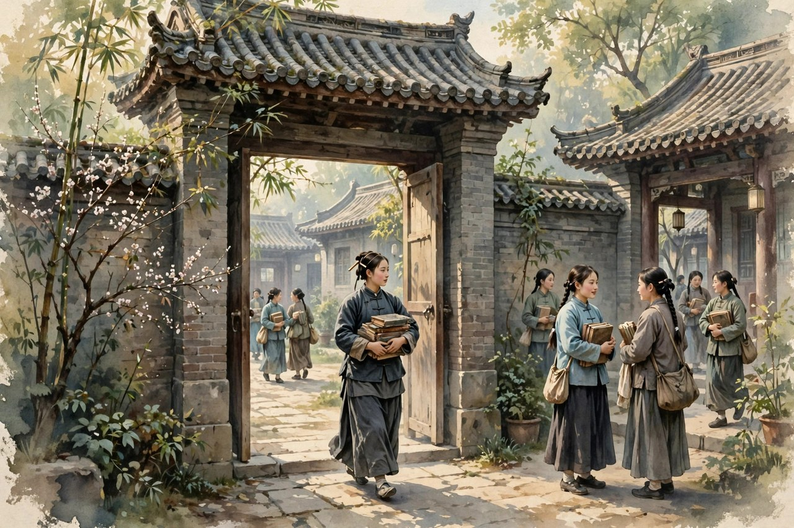
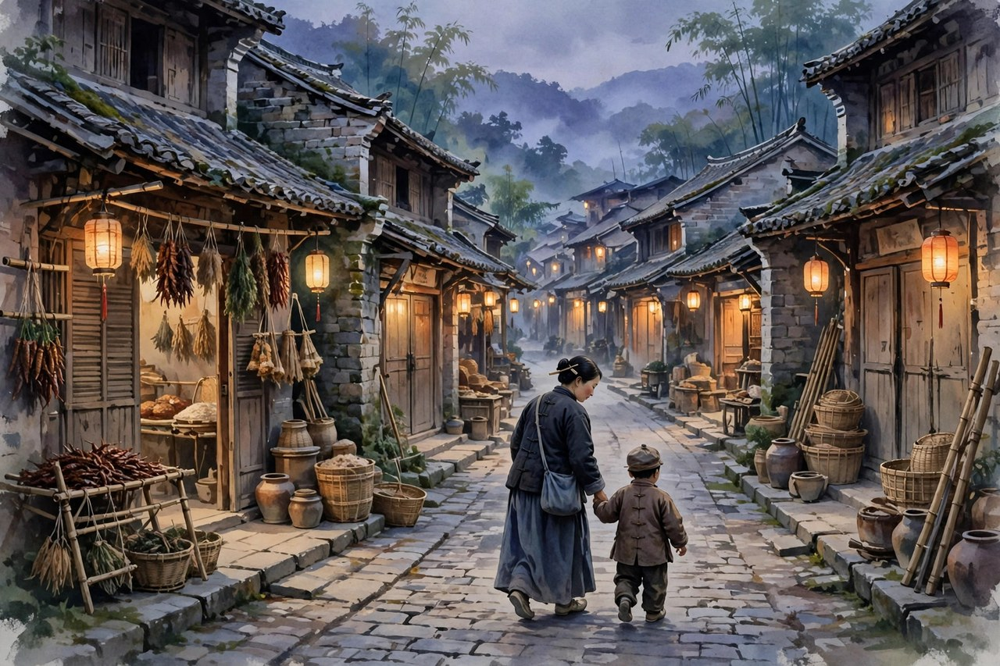

《母亲》是丁玲想写的一部传记体长篇小说，写湖南一个小城市和村镇从辛亥革命前后，到大革命，再到农村土地骚动几十年里，几家豪绅地主的没落变迁和多种人物的发展变化。小说的主人公曼贞，原型就是丁玲的母亲余曼贞。丁玲从一九三二年五月开始动笔，陆续发表，到一九三三年六月由上海良友图书公司初版，同年十月再版，可小说并没有写完，到一九三三年五月丁玲被国民党特务绑架，押到南京囚禁，创作被迫中断。鲁迅当时建议马上出版这部未完成的长篇，还亲自安排把稿酬寄到丁玲母亲手里。已经发表的八九万字，写的是辛亥革命前后，一个年轻的寡妇遭遇的层层苦痛和压迫，以及她冲出封建大家庭，走向自立的觉醒与反抗的过程。茅盾评价这部小说，说它的主题是想展现以曼贞为代表的前一代女子，怎样挣扎着从封建思想和封建势力的重围中闯出来，怎样憧憬着光明的未来。这个评价，说到了点子上：《母亲》写的不是一个女子的传奇，是一代女子从旧家庭里挣出来的路。

曼贞这个人物，很多人读的时候会觉得她很熟悉。她从前是一个善良贤惠、从不管闲事的少奶奶，嫁到夫家，丈夫不管事，她也不管事，日子过得安稳，也过得糊涂。她从小缠足，又因父母之命、媒妁之言，糊里糊涂地成了少奶奶，做了两个孩子的母亲。她肩不能挑，手不能提，对自己的生活一片茫然，完全由他人主宰命运，活成了一个被动生活的弱者。可是，丈夫早逝，家境衰落，亲戚倾轧，把她置于人生命运的转折时刻：生之艰难和家庭责任的问题，摆在了她的面前。她不能再依照原来那种方式做人了，她要替自己开辟出一条路来，她要不顾一切的讥笑和反对，她不愿再受人管辖，而要自己处理自己的生活了。这样的转变，不是凭空喊出来的，是现实的压迫一步一步逼出来的：丈夫死了，债来了，亲戚欺负了，孩子要养了，她不站起来，全家就没有活路了。丁玲写曼贞的转变，写得非常真实，非常有层次，没有把转变写成一夜之间的觉悟，而是写成在压迫里一点一点被逼出来的觉醒。

### 少奶奶的糊涂日子

曼贞从前的日子，是糊涂的，也是安稳的。她嫁到夫家，丈夫是百事不管的人，她也是百事不管的人，两个人凑在一起，过着不管闲事的日子。她不管家里的账，不管田里的事，不管外面的风浪，只管在家里做少奶奶，做两个孩子的母亲。这样的日子，在旧社会里是很多少奶奶的日子：不用操心，不用做主，不用负责，只管享福，只管被养着。可是，这样的日子有一个代价：女子一旦被养着，就失去了做主的能力，失去了处理生活的能力，失去了面对风浪的能力。曼贞从小缠足，脚被裹住了，走路都困难，更不用说挑担、种地、做事。她的人生，从小就被安排好了：父母安排婚姻，夫家安排生活，丈夫安排一切，她只需要听话，只需要做少奶奶，只需要不管闲事。这样的安排，看起来安稳，实际上危险：安排她的人一旦不在了，她的人生就塌了。丈夫早逝，就是安排她的人不在了，就是她人生的转折点，就是她不得不自己站起来的时刻。

丁玲写曼贞从前的糊涂日子，写得非常克制，没有嘲笑曼贞，没有骂曼贞糊涂，而是写她的糊涂是社会造成的，是封建家庭造成的，是缠足和包办婚姻造成的。女子从小被裹脚，被安排婚姻，被教育不管闲事，被养成被动生活的弱者，这不是女子一个人的错，是整个旧社会的错。丁玲写曼贞的糊涂，就是写旧社会怎么把女子养成弱者，怎么把女子的人生安排得明明白白，怎么让女子失去做主的能力。把这个道理写清楚了，读者就不会骂曼贞糊涂，就会心疼曼贞，就会明白，曼贞后来的觉醒，不是她忽然变聪明了，是她被逼到绝境里，不得不聪明，不得不做主，不得不自己处理生活。这样的写法，比直接骂旧社会更有力量：它让读者看到，旧社会不是抽象的概念，是曼贞脚上的裹脚布，是曼贞糊涂的日子，是曼贞被动的生活，是曼贞丈夫死后塌下来的人生。

对照今天看，曼贞从前的糊涂日子，依然有现实意义。今天的很多女子，同样过着不管闲事的日子：家里有人赚钱，有人做主，有人安排一切，自己只需要享福，只需要做贤妻良母，只需要不管闲事。这样的日子，看起来安稳，实际上危险：一旦赚钱的人不在了，一旦做主的人变了，一旦安排一切的人离开了，女子的人生就会塌下来，就会发现自己什么都不会，什么都做不了主，什么都处理不了。丁玲写曼贞，就是给今天的女子提个醒：不要把自己活成被养着的人，不要把自己的人生交给别人安排，要学会做主，学会处理生活，学会面对风浪。曼贞的教训，就是今天的教训：安稳的日子不是永远的，做主的能力才是自己的，处理生活的能力才是自己的，面对风浪的能力才是自己的。把这些能力练出来了，风浪来了，女子才能站得住，才能不塌。

### 丈夫去世与亲戚倾轧

曼贞人生的转折点，是丈夫早逝。丈夫死了，家里的顶梁柱倒了，债来了，亲戚来了，倾轧来了，世态炎凉来了。曼贞带着一双儿女，背着一身债，在世态炎凉的境遇中奋起，自立自强。丁玲写这段，写得非常细：亲戚怎么欺负她，怎么想占她家的便宜，怎么在她最难的时候落井下石；债主怎么上门，怎么逼债，怎么让她喘不过气来；世态怎么炎凉，从前巴结她的人，现在躲着她，从前对她好的人，现在翻脸不认人。这些细节，放在今天看一点都不陌生：人走茶凉，世态炎凉，亲戚在利益面前翻脸，债主在困难面前逼债，这些事，到今天还在。丁玲写曼贞在世态炎凉里奋起，就是写女子在最难的时候怎么站起来：不是靠别人可怜，不是靠亲戚施舍，是靠自己奋起，靠自己自立，靠自己把债还上，把孩子养大，把日子过下去。这样的奋起，比任何口号都更有力量：奋起不是喊出来的，是在债主上门的时候挺住，是在亲戚欺负的时候顶回去，是在世态炎凉里把腰挺直。

曼贞的奋起，还有一个特点：她不是一个人奋起，她是带着孩子奋起。她有两个孩子，孩子要吃饭，要上学，要长大，她不能倒下，她倒下了，孩子就没有活路了。母亲的身份，给了她奋起的动力，也给了她奋起的压力。她为了孩子，必须站起来，必须做主，必须处理生活，必须面对亲戚和债主。这样的母亲，今天的读者一点都不陌生：很多单亲母亲，同样带着孩子奋起，同样在世态炎凉里把腰挺直，同样在债主和亲戚面前顶回去。丁玲写曼贞带着孩子奋起，就是写母亲的力量：母亲不是弱者，母亲在孩子面前，就是强者，就是顶梁柱，就是全家的希望。曼贞从前是被动生活的弱者，做了母亲之后，在丈夫去世之后，她变成了强者，变成了能做主、能处理生活、能面对风浪的人。这个变化，不是她忽然变了，是母亲的责任把她逼出来的，是孩子的未来把她推出来的。丁玲把这个变化写出来，就是告诉读者：母亲的力量，是在责任里长出来的，是在孩子面前长出来的，是在绝境里长出来的。

丁玲写亲戚倾轧，还有一个深意：她在写封建大家庭内部的衰落与分化。曼贞的夫家，是一个封建大家庭，家里有几房人，有田产，有规矩，有倾轧。丈夫死了，家庭内部的矛盾就爆发了：谁来管家，谁来分产，谁来还债，谁来照顾孩子，这些问题，都变成了倾轧的借口。亲戚们不是来帮忙的，是来分家产的，是来占便宜的，是来把曼贞挤出去的。丁玲写大家庭的倾轧，写得非常细：亲戚怎么说话，怎么算计，怎么在背后使绊子，怎么在人前装好人。这些细节，让读者看到，封建大家庭不是温情脉脉的大家庭，是利益倾轧的战场，是女子在里面最容易被牺牲的地方。曼贞在这个战场里，不但没有被牺牲，反而挣出来了，走出来了，走向了学校，走向了自立，这就是她的了不起之处。今天的大家庭，同样有倾轧，同样有利益之争，同样有女子被牺牲的风险，丁玲写曼贞挣出大家庭，就是给今天的女子留的一条路：大家庭的倾轧里，不要认命，不要被牺牲，要挣出来，要走出来，要自己处理自己的生活。

### 走进学校与放开小脚

曼贞挣出来的路，有一个非常具体的标志：走进学校。她从一个不管闲事的少奶奶，变成一个敢走进学校的女子，敢放开自己的小脚，敢勇敢地迈入新式学校接受教育。这个变化，在当时是非常了不起的：缠足的女子，放开小脚，走进学校，本身就是对封建旧俗的反抗，就是对女子不能读书、不能做主的旧规矩的反抗。丁玲写曼贞走进学校，写得非常动人：她放开小脚，走路都疼，可她还是走，她走进学校的大门，看到学校里的女子，看到学校里的书，看到学校里的新世界，心里亮了一点。她在学校里读书，学知识，学道理，学怎么处理自己的生活，学怎么不被别人管辖。学校给她的，不只是知识，更是做主的底气，是自立的能力，是走向新生活的路。这样的学校，今天的读者一点都不陌生：女子读书，女子上学，女子接受教育，本身就是女子解放的起点，就是女子做主的起点。丁玲写曼贞走进学校，就是写女子解放的起点：起点不在口号里，在学校的大门里，在放开小脚的脚步里，在读书的灯光里。

曼贞走进学校，还有一个背景：她的母亲原型余曼贞，本身就是借钱读师范，毕业后当教员，还办过女子学校的人。丁玲写曼贞走进学校，就是写自己母亲的路：母亲借钱读书，母亲当教员，母亲办学校，母亲用一生证明，女子可以读书，可以教书，可以办学校，可以自己处理自己的生活。丁玲把母亲的路写进小说里，就是把母亲的精神传下来：母亲的精神，就是女子自立的精神，就是女子不靠别人、自己挣路的精神。这样的精神，到今天还没有过时：女子读书，女子工作，女子创业，女子做主，都是母亲精神的延续，都是曼贞精神的延续。丁玲写《母亲》，就是写母亲的精神，就是写女子自立的精神，就是写一代女子怎么从旧家庭里挣出来的精神。这部小说没有写完，可它的精神写完了，写在了曼贞走进学校的脚步里，写在了曼贞放开小脚的疼里，写在了曼贞自己处理生活的决心里。

小说里还有一个人物，值得多说几句：以向警予为原型的夏真仁。夏真仁是一个新式女子，有思想，有追求，有革命的影子，她和曼贞的交往，给了曼贞很多启发，很多勇气，很多新的想法。曼贞从夏真仁身上，看到女子可以有另外一种活法：可以读书，可以革命，可以做事，可以不被家庭管辖，可以自己选择生活。夏真仁的出现，让曼贞的路更亮了，让她知道，自己不是一个人在挣，前面还有人走过，还有人给她指路。丁玲写夏真仁，就是写新时代女子的榜样：榜样不是高高在上的圣人，是身边可以学习的人，是可以一起走路的人。曼贞跟着夏真仁走，走到学校，走到自立，走到新生活，这条路，就是榜样带出来的路。今天的女子，同样需要榜样：需要身边读书的女子，需要身边工作的女子，需要身边做主的女子，需要身边挣出旧家庭的女子。榜样在身边，路就在脚下，曼贞的路，就是这样被榜样照亮的路。

### 未完成长篇的遗憾与分量

《母亲》没有写完，是丁玲一生里一个很大的遗憾。她本来打算写一部三十万字的传记体长篇，从宣统末年写起，经过辛亥革命，经过大革命，一直到农村的土地骚动，写湖南一个小城市几家豪绅地主的没落变迁，写多种人物的发展变化。可是，她只写了八九万字，就被绑架，被囚禁，创作中断了。后来，她又想继续写，准备写成三部，可没有完成计划，就被捕了，就被囚禁了，就再也没有机会把这部小说写完。小说没有写完，可已经发表的部分，已经有了很大的分量：它写了曼贞从少奶奶到自立女子的转变，写了封建大家庭的衰落，写了辛亥革命的时代浪花，写了前一代女子怎么从封建重围里闯出来。这些内容，放在今天看，依然有分量，依然能打动读者，依然能让读者明白，女子自立不是一句口号，是一个寡妇带着孩子、背着债、在亲戚的白眼里一寸一寸挪出来的路。没有写完的小说，有写完的精神，精神写完了，小说就没有白写。

《母亲》没有写完，还有一个原因：丁玲后来的生活太动荡了。她从南京逃出来，奔赴陕北，参加革命，参加土改，参加文坛工作，参加各种运动，被打成右派，下放北大荒，坐监狱，平反之后创办刊物，提携后进，她的一生，没有多少安稳的日子可以坐下来写长篇。她想写《母亲》的续篇，想把曼贞后来的路写出来，想把于家、江家的故事写出来，可时间不等人，风浪不等人，她到去世前，还在病床上坚持写作和审稿，还在问文章能不能续下去。她的续篇，没有公开面世，直到她生前的秘书整理她的遗物，才发现残稿，残稿里还是曼贞为中心的于家、江家故事，还是曼贞后来的路。残稿的发现，让读者知道，丁玲心里一直惦记着《母亲》，一直想把曼贞的路写完，一直没有放下这部小说。她没有写完，不是她不想写，是时代没有给她安稳写长篇的日子。这样的遗憾，比写完了更有分量：它让读者明白，好作品不是写完才有价值，写了一半，只要精神写完了，只要路指出来了，就有价值，就能流传。

对照今天看，《母亲》没有写完，依然有现实意义。今天的很多长篇，写完了，却没有精神，写完了，却没有路，写完了，读者看完就忘了。丁玲的《母亲》，没有写完，却有精神，有路，有曼贞走进学校的脚步，有曼贞放开小脚的疼，有曼贞自己处理生活的决心，这些东西，读者看完忘不了，记住了，就会想，就会学，就会走。好作品的标准，不是写完没有，是精神有没有，路有没有，人心有没有。丁玲的《母亲》，精神有了，路有了，人心有了，写完没有写完，就没有那么重要了。读者读《母亲》，不要纠结它没有写完，要读它写完的部分，要读曼贞的转变，要读封建大家庭的衰落，要读辛亥革命的浪花，要读前一代女子挣出来的路。把这些读懂了，《母亲》就读懂了，丁玲写《母亲》的苦心就明白了。

### 曼贞与丁玲母女的两代路

曼贞和丁玲，是母女两代人的路。曼贞是前一代女子，从旧家庭里挣出来，走到学校，走到自立；丁玲是后一代女子，从母亲的路出发，走到文坛，走到革命，走到土改，走到延安，走到北大荒，走到晚年的刊物。两代人的路，合起来就是中国现代女子的一部成长史：前一代挣出家庭，后一代挣出社会，前一代放开小脚，后一代拿起笔，前一代走进学校，后一代走进文坛。丁玲写《母亲》，就是写母女两代人的路，就是写自己骨气的来处：她的骨气，不是天上掉下来的，是母亲一步一步挣出来的，是母亲带着孩子、背着债、在亲戚的白眼里挣出来的。她把母亲的路写下来，就是把自己的来处写下来，就是告诉读者，她为什么这么硬，为什么这么敢写，为什么在风浪里不弯腰：因为她的母亲就是这样硬，就是这样敢挣，就是这样在风浪里不弯腰。母亲的路，就是女儿的底气，女儿的笔，就是母亲精神的延续。

今天的母女，同样是两代人的路。母亲那一代，可能没有读过多少书，可能没有做过主，可能在旧家庭里忍了一辈子；女儿这一代，读了书，工作了，做主了，挣出来了。女儿的路，是站在母亲的肩膀上走出来的，是母亲忍了一辈子换来的，是母亲供读书换来的。丁玲和曼贞的路，就是这样：曼贞忍了，挣了，供丁玲读书了，丁玲才有了走出湖南、走进文坛、走进革命的机会。女儿读《母亲》，要带着感激读：母亲的路不好走，母亲的挣不容易，母亲的学校是借钱读的，母亲的自立是背着债挣的。把母亲的路记住了，女儿的路就有了根，就有了底气，就不会在风浪里轻易趴下。曼贞的路，是丁玲的根，今天母亲的路，同样是女儿的根。把根记住了，路就不会走偏，腰就不会轻易弯。

丁玲写《母亲》，还有一个值得今天的人学的点：她写母亲，没有把母亲写成圣人，没有把母亲写成完美的人，而是写成一个有糊涂、有软弱、有挣扎、有奋起的活人。曼贞从前糊涂，后来奋起，中间有挣扎，有为难，有疼，有泪，这样的母亲，才是真的母亲。今天的很多作品写母亲，喜欢把母亲写成圣人，写成毫无瑕疵的奉献者，结果母亲失去了真实感，读者读着觉得假。丁玲的曼贞不圣人，可她真实，她的糊涂是社会造成的，她的奋起是责任逼出来的，她的挣扎是人性的，她的疼是真实的。这样的母亲，读者读了会心疼，会敬佩，会感激，会想自己的母亲。把母亲写真实，比把母亲写成圣人更有力量，因为真实的母亲，才能让读者想起自己的母亲，才能让读者把感激落实到生活里，落实到给母亲打一个电话，落实到陪母亲吃一顿饭，落实到帮母亲分担一点生活的重担。

### 今天读母亲的几句心里话

今天读《母亲》，头一句心里话是：不要把自己活成被养着的人。曼贞从前的日子，就是被养着的日子，就是不管闲事的日子，就是被动生活的日子。这样的日子，看起来安稳，实际上危险，一旦养着你的人不在了，你的人生就塌了。今天的女子，同样不要把自己活成被养着的人，不要把自己的人生交给别人安排，要学会做主，学会处理生活，学会面对风浪。做主的能力，是自己的，处理生活的能力，是自己的，面对风浪的能力，是自己的，这些能力，别人给不了，只有自己练出来。曼贞练出来了，是在丈夫去世、亲戚倾轧、背着债、带着孩子的情况下练出来的，她练出来了，你也可以练出来，不必等到绝境，不必等到塌下来，现在就可以练：学会算账，学会做主，学会处理家里的事，学会面对困难，练出来了，风浪来了，你就站得住。

另外一句心里话是：走进学校，走进书里，走进新世界。曼贞走进学校，是她挣出来的关键一步：学校给了她知识，给了她底气，给了她自立的能力，给了她走向新生活的路。今天的女子，走进学校同样重要：读书，学习，接受教育，增长见识，这些都是女子做主的底气，都是女子自立的能力。不要觉得读书没有用，不要觉得学习是年轻人的事，读书和学习，是一辈子的事，是女子在任何年纪都可以做的事。曼贞放开小脚走进学校的时候，已经是两个孩子的母亲了，已经背着债了，已经被亲戚欺负了，可她还是走进去了，还是读了书，还是自立了。她的年纪，她的处境，都没有挡住她读书的路，今天的女子，处境比曼贞好得多，读书的路更不应该被挡住。把书读好，把见识长出来，把底气练出来，女子做主的路就宽了。

还有一句心里话是：母亲的路，值得女儿好好走。曼贞的路，是丁玲的根，今天母亲的路，同样是女儿的根。女儿读《母亲》，要想想自己的母亲：母亲忍了什么，挣了什么，供自己读书付出了什么，母亲的自立是怎么挣出来的，母亲的委屈是怎么咽下去的。想清楚了，女儿就会更感激母亲，更珍惜母亲，更愿意陪母亲，更愿意帮母亲分担。母亲不需要女儿给她立碑，不需要女儿给她写传，只需要女儿记得她的路，记得她的挣，记得她的疼，记得她的爱，把这些记在心里，落实到生活里，落实到给母亲打电话，落实到陪母亲吃饭，落实到帮母亲做点事，这就是对母亲最好的回报。丁玲写《母亲》，就是给母亲立了一块碑，碑上写的是曼贞的路，写的是母亲的精神，写的是女子自立的路。女儿读这块碑，就会明白，母亲的爱，不是空话，是路，是脚步，是放开小脚的疼，是走进学校的决心，是带着孩子奋起的腰。

### 辛亥浪花里的小城与大家庭

《母亲》写的时间，是从辛亥革命前后写起的，地点是湖南的一个小城市，写的是几家豪绅地主的没落变迁。辛亥革命的浪花，打到小城里，打到大家庭里，打到曼贞的生活里，让小城的规矩松动了，让大家庭的墙裂缝了，让女子的路亮了一点。丁玲写辛亥革命，不是写大人物，不是写武昌起义的枪声，而是写小城里的浪花：小城里的人怎么议论革命，怎么害怕革命，怎么盼着革命，怎么在革命里找自己的出路。曼贞在浪花里，看到新世界的一角，看到女子可以读书，可以做事，可以不被家庭管辖，她的心动了，她的路亮了，她的脚步往学校去了。这样的写法，比写大人物更有生活气：革命不是远方的事，是小城里的事，是大家庭里的事，是女子生活里的事。浪花打到小城，墙就裂了，路就亮了，女子就能挣出来了。

小城的大家庭，在辛亥浪花里，慢慢衰落了。田产少了，规矩松了，亲戚散了，倾轧多了，女子在大家庭里的位置也松动了。曼贞在大家庭衰落里，找到了挣出来的缝隙：大家庭管不住了，她才能走出去；大家庭的墙裂了，她才能走进学校；大家庭的规矩松了，她才能自己处理生活。丁玲写大家庭的衰落，不是为了幸灾乐祸，是为了写女子挣出来的条件：旧家庭不衰落，女子很难挣出来；旧家庭衰落了，女子挣出来的缝隙就大了。今天的大家庭，同样在变化：小家庭多了，大家庭散了，女子的位置松动了，女子做主的缝隙大了。丁玲写小城大家庭的衰落，就是给今天的女子提个醒：家庭在变，规矩在松，缝隙在变大，女子要抓住缝隙，往外走，往学校走，往自立走，不要等家庭完全散了才走，不要等缝隙关上了才后悔。抓住缝隙，走出去，路就宽了。

湖南的小城，在丁玲笔下，不是抽象的地名，是曼贞生活的地方：有街道，有店铺，有学校，有大家庭的院子，有田野，有河流，有辛亥革命的浪花，有大革命的风声，有土地骚动的影子。丁玲写小城，写得非常具体，写街道上的议论，写店铺里的买卖，写学校里的读书声，写大家庭院子里的倾轧声，这些细节堆起来，小城就活了，就成了曼贞生活的地方，就成了女子挣出来的地方。读者读《母亲》，会觉得小城不是远方，就是自己老家那个小城，就是自己长大的地方，就是自己母亲生活的地方。把小城写活了，曼贞的路就有了地方，就有了根，就有了生活的气息。今天的写作者写小城，同样要把小城写活，写街道，写店铺，写学校，写院子，写议论，写买卖，写读书声，写倾轧声，小城活了，人物就活了，故事就有了根。

### 曼贞的路还没有走完

曼贞的路，在小说里没有走完，在丁玲心里也没有走完，在今天女子的脚步里也没有走完。曼贞走进学校了，走出大家庭了，走向自立了，可她后来的路，丁玲没有写完，残稿里还在继续，还在写于家、江家的故事，还在写曼贞后来的挣扎和奋起。曼贞后来的路，今天的女子还在走：走进学校之后，还要走进职场，走进社会，走进婚姻，走进家庭，走进各种各样的新旧交替里。每一步，都要挣，每一步，都要做主，每一步，都要面对新的亲戚倾轧，新的世态炎凉，新的债，新的孩子，新的责任。曼贞的路没有走完，今天女子的路也没有走完，路在脚下，在每一次做主里，在每一次处理生活里，在每一次面对风浪里。把曼贞的路记住了，今天的女子在路上，就不会觉得自己是一个人在走，就会知道，原来一百年前就有人这样走过，原来走路的疼是正常的，原来走路的挣是值得的。

丁玲写《母亲》，写到一半停下了，可她的心没有停下，她到晚年还在想《母亲》的续篇，还在想曼贞后来的路，还在病床上问文章能不能续下去。这样的惦记，比写完了更有分量：它说明《母亲》不是一篇小说，是丁玲心里的一块石头，是她母亲的路，是她自己的根，是她一生都没有放下的东西。读者读《母亲》，要读出这块石头，读出丁玲心里的惦记，读出母亲的路在女儿心里有多重。把这块石头记住了，读者就会明白，丁玲为什么这么硬，为什么这么敢写，为什么在风浪里不弯腰：因为她心里有一块母亲的石头，石头压着她，也撑着她，让她在风浪里站得住，在冤屈里不趴下，在晚年里还想着写作，还想着后辈，还想着母亲的路。这样的石头，今天的读者心里同样可以有一块：母亲的路，母亲的挣，母亲的疼，母亲的爱，都是心里的石头，压着你，也撑着你，让你在风浪里站得住，在困难里不趴下，在生活里往前走。
