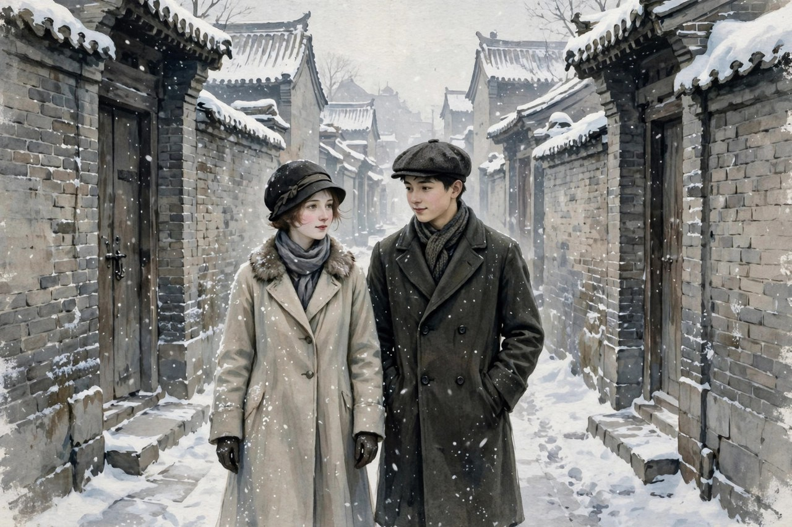
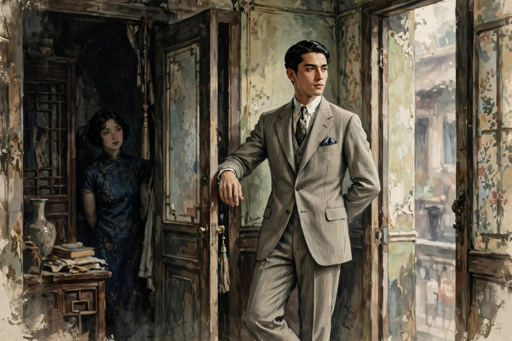

莎菲这个名字，很多读者是在中学课本的边角里听到的，听起来像个旧时代的女子，离今天很远。可你要是真的坐下来读《莎菲女士的日记》，会发现她一点都不旧。她就是今天很多姑娘的影子：脑子很清醒，知道对方不靠谱，还是忍不住往上凑；嘴上说要独立，心里还是渴望被爱、被理解；身体不好，情绪也不稳，白天强撑着笑，夜里在日记里骂自己。丁玲写这篇小说的时候，自己才二十出头，写于一九二七年，发表于一九二八年二月的《小说月报》。小说一出来就轰动了文坛，因为从来没有人这样写过女子：不遮，不掩，不把女子写成贤妻良母的模范，也不把女子写成等男人来救的可怜人，而是写一个活生生的、有欲望、有脾气、有病痛的姑娘。

小说用的是日记形式。莎菲在北京，患肺病，住在小屋里，身边有两个青年男子。一个叫苇弟，老实，虔诚，对莎菲一心一意，天天来探望，送东西，问寒问暖。另一个叫凌吉士，是南洋回来的富家子，仪表堂堂，能说会道，浑身带着一种让女子心跳的派头。莎菲不爱苇弟，却迷恋凌吉士。她在日记里写自己看到凌吉士时的慌乱，写自己故意接近他，写自己明知道他轻浮、靠不住，还是想把他抓在手里。等到她终于看清凌吉士的真面目，看到他对女子不过是玩玩而已，看到他根本不值得托付，爱情和希望一起碎了。小说没有给莎菲安排翻身仗，没有让她忽然找到事业、忽然觉悟，她停在绝望里，停在病痛和孤独里。这个结尾让很多读者不舒服，可正是这种不舒服，让这篇小说活到今天：丁玲没有骗读者，没有说女子只要觉醒就能万事大吉，她把觉醒之后的无路可走也写出来了。

### 小屋里的日记与心跳

莎菲的日记写得非常细，细到让人觉得不是在读小说，是在偷看一个姑娘的抽屉。她的屋子冷，窗外有雪，炉火不旺，她咳着嗽，写着字，一会儿骂苇弟太黏人，一会儿骂自己太糊涂，一会儿又因为凌吉士的一句话高兴半天。丁玲写心理的本事，在这里全使出来了。她不写大道理，只写一闪而过的念头：看到凌吉士走进门，心跳快了半拍；听到苇弟的脚步声，心里烦得想把门关上；夜里睡不着，翻来覆去想自己到底要什么。这样的写法，在当时是新鲜的。以前的男作家写女子，多半写外貌，写贤惠，写哭，写笑，很少写女子心里那种又想要、又害怕、又看不起自己的拧巴。丁玲自己就是女子，她知道女子心里不是一汪清水，是一团乱麻。她把乱麻一根一根挑出来给读者看，读者看了才明白，原来女子不是天生温顺的，原来女子心里也有火。

莎菲的病，是小说里一个很重要的线索。她患肺病，身体弱，动不动就咳，就发烧，就觉得自己活不长。病让她对时间特别敏感，对爱情特别急切。她觉得自己没有多少时间可以慢慢等，所以她想要的爱，要来得快，要来得真，要能证明自己还活着，还值得被爱。这种急切，让她在凌吉士身上栽了跟头。苇弟的爱是慢的，是稳的，是天天送来的热汤，可莎菲看不上慢的东西，她想要那种一下子把她点燃的东西。凌吉士恰好就是那种会点火的人，他会说话，会打扮，会在恰当的时候看你一眼，让你觉得自己是特别的。莎菲明明知道这种火烧不长，还是往火里扑。她在日记里骂自己，也原谅自己，骂完了还是扑。这种反复，不是丁玲写得啰嗦，而是人性本来就是反复的。今天的姑娘在恋爱里反复横跳，拉黑又加回来，分手又复合，道理是一样的：清醒归清醒，心动归心动，两个人常常不在一条线上。

莎菲住的小屋，也值得多说几句。她的屋子不是闺房，是一个病人的屋子，也是一个思想者的屋子。屋里有书，有药，有炉子，有窗外的雪。莎菲在屋里想问题，想爱情，想自己的人生，想社会对女子的不公。她不是那种只会哭的女子，她会思考，会反驳，会用很刻薄的话骂男人，骂社会，骂自己。她骂苇弟的时候，说他太老实，太没有意思；她骂凌吉士的时候，说他轻浮，靠不住；她骂自己的时候，说自己虚荣，糊涂，不争气。这些骂，不是泼妇骂街，是一个清醒的人对自己和周围世界的不满。她看得清楚，却走不出去，这种清醒而无路的状态，就是五四之后很多知识女子的真实处境：脑子已经新了，脚下的路还是旧的，爱情不能自主，职业没有保障，身体又不好，想往前走，四面都是墙。

### 苇弟的痴情与凌吉士的轻浮

苇弟这个人物，很多人读的时候会替他不值。他对莎菲是真心的，天天来，送东西，问病情，莎菲对他冷淡，他也不走，莎菲发脾气，他也忍着。按今天的话说，苇弟就是那种老实巴交的好人，适合过日子，不适合谈恋爱。莎菲看不上他，不是因为他穷，也不是因为他丑，而是因为他给不了莎菲想要的那种刺激和确认。莎菲想要的不是一个天天送汤的人，而是一个能让她觉得自己有魅力、值得被追逐的人。苇弟的爱太稳了，稳到让莎菲觉得自己在他面前没有神秘感，没有征服感。她在日记里对苇弟忽冷忽热，有时候心软，有时候厌烦，这种态度对苇弟很不公平，可丁玲没有替莎菲遮掩，她把莎菲的自私和任性也写出来了。一个好小说，就是不替主人公洗白，让主人公的好和坏都摆在台面上，让读者自己去判断。

凌吉士这个人物，是小说里最耐琢磨的一个。他是南洋富家子，有钱，有派头，会说话，懂得怎么让女子心动。他对莎菲不是真心的，他看中的是莎菲的才气和姿色，是征服的快感。莎菲一开始被他的外表迷住，后来慢慢看清他的轻浮：他对女子说话油滑，对感情不认真，对别人的真心不当回事。丁玲写凌吉士，没有把他写成一个简单的坏人，而是写他那种受过新式教育、见过世面、却把爱情当游戏的做派。这样的男子，在今天一点都不陌生：朋友圈里光鲜亮丽，嘴上说得天花乱坠，到了要负责任的时候就消失不见。莎菲栽在凌吉士手里，不是莎菲一个人傻，是那个时代给女子的选择太少了：女子要找一个能谈得来、有见识、又不那么土气的男子，圈子就那么大，碰上凌吉士这样的人，栽跟头的概率本来就高。丁玲写凌吉士，是在写一种社会现象，不是在写一个孤立的坏蛋。

莎菲、苇弟、凌吉士这三个人的关系，表面上是三角恋，骨子里是女子在旧社会里找爱情的困境。苇弟代表一种安全的爱，安全到无聊；凌吉士代表一种刺激的爱，刺激到危险。莎菲在两者之间摇摆，不是她花心，是她既想要安全，又想要刺激，既想要被好好对待，又想要证明自己的魅力。她找不到一个既安全又刺激、既真心又有趣的人，因为那个时代的男子，要么像苇弟那样老实得没有意思，要么像凌吉士那样有趣得靠不住。莎菲的悲剧，不在于她选错了人，而在于她根本没有好的选项。她在日记里写来写去，写到最后，还是不知道自己到底要什么，因为她要的东西，社会根本没有给她准备好。今天的姑娘在恋爱里挑来挑去，同样会遇到这个问题：老实人嫌无聊，有趣人嫌不靠谱，靠谱又有趣的人可遇不可求。丁玲一百年前写的问题，今天换了衣服还在。

### 欲望不是罪，出路才是题

《莎菲女士的日记》当年引起轰动，一个很重要的原因，是丁玲敢写女子的欲望。在此之前，中国小说里的女子，要么是贤妻良母，要么是苦命人，很少有人敢写女子想要爱，想要身体的亲近，想要被注视，想要在爱情里占上风。丁玲写莎菲，写她对凌吉士的身体和气派动心，写她在夜里想他想得睡不着，写她故意穿好看的衣服去见他，写她在日记里承认自己的虚荣和占有欲。这样的写法，在当时被一些人骂为伤风败俗，可丁玲没有收手。她心里明白，欲望不是罪，把欲望藏起来，女子的苦闷就永远说不清楚。女子不是没有欲望的圣人，欲望本身没有错，错在社会不给女子正当的出路，让女子只能把欲望寄托在爱情和男子身上。莎菲的悲剧，不是她有欲望，而是她除了爱情，没有别的地方可以安放欲望。

对照今天看，这个道理依然成立。今天的女子有了工作，有了收入，有了更多的选择，可是在感情里，很多人还是把全部希望押在一个人身上。工作不顺心，就想找个男朋友来安慰；生活不如意，就想找个爱人来兜底；一个人过得孤单，就想赶紧找个人结婚。这样的心态，和莎菲没有本质区别：都是把人生的出路押在爱情上。爱情本来是生活的一部分，不是全部，可当女子没有别的支撑，没有事业上的成就感，没有朋友圈的支撑，没有经济上的底气，爱情就很容易变成全部，变成救命稻草。一旦爱情出了问题，整个人就塌了。丁玲写莎菲，就是在提醒读者：女子要活得稳，不能只靠爱情，要靠自己多方面的支撑。她没有在小说里给莎菲安排事业上的成功，因为那个时代的女子很难有事业上的成功，可她把问题摆出来了，让后来的女子自己去想办法。

莎菲的日记还有一个特点，就是诚实。她对自己很诚实，诚实到刻薄。她写自己虚荣，写自己糊涂，写自己对苇弟不公平，写自己对凌吉士上瘾。她没有把自己写成受害者，没有说都是男人的错，都是社会的错。她承认自己的问题，也承认社会的压迫，两边都写，两边都不放过。这样的诚实，在今天同样稀缺。今天的社交平台上，很多人讲感情，要么把自己讲成完美受害者，要么把对方讲成十恶不赦，很少有人像莎菲这样，把自己那点小心思也摊开来。丁玲的诚实，让莎菲这个人物立住了：她不是一个符号，是一个会犯错、会后悔、会反复的人。读者讨厌她的时候，也会心疼她；心疼她的时候，也会骂她糊涂。这种又爱又恨的感觉，就是好小说给人的感觉。

### 病痛、孤独与时代的墙

莎菲的肺病，不能只当成一个情节道具。病让她的时间感和别人不一样。健康人可以慢慢等，等一个合适的人，等一个好的时机，莎菲等不起。她觉得自己活不长，所以她对爱情特别急，对生活特别敏感，对孤独特别害怕。她在日记里写夜里的咳嗽，写窗外的雪，写屋里的冷，这些细节不是为了煽情，是为了让读者感受到一个病人的世界：世界在她眼里是灰的，是冷的，是随时会塌的。她想要抓住一点暖的东西，凌吉士的出现，恰好给了她一点暖，哪怕这点暖是假的，她也想抓住。病人的心理就是这样：明知道是假的暖，也比冷着强。丁玲写病，写得非常克制，没有大段大段地写痛苦，而是写咳嗽声，写药味，写夜里睡不着的翻身，写看到别人健康时的羡慕。这些细节，比直接喊痛苦更有力量。

莎菲的孤独，也值得细说。她身边不是没有人，苇弟天天来，朋友也来，可她还是孤独。因为她的孤独不是没有人陪，是没有人懂。苇弟懂她的病情，不懂她的心思；凌吉士懂怎么逗她开心，不懂她想要什么；朋友们懂她的才气，不懂她的欲望。她在日记里说话，是因为在现实里没有人能听她说真话。她把日记当成唯一的朋友，把心里的话都倒给日记。这种孤独，在今天一点都不陌生：微信里几百个好友，真正能说心里话的没有几个；白天在人群里笑着，夜里一个人对着手机发呆。丁玲写莎菲的孤独，是在写现代人的孤独：人越多，越孤独；话越多，越说不到点子上。莎菲的日记，就是她对抗孤独的方式，她写下来，至少证明自己存在过，自己的感受不是假的。

时代的墙，是莎菲走不出去的根本原因。五四运动给女子打开了一扇窗，让女子知道自己可以读书，可以恋爱自由，可以追求平等，可窗外的路并没有铺好。女子受了教育，脑子里有了新念头，脚下还是旧社会的地面：家里要她嫁人，社会要她贤惠，职业没有保障，爱情不能自主。她想做新女性，社会只给她旧女性的位置；她想做旧女性，脑子已经回不去了。这种夹在中间的状态，就是莎菲的病根。她的肺病是身体的病，她的心病是时代的病。丁玲没有给莎菲开药方，因为那个时代根本没有药方。她只是把病症写清楚，让后人知道，女子解放不是喊几句口号就能完成的，是要把教育、职业、经济、法律、风俗一整套东西都改过来，才能让女子真正站得住。今天的女子比莎菲幸运，有了更多的工作机会和法律保障，可是在一些角落里，旧的墙还在：催婚的压力，对女子外貌的挑剔，对女子野心的嘲笑，这些墙换了样子还在。读莎菲，就是认清这些墙还在，才能想办法拆墙。

### 丁玲的笔法与后来的回响

从笔法上看，《莎菲女士的日记》最突出的成就是心理描写。丁玲不靠情节的曲折取胜，靠心理的细腻取胜。她写莎菲的心思，写得像剥洋葱，一层一层剥下去，每一层都有泪。茅盾后来称赞丁玲写女性心理，是中国新文坛上极可骄傲的成绩，这个评价放在莎菲身上最贴切。丁玲写心理，不是用大段的议论，而是用日记里的碎碎念：今天见了谁，说了什么话，心里怎么想，夜里怎么翻来覆去。她把女子的心理写得既具体又普遍，具体到咳嗽声和雪光，普遍到今天的读者读了还会点头。这种笔法，后来影响了很多女作家，也影响了很多写心理小说的人。丁玲证明了，中国小说也可以这样写，不靠打打杀杀，不靠大起大落，只靠一个人的心跳，就能撑起一部作品。

这篇小说的回响，一直延续到今天。很多研究者把它当成中国现代女性文学的起点，因为它把女子的主体性写出来了：女子不再是男子故事里的配角，而是自己故事的主角。莎菲的日记，就是女子自己给自己写的历史。她不再等别人来定义她贤惠还是放荡，她自己定义自己的感受，自己记录自己的爱恨。这种主体性，在今天看依然重要：女子要写自己的故事，要说自己的感受，要定义自己的生活，而不是等别人来定义。丁玲用莎菲的日记，给后来的女子文学开了一个头：女子可以写自己，可以写欲望，可以写痛苦，可以写不完美，可以写失败。写失败不是丢人，写失败是诚实，是力量。莎菲失败了，可她的日记成功了，成功到一百年后还有人读，还有人讨论，还有人在她身上看到自己。

### 今天读莎菲的三点提醒

今天读莎菲，头一点提醒是：爱人之前，先看清人。莎菲栽在凌吉士手里，很大一个原因是她被外表和派头迷住了，没有静下心来看这个人的品行和责任心。她看到凌吉士会说话、会打扮，就以为他值得托付，结果发现他对感情不过是玩玩而已。今天的恋爱里，同样有很多凌吉士式的人：朋友圈里光鲜，嘴上说得好听，到了要负责任的时候就消失。姑娘们在恋爱里，要多看对方在小事上的做法，看他对服务员的态度，看他对朋友的态度，看他遇到困难是躲还是扛，看他说过的话算不算数。这些小事，比甜言蜜语更能说明一个人。莎菲的日记，就是一本反面教材，告诉读者：心动的时候，别急着把自己交出去，先看清楚，再决定。

另外一点提醒是：不要把全部人生押在爱情上。莎菲的生活里，除了爱情，几乎没有别的支撑。她没有稳定的职业，没有能兜底的经济来源，没有能说心里话的朋友圈，她把全部希望都放在凌吉士身上，凌吉士一走，她整个人就塌了。今天的女子比莎菲幸运，有工作，有收入，有朋友，可还是有很多人把爱情当成全部，把男朋友当成救命稻草。工作不顺，就想找个人来安慰；生活孤单，就想赶紧结婚；一个人过得不好，就想换个人来拯救自己。这样的心态，很容易在爱情里栽跟头。丁玲提醒读者：女子要活得稳，要有多方面的支撑，工作、朋友、兴趣、经济底气，这些都是支撑，爱情只是其中一种支撑，不是全部。把鸡蛋放在不同的篮子里，人生才不会因为一个篮子破了就全塌了。

还有一点提醒是：对自己诚实，比对别人苛刻更重要。莎菲对自己很诚实，她承认自己的虚荣，承认自己的糊涂，承认自己对苇弟不公平。这种诚实，让她虽然失败了，却没有活成一个怨妇。她没有把全部责任推给男人，推给社会，她也认自己的账。今天的感情里，很多人习惯把责任全推给对方，自己永远是受害者，这样的心态，永远走不出来。丁玲写莎菲，是在告诉读者：认自己的账，不是认输，是成长的开始。你承认自己看走了眼，承认自己太急，承认自己把希望押错了地方，你才能在下一段关系里不重蹈覆辙。莎菲没有走到这一步，她停在绝望里，可读者可以走到这一步，读者可以替莎菲把没走完的路走完。

### 结尾不圆满，才是真生活

很多人读完《莎菲女士的日记》，会觉得结尾太丧了，莎菲没有翻身，没有找到好归宿，没有忽然觉悟、忽然革命。可丁玲故意这样写，因为她知道，生活本来就不是每段故事都有圆满结局。莎菲的绝望，不是丁玲要宣扬悲观，而是丁玲要告诉读者：女子的出路，不是一篇小说就能给出来的，是要靠一代代女子在生活里慢慢挣出来的。莎菲这一代女子，把问题提出来了，把苦闷写出来了，把墙指出来了，后来的女子才能接着拆墙。今天的女子能读书，能工作，能自由恋爱，能自己买房，能自己做主，这些权利，不是天上掉下来的，是莎菲那一代女子用日记、用眼泪、用失败换来的。读莎菲，要带着感激读：她替我们把最难说的话说出来了，她替我们把最难走的路先走了一段，她走得跌跌撞撞，可她走过了。

丁玲写莎菲的时候，自己也很年轻，她把自己的寂寞、对社会的不满、对生活没有出路的焦虑，都写进了莎菲的日记里。她后来走的路，比莎菲要远得多：她从写个人苦闷走到写农村、写土改、写革命队伍里的人，从文小姐走到武将军，从上海的小屋走到延安的窑洞，再走到北大荒的农场。她的路比莎菲宽，是因为她找到了比爱情更大的支撑：事业、信念、土地、人民。她用自己的一生，给莎菲的问题补了一个答案：女子的出路，不只在爱情里，也在工作里，在土地里，在时代里。读者读完莎菲，再去读丁玲后来的作品，会看到一个完整的答案：莎菲问的问题，丁玲用一生来回答。这个答案不是一句话，是丁玲一生的作品合起来才说清楚的。

所以，今天再读《莎菲女士的日记》，不要只把它当成一篇旧小说，要把它当成一面镜子。镜子里有莎菲，也有你自己。你在恋爱里的糊涂，莎菲也有；你在深夜里的孤独，莎菲也有；你对生活的渴望，莎菲也有。不同的是，莎菲没有走出来，你还有机会走出来。你可以比莎菲多一份清醒，多一份支撑，多一份对自己的诚实。你可以爱，但不要把全部押在爱上；你可以心动，但心动的时候先看清人；你可以失败，但失败之后要认账，要站起来。丁玲把莎菲的日记留下来，就是为了让后来的姑娘少走弯路，少栽跟头，少在深夜里一个人哭。她写这篇小说，不是为了让读者同情莎菲，是为了让读者超过莎菲。这，才是这篇小说活到今天的真正原因。

### 日记体为什么这样动人

莎菲的故事如果换成旁观者来讲，味道会差很多。丁玲用日记体，让莎菲自己说话，自己骂人，自己后悔，自己给自己拆台。读者读到的不是一个被总结好的人物，而是一个正在活着、正在犯错的人。日记没有经过整理，没有美化，没有事后诸葛亮的聪明，只有当下的慌乱和真实。今天的人写朋友圈、写备忘录、写深夜的长文，其实和莎菲写日记是一回事：白天说不出口的话，夜里写下来才敢承认。丁玲早就看透了这一点：人最真实的样子，往往不在人前，而在日记里。她让莎菲把日记留下来，就是让读者看到一个女子在没有观众的时候是什么样子。这种写法，比任何旁观视角的评判都更有说服力，因为读者不是在听别人讲莎菲，是在陪莎菲过日子。

日记体还有一个好处，就是时间感特别真。莎菲的日记不是一口气写完的总结，是断断续续的记录：今天见了凌吉士，心跳快了；隔日见了苇弟，心里烦了；夜里咳得厉害，想了很多；天亮了，又后悔夜里想得太多。这种断续感，和真实的生活一模一样。生活本来就是断续的，不是连贯的剧本，人今天想通的事，明天又会糊涂，今天下定的决心，明天又会动摇。丁玲用日记把这种断续感写出来了，读者读着读着，会觉得莎菲不是纸上的人，是隔壁屋里真实存在的人。她的情绪起伏，她的反复无常，她的清醒和糊涂交替出现，都是生活本来的样子。今天很多小说写人物，写得太顺了，人物从头到尾一个样，读者读着觉得假。丁玲的莎菲不顺，她一会儿清醒，一会儿糊涂，一会儿刻薄，一会儿心软，这种不顺，恰恰是真的。

丁玲写日记，还有一个细节值得学：她不写空话，不写大道理，只写具体的小事。莎菲写炉火，写雪，写咳嗽，写药味，写凌吉士进门时的脚步声，写苇弟送来的东西放在桌上的样子。这些小事堆起来，莎菲的世界就立住了。读者不需要作者告诉你莎菲很孤独，你看到她夜里一个人对着炉火写字，就知道她孤独；不需要作者告诉你莎菲很渴望爱，你看到她因为凌吉士一句话高兴半天，就知道她渴望爱。这种用细节说话的本事，是丁玲早年写作最硬的功夫。她后来写农村、写土改，同样靠细节取胜：村口的争吵，场院的分地，牛的叫声，土地的气味，都是细节堆出来的真实。学写作的人，从莎菲的日记里能学到最实在的一课：不要先喊口号，先把屋子里的炉火、窗外的雪、桌上的药写清楚，人物的心自然就出来了。

### 莎菲留给后世女子的路标

莎菲没有走出来的路，后来的女子替她走了。丁玲自己就是走在前面的人：她从写莎菲的苦闷出发，走到写贞贞的坚强，走到写曼贞的自立，走到写暖水屯妇女在土改里的做主。她用自己的一生，把莎菲提出的问题一步一步往前推。莎菲问：女子能不能有自己的欲望和爱情？丁玲回答：能，但欲望不能只寄托在爱情上。莎菲问：女子清醒了却没有出路怎么办？丁玲回答：出路要在工作里、在土地里、在时代里找。莎菲问：女子受了伤还能不能站起来？丁玲用贞贞回答：能，站起来的样子可能不好看，可能满身是伤，可站起来就是站起来了。这样的回答，不是一篇小说给出来的，是一代代女子的生活给出来的。莎菲的日记，就是这条长路上的头一块路标，上面写着：这里有人走过，这里有墙，这里要小心。

今天的女子读莎菲，不必把莎菲当成偶像，也不必把莎菲当成反面教材。她就是一个路标，提醒你前面有坑，提醒你别把全部押在一个人身上，提醒你对自己诚实一点，提醒你夜里写下来的话，白天也要敢认。路标的意义，不在于它自己走到了终点，而在于它告诉后来的人：这条路有人走过，前面有坑，也有光。你可以比莎菲走得稳，因为你有她没有的东西：工作、收入、朋友、法律保障、更多的选择。你也可以比莎菲走得远，因为你站在她写下的日记上，站在丁玲一生的作品上，站在后来无数女子走过的路上。莎菲的日记写于一九二八年，到今天快一百年了，它还没有过时，因为它写的问题还没有完全解决，写的拧巴还没有完全解开。只要女子还在恋爱里患得患失，还在深夜里孤独，还在问自己到底要什么，莎菲的日记就还有人读，就还有意义。

莎菲的日记读到最后，读者会明白一个道理：女子的成长，从来不是一夜之间想通的，是在一次次心动、一次次看错人、一次次后悔、一次次重新站起来里慢慢磨出来的。莎菲磨得不够，她停在了半路上，可她的日记把磨的过程留下来了。后来的人读着这本日记，就等于提前看了一遍自己可能会走的弯路，提前认了一遍自己可能会栽的跟头。这本日记的价值，就在这里：它不是让你同情莎菲，是让你少走莎菲走过的弯路，让你在心动的时候多一份清醒，在受伤的时候多一份支撑，在孤独的时候多一份对自己的诚实。

丁玲写莎菲，不是为了让读者记住一个病姑娘的名字，而是为了让读者记住一种写女子的方式：贴着心跳写，不遮不掩，不拔高，不卖惨。把这种方式记住，读别的女子故事时，你就有了自己的尺子，能分清谁在写真人，谁在写摆设。

莎菲的日记合上之后，屋里的炉火好像还亮着，窗外的雪好像还在下，读者的心里却多了一盏灯。

这盏灯照着的，是女子自己的路。
