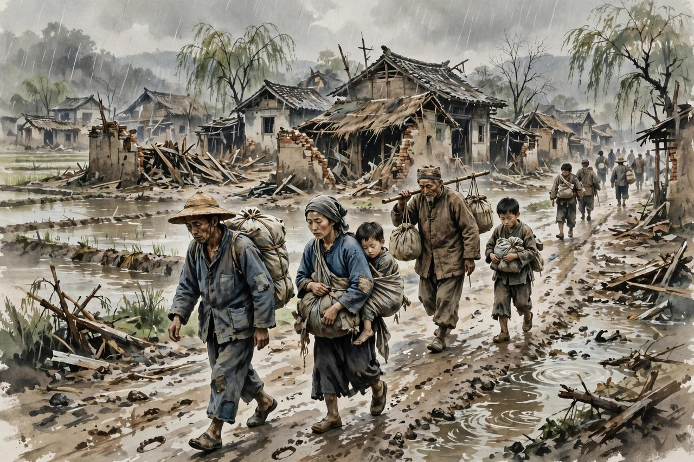
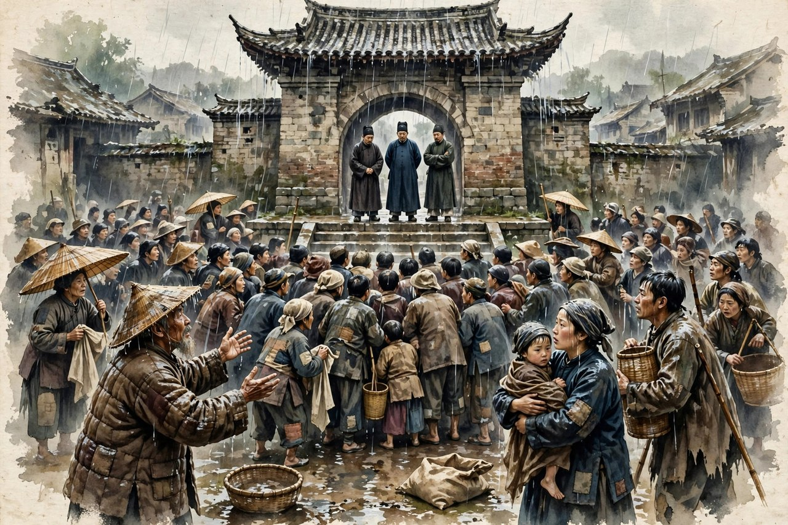

丁玲写《水》，是在一九三一年夏天，发表于同年九月起的《北斗》创刊号上，连载到十一月。这篇小说的背景，是一九三一年遍及十几个省的大水灾。长江泛滥，堤坝溃决，村庄被淹，农民拖家带口逃难，去找镇长、县长要赈济，等不到满意的答复，忍无可忍之下团结起来，汇成自己的声音。丁玲写这篇小说的时候，刚刚经历了胡也频牺牲的打击，刚刚加入左联，正在从写个人苦闷转向写大众生活。她自己后来把《水》看成新作风的头一篇，说自己有意识地要到群众中去描写群众，要写群众的生活和觉醒。茅盾评价这篇小说，说它表示过去那种革命加恋爱的公式已经被清算。这个评价，说到了点子上：丁玲的笔，从小屋里走出来了，走到了堤上，走到了逃难路上，走到了人群里。

《水》最突出的特点，是写群像，不写单个英雄。小说里没有一个从头到尾撑起故事的大英雄，有的是一群农民：老的，小的，男的，女的，胆大的，胆小的，精明的，糊涂的。他们在洪水面前绝望地抗争，在泥泞里艰难求生，在逃难路上互相扶持，也互相争吵。丁玲写他们，不是写几个人的传奇，而是写一群人的共同命运。洪水来了，堤垮了，房子倒了，粮食泡了，牲口跑了，一群人站在水边，看着自己的家园变成一片汪洋，那种绝望，不是某一个人的绝望，是全村人的绝望。丁玲把这种共同的绝望写出来了，读者读着，会觉得自己也站在水边，也看着家园被淹，也不知道明天该往哪里走。这种群像写法，在当时是新鲜的，在今天看依然有分量：灾难面前，个人的聪明没有用，群体的觉醒才是出路。

### 堤垮了，家园成了汪洋

丁玲写洪水，写得非常具体，不是空喊水大，而是写水怎么涨，怎么冲，怎么把堤冲垮，怎么把房子泡倒，怎么把庄稼淹没。她写农民站在堤上，看着水一点一点涨上来，心里从希望变成害怕，从害怕变成绝望。她写农民拿着锄头、拿着麻袋去堵堤，堵不住，水还是往村里灌。她写妇女抱着孩子站在高处哭，写老人看着祖上传下来的房子被水泡倒，一句话都说不出来。这样的细节，比任何灾难数字都更有冲击力。今天的读者看洪水新闻，看到的是数字和画面，丁玲的小说让读者看到的是数字背后的人：一个农民看着自己的房子被水泡倒，心里是什么滋味；一个母亲抱着孩子在水里走，心里是什么滋味；一个村子的人站在堤上，看着家园变成汪洋，心里是什么滋味。这些滋味，丁玲都写出来了，写得非常克制，没有煽情，没有大喊大叫，就是写水，写泥，写人站在水里的样子，读者自己就能感受到那种绝望。

洪水在小说里有两个意思。表层的意思，是自然灾害，是长江泛滥，是堤坝失修。深层的意思，是社会的不公：官僚和富人拿了修堤的捐款，却不修堤，导致农民家园被毁，流离失所。丁玲写农民逃难，去找镇长、县长要赈济，等不到答复，农民才慢慢明白，指望剥削者来救自己，是指望不上的。洪水冲垮的，不只是堤，还有农民对官府的幻想。农民从前觉得，官府总会管的，富人总会发善心的，等到洪水来了，官府不管，富人躲了，农民才明白，救自己的人只能是自己，只能是团结起来的农民自己。这个觉醒的过程，是小说最核心的部分。丁玲没有把觉醒写成一夜之间的事，而是写成在逃难路上一点一点磨出来的：农民开始还指望官府，后来失望了，再后来愤怒了，再后来团结了。这个过程，写得非常真实，非常有层次。

对照今天看洪水，丁玲的小说依然有现实意义。今天的洪水、地震、疫情，同样会考验一个社会：灾难来了，谁来救，谁来管，物资怎么分，信息怎么传，普通人怎么自救，怎么互救。丁玲写一九三一年的洪水，写的是农民在灾难里怎么从指望别人变成自己站起来，这个道理，到今天还没有过时。灾难面前，个人的力量是有限的，群体的力量是无限的，可群体的力量不是自动就有的，是要在灾难里互相扶持、互相商量、互相分担里长出来的。丁玲的小说，就是写这个长出来的过程。她写农民在逃难路上分粮食，写农民在夜里互相照看孩子，写农民在绝望里互相打气，这些细节，都是群体力量长出来的样子。今天的读者在灾难新闻里看到志愿者、看到邻里互助，道理是一样的：灾难把人逼到绝境，绝境里的人要么散了，要么团结起来，团结起来的那一刻，就是觉醒的开始。

### 逃难路上的人心变化

丁玲写逃难，写得最动人的地方，是人心在逃难路上的变化。农民刚逃出来的时候，心里还是旧的：指望官府，指望富人，指望老天爷，指望菩萨。他们去镇上找镇长，镇长推给县长，县长推给省里，推来推去，没有一个人管。农民在镇门口等，等了一天又一天，粮食吃完了，孩子哭了，老人病了，还是没有人管。失望积累到一定程度，就变成了愤怒。愤怒积累到一定程度，就变成了团结。农民开始商量，开始组织，开始自己说话，开始要求赈济，开始不再把希望押在别人身上。这个变化，不是丁玲凭空写出来的，是她在生活里看到的真实变化：人在绝境里，要么认命，要么反抗，认命的人会死，反抗的人会活。丁玲写农民选择反抗，写得非常有分寸，没有把反抗写成一时的冲动，而是写成失望和愤怒积累到顶点的结果。

逃难路上，丁玲还写了农民的天真和固执。农民对土地赤诚，誓死要把暴虐的水灾拦住，哪怕水已经冲垮了堤，他们还是想回去，想保住家园。这种固执，有可爱的地方，也有可悲的地方：可爱在他们对土地的感情是真的，土地就是命根子，丢了土地，就等于丢了命；可悲在他们还不明白，洪水不是光靠人力就能拦住的，堤坝失修、官府腐败这些根子不解决，明年洪水还会来。丁玲写农民的天真，不是嘲笑农民，而是心疼农民：他们太相信官府，太相信富人，太相信老天爷，太相信只要自己老实干活，就能过上好日子。洪水把这种相信冲垮了，冲垮之后，农民才开始想别的问题：为什么堤不修，为什么捐款被贪了，为什么官府不管我们。这些问题一想，农民就开始觉醒了。丁玲把天真和觉醒写成一个过程，写得非常有耐心，没有急着让农民一下子就觉悟，而是让农民在逃难路上慢慢想，慢慢问，慢慢明白。

丁玲写逃难路上的妇女，也值得多说几句。妇女在逃难路上，抱着孩子，背着包袱，走在泥泞里，比男人更辛苦。她们要照顾孩子，要照顾老人，要分粮食，要安慰哭闹的孩子，还要忍受村里人的闲话。丁玲写妇女在逃难路上的坚强，写她们在绝望里还想着孩子，写她们在夜里哄孩子睡觉，写她们在分粮食的时候先紧着孩子和老人。这些细节，让妇女的形象立住了：她们不是灾难里的配角，是灾难里的顶梁柱。今天的灾难新闻里，同样有很多这样的妇女：地震里护着孩子的母亲，洪水里背着老人走的女儿，疫情里照顾全家的妻子。丁玲在一九三一年就把这样的妇女写出来了，她的笔，比很多后来的写作者都要早，都要真。

### 群像写法为什么这样难

《水》难写，难在写群像。写一个人，容易，写一个人的心理，写一个人的爱情，写一个人的成长，都有现成的路子。写一群人，难，因为一群人没有统一的心理，没有统一的行动，每个人都有自己的算盘，自己的害怕，自己的高兴。丁玲写群像，没有把农民写成一个模子刻出来的群像，而是写每个人的不同：有的农民胆大，敢去镇上闹；有的农民胆小，怕被抓，躲在人群后面；有的农民精明，会算账，分粮食的时候算得清楚；有的农民糊涂，跟着人群喊，喊完了又不知道自己喊了什么。这些不同加起来，才是真实的群像。今天的写作者写群体，常常把群体写成一个声音，写成齐刷刷的口号，读着觉得假。丁玲的群像不假，因为她写出了群体的不同，写出了群体里的矛盾，写出了群体从散到聚的过程。群体不是天生就团结的，是在灾难里、在失望里、在愤怒里，慢慢聚起来的。丁玲把聚的过程写出来了，群像就活了。

丁玲写群像，还难在她要写群体的声音，又不能丢了个体的声音。她写农民在镇门口的要求，写的是群体的声音：要赈济，要粮食，要活路。她写农民在夜里的私语，写的是个体的声音：我家孩子病了，我家粮食没有了，我家老人走不动了。这两种声音交替出现，小说就有了层次：群体的声音是大的，是愤怒的，是要求公道的；个体的声音是小的，是具体的，是生活里的琐碎。大的声音没有小的声音做底子，就会变成空口号；小的声音没有大的声音做方向，就会变成一盘散沙。丁玲把两种声音拧在一起，小说就有了筋骨。读者读的时候，既能听到群体在喊，又能听到个人在哭，既能看到农民团结起来，又能看到农民各自的苦。这种写法，后来影响了很多写群体的作家，可丁玲在一九三一年就做到了，这就是她的先见之明。

茅盾和冯雪峰对《水》的评价，都点到了群像的意义。茅盾说，这篇小说表示过去那种革命加恋爱的公式已经被清算，意思是丁玲不再只写屋子里男女那点事，开始写社会，写大众，写群体的命运。冯雪峰说，丁玲走过的路，是从离社会走向社会，从个人主义的虚无走向工农大众的革命，这条路，很多进步知识分子都走过，丁玲走得非常典型。这两个评价，放在今天看依然成立：一个作家要成长，就要从写自己走向写大众，从写小屋走向写社会，从写个人苦闷走向写群体的命运。丁玲用《水》完成了这个转变，她的转变不是口号上的转变，是笔法上的转变，是题材上的转变，是眼光上的转变。她把眼睛从莎菲的小屋挪到了堤上，挪到了逃难路上，挪到了人群里，眼睛挪过去了，笔也就跟着过去了，作品的分量也就跟着变了。

### 今天读水的现实回响

今天读《水》，不要只把它当成一篇旧小说，要把它当成一面镜子，照今天的灾难和今天的群体。灾难来了，普通人头个反应还是指望上面，指望富人，指望好心人，等不到的时候，才会想自己组织，自己互助，自己说话。这个过程，和一九三一年农民的逃难路没有本质区别。丁玲的小说提醒读者：指望别人救，是靠不住的，救自己的人，只能是自己和团结起来的同伴。这个道理，在洪水里成立，在地震里成立，在疫情里成立，在任何灾难里都成立。今天的志愿者、邻里互助、社区团购，都是这个道理的现代版本：灾难把人逼到绝境，绝境里的人团结起来，就能活下去，就能找到出路。丁玲在一九三一年写下的道理，到今天还没有过时。

丁玲写《水》，还给今天的写作者留了一个提醒：写灾难，不要只写灾难本身，要写灾难里的人心。灾难本身是水，是泥，是倒塌的房子，是数字，可灾难里的人心，是绝望，是愤怒，是团结，是觉醒，是妇女抱着孩子的坚强，是老人在水边的沉默。写灾难，只写水和泥，读者看完就忘了；写灾难里的人心，读者看完会记住，会想，会问自己：如果是我，我会怎么办。丁玲写《水》，就是写人心的，她写农民从指望到失望，从失望到愤怒，从愤怒到团结，这个人心变化的过程，比洪水本身更有力量。今天的灾难报道、灾难文学，同样要写人心，写普通人在灾难里的选择，写群体怎么从散到聚，写绝望里怎么长出希望。把人心写清楚了，灾难题材才有了分量，才对得起受灾的人。

### 洪水退去之后的话

洪水总会退去，村子总要重建，农民总要回家。丁玲的小说没有写洪水退去之后的重建，没有写农民回家之后的安稳，她停在农民团结起来、汇成声音的那一刻。这个停法，和莎菲的停法是一样的：不停在圆满结局，停在觉醒的开始。丁玲相信，觉醒的开始比圆满结局更重要，因为圆满结局是假的，觉醒的开始是真的。农民团结起来了，声音汇起来了，后面的路还要走，还要磨，还要吵，还要面对更多的困难，可只要团结起来了，只要声音汇起来了，路就有希望了。丁玲把小说停在这里，就是把希望留给读者，让读者自己去想后面的路该怎么走。这种不给圆满结局的写法，比给圆满结局更有力量，因为它把问题留给了生活，留给了读者，留给了后来的人。

读完《水》，再回头看丁玲的路，会发现这篇小说是一个转折点。从《水》开始，丁玲不再只是一个写女子心理的作家，她开始成为一个写社会、写大众、写农民的作家。她后来写《母亲》，写《太阳照在桑干河上》，写《我在霞村的时候》，写《夜》，都是从《水》这个转折点出发的。没有《水》的转变，就没有后来的土改长篇，没有后来的延安小说，没有后来的代表作。《水》在丁玲一生里的位置，就是这样一个转折点：它短，却重；它写的是洪水，却写出了丁玲创作方向的大转弯。读者读丁玲，不能跳过《水》，跳过了，就看不懂她后来的路是怎么走出来的。

今天的读者读《水》，会得到一种踏实感：灾难不可怕，可怕的是灾难里的人散了；只要人不散，只要声音汇起来，只要妇女抱着孩子还能往前走，只要老人在水边还能站着，日子就有希望。丁玲用一篇不长的中篇小说，把这个道理写清楚了，写扎实了，写进了中国现代文学的骨头里。洪水退去了，堤还要修，村子还要建，农民还要种地，可农民心里那杆秤，已经和从前不一样了：从前他们指望别人，现在他们知道要靠自己和团结起来的同伴。这杆秤的变化，就是《水》留给后来人的东西，就是丁玲留给今天读者的东西。把这杆秤记住了，再看今天的灾难和群体，心里就有了底，知道该往哪里走，知道该和谁站在一起。

### 水里的两种力量

《水》这个题目，本身就藏着两种力量。一种是洪水的力量，是自然的力量，是冲垮堤坝、淹没村庄的力量，这种力量是破坏的，是可怕的，是让人绝望的。另一种是人心的力量，是农民团结起来的力量，是绝望里长出来的觉醒的力量，这种力量是建设的，是温暖的，是让人看到希望的。丁玲用一个水字，把两种力量拧在一起：洪水冲垮了堤，也冲垮了农民对官府的幻想；人心汇成了力量，也汇成了农民自己的声音。水既是灾难，也是镜子，照出官府的不管，照出富人的躲藏，照出农民的天真，也照出农民的觉醒。读者读《水》，要读出这两种力量，读出洪水和人心是怎么较劲的，读出人心是怎么在洪水里长出来的。

今天的读者看水这个意象，会有更多的联想。水可以是洪水，可以是眼泪，可以是生活的重压，可以是时代的洪流。人站在水里，要么被冲走，要么站稳，要么学会游泳。丁玲的农民，刚开始是被水冲走的，后来是站在水里挣扎的，再后来是团结起来往高处走的。这个过程，就是人在时代洪流里的过程：刚开始被冲得东倒西歪，后来学会扶着别人站稳，再后来学会一起往高处走。丁玲把这个过程写得非常具体，没有空话，就是写农民在水里的脚步，写农民在泥泞里的互相搀扶，写农民在夜里互相打气。这样的写法，让水这个意象有了血肉，不再是一个抽象的象征，而是一段真实的生活。读者读完，会明白一个道理：时代的水总会涨，人总会站在水里，关键不是水涨不涨，是人散不散，是人能不能互相扶着往高处走。

丁玲写水，还写出了水的另一面：水退去之后，土地还在，人还在，日子还要过。洪水冲走了房子，冲走了粮食，冲走了家当，可冲不走农民对土地的感情，冲不走农民心里那杆秤，冲不走农民团结起来的记忆。等到水退了，农民回到村里，看到满目疮痍，心里会想：明年还要种地，还要修堤，还要防着官府贪了修堤的钱，还要想办法让自己的声音被听见。这些想法，就是觉醒留下的种子。种子埋在土里，明年会发芽，会长出来，会变成新的力量。丁玲的小说停在觉醒的开始，就是把种子埋下去了，让读者自己去想种子会怎么发芽，会长成什么样子。这种留白的写法，比把重建的过程写满更有力量，因为它把希望留给了生活，留给了后来的人。

### 从小屋到堤上的丁玲

《水》在丁玲一生里的意义，还在于它标志着丁玲眼睛的转移。从前她的眼睛盯着小屋，盯着莎菲的日记，盯着女子心里的乱麻；从《水》开始，她的眼睛盯着堤，盯着逃难路，盯着人群，盯着农民的心思。这个转移，不是丁玲一夜之间想通的，是她在生活里撞出来的：胡也频牺牲了，左联的担子压过来了，社会的矛盾摆在眼前了，她再写小屋里的情爱，已经写不下去了，她必须走出来，必须写大众，必须写农民。她走出来的过程，和农民在逃难路上觉醒的过程，是一样的：都是从指望到失望，从失望到愤怒，从愤怒到行动。丁玲的创作转变，和她笔下农民的觉醒，是同一条路上的两段路。她用《水》把自己的转变写出来了，也把农民的转变写出来了，两个转变拧在一起，小说就有了双倍的分量。

对照今天的写作者，丁玲的转变依然有启发意义。很多写作者一辈子只写自己，只写小屋，只写个人的苦闷，写到后来，越写越窄，越写越重复。丁玲没有这样，她在写出名堂之后，敢于走出小屋，敢于写自己不熟悉的大众，敢于写洪水和农民，敢于把自己的笔交给生活。这种勇气，在今天同样稀缺：写作者要走出自己的舒适区，要到生活里去，到人群里去，到灾难和变革里去，才能写出有分量的东西。丁玲用《水》证明了，走出小屋不是背叛自己，是成长自己。她的小屋功夫没有丢，她把小屋里练出来的心理描写功夫，用到了农民身上，用到了群体身上，人物就都活了。走出小屋，不是丢掉自己的看家本事，是把看家本事用到更大的地方去。

读《水》，还要读丁玲的诚实。她写农民的天真，没有嘲笑；写农民的固执，没有美化；写官府的不管，没有脸谱化；写富人的躲藏，没有简单化。她把各色人等都写得有血有肉，有算计，有害怕，有高兴，有失望。这样的诚实，让小说经得起时间：几十年过去了，读者再读，依然觉得它真实，依然觉得它没有骗人。今天的灾难写作，同样需要这种诚实：不要把受灾的人写成只会哭的符号，不要把救援的人写成只会喊口号的英雄，不要把官府写成非黑即白的脸谱，要把各色人等的心思都写出来，把灾难里的矛盾都写出来，把觉醒的过程写出来。把诚实守住了，作品才有分量，才对得起受灾的人，才对得起读者。

### 堤上的人，村里的人，城里的人

《水》里的农民，不是孤立的村里人，他们和镇上、城里的人有着千丝万缕的联系。他们去镇上找镇长，镇长推给县长，县长推给省里，推来推去，农民才明白，镇上和城里的人，和村里的人想的根本不是一回事。镇上的人想的是自己的位置，自己的面子，自己的好处；村里的人想的是粮食，是活路，是孩子的命。这两种想法的差距，就是小说里最深的一道裂缝。丁玲写这道裂缝，写得非常克制，没有大段地骂官府，没有把镇长写成脸谱化的坏人，而是写镇长的推诿，写县长的敷衍，写办事人员的冷漠。这些细节堆起来，读者自己就能明白：农民的活路，在这些人眼里根本排不上号。这样的写法，比直接骂人更有力量，因为它让读者自己去判断，自己去愤怒。

对照今天看，村里人和城里人的裂缝，换了样子还在。农民进城打工，城里人看不起农民工；村里人要办事，城里窗口的人推来推去；农村要发展，城里的政策落到村里就变了样。这些裂缝，和一九三一年农民去镇上要赈济时遇到的推诿，道理是一样的：不同位置的人，想的东西不一样，农民的活路，在有些人眼里就是一张报表上的数字。丁玲的小说提醒读者：要弥合裂缝，不能只靠文件，要靠人到村里去，靠干部到堤上去，靠城里人到逃难路上走一走。只有走到了，听到了，看到了，裂缝才能慢慢合上。丁玲自己就是这样做的：她写《水》，不是坐在上海的书房里想象农民，她是关心农民的命运，把农民的活路放在心上，才写出了这篇小说。今天的写作者、干部、记者，同样要到村里去，到堤上去，到逃难路上走一走，才能写出真实的东西，才能办出公道的事。

《水》里的农民，还有一个特点：他们不是等救济的乞丐，他们是想活下去的活人。他们去镇上要赈济，不是去讨饭，是去要自己应得的东西：修堤的捐款是他们交的，粮食是他们种的，活路是他们应得的。丁玲写农民要赈济，写得很有骨气：农民站在镇门口，话说得硬，腰挺得直，不卑不亢，要的就是一个公道。这种骨气，在今天同样重要：普通人遇到不公道的事，要敢说话，敢要求，敢团结起来要公道，而不是只会忍气吞声，只会认命。丁玲的农民，就是这样敢说话的人，他们从指望到失望，从失望到愤怒，从愤怒到团结，每一步都是骨气长出来的过程。读《水》，就是读这种骨气是怎么长出来的，就是学这种骨气在今天该怎么用。

洪水退去之后，农民还要回家，还要种地，还要修堤，还要防着明年的水。丁玲把小说停在觉醒的开始，就是把后面的路留给农民自己走，也留给读者自己想。后面的路不好走，可只要农民团结起来了，只要声音汇起来了，只要骨气长出来了，路就有希望了。这就是《水》留给后来人的话：灾难不可怕，可怕的是人散了；只要人不散，只要骨气在，只要声音汇起来，日子就有希望。这句话，从一九三一年说到今天，还没有过时，还在堤上回响，还在逃难路上回响，还在每一个普通人心里回响。

水退了，堤还要修，村子还要建，农民还要种地。丁玲把洪水写下来，就是为了让后来的人记住：堤不修，明年水还会来；公道不磨，农民的心还会凉。记住这两句，灾难才没有白受，觉醒才没有白费。

### 写群像的底子是生活

丁玲写群像，底子是生活，不是技巧。技巧可以学，群像的底子学不来，只有到生活里去，到人群里去，到堤上去，到逃难路上走一走，才能有底子。丁玲写《水》的时候，虽然没有亲身经历那场大水灾，可她关心农民的命运，关心水灾里的农民怎么活，她的笔是贴着农民的心写的，不是贴着概念写的。她写农民在堤上的样子，写农民在泥泞里的脚步，写农民在镇门口等赈济时的眼神，这些细节，都是她从生活里观察来的，从农民的苦难里体会来的。她没有把农民写成概念，没有把洪水写成背景，她把农民和洪水写成了生活本身。这种底子，今天的写作者同样需要：写群体，不要先想概念，先到人群里去住，去听，去看，去记，把人群里的不同声音都记下来，把群体从散到聚的过程都记下来，群像自然就活了。

写群像，还有一个底子是同情。丁玲同情农民，不是居高临下的同情，是站在农民中间的同情。她写农民的天真，没有嘲笑；写农民的固执，没有嫌弃；写农民的愤怒，没有害怕；写农民的团结，没有拔高。这种同情，让她的群像有了温度。读者读《水》，会觉得丁玲是站在农民身边的，不是站在农民头顶的。她和农民一起站在水边，一起看着家园被淹，一起在镇门口等，一起在夜里互相打气。这样的站位，写出来的群像才有血肉，才有温度，才经得起时间。今天的写作者写群体，同样要站到群体中间去，不能站在外面看热闹，不能站在头顶做评判。站到中间去，听听群体的不同声音，看看群体的不同面孔，记记群体的不同算计，群像才能活，才能真，才能动人。

《水》的群像，到今天还在生长。每当灾难来了，每当一群人团结起来，每当普通人汇成声音，《水》里的农民就会重新活过来，走到今天的堤上，走到今天的镇门口，走到今天的社区里。他们换了衣服，换了地方，可心里的秤没有变：要活路，要公道，要团结，要声音。丁玲把他们写下来，就是把一群人的样子留下来，让后来的人认得：原来一群人团结起来是这个样子，原来绝望里长出希望是这个样子，原来农民的心是这个样子。把这个样子记住了，再看今天的群体，心里就有了参照，知道群体该怎么聚，知道声音该怎么汇，知道灾难该怎么扛。这就是《水》到今天还值得读的原因：它不只是一篇旧小说，它是一群人的样子，是一群人团结起来的样子，是后来的人可以照着做的样子。
