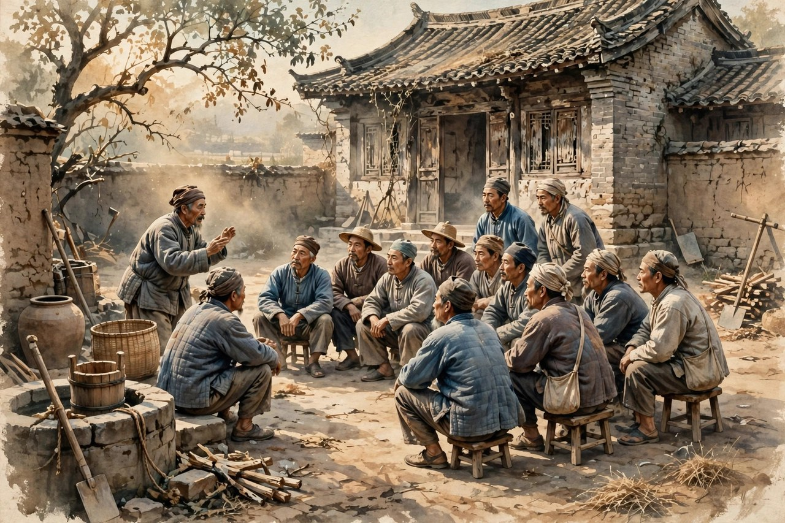
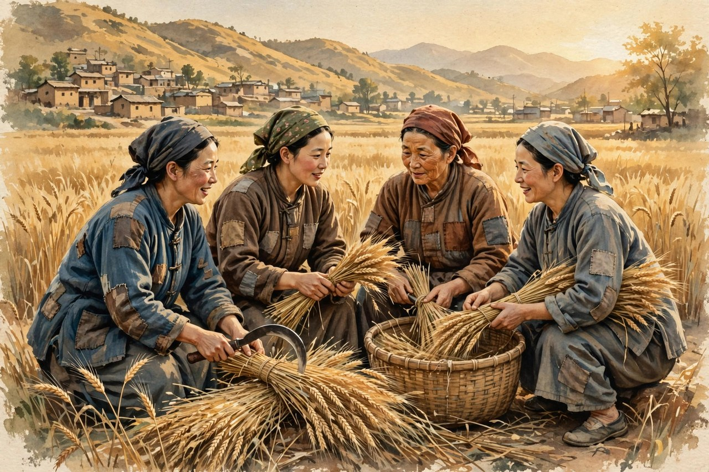

土改这个词，今天听起来像历史书上的名词，离生活很远。可丁玲写《太阳照在桑干河上》的时候，土改是村口每天都在发生的事：谁家分几亩地，谁家被斗，谁家藏了粮食，谁家妇女敢在会上说话，这些事都关系到一家人能不能吃饱，能不能抬起头。丁玲不是在书房里想象土改，她是在一九四六年跟着土改队伍到了晋察冀边区，在村里住下来，看下来，记下来，然后从一九四六年十一月开始动笔，到一九四八年六月完稿，同年出版。这部小说写的是桑干河边一个叫暖水屯的村子里的土改故事，人物多，矛盾多，细节多，读起来像走进了一个真实的村子，村口有人吵架，场院有人分地，土屋里有人算账，妇女在会上声音发抖又越说越稳。小说在一九五一年获得斯大林文学奖金二等奖，成为中国革命文学走向世界的一块招牌。这个奖不是白得的，是丁玲用脚力换来的。

很多人以为土改小说就是写好人斗坏人，写农民翻身做主，写得热热闹闹就完了。丁玲这部小说不是这样写的。她写暖水屯，写的是一个村子在变局里的全部心思：积极的农民想快点分地，动摇的中间人物怕得罪人，观望的人想等风头过了再说，地主想保住家产，想方设法反扑，妇女想借土改的机会摆脱家里的压迫，干部想把政策执行好，又怕把事情做过头。丁玲没有把人物分成好人坏人两堆，她写每个人的算盘，写每个人的害怕，写每个人的高兴和失望。这样的写法，让土改从一个概念变成了一段生活。读者读着读着，会觉得暖水屯不是小说里的村子，就是自己老家那个村子，村里的人和事，换个名字都能对上号。

### 暖水屯不是布景，是活生生的村子

暖水屯这个名字，丁玲写得很讲究。村子在桑干河边，河水、土地、庄稼、土屋、场院，都是农民的命根子。丁玲写村子，不写风光片式的田园诗，写的是村子里的土路、土墙、土炕、牛棚、粮仓，写的是农民每天打交道的东西。她写农民下地，写农民分粮，写农民开会，写农民吵架，写得非常具体，具体到读者能闻到土味，能听见牛叫，能摸到粮食的颗粒。这样的村子，才是真的村子。今天有些作品写农村，写得像旅游画册，只有风景，没有生活，读者读了记不住。丁玲的暖水屯记得住，因为她写的是生活本身：谁家地多，谁家地少，谁家欠了债，谁家娶了媳妇，谁家死了老人，这些家长里短堆起来，就是土改的土壤。土改不是从天上掉下来的，是从这些家长里短里长出来的。

丁玲写暖水屯的人，也是一样的路数。她不写符号，写活人。村里的农民，有的胆大，敢在会上带头站出来讲地主的坏事；有的胆小，怕报复，怕秋后算账，说话吞吞吐吐；有的精明，会算账，分地的时候算得比谁都清楚；有的糊涂，跟着人群喊口号，喊完了又不知道自己喊了什么。妇女里，有的敢站出来要求分地，敢要求离婚，敢要求上学；有的还是怕，怕男人打，怕婆婆骂，怕村里人说闲话。干部里，有的干劲足，政策记得牢，办事公道；有的性子急，做事过火，把好事做成了坏事。丁玲把这些人都写出来了，没有美化，也没有丑化。她相信，土改的伟大，不在于每个人都完美，而在于一群不完美的人，在变局里慢慢学会了做主，学会了说话，学会了分清公道和私心。这样的土改，才是可信的土改。

丁玲写土改的斗争，同样写得有分寸。她写斗争会，写地主被斗，写农民的愤怒，写斗争里的过火和冷静，写斗争之后村里的变化。她没有把斗争写成一场戏，写成好人打坏人的痛快场面，而是写斗争里人的心理：农民头回敢对着地主说话，心里是怕的，手是抖的，话说出来了，才发现自己原来也能说话；地主被斗的时候，有害怕，有狡辩，有求饶，也有不服气；旁观的人，有叫好，有害怕，有同情，有观望。这些心理加起来，才是斗争的真实面貌。今天的读者看这段，会觉得特别真实，因为任何一场涉及利益的变革，都是这样：有人高兴，有人害怕，有人观望，有人趁机占便宜。丁玲把这些都写出来了，没有只写高兴的那一面，也没有只写害怕的那一面，她把全部都写出来了，这就是她的诚实。

### 妇女在土改里学会说话

《太阳照在桑干河上》里最动人的一条线，是妇女的变化。从前在家里不敢大声说话的妇女，到了土改会上，敢站出来讲自己受过的欺负，敢要求分地，敢要求离婚，敢要求上学。这种变化，不是上面发个文件就能变出来的，是妇女自己在斗争里发现自己原来也能说话、也能做主，才变出来的。丁玲写妇女说话，写得非常细：妇女头回在会上开口，声音发抖，话说不完整，脸红得厉害，可她还是把话说完了；说完之后，她发现天没有塌下来，村里人没有把她赶出去，她反而觉得自己腰板硬了一点。这样的细节，比喊一百句妇女解放的口号都有力量。妇女解放不是一句标语，是一个妇女在会上把话说完之后，发现自己还能站着，这就是解放的开始。

对照今天看，妇女在土改里的变化，依然有现实意义。今天的妇女有了更多的工作机会，有了更多的法律保障，可是在一些家庭里，在一些村子里，妇女还是不敢大声说话，还是怕男人打，怕婆婆骂，怕村里人说闲话。丁玲写的妇女，放在今天看，依然能引起共鸣：妇女要做主，不能只靠别人给权利，要靠自己在具体生活里一次次开口，一次次争取，一次次把话说完。土改会上的妇女，就是这样一次次开口，才把自己的位置争出来的。今天的妇女在家庭里、在职场里、在村里争取自己的位置，同样要一次次开口，一次次把话说完。丁玲把这个道理写进了暖水屯的故事里，没有写成讲义，写成了生活。

丁玲写妇女，还有一个特点：她不把妇女写成只会受苦的人，也不把妇女写成只会斗争的人。她写妇女在土改里的高兴，写妇女分到地之后的笑，写妇女学会算账之后的得意，写妇女和男人吵架时的泼辣，写妇女心疼孩子时的温柔。这样的妇女，才是真的妇女。今天有些作品写妇女，要么写成苦情戏里的受害者，要么写成女强人式的完美形象，都不像生活。丁玲的妇女像生活，因为她既写妇女的苦，也写妇女的笑，既写妇女的怕，也写妇女的勇。妇女在土改里，不是配角，是主角之一，是推动土改往前走的力量之一。丁玲把这一点写清楚了，土改小说才有了完整的面貌：土改不只是男人的事，也是妇女的事，是全村人的事。

### 土地、粮食与人心里的秤

土地在《太阳照在桑干河上》里，不是一个背景，是一杆秤。农民心里都有一杆秤：谁家地多，谁家地少，谁家占了便宜，谁家吃了亏，秤上称得清清楚楚。土改就是要把这杆秤重新校准，把不公道的地重新分一分。丁玲写分地，写得非常具体：量地，分地，登记，吵架，算账，每一步都有人高兴，有人抱怨，有人觉得公道，有人觉得不公道。她没有把分地写成皆大欢喜的场面，而是写分地里的矛盾：地有好有坏，有水田有旱地，有近有远，怎么分才算公道，村里人各有各的算法。干部要讲政策，农民要讲实际，两边磨来磨去，最后磨出一个大家勉强能接受的方案。这样的分地，才是真的分地。今天的读者看分地，可能会想到今天的拆迁、分红、征地，道理是一样的：涉及利益的事，没有皆大欢喜的方案，只有磨出来的公道。丁玲把磨的过程写出来了，读者才能理解土改的难处，也才能理解土改的伟大。

粮食在小说里，同样是一杆秤。农民看粮食，比看什么都重。谁家粮多，谁家粮少，谁家藏了粮，谁家借了粮，都是村里的大事。丁玲写粮食，写农民对粮食的珍惜，写地主藏粮的狡猾，写土改队伍查粮的认真，写分粮时的高兴和争吵。粮食不是抽象的概念，是农民一年的辛苦，是全家人能不能吃饱的底线。土改要解决的，归根结底就是粮食和土地的问题：让种地的人有地种，有粮吃，能抬起头做人。丁玲把这个道理写得很实在，没有喊大口号，而是写农民看到分到的粮食时的笑，写农民摸到分到的土地时的踏实。这种实在，比任何理论都更有说服力。

人心里的秤，是丁玲这部小说最深的一层。她写农民心里那杆秤：谁对我好，我记着；谁欺负我，我也记着；政策说得再好，落到我家门口的那一份是不是公道，我心里有数。她写干部心里那杆秤：政策要执行，人情要顾，村里的关系要理顺，做事不能太急，也不能太软。她写地主心里那杆秤：家产要保，面子要保，实在保不住了，也要想办法少损失一点。这些秤加起来，就是暖水屯的全部生活。丁玲没有站在任何一杆秤外面评判，她是蹲在村口，和农民一起称，一起算，一起吵，一起磨。她的小说之所以扎实，就是因为她把人心里的秤写清楚了。读者读完，会明白一个道理：任何变革，最后都要落到人心里的秤上，秤不平，人心就不服，人心不服，变革就站不住。

### 丁玲下生活的功夫

《太阳照在桑干河上》之所以能成为代表作，关键在丁玲下生活的功夫。她不是在书房里查资料写土改，她是真的在村里住过。她跟着土改队伍下村，看农民怎么开会，怎么分地，怎么斗争，怎么在旧势力的反扑里站稳脚跟。她每天在村口、场院、土屋里看到的人和事，都记下来了，写进了小说里。这样的功夫，今天的写作者很少有人愿意下了：下村要吃苦，要住土屋，要吃粗粮，要和农民一起开会到半夜，要忍受蚊虫和寒冷。丁玲下了，她下得心甘情愿，因为她相信，不下生活，写出来的东西就是空的。她的土改小说有筋骨，就是因为她下过生活，知道农民说话的语气，知道分地时的争吵声，知道妇女在会上声音发抖的样子。这些东西，查资料是查不到的，只有在村里住过才能知道。

对照今天的写作，这个道理依然成立。今天很多写农村的作品，写得飘在半空，就是因为作者没有下过生活，没有在村里住过，没有和农民一起吃过饭、开过会、吵过架。他们写农村，靠的是想象和二手材料，写出来的农村像布景，不像生活。丁玲给后来的人立了一个标杆：写农村，就要到农村去住；写农民，就要和农民一起生活；写变革，就要亲眼看变革是怎么发生的。这条标杆，到今天还没有过时。今天的扶贫、乡村振兴、农村改革，同样需要写作者下生活，需要记者、作家、干部到村里去住，去看，去记，去和农民一起算账。丁玲的土改小说，就是下生活的范本：她不是在写概念，她是在写她亲眼看到的生活。

丁玲写土改，还有一个值得学的点：她不回避土改里的过火和失误。她写斗争里的过火，写干部做事急了，把好事做成坏事，写农民在愤怒里失了分寸，写土改之后的村里还有矛盾，还有遗留问题。她没有把土改写成一帆风顺的凯歌，而是写成一个有曲折、有反复、有教训的过程。这样的写法，在当时需要勇气，在今天看更有价值：任何变革都有曲折，承认曲折不是否定变革，是让变革走得更稳。丁玲的诚实，让这部小说经得起时间的考验：几十年过去了，读者再读，依然觉得它真实，依然觉得它没有骗人。这就是好作品的标准：不怕时间，不怕重读，越读越觉得真。

### 太阳照在桑干河上的光

小说的题目，太阳照在桑干河上，本身就是一个画面：太阳升起来，照在河面上，照在田野上，照在村子里，照在农民的脸上。这个画面，不是空洞的象征，是丁玲在村里看到的真实景象：土改之后，农民分到了地，太阳照在新分到的土地上，农民心里亮堂了。丁玲用这个题目，点出了土改给农民带来的变化：从前农民在地主的阴影里过日子，太阳照不到他们心里；土改之后，农民有了自己的地，太阳才真正照到了他们心里。这个题目，放在今天看，依然有力量：任何让普通人过上好日子的变革，都是太阳照在河上的时刻，都是普通人心里亮堂的时刻。

今天读这部小说，不要只把它当成历史书，要把它当成一面镜子。镜子里有暖水屯的农民，也有今天的我们。今天的农村，土地流转、乡村振兴、农民进城打工又想回乡守土，这些问题，和土改时期的农民心思有相通的地方：农民最关心的，始终是土地、粮食、公道、做主的权利。丁玲写的农民心思，到今天还没有过时：农民怕吃亏，怕出头，怕政策变，怕自己的利益被忽视，这些怕，都是真实的怕。政策制定者、写作者、干部，读丁玲的土改小说，能学会一件事：做农村工作，要蹲下来听农民说话，要称一称农民心里的秤，要把公道磨出来，不能只靠文件和口号。丁玲的小说，就是给后来人留的一本农村工作的活教材。

丁玲写《太阳照在桑干河上》，还给中国文学留下了一个重要的遗产：长篇小说可以这样写，既有宏大的时代背景，又有细腻的心理描写，既有群像，又有个体，既有斗争，又有温情。她用心理描绘见长，把农民在土改里的心思写得细腻而真实，这种写法，后来影响了很多土改题材和农村题材的作家。她证明了，革命题材不是只能写概念，农村题材不是只能写风光，土改题材不是只能写斗争，好的小说，要把时代、土地、人心三样东西拧在一起写。她做到了，所以这部小说成了代表作，成了获奖作品，成了被译成多国文字、在世界流传的作品。这样的成就，不是靠运气，是靠她在村里住下来的功夫，靠她对农民的感情，靠她对生活的诚实。

读完《太阳照在桑干河上》，读者会明白丁玲为什么重要。她不是一个只会写情爱的女作家，她是一个能写土地、写农民、写时代变革的大作家。她从莎菲的小屋走到暖水屯的场院，从写一个姑娘的心跳走到写一村人的命运，这条路走得非常扎实。她后来的遭遇，她被打成右派，下放北大荒，坐监狱，这些风浪没有把她的小说打倒，她的小说到今天还站着，还被人阅读，还被讨论。这就是好作品的命：作者会老，会受冤，会去世，作品会留下来，继续照着后来的人。太阳照在桑干河上，照的不仅是暖水屯的河面，也是后来读者的心。

### 暖水屯的人情与算计

暖水屯的故事好看，很大一个原因在人情。村里人不是抽象的阶级符号，是有亲戚关系、有恩怨、有算计的活人。谁家和谁家是亲戚，谁家和谁家有过节，谁家借过谁家的粮，谁家帮过谁家的忙，这些人情网，土改一来，全被搅动了。丁玲写土改，没有把人情网撇开，而是把人情网写进了斗争里：农民斗地主的时候，心里会想，这个地主是不是我家亲戚，是不是小时候给过我家一碗饭；干部做工作的时候，心里会想，这个人是不是我家的远房亲戚，能不能网开一面；妇女站出来说话的时候，心里会想，家里男人会不会因为我说话而丢面子。这些人情上的拉扯，让土改的故事变得非常真实，也非常难办。今天的读者看这段，会觉得特别亲切，因为今天的村里办事，同样绕不开人情：分东西要讲亲戚，选干部要讲人情，处理纠纷要讲面子。人情不是坏东西，可人情要是压过了公道，事情就办不公道了。丁玲写暖水屯，就是在写人情和公道怎么磨，磨到最后，公道能不能压过人情。

丁玲写算计，也写得非常到位。农民算计土地，算计粮食，算计分红，算计自己家能得多少，算计别人家会不会多得。干部算计政策，算计进度，算计村里的影响，算计上级的检查。地主算计家产，算计退路，算计怎么少损失一点。这些算计，不是丁玲要丑化人物，是生活本来就是算计出来的。农民不算计，就吃亏；干部不算计，就办不好事；地主不算计，就保不住家产。算计本身没有错，错在算计只为自己，不为公道。丁玲写算计，是为了让读者看到，土改的公道不是天上掉下来的，是在每个人的算计里磨出来的：农民算计自己的利益，干部算计政策的落实，两边磨来磨去，磨到一个大家能接受的点，公道就出来了。今天的读者看算计，可能会想到今天的各种利益分配：拆迁补偿怎么算，村里分红怎么分，土地流转怎么谈，都是算计，都是磨。丁玲把磨的过程写清楚了，后来的人办事，就知道不能只靠拍桌子，要靠磨，靠算，靠讲公道。

暖水屯的人情和算计，还体现在妇女和男人之间。妇女想做主，男人怕丢面子；妇女想分地，男人怕分少了；妇女想离婚，男人怕村里人笑话。这些矛盾，丁玲都写出来了，没有回避。她写妇女和男人的争吵，写得非常生活化：不是大道理的辩论，是锅碗瓢盆里的争吵，是地里的争吵，是炕头上的争吵。吵完了，日子还要过，土改还要搞，夫妻还要一起下地。这样的写法，让读者看到，变革不是把旧关系一下子砸碎，而是把旧关系里的不公道一点一点磨掉，把新关系一点一点磨出来。妇女做主，不是一夜之间就做主了，是在一次次争吵、一次次开口、一次次分地里，慢慢做主的。男人接受妇女做主，也不是一夜之间就接受了，是在看到妇女分地、分粮、算账都不比男人差之后，慢慢接受的。丁玲把这个慢慢的过程写出来了，土改小说才有了温度，有了生活气。

### 土改小说为什么难写

土改题材难写，难在它既要写时代，又要写人心；既要写斗争，又要写生活；既要写政策，又要写人情。很多作家写土改，要么写成了政策说明文，只有概念，没有活人；要么写成了斗争戏，只有热闹，没有心理；要么写成了苦情戏，只有受苦，没有觉醒。丁玲这部小说难得的地方，就是把这几样东西拧在一起了：时代背景是土改，人物心理是农民的心思，生活细节是村口的争吵和分地，政策是干部手里的文件，人情是村里的亲戚网。她把这些拧在一起，拧成了一个完整的暖水屯。读者读的时候，既能看到时代的大势，又能看到个人的小算盘，既能看到斗争的激烈，又能看到生活的温情。这种拧在一起的功夫，是丁玲下生活换来的，也是她心理描写功夫的底子。她早年写莎菲，练的就是心理描写的功夫，到了写土改，她把心理描写的功夫用到了农民身上，用到了妇女身上，用到了干部身上，用到了地主身上，人物就都活了。

土改小说难写，还难在它要经得起时间的考验。土改过去几十年了，读者再读土改小说，会不会觉得过时，会不会觉得那是过去的事，和今天没有关系？丁玲的小说经得起考验，因为她写的人心没有过时：农民怕吃亏的心，没有过时；妇女想做主的心，没有过时；干部想把事办好的心，没有过时；人情和公道磨来磨去的过程，没有过时。今天的农村改革，同样要面对这些心，同样要磨这些公道。丁玲的小说，给后来的人留了一面镜子：照一照，就知道农村工作难在哪里，知道农民心里在想什么，知道变革要怎么走才稳。这面镜子，到今天还没有蒙灰，因为它照的是人心，人心变化慢，镜子就不会过时。

丁玲写土改，还有一个值得后人学的态度：她不站在农民外面看，她站在农民中间写。她不是来视察的干部，不是来采风的记者，她是跟着土改队伍在村里住下来的人。她和农民一起吃饭，一起开会，一起分地，一起吵架，她的小说里才有了农民的语气，农民的算计，农民的笑和怕。今天的写作者，要写农村，同样要站在农民中间写，不能站在外面看风景。站在外面看，看到的是风光；站在中间写，写到的是生活。丁玲的土改小说，就是站在中间写的范本。她用这部小说告诉后人：写农村，没有捷径，只有下生活这一条路；写变革，没有捷径，只有和变革里的人一起生活这一条路。这条路不好走，可走过去了，写出来的东西才有筋骨，才经得起时间，才对得起读者。

太阳照在桑干河上，照的是暖水屯的河面，照的是农民分到的土地，照的是妇女在会上说话时的脸，照的是干部在夜里算账时的灯。这束光，到今天还在：每当农村有变革，每当农民要做主，每当妇女要开口，这束光就会亮起来，提醒后来的人，丁玲曾经在这里住过、看过、写过，她把光留下来了。

### 读暖水屯的三层意思

读暖水屯，可以读出三层意思。表层是土改的故事：分地，斗争，妇女做主，村子变了样。里层是人心的故事：农民怕吃亏，干部怕办错事，妇女怕说话，地主怕失去家产，每个人心里都有一杆秤，秤来秤去，磨出公道。深层是时代的故事：一个旧村子怎么在变局里换骨头，怎么从地主说了算变成农民说了算，怎么从妇女不敢说话变成妇女敢在会上开口。这三层意思，丁玲都写到了，没有只写表层，没有只写口号。她把表层写得热闹，把里层写得细腻，把深层写得扎实，读者读完，既能看热闹，又能看门道，既能记住暖水屯的人，又能明白土改为什么重要。这样的长篇，才配得上代表作三个字。

今天的人读暖水屯，表层可能觉得远，里层和深层却一点都不远。里层的人心，到今天还在：分利益的时候怕吃亏，办事的时候怕出错，想说话的时候怕得罪人，这些心思，换个场合还在。深层的变革，到今天还在：农村要振兴，农民要做主，妇女要平等，这些目标，换个说法还在。丁玲的小说，把表层、里层、深层拧在一起，就是为了让读者明白，变革不是只改政策，是要改人心，是要改村里的规矩，是要改妇女和男人的关系，是要改土地和粮食的分配。改政策容易，改人心难，改规矩更难。丁玲把难处写出来了，后来的人做农村工作，就知道难在哪里，就不会把事情想得太简单，就不会以为发个文件就能解决问题。

读完暖水屯，读者还会得到一种踏实感：变革是难，可变革是能成的。暖水屯的农民，从前不敢说话，后来敢说话了；从前没有地，后来有地了；从前妇女不敢做主，后来敢做主了。这些变化，不是天上掉下来的，是农民自己在土改里一寸一寸争出来的，是干部和农民一起磨出来的，是妇女一次次开口磨出来的。这种踏实感，在今天同样重要：今天的农村振兴，同样要靠农民自己争，靠干部和农民一起磨，靠妇女一次次开口。丁玲的小说，就是给后来的人打气：别怕难，别怕磨，别怕吵，磨过去了，公道就出来了，日子就亮堂了。太阳照在桑干河上，照的就是这种磨过去之后的光，照的就是农民心里亮堂起来的那一刻。这束光，到今天还没有灭，因为农民心里亮堂的渴望，到今天还没有灭。

### 暖水屯留给后来人的话

暖水屯的故事讲完了，村子里的人却没有散。他们还在村口，还在场院，还在土屋里，还在为土地、粮食、公道算账。丁玲把他们留下来，就是为了让后来的人去村口看看，去场院听听，去土屋里坐坐。后来的人去了，会发现暖水屯的人没有走远，他们换了衣服，换了地方，还在为同样的事操心：土地怎么分才公道，粮食怎么算才清楚，妇女怎么才能真正做主，干部怎么才能把事办好。这些事，没有一劳永逸的答案，只有一次次磨出来的公道。丁玲的小说，就是把磨的过程留下来，让后来的人少走弯路，少办错事，少让农民吃亏。把这部小说读透了，再去做农村工作，心里就有了底，知道农民在想什么，知道公道要怎么磨，知道变革要怎么走才稳。

丁玲写暖水屯，用了一年多的时间，写了一部几十万字的长篇，换来了一个国际大奖，换来了中国土改文学的一块招牌。这个代价，值得。今天的写作者，要写农村，要写变革，同样要付出这样的代价：到村里去住，到农民中间去生活，到田野里去看，到会上听农民说话。这条路没有捷径，可走过去了，写出来的东西才有分量，才经得起时间，才对得起农民。太阳照在桑干河上，这束光不是丁玲一个人照出来的，是暖水屯的农民和丁玲一起照出来的，是土改的年代和丁玲的笔一起照出来的。光留下来了，后来的人只要愿意到村里去，就能看到这束光，就能顺着光往前走。

太阳升起来，河面亮了，田野亮了，村子亮了，农民的脸也亮了。这束光，从暖水屯出发，照到了今天，照到了每一个还在为土地和公道操心的人心里。

读完暖水屯，再回头看丁玲，会觉得她不只是一个写小说的人，更是一个在村里住过、和农民一起算过账、一起开过会的人。这样的作家，写出来的东西，时间拿不走。

暖水屯的太阳，到今天还在升起。

这束光，照着后来的人往前走。
