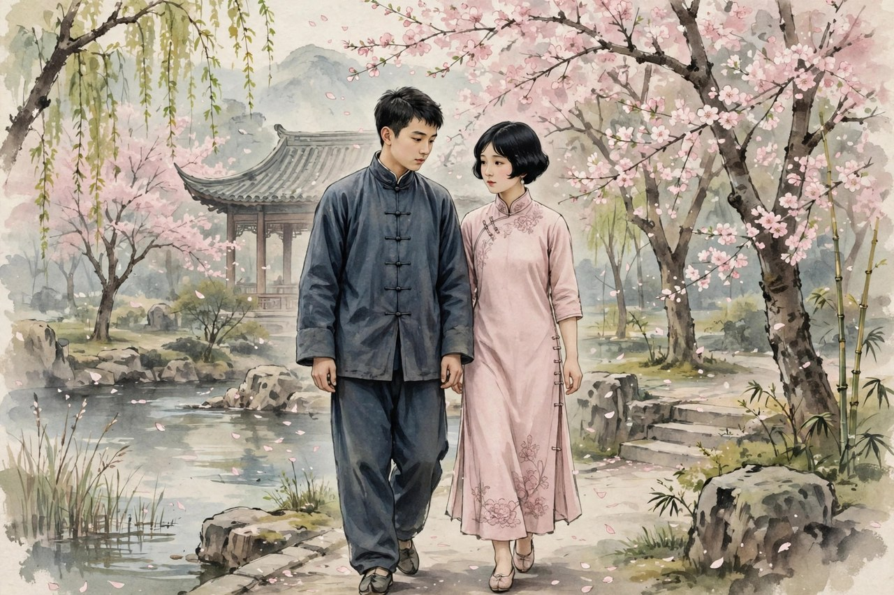
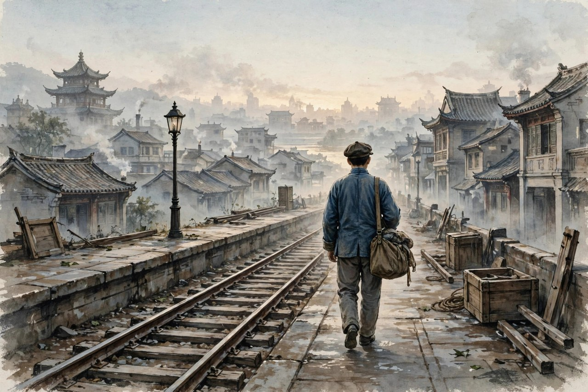

《韦护》是丁玲从一九二九年末到一九三零年初创作的中篇小说，发表于一九三零年。小说以丁玲自己与友人王剑虹、瞿秋白的交往为原型，写了以瞿秋白为原型的韦护，和以王剑虹为原型的丽嘉相识、相恋、最后分离的故事。韦护是一个革命者，丽嘉是一个小资产阶级知识女子，两个人在上海的小屋里相爱，相处了七天，七天里有温柔，有争吵，有身体的亲近，有思想的分歧，有对未来的不同想象。七天过去，韦护抛下丽嘉，南下投奔革命，丽嘉留在原地，决心好好做点事业出来。小说发表之后，受到了很多批评，有人说它写革命者不负责任，写恋爱太感伤，写革命和恋爱的冲突太粗俗。丁玲后来自己也承认，她发现这篇小说陷入了革命与恋爱冲突的圈套里。可是，时间过去了，读者再读《韦护》，会发现它的价值恰恰在这里：它没有把革命和恋爱写成非此即彼的选择题，而是写成撕扯人心的真实过程，写成两个活生生的人在理想和感情之间的挣扎。

韦护这个人物，很多人读的时候会骂他冷酷，骂他不负责任，骂他抛弃爱人。可丁玲写韦护，不是为了骂他，也不是为了捧他，而是为了写一个革命者内心的困境。韦护心里有革命的理想，有对未来的信念，有对旧社会的愤怒，可他心里也有欲望，也有对丽嘉身体的迷恋，也有对安稳生活的渴望。他在丽嘉的房间里度过的七天，是他一生里最温柔、最完满的七天，也是他一生里最矛盾、最挣扎的七天。他爱丽嘉，可他也知道，丽嘉的生活方式，丽嘉的小资产阶级趣味，和他的革命理想合不到一起去。他留下来，就是背叛革命；他走，就是背叛爱情。两边都是背叛，两边都让他疼。丁玲把这种两边都疼的状态写出来了，写得非常细，写得非常真，没有把韦护写成一个高大全的英雄，也没有把他写成一个玩弄女子的坏蛋，而是写成一个在理想和感情之间挣扎的活人。这样的韦护，比英雄更真实，比坏蛋更动人。

### 小屋里的七天温柔

韦护和丽嘉相处的那七天，是小说里最动人的部分。两个人在上海的小屋里，关起门来，过着自己的小日子：一起吃饭，一起谈话，一起看书，一起在夜里相拥，一起在白天争吵。丁玲写这七天，写得非常细腻，写丽嘉的腰肢，写韦护的眼神，写两个人相处时的温柔和尴尬，写两个人谈理想时的分歧和理解。有研究者说，这七天是现代文学史上最浪漫、最完满的爱情，这个评价，说到了点子上：七天里没有外人打扰，没有革命任务，没有社会压力，只有两个人，只有爱情，只有身体和心灵的亲近。这样的爱情，在现实里很难得，在小说里也很难得。丁玲把七天写得这么满，这么真，就是为了让读者明白，韦护抛下丽嘉，不是他不爱丽嘉，是他爱丽嘉却不得不走；丽嘉留在原地，不是她不爱韦护，是她爱韦护却留不住他。爱情的完满和分离的痛苦，合在一起，才是《韦护》的全部。

七天里的温柔，还有一个特点：它是私人的，是具体的，是身体的。丁玲写韦护对丽嘉身体的审视，写他对丽嘉腰肢的注视，写他心里对女性身体的幻想和挣扎，写得非常直白，非常大胆。这样的写法，在当时招来不少非议，有人说她写得太露骨，有伤风化。可丁玲没有理会，她心里清楚，爱情不是抽象的概念，是身体的亲近，是心跳的加快，是夜里的相拥，是白天的争吵。把身体写出来，爱情才真实；把身体藏起来，爱情就成了空话。她后来在八十年代修订《韦护》的时候，对这些直白的心理描写做了暧昧处理，把一些露骨的话改得含蓄了。可初版本里的直白，恰恰是丁玲早年写作最鲜明的特点：她敢写欲望，敢写身体，敢写女子和男子心里的那点事，不遮不掩，不装腔作势。今天的读者读初版本，会觉得丁玲的直白一点都不过时：爱情里的欲望，本来就是真实的一部分，藏起来不写，爱情就不完整。

七天里的争吵，同样值得细说。韦护和丽嘉不是天天甜蜜，他们也吵架，吵理想，吵生活方式，吵未来。韦护觉得丽嘉太小资产阶级，太讲究生活，太不关心革命；丽嘉觉得韦护太严肃，太不近人情，太把革命看得比爱情还重。两个人吵完了，又和好，和好了，又吵，吵吵和和，和和吵吵，七天就是这样过去的。这样的争吵，比甜蜜更有真实感：两个人在一起，不可能天天甜蜜，总要吵架，总要分歧，总要在分歧里找共同点。丁玲写争吵，写得非常生活化，不是大道理的辩论，是小屋里的拌嘴，是饭桌上的顶撞，是夜里的冷战。这样的争吵，读者读着会觉得亲切，因为自己的恋爱也是这样：甜蜜的时候很甜，吵架的时候很凶，吵完了又舍不得分开。韦护和丽嘉的七天，就是这样甜蜜和争吵交织的七天，就是这样完满和矛盾交织的七天。

### 革命者的冷酷与挣扎

韦护离开丽嘉的时候，没有事先知会，只留下了一些外文书、他的情诗和他的日记，任由丽嘉处置。这样的离开方式，很多人读了会骂他冷酷，骂他不负责任，骂他把丽嘉一个人扔在上海。丁玲写这个离开，没有替韦护辩解，没有说他离开是对的，也没有说他离开是错的，她只是把离开的样子写出来：书放在桌上，情诗放在抽屉里，日记放在枕头边，人已经走了，屋子还留着他的气息。丽嘉回到屋里，看到这些东西，心里是什么滋味，丁玲没有细写，可读者能想象出来：被抛下的人，看到爱人留下的东西，心里比看到爱人本人还要疼。韦护的冷酷，就在这里：他不是当面说分手，不是吵一架再走，而是悄悄地走了，留下一堆东西，让丽嘉自己去收拾，自己去消化。这样的离开，比吵架分手更伤人，因为它连一个告别的机会都没有给对方。

可是，韦护的冷酷背后，是挣扎。他不是不想告别，是不敢告别，是怕告别了就走不了了，是怕看到丽嘉的眼泪就心软了，就留下来了，就背叛了革命。他心里清楚，留下来，就是放弃革命；走，就是放弃爱情。两边都是放弃，两边都让他疼。他选择了走，选择了革命，选择了把爱情留在上海的小屋里，留在七天的温柔里。他走的时候，心里不是轻松的，是沉重的，是愧疚的，是舍不得的。丁玲写韦护的挣扎，写他对房东亲戚的自我剖析，写他只有在和丽嘉沉浸爱情之中时，才真正意识到自己平时生活里的空虚和压抑。这样的自我剖析，让读者看到，韦护不是一个冷血的人，他是一个有血有肉、有欲望、有愧疚、有挣扎的人。他的冷酷，是挣扎的结果，不是天生的冷血。把这个道理写清楚了，读者对韦护的骂，就会变成心疼，就会变成理解，就会变成对革命和恋爱冲突的思考。

丁玲写韦护的挣扎，还有一个深意：她在写革命者也是人。革命者不是神，不是没有欲望、没有感情、没有软弱的符号，革命者也是人，也会爱，也会欲望，也会舍不得，也会在理想和感情之间挣扎。把革命者写成人，写他的欲望，写他的愧疚，写他的挣扎，比把革命者写成神更有力量，因为神不需要选择，人需要选择，选择本身就是痛苦的。韦护的选择，是痛苦的，是撕扯的，是让人心疼的。丁玲把这种痛苦写出来了，就是告诉读者：革命不是一句口号，是一个个活生生的人在理想和生活之间做选择，是一个个韦护在小屋和远方之间做选择。选择没有对错，只有代价，韦护付出了爱情的代价，丽嘉付出了被抛下的代价，两个人都付出了代价，革命也付出了代价。把代价写清楚了，革命题材才有了分量，才不是空话。

### 丽嘉不是配角，是另一个主角

丽嘉这个人物，很多人读的时候会把她当成配角，当成韦护革命路上的绊脚石，当成小资产阶级知识女子的代表。可丁玲写丽嘉，不是把她写成配角，而是把她写成另一个主角，写她的温柔，写她的坚强，写她的觉醒，写她在被抛下之后没有趴下，而是决心好好做点事业出来。丽嘉的原型是王剑虹，她是一个安那其主义者，有自己的思想，有自己的追求，不是只会谈恋爱的女子。她和韦护相爱，不是仰慕韦护的革命光环，是两个人思想上的碰撞，是两个人生活上的吸引。她在七天里，和韦护谈理想，谈生活，谈未来，谈自己的想法，她不是韦护的附属品，是一个独立的人。丁玲写丽嘉的独立，写得非常清楚：丽嘉有自己的房间，有自己的生活，有自己的朋友，有自己的思想，她爱韦护，可她没有把自己全部交给韦护，她在爱情里还保留着自己。

丽嘉被抛下之后的反应，同样值得细说。她没有哭天抢地，没有寻死觅活，没有骂韦护是负心汉，她收拾了韦护留下的书、情诗、日记，坐在屋里想了很久，然后决心好好做点事业出来。这个决定，不是赌气，不是报复，是她在被抛下之后，给自己找的一条路：爱情没有了，生活还要过，事业还要做，自己还要活。她没有因为被抛下就否定自己，没有因为失去爱情就否定生活，她把失去爱情的痛苦，变成了做事业的动力。这样的丽嘉，比很多爱情小说里的女子要硬得多，也要亮得多。丁玲写丽嘉的这个决定，就是在写女子的另一种出路：爱情不是全部，事业也是出路，被抛下不是终点，重新开始才是出路。今天的女子在失恋之后，同样可以学丽嘉：不要在失去爱情里趴下，不要在被抛下里认命，把痛苦变成动力，把生活重新安排，把事业做起来，把自己活出来。丽嘉的路，就是这样一条路。

丁玲写丽嘉，还有一个特点：她没有把丽嘉写成革命的对立面，没有把小资产阶级女子写成落后、该被抛弃的人。她写丽嘉的温柔，写丽嘉的才气，写丽嘉的思想，写丽嘉在七天里的完满，写得非常动人，让读者觉得，丽嘉这样的人，值得被爱，值得被珍惜，值得有一个好的结局。可是，韦护还是走了，丽嘉还是被抛下了，这个结局，让读者觉得不公平，觉得惋惜，觉得革命和恋爱的冲突，不应该以抛弃女子来解决。丁玲把这种不公平写出来，就是在质疑革命和恋爱冲突的公式：为什么革命一定要抛弃恋爱，为什么理想一定要牺牲爱情，为什么女子一定要成为革命的代价。她没有给出答案，她只是把问题摆出来，让读者自己去想。这个问题，到今天还没有过时：理想和爱情，事业和家庭，远方和身边，很多人一生都在这两边拉扯，都在为选择付出代价。丁玲的《韦护》，就是把这个拉扯写出来的小说，就是把代价写出来的小说。

### 革命加恋爱的公式与清算

《韦护》发表之后，被文学史划入革命加恋爱小说，意思是小说把革命和恋爱搅在一起，写革命者谈恋爱，写恋爱影响革命，写革命抛弃恋爱。丁玲起初不承认，后来发现确实陷入了恋爱与革命冲突的圈套里。这个圈套，是当时很多左翼作家都陷入的圈套：写革命，就要写革命者谈恋爱；写恋爱，就要写恋爱怎么影响革命；写到最后，革命和恋爱总要分出胜负，总要有一个被抛弃。丁玲的《韦护》，就是这个圈套里的典型：韦护和丽嘉相爱，爱到最后，韦护抛下丽嘉去革命，丽嘉留在原地做事业，革命赢了，恋爱输了。这样的公式，看起来很革命，实际上很粗俗，因为它把革命和恋爱写成了对立面，把女子写成了革命的代价，把爱情写成了革命的绊脚石。丁玲后来写《水》，就是要清算这个公式，要写革命不是抛弃恋爱，写大众不是抛弃个人，写群体的觉醒不是以抛弃女子为代价。她的清算，从《韦护》开始，到《水》完成，中间隔着胡也频牺牲的打击，隔着她加入左联的转变，隔着她眼睛从小屋挪到堤上的过程。

对照今天看，革命加恋爱的公式，换了样子还在。今天的很多作品，写事业和爱情，同样写成对立面：要事业，就要抛弃爱情；要爱情，就要放弃事业；要远方，就要抛弃身边；要理想，就要牺牲家庭。这样的公式，同样粗俗，同样把女子写成代价，把爱情写成绊脚石。丁玲的《韦护》，就是一面镜子，照出这种公式的粗俗：韦护抛下丽嘉，真的就是革命的胜利吗？丽嘉被抛下，真的就是小资产阶级的失败吗？爱情输了，革命就赢了吗？这些问题，丁玲没有回答，可她把问题摆出来了，让读者自己去想。今天的读者看《韦护》，要带着这些问题看：事业和爱情，真的只能二选一吗？理想和身边，真的只能抛弃一边吗？女子，真的只能成为代价吗？把这些问题想清楚了，读者就不会再被革命加恋爱的公式骗了，就不会再把爱情当成事业的绊脚石，就不会再把女子当成代价了。

丁玲写《韦护》的另一个价值，在于她写出了革命话语和私人话语之间的缝隙。主题层面上，韦护抛下丽嘉去革命，是革命追求、理想信仰取代一己之恋爱私情，是批判知识分子的个人主义思想；细部叙述上，韦护和丽嘉的七天温柔，是两性爱情的缠绵悱恻，是痛苦温馨的私人情感。主题和细部之间，有缝隙，有矛盾，有撕裂：主题说革命赢了，细部说爱情输得让人心疼；主题说个人主义要批判，细部说私人情感是真实的，是动人的。这种缝隙，不是丁玲写坏了，是她写真实了：革命话语和私人话语，本来就是有缝隙的，理想和感情，本来就是撕扯的，把缝隙写出来，比把缝隙掩盖起来更有力量。今天的写作者写理想和感情，同样要写出缝隙，写出撕裂，写出主题和细部的矛盾，不要把人物写成主题的传声筒，不要把爱情写成主题的注脚。丁玲的《韦护》，就是写缝隙的范本：主题是革命，细部是爱情，缝隙里站着韦护和丽嘉，站着两个活生生的人。

### 今天读韦护的提醒

今天读《韦护》，头一个提醒是：不要把爱人当成代价。韦护抛下丽嘉，是把丽嘉当成了革命的代价，当成了理想的绊脚石。这样的代价，放在今天看，依然有人在付：有人为了事业抛下爱人，有人为了远方抛下身边，有人为了理想抛下家庭，抛完了，还觉得自己是为了理想牺牲，是高尚的。丁玲写韦护，就是在提醒读者：把爱人当成代价，不是高尚，是冷酷，是不负责任。理想再大，也不能以抛弃爱人为代价；事业再重要，也不能以牺牲身边人为代价。真正的高尚，是带着爱人一起往前走，是让爱情和理想互相成就，不是互相牺牲。韦护没有做到这一点，他抛下了丽嘉，丽嘉也没有等他，她自己去做事业了。两个人的路，从此分开了，分开的原因，不是爱情不够，是韦护把爱情当成了代价。今天的读者，要吸取这个教训：爱一个人，不要把她当成代价，要把她当成同伴，要带着她一起走，要让她也做主，也选择，也往前走。

另外一个提醒是：分手要体面，不要悄悄地走。韦护离开丽嘉，没有告别，只留下了书、情诗、日记，这样的离开，比吵架分手更伤人。今天的分手，同样有很多悄悄地走：拉黑，消失，不回消息，不告而别，留下一堆东西让对方自己消化。这样的分手，看起来省事，实际上最伤人，因为它连一个告别的机会都没有给对方，连一个解释的机会都没有给对方。丁玲写韦护的悄悄离开，就是在写这种不体面的分手：爱过的人，分手也要体面，要当面说清楚，要给对方一个告别的机会，要让对方知道，你走了，不是因为她不好，是因为你要走的路和她不一样。把话说清楚了，对方才能放下，才能往前走，才能像丽嘉一样去做事业。把话说不清楚，对方就会一直想，一直问，一直放不下，就会像丽嘉刚被抛下时那样，坐在屋里，看着爱人留下的东西，心里翻江倒海。体面的分手，是对爱过的尊重，也是对自己的尊重。

还有一个提醒是：失恋之后，要像丽嘉一样去做事业。丽嘉被抛下之后，没有趴下，没有寻死，没有骂人，她收拾东西，决心好好做点事业出来。这个决定，是失恋之后最好的出路：把痛苦变成动力，把生活重新安排，把事业做起来，把自己活出来。今天的女子在失恋之后，同样可以这样：不要在失去爱情里趴下，不要在被抛下里认命，不要在流言里哭，不要在怜悯里活。把失恋的痛苦，变成做事的动力，变成学习的动力，变成重新开始的动力，日子就会亮起来。丽嘉的路，就是这样一条路：爱情没有了，事业还在，生活还在，自己还在，往前走就是了。丁玲写丽嘉的这个决定，就是给失恋的人留的一条路：路在前面，不在后面，不在爱人留下的东西里，在自己要做的事情里。

### 七天之后的话

韦护走了，丽嘉留下了，七天过去了，小屋空了，书还在，情诗还在，日记还在，人已经走了。小说的结尾，没有写韦护南下之后怎么样，没有写丽嘉做事业之后怎么样，只写韦护走了，丽嘉决心做事业了。这个结尾，和丁玲很多小说的结尾一样，不圆满，不交代，只把选择留下来，把路留下来，把问题留给读者。韦护的选择，是革命；丽嘉的选择，是事业；两个人的选择，都没有错，都付出了代价，都往前走了。读者读完，会觉得惋惜，会觉得如果韦护不走，如果丽嘉跟着走，如果两个人能一起走，故事会不会不一样。可是，丁玲没有给如果，她只给了现实：韦护走了，丽嘉留下了，七天过去了，爱情留在了小屋里，革命留在了远方，事业留在了丽嘉手里。现实就是这样，没有如果，只有选择，只有代价，只有往前走。

丁玲写《韦护》，写的是她自己的朋友，写的是她身边的故事，写的是她年轻时看到的革命和恋爱。她后来走的路，比韦护和丽嘉都要远：她从写革命加恋爱走到写水，走到写土改，走到写延安，走到写北大荒，走到写晚年的散文。她用自己的一生，清算了革命加恋爱的公式，证明了作家可以从写小屋走到写社会，从写个人走到写大众，从写恋爱走到写土地。她的小说，从《韦护》到《水》，从《水》到《太阳照在桑干河上》，就是一条清算的路，一条成长的路，一条从圈套里走出来的路。读者读《韦护》，要带着这条路读：韦护是起点，水是转折，太阳是高峰，起点里的圈套，转折里清算了，高峰里超越了。把这条路走一遍，读者就明白丁玲为什么重要，就明白她的小说为什么经得起时间，就明白革命和恋爱，本来不应该是对立面，本来应该是互相成就的。

七天很短，七天也很长。七天里，韦护和丽嘉相爱了，争吵了，温柔了，分开了。七天之后，韦护南下了，丽嘉做事业了，丁玲的笔也往前走了。七天留下的，不只是小屋里的温柔，不只是书和情诗和日记，更是一个问题：理想和爱情，到底该怎么相处。这个问题，丁玲用一生来回答，韦护用离开来回答，丽嘉用事业来回答，读者要用自己的生活来回答。把这个问题带在身上，读丁玲的小说，读自己的生活，答案会在生活里慢慢出来，不在书上，不在口号里，在每一次选择里，在每一次往前走里。

### 韦护的书与丽嘉的房间

韦护留下的书、情诗、日记，是小说里最耐琢磨的细节。书是外文书，是韦护的思想，是他革命理想的底子；情诗是他对丽嘉的爱，是他温柔的一面，是他七天里写下的心意；日记是他对自己的剖析，是他挣扎的记录，是他不敢当面说的话。这三样东西放在一起，就是韦护这个人的全部：思想，爱情，挣扎。丽嘉收拾这些东西的时候，看到的不只是几样物品，看到的是韦护这个人，看到的是七天的全部，看到的是爱情和革命在他身上怎么撕扯。她把这些东西收起来，不是扔掉，不是烧掉，是留下来，留下来慢慢想，慢慢消化，慢慢变成自己做事业的动力。丁玲写这些细节，写得非常克制，没有大段地写丽嘉哭，没有大段地写丽嘉骂，只是写她收拾东西的样子，写她坐在屋里想的样子，读者自己就能感受到那种疼，那种不舍，那种重新开始的决心。

丽嘉的房间，也是小说里一个重要的空间。房间不大，关起门来，就是两个人的世界，就是七天的世界，就是爱情的世界。房间外面，是上海，是社会，是革命，是远方；房间里面，是温柔，是争吵，是身体，是心跳。韦护走出房间，就是走出爱情，走进革命；丽嘉留在房间，就是留在爱情里，留在七天的记忆里，再从记忆里走出来，去做事业。房间的门，开着是爱情，关着也是爱情，韦护开门走了，丽嘉关门想了，门开门关之间，就是革命和恋爱的全部。丁玲写房间，写得非常具体：桌子，抽屉，枕头，书，情诗，日记，这些东西堆在房间里，就是七天的证据，就是爱情的证据，就是韦护来过的证据。丽嘉住在证据里，疼在证据里，也从证据里站起来，走向事业，走向新的生活。房间没有变，人变了，爱情没有变，路变了，这就是《韦护》的全部。

对照今天看，韦护留下的东西和丽嘉的房间，依然是失恋之后的样子。今天的人分手，同样会留下东西：衣服，书，照片，聊天记录，合影，礼物。被留下的人，收拾这些东西的时候，心里同样翻江倒海，同样想扔掉又舍不得，同样想留着又疼。丁玲写丽嘉收拾东西，就是写今天的人收拾东西：收拾的不是物品，是记忆，是七天的温柔，是爱情的证据。收拾完了，人才会往前走，才会去做事业，才会重新开始。把东西收拾好，把记忆放好，把路往前走，这就是失恋之后最体面的样子，就是丽嘉的样子，就是丁玲留给失恋的人的路。不要把东西烧掉，不要把记忆删掉，不要把自己关在房间里哭，把东西收好，把门打开，把事业做起来，日子就会亮起来。

### 瞿秋白与王剑虹的影子

《韦护》的原型，是瞿秋白和王剑虹的故事。瞿秋白总把自己比作韦护，经常用韦陀的笔名发表文章，韦护这个名字，本身就带着疾恶如仇、专打抱不平的意思。王剑虹是一个安那其主义者，有自己的思想，有自己的追求，她和瞿秋白的恋爱，本身就是一场思想上的碰撞，一场生活上的吸引。丁玲写《韦护》，不是照抄原型，不是写传记，而是借原型的影子，写革命和恋爱的普遍问题：革命者谈恋爱，会遇到什么问题；小资产阶级女子爱上革命者，会遇到什么问题；两个人在一起，思想不同，生活方式不同，未来想象不同，会怎么吵，会怎么爱，会怎么分开。丁玲借原型写普遍问题，写得非常聪明：原型给了她真实的底子，普遍问题给了她文学的分量，两个合在一起，小说就既有真实感，又有思想性。

读《韦护》，不必去考证原型和小说的每一处对应，不必去问韦护是不是就是瞿秋白，丽嘉是不是就是王剑虹。原型只是影子，小说才是本体。丁玲写小说，不是为了给原型立传，是为了写革命和恋爱的问题，是为了写韦护和丽嘉这两个人。读者读小说，要读韦护和丽嘉，不要读原型考证；要读七天的温柔和分离的痛苦，不要读历史八卦。原型考证是研究者的事，读小说是读者的事，读者要读的是人，是爱情，是挣扎，是选择，是代价。把这些读清楚了，《韦护》就读懂了，就明白了丁玲为什么要写这篇小说，就明白了她为什么后来要清算革命加恋爱的公式，就明白了她的小说为什么从小屋走向了社会，走向了大众，走向了土地。

韦护和丽嘉的故事，到今天还在延续。今天的革命者，换成了创业者，换成了理想主义者，换成了要去远方的人；今天的丽嘉，换成了留在原地的爱人，换成了要做事业的人，换成了被抛下之后重新开始的人。故事换了衣服，道理没有变：理想和爱情，事业和身边，远方和家里，很多人一生都在这两边拉扯，都在为选择付出代价。丁玲的《韦护》，就是把这个拉扯写出来的小说，就是把代价写出来的小说。把这个小说读透了，读者在自己的拉扯里，就不会那么慌，就不会觉得只有自己在拉扯，就知道原来一百年前就有人这样拉扯过，原来拉扯是常态，原来选择没有对错，只有代价，只有往前走。把这个道理记住了，拉扯就没有那么可怕了，选择就没有那么难了，日子就有盼头了。

七天过去了，小屋还在，书还在，情诗还在，日记还在，韦护走了，丽嘉还在，丁玲的笔还在往前走。七天的温柔没有白费，七天的争吵没有白费，七天的分离没有白费，它们都变成了后来小说里的光，照着丁玲从小屋走向社会，从恋爱走向土地，从圈套走向清算。

这束光，到今天还在照着每一个在理想和爱情之间拉扯的人。

拉扯的人，读完《韦护》，心里会亮一点，脚步会稳一点。

这就够了。
