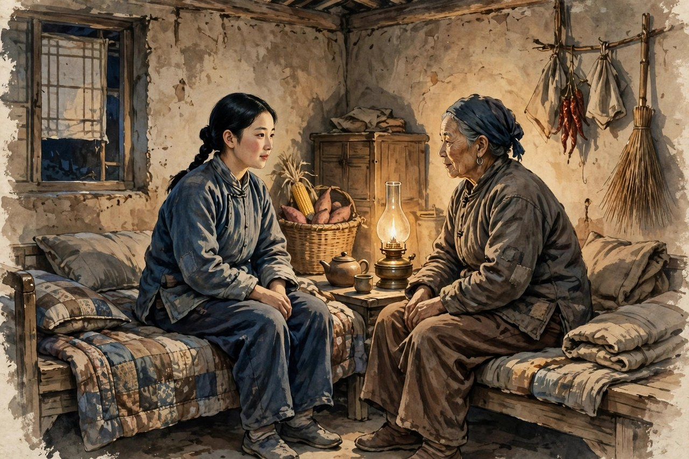

霞村是一个抗战时期临近前线的小村子，丁玲在那里休养的时候，住在房东刘二妈家里，听到了刘二妈女儿贞贞的故事。贞贞的故事，放在今天看，依然让人心里发紧：一个农村姑娘，为了反抗包办婚姻，决心到天主堂当修女，结果不幸落入进村劫掠的日军手中，受尽了侮辱和蹂躏。她没有被灾难摧毁，反而和抗日队伍取得了联系，利用自己的特殊身份，坚持给队伍递送情报。后来她逃出魔掌，回到村里，却受到周围一些愚昧、冷漠、毫无同情心的村民的鄙视和厌弃。虽然原先和她恋爱的夏大宝依然真诚地向她求婚，可她不愿在怜悯的眼光下生活，毅然接受上级的安排，到延安治病学习去了。这篇小说发表于一九四一年六月的《中国文化》，后来收入桂林远方书店出版的同名集子。小说不长，却是丁玲延安时期影响最大、也最有争议的一篇。争议的焦点，就是丁玲敢用同情的笔调写贞贞这样的女子，敢把女子的伤口和尊严一起写出来。

贞贞这个人物，丁玲自己说过，她寄托了自己的感情，因为贞贞寂寞、傲岸、强悍。寂寞，是因为贞贞在村里没有人懂她，她的反抗，她的遭遇，她的情报工作，她的心思，村里人都不懂，只会用流言去量她。傲岸，是因为贞贞不肯低头，不肯在怜悯里活着，不肯把自己活成一个等别人可怜的人。强悍，是因为贞贞受了那么重的伤，得了病，还能坚持送情报，还能在流言里站起来，还能接受安排去延安治病学习。这三个词，放在今天的女子身上，依然贴切：很多女子在生活里都是寂寞的，因为没有人懂自己的选择；都是傲岸的，因为不肯在怜悯里活着；都是强悍的，因为受了伤还能站起来。丁玲写贞贞，就是写这种寂寞、傲岸、强悍合在一起的女子，写她怎么在最难的处境里，还把自己活成一个人。

### 霞村的流言比刀子还快

贞贞回到村里之后，遇到的不是安慰，是流言。村里人议论她，说她在日本人那里待过，说她不干净，说她给村里丢了脸。这些流言，比日军的刀子还要伤人，因为刀子伤的是身体，流言伤的是人心。贞贞在村里走路，村里人看她的眼神都不对劲，有人躲着她，有人背后说她，有人当面给她脸色看。她住在家里，家里人也为难，刘二妈心疼女儿，可也怕村里人的闲话。这样的处境，今天的读者一点都不陌生：一个女子受了伤，回到熟悉的环境里，本来最需要安慰，可得到的却是议论和白眼。流言的可怕之处，在于它不需要证据，不需要真相，只需要几张嘴，就能把一个活生生的人说成一个污点。丁玲写霞村的流言，写得非常真实，真实到读者会觉得，霞村不是一九四一年的村子，就是今天的某个村子、某个小区、某个朋友圈。

丁玲写流言，还有一个狠劲：她不只写流言本身，还写流言背后的愚昧和冷漠。村里人议论贞贞，不是因为他们坏，是因为他们脑子里有一套老尺子：女子要贞节，女子要干净，女子受了辱就是丢了脸，就是不配再抬头。这套尺子，量了几千年，量得女子喘不过气来。丁玲写村里人用这套尺子量贞贞，就是在写这套尺子本身的问题：尺子是旧的，是错的，是用来压女子的，可村里人还拿着它当宝贝，还觉得自己是在维护风气。这样的写法，比直接骂村里人更有力量，因为它让读者看到，流言不是几个坏人的事，是整个旧观念的事。要拆流言，就要拆旧观念，就要让村里人明白，贞贞受辱不是她的错，是侵略者的罪，是战争的罪，是旧社会的罪。把责任分清楚了，流言才能慢慢散去。

贞贞面对流言的态度，是这篇小说最动人的地方。她没有哭着求村里人原谅，没有低头认错，没有把自己活成一个等别人可怜的人。她在流言里强撑着，照常生活，照常和队伍联系，照常给队伍送情报，照常在夜里想自己的出路。她心里苦，可她没有把苦挂在嘴上，她把苦咽下去，把腰挺直，把路往前走。这样的贞贞，比那些在流言里哭天抢地的女子要硬得多，也比那些在流言里低头认命的女子要亮得多。丁玲写贞贞的硬，不是写她没有感情，而是写她有感情却不肯被感情压垮，有伤口却不肯被伤口定义。她受了伤，得了病，可她没有让伤和病成为自己的全部身份，她还有情报工作，还有去延安的路，还有自己的未来。这样的女子，才是丁玲心里真正的女子。

### 送情报的姑娘与恋人的求婚

贞贞的情报工作，是小说里最值得细说的一条线。她落入日军手中之后，没有认命，没有只想着逃跑，她利用自己的特殊身份，和抗日队伍取得了联系，坚持给队伍递送情报。她在敌人的眼皮底下做事，冒着生命危险，把情报送出去，把队伍的需要记下来，把敌人的动向传出去。这样的事，放在今天看，就是地下工作，就是间谍故事，可丁玲没有把贞贞写成传奇英雄，而是写成一个在绝境里找活路的姑娘：她送情报，不是因为她天生勇敢，是因为她不想只当一个受害者，她想为抗日做点事，想证明自己还能用，想让自己的苦没有白受。这种动机，比英雄主义更真实，更动人。今天的读者看贞贞送情报，会明白一个道理：人在绝境里，不只有哭和认命两条路，还有一条路，就是找点事做，找点用处，让自己在苦难里还有价值。贞贞就是这样做的，她用情报工作，把自己的苦难变成了力量。

夏大宝向贞贞求婚，是小说里另一个让人心里发酸的情节。夏大宝是贞贞原先的恋人，他真诚地向贞贞求婚，想娶她，想照顾她，想给她一个家。按一般的爱情小说，贞贞应该感动，应该答应，应该和夏大宝过上安稳日子。可丁玲没有这样写。贞贞拒绝了夏大宝的求婚，不是因为她不爱夏大宝，也不是因为她看不上夏大宝，而是因为她不愿在怜悯的眼光下生活。她知道，夏大宝的求婚里有真心，也有怜悯，有同情，也有村里人的眼光。她要是在怜悯里嫁给夏大宝，她一辈子都会觉得自己是被可怜的那个人，都会觉得自己低人一等。她宁愿去延安治病学习，宁愿一个人往前走，也不愿在怜悯里过一辈子。这样的拒绝，比答应要难得多，也比答应要硬得多。丁玲写这个拒绝，就是在写女子的尊严：尊严不是别人给的面子，是自己不肯在怜悯里活着的骨气。

对照今天看，贞贞的拒绝依然有现实意义。今天的女子在感情里，常常会遇到怜悯式的爱：对方说，我不嫌弃你，我愿意照顾你，我愿意娶你，可话里话外透着一种高高在上的怜悯。这样的爱，听起来温柔，实际上伤人，因为它把女子放在了低一等的位置上，让女子一辈子都觉得自己欠对方的。丁玲写贞贞拒绝怜悯，就是在提醒今天的女子：爱要是带着怜悯，就不是平等的爱，就不是值得托付的爱。女子要找的爱，是平视的爱，是把你当成一个人来爱的爱，不是把你当成可怜人来救的爱。贞贞去延安，不是逃避爱情，是去找一个能让她平视生活的地方，去治病，去学习，去让自己重新站起来。这样的选择，比嫁给怜悯要亮得多，也要远得多。

### 我在霞村的讲述者

小说的讲述者是我，是一个在霞村休养的人，住在刘二妈家里，听村里人议论贞贞，自己也好奇，也去听，弄了半天才知道，大家是在议论房东的女儿贞贞。这个我的视角，非常重要。她不是全知全能的作者，她是一个外来者，一个旁观者，一个慢慢了解贞贞的人。她听流言，也怀疑流言；她看贞贞，也心疼贞贞；她和贞贞谈话，也被贞贞的坚强打动。读者跟着我的视角走，就像跟着一个朋友走进霞村，慢慢了解贞贞的真相，慢慢看清流言的荒谬，慢慢被贞贞的硬气打动。这样的叙事，比直接告诉读者贞贞多么好要更有说服力，因为读者是自己一步一步走近贞贞的，是自己一步一步看清真相的。丁玲用我的视角，就是让读者自己去判断，自己去心疼，自己去敬佩。

我的视角，还有一个好处，就是它保留了距离感。我不是贞贞，我不能代替贞贞说话，我只能听，只能看，只能记，只能把贞贞的故事讲出来。这种距离感，让小说有了克制，有了分寸，没有把贞贞写成作者的传声筒，没有把贞贞的苦难写成煽情的工具。丁玲相信，贞贞的故事本身就有力量，不需要作者在旁边大喊大叫，只需要把故事讲清楚，把流言写清楚，把贞贞的硬气写清楚，读者自己就能感受到力量。今天的写作者写受害者的故事，常常忍不住煽情，忍不住替受害者喊冤，忍不住把受害者写成完美的受害者，结果反而削弱了力量。丁玲的克制，值得学：把故事讲清楚，把人物写真实，把流言写真实，把硬气写真实，力量自然就出来了，不需要煽情，不需要喊口号。

小说里我的另一个作用，是连接霞村和延安，连接流言和出路。我在霞村休养，听到了贞贞的故事，也看到了贞贞的出路：去延安治病学习。这个出路，不是小说凭空编出来的，是抗战时期的真实出路：延安是革命的中心，是学习的地方，是女子可以重新开始的地方。贞贞去延安，不是逃跑，是去找新的生活，去治病，去学习，去让自己从流言里走出来，去让自己从伤口里走出来。这个出路，给霞村的故事留了一个亮口：流言再厉害，也关不住一个要去延安的人；伤口再深，也挡不住一个要去学习的人。丁玲把这个亮口留下来，就是告诉读者，贞贞的路没有断，霞村的故事没有完，女子的出路还在前面，还在延安，还在学习里，还在自己往前走的脚步里。

### 贞贞的病与新的东西

贞贞身上有病，是日军糟蹋留下的病，是身体上的病，也是心里的病。丁玲写贞贞的病，写得非常克制，没有大段地写痛苦，而是写贞贞的脸色，写贞贞的沉默，写贞贞在夜里的辗转，写贞贞去延安治病的决定。病在这里，不是一个情节道具，是一个象征：战争给女子留下的伤，不只是身体上的，更是心里的，是流言里的，是村里人眼光里的。贞贞去延安治病，治的不只是身体上的病，更是心里的病，是流言带来的病，是旧观念带来的病。她去延安，是去找一个能让她把病治好的地方，是去找一个能让她重新做人的地方。这个决定，比任何口号都更有力量：女子受了伤，不是只能哭，只能认命，还可以去治病，去学习，去重新开始。丁玲把这个道理写进了贞贞去延安的脚步里，没有写成讲义，写成了生活。

小说结尾，丁玲写贞贞身上有一种新的东西表现出来了。这句话，很多人读的时候会停下来想：新的东西是什么？是觉醒，是坚强，是不再被流言定义的骨气，是去延安的决心，是重新开始的勇气。新的东西，不是凭空长出来的，是贞贞在流言里、在情报工作里、在拒绝怜悯里、在去延安的决定里，一点一点长出来的。她从前是一个反抗包办婚姻的姑娘，后来是一个受辱的姑娘，再后来是一个送情报的姑娘，再后来是一个在流言里站起来的姑娘，再后来是一个要去延安学习的姑娘。每一步，她都在长出新的东西。丁玲写新的东西，就是写贞贞的成长：成长不是一夜之间的事，是在苦难里、在流言里、在选择里，一点一点长出来的。今天的读者看贞贞的成长，会明白一个道理：成长不是没有伤，是带着伤还能往前走；不是没有流言，是在流言里还能抬头；不是没有怜悯，是拒绝怜悯还能往前走。这样的成长，才是真的成长。

### 今天为什么还要讲贞贞

今天讲贞贞，不是为了怀旧，是为了照镜子。今天的女子，同样会遇到流言，同样会遇到怜悯式的爱，同样会遇到受了伤之后被人议论的处境。社交平台上的流言，比霞村的流言传得更快，更广，更伤人。一个女子受了伤，网上的人不需要证据，只需要几张截图，几句话，就能把她说成污点。丁玲写霞村的流言，就是在写今天的网络流言：流言不需要真相，只需要嘴。贞贞在流言里站起来的样子，就是今天的女子在网络流言里该有的样子：不哭着求原谅，不低头认错，不在怜悯里活着，挺直腰板，往前走，去治病，去学习，去找新的生活。这样的贞贞，到今天还没有过时，因为流言还没有消失，怜悯式的爱还没有消失，女子受了伤被人议论的处境还没有消失。只要这些还在，贞贞的故事就还有人讲，就还有意义。

丁玲写贞贞，还有一个值得今天的人学的点：她没有把贞贞写成完美的受害者。贞贞有脾气，有傲岸，有固执，有时候说话刻薄，有时候态度强硬，她不是那种人见人爱的完美姑娘。她的不完美，让她像真人。今天的很多作品写受害者，喜欢把受害者写成完美的、毫无瑕疵的、值得所有人同情的人，结果反而让受害者失去了真实感，让读者觉得假。丁玲的贞贞不完美，可她真实，她的傲岸和强悍，就是她的不完美里长出来的光。读者喜欢贞贞，不是因为她完美，是因为她真实，是因为她在最难的处境里还把自己活成了一个人。这样的写法，值得今天的写作者学：写受害者，不要先把她洗白，先把她写真实，写她的脾气，写她的固执，写她的硬气，写她的不完美，真实比完美更有力量。

贞贞去延安的路，到今天还在延续。今天的女子受了伤，同样要去找自己的延安：可能是去学习，可能是去工作，可能是去一个新的城市，可能是去找一群能理解自己的人。延安不是一个地名，是一个象征：是一个能让女子重新开始的地方，是一个能让女子治病、学习、重新做人的地方。丁玲把贞贞送去延安，就是把这个象征留下来，让后来的女子知道，受了伤不是终点，流言不是终点，怜悯不是终点，重新开始才是出路。贞贞的故事讲完了，可她的路没有完，她的路在后来女子的脚步里延续着，在今天女子的选择里延续着，在每一个不肯在怜悯里活着的女子身上延续着。这就是《我在霞村的时候》活到今天的原因：它写了一个姑娘，也写了一条路，路还在，姑娘的精神还在。

### 刘二妈家里的灯光

霞村的故事，离不开刘二妈的家。我住在刘二妈家里，听着刘二妈讲女儿的事，看着刘二妈心疼女儿又怕闲话的样子，心里特别不是滋味。刘二妈是一个普通的农村母亲，她爱女儿，可她也怕村里人的闲话，怕女儿的名声坏了，怕家里被人指指点点。她的爱里有心疼，也有为难，有想护着女儿的心，也有不敢和全村人作对的怕。这样的母亲，今天的读者一点都不陌生：很多母亲爱孩子，可也怕闲话，怕孩子被人说，怕家里丢面子，结果爱变成了为难，变成了沉默，变成了让孩子自己扛。丁玲写刘二妈，没有把她写成坏母亲，也没有把她写成完美母亲，而是写成一个在爱和怕之间拉扯的母亲。她的拉扯，就是霞村很多家庭的拉扯，就是今天很多家庭的拉扯。母亲爱孩子，可母亲也活在村里人的眼光里，母亲的爱，要穿过流言才能到达孩子心里，这条路，有多难，只有当母亲的人才知道。

刘二妈家里的灯光，是小说里一个很温暖的细节。我住在她家里，夜里灯亮着，刘二妈在灯下做针线，贞贞在灯下沉默，我在灯下听故事。灯光不亮，却暖，暖到让读者觉得，霞村虽然有流言，可家里还有灯，还有母亲的心疼，还有一个外来者的理解。这盏灯，和贞贞去延安的路一样，是小说里的亮口：流言再黑，家里还有灯；村里人再冷，母亲心里还有暖。丁玲写这盏灯，不是为了煽情，是为了让读者看到，霞村不是只有流言，还有人情，还有母亲的爱，还有外来者的同情。这些暖的东西，虽然敌不过全村的流言，可它们是贞贞站起来的底子：没有母亲的心疼，没有我的理解，贞贞在流言里会更难站起来。丁玲把这些暖的东西写出来，就是告诉读者，女子的坚强不是凭空长出来的，是在家里灯光的暖里，在母亲心疼的眼神里，在朋友理解的话里，一点一点长出来的。

对照今天看，刘二妈家里的灯光，依然有意义。今天的女子受了伤，回到家里，家里人的态度，决定了她能不能站起来。家里人要是像刘二妈这样，心疼又为难，女子会觉得家里还有暖，可暖里还有怕；家里人要是能挺直腰板说，孩子没有错，错的是伤害她的人，是传流言的人，女子站起来就会容易得多。丁玲写刘二妈的为难，就是在提醒今天的家人：爱孩子，不能只在心里疼，要在村里人面前也敢疼，要在流言面前也敢站出来说，孩子没有错。把这句话说出来，家里的灯才能真正亮起来，才能照着孩子往前走。刘二妈没有把这句话说出口，她的灯是暖的，却也是暗的，贞贞最后还是要去延安，才能找到真正亮的地方。今天的家人，可以比刘二妈多走一步：把疼说出来，把对说出来，把流言顶回去，让家里的灯亮得更亮一些。

### 贞贞与莎菲的两条路

把贞贞和莎菲放在一起看，会看到丁玲写女子的两条路。莎菲的路，是小屋里的路，是日记里的路，是爱情里的路，她清醒，却走不出去，停在绝望里。贞贞的路，是村子里的路，是战争里的路，是流言里的路，她受了伤，却走出去了，走到了延安，走到了新的生活。两条路，一条停了，一条走了，停的那条是丁玲早年的路，走的那条是丁玲延安时期的路。从莎菲到贞贞，丁玲的女子从小屋走到了村口，从日记走到了情报工作，从爱情走到了抗日，从绝望走到了新的东西。这个变化，就是丁玲自己从写个人苦闷到写大众生活的转变，就是她从文小姐到武将军的转变。读者把这两篇小说连起来读，会看到一个完整的丁玲：她早年写女子的苦闷，写得细，写得真；她后来写女子的坚强，写得硬，写得亮。两条路合起来，才是丁玲写女子的全部面貌。

莎菲和贞贞的不同，还在于她们面对的敌人不同。莎菲的敌人，是爱情里的虚伪，是凌吉士的轻浮，是社会给女子的窄路。贞贞的敌人，是侵略者的刀子，是村里的流言，是旧观念的尺子。莎菲的敌人看不见，摸不着，是心里的敌人；贞贞的敌人看得见，摸得着，是村口的流言，是日军的罪行。丁玲写莎菲，是写心里的敌人怎么折磨人；写贞贞，是写外面的敌人怎么伤人，又怎么写人在外面敌人的压迫下站起来。两篇小说合起来，丁玲写女子的敌人就写全了：心里的敌人要靠清醒来对付，外面的敌人要靠坚强来对付，清醒加坚强，女子才能真正站起来。今天的女子，同样要面对心里的敌人和外面的敌人：心里的敌人是患得患失，是自我怀疑，是把希望押在一个人身上；外面的敌人是流言，是怜悯式的爱，是旧观念的尺子。对付这两类敌人，莎菲和贞贞都给了路标：清醒一点，坚强一点，拒绝怜悯一点，往前走一点。

把贞贞和莎菲放在一起，还能看到丁玲写女子的一个贯穿始终的特点：她不替女子遮丑，不替女子喊冤，不把女子写成完美的人。莎菲虚荣，糊涂，任性，丁玲都写出来了；贞贞傲岸，固执，刻薄，丁玲也都写出来了。她们的不完美，让她们像真人，让读者既心疼又骂，既骂又心疼。这种写法，比把女子写成完美受害者要难得多，也要真得多。今天的写作者写女子，常常忍不住把女子洗白，把女子写成毫无瑕疵的受害者，结果读者读着觉得假，觉得女子不像活人。丁玲的写法值得学：把女子的好和坏都写出来，把女子的清醒和糊涂都写出来，把女子的坚强和软弱都写出来，女子就立住了，就像真人一样站在读者面前，让读者自己去判断，自己去心疼，自己去敬佩。这样的女子，才是活的女子，才是能活到今天的女子。

### 霞村的夜与延安的晨光

霞村的夜，是贞贞最难熬的时候。夜里村里静了，流言也静了，可贞贞的心里静不下来。她想自己的遭遇，想自己的病，想夏大宝的求婚，想去延安的路，想村里人的眼神。她在夜里翻来覆去，睡不着，起来坐着，看着窗外的月光，心里一遍一遍地问自己：我该怎么办，我能不能站起来，我去延安能不能治好病，能不能重新开始。丁玲没有把贞贞夜里的心思写成大段的独白，而是写她夜里的沉默，写她夜里的辗转，写她天亮之后照常生活的样子。这样的写法，比独白更有力量：读者看到贞贞夜里睡不着，天亮了还照常生活，就知道她心里有多苦，也知道她有多硬。夜里的苦，没有把她压垮，天亮之后的照常生活，就是她硬气的证明。

延安的晨光，是贞贞故事里的亮口。她接受安排去延安治病学习，坐上车，离开霞村，走向延安，走向晨光。这个画面，丁玲没有细写，可读者能想象出来：车开出村口，村里的流言被甩在后面，延安的山在前面，晨光照在路上，贞贞的心里亮了一点。她去延安，不是去享福，是去治病，去学习，去重新做人。治病要吃苦，学习要吃苦，重新做人更要吃苦，可这些苦，和在霞村流言里的苦不一样：流言里的苦是被人压着的苦，是抬不起头的苦；延安的苦是自己往前走的苦，是抬着头的苦。贞贞选择了抬着头的苦，拒绝了低着头的活，这就是她的硬气，这就是她的新东西。丁玲把贞贞送去延安，就是把她从霞村的夜里送到了延安的晨光里，从流言里送到了学习里，从伤口里送到了新的生活里。

今天的女子，同样要在夜里问自己：我该怎么办，我能不能站起来，我的延安在哪里。延安可能是一个新的城市，可能是一份新的工作，可能是一个新的学习机会，可能是一群能理解自己的人。找到自己的延安，坐上车，离开流言的村子，走向晨光，这就是贞贞留给今天女子的路。路不好走，车上会颠簸，会吃苦，会想家，会想回头，可只要车往前开，只要晨光在前面，女子就能重新开始，就能把伤治好，把书读好，把生活过好。贞贞的故事讲完了，可她的车还在开，她的晨光还在前面，她的路还在后来女子的脚步里延续。每一个不肯在怜悯里活着的女子，都是坐在那辆车上的人，都是走向晨光的人。霞村的夜再黑，也挡不住延安的晨光；流言再厉害，也挡不住一个要往前走的人。

贞贞在霞村的故事，讲的是一个姑娘怎么在流言里站起来，也讲的是丁玲怎么把女子的尊严写到最硬的底色上。把这个故事记住了，再看今天的流言和怜悯，心里就有了尺子，知道什么话不该信，什么爱不该要，什么路该往前走。贞贞走了，去延安了，她的脚步声，到今天还在村口回响，还在后来女子的心里回响。

### 给流言里的姑娘几句贴心话

如果你正在流言里，不妨学学贞贞的法子：不要急着向所有人解释，不要哭着求所有人原谅，不要把自己的生活交给村里人的嘴去定。解释是解释不完的，流言的嘴比你的嘴多，你解释一句，它能编出十句；求原谅是求不来的，你没有错，为什么要求原谅；把生活交给别人去定，就是把自己的命交给了流言。贞贞的法子是：照常生活，照常做事，照常和队伍联系，照常想自己的出路。她没有和全村人吵架，没有挨家挨户去解释，她只是把腰挺直，把路往前走，把去延安的决定做出来。流言还在，可她走了，流言就追不上她了。今天的姑娘在网络流言里，同样可以这样：不要和所有账号吵架，不要挨个去解释，不要把自己的生活交给评论区去定。把账号关掉，把书读好，把工作做好，把病治好，把路往前走，流言还在，可你走了，流言就追不上你了。

贞贞的法子还有一条：找点事做，找点用处。她在绝境里找情报工作做，在流言里找去延安的路走，在伤口里找重新开始的勇气。她没有让自己闲下来胡思乱想，没有让自己在流言里越想越苦，她让自己忙起来，让自己有用起来，让自己往前走起来。今天的姑娘在低谷里，同样可以这样：找点事做，找点用处，找点能让自己往前走的东西。工作、学习、运动、朋友、新的城市、新的机会，都是往前走的东西。忙起来了，流言的声音就小了；有用起来了，自己的心就稳了；往前走起来了，新的东西就长出来了。贞贞的新东西，就是这样长出来的：不是想出来的，是走出来的，是做出来的，是在情报工作里、在去延安的路上、在拒绝怜悯的选择里，一点一点长出来的。把这个道理记住了，低谷就没有那么可怕了，流言就没有那么厉害了，日子就有盼头了。

霞村的灯还亮着，贞贞的车已经开远了。灯照着村子，车开向延安，两个方向，一条路：往前走，别回头。

往前走的姑娘，流言追不上，怜悯留不住，伤口也能慢慢长好。

这就是贞贞留给后来人的话。
