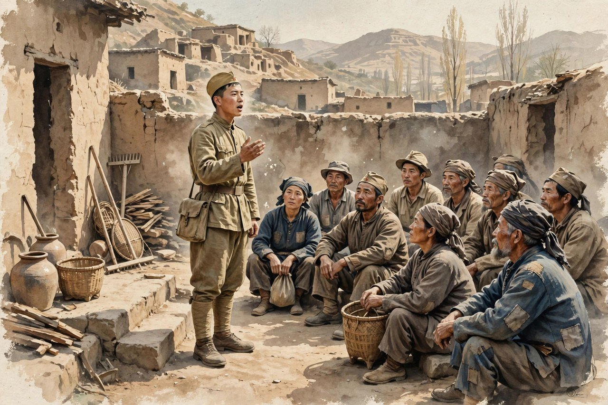
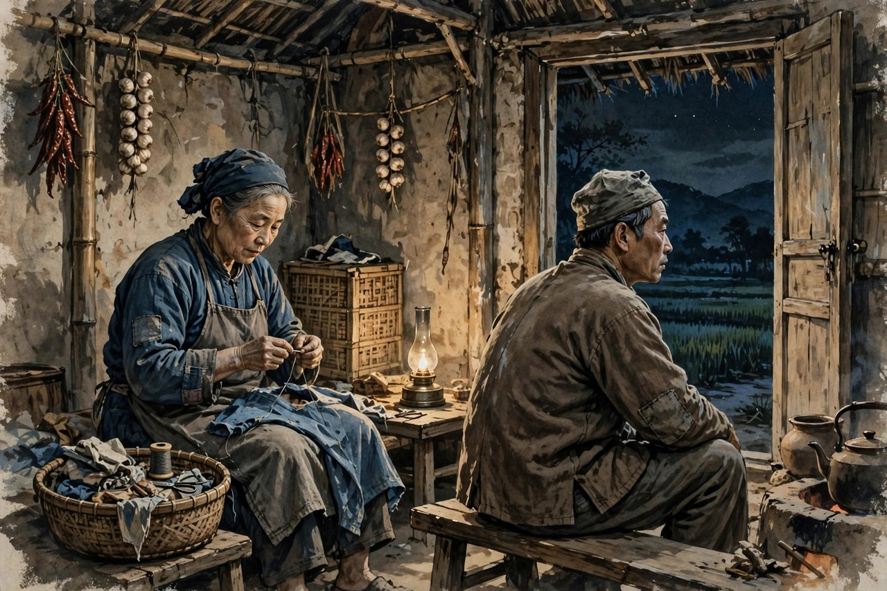

《夜》是一篇不长的短篇小说，发表于一九四一年六月十日和十一日的《解放日报》，署名晓菡。小说写的是延安解放区川口农村的一个夜晚：主人公何华明是一个农民，刚刚被选为乡里的指导员，忙着筹备乡里的选举大会，已经好几天没有回家了。这一天，他被准许回家，是因为他家里唯一的牛就在这两天要生产，而他的妻子是一个只能烧烧三顿饭的四十多岁的女人。小说就写何华明回家的这一夜，写他在家里和妻子、地主女儿清子、女干部侯桂英之间，暴露出来的新旧两种生活意识的拉扯。冯雪峰后来评价这篇小说，说它是丁玲从《梦珂》之后最成功的一篇，在不长的篇幅里，把过渡期中的一个意识世界完满地表现出来了。这个评价，说到了点子上：《夜》写的不是大事件，是一个农民心里的一夜拉扯，可这一夜拉扯里，藏着整个边区农村新旧交替的全部矛盾。

何华明这个人物，很多人读的时候会觉得他很熟悉。他是一个没有文化的农民，刚刚当上指导员，在村里说话有人听了，做事有人看了，可他心里还是农民的心：想着自家的土地，想着自家的牛，想着自家的粮食。他为公家的事忙得没有时间上山，没有时间种地，心里痛得厉害：土地在呼唤他，牛在呼唤他，泥土的气息在呼唤他，可选举工作也在等着他，乡里的大会也在等着他。他夹在中间，两边都放不下，两边都觉得对不起。这种夹在中间的状态，就是过渡期的人物的真实状态：旧的生活还没有完全过去，新的生活还没有完全到来，人站在中间，脚踩两条船，心里两边拉扯。丁玲写何华明，就是写这种拉扯，写得非常细，写得非常真，没有把何华明写成一个符号，写成一个只会喊口号的新人，而是写成一个有血有肉、有私心、有干劲、有矛盾的活人。

### 牛要生产与选举要开会

小说的线索，是一头牛。何华明家里的牛要生产了，这是家里的大事，牛是家当，是命根子，牛生产顺利不顺利，关系到全家人的生计。何华明因为牛要生产，才被准许回家过夜。这个情节，看起来小，实际上大：牛代表旧生活，代表农民和土地、和家当的感情；选举代表新生活，代表农民和公家、和政治的联系。何华明回家，是因为牛，也是因为家；他回乡里开会，是因为选举，是因为公家。牛和选举，在他心里拉扯，就是旧生活和新生活在他心里拉扯。丁玲用一头牛做线索，把这个大矛盾写成了一个具体的夜晚，写成了一个农民回家的故事，这就是她的高明之处：大道理不空喊，写成牛，写成家，写成夜，读者一看就明白，一读就心疼。

何华明回家的路上，看到西边山上，人还跟在牛的后边，在松软的田地里走来走去，也有背着犁，把牛从山坡上赶回家去的。他看到别人在田地里辛勤劳动的样子，就想到自己那几垧等着他去种的土地，想到自己已经很久没有上过山，没有种过地，心里说不出的痛楚。他在人面前说笑，谈问题，做报告，在村民选举大会的时候，还被人拉出来跳秧歌舞，唱迷胡，有被全乡的人最熟稔和欢迎的嗓子，可他心里想的还是他的耕地，还是土地的气息，还是强烈的阳光，还是伴着他的牛。这些细节，丁玲写得非常动人：何华明在台上是风光的，是受欢迎的，是指导员，可在他心里，风光比不上土地，欢迎比不上牛叫，报告比不上泥土的气息。他的心，还在土地上，还在牛身上，还在旧生活里，可他的脚，已经站到了新生活里，站到了选举大会的台上。这种心和脚不在一个地方的状态，就是过渡期人物的真实状态。

对照今天看，何华明的心和脚不在一个地方，依然是很多人的状态。今天的年轻人，在城里工作，心里想着老家的土地和父母；在村里当干部，心里想着自家的生意和家当；在公司里开会，心里想着家里的孩子和老人。工作和家庭，公家和自家，理想和生计，两边拉扯，两边都放不下，很多人就是这样过日子的。丁玲写何华明，就是写这种拉扯的普遍性：人不是机器，不能一换了位置就换了心，心里的旧东西，不会因为换了旗帜就自动消失，要慢慢挪，慢慢磨，慢慢在生活里调整。何华明的一夜，就是这种慢慢挪、慢慢磨的过程：他回家了，看到了牛，看到了妻子，看到了家里的样子，心里旧的东西被勾起来了，可他也知道，选举工作还要做，乡里的大会还要开，新生活还要往前走。他在夜里拉扯，天亮了还要回去开会，这就是过渡期的人：夜里拉扯，白天还要往前走。

### 家里的妻子与外面的女子

何华明家里，有一个比他年长许多的妻子。妻子四十多岁，只能烧烧三顿饭，不能下地，不能帮他干重活，不能和他谈工作，不能和他谈新生活。何华明对妻子，有感情，有责任，有愧疚，也有不满。他觉得妻子跟不上新时代，跟不上自己的步子，可他也知道，妻子跟了他一辈子，吃了不少苦，不能说不要就不要。这种感情和不满交织在一起，就是何华明夜里拉扯的另一条线：旧家庭和新生活的拉扯。旧家庭是妻子，是包办婚姻，是年长许多的妻子，是只能烧饭的妻子；新生活是选举，是指导员，是乡里的大会，是外面世界的女子。何华明夹在中间，既不能抛弃妻子，也不能回到旧家庭里安安稳稳地过日子，他只能在夜里想，在夜里拉扯，在夜里为难。

小说里还有两个女子，一个是地主的女儿清子，一个是女干部侯桂英。清子年轻，漂亮，有文化，和何华明的妻子完全不一样，她代表一种让何华明心动的东西：年轻，漂亮，有见识，能谈话。侯桂英是女干部，能干，泼辣，有新思想，能和何华明谈工作，谈选举，谈新生活，她代表另一种让何华明心动的东西：能干，有思想，能和自己并肩工作。何华明在夜里，面对妻子、清子、侯桂英三个女子，心里的拉扯就更复杂了：妻子是旧的，是责任，是愧疚；清子是新的诱惑，是年轻漂亮的诱惑；侯桂英是新的同伴，是工作上的同伴，是思想上的同伴。他在三个女子之间，心里翻来覆去，想了很多，可他没有做出格的事，没有抛弃妻子，没有追清子，没有和侯桂英怎么样，他只是在夜里想，在夜里拉扯，在夜里为难。丁玲写这种想而不做的拉扯，写得非常克制，非常真实：人心里想的东西，不一定都会做出来，想和做之间，还有责任，还有分寸，还有良心。何华明的心里有拉扯，可他的脚没有乱走，这就是他的分寸，也是他的可贵之处。

丁玲写何华明家里的女子，还有一个深意：她在写过渡期里被时代抛下的老妻。何华明的妻子，年老色衰，不能下地，不能谈工作，在新时代里，她的位置越来越尴尬：丈夫在外面风光，她在家里烧饭；丈夫谈选举，她听不懂；丈夫跳秧歌，她只能看着。这样的老妻，在边区农村里有很多，她们在过渡期里遭受着前所未有的冲击：从前她们是家里的顶梁柱，是烧饭、带孩子、管家的主心骨；到了新时代，她们忽然发现自己跟不上了，丈夫的眼光开始往外看了，村里的新女子开始抢眼了，她们的位置被动摇了。丁玲写何华明的妻子，就是写这群老妻的处境：她们没有错，她们只是老了，只是没有文化，只是跟不上新时代，可新时代不能把她们一脚踢开。丁玲用何华明对妻子的愧疚和责任，提醒读者：变革不能只顾着往前冲，还要顾着那些跟不上的人，还要给老妻留一个位置，留一份体面，留一份人情。这样的提醒，到今天依然重要：任何变革，都不能把跟不上的人一脚踢开，要带着他们一起走，要给他们留位置，留体面，留人情。

### 指导员的嗓子与农民的心

何华明在乡里，是一个受欢迎的人。他在人面前说笑，谈问题，做报告，在村民选举大会的时候，还被人拉出来跳秧歌舞，唱迷胡，有被全乡的人最熟稔和欢迎的嗓子。这个嗓子，是他新生活的象征：他从一个只会种地的农民，变成了一个能在大会上说话、能唱歌、能跳舞、能受欢迎的指导员。这个变化，是新生活给他的，也是他自己努力换来的。他喜欢这种受欢迎的感觉，喜欢在人面前说话的感觉，喜欢被全乡人熟稔的感觉。可他心里也清楚，这种受欢迎，是公家的事，是选举的事，不是自家的事，不是土地的事。他回到家里，看到牛，看到妻子，看到家里的土屋，心里又回到了农民的心：土地，牛，粮食，家当，这些才是他的根。他的嗓子在外面受欢迎，他的心在家里牵挂着土地，嗓子和心不在一个地方，这就是他的拉扯。丁玲写这个嗓子，写得非常妙：嗓子是新的，心是旧的，嗓子在外面唱，心在家里想，两边拉扯，一夜无眠。

对照今天看，何华明的嗓子，依然是很多人的写照。今天的村干部、社区干部、企业里的骨干，在外面说话有人听，做事有人看，风光得很，可回到家里，看到父母、孩子、家里的琐事，心里又回到了普通人的心：父母的病，孩子的学费，家里的房贷，这些才是根。外面风光，家里牵挂，两边拉扯，两边都放不下，很多人就是这样过日子的。丁玲写何华明，就是写这种外面风光、家里牵挂的普遍状态：人不是只有一个身份，指导员是身份，农民也是身份，丈夫也是身份，儿子也是身份，每个身份都有自己的责任，每个身份都有自己的拉扯。把这些身份拧在一起，就是一个活生生的人，就是何华明。丁玲没有把何华明写成只有一个身份的符号，而是写成多重身份拉扯的人，这就是她的真实，这就是她的高明。

何华明的拉扯，还体现在他对土地的感情上。他只盼望着选举工作一结束，他便好上山去，那土地，那泥土的气息，那强烈的阳光，那伴着他的牛都在呼唤着他，同他的生命都是不能分离开来的。这段心理，丁玲写得非常动人：土地不是抽象的概念，是生命的一部分，是不能分开的。何华明当了指导员，忙着选举，忙着开会，可他心里最惦记的还是土地，还是牛，还是泥土的气息。这种惦记，不是落后，不是觉悟低，是农民的本色：农民离开了土地，就像鱼离开了水，就像树离开了土，活不下去。丁玲写何华明对土地的惦记，就是写农民的本色：不管当了多大的干部，不管在外面多风光，农民的心还在土地上，还在牛身上，还在泥土里。这份本色，不能丢，丢了，农民就不是农民了，指导员也就成了空架子。丁玲用何华明的惦记，提醒读者：变革不能丢了本色，不能丢了土地，不能丢了农民的心，丢了这些，新生活就站不住。

### 一夜写尽过渡期

《夜》这个题目，本身就很有讲究。小说只写一夜，何华明回家过夜，夜里发生的事，夜里的拉扯，夜里的想，夜里的为难，都写在这一夜里。天亮了，何华明还要回去开会，还要继续选举工作，还要继续新生活。夜过去了，拉扯没有过去，拉扯还要继续，还要在白天的工作里继续，还要在以后的日子里继续。丁玲用一夜做题目，就是告诉读者：过渡期不是一天两天的事，是一个漫长的夜，是一个要慢慢熬过去的夜。何华明的一夜，就是边区农村过渡期的一夜，就是中国农村新旧交替的一夜，就是每一个人在变局里的一夜。夜里拉扯，白天往前走，夜里为难，白天还要做事，这就是过渡期的人的活法。丁玲把这个活法写成了一夜，写得非常集中，非常有力，读者读完一夜，就明白了过渡期是怎么回事，就明白了新旧交替是怎么回事。

小说的结构，也是两章构成，写何华明回家过夜的前后，写他路上的想和家里的想，写他外面的风光和家里的牵挂，写他新生活的嗓子和旧生活的心。这种结构，不复杂，却很扎实：路上想的是土地，家里想的是妻子和女子，外面是选举，里面是家庭，两边对照，两边拉扯，读者一看就明白何华明心里在想什么。丁玲写结构，不玩花哨，不玩技巧，就是把何华明的一夜摊开来写，写路上，写家里，写夜里，写天亮，写得清清楚楚，写得有条有理。这样的结构，今天的写作者同样可以学：写人物，不要先想技巧，先把人物的一夜摊开来写，写他路上的想，写他家里的想，写他外面的风光，写他心里的牵挂，人物自然就立住了，主题自然就出来了。技巧是为人物服务的，不是为炫技服务的，丁玲的《夜》就是这个道理的范本。

《夜》发表之后，得到了骆宾基、冯雪峰等人的好评。骆宾基说，何华明代表那些背负着旧时代所给予的枷锁，而开垦新时代的农民，这些人跨着两个时代，两种农村社会生活，不迁就那些旧的过时的农村人民的观念。这个评价，说到了何华明的本质：他背着旧时代的枷锁，开垦着新时代的土地，脚踩两边，心里两边拉扯，可他没有迁就旧的，没有退回旧的，他在拉扯里往前走，在为难里往前走，在夜里想清楚了，天亮了还要往前走。这样的农民，才是新时代的农民，才是过渡期的农民，才是丁玲心里真正的农民。读者读《夜》，要读出何华明这种背着枷锁往前走的劲儿，读出他在拉扯里不退回去的劲儿，读出他在夜里想、天亮了还要做的劲儿。这股劲儿，就是《夜》留给后来人的东西，就是丁玲留给今天读者的东西。

### 今天读夜的三点意思

今天读《夜》，可以读出三点意思。表层的意思，是一个农民回家过夜的故事，是牛要生产、选举要开会、妻子和女子之间的拉扯。里层的意思，是新旧交替的故事，是旧家庭和新工作、旧生活和新生活、旧心和新嗓子之间的拉扯。深层的意思，是变革不能丢了人的意思，是变革要顾着跟不上的人，要给老妻留位置，要给农民留土地，要给人心留时间，不能一夜之间就把旧的东西全砸了，也不能一夜之间就把新东西全立起来。变革要慢慢来，要在夜里想清楚，要在白天做出来，要在拉扯里往前走。丁玲把这三层意思都写到了，没有只写表层，没有只写口号，她把表层写得生活化，把里层写得心理化，把深层写得人情化，读者读完，既能看故事，又能看门道，既能记住何华明，又能明白变革为什么难，为什么要慢慢来。

对照今天看，《夜》的深层意思依然成立。今天的变革，同样不能丢了人：城市化不能丢了农村老人，数字化不能丢了不会用手机的老人，改革不能丢了跟不上的人，发展不能丢了土地和人心。何华明的妻子，就是那些跟不上的人的代表：她老了，没有文化，跟不上新时代，可她没有错，她只是需要时间，需要体面，需要人情。丁玲写何华明对妻子的愧疚和责任，就是在提醒今天的变革者：往前冲的时候，回头看看那些跟不上的人，拉他们一把，给他们留个位置，留份体面，留点人情。变革走得快是好事，可走得快不能把人甩下，甩下的人多了，变革就站不住，人心就散了。丁玲的《夜》，就是给变革者提的一个醒：夜里想一想，白天做的时候慢一点，稳一点，顾着人一点。

读完《夜》，读者还会得到一种安慰：拉扯不是你的错，是过渡期的常态。何华明拉扯，你也拉扯；何华明夜里为难，你也夜里为难；何华明心和脚不在一个地方，你也心和脚不在一个地方。拉扯不是落后，不是觉悟低，是人在变局里的正常状态。丁玲没有因为何华明拉扯就批评他，没有因为他想土地、想妻子、想清子就说他觉悟低，她把拉扯写出来，让读者看到，拉扯是真实的，是普遍的，是可以理解的。理解了拉扯，人就不会那么焦虑，不会因为自己拉扯就骂自己，不会因为自己为难就觉得自己不行。何华明拉扯着还要往前走，你拉扯着也可以往前走，夜里想清楚了，天亮了还要做事，这就是过渡期的人的活法，这就是今天的人的活法。丁玲的《夜》，就是给拉扯中的人的一盏灯：夜里有灯，天亮了路还在，往前走就是了。

### 川口村里的选举与生活

川口这个村子，是丁玲亲自去过的农村。她到川口体验生活，看到农民怎么开会，怎么选举，怎么种地，怎么过日子，才写出了《夜》。川口不是凭空编出来的村子，是丁玲脚底下走过的村子，是她眼睛里看到的村子，是她耳朵里听到的村子。她写川口的选举，写得非常具体：乡里要开选举大会，要选指导员，要筹备，要开会，要跳秧歌，要唱迷胡，这些细节，都是她在川口看到的。选举不是抽象的概念，是村里的大事，是农民头回觉得自己能说了算的时刻，是农民从被管的人变成管事的人的时刻。丁玲写选举，没有把选举写成程序，没有把选举写成口号，而是写成村里的生活：开会要准备，跳秧歌要排练，唱迷胡要嗓子，选指导员要人心。这些生活细节堆起来，选举就活了，就成了村里人自己的事，就成了何华明心里的拉扯：选举是公家的事，也是自家的事，是新生活的事，也是旧生活里的事。

川口的生活，还有一个特点：新旧交替不是在大会上完成的，是在家里、在炕头、在牛棚里完成的。何华明在大会上风光，回到家里还是农民，还是丈夫，还是要管牛、管妻子、管家里的事。大会上的新生活，回到家里就遇到了旧生活：妻子老了，牛要生产了，家里的土屋还是旧的，家里的规矩还是旧的。新生活和旧生活，不是在大会上分出胜负的，是在家里一夜一夜磨出来的。何华明的一夜，就是这种磨的一个缩影：夜里想清楚了，天亮了还要去磨，磨一天，磨一夜，磨一个月，磨一年，慢慢地，旧的东西少了，新的东西多了，农民的心也就慢慢挪过来了。丁玲写川口，就是写这种慢慢磨的过程，写得非常有耐心，没有急着让何华明一下子就变成新人，而是让他在一夜里拉扯，在拉扯里往前走，在往前走里慢慢变。这样的写法，比让人物一下子觉悟要真实得多，也要动人得多。

对照今天的农村，川口的选举和生活依然有现实意义。今天的村里选干部，同样是村里的大事，同样要开会，同样要准备，同样要人心，同样要面对新旧交替：老干部要退，新干部要上，老规矩要改，新办法要立，村里人心里同样拉扯，同样为难。丁玲写川口的选举，就是写这种拉扯的普遍性：选举不是换个人就完了，是换一种活法，是换一种村里的规矩，是换一种人心的秤。换活法要时间，换规矩要磨合，换秤要耐心，不能一夜之间就换完。何华明的一夜，就是换活法的一夜，就是换规矩的一夜，就是换秤的一夜。夜过去了，活法还要继续换，规矩还要继续磨，秤还要继续校，这就是农村变革的常态，就是今天农村工作的常态。读《夜》，就是读这种常态，就是学这种耐心，就是明白变革为什么要慢慢来。

### 何华明与丁玲的距离

何华明是农民，丁玲是作家，两个人身份不同，生活不同，可丁玲写何华明，写得非常贴近，没有居高临下的味道，没有知识分子看农民的优越感。她写何华明对土地的惦记，写何华明对妻子的愧疚，写何华明对清子和侯桂英的心动，写得都非常体贴，非常理解，好像她自己就是何华明，好像她自己也在夜里拉扯过。这种贴近，不是丁玲凭空想象出来的，是她到川口体验生活换来的：她在川口住过，和农民一起吃饭，一起开会，一起看牛，一起听村里人说话，她才知道农民心里在想什么，才知道何华明的一夜是怎么过的。今天的写作者写农民，常常写得隔着一层，写得像看风景，写得像做调查，就是因为没有到村里去住，没有和农民一起生活，没有把自己的心贴到农民的心上。丁玲的《夜》，就是贴着心写的范本：作家要写农民，就要到农民中间去住，去生活，去听，去看，去记，把心贴过去，笔才能贴过去，人物才能活。

何华明与丁玲的距离，还有一层意思：丁玲是女子，何华明是男子，她写男子的心理，写得同样细腻，同样真实。她写何华明对妻子的感情，写何华明对清子的心动，写何华明对侯桂英的欣赏，写得没有男子的粗糙，没有女子的偏见，就是写一个人的心。这样的写法，打破了很多人对女作家的偏见：女作家不是只能写女子，女作家写男子同样可以写得好，写得真，写得有分寸。丁玲写何华明，就是证明：作家的笔，不分男女，只分贴不贴心，贴心了，写谁都真，不贴心，写谁都假。她用《夜》证明了这一点，也给后来的女作家开了一条路：女子可以写男子，可以写农民，可以写土改，可以写战争，可以写任何题材，只要心贴过去了，笔就能过去，人物就能活。

读《夜》，还要读丁玲的克制。她写何华明的心动，写得非常克制，没有把心动写成出轨，没有把拉扯写成背叛，没有把夜写成丑闻。她让何华明想，让他拉扯，让他为难，让他天亮了还要回去开会，这种克制，比写出轨更有力量：人心里想的东西，不一定都会做出来，想和做之间，还有责任，还有分寸，还有良心。丁玲相信，人心里的拉扯，本身就是故事，本身就是主题，不需要用出轨来加料，不需要用丑闻来吸引眼球。她把拉扯写清楚了，小说就有了分量，就有了深度，就经得起时间。今天的很多作品，写拉扯非要写出轨，写矛盾非要写丑闻，结果反而削弱了力量，失去了分寸。丁玲的克制，值得学：把人心里的拉扯写清楚，把责任和分寸写清楚，把夜里的想和天亮的做写清楚，故事自然就有了力量，自然就经得起重读。

### 夜过去了，拉扯还在继续

《夜》写完一夜，何华明的故事并没有完。天亮了，他要回去开会，要继续选举工作，要继续当指导员，要继续在公家和自家之间拉扯，要继续在妻子和外面的女子之间为难，要继续在土地和选举之间想。夜过去了，拉扯还在，拉扯要伴随他很长一段时间，要伴随整个过渡期，要伴随边区农村的新旧交替。丁玲把小说停在一夜，就是把拉扯留下来，让读者知道，拉扯不是一夜就能解决的，是要慢慢磨的，是要在白天的工作里、在家里的生活里、在以后的日子里，一点一点磨过去的。这样的结尾，比给何华明一个圆满结局更有力量：圆满结局是假的，拉扯继续才是真的，生活就是这样，夜过去了，问题还在，人还要往前走。

今天的读者，同样在夜里拉扯，白天往前走。白天在公司里开会，夜里想家里的事；白天在村里当干部，夜里想自家的地；白天在外面风光，夜里想父母的病，孩子的学费，家里的房贷。拉扯是常态，夜里想清楚了，天亮了还要做事，这就是生活。丁玲的《夜》，就是给拉扯中的人的一盏灯：夜里有灯，灯下可以想，想清楚了，天亮了路还在，往前走就是了。不要因为拉扯就骂自己，不要因为为难就觉得自己不行，何华明拉扯着还能当好指导员，你拉扯着也能把日子过好。拉扯不是失败，是人在变局里的正常状态，是心还在、责任还在、良心还在的证明。把拉扯看清楚了，人就踏实了，就不会被拉扯吓倒，就能在拉扯里往前走了。

何华明的一夜，到今天还在继续。每一个在变局里的人，都在过这样的一夜：夜里想，白天做，夜里为难，白天还要往前走。丁玲把这一夜写下来，就是把所有人的夜写下来，让后来的人在夜里读到这篇小说的时候，觉得自己不是一个人在拉扯，原来一九四一年的农民也在拉扯，原来拉扯是所有人的常态，原来夜过去了，路还在，往前走就是了。这就是《夜》活到今天的原因：它写了一夜，也写了所有人的夜，写了一个农民，也写了所有在变局里的人。夜会过去，拉扯会继续，可只要人还在往前走，只要心还在土地上，还在家里，还在公道上，夜就不可怕，路就还在前面。

夜里的灯还亮着，何华明的脚步声已经走向了乡里的会场。灯照着夜，脚步走向天亮，拉扯还在，路也在前面。

读完《夜》，再想何华明，会觉得他不是一个符号，而是一个在夜里想过、在天亮后做过、在土地和选举之间拉扯过、最后还是往前走了的活人。这样的活人，放在任何时代都不会过时，因为每个时代都有人在夜里拉扯，都有人在天亮后往前走。丁玲把何华明的一夜留下来，就是把所有人的夜留下来，让后来的人在自己的夜里，能找到一盏灯，能找到一个同伴，能找到往前走的勇气。夜会过去，天会亮，拉扯会继续，可只要灯还在，路就在，往前走就是了。

这盏灯，丁玲在一九四一年点亮，到今天还没有灭。

夜过去了，天亮了，何华明还在往前走，后来的人也在往前走。

这就是《夜》留给后来人的话。
