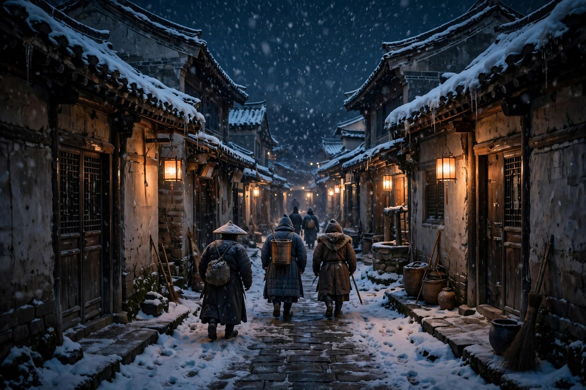
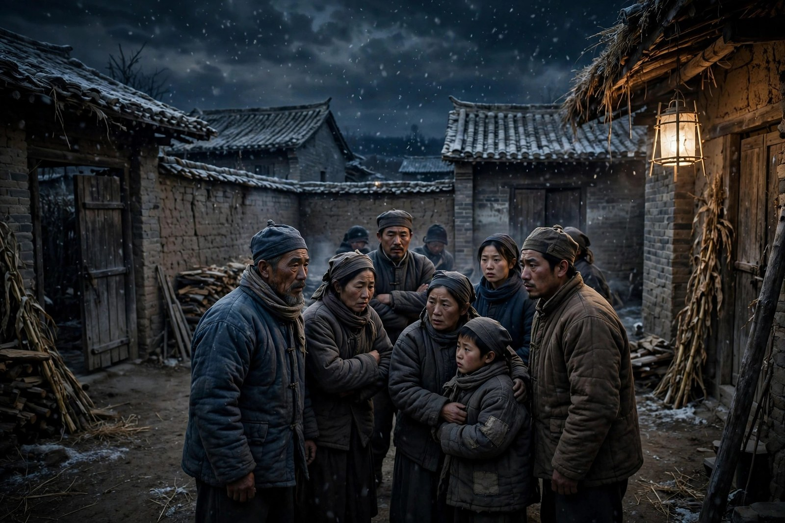

## 冬天到了，日子到了头

残冬是农村三部曲的收尾一篇，最初发表于一九三三年二月的东方杂志，后来和春蚕、秋收合为农村三部曲出版。故事接着秋收往下写：老通宝死了，家里失去了顶梁柱，日子过到了头，春蚕的美梦破灭了，秋收的幻想也破灭了，农民们体会到一个道理：在那个社会里，规规矩矩做人就活不了命。这句话，听起来很刺耳，可它是残冬里的人物用血汗换来的认识：老通宝规规矩矩了一辈子，养蚕、种稻、拼命干活，结果还是亏、还是病、还是死。规规矩矩没有救了他，反而让他走到了绝路。年轻一代看到这一点，心里就种下了一颗种子：老路走不通了，该换路了。

小说的主角，换成了老通宝的小儿子多多头。多多头和他父亲不一样：父亲相信苦干，儿子却早知道父辈们想靠苦干来改善处境只不过是幻想。他看得多、想得多，对市场的规则、对中间商的盘剥、对高利贷的利息，都有自己的判断。他不像父亲那样把希望押在一次收成上，而是把目光投向了更远的地方：既然老老实实活不下去，那就得找一条新的路，一条能改变规则、能打破盘剥的路。这条路，在小说里就是武装斗争的路：多多头和六宝的哥哥陆福庆等人，在一个夜晚，走上了这条路。

茅盾写残冬的冬天，写得非常有味道。冬天是残冬，是最冷的时候，是日子最难过的时候，也是人心最冷的时候。田里没有活了，蚕房里没有蚕了，米缸里没有米了，债主却还在上门，官府却还在催税，日子冷到了头，人心也冷到了头。可冷到头了，反而会激起一种反抗的劲：冷到没有退路了，人就不再怕冷了；日子过到头了，人就不再怕日子更坏了。这种冷到头反而敢站起来的劲，就是残冬的核心：绝望到了头，就变成了觉醒；日子到了头，就变成了行动。茅盾用残冬这个题目，既写出了季节，也写出了人心：季节到了残冬，人心也到了残冬，残冬之后，就是春天，就是新的开始。

多多头这个人物，值得细看。他不是天生的革命者，也不是天生的英雄，他就是一个普通的农村年轻人，看着父亲一辈子苦干却没有好下场，心里慢慢明白了一个道理：苦干救不了自己，规矩救不了自己，只有改变规则、打破盘剥，才能活下去。这个道理，不是书本上教给他的，而是生活教给他的：父亲的死，就是最生动的教材；春蚕和秋收的两次破灭，就是最深刻的教训。多多头从父亲的死里学到的，不是悲伤，而是清醒：悲伤没有用，清醒才有用；哭没有用，站起来才有用。这种从悲伤到清醒、从清醒到行动的转变，就是残冬里最动人的弧线。

## 荷花的盼望与多多头的选择

残冬里还有一个人物，叫荷花。她是受歧视的妇女，代表的是农村里另一种盼望：她期望真命天子出世，穷人就可以翻身。这种盼望，听起来很天真，也很无奈：自己没有办法改变命运，就只能把希望寄托在别人身上，寄托在一个传说中的救世主身上。荷花的盼望，和多多头的选择放在一起，就是两种不同的出路：一种是等别人来救，一种是自己站起来救自己。茅盾写这两种出路，没有嘲笑荷花，也没有神化多多头，就是如实地写：等别人来救的人，等来的往往是失望；自己站起来的人，虽然风险很大，可至少把命运掌握在了自己手里。

荷花的盼望，在今天看来一点都不陌生。很多人遇到困难的时候，也会把希望寄托在别人身上：寄托在领导身上，寄托在贵人身上，寄托在运气身上，寄托在下一个风口身上。寄托本身不是错，错的是只寄托、不行动，把全部希望都押在别人身上，自己却什么都不做。荷花的故事告诉我们：等来的救世主，很可能永远不会来；等来的翻身，很可能永远不会到。与其等，不如自己动一动，动一动，不一定能立刻改变什么，可不动，就一定什么都改变不了。多多头的选择，就是动一动的极端版本：他动了，动得很大，动得有风险，可他动了，就比荷花的等要更有力量。

多多头和陆福庆等人的行动，在小说里写得比较含蓄：他们在一个夜晚，摸进反动武装保卫团三甲联合队的驻地，缴了他们的枪，走上了武装斗争的道路。这个行动，写得不长，可分量很重：它标志着农民从忍耐到反抗、从绝望到行动的转变。茅盾没有把这个行动写成轰轰烈烈的起义，而是写成一次小规模的、自发的行动：几个人、一个夜晚、几支枪，行动不大，可意义很大：它说明农民已经不再相信老路了，已经开始找新路了。新路是什么样子的，小说没有展开写，只是让读者猜到主人公们未来的命运和要走的道路。这种留白，写得很有味道：它没有假装问题解决了，也没有假装新路已经走通了，就是让读者看到：路开始了，走下去会怎么样，还要看后来的人怎么走。

残冬的结尾，茅盾没有用很多农民都参加暴动这样一些画面作为故事的终结，而是让读者自己去猜主人公们的未来。这种不写终结的写法，是茅盾的高明之处：他不给读者一个现成的结局，他给读者的是一个开始：开始反抗了，开始找路了，开始不再认命了。开始本身，就是希望；开始本身，就是力量。读残冬的时候，不要只盯着行动本身看，还要看看行动背后的转变：从忍耐到反抗，从绝望到觉醒，从认命到不认命，这种转变，比行动本身更重要。行动可能失败，转变却不会白费：转变了的人，再也回不到原来的认命状态了。

## 从春蚕到残冬的一条线

把农村三部曲合起来看，会看到一条很清晰的线：春蚕写的是希望，秋收写的是希望的破灭，残冬写的是破灭之后的觉醒。这条线，从希望到破灭，从破灭到觉醒，合起来就是农民从忍耐到反抗的心路历程。春蚕里，老通宝还有希望，相信丰收能翻身；秋收里，老通宝的希望破灭了两次，人也跟着去了；残冬里，多多头不再抱着老希望了，而是开始找新路。这条线，不是茅盾凭空编的，而是农村生活的真实逻辑：希望破灭一次，还可以再抱希望；希望破灭两次，人就开始怀疑；怀疑久了，人就开始觉醒；觉醒了，人就开始行动。这条逻辑线，是农村三部曲最核心的结构。

这条线，还可以从另一个角度理解：它是代际之间的交接线。老一代的希望，在春蚕和秋收里破灭了；年轻一代的觉醒，在残冬里开始了。老一代的死，换来了年轻一代的生；老一代的路走不通了，年轻一代就开始找新路。这种代际交接，写得很沉重，也很有力量：沉重的是老一代的牺牲，力量的是年轻一代的站起来。茅盾写这种交接，不是为了让读者悲伤，而是为了让读者看到：社会的进步，往往就是这样来的：老一代用失败给年轻一代上课，年轻一代用行动给老一代的失败一个交代。这种交接，在今天同样存在：老一辈的经验和教训，是年轻一辈的财富；年轻一辈的怀疑和行动，是社会变化的动力。两代人互相理解、互相接力，社会才能往前走。

农村三部曲的这条线，还有一个层面：它是从经济到政治的线。春蚕和秋收，写的主要是经济问题：价格、利息、中间商、市场波动；残冬写的主要是政治问题：武装斗争、反抗、规则的改变。经济问题积累久了，就会变成政治问题：农民在经济上活不下去了，就会在政治上找路；经济上的盘剥不解决，政治上的反抗就会出现。茅盾写这条从经济到政治的线，写得非常自然：他没有直接讲道理，而是通过老通宝的死、多多头的行动，让读者自己看到：经济问题不解决，政治问题就会来；政治问题来了，经济问题才有可能被根本解决。这种从经济到政治的视野，是茅盾社会分析小说的又一个特点：他不只看经济，也不只看政治，而是看经济和政治是怎么互相影响的。

对照今天，这条线同样有启发。今天很多社会问题，也是从经济开始的：房价、工资、就业、物价，这些经济问题积累久了，就会变成社会情绪、社会行动、社会变化。茅盾写农村三部曲的时候，就已经看明白了这个道理：经济问题是根子，政治行动是结果，根子不解决，结果就会一再出现。看今天的问题，也应该用这种眼光：不要只看表面的行动，还要看行动背后的经济根子；不要只看情绪，还要看情绪背后的利益和规则。根子看清楚了，行动的意义也就看清楚了；根子看不清，行动就很容易走偏。

## 残冬里的冬天意象

残冬这个题目，本身就很有意象：残冬是冬天快要过去、春天还没有来的时候，是最冷、最难熬的时候，也是离春天最近的时候。茅盾用残冬这个题目，既写出了季节，也写出了时代：时代到了残冬，日子最难熬，可春天也就不远了。这种残冬之后就是春天的意象，给残冬这部小说留了一份希望：冬天再冷，也会过去；日子再难，也会过去；觉醒了的人，再也不会回到原来的认命状态了。这种希望，不是廉价的乐观，而是从绝望里长出来的希望：绝望到了头，希望就开始了；日子到了头，新路就开始了。

残冬里的冬天描写，写得非常细致。茅盾写寒风、写积雪、写空荡荡的田野、写冷清清的村庄、写家里没有米的米缸、写债主上门的声音。这些冬天的细节，合起来就是一种氛围：冷、空、难、紧。氛围感受到了，人物的心情就好理解了：多多头为什么会站起来，因为冬天太冷了，冷到没有退路了；荷花为什么会盼望真命天子，因为冬天太难了，难到只能盼望别人来救了。冬天这个意象，在小说里不只是背景，而是推动人物行动的力量：冬天越冷，人物行动的动力就越强；冬天越难，人物的觉醒就越深。茅盾写冬天，不是为了写风景，而是为了写出人物行动的必然性：冷到头了，不站起来，就真的活不下去了。

对照今天，残冬这个意象同样有力量。很多人都有过自己的残冬时刻：事业到了低谷、生活到了困境、希望到了破灭、日子到了头。残冬时刻最难熬，可残冬时刻也最容易让人清醒：顺境里看不清的东西，逆境里反而看清楚了；平时不敢想的路，到了绝路反而敢想了。茅盾写残冬，就是要告诉读者：残冬不可怕，可怕的是在残冬里还抱着老希望不放，还认命、还忍耐、还等别人来救。残冬里最该做的，是像多多头那样，站起来，找新路，哪怕新路很险、很窄、很不确定，站起来本身，就是一种力量。站起来了，冬天就不再只是冬天，而是春天的开始。

残冬里的夜晚，同样写得很有味道。多多头等人的行动，发生在一个夜晚：夜很黑，村庄很静，三甲联合队的驻地灯火昏暗，行动的人摸黑进去，缴了枪，又摸黑出来。夜晚这个意象，在小说里象征着秘密、风险、决心：白天不敢做的事，夜晚敢做了；白天不敢想的路，夜晚敢走了。夜晚的行动，写得不长，可分量很重：它标志着农民从白天的忍耐，变成了夜晚的行动；从公开的认命，变成了秘密的反抗。这种从白天到夜晚的转变，是残冬里最动人的转变：白天还是农民，夜晚就成了战士；白天还是忍耐，夜晚就成了行动。茅盾写夜晚，不是为了写刺激，而是为了写出转变的决心：决心下了，夜晚就不再是黑暗，而是行动的掩护。

## 残冬里的妇女与村庄

残冬里的妇女，同样值得细看。荷花是其中一个代表，她受歧视、被看不起，可她心里还有盼望：盼望真命天子出世，穷人就可以翻身。这种盼望，听起来很天真，可它背后是一种无奈：自己没有办法改变命运，只能把希望寄托在别人身上。茅盾写荷花，没有嘲笑她的天真，而是写出了她的无奈：无奈的人，才会把希望寄托在传说上；有办法的人，是不会等救世主的。荷花的盼望，和多多头的行动放在一起，就是两种出路的对照：等和动，等是被动的，动是主动的；等是把命运交给别人，动是把命运掌握在自己手里。茅盾没有说等就一定错，动就一定对，他只是把两种出路都摆出来，让读者自己掂量：等下去，会等来什么；动起来，又会付出什么代价。

残冬里的村庄，同样写得很细。村庄在冬天里，显得格外冷清：田里没有人了，街上没有人了，铺子里没有生意了，债主却还在，官府却还在，保卫团却还在。这种冷清和压迫并存的氛围，就是残冬里村庄的真实样子：冷清的是生活，压迫的是权力；生活冷下去了，压迫却没有冷下去，反而更紧了。茅盾写村庄的冷清，不是为了写风景，而是为了写出农民的处境：生活已经冷到头了，压迫却还在加码，冷和压合起来，就是农民站起来的动力。村庄越是冷清，农民的觉醒就越是深刻；压迫越是紧，农民的反抗就越是坚决。这种冷清和压迫的对照，是残冬里村庄描写的核心。

残冬里的保卫团三甲联合队，同样值得说一说。它是反动武装保卫团，是镇压农民的力量，也是农民行动的对象。多多头等人摸进它的驻地，缴了它的枪，这个行动的象征意义很大：它说明农民已经不再怕保卫团了，已经敢对保卫团动手了。怕和不怕，是农民觉醒的一个标志：以前怕，是因为觉得保卫团不可战胜；现在不怕了，是因为觉得保卫团也是人，也有弱点，也可以被缴枪。这种从怕到不怕的转变，是残冬里最关键的心理转变：心理转变了，行动才会跟着变；心理还怕，行动就不可能发生。茅盾写这个转变，写得很含蓄，可读者能感觉到：多多头等人行动之前，心里一定经过了一番挣扎，挣扎过了，才敢动手。动手本身，就是挣扎的结果，也是觉醒的证明。

残冬里的村庄和妇女合起来，就是一幅农村社会的冬景图：村庄冷清，妇女盼望，青年行动，老人已去，冬天到了头，春天还没有来。这幅冬景图，读起来让人心凉，可凉里又有一点暖：暖在多多头的行动里，暖在年轻人的觉醒里，暖在不再认命的劲里。茅盾写冬景，不是为了让读者绝望，而是为了让读者看到：冬天再冷，也会过去；觉醒了的人，再也不会回到原来的样子了。这种凉里带暖的写法，是残冬这部小说最动人的地方：它不粉饰冬天，也不放弃春天，它相信冬天之后，就是春天。

## 合上残冬想一想

合上残冬，你可以问自己几个问题：你有没有过像老通宝那样，靠苦干却走不通的时候，走不通之后，你是继续苦干，还是开始找新路；你有没有过像荷花那样，把希望寄托在别人身上的时候，寄托之后，你等来了什么，还是什么都没有等来；你有没有过像多多头那样，冷到头了才站起来的时候，站起来之后，你找到了路，还是还在找路。这几个问题，没有标准答案，可问一问自己，就能让残冬这部小说从纸上走到心里。茅盾写残冬，不是为了让读者记住一个故事，而是为了让读者在自己的生活里，认出残冬的时刻，并且在认出之后，还能保持一点站起来的勇气。

再看多多头一眼，你会发现他身上有一种让人敬佩的东西：他没有被父亲的死打倒，没有被春蚕和秋收的两次破灭打倒，没有被冬天的冷打倒，反而在冷到头的时候站了起来。站起来不是一件容易的事，需要勇气，需要决心，需要同伴，需要对老路的彻底失望。多多头站起来了，他的同伴也站起来了，他们的站起来，就是农村三部曲的收尾，也是茅盾留给读者的希望：老路走不通了，新路虽然险，可站起来本身，就是希望；站起来了，路就开始了；路开始了，春天也就不远了。这份希望，是残冬留给今天的人最实在的东西：冬天再冷，也要站起来；站起来了，冬天就不再只是冬天。

## 残冬与春蚕秋收的对照

把残冬和春蚕、秋收对照着读，会发现三部作品的笔法是不一样的：春蚕的笔法是细腻的，写蚕房、写账本、写希望；秋收的笔法是沉重的，写稻田、写米价、写希望的破灭；残冬的笔法是冷峻的，写冬天、写夜晚、写觉醒和行动。三种笔法合起来，就是茅盾写作风格的一个缩影：他能细腻，也能沉重，也能冷峻，笔法跟着题材走，跟着人物的心境走。春蚕里的人物还有希望，笔法就细腻；秋收里的人物希望破灭了，笔法就沉重；残冬里的人物觉醒了，笔法就冷峻。这种笔法跟着心境走的写法，是茅盾的高明之处：他不固定用一种笔法写所有题材，而是让笔法服务于题材，服务于人物。

三部作品的人物，也是不一样的：春蚕的主角是老通宝，秋收的主角还是老通宝，残冬的主角换成了多多头。这种主角的更换，本身就是一种叙事：老一代的故事讲完了，年轻一代的故事开始了；老一代的希望破灭了，年轻一代的觉醒开始了。茅盾用主角的更换，来写代际的交接，来写社会的变迁。这种更换，写得很自然，没有生硬的转折，就是老通宝死了，多多头站出来了，故事自然而然地交到了年轻人手里。这种自然的交接，比刻意的交接更有力量：它说明社会的变迁，不是某一个人安排的，而是生活本身推动的；老一代走了，年轻一代自然会站出来，站出来之后，故事就会继续下去。

三部作品的结局，也是不一样的：春蚕的结局是老通宝病了，秋收的结局是老通宝死了，残冬的结局是多多头行动了。病、死、行动，三个结局合起来，就是一条从希望到绝望、从绝望到行动的线。这条线，读起来让人心沉，可沉里又有一点亮：亮在行动里，亮在觉醒里，亮在不再认命的劲里。茅盾写这条线，不是为了让读者绝望，而是为了让读者看到：绝望不是终点，行动才是；死不是终点，生才是。老通宝死了，可多多头活着；老路走不通了，新路开始了。这种死和生、老路和新路的对照，是农村三部曲最核心的对照，也是茅盾留给读者的最大希望。

对照今天，农村三部曲的这条线同样有启发。今天很多行业、很多地方、很多家庭，同样处在从希望到破灭、从破灭到觉醒的阶段：曾经相信的路走不通了，曾经抱着的希望破灭了，接下来该怎么办？是继续抱着老希望不放，还是开始找新路？茅盾的回答是：找新路。新路可能很险、很窄、很不确定，可不找新路，就只能在老路上走到头，走到头像老通宝那样。找新路需要勇气，需要同伴，需要对老路的彻底失望，更需要对新路的探索和尝试。探索和尝试，可能会失败，可不探索、不尝试，就一定没有出路。残冬的故事，就是探索和尝试的开始：开始了，就有希望；开始了，春天也就不远了。

## 残冬留给今天的话

残冬留给今天的话，其实很简单：冷到头了，不要怕冷；日子到了头，不要认命；老路走不通了，就找新路。新路可能不好走，可能有风险，可能要付出代价，可不找新路，就只能在老路上走到头。找新路的时候，要找同伴，要找方向，要找对规则的清醒认识：规则不公平，就要想办法改变规则；渠道被别人掌握，就要想办法掌握自己的渠道；信息不对称，就要想办法拿到信息。这些办法，茅盾没有在残冬里直接给出，他把办法留给了后来的人。后来的人能不能找到办法，决定了残冬的故事会不会在今天重演，也决定了今天的人能不能走出自己的残冬。

残冬还留给今天的人一个关于等待和行动的提醒：荷花的等，是被动的等；多多头的动，是主动的动。等下去，可能会等来救世主，可救世主很可能永远不会来；动起来，可能会失败，可动起来本身，就是一种力量。生活里的大多数问题，都是等不来的，只能靠动来解决：工作等不来，只能靠找；机会等不来，只能靠争；改变等不来，只能靠做。等和动，看起来只差一个字，实际上差的是整个人生态度：等是把命运交给别人，动是把命运掌握在自己手里。茅盾写残冬，就是要让读者在等和动之间，做出自己的选择：选择动，虽然难，可至少还有希望；选择等，虽然容易，可希望却越来越渺茫。

最后，残冬还告诉我们一个关于冬天的道理：冬天不是终点，而是转折点。冬天到了头，春天就不远了；日子到了头，新路就不远了；希望破灭了，觉醒就不远了。这种冬天之后就是春天的信念，不是廉价的乐观，而是从绝望里长出来的信念：绝望过了，人才会清醒；清醒了，人才会行动；行动了，春天才会来。茅盾写残冬，不是为了让读者在冬天里取暖，而是为了让读者在冬天里看到春天：春天不在远方，就在站起来的脚步里；春天不在别人手里，就在自己找路的手里。站起来，找路，春天就来了。

## 残冬里的同伴与信任

多多头的行动，不是他一个人完成的，而是和陆福庆等人一起完成的。同伴的重要性，在残冬里写得很含蓄，可读者能感觉到：一个人行动，很容易害怕、很容易退缩、很容易失败；一群人行动，互相壮胆、互相掩护、互相分担，行动就有了底气。茅盾写同伴，不把同伴写成完美的战友，而是写成各有心思、却又愿意一起行动的普通人：他们有分歧，有害怕，可到了行动的时候，还是愿意一起上。这种愿意一起上的劲，就是同伴的力量：力量不在某一个人身上，而在一群人愿意一起上的决心上。

信任在残冬的行动里，同样很重要。行动是秘密的，需要信任：信任同伴不会出卖自己，信任同伴会在关键时刻顶住，信任同伴和自己是一条心。信任不是天生的，而是通过共同的生活、共同的苦难、共同的希望积累起来的。多多头和陆福庆等人的信任，就是在农村的共同生活里积累起来的：一起种过田，一起借过债，一起被压迫过，一起失望过，共同的经历，让他们成了可以信任的人。茅盾写信任，不直接写信任两个字，而是通过行动来写信任：敢一起行动，就是信任的证明；敢把后背交给同伴，就是信任的最高形式。这种用行动写信任的手法，比直接说信任要更有力量。

对照今天，同伴和信任同样重要。很多人想改变点什么，可一个人单打独斗，很容易累、很容易怕、很容易放弃；找到同伴，互相支持、互相分担，路就好走一些。同伴不是越多越好，而是越可靠越好：可靠的同伴，是在关键时刻不会掉链子的人，是在困难面前不会先跑的人，是和你有共同经历、共同目标的人。茅盾写残冬的同伴，就是要提醒人们：找路的时候，不要一个人闷着头找，要找同伴一起找；行动的时候，不要一个人硬扛，要找同伴一起扛。同伴在，希望就在；信任在，行动就有了底气。

## 残冬的最后一点光

残冬的最后一点光，藏在多多头行动的夜晚里：夜很黑，可行动的人心里是亮的；村庄很冷，可行动的人心里是热的；冬天很长，可行动的人心里已经看到了春天。这种黑里带亮、冷里带热、冬里带春的对照，就是残冬这部小说最后留给读者的光：光不大，可它在；光不亮，可它没有灭。光在，希望就在；光没有灭，路就还在。茅盾写残冬，最终想留给读者的，就是这点光：光不在别人手里，就在自己站起来的脚步里；光不在远方，就在找路的手里。站起来，找路，光就来了，春天也就来了。

## 残冬里的雪与路

残冬里的雪，值得再单独说一说。雪下下来，盖住了田野，盖住了道路，盖住了村庄的痕迹，整个世界都变得白茫茫一片。雪的美，是冷的美；雪的静，是压抑的静。多多头走在雪地里，脚步声很清晰，每一步都踩出一个印子，印子很快又被新雪盖住。这种踩出印子又被盖住的感觉，就是残冬里的人物处境：行动留下了痕迹，可痕迹很容易被环境盖住；觉醒留下了印子，可印子很容易被冬天盖住。可印子被盖住了，不等于没有走过；行动被雪盖住了，不等于没有行动过。茅盾写雪，不是为了写美景，而是为了写出行动和环境之间的关系：环境再大，也盖不住行动本身；雪再厚，也盖不住脚印的方向。方向对了，雪停了，路就出来了。

残冬里的路，同样值得说一说。路在冬天里，是不好走的：雪厚、泥泞、结冰，走一步滑一步。可多多头等人还是要走夜路，还是要摸黑去缴枪。夜路不好走，可不走夜路，就没有路；夜路走过去了，天就亮了。茅盾写路，不是为了写风景，而是为了写出选择的重量：走夜路是有风险的，可不走夜路，风险更大，因为不走就只能等死。两害相权，走夜路反而是更轻的害。这种两害相权的计算，是残冬里人物行动的逻辑：不是因为夜路安全才走，而是因为不走更危险才走。看清了这个逻辑，多多头的行动就不再是冲动，而是清醒的选择：清醒的人，在两害之间选了较轻的一害，这就是勇气。

## 残冬再补一句

残冬再补一句：冬天会过去，路会出来，人会站起来。这句话不是安慰，而是残冬这部小说用整个故事证明的事：老通宝走了，多多头站起来了；老路走不通了，新路开始了；冬天冷到头了，春天也就不远了。记住这句话，遇到自己的残冬时，心里就多一分底气。
