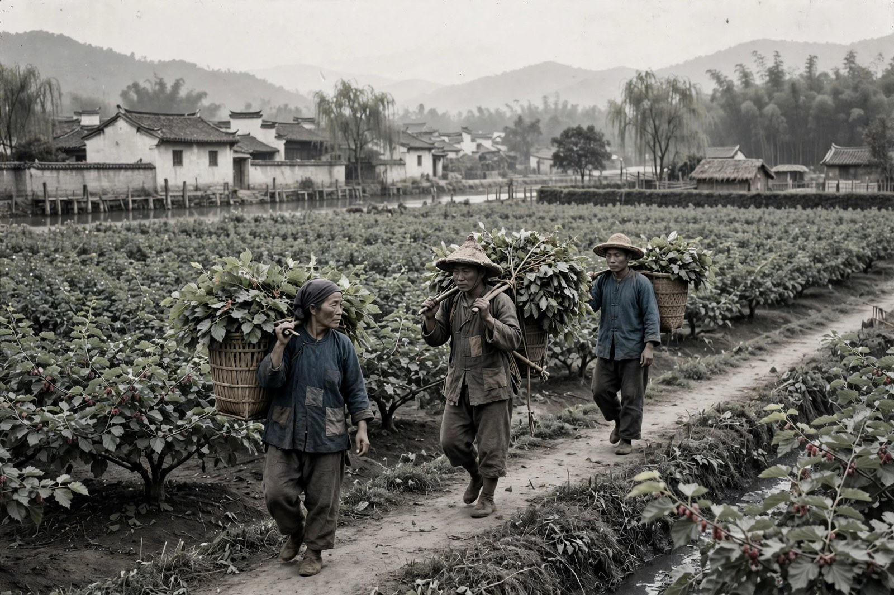

## 蚕房里的一个月

春蚕写的是清明之后的一个月，浙东一户普通的蚕农老通宝一家，在春蚕季节里紧张、艰辛、充满希望又充满焦虑的劳作。小说最初发表于一九三二年十一月的现代杂志，后来和秋收、残冬合为农村三部曲，由开明书店出版。春蚕的篇幅不长，只有四章，可味道很足：它把一个蚕农家庭一个月里的全部心思、全部算计、全部希望和失望，都写得清清楚楚。

老通宝是这篇小说的核心人物。他是个老蚕农，养蚕很有经验，对蚕的习性、桑叶的好坏、天气的变化，都摸得很透。可他的经验，在市场面前却显得很无力：蚕养得再好，茧收得再多，卖茧的价格却不是他说了算。他在这个月里，经过了大紧张、大决心、大奋斗，同时又是大希望：紧张的是蚕会不会生病，决心的是今年一定要把蚕养好，奋斗的是全家老小齐上阵，没日没夜地伺候蚕，希望的是今年能有个好收成，能把债还上，能让日子宽松一点。这种紧张、决心、奋斗、希望搅在一起，就是蚕农春天的真实心情：希望越大，紧张也越大，因为希望背后是债，是全家人的生计，是容不得闪失的压力。

茅盾写蚕房，写得非常具体。他写蚕宝宝怎么吃桑叶，怎么蜕皮，怎么结茧，写蚕房里的温度、湿度、气味，写老通宝半夜起来看蚕，写家里人轮流值夜，写桑叶不够了要去借、去买，写借来的桑叶质量不好又要发愁。这些细节，不是为了好看，而是为了让读者感受到养蚕的辛苦和风险：蚕是很娇贵的东西，温度高一点、低一点，桑叶老一点、嫩一点，都可能影响收成。养蚕的辛苦，不只是体力上的辛苦，更是心里的辛苦：每天提心吊胆，生怕出一点差错，差错一出，一个月的辛苦就白费了。

老通宝的家里，还有其他人物：他的儿子、儿媳、孙子，各有各的性子，各有各的想法。儿子想按老办法养蚕，儿媳想省点力气，孙子还小，只知道蚕宝宝好看。茅盾写这一家人，不把他们写成一个模子刻出来的农民，而是写成各有心思的活人：老通宝固执，相信经验；年轻人想变通，相信新办法；家里人之间有分歧、有争吵，可到了养蚕的关键时刻，又都齐心协力。这种家庭内部的分歧和齐心，合起来就是农村家庭的真实样子：平时可以吵，关键时刻还是要一起扛。

## 丰收了，为什么还亏

春蚕最扎心的地方，在于它的结局：老通宝一家经过一个月的拼命，好不容易获得了蚕茧的大丰收，可卖茧所得，却还不够偿还买桑叶所借的债，结果老通宝气得生了病。这个结局，初看很荒唐：丰收了，怎么反而更穷了？细看却很真实：丰收不等于赚钱，产量上去了，价格下来了，成本上去了，利润就没了。老通宝的账是这样算的：买桑叶借了债，借债要付利息；养蚕要人工，人工要吃饭；蚕茧丰收了，大家都丰收，市场上的茧多了，价格就跌了；茧行、中间商还要从中抽利，层层盘剥下来，落到老通宝手里的钱，根本不够还债。丰收的喜悦，还没有捂热，就被债的现实浇灭了。

茅盾写这个账，写得非常细致。他写老通宝怎么算账，怎么一笔一笔地对，怎么越算越心凉。他写茧行的人怎么压价，怎么挑毛病，怎么拖着不给钱。他写中间商怎么从中渔利，怎么把农民的血汗变成自己的利润。这些细节合起来，就是一幅农村经济的图：农民是生产者，却不是价格的制定者；农民付出了最多的劳动，却拿到了最少的收益；农民越是丰收，市场就越是压价，丰收反而成了灾难。这种丰收成灾的道理，在今天看来一点都不陌生：很多农产品丰收了，价格就跌了，农民白忙一场；很多小生产者拼命干活，最后却被中间环节、被平台、被渠道拿走了大头。

春蚕的这个道理，放在今天同样管用。今天的农民，面对的不再是茧行了，可能是收购商、电商平台、冷链物流，可道理是一样的：生产者不掌握定价权，就很容易被市场波动和中间环节挤压。今天的打工人，面对的也不是蚕茧了，可能是绩效、是平台抽成、是房租，可道理也是一样的：干得再多，如果规则不公平，收益就很难落到自己手里。茅盾写春蚕，不是为了让读者同情老通宝，而是为了让读者看清规则：规则不改，丰收也可能是灾难；规则改了，丰收才能真正变成好日子。

老通宝气得生病，这个细节写得很有味道。他不是因为懒、因为笨而生病，而是因为气：气自己拼命了一个月，结果还是欠债；气市场不讲理，气中间商太黑，气自己再有经验也算不过这笔账。这种气，是很多普通人的共同感受：明明很努力了，明明做得不错了，结果还是不尽如人意，气自己，也气世道。茅盾写老通宝生病，不是为了煽情，而是为了说明：经济上的打击，最终会变成身体上的、心理上的打击，农民的病，不只是身体的病，更是心里的病。这种身心俱疲的状态，是农村生活里最常见的状态，也是最让人心疼的状态。

## 老通宝的经验与固执

老通宝这个人物，还有一个特点：经验丰富，却也很固执。他相信自己的老办法，相信蚕要这么养、桑叶要这么挑、天气要这么看，对年轻人的新办法，他常常不以为然。这种固执，有它的道理：老办法是经过多年实践检验的，新办法未必靠谱，贸然改了，风险很大。可固执也有它的代价：市场变了，行情变了，老办法再好，也架不住市场规律的变化。老通宝的固执和经验，合起来就是老一代农民的缩影：他们有本事，有耐心，有吃苦的精神，可他们的本事，是在旧的市场里练出来的，新市场的规则变了，他们的本事就不够用了。

茅盾写老通宝的固执，没有嘲笑他，也没有神化他，就是如实地写：他固执的时候，家里人会和他吵；他经验起作用的时候，家里人又会佩服他。这种又吵又佩服的关系，就是家庭里代际关系的真实样子：老一辈有经验，年轻一辈有新想法，两代人互相不服气，又互相离不开。老通宝和儿子的分歧，就是这种代际分歧的缩影：儿子想试试新办法，老通宝怕新办法出岔子，两个人吵来吵去，最后还是按老办法来，结果老办法也没有救了全家。这种吵来吵去最后还是老样子的结局，写得很有味道：代际之间的分歧，不是靠吵架能解决的，而是要靠现实的教训、靠市场的变化、靠新一代的成长来慢慢化解。

对照今天，老通宝的固执同样有启发。今天很多行业里，老一辈有经验，年轻一辈有新工具、新渠道、新玩法，两代人之间同样有分歧：老一辈觉得年轻人浮躁，年轻一辈觉得老一辈保守。分歧本身不是坏事，坏的是分歧变成了对立，对立变成了内耗。老通宝的故事告诉我们：经验值得尊敬，新办法也值得一试，关键是要找到一个结合点：经验里有用的部分留下来，新办法里靠谱的部分试一试，两者结合起来，才有可能走出困境。光守着经验，会被市场淘汰；光追着新办法，会冒不必要的风险。结合起来，才是稳妥的路。

老通宝的身上，还有一种农民的韧性：气病了，歇一歇，还是要接着干；欠了债，想办法，还是要接着养蚕。这种韧性，不是盲目的乐观，而是一种没有退路的坚持：不干，就没有饭吃；干了，虽然可能还是亏，可至少还有希望。这种没有退路的坚持，是很多普通人的生活状态：明知道前路艰难，还是要往前走，因为停下来就更没有希望。茅盾写老通宝的韧性，不是为了歌颂吃苦，而是为了说明：农民的吃苦，不是自愿的，而是被逼出来的；他们的坚持，不是浪漫的，而是现实的。看清这一点，对农民的尊敬，才是真正的尊敬，而不是廉价的歌颂。

## 茧行与中间环节的账

春蚕里的茧行，是一个很值得细看的角色。茧行是收茧的地方，也是定价的地方，农民把茧送到茧行，茧行的人挑三拣四，压价、拖欠、克扣，样样都有。老通宝面对茧行的人，心里有气，嘴上却不敢多说什么：不卖给茧行，茧就烂在手里；卖给茧行，又要被压价。这种两难，就是小生产者面对中间环节的普遍处境：渠道掌握在别人手里，定价权掌握在别人手里，自己只能被动接受。今天的农民面对收购商、面对电商平台，同样有这种两难：不通过平台，货卖不出去；通过平台，又要被抽成、被压价、被规则牵着走。茧行换成了平台，道理却没有变。

茅盾写茧行，没有把它写成一个简单的坏人集合，而是写成一个制度：茧行的人也是按规则办事，规则就是压价、拖欠、克扣，规则对茧行有利，对农民不利。这种制度性的压价，比个别坏人的压价更难对付：坏人可以换，制度却很难改。老通宝面对的，不是某一个坏人，而是一整套对他不利的制度。这套制度，包括高利贷、中间商、市场波动、信息不对称，每一环都对农民不利，合起来就是农民的困境。茅盾写春蚕，就是要把这套制度写出来，让读者看到：农民的穷，不是因为懒，不是因为笨，而是因为制度对他们不利。

高利贷是这套制度里很关键的一环。老通宝买桑叶要借钱，借钱要付高利息，利息越滚越多，丰收的钱还不够还利息。这种高利贷的困境，今天同样存在：很多小生产者、小店主、普通家庭，都要靠借贷来周转，借贷的利息、手续费、违约金，样样都是负担。借贷本身不是坏事，坏的是不公平的借贷条件：利息太高、条款太苛刻、信息不对称，借贷就从帮手变成了枷锁。茅盾写老通宝借债，就是要提醒人们：借贷的规则不公平，生产者再努力，也可能被利息拖垮。看清借贷的账，才能看清农民的账。

春蚕里的市场波动，也是制度的一部分。蚕茧丰收了，大家都丰收，价格就跌了；蚕茧歉收了，价格上去了，可农民手里又没有货。这种丰收跌价、歉收没货的怪圈，是小生产者最怕的怪圈：丰收也亏，歉收也亏，怎么都是亏。怪圈的根子，在于农民是分散的、弱小的，没有议价能力，也没有储存、加工、销售的能力，只能靠天吃饭、靠市场吃饭。茅盾写这个怪圈，不是为了让读者绝望，而是为了让读者思考：怎么才能打破这个怪圈？是靠合作、靠组织、靠加工、靠品牌，还是靠政策、靠金融、靠信息？茅盾没有直接给出答案，他把问题摆出来，让后来的人去想、去试、去解决。这种摆问题而不给现成答案的写法，是茅盾一贯的风格，也是他留给读者的功课。

## 春蚕和今天的对照

今天读春蚕，最容易引起共鸣的，是那种干得多、拿得少的感觉。很多人都有过类似的经历：加班加了很多，绩效却没有涨多少；产品卖得很好，利润却被平台、被渠道、被房租拿走了；种了很多菜，菜价跌了，白忙一场。这种干得多、拿得少的感觉，和老通宝的感觉很像：明明付出了很多，回报却很少，少到让人怀疑努力的意义。茅盾写春蚕，就是要让这种感觉被看见、被理解、被思考：干得多、拿得少，不是你的错，而是规则的问题；规则不改，努力就很难变成收益。

春蚕还给今天的人留了一个关于希望的提醒：老通宝的希望，是今年能把债还上、日子宽松一点。这个希望很小，小到让人心酸，可就是这么小的希望，支撑着他一个月的拼命。今天很多人的希望，同样很小：还上房贷、还上车贷、让孩子上个好学校、让父母过得好一点。这些小希望，支撑着很多人每天的拼命。希望小，不等于希望不重要；希望小，恰恰说明希望很真实。茅盾写老通宝的小希望，不是为了嘲笑他目光短浅，而是为了说明：普通人的希望，本来就是具体的、小的、和生计连在一起的。看不起小希望的人，是不懂普通人的生活。

春蚕的结尾，老通宝病了。这个病，写得很有余味：病不是结局，而是下一个季节的开始。病好了，他还是要接着干；债还在，他还是要接着还；蚕还是要接着养。这种病了还要接着干的劲，就是农民的韧性，也是普通人的韧性。今天很多人在遭遇打击之后，同样是病了、累了、想放弃了，可歇一歇之后，还是要接着干：因为生活还要继续，因为家人还要吃饭，因为希望还没有彻底灭。这种歇一歇再接着干的劲，是春蚕留给读者最实在的东西：它不浪漫，不煽情，就是生活本身的样子。

读春蚕的时候，不妨多留意茅盾写细节的手法。他写蚕、写桑叶、写蚕房、写茧行、写账本，每一个细节都是实的，都是经过观察的。这种实的细节，是春蚕最打动人的地方：你读的时候，能闻到蚕房的味道，能听到老通宝算账的声音，能感受到他气病时的心凉。这种真实感，靠编是编不出来的，只能靠对生活的细致观察。今天很多写农村、写基层的作品，缺的就是这种实的细节：写得热闹，却没有味道；写得感人，却没有根基。茅盾的春蚕，就是一面镜子，照出了什么是实的写作，什么是飘的写作。

## 春蚕里的家庭与邻里

春蚕里的家庭和邻里，同样写得很细。老通宝一家，不是孤立存在的，他们住在村子里，和邻居、亲戚、茧行、债主都有来往。邻居家也养蚕，也面临同样的困境，大家在一起的时候，会互相诉苦、互相打听行情、互相借桑叶、互相帮忙。这种邻里之间的互助，是农村生活里很重要的部分：平时可以互相帮忙，关键时刻也可以互相取暖。可互助也有它的限度：大家都穷，帮忙也只能帮一点；大家都面临同样的市场，互助也改变不了市场的规则。茅盾写邻里互助，不把它写成解决问题的办法，而是写成生活里的一点温度：温度有了，困境还在，可有了温度，困境就好熬一点。

家庭内部的关系，在春蚕里也写得很真实。老通宝和儿子之间，有分歧、有争吵，可到了养蚕的关键时刻，又都放下分歧，一起干活。这种放下分歧、一起干活的劲，是家庭最核心的力量：平时可以吵，关键时刻还是要一起扛。儿媳在家里，操持家务、照顾蚕、照顾孩子，样样都要管，她的辛苦，在小说里写得比较含蓄，可读者能感觉到：没有她的操持，蚕房的运转就会乱套。茅盾写家庭女性，不把她们写成背景板，而是写成家庭运转的关键人物：她们的话不多，可她们的手不能停，她们的辛苦，是家庭能够运转的基础。

春蚕里的孩子，也写得很有味道。孩子还小，对蚕宝宝充满好奇，觉得蚕宝宝好看、好玩，可他还不懂得蚕宝宝背后的账、背后的债、背后的风险。孩子的天真，和大人的焦虑放在一起，就是一种对照：大人愁的是账，孩子乐的是蚕，同一个蚕房里，两种心情。这种对照，写得很动人：它提醒读者，农村的生活不只有苦，还有天真、还有乐趣、还有孩子眼里的美好。可这种美好，是脆弱的：孩子长大了，就会懂得账、懂得债、懂得风险，天真就会被现实磨掉。茅盾写孩子，不是为了煽情，而是为了说明：农村的未来，在孩子身上；孩子能不能保住天真、能不能有更好的出路，取决于农村的困境能不能被解决。

春蚕里的邻里和家庭合起来，就是一幅农村社会的图：家庭是基本单位，邻里是互助网络，市场是外部压力，债是悬在头顶的剑。茅盾把这幅图写出来，让读者看到：农村的困境，不是某一家人的困境，而是整个村子、整个地区的困境；农村的出路，也不是某一家人的出路，而是整个村子、整个地区一起找的出路。这种从一家到一村、从一村到一地区的视野，是春蚕这篇短篇小说最了不起的地方：篇幅不长，视野却很宽，宽到能照见整个农村经济的结构。

## 春蚕的写作手法

春蚕的写作手法，值得单独说一说。茅盾在这篇小说里，用了很克制的笔法：他不煽情，不喊口号，不直接议论，就是老老实实地写蚕房、写账本、写人物、写细节。克制的好处，是让读者自己去体会：老通宝的账算不过来，读者自己算一算，也会觉得心凉；老通宝气病了，读者自己想一想，也会觉得心疼。克制的写法，比煽情的写法更有力量：煽情是作者替读者哭，克制是让读者自己哭。自己哭出来的感受，比别人替你哭的感受要深得多。

茅盾写春蚕的时间跨度，也很有讲究：小说只写了一个月，从清明之后到卖茧之后，一个月的时间，浓缩了一个蚕农家庭的全部希望和失望。一个月不长，可茅盾把它写得很满：每天的蚕房、每天的算计、每天的希望、每天的焦虑，都写进去了。这种把一个月写满的手法，让春蚕的节奏很紧凑，读起来不觉得散，反而觉得每一页都有东西。这种紧凑，是短篇小说最需要的品质：篇幅有限，就要把每一页都写实，每一段都有用。茅盾的春蚕，就是短篇小说紧凑写作的一个范本。

春蚕的语言，同样值得学。茅盾的语言不花哨，不堆砌，就是朴素、具体、有分量。他写蚕，用的是农民的话；写账，用的是农民的算法；写人物，用的是农民的心理。这种朴素的语言，和农村的题材非常贴合：写农民，就要用农民能懂的语言，就要用农民的账来算账，就要用农民的心来想事。语言和题材贴合了，小说就有了根；语言和题材脱节了，小说就飘了。茅盾的春蚕，根扎得很深，深到读者读完之后，还能记得蚕房的味道、老通宝的账、茧行的压价。这种记得，就是语言的力量。

最后说说春蚕在农村三部曲里的位置。春蚕是开篇，写的是希望的破灭；秋收是中间，写的是幻想的破灭；残冬是收尾，写的是绝望之后的觉醒。三部作品合起来，就是农村从希望到绝望、从绝望到觉醒的一条线。春蚕单独读，已经很完整了；合起来读，更能看到茅盾的完整意图：他不是要让农民停在绝望里，而是要让他们走过绝望，找到新的路。这条路，在春蚕里还没有出现，在秋收里还在摸索，在残冬里才隐约出现。春蚕的价值，就在于它是这条路的起点：起点是希望的破灭，破灭之后，路才开始真正地找。

## 合上春蚕想一想

合上春蚕，你可以问自己几个问题：你手里的工作，是不是像养蚕一样，付出了很多，回报却很少；你身边的规则，是不是像茧行一样，对生产者不利；你家里的账，是不是像老通宝的账一样，越算越紧。如果这几个问题里有让你心里一紧的，那春蚕就没有白读。茅盾写老通宝，不是为了让读者同情一个农民，而是为了让每个在局里的人，看清自己脚下的局。看清了，路就好走一些；看不清，再努力也可能白忙一场。春蚕的价值，就在这里：它是一本蚕农的账，也是一本每个普通人的账。账算清楚了，心里就亮堂了，亮堂了，就不容易被糊涂的规则牵着走。

再看老通宝一眼，你会发现他身上有一种让人尊敬的东西：他气病了，可病好了还是要干；他欠了债，可欠了债还是要养蚕；他希望破灭了，可破灭之后还是要找下一个希望。这种气病了还要干、欠了债还要养、希望破灭了还要找希望的劲，就是普通人最宝贵的东西。它不浪漫，不煽情，就是生活本身：生活再难，也要接着过；日子再苦，也要接着干。茅盾写春蚕，最终想说的，大概就是这句话：丰收成灾不可怕，可怕的是丰收成灾之后，就再也不敢丰收了；欠了债不可怕，可怕的是欠了债之后，就再也不敢干了。敢干，就是希望；敢干，就是路。

## 春蚕里的天气与人心

春蚕里还有一个经常被忽略的角色：天气。养蚕最怕天气变化：天冷了，蚕吃得少；天热了，蚕容易病；下雨了，桑叶湿了，蚕也容易出问题。老通宝每天都要看天，看云，看风，判断天气的变化，调整蚕房的温度和湿度。天气这个角色，在小说里不是背景，而是实实在在的压力：它和市场一样，不由农民说了算，却能决定农民的收成。茅盾写天气，写得非常细致：他写老通宝怎么看天，怎么根据天气调整，怎么在天气变化的时候提心吊胆。这种对天气的细致描写，让春蚕的真实感更强了：农民的生活，就是和天气、和市场、和债这三样东西打交道，三样东西都不由自己说了算，却样样都能决定自己的日子。

天气和人心，在春蚕里是连着的：天气好的时候，老通宝的心情就好一点，觉得今年有希望；天气不好的时候，他的心情就沉下去，觉得今年又要悬。这种天气影响心情的写法，在今天看来同样真实：很多人的心情，也会被天气、被市场、被环境影响，环境好了，心情就好一点；环境差了，心情就沉下去。茅盾写天气和人心的关系，不是为了写风景，而是为了说明：人的心情，从来不是孤立的，而是和环境连在一起的。环境变了，心情也会跟着变；心情变了，判断也很容易跟着变。老通宝在天气好的时候算账，会乐观一点；在天气不好的时候算账，会悲观一点。这种乐观和悲观的摇摆，就是农民心里的真实波动。

对照今天，天气这个角色换成了很多新的东西：市场行情、平台规则、政策变化、行业周期，这些东西和天气一样，不由个人说了算，却能决定个人的日子。茅盾写天气的方法，放在今天依然管用：看一个人，不能只看他的本事，还要看他处在什么样的天气里：顺风的时候，本事容易发挥；逆风的时候，本事再大也很难施展。看清了天气，再谈努力，努力才有分寸；看不清天气，努力就很容易变成蛮干。老通宝的故事，就是在逆风里努力的故事：逆风里努力，很难，可不努力，就更难。这种逆风里还要努力的劲，是春蚕留给读者的一份力量。

春蚕里的天气，还可以从另一个角度理解：它象征着农民无法控制的力量。市场、天气、债、中间商，这些力量合起来，就是农民头顶的天。天变了，农民的日子就变了；天不变，农民的日子也很难变。茅盾写天气，就是要让读者感受到这种无力感：农民再有经验，也算不过天；再有本事，也斗不过市场。这种无力感，不是为了让读者绝望，而是为了让读者思考：怎么才能让农民少受天气和市场的摆布？是靠保险、靠合作、靠加工、靠信息，还是靠政策、靠金融、靠技术？茅盾没有直接回答，他把问题留给了后来的人。后来的人能不能回答好这个问题，决定了春蚕的故事会不会在今天重演。

## 春蚕的最后一点温度

春蚕的最后一点温度，藏在老通宝一家人的日常里：蚕房里的灯、桑叶的香、孩子看蚕的眼神、家里人一起吃饭的热气。这些日常的温度，是春蚕里最暖的部分，也是茅盾最想保留的部分：生活再苦，日常里还是有温度的；账再紧，家里人坐在一起吃饭的时候，还是暖的。这种温度，不是用来掩盖困境的，而是用来说明：困境里的人，依然是活生生的人，他们有喜怒哀乐，有日常的温暖，有对生活的眷恋。看清了温度，再看困境，困境就不再是抽象的数字，而是具体的人的生活。茅盾写春蚕，最终想留给读者的，就是这份温度：温度在，希望就在；温度在，人就还在。

## 春蚕里的桑叶与人心

春蚕里的桑叶，值得再单独说一说。桑叶是蚕的食物，也是蚕农的命脉：桑叶好不好，直接决定蚕长得好不好；桑叶够不够，直接决定蚕能不能吃饱。老通宝为了桑叶，要借钱、要赊账、要挑三拣四、要半夜起来看桑叶的质量。桑叶这个东西，看起来不起眼，可它牵动的是整个蚕农家庭的命运：桑叶贵了，成本就高了；桑叶质量差了，蚕就容易病；桑叶不够了，蚕就要饿肚子。茅盾写桑叶，写得非常细致：他写桑叶的颜色、老嫩、干湿，写老通宝怎么挑桑叶，怎么把好桑叶留给蚕吃，怎么把差桑叶先喂给大蚕。这些细节，读起来很生活，可生活里藏着的就是账：桑叶的账，就是蚕农的账；桑叶的账算不过来，蚕农的账也就算不过来了。

桑叶和人心，在春蚕里也是连着的：桑叶好的时候，老通宝的心情就好一点，觉得今年有希望；桑叶不好的时候，他的心情就沉下去，觉得今年又要悬。这种桑叶影响心情的写法，在今天看来同样真实：很多人的心情，也会被原材料、被成本、被市场影响，原材料好了，心情就好一点；原材料差了，心情就沉下去。茅盾写桑叶和人心的关系，不是为了写风景，而是为了说明：人的心情，从来不是孤立的，而是和生计连在一起的。生计好了，心情就好一点；生计差了，心情就很难好起来。看清了这种连带，对农民的焦虑，才会有真正的理解，而不是廉价的劝慰。

## 春蚕再补一句

春蚕再补一句：丰收不等于赚钱，拼命不等于成功，账算清楚了，心里就亮堂了。老通宝的账，算给所有在局里的人看：看清了规则，再去拼命，拼命才有方向；看不清规则，拼命就很容易变成白忙。记住这句话，遇到丰收成灾的时候，心里就多一分清醒。
