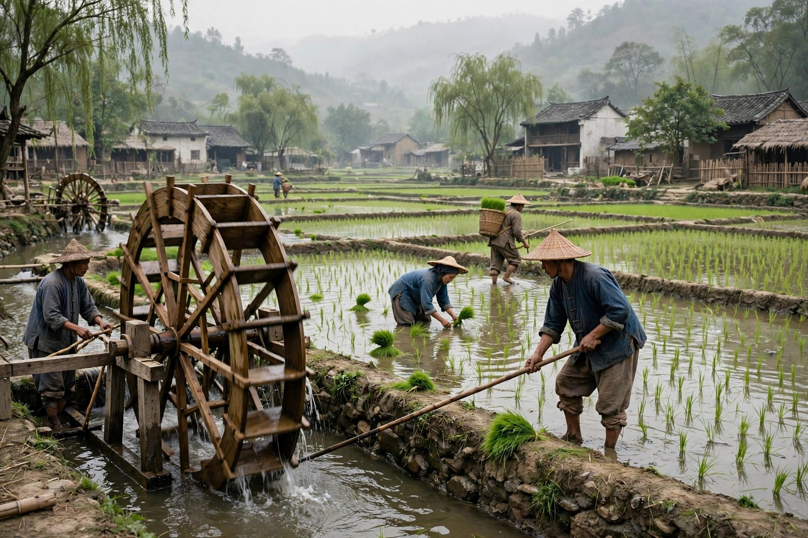
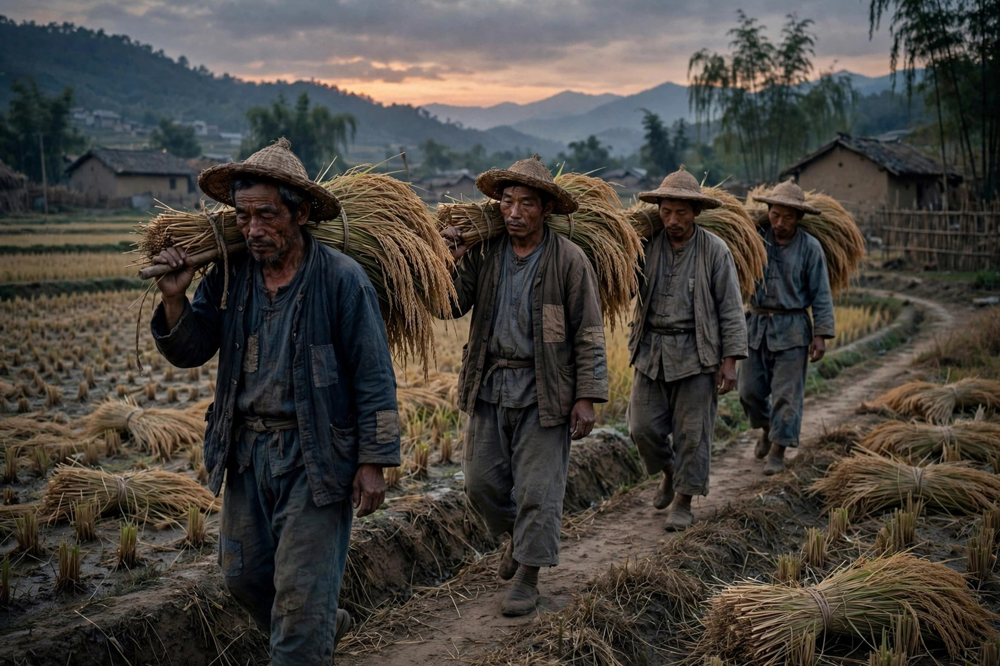

## 病好之后的新希望

秋收是农村三部曲的中间一篇，最初发表于一九三三年四月和五月的申报月刊，后来和春蚕、残冬合为农村三部曲出版。故事接着春蚕往下写：春蚕时节，老通宝气病了，到了五月底，他的病渐渐好了，家里依旧青黄不接，可他心里又燃起了希望。春蚕时期的幻想，又在他头脑里蓬勃生长起来：他相信只要一次好收成，乡下人就可以翻身。这种相信，不是盲目的乐观，而是一种没有退路的盼望：春蚕亏了，秋收要是再亏，全家就真的过不下去了，所以他必须相信秋收会好，必须把全部力气都押在秋收上。

茅盾写老通宝病好之后的状态，写得非常细致。他写老通宝怎么从床上爬起来，怎么到田里看稻子，怎么盘算着赊豆饼、施肥、车水灌溉，怎么动员全家老小一起干活。他的盘算，听起来很有道理：赊来豆饼施肥，稻子就能长得好；全家没日没夜地车水灌溉，稻子就能喝饱水；稻子长好了，秋收就能丰收；丰收了，米价要是好一点，债就能还上，日子就能宽松一点。这一环扣一环的盘算，逻辑上没有毛病，可现实却不是按逻辑走的：逻辑里没有米价飞跌，没有中间商压价，没有高利贷的利息，没有天气的变化。老通宝的盘算，漏掉了最关键的一环：价格不是他说了算。

全家拼命干活的场面，茅盾写得很有力量。他写老通宝怎么起早贪黑，怎么在田里弯腰插秧、车水、施肥，怎么晒得黝黑、累得腰酸背痛，还不肯停下来。他写家里人怎么分工，怎么轮流干活，怎么在最累的时候互相打气。这种全家拼命的场面，读起来让人感动，也让人心酸：感动的是这家人的韧性，心酸的是这种韧性换来的，很可能又是一场空。茅盾写拼命，不写成歌颂吃苦，而是写成一种没有退路的坚持：不拼命，就没有希望；拼命了，希望也未必能实现。可不拼命，希望就一点都没有了，所以只能拼命。这种只能拼命的处境，就是农民的处境，也是很多普通人的处境。

秋收的希望，和春蚕的希望很像，都是把全部希望押在一次收成上。这种押宝式的生活，是小生产者最常见的生活方式：一年就靠一两次收成，收成好了，全年都好；收成不好，全年都难。这种押宝，风险极大：天气、市场、价格，任何一个环节出问题，全年的希望就落空了。茅盾写老通宝的押宝，不是为了嘲笑他赌性大，而是为了说明：在没有保障、没有退路的情况下，押宝是唯一的办法。农民没有社保、没有稳定的工资、没有其他的收入来源，只能靠收成吃饭，靠收成还债，靠收成翻身。押宝不是选择，而是被逼出来的生存方式。

## 稻子熟了，米价跌了

到了秋天，老通宝一家终于见到了稻子下垂，获得了一个好收成。稻子熟了，金黄一片，看起来喜人极了，全家人都松了一口气，觉得今年的辛苦没有白费，觉得翻身的日子就要来了。可现实很快就给了他们一记重击：米价飞跌，白辛苦一场，又背了一身债。稻子丰收了，大家都丰收，市场上的米多了，价格就跌了；米行、中间商又从中压价、克扣，落到老通宝手里的钱，根本不够还债。丰收的喜悦，还没有捂热，就被米价的现实浇灭了。这种丰收了反而更穷的怪圈，在春蚕里出现过一次，在秋收里又出现了一次，两次合起来，就是农村经济的一个死结：丰收也亏，歉收也亏，怎么都是亏。

茅盾写米价飞跌，写得非常具体。他写老通宝怎么到米行问价，怎么听到价格之后心里一沉，怎么和米行的人讨价还价，怎么讨来讨去还是卖不上价。他写米行的人怎么挑毛病，怎么说米的质量不好、怎么说市场不好、怎么拖着不给钱。这些细节合起来，就是一幅农村市场的图：农民是弱势的，米行是强势的，价格是米行说了算，农民只能被动接受。今天的农民面对收购商、面对电商平台，同样有这种被动：价格不是自己说了算，渠道不是自己掌握的，只能接受别人给的价格。这种被动，是小生产者的共同命运：分散、弱小、没有议价能力，只能靠天吃饭、靠市场吃饭。

秋收的结局，比春蚕的结局更沉重。春蚕的结局，是老通宝气病了；秋收的结局，是老通宝在秋收的打击下，病情加重，最后要了他的命。茅盾写老通宝的死，没有大肆渲染，就是平平淡淡地写：秋收的幻想破灭了，老通宝的心也死了，人也就跟着去了。这种心死而人亡的写法，比直接写他怎么死更有力量：一个人不是被某一次打击打倒的，而是被一次次希望破灭磨死的。春蚕破灭了一次，秋收又破灭了一次，两次破灭合起来，就把老通宝心里的那点希望彻底磨没了。希望没了，人也就没有撑下去的力气了。

老通宝的死，在农村三部曲里是一个转折点：春蚕写的是老一代农民的希望，秋收写的是老一代农民希望的破灭和生命的终结，残冬写的是年轻一代农民的觉醒。老通宝死了，故事并没有结束，而是把接力棒交给了他的儿子多多头。茅盾用老通宝的死，来说明一个道理：靠苦干来改善处境的路，老一代已经走到了头，走不通了；年轻一代必须找新的路，不然就会重蹈老通宝的覆辙。这种代际之间的交接，写得很沉重，也很有力量：老一代的死，不是白死的，它给年轻一代提了一个醒：老路走不通了，该换路了。

## 全家拼命的账本

秋收里全家拼命的账，值得一笔一笔地算清楚。老通宝为了秋收，赊来了豆饼施肥，豆饼要钱，赊来的豆饼要付利息；全家没日没夜地车水灌溉，车水要力气，力气要吃饭，吃饭要花钱；稻子长好了，要收割、要打谷、要晒干、要运到米行，每一步都要花钱、都要出力。这些成本加起来，就是一笔不小的账。老通宝算账的时候，心里想的是：成本花了，收成好了，卖米的钱就能把成本盖住，还能剩一点还债。可他没有算到的是：米价跌了，卖米的钱连成本都盖不住，更别说还债了。成本是实的，价格是虚的，实的成本对上虚的价格，结果就是亏。这种实的对虚的亏，是农民最怕的亏：干活是实的，花钱是实的，亏也是实的，可价格却是别人说了算的虚的。

茅盾写这笔账，写得非常细致。他写老通宝怎么赊豆饼，怎么和债主讨价还价，怎么在豆饼的质量上纠结；他写全家人怎么车水，怎么在烈日下轮流踩水车，怎么累得腰酸背痛还不肯停；他写收割的时候怎么抢时间，怎么怕下雨把稻子淋坏，怎么连夜把稻子收回来。这些细节，不是为了好看，而是为了让读者感受到：农民的每一分钱、每一分力，都是实的，都是用血汗换来的。可就是这么实的血汗，到了市场上，却换不来实的回报。这种实换不来实的荒唐，就是秋收最扎心的地方：你付出了实的劳动，市场却给你虚的价格，虚的价格一跌，实的劳动就白费了。

全家拼命的场面，还有一个层面值得说：家里人的分工和配合。老通宝负责总的盘算，儿子负责田里的重活，儿媳负责家务和后勤，孩子负责跑腿和帮忙。每个人都有自己的活，每个人也都有自己的累。茅盾写这种分工，不把它写成理想化的和谐，而是写成有分歧、有抱怨、有关心、有互相体谅的真实家庭：儿子会抱怨太累，儿媳会抱怨钱不够，老通宝会抱怨年轻人不懂事，可抱怨完了，还是要一起干活。这种抱怨完了还要一起干的劲，就是家庭的力量：家庭不是没有矛盾，而是矛盾再大，关键时刻还是要一起扛。秋收的全家拼命，就是这种家庭力量的集中体现：平时可以吵，秋收的时候必须一起上。

对照今天，全家拼命的账同样存在。今天很多家庭，为了还房贷、为了孩子上学、为了父母看病，全家人都要拼命：父母加班、年轻人熬夜、老人帮忙带孩子，全家人齐上阵，日子才能勉强维持。可拼命之后，回报却未必能跟上：房价跌了，工资没有涨，教育成本涨了，医疗成本涨了，拼命换来的，很可能又是一场空。茅盾写秋收的全家拼命，就是要让读者看到：拼命本身不是问题，问题是拼命换不来相应的回报；回报跟不上拼命，拼命就很容易变成绝望。老通宝的绝望，就是从拼命换不来回报开始的：拼命了，还是亏，亏了，还是要拼命，拼命了，还是亏，这种循环，就是绝望的来源。

秋收里的希望，也值得单独说一说。老通宝的希望，是只要一次好收成，乡下人就可以翻身。这个希望，听起来很朴素，也很动人：一次好收成，就能翻身，多么简单、多么直接。可现实是：一次好收成，根本翻不了身，因为翻身需要的，不只是一次收成，还需要公平的价格、合理的利息、稳定的市场、没有盘剥的渠道。这些条件，老通宝一个都没有，他只有一次收成。一次收成对上一整套不利的条件，结果只能是亏。茅盾写这个希望，不是为了嘲笑老通宝天真，而是为了说明：普通人的希望，往往是很具体的、很小的，可就是这么小的希望，也需要一整套公平的条件来支撑。条件不公平，希望再小也很难实现。这种希望和条件之间的落差，就是秋收最让人心酸的地方。

## 米行与市场的另一面

秋收里的米行，和春蚕里的茧行很像，都是中间环节，都是定价的地方，都是农民的对手。米行的人，挑米的质量、压米的价格、拖欠米款，样样都有。老通宝面对米行的人，心里有气，嘴上却不敢多说什么：不卖给米行，米就烂在手里；卖给米行，又要被压价。这种两难，和春蚕里的两难一模一样：渠道掌握在别人手里，定价权掌握在别人手里，自己只能被动接受。茅盾写米行，不是为了写个别坏人，而是为了写一种制度：米行的规则，就是压价、拖欠、克扣，规则对米行有利，对农民不利。这种制度性的压价，比个别坏人的压价更难对付，因为制度很难改，坏人却很容易换。

市场的另一面，是信息的不对称。老通宝不知道外面的米价是多少，不知道今年的行情怎么样，不知道米行给的价格是不是合理的，他只能听米行的人说，米行的人说多少就是多少。这种信息不对称，是农民最吃亏的地方：你不知道行情，就没有议价的底气；你没有底气，就只能接受别人给的价格。今天的农民，信息不对称的问题依然存在：虽然有了手机、有了网络，可真正有用的市场信息、价格信息、渠道信息，依然掌握在少数人手里，普通农民很难拿到及时、准确的信息。茅盾写老通宝的信息不对称，就是要提醒人们：信息就是力量，没有信息，就没有议价权；没有议价权，就只能被动挨打。

秋收里的市场波动，同样值得细看。稻子丰收了，米价就跌了；稻子歉收了，米价就涨了，可农民手里又没有货。这种丰收跌价、歉收没货的怪圈，在春蚕里出现过，在秋收里又出现了一次。怪圈的根子，在于农民是分散的、弱小的，没有组织、没有储存、没有加工、没有品牌，只能靠天吃饭、靠市场吃饭。茅盾写这个怪圈，不是为了让读者绝望，而是为了让读者思考：怎么才能打破这个怪圈？是靠合作、靠组织、靠加工、靠品牌，还是靠政策、靠金融、靠信息？茅盾没有直接给出答案，他把问题摆出来，让后来的人去想、去试、去解决。这种摆问题而不给现成答案的写法，是茅盾一贯的风格，也是他留给读者的功课。

秋收里的高利贷，同样是制度的一部分。老通宝赊豆饼要付利息，买桑叶要付利息，借钱要付利息，利息越滚越多，收成的钱还不够还利息。这种高利贷的困境，今天同样存在：很多小生产者、小店主、普通家庭，都要靠借贷来周转，借贷的利息、手续费、违约金，样样都是负担。借贷本身不是坏事，坏的是不公平的借贷条件：利息太高、条款太苛刻、信息不对称，借贷就从帮手变成了枷锁。茅盾写老通宝借债，就是要提醒人们：借贷的规则不公平，生产者再努力，也可能被利息拖垮。看清借贷的账，才能看清农民的账，也才能看清很多普通人的账。

## 老通宝之死意味着什么

老通宝的死，在秋收里写得很平淡，可分量很重。他不是被某一次打击打死的，而是被一次次希望破灭磨死的：春蚕破灭了一次，秋收又破灭了一次，两次破灭合起来，就把他心里的希望彻底磨没了。希望没了，人也就没有撑下去的力气了。茅盾写老通宝的死，没有用大段的抒情，就是平平淡淡地写：秋收的幻想破灭了，老通宝的病加重了，人也就去了。这种平淡，比煽情更有力量：一个人的死，不需要大张旗鼓，只需要把希望破灭的过程写清楚，读者自然就能感受到死的分量。

老通宝的死，还意味着一个时代的结束：靠苦干来改善处境的老路，走到了头。老通宝的一生，就是靠苦干来改善处境的一生：他养蚕、种稻、拼命干活，相信只要肯干，日子就能好起来。可现实告诉他：肯干不够，还需要公平的规则、合理的价格、没有盘剥的渠道。这些条件他都没有，所以他肯干了一辈子，最后还是亏、还是病、还是死。他的死，是对老路的一个判决：老路走不通了，该换路了。换什么路？茅盾没有在秋收里直接回答，他把答案留给了残冬：年轻一代的多多头，会走上另一条路。

对照今天，老通宝的死同样有启发。今天很多人，也在走靠苦干来改善处境的老路：加班、熬夜、拼命干活，相信只要肯干，就能升职、就能加薪、就能买房。可现实是：肯干不够，还需要公平的规则、合理的回报、没有过度压榨的环境。这些条件如果没有，肯干就很容易变成白干，变成过劳，变成身心俱疲。茅盾写老通宝的死，就是要提醒人们：肯干值得尊敬，可光肯干不够，还要看规则、看回报、看环境。规则不公平，肯干就很容易变成自我消耗；回报不合理，肯干就很容易变成绝望。看清这一点，对肯干的人，才是真正的保护，而不是廉价的歌颂。

老通宝死后，家里人的反应，茅盾也写得很细。家里人悲伤，可悲伤之余，还是要接着过日子：田还要种，债还要还，孩子还要养。这种悲伤之余还要接着过的劲，就是农村家庭的韧性：人死了，日子还要继续；希望破灭了，生活还要继续。这种韧性，不是乐观，而是没有退路的坚持：不坚持，就没有饭吃；坚持了，虽然可能还是亏，可至少还有希望。这种没有退路的坚持，是很多普通家庭的真实状态：亲人走了，日子还要过；打击来了，生活还要继续。茅盾写这种韧性，不是为了歌颂吃苦，而是为了说明：普通人的生活，本来就是在打击里接着过的，接着过，就是一种力量。

## 秋收里的年轻一代

秋收里，年轻一代的身影已经开始出现了。虽然小说的主角还是老通宝，可多多头等年轻人的想法，已经和老通宝不一样了：老通宝相信靠苦干就能翻身，年轻人却开始怀疑：苦干了这么多年，日子还是这样，苦干真的能翻身吗？这种怀疑，在秋收里还是隐约的，没有变成行动，可它已经是一颗种子：种子埋在土里，到了残冬，就会发芽、长出来，变成行动。茅盾写年轻一代的怀疑，不把它写成叛逆，而是写成一种清醒：年轻人看得多、想得多，对老路的怀疑，是他们觉醒的开始。

年轻一代和老一代的分歧，在秋收里写得很含蓄：年轻人想试试新办法，老通宝怕新办法出岔子；年轻人觉得市场不公平，老通宝觉得市场就是这样，只能认命；年轻人想出去闯闯，老通宝觉得出去闯风险太大，不如守着田过日子。这种分歧，不是简单的代沟，而是两种生存逻辑的碰撞：老一代的逻辑是守成、是苦干、是认命；年轻一代的逻辑是怀疑、是想变、是不认命。两种逻辑都没有错，可在秋收的现实里，老一代的逻辑已经走到了头，年轻一代的逻辑还没有找到出路。茅盾写这种碰撞，不是为了让两代人对立，而是为了说明：代际之间的分歧，是社会变化的动力，也是社会变化的阵痛。阵痛过了，新路才可能出现。

秋收里的妇女，同样值得细看。老通宝家里的妇女，操持家务、照顾田地、照顾孩子，样样都要管，她们的辛苦，在小说里写得比较含蓄，可读者能感觉到：没有她们的操持，秋收的运转就会乱套。她们对秋收的希望，和老通宝一样朴素：希望今年能有个好收成，希望债能还上，希望日子能宽松一点。可她们的希望，同样被米价的现实浇灭了。她们的失望，和老通宝的失望一样深，可她们没有像老通宝那样病倒，而是默默地承受着，继续操持着家务，继续照顾着孩子。这种默默承受的劲，是农村妇女最常见的劲：她们不张扬，不抱怨，就是默默地扛着，扛着家庭，扛着生活，扛着希望破灭之后的日常。茅盾写农村妇女的默默承受，不是为了歌颂她们的牺牲，而是为了让读者看到：家庭的运转，离不开她们的默默付出；农村的困境，最终也要由她们来默默承担。

秋收的结尾，老通宝死了，故事并没有结束，而是把接力棒交给了年轻一代。这种交接，写得很沉重，也很有力量：老一代的死，不是白死的，它给年轻一代提了一个醒：老路走不通了，该换路了。换什么路？茅盾在秋收里没有直接回答，他把答案留给了残冬。读秋收的时候，不要只盯着老通宝的死看，还要看看年轻一代的种子：种子在哪里，种子长什么样，种子到了残冬会长成什么样。种子看清楚了，秋收的悲剧就不再只是悲剧，而是一个转折：悲剧的终点，就是新路的起点。

## 合上秋收想一想

合上秋收，你可以问自己几个问题：你手里的工作，是不是像种稻一样，付出了很多，回报却很少；你身边的规则，是不是像米行一样，对生产者不利；你家里的希望，是不是像老通宝的希望一样，押在一次收成、一次机会、一次翻盘上。如果这几个问题里有让你心里一紧的，那秋收就没有白读。茅盾写老通宝，不是为了让读者同情一个农民，而是为了让每个在局里的人，看清自己脚下的局。看清了，路就好走一些；看不清，再努力也可能白忙一场。秋收的价值，就在这里：它是一本稻农的账，也是一本每个普通人的账。账算清楚了，心里就亮堂了，亮堂了，就不容易被糊涂的规则牵着走。

再看老通宝一眼，你会发现他身上有一种让人尊敬又让人心疼的东西：尊敬的是他的韧性，心疼的是他的无奈。韧性让他拼命干活，无奈让他拼命了还是亏。韧性和无奈在他身上打架，打来打去，无奈赢了。这不是因为他不够努力，而是因为规则对他不利。读他的故事，不是为了给他判分，而是为了看清规则的形状。看清了规则，你对身边那些拼命干活却还是过得紧巴的人，就会多一分理解，少一分苛责。这种理解，是秋收留给读者的一份温柔，也是茅盾留给读者的一份功课：不要只怪个人不努力，先看看规则公不公平；规则不公平，努力就很难变成收益。这份功课，放在今天同样管用。

## 秋收里的季节与人心

秋收这个题目，本身就很有味道：秋天是收获的季节，可收获之后，日子反而更苦了。这种收获和苦难并存的反差，就是秋收这部小说的核心：收获是实的，苦难也是实的，实的收获换不来实的好日子，这就是农民的困境。茅盾用秋收这个题目，既写出了季节，也写出了人心：季节到了秋天，人心也到了秋天，秋天本该是喜悦的，可人心里的秋天，却是凉的、沉的、让人喘不过气的。这种季节和人心的对照，是茅盾写作的一个特点：他不直接写人心，而是通过季节、通过收成、通过价格来写人心。季节看清楚了，人心也就看清楚了。

秋收里的季节变化，还写出了农村生活的时间感：春天养蚕，夏天种稻，秋天收割，冬天猫冬，一年四季，周而复始，每一年都差不多，每一年又都不一样。差不多的是劳作的辛苦，不一样的是价格的波动、债的多少、希望的破灭。这种周而复始里又有变化的时间感，是农村生活最真实的时间感：日子不是直线往前走的，而是循环着走的，循环里有希望，也有失望，希望和失望交替着来，就是一年的生活。茅盾写秋收的时间感，不是为了写风景，而是为了让读者感受到：农民的生活，就是在这种循环里过的，循环里有盼头，也有绝望，盼头和绝望交替着，就是全部的人生。

对照今天，季节这个意象换成了很多新的东西：行业的周期、市场的涨跌、政策的变化、平台的规则，这些东西和季节一样，周而复始，又各有不同。顺境的时候，觉得前途光明；逆境的时候，觉得一切都完了。茅盾写秋收的季节感，就是要提醒人们：顺境和逆境，都是暂时的，都是循环的一部分；顺境里不要飘，逆境里不要慌，循环看清楚了，心里就稳了。老通宝的悲剧，有一部分就是因为他把一次收成看得太重，把一次逆境看成了全部的命运。一次收成只是循环里的一环，一环不好，不等于全年都不好；一环好了，也不等于全年都好。看清循环，才能看清生活。

秋收的最后一点温度，藏在老通宝一家人的日常里：田里的稻香、家里人的饭香、孩子在田埂上跑的身影、邻居互相打招呼的声音。这些日常的温度，是秋收里最暖的部分，也是茅盾最想保留的部分：生活再苦，日常里还是有温度的；账再紧，家里人坐在一起吃饭的时候，还是暖的。这种温度，不是用来掩盖困境的，而是用来说明：困境里的人，依然是活生生的人，他们有喜怒哀乐，有日常的温暖，有对生活的眷恋。看清了温度，再看困境，困境就不再是抽象的数字，而是具体的人的生活。茅盾写秋收，最终想留给读者的，就是这份温度：温度在，希望就在；温度在，人就还在。

## 秋收的余味

秋收读完之后，余味很长。长在哪里？长在稻子的金黄里，长在米价的下跌里，长在老通宝的背影里，长在全家人拼命干活的身影里。这些画面，不会因为合上书就消失，反而会在你遇到类似处境的时候，突然浮出来，提醒你：别把全部希望押在一次收成上，别把全部力气押在一次机会上，规则看清楚了，再拼命，拼命才有方向；规则看不清，拼命就很容易变成白忙。这种提醒，是秋收留给读者最实在的东西。它不是道理，而是一种感觉，一种在关键时刻能拉你一把的感觉。有了这种感觉，秋收就没有白读，茅盾的苦心也就没有白费。

## 再看秋收一眼

再看秋收一眼，你会发现它不是一本让人绝望的书，而是一本让人清醒的书。清醒的是：丰收不等于赚钱，拼命不等于成功，希望不等于现实。清醒之后，你不会立刻找到出路，可你至少不会再被虚假的希望骗了，不会再把全部身家押在一次收成上了。清醒是一种力量，它能让你在下一次收成来临之前，先把账算清楚，先把规则看清楚，先把退路想清楚。账算清楚了，规则看清楚了，退路想清楚了，再去拼命，拼命才有底气。茅盾写秋收，最终想给读者的，就是这份清醒的底气：底气在，希望就在；底气在，路就还在。

## 秋收给后来人的话

秋收给后来人的话，其实很简单：别只盯着收成看，要盯着规则看；别只盯着产量看，要盯着价格看；别只盯着拼命看，要盯着回报看。收成、产量、拼命，这些都是你能控制的；规则、价格、回报，这些是你控制不了的，却能决定你的日子。控制不了的东西，要想办法去了解、去应对、去改变，而不是假装它们不存在。了解了，应对了，改变了，收成才能真正变成好日子，拼命才能真正变成好生活。这句话，老通宝没有来得及听到，可后来的人听到了，就还有机会不走他的老路。

## 秋收里的稻香与人心

秋收里的稻香，值得再单独说一说。稻子熟了，田野里飘着稻香，香气很浓，闻起来让人觉得丰收就在眼前，觉得今年的日子会好过一点。老通宝闻着稻香，心里是喜的，觉得全家人的辛苦没有白费，觉得翻身的日子就要来了。可稻香再浓，也盖不住米价下跌的现实：香气是香气，价格是价格，香气不能当钱花，价格才是实的。茅盾写稻香，不是为了写风景，而是为了写出希望和现实之间的落差：希望闻起来很香，现实算起来却很凉；香气越浓，落差就越大，落差越大，心就越凉。这种香和凉的对照，是秋收这部小说最动人的对照：它让读者闻到丰收的香，也感受到丰收之后的凉，香和凉合起来，就是农民的真实生活。

## 秋收再补一句

秋收再补一句：一次收成翻不了身，一次机会也翻不了身，翻身需要的是公平的规则、合理的价格、没有盘剥的渠道。老通宝把希望押在一次收成上，结果还是亏；后来的人不要再押宝了，要先把规则看清楚，先把账算清楚，再去拼命，拼命才有底气。
