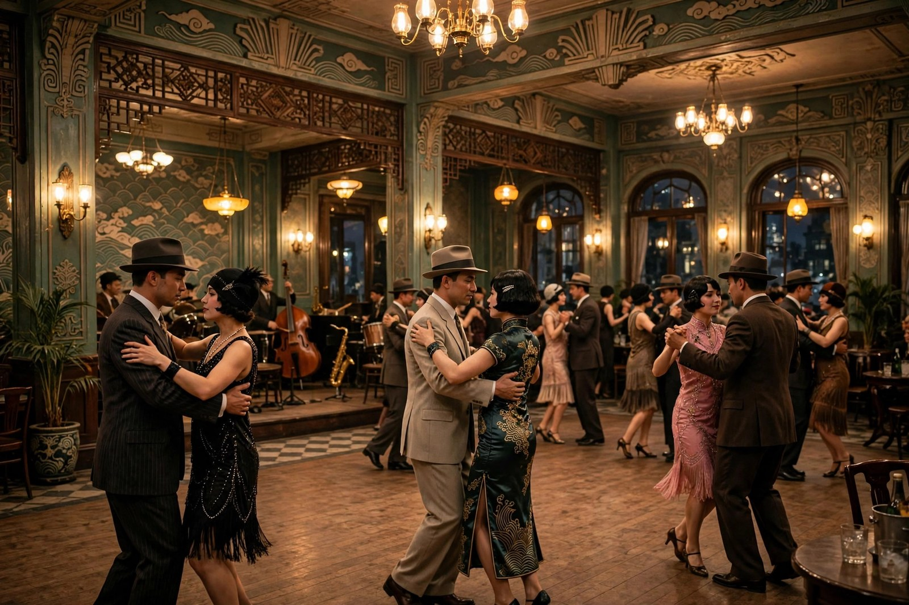

## 散场之后的上海

追求写的是大革命失败之后，上海一群青年知识分子的生活。那时的上海，革命的高潮已经过去了，街头不再像从前那样热闹，口号声小了，集会少了，留下来的是一群曾经热情过、如今却不知道该往哪里走的年轻人。他们愤世嫉俗，又悲观失望；他们不甘心沉沦，又找不到出路；他们想有所追求，可社会的压迫和自身的局限，又让他们的追求一次次落空。茅盾写这群人，写得非常贴切：散场之后的气氛，不是轰轰烈烈的悲壮，而是闷闷的、黏黏的、让人喘不过气来的苦闷。

小说里的人物，各有各的追求。张曼青主张教育救国，想当教师，想通过教育下一代来扭转国家的命运。他对教育有憧憬，对理想的伴侣也有憧憬：希望找一个温柔沉默、不尚空谈、不耻小事的女子，和自己一起过踏实的日子。可现实是，教育救国这条路，在当时的上海并不好走：学校里有各种势力，教育界有各种算计，想靠教书来救国，谈何容易。张曼青的追求，写得很有代表性：很多读书人都有过类似的想法，觉得只要把下一代教好了，国家就有希望了，可教书本身，也要面对现实的种种牵制。

王仲昭的追求，是改革报业。他是个新闻记者，想通过办报、写文章来揭露社会乱象，来推动改革。他对跳舞场的颓废、离婚风潮的盛行这些社会现象，都有自己的看法，想通过新闻的力量来改变点什么。可报业同样不是净土：报纸要靠广告、靠发行、靠关系，记者想说真话，往往要付出代价。王仲昭的理想，在报业的现实面前，同样碰了壁。茅盾写王仲昭，不是为了嘲笑他的天真，而是为了说明：靠一支笔来改变社会，同样需要面对权力、资本、市场的多重压力，笔再锋利，也很难单枪匹马地改变结构。

章秋柳是追求里最耀眼的人物。她敢爱敢恨，热血、活泼、敢于追求自己的生活，对组织运动充满热情，对恋爱也充满热情。她和王仲昭在跳舞场里不期而遇，平时生活里随时有旋身、舞蹈的动作，即便到了最后，知道自己可能已经染上了病，她还是笑着从床上跳起来，在房里旋了一个半圆。这种对生命的激情，即便到了最后关头也不肯放弃，是章秋柳最动人的地方。茅盾写章秋柳，写出了新女性的强力性格和丰美肉体所表征的战斗性：她不肯向命运低头，不肯向颓废投降，哪怕追求落空了，她还是要活得热烈。

史循是追求里的另一个极端：颓废、自弃、悲观、失望。他曾经也有过理想，可理想破灭之后，他就彻底沉下去了，靠颓废来打发日子，靠自弃来逃避现实。章秋柳曾经想改造史循，想通过恋爱把他改造成一个新人，可改造没有成功：身体毕竟是旧有的，革命和恋爱搅在一起，最后变成了负面的例子。史循的颓废，和章秋柳的热情放在一起，就是追求这部小说的一组对照：同样是面对失败，有人选择热情到底，有人选择颓废到底，两种选择都没有赢，可热情到底的人，至少活得像个人，颓废到底的人，连活着的滋味都尝不到了。

## 组社办杂志的热闹与冷清

追求里的青年们，曾经群聚在一起，倡议组社、办杂志、批评时政。那段时间，他们聚在一起讨论、争论、写文章，觉得只要团结起来，就能发出自己的声音，就能影响社会。这种组社办杂志的热闹，在今天看来一点都不陌生：今天的年轻人，也喜欢组社群、办公众号、做播客、拍视频，想通过自己的声音来表达观点、影响别人。可热闹之后，往往是冷清：社团办着办着就散了，杂志出着出着就停了，公众号写着写着就断更了，原因都差不多：热情会退潮，现实会磨人，意见会分歧，钱和精力会跟不上。

茅盾写组社办杂志，写得非常真实。他写青年们聚在一起的时候，那种兴奋、那种憧憬、那种觉得自己能改变点什么的劲头；他也写青年们散开的时候，那种失落、那种互相埋怨、那种觉得一切都没有意义的情绪。组社的热闹和冷清，合起来就是追求这部小说的一个缩影：追求不是一条直线，而是一条起起伏伏的线，热闹的时候觉得前途光明，冷清的时候觉得一切都完了。茅盾没有因为冷清就否定热闹的价值，也没有因为热闹就掩盖冷清的现实，就是如实地写：热闹过，冷清过，追求过，落空过，这就是青年生活的真实样子。

张曼青、王仲昭、章秋柳这三条线，在小说里是分开叙述的，各自有各自的追求，各自有各自的落空。张曼青的教育梦，在现实面前碰了壁；王仲昭的报业梦，在市场和权力面前碰了壁；章秋柳的恋爱改造梦，在人性和疾病面前碰了壁。三条线合起来，就是一幅大革命失败之后青年生活的全景图：每个人都有梦，每个梦都碰壁，可每个人又都不肯彻底承认梦碎了，还在找下一个梦、下一个出路。这种不肯彻底承认的劲，就是追求这个题目的意思：不是追求成功了，而是还在追求，还没有停下来。

茅盾写追求，还有一个很厉害的地方：他写出了追求和幻灭、动摇之间的关系。幻灭是热情凉下来，动摇是心里摇摆不定，追求是凉下来、摇摆之后还不甘心，还想再试一次。这三个阶段，不是分开的，而是连着的：没有幻灭，就没有动摇的教训；没有动摇，就没有追求的迫切。追求这部小说，就是蚀这组作品的收尾：它告诉读者，青年走过了幻灭、走过了动摇，最后还没有停下来，还在找路。这种还没有停下来的劲，是茅盾对青年最大的信任：他相信青年在走过弯路之后，还能找到路，哪怕这条路一时还看不清楚。

## 章秋柳的舞蹈

章秋柳这个人物，值得单独拿出来细说。她是追求里最有生命力的人，也是最让人心疼的人。她敢爱敢恨，敢于追求自己的生活，敢于在跳舞场里旋身，敢于在众人面前表达自己的感情。这种敢，在当时的女性里面并不多见。很多女性在感情面前是被动的、等待的、羞涩的，章秋柳却是主动的、热烈的、毫不掩饰的。她的这种主动，让张曼青这样保守的男性感到心荡神驰，又感到不安：张曼青喜欢她的热情，又害怕她的放浪，觉得她将来不免会变成史循，或者更坏。这种又爱又怕的态度，恰恰说明了章秋柳的冲击力：她冲击了当时男性对女性的想象，也冲击了社会对女性的规训。

章秋柳对史循的改造计划，是小说里一个很重要的情节。她想通过恋爱，把史循从颓废里拉出来，改造成一个新人。这个计划，听起来很浪漫，也很天真：爱情真的能改造一个人吗？恋爱真的能让人重新做人吗？茅盾的回答是：不能，或者说，很难。史循在章秋柳热烈生活欲的影响下，确实有过改变的迹象，可身体毕竟是旧有的，旧习惯、旧病、旧心态，不是靠一段恋爱就能彻底改掉的。改造失败之后，章秋柳自己也付出了代价：她可能已经染上了病，可她还是笑着跳舞，还是不肯放弃对生命的热情。这种热情，到了最后，已经不是为了改造别人，而是为了证明自己还活着，还热烈，还没有被命运打倒。

章秋柳的舞蹈，是小说里一个很有象征意义的意象。她平时生活里随时有旋身、舞蹈的动作，跳舞场里是这样，家里也是这样，甚至在知道自己可能染病之后，还是从床上跳起来旋了一个半圆。舞蹈对她来说，不只是一种娱乐，更是一种生活态度：不管生活多么苦闷，不管追求多么落空，身体还是要动起来，心还是要热起来。茅盾写章秋柳的舞蹈，不是为了写风情，而是为了写一种不肯投降的劲：只要还能跳舞，就还没有彻底输。这种劲，在今天看来依然动人：生活再难，也要找点让自己热起来的事，哪怕只是跳一支舞、唱一首歌、跑一段路，只要心还是热的，人就没有彻底输。

对照今天的年轻人，章秋柳的热情同样有启发。今天很多年轻人，面对内卷、面对压力、面对不确定的未来，很容易陷入颓废：躺平、摆烂、自我放弃，觉得反正努力也没有用，不如省点力气。章秋柳的故事告诉我们：颓废很容易，热情却很难，可热情才是活着的证明。她的追求落空了，可她的热情没有落空；她的改造计划失败了，可她的生命力没有失败。这种热情和生命力，比追求成功本身更重要：成功是外在的，热情是内在的，外在的成功可能会落空，内在的热情却可以一直留着。

## 张曼青的保守与王仲昭的半步

张曼青和王仲昭，是追求里的另外两个主角，他们的追求方式，和章秋柳完全不一样。张曼青是保守的，他主张教育救国，想当教师，想找一个温柔沉默的伴侣，过踏实的日子。他对章秋柳的热情感到心荡神驰，可当章秋柳主动献吻的时候，他又视其为神经错乱，觉得章秋柳的放浪让人不安。这种保守，不是没有理想，而是理想比较温和：他不想大刀阔斧地改变社会，只想通过教育，一点点地改变下一代。这种温和的理想，在激烈的时代里显得有点跟不上趟，可它也有自己的价值：温和不等于无用，教育不等于空谈，一点点地改变，有时候比大刀阔斧更持久。

王仲昭的追求，被茅盾称为半步主义：他想改革报业，想通过新闻来推动社会进步，可他的步子并不大，总是半步半步地走，想改又不敢大改，想说又不敢全说。这种半步主义，在今天看来也很熟悉：很多人想改变点什么，可又怕得罪人、怕丢饭碗、怕担风险，于是只能半步半步地走，走得很慢，也很累。茅盾写王仲昭的半步，不是为了嘲笑他，而是为了说明：半步主义有它的无奈，也有它的现实性：在权力、资本、市场多重压力下，能走半步已经不容易了，半步虽小，总比原地不动强。可半步的问题是：走得太慢，很容易被时代甩在后面，也很容易在半路上就泄了气。

张曼青和王仲昭的追求，和章秋柳的追求放在一起，就是三种不同的追求方式：保守的、半步的、热烈的。三种方式都没有成功，可失败的原因不一样：张曼青失败，是因为教育救国的路太长、太慢，等不起；王仲昭失败，是因为报业改革的路太窄、太险，走不通；章秋柳失败，是因为恋爱改造的路太天真、太浪漫，靠不住。三种失败合起来，就是追求这部小说的核心：追求本身没有错，错的是对追求的估计不足，对现实的压力估计不足，对人性的复杂估计不足。追求需要热情，也需要清醒，热情没有清醒，就容易碰壁；清醒没有热情，就容易变成颓废。

茅盾写这三个人，没有偏袒任何一个。他没有说章秋柳的热烈就一定比张曼青的保守高尚，也没有说王仲昭的半步就一定比章秋柳的热烈明智。他只是把三种追求都摆出来，让读者自己看：每一种追求都有它的道理，也都有它的局限。读追求的时候，不要急着站队，不要急着说谁对谁错，先把三种追求都看清楚，再想一想自己属于哪一种，或者自己想成为哪一种。这种不站队的写法，是茅盾一贯的风格：他不给读者现成的答案，他给读者的是看清楚问题的材料。

## 追求和今天的对照

今天读追求，最容易引起共鸣的，是那种散场之后的苦闷。很多人都有过类似的经历：一个项目结束了，一个团队散了，一段感情结束了，一份工作丢了，散场之后，心里空落落的，不知道下一步该往哪里走。这种散场之后的苦闷，和追求里的青年们的苦闷很像：曾经热闹过，曾经有过目标，目标没了，人就散了，心也散了。散场不可怕，可怕的是散场之后就再也聚不起来了，再也找不到新的目标了。追求里的青年们，散场之后还在找目标，还在组社、还在办杂志、还在谈恋爱、还在想改造别人，这种还在找的劲，就是追求这部小说最想保留的东西。

今天的年轻人，面对的散场可能更多：行业变化快，今天还是热门行业，明天就可能裁员；平台变化快，今天还是流量红利，明天就可能规则大变；感情变化也快，今天还是热恋，明天就可能分手。散场多了，苦闷也就多了，很多人会在散场之后陷入迷茫，不知道该坚持还是该放弃。追求的故事告诉我们：迷茫是正常的，散场也是正常的，关键是在散场之后，你还能不能找到新的追求，还能不能保持一点热情。张曼青的教育梦、王仲昭的报业梦、章秋柳的恋爱梦，虽然都落空了，可他们找梦的过程本身，就是一种活着的证明。没有梦的人，才是真的输了。

追求还给今天的人留了一个关于改造别人的提醒：章秋柳想改造史循，结果没有成功，反而把自己搭了进去。这个教训，在今天同样适用：很多人谈恋爱、交朋友、带团队的时候，总想改造对方，觉得只要自己够真心、够努力，对方就能变好。可现实是，改造别人是很难的，人的习惯、性格、处境，不是靠一段感情、几句劝告就能改掉的。改造别人的热情，很容易变成控制欲，也很容易变成自我感动。茅盾写章秋柳的改造失败，就是在提醒人们：与其想着改造别人，不如先把自己活好；与其把希望押在别人身上，不如把希望押在自己能控制的事情上。这份提醒，放在今天的感情和职场里，依然管用。

追求的结尾，没有大团圆，也没有大悲剧，就是一群青年还在苦闷里徘徊，还在找路，还没有找到路。这种没有找到路的结尾，写得很有味道：它没有假装问题解决了，也没有假装青年们都找到了出路，就是如实地写：路还没有找到，找路的人还在。这种如实，比假装找到了路要诚实得多，也更能引起共鸣：今天很多年轻人的路，同样还没有找到，可他们还在找，还在走，还没有停下来。还在找，就是希望；还在走，就是追求。茅盾写追求，最终想说的，大概就是这句话：路没有找到不要紧，找路的人还在，就还有希望。

## 史循的颓废是怎么来的

史循的颓废，值得单独拆开看。他不是天生就颓废的人，他曾经也有过理想，也曾经投入过、热血过，可理想破灭之后，他没有像章秋柳那样继续热下去，也没有像张曼青那样退到教育里去，而是彻底沉下去了。沉下去的原因，有外部的，也有内部的：外部是社会的压迫、机会的减少、希望的渺茫，内部是性格里的软弱、对挫折的承受力不足、对自我的怀疑。外部和内部合起来，就把一个人推向了颓废。茅盾写史循，不是为了让他当一个反面教材，而是为了说明：颓废不是一个人的道德问题，而是一个人和环境互相作用的结果。环境越是让人看不到希望，人就越容易颓废；人越是颓废，环境就越是看不到改变的可能。这种恶性循环，是追求里最让人无奈的地方。

章秋柳想改造史循，出发点是好的：她相信爱情的力量，相信热情可以感染人，相信一个人只要被爱着，就能重新站起来。可茅盾的回答是冷静的：爱情的力量是有限的，热情的感染也是有限的，一个人能不能站起来，最终还是要看他自己有没有想站起来的劲。史循没有这股劲，或者说，这股劲已经被磨没了，章秋柳再热情，也只能把他往上推一推，推完之后，他还是会滑回去。改造别人的计划，往往就是这样收场的：改造者付出了很多，被改造者却没有真正改变，最后两败俱伤。茅盾写这段，没有煽情，就是平平淡淡地写改造的过程和失败的结果，让读者自己体会到改造别人的难。

对照今天，史循式的人物并不少见。很多人毕业之后，遭遇几次挫折，就开始自我放弃：工作不找了，学习不学了，社交不去了，每天靠短视频、游戏、熬夜打发时间，觉得这样活着也挺好，至少不用再受伤。这种颓废，看起来是自我保护，实际上是自我放弃：保护的是短期的舒服，放弃的是长期的可能。章秋柳的故事提醒我们：颓废很容易，站起来却很难，可站起来的起手动作，往往不是等别人来拉你，而是自己先动一动。动一动，不一定能立刻改变什么，可不动，就一定什么都改变不了。史循没有动，所以他沉下去了；章秋柳一直在动，所以她哪怕落空了，也还活得像个人。

史循和章秋柳的对照，还有一层意思：热情和颓废，是一对冤家。热情的人看不惯颓废的人，觉得他们不争气；颓废的人看不惯热情的人，觉得他们太天真。可茅盾没有让任何一方彻底赢：热情的章秋柳没有改造成功，颓废的史循也没有过得更好。两方的失败合起来，就是追求这部小说的一个结论：光有热情不够，光有颓废更不行，热情需要清醒来护航，颓废需要一点外力来打破。清醒和外力从哪里来？茅盾没有直接回答，他把这个问题留给了读者：你的清醒从哪里来，你的外力又在哪里。想清楚这两个问题，史循的路就不会是你的路。

## 追求里的上海味道

追求里的上海，和幻灭里的上海、子夜里的上海都不太一样。幻灭里的上海，是亭子间、影戏院、法国公园的上海，是私人生活的上海；子夜里的上海，是交易所、银行、丝厂的上海，是经济生活的上海；追求里的上海，是舞厅、杂志社、学校、弄堂的上海，是青年生活的上海。这三个上海合起来，就是茅盾笔下的上海全图：私人、经济、青年，三个层面交织在一起，才是一个完整的上海。

追求里的舞厅，写得很有味道。舞厅是青年们聚会、跳舞、谈恋爱、发泄苦闷的地方，也是颓废和热情交织的地方。章秋柳在舞厅里旋身，王仲昭在舞厅里和章秋柳不期而遇，张曼青对舞厅的颓废既反感又好奇。舞厅这个地方，本身就是大革命失败之后上海青年生活的一个缩影：热闹是热闹，可热闹底下是空虚；跳舞是跳舞，可跳完之后还是不知道往哪里走。茅盾写舞厅，不是为了猎奇，而是为了写出散场之后的气氛：大家聚在一起，跳一支舞，喝一杯酒，暂时忘掉烦恼，可舞散了、酒醒了，烦恼还在，路还在前面等着。

追求里的杂志社和学校，同样写得很有味道。杂志社是青年们想发出声音的地方，学校是张曼青想实现教育梦的地方，可这两个地方，同样充满了现实的牵制：杂志社要靠钱、靠关系、靠发行，学校要靠背景、靠人脉、靠规则。青年们想靠杂志和学校来改变社会，结果发现杂志和学校本身，也被社会改变着。这种想改变却被改变的无奈，是追求里最普遍的感受：你想推着社会走，社会却推着你走；你想发出自己的声音，声音却被市场的噪音盖住了。这种无奈，今天很多做内容、做教育的人同样有体会：平台规则变了，流量逻辑变了，教育政策变了，个人的声音很容易被淹没。

追求里的弄堂，写得也很细。弄堂是青年们住的地方，也是他们生活的地方：亭子间、灶披间、公共水龙头、邻居的闲话，这些细节合起来，就是上海青年日常生活的底色。茅盾写弄堂，不是为了写风情，而是为了写出青年生活的真实质感：他们的追求不是在真空里发生的，而是在弄堂的油烟味、邻居的闲话声、房租的压力里发生的。追求再高远，也要落到弄堂的生活里；理想再宏大，也要面对房租、水电、吃饭这些具体的问题。这种高远和具体的落差，就是追求这部小说的日常感：青年们谈的是救国、是报业、是教育，可每天面对的，却是房租、是吃饭、是感情的纠葛。高远的话题和具体的生活搅在一起，才是真实的人生。

## 追求的余味与蚀的收尾

追求是蚀这组作品的收尾，读完追求，再回头看幻灭和动摇，会有一种完整的感觉：幻灭写的是热情凉下来，动摇写的是心里摇摆不定，追求写的是凉下来、摇摆之后还不甘心，还想再找路。这条线，从热到凉，从凉到摇摆，从摇摆到再找路，合起来就是一代青年在大革命前后的心路历程。茅盾写这条线，不是要给青年判分，而是要给青年留一个记录：你们走过的路，有热、有凉、有摇摆、有不甘心，这些都是真实的，都值得被记住。记住这些，后来的人就不会觉得自己的迷茫是孤例，就不会觉得自己的幻灭是罪过。

蚀这个总名，本身就很有味道。蚀是侵蚀、是损耗、是月亮被天狗吃掉一块的意思。茅盾用蚀来概括这组作品，就是说：青年的热情，在时代的风浪里被一点点侵蚀了；青年的理想，在现实的压力下被一点点损耗了。可侵蚀和损耗，不是彻底的消失：月亮被蚀了，还会再圆；热情被蚀了，还可能再热。茅盾用蚀这个题目，既写出了损耗的真实，也留下了再圆的可能。这种既真实又留有余地的题目，是茅盾对青年的态度：他不粉饰损耗，也不放弃希望，他相信损耗之后，还能再圆。

追求的余味，还在于它没有给出一个光明的结局。青年们还在苦闷里，还在找路，还没有找到路。这种没有结局的结局，恰恰是最诚实的结局：生活里的大多数问题，都不是读完一本书就能解决的，路也不是看完一部小说就能找到的。茅盾不假装问题解决了，他只是把问题摆出来，让读者自己去找路。找路的过程，本身就是追求；找路的人，本身就是希望。追求这部小说，最终留给读者的，不是答案，而是一种状态：还在找，还在走，还没有停。这种状态，比任何答案都更珍贵。

最后说一句：读完蚀这组作品，你可以把三部作品合起来想一想：你有没有过幻灭的时候，你有没有过动摇的时候，你现在是不是正处在追求的阶段。想完之后，你会对自己的心路多一分理解，对茅盾的用心多一分敬意。茅盾写蚀，不是为了让读者记住三个书名，而是为了让读者在自己的生活里，认出幻灭、动摇、追求这三个阶段，并且在认出之后，还能保持一点往前走的力气。这份力气，就是蚀留给今天的人最实在的东西。

## 再看追求这群人一眼

再看追求这群人一眼，你会发现他们身上有一种让人又怜又敬的东西。怜的是他们的追求大多落空了，敬的是他们落空了还不肯停下来。张曼青还在想教育，王仲昭还在想报业，章秋柳还在跳舞，史循虽然沉下去了，可他的沉也成了一种提醒：提醒后来的人，沉下去是什么样子。茅盾写这群人，没有让他们成功，也没有让他们彻底失败，就是让他们停在追求的状态里：追求着，就是活着；停下来，就是输了。这种追求着的状态，是蚀这组作品最后留给读者的姿势：不管路找没找到，人还在路上，就还有希望。希望不在远方，就在还在走的脚步里。

## 追求里的友情与爱情

追求里的友情和爱情，同样值得细看。青年们聚在一起，友情是真的，互相鼓励、互相倾诉、互相取暖，可友情也有它的限度：各人有各人的追求，各人有各人的软肋，友情再好，也不能代替各自的选择。张曼青、王仲昭、章秋柳、史循，他们是朋友，可朋友之间也有分歧、有误解、有各自的小算盘。茅盾写友情，不把友情写成铁板一块，而是写成有裂缝、有温度、有距离的东西。这种有裂缝的友情，才像真实的友情：朋友不是用来解决你所有问题的，朋友是陪你一起面对问题的人。陪伴本身，就是友情最大的价值。

爱情在追求里，同样写得复杂。章秋柳对爱情的态度是主动的、热烈的，她敢爱，也敢为爱付出代价；张曼青对爱情的态度是保守的、犹豫的，他想要爱情，又害怕爱情带来的麻烦；王仲昭对爱情的态度是半步的，想爱又不敢全爱，想追又怕受伤。三种爱情观放在一起，就是三种人生观的缩影：热烈的、保守的、半步的，没有哪一种是完美的，每一种都有代价。茅盾写爱情，不写童话，不写悲剧，就是写爱情在现实里的样子：有甜，有苦，有误会，有错过，有坚持，有放弃。爱情不是救世主，不能解决所有问题，可爱情也不是累赘，它是生活里的一份温度，有了温度，人就不容易彻底凉下来。

追求里的友情和爱情合起来，就是青年生活的两个支柱：友情给人陪伴，爱情给人温度。两个支柱都在，青年就还能撑下去；两个支柱都倒了，青年就很容易沉下去。茅盾写追求，就是要让读者看到这两个支柱的重要性：追求不只是个人的事，也是和朋友、和爱人一起的事。一个人追求，很容易孤单；一群人追求，哪怕最后没有成功，过程里也有陪伴和温度。这种陪伴和温度，是追求这部小说里最暖的部分，也是它留给读者的一份安慰：路不好走，可路上还有人陪着，这就够了。

## 追求的最后一句

追求的最后一句，其实不在书里，而在读者心里。合上书，你问问自己：你现在还在追求什么，你的追求落空过吗，落空之后你还想再试一次吗。如果答案是还在追求、还想再试，那你就是追求这部小说的同路人。茅盾写这群青年，不是为了让他们成功，而是为了让他们成为一面镜子，照见每个还在追求的人。镜子里的人还在走，你也在走，路虽然没有走完，可走着走着，路就出来了。这就是追求留给我们的最后一句：还在走，就是希望。
