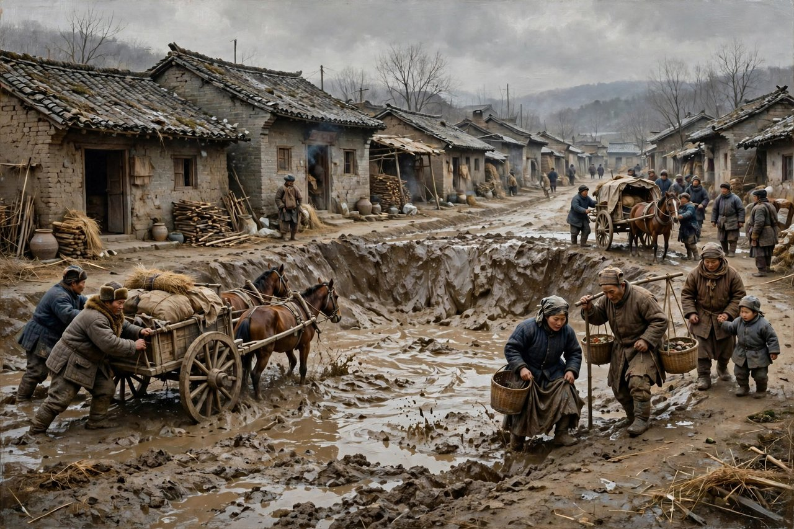
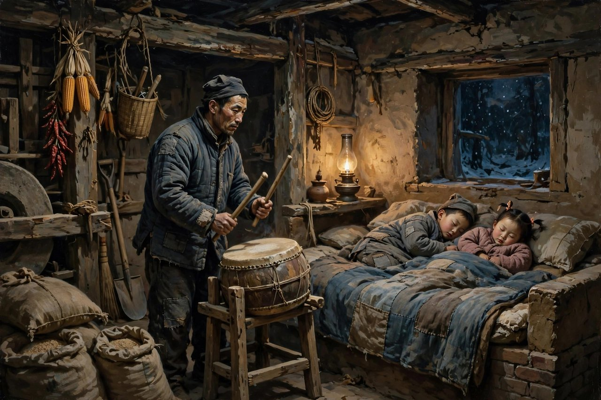

## 呼兰河这小城里边

呼兰河传开篇有一句话，读过的人都忘不掉，呼兰河这小城里边住着我的祖父。这句话听起来平平淡淡，像拉家常，像一个孩子在给你指路，可里头藏着整本书的魂。呼兰河是萧红的老家，是黑龙江边上的一座小城，小到一条街上的泥坑能出名，小到一家人的事能传遍全城，小到风俗和规矩能把人压得喘不过气来。萧红写这本书的时候，人已经在香港了，身体已经不好了，离家已经很远了，可她笔尖一动，呼兰河就回来了，园子回来了，祖父回来了，泥坑回来了，庙会回来了，小团圆媳妇回来了，有二伯回来了，冯歪嘴子回来了。她写这本书，写于一九四零年，在香港写成，在星岛日报的副刊星座上连载，年底连载完，一九四一年由桂林河山出版社出成书，茅盾给它写了序。这本书，是萧红后期最有名的代表作，也是中国现代文学里最特别的一本乡土小说，特别在它不像传统小说，特别在它散，特别在它像回忆，像散文，像一个人在给你讲她老家的事，讲着讲着，你就走进了呼兰河。

书里写小城，写得最让人记住的，是东二道街上的大泥坑。那个泥坑有多大，大到马车陷进去出不来，大到行人绕着走还会被溅一身泥，大到牲口掉进去要费好大力气才能拉出来。泥坑年年都在，雨一下，泥坑就满了，晴了天，泥坑就干成硬块，可就是没有人去填它，没有人去修它，没有人觉得这个坑是个问题。街坊们看着马车陷进去，看着行人摔跤，看着牲口挣扎，习以为常，见怪不怪，甚至觉得这个坑本来就该在那里，本来就是小城的一部分。萧红写这个泥坑，写得冷静，写得具体，写得让人发笑又让人心寒，因为这个泥坑不只是一个坑，这个泥坑是一种精神状态，是一种对不合理的事情视而不见、习以为常的状态。今天的人看这个泥坑，可能会笑小城的人傻，可笑完了再想想，自己身边有没有这样的泥坑，有没有一条年年积水、年年没人修的路，有没有一个明明不合理、大家却都习惯了的规矩，有没有一个明明坑人、大家却都绕着走的制度。泥坑这个意象，萧红写于一九四零年，今天读起来，依然能照见很多人、很多事、很多地方。

小城的热闹，萧红也写得细，写得全。跳大神、唱秧歌、放河灯、看野台子戏、逛娘娘庙会，这些在小城里都是盛举，都是大事，都是全城人出动的日子。跳大神的时候，鼓声、锣声、神婆的唱声混在一起，香火缭绕，人山人海，看着热闹，实际上是迷信在撑场面。唱秧歌的时候，男男女女扭着秧歌，唱着小调，看着喜庆，实际上是穷日子里难得的一点乐子。放河灯的时候，河面上漂着一盏一盏的灯，灯火摇曳，看着好看，实际上是人们在把心愿寄托给河神，寄托给看不见的东西。野台子戏的时候，台上唱得热闹，台下看得热闹，可戏散了，日子还是老样子，该穷还是穷，该被压着还是被压着。四月十八的娘娘庙会，更是全城的节日，香客如云，小贩云集，热闹非凡，可热闹背后，是人们对神的依赖，对命运的无奈，对改变日子没有信心的寄托。萧红写这些热闹，不批判，不嘲笑，不站在高处骂小城的人愚昧，她就是把热闹摆出来，把热闹背后的冷摆出来，让读者自己看，看热闹里有多少真心，有多少无奈，有多少麻木。

## 祖父和后花园

呼兰河传里最暖的一段，是祖父和后花园。祖父是个慈祥温和的老人，眼睛笑盈盈的，身体很健康，手里喜欢拿着手杖，嘴上不住地抽着旱烟管，遇见孩子，喜欢开玩笑，喜欢把孩子的帽子藏起来，说是家雀叼走了。家里只有祖父最关心我，父亲冷淡，母亲恶言恶色，祖母用针刺手指，只有祖父疼她，护她，陪她。祖父一天都在后园里边，我也跟着祖父在后园里边。祖父戴一个大草帽，我戴一个小草帽，祖父栽花，我就栽花，祖父拔草，我就拔草，祖父下种种小白菜，我就跟在后边，把下了种的土窝用脚一个一个地溜平，溜得东一脚西一脚，全是瞎闹，祖父也不恼。祖父铲地，我拿不动锄头杆，祖父就把锄头杆拔下来，让我单拿个头来铲。祖父教我念诗，教我认字，教我看天上的云，教我听园子里的虫鸣。那段日子，是萧红一生里最自由、最快乐的日子，自由到她想干什么就干什么，想怎么闹就怎么闹，快乐到她觉得，有了祖父就够了，还怕什么呢。

后花园在萧红笔下，不是一个普通的园子，是一个孩子的乐园，是一个没有规矩的地方。在园子里，菜可以乱种，草可以乱拔，蜻蜓可以追，蚂蚱可以绑，水可以用瓢往天上洒，玫瑰花可以插在祖父的帽子上，祖父浑然不觉，还说今年雨水真大，玫瑰花香离了两里地都闻得到。孩子乐坏了，边走边笑，回家之后，全家人都笑了，祖父把帽子拿下来，才发现玫瑰花插了一头，难怪花香这么大。这种笑，是书里少有的、干净的笑，是没有被日子压过的笑，是没有被规矩压过的笑。今天的人读到这里，可能会羡慕，可能会想起自己的童年，想起自己的祖父祖母，想起自己小时候在院子里、田野里瞎闹的日子。萧红写园子，写的不只是一个园子，写的是童年本身，写的是一个人心里最后一点没有被污染的地方，写的是一个人长大之后，还能回得去、还想回得去的地方。

可是园子再好，祖父再疼她，日子还是要往前走的。祖父年纪大了，我生的时候，祖父已经六十多岁了，我长到四五岁，祖父就快七十了，我还没有长到二十岁，祖父就七八十岁了，祖父一过了八十，祖父就死了。书的尾声里，萧红写，从前那后花园的主人，而今不见了，老主人死了，小主人逃荒去了。这句话，读起来轻，落到心里重。园子还在，菜还在，花还在，可园子里的人不在了，陪着孩子瞎闹的人不在了，教孩子念诗的人不在了，孩子自己也逃荒去了，逃到了哈尔滨，逃到了上海，逃到了香港，逃了一辈子，再也没有回到那个园子里。这种回不去，是呼兰河传里最疼的地方，也是萧红一生里最疼的地方。她写呼兰河，表面上是写故乡，实际上是写回不去，写一个人长大之后，故乡就只剩下回忆了，园子就只剩下文字了，祖父就只剩下怀念了。今天很多人说乡愁，说回不去的故乡，说的也是这个意思，只不过萧红写得更具体，写得更疼，写得更让人忘不掉。

## 小团圆媳妇的死

呼兰河传里最让人心碎的人，是小团圆媳妇。她来的时候，才十二岁，头发又黑又长，梳着很大的辫子，坐得笔直，走得风快，看见人还偷着笑，是个活泼泼、健康康的小姑娘。可就是这样一个小姑娘，到了婆家之后，命运就变了。婆婆嫌她太大方，嫌她不怕羞，嫌她头一天来到婆家，吃饭就吃了三碗，嫌她不像个团圆媳妇该有的样子。婆婆打她，打得狠，打得勤，打出了毛病，打出了病。街坊们看着，看热闹，议论纷纷，没有人觉得婆婆打人不对，没有人觉得一个十二岁的孩子不该被这样打，大家觉得，团圆媳妇就是该被管教的，就是该被打的，就是该乖乖听话的。这种看客的逻辑，这种把打人当成管教、把虐待当成规矩的逻辑，就是小城最冷的地方，就是萧红要解剖的地方。

小团圆媳妇病了之后，事情更惨了。家里人不给她看病，不给她吃药，反而请来了庸医，请来了云游真人，请来了跳大神的，用各种迷信的法子折腾她，扎彩衣，算卦，跳神，用烧开的水给她洗澡，说是驱鬼，说是治病，实际上是把一个病人往死里折腾。她本来只是被打出了毛病，被折腾之后，毛病更重了，头发掉了，人黄瘦了，眼睛也瞎了一只，最后死在了那锅热水里，死在了那些仪式里，死在了婆婆和街坊的围观里。她死的时候，婆婆哭的不是她这个人，哭的是花在她身上的钱，哭的是倾家荡产的五千多吊钱，哭的是自己亏了本。这种哭，比打她还冷，比折腾她还狠，因为这种哭说明，在婆婆眼里，小团圆媳妇不是一个人，是一笔买卖，是一笔亏了本的买卖。萧红写到这里，笔是冷的，冷到让人发抖，冷到让人明白，封建的吃人，不是抽象的词，吃人就是这样吃的，就是婆婆打人、街坊看热闹、迷信折腾人、最后哭钱不哭人，这样一口一口吃掉的。

小团圆媳妇的死，今天读起来，依然让人愤怒，依然让人想问，为什么没有人救她，为什么没有人说一句公道话，为什么一整个小城的人，看着一个孩子被打死、被折腾死，还觉得理所当然。答案，萧红已经写出来了，答案就是小城的风俗，答案就是看客的麻木，答案就是迷信的盛行，答案就是女人没有话语权，答案就是一个十二岁的孩子，在那个小城里，连为自己说话的资格都没有。今天的女孩子，不用再被这样打了，不用再被这样折腾了，可新的折腾换了个样子还在，换成了网络暴力，换成了家庭冷暴力，换成了职场排挤，换成了婚恋市场上的标价，换成了对女性身材、年龄、婚育的围观和评判。机制没有变，变的只是样子。读小团圆媳妇，就是认出这种机制，认出来了，才不会跟着起哄，才不会在别人被欺负的时候，还站在旁边看热闹，还觉得被欺负的人活该。

## 有二伯和冯歪嘴子

有二伯是书里一个很特别的人物，特别在他的滑稽里透着悲凉，特别在他的可厌里透着可怜。他在萧红家里做了三十年，还是穷得一无所有，还是住在萧红家里，却又不是家里人，位置尴尬，身份尴尬，日子也尴尬。他游手好闲，嚼嘴咬舌，爱说大话，偷东摸西，偷铜酒壶，偷米，偷锡火锅，偷大铜钱，偷烟袋嘴，甚至偷大澡盆，偷得理直气壮，偷得让人哭笑不得。他吹牛说自己胆大，可一和祖父提起跑毛子来，他就胆小了，自己越说越怕，有的时候还哭了起来，说大马刀闪光湛亮，说毛子骑在马上乱杀乱砍。他踢到砖头，就和砖头谈话，鸟拉粪在他身上，他就仰天大骂，他追问大昴星是什么，说这是多管闲事，他古怪，他滑稽，他让人发笑，可笑完了，心里是酸的，因为他的滑稽背后，是一个老人的荒凉，是一个没有家、没有后、没有指望的人的荒凉。他最后因为绝后而哭，那种哭，不是矫情，是一个老人在生命尽头，看见自己什么都没有留下的时候，那种无可奈何的哭。

冯歪嘴子和有二伯正好相反，冯歪嘴子是书里最让人欣慰的人物，是书里的一点光。他是个磨房里的穷人，拉磨谋生，日子穷，家里冷得像露天一样，可他就是不倒，就是硬，就是活得有劲。他和王大姑娘恋爱，顶着全城人的奚落，顶着风俗的压力，平静地生活着，不吵，不闹，不解释，就是过自己的日子。王大姑娘嫁给他之后，生了孩子，日子更穷了，可两个人还是互相体贴，互相爱着，孩子一个一个地生下来，日子一天一天地过下去。王大姑娘死的时候，扔下了两个孩子，一个四五岁，一个刚生下来，街坊都觉得，冯歪嘴子这回算完了，这回是真的完了。可冯歪嘴子没有完，他没有绝望，没有消极，没有厌世，他照常地活着，照常地负着责任，照常地打着梆子，半夜半夜地打，一夜一夜地打，守着两个孩子，守着磨房，守着自己的日子。书的结尾，写冯歪嘴子的孩子，大的孩子会拉着小驴到井边去饮水了，小的会笑了，会拍手了，会摇头了，给他东西吃，他会伸出手来拿，而且小牙也长出来了，微微一咧嘴笑，那小白牙就露出来了。这颗小白牙，是整本书最后的光，是萧红留给读者的最后一点希望，是贫穷、是风俗、是看客、是死亡都没有压垮的东西，是生命本身向上的姿态。

## 对照今天看呼兰河

今天再读呼兰河传，很多人会把它当成一本童年回忆录，当成一本写给孩子的书，当成一本怀旧的书。其实这本书一点都不只是怀旧，这本书是一本解剖报告，解剖的是一个小城，解剖的是风俗，解剖的是看客，解剖的是人性。今天的小城变了样子，泥坑变成了柏油路，庙会变成了旅游节，跳大神变成了直播带货，野台子戏变成了短视频，可解剖出来的东西没有变。看客还在，围观还在，起哄还在，把别人的痛苦当成谈资的习惯还在，把不合理的事情当成理所当然的习惯还在，把一个活泼的姑娘逼到绝路上的机制，换了个样子还在。今天的网络暴力，就是小团圆媳妇遭遇的升级版，只不过打人的手换成了键盘，围观的人换成了网友，迷信的仪式换成了谣言和偏方，哭钱不哭人的婆婆，换成了看流量、看热搜、看转发量的平台。读呼兰河传，就是认出这些换了样子的东西，认出来了，才不会稀里糊涂地跟着起哄，才不会在别人被围攻的时候，还站在旁边看热闹。

今天的乡土写作，也该向呼兰河传学一学。今天很多写乡土的作品，要么是苦情戏，要么是旅游宣传片，要么是滤镜里的田园诗，写出来的乡村全是好看的，全是温情的，全是没有泥坑、没有看客、没有愚昧的。萧红不吃这一套，她写呼兰河，写泥坑，写庙会，写跳大神，写小团圆媳妇的死，写有二伯的荒凉，写冯歪嘴子的硬，写得真实，写得复杂，写得让人不舒服，写得让人忘不掉。她不美化故乡，不丑化故乡，她就是把故乡摊开，把故乡里的好和坏、暖和冷、光和暗全都摆出来，让读者自己看，自己想，自己判断。这种不美化的乡土写作，今天特别缺，因为今天的乡土题材太爱美化了，太爱把乡村写成逃离城市的桃花源，写成心灵的栖息地，写得好像乡村没有穷、没有压迫、没有看客、没有愚昧似的。萧红提醒我们，乡土不是用来逃避的，乡土是用来认识人的，认识了乡土里的人，才算真正认识了中国，认识了自己。

今天的童年写作，也该向呼兰河传学一学。今天很多写童年的作品，写的是快乐，写的是无忧无虑，写的是糖果和游戏，写得好像童年只有甜，没有苦，没有冷，没有大院里的冷脸，没有小城里的规矩。萧红写童年，写的是甜和苦加在一起，写的是园子里的快乐和大院里的冷加在一起，写的是祖父的疼和父亲的冷加在一起，写的是孩子的天真和小城的残酷加在一起。这种甜和苦加在一起的童年，才是真实的童年，才是大多数人经历过的童年。孩子不是生活在真空里的，孩子是生活在大人的世界里的，大人的冷脸，大人的规矩，大人的迷信，大人的看客，孩子都看在眼里，记在心里，长大之后，都变成了文字，变成了呼兰河传，变成了萧红。读呼兰河传，就是读一个孩子是怎么在冷和暖之间长大的，是怎么在园子和大院之间长大的，是怎么在快乐和心疼之间长大的，这种长大，今天的孩子也在经历，只不过园子换成了小区，大院换成了学区房，规矩换成了补习班和升学压力，本质没有变，还是孩子在夹缝里长大，还是孩子在找一点属于自己的自由和快乐。

## 散的写法和深的用意

呼兰河传的写法，是萧红最有代表性的写法，就是散文化的写法，就是没有传统小说那种笔直的故事线，没有贯穿始终的大冲突，没有一定要解决的悬念，书里有的，是一个小城的片段，是风俗、是人物、是日子一个一个地摆出来，摆着摆着，整个小城就出来了，整个时代就出来了，整个人性就出来了。这种写法，在当时是冒险的，因为很多读者习惯了有头有尾的故事，习惯了有主人公、有高潮的故事，突然读到这样一本散的书，会觉得散，会觉得乱，会觉得没有重点。可萧红偏偏要这样写，因为她觉得，小城的日子本身就是散的，就是碎的，就是没有大高潮的，小城的日子是泥坑、是庙会、是园子、是邻里、是一件一件的小事堆起来的大事。她用散的笔法写散的日子，写得越散，越真实，越让人觉得这就是小城，这就是生活，这就是童年。

这种写法的另一个好处，是视角的独特。呼兰河传用的是孩子的视角，用的是一个小女孩的眼睛看小城，看祖父，看园子，看小团圆媳妇，看有二伯，看冯歪嘴子。孩子的眼睛是干净的，是没有被世故污染的，是能看见大人看不见的东西的。孩子看见婆婆打人，觉得不对，孩子看见街坊看热闹，觉得奇怪，孩子看见冯歪嘴子活得硬，觉得欣慰，孩子看见祖父死了，觉得疼。这种孩子的视角，让萧红的批判变得不生硬，不说教，不喊口号，批判是藏在孩子的眼睛里的，是藏在孩子的疑问里的，是读者自己读出来、自己想出来的。今天很多批判性的作品，写得太直白，太说教，太喊口号，读起来像上课，像训话，读者听不进去。萧红不这样，她让孩子看，让孩子问，让孩子疼，读者跟着孩子看，跟着孩子问，跟着孩子疼，批判就自然而然地长出来了，长在了读者心里，忘不掉了。

茅盾给呼兰河传写序，肯定了这本书的价值，肯定了萧红的才华，肯定了这本书在中国现代文学里的位置。这本书出版之后，影响越来越大，被改编，被研究，被写进教材，被一代一代的读者读下去。它的影响，不只是在文学上，更是在认识中国、认识小城、认识女性、认识童年这些方面。它告诉后来的人，写小说不一定要写大事件，不一定要写英雄，不一定要写高潮，写小城，写园子，写泥坑，写庙会，写一个小姑娘的死，写一个老人的荒凉，写一个穷人的硬，同样可以写出大书，同样可以写出经典，同样可以让几十年后的人还记得，还心疼，还想一想自己身边的小城、自己身边的园子、自己身边的泥坑。

读呼兰河传的方法，也很简单，别急着找主题，别急着找思想，别急着划线，别急着写读后感。先慢慢读，读园子，读祖父，读泥坑，读庙会，读小团圆媳妇，读有二伯，读冯歪嘴子，读那颗小白牙，读完一遍，再读一遍，读出甜来，读出苦来，读出冷来，读出暖来，读出自己童年的影子来，读出自己故乡的影子来，读出自己身边小城的影子来。读进去了，你会发现，呼兰河不只是一个地名，呼兰河是每一个人心里的故乡，是每一个人回不去的童年，是每一个人在风雪里还想着的园子，是每一个人在长大之后，还想回去看看的地方。萧红用一本书，把这个地方留下来了，留给了后来的人，留给了今天的人，留给了每一个还在想家、还在想祖父、还在想童年的人。这本书，今天还在，还在被阅读，还在被讨论，还在让一代又一代的读者心里发紧，眼睛发酸，想起自己的祖父，想起自己的园子，想起自己的呼兰河。

## 园子还在水还在流

呼兰河传读到尾巴上，留在心里的，是园子的样子，是祖父的样子，是小白牙的样子，是泥坑的样子，是庙会的样子，是小团圆媳妇头发的样子，是有二伯哭的样子，是冯歪嘴子打梆子的声音。这些样子，拼在一起，就是呼兰河，就是萧红的童年，就是萧红的故乡，就是萧红留给我们的一幅画。这幅画，不好看，不精致，不让人舒服，可就是真实，就是动人，就是忘不掉。今天的人，日子比萧红好过得多，可很多人心里已经没有园子了，没有祖父了，没有小白牙了，没有那种在风雪里还想活下去的劲了。读呼兰河传，就是把这些东西找回来，就是提醒自己，别把日子过得只剩下房子、车子、票子、位子，别把童年过得只剩下补习班、考试、排名、升学，别把故乡过得只剩下高楼、商场、旅游节、网红打卡点。园子还在水还在流，祖父的笑还在，孩子的闹还在，冯歪嘴子的梆子声还在，小白牙的光还在，只要你还愿意睁开眼看，还愿意慢慢读，还愿意把自己的日子过得像个人，呼兰河就还在，萧红就还在，她的书就还在，她留给我们的那盏灯，就还在风雪里亮着，亮给后来的人看，亮给今天的人看，亮给每一个还在想家、还在想童年、还在想活出一点分量的人看。

## 小城里的人情冷暖

呼兰河传里的人情，写得也细，写得也冷，也暖。邻里之间，有帮忙的时候，有借东西的时候，有红白喜事互相走动的时候，可更多的時候，是看热闹的时候，是议论的时候，是把别人的事当成谈资的时候。小团圆媳妇被打，邻里看热闹，小团圆媳妇病了，邻里出主意，出偏方，出仪式，出得热闹，出得起劲，可就是没有人真正心疼她，没有人真正想救她，没有人站出来说一句，孩子还小，别打了，别折腾了。这种人情，今天的人也熟悉，今天的邻里变成了网友，变成了同事，变成了亲戚群里的人，帮忙的时候有，看热闹的时候更多，议论的时候更多，把别人的事当成谈资的时候更多。萧红写人情，不美化，不丑化，就是把人情摊开，把人情里的暖和冷全都摆出来，让读者自己掂量，自己身边的人情，是暖多一点，还是冷多一点，自己对别人的人情，是帮忙多一点，还是看热闹多一点。

## 风俗背后的日子

小城的风俗，在萧红笔下，不只是好看的热闹，更是日子的骨架。跳大神、放河灯、唱秧歌、看野台子戏、逛庙会，这些风俗，撑起了小城一年的节奏，撑起了人们的精神生活，撑起了人们对命运的寄托。可风俗的另一面，是迷信，是浪费，是折腾人，是把生病的人往死里折腾，是把活泼的姑娘往死里管教。萧红写风俗，写的是风俗的好看，也写风俗的害人，写的是风俗怎么给穷日子添一点乐子，也写风俗怎么给苦日子添一把火。这种两面都写的态度，今天写风俗、写传统、写非遗的时候，特别值得学。今天很多人写传统，只写好看的一面，只写温情的一面，只写值得骄傲的一面，不写传统里害人的部分，不写传统里压人的部分，不写传统里把女人、把孩子、把穷人往死里逼的部分。萧红不这样，她两面都写，写得真实，写得完整，写得让人既喜欢小城的热闹，又害怕小城的冷，这种又喜欢又害怕的感觉，才是对故乡最真实的感觉，才是对传统最诚实的感觉。

## 给孩子的一封信

如果把呼兰河传当成萧红写给后来孩子的一封信，这封信里写的东西，大概是这样几句，孩子，园子是好的，祖父是好的，童年是好的，可小城是冷的，规矩是硬的，看客是多的，迷信是害人的，你长大之后，要自己走出去，要自己看清楚，要自己做主，别像小团圆媳妇那样，被人打、被人折腾、被人看热闹还不知道为什么，别像有二伯那样，活了一辈子，什么都没有留下，只剩下一声哭，要像冯歪嘴子那样，穷也要活，冷也要活，别人奚落也要活，妻子死了也要活，守着孩子，守着磨房，守着自己的日子，活出一点光，活出一点白牙的笑。这封信，萧红没有明着写出来，可整本书都是这封信，整本书的字里行间，都是这封信。今天的孩子，读到这封信，可能会觉得远，可能会觉得这是民国的事，可读进去了，就会发现，这封信是写给每一个孩子的，是写给每一个在规矩里长大、在看客里长大、在压力里长大的孩子的，是告诉孩子，童年会过去，园子会不在，祖父会老去，可园子里的自由、祖父的疼、童年的笑，是可以带走的，是可以变成文字、变成记忆、变成活下去的劲的。

呼兰河的水还在流，园子里的菜还在长，祖父的旱烟味好像还在，孩子的笑声好像还在，冯歪嘴子的梆子声好像还在，小白牙的光好像还在。萧红走了很久了，可她留下的呼兰河还在，留下的园子还在，留下的小城还在，留下的那些人还在。读这本书，就是走进呼兰河，就是走进园子，就是站在泥坑边想一想，就是站在庙会上看一看，就是站在小团圆媳妇的屋子外叹一口气，就是站在冯歪嘴子的磨房外点一点头。走进去了，出来的时候，心里会多一点东西，多一点对故乡的疼，多一点对童年的想，多一点对人的心疼，多一点对自己的提醒。这本书，就是这样一本书，不轰轰烈烈，不惊天动地，可就是让人忘不掉，让人读完之后，还想再读一遍，还想把自己的日子也过得像园子里那样，自由一点，真实一点，硬一点，暖一点。

呼兰河的园子，今天还在读者的心里，祖父的笑还在，孩子的闹还在，泥坑还在，庙会还在，小团圆媳妇的头发还在，有二伯的哭还在，冯歪嘴子的梆子声还在，小白牙的光还在。读完这本书，再走回自己的故乡，再看一看自己小时候的院子，再想一想自己的祖父祖母，再问一问自己，自己的园子还在不在，自己的童年还在不在，自己的小城还在不在，想清楚了，园子就回来了，童年就回来了，小城就回来了，萧红就回来了，呼兰河的水，就还在流，流进后来人的心里，流进今天的人的日子里，流得长，流得远，流得暖，流得像一条河一样，载着园子，载着祖父，载着孩子，载着小白牙，载着所有没有说出口的话，往前流，往未来流。

呼兰河这本书，读一遍是不够的，读两遍也不够，读三遍，还会读出新的东西，读出园子里的新细节，读出泥坑里的新意思，读出庙会里的新冷暖，读出小团圆媳妇的新疼，读出有二伯的新荒凉，读出冯歪嘴子的新硬，读出小白牙的新光。每读一遍，呼兰河就近一点，园子就真一点，祖父就亲一点，童年就疼一点，小城就冷一点，人就清醒一点。萧红把呼兰河留下来了，留给读一遍的人，也留给读很多遍的人，留给今天的人，也留给后来的人，读下去了，呼兰河就不会消失，园子就不会消失，祖父就不会消失，小白牙的光就不会消失。
