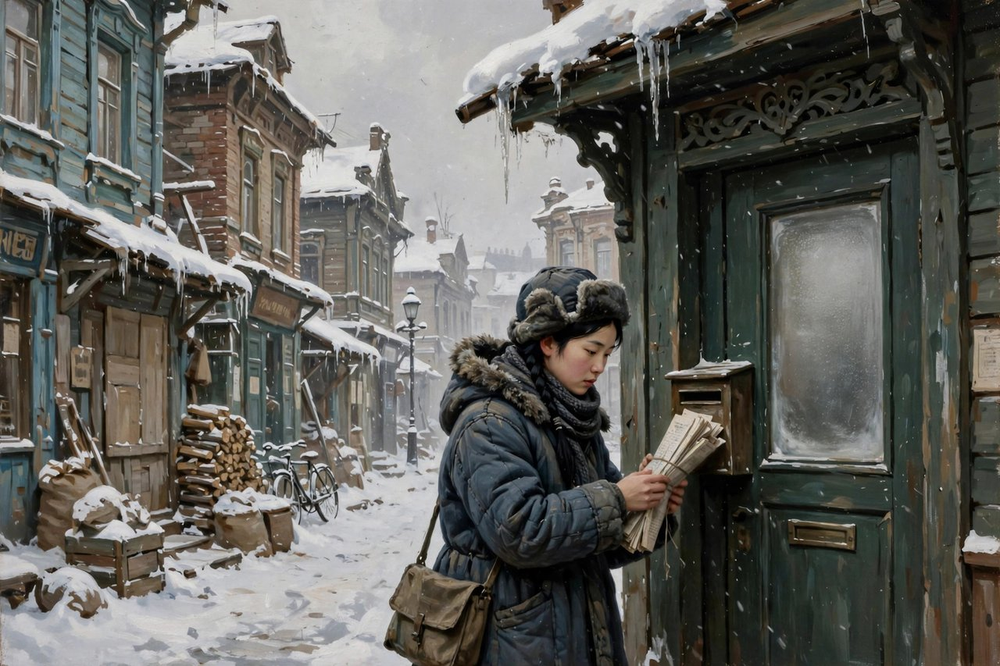
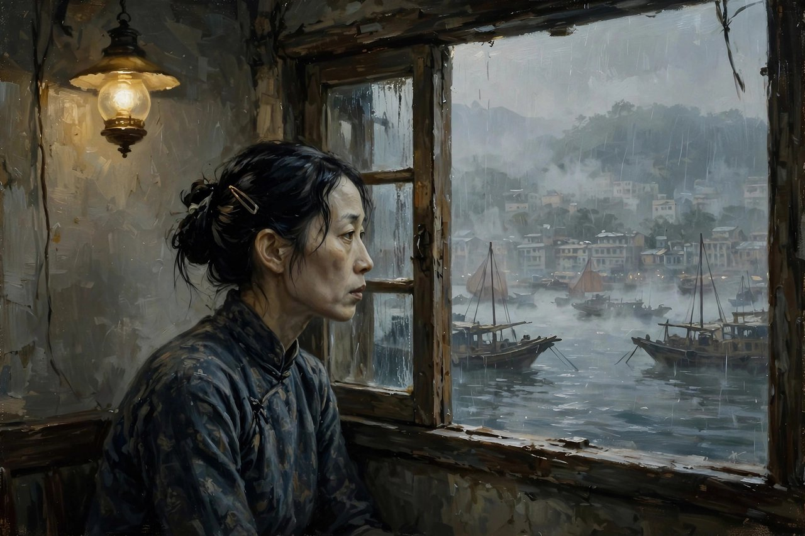

## 呼兰河小院里的女孩

呼兰河是个小城，小到一条街上的泥坑能坑住马车，能坑住行人，能坑住一整天的日子。萧红就生在这样的小城里，生在一座大院里，家里有钱，有规矩，有冷脸。她的本名叫张乃莹，乳名荣华，家里人后来给她改过学名，笔名倒是一个接一个地换，悄吟、玲玲、田娣，到头来留在书封上的，是萧红两个字。她生于一九一一年六月，死于一九四二年一月，满打满算活了三十一岁。三十一年里，她几乎没有过过几天安稳日子，搬家、逃难、生病、生孩子、失去孩子、再搬家，像水上的浮萍，风往哪里吹，她就往哪里漂。可就是这样一个漂着的人，写出了中国现代文学里最硬、最冷、最动人的几本书。

她小时候先没了娘。母亲去世早，父亲再娶，继母进门，家里添了弟弟，父亲的眼光就更冷了。在那个大院里，真正疼她的人，是祖父。祖父年纪大了，性子温和，眼睛笑盈盈的，手里拿着旱烟管，喜欢跟孩子开玩笑。祖父在后园里栽花、拔草、种小白菜，她就跟在后头瞎闹，祖父栽花她栽花，祖父拔草她拔草，祖父下了种，她跟在后头用脚把土窝溜平，溜得东一脚西一脚，全是乱来，祖父也不恼，只笑。祖父教她念诗，抱着她走不动的时候就抱着，能走了就拉着手。那段日子，是她一生里少有的、不必提防的日子。后来她写呼兰河，写来写去，笔尖总要回到那个园子，回到祖父身边，因为那是她心里唯一没有被风雪打透的地方。

可是大院之外，规矩是硬的。女孩子到了年纪，家里就要给她定亲，亲事由不得她点头，也由不得她摇头。她读了书，见了新思想，心里已经装不下那套旧规矩了。一九三零年，她为了抗婚离家出走，去了北平，穷得叮当响，吃尽了苦头。逃出来不等于自由了，自由是要拿日子一分一分换的。她在北平漂，在哈尔滨漂，漂到后来遇见了萧军，两个同样爱写字、同样没钱的年轻人凑到了一起，互相取暖，也互相较劲。萧军这个名字，和萧红这个名字摆在一起，像一对约好了的暗号，从此中国文坛上就有了二萧的说法。

## 哈尔滨的穷日子和一支笔

哈尔滨的日子，是萧红写作的起点，也是她最穷、最冷的一段日子。她和萧军住过旅馆，住过商市街的小楼，楼上楼下全是算计着过日子的穷人。冬天长，雪大，风像刀子，屋里冷，肚子饿，两个人常常是吃了上顿没下顿。萧军白天出去找活、找钱、找发表的门路，她一个人留在屋里，对着四面墙发呆、想事、写字。茶房把列巴圈挂在别的房门上，香味飘过来，饿着肚子的人闻了想做贼，又觉得羞耻。她后来把这段日子写进了散文集里，写饥饿，写寒冷，写孤独，写无聊，写人在没办法的时候心里长出来的伤痕，写得坦白，写得不怕难看。

穷没有压垮她，反倒把她的眼睛磨利了。她看人看得细，看物看得细，看一个人的手、一个人的走路、一个人吃饭的样子，都能看出背后的日子。一九三三年，她和萧军合出了一本集子，叫跋涉，算是正式进了文坛。往后几年，她写得越来越顺，越来越狠。一九三四年，她在哈尔滨写生死场的前半部分，在青岛写完后半部分，写东北农村在日本人打进来前后的样子，写农民怎么活、怎么死、怎么在糊涂里挣扎、怎么在血里醒过来。写完之后，她和萧军去了上海，举目无亲，就给鲁迅写了信。鲁迅回了信，见了面，拿过稿子认真改了，还自己掏钱帮她出了书，写了序。鲁迅在序里说，这本书写的是北方人民对于生的坚强、对于死的挣扎，力透纸背。这句话，后来成了生死场最好的注脚，也成了萧红最好的通行证。

上海的日子并没有让她安稳下来。她和萧军的感情慢慢出了裂缝，两个人越走越远。她东渡日本，在东京写散文、写组诗，写孤独的生活，写砂粒，写人在异乡的冷。回国之后，抗战已经打起来了，她跟着文化界的人从上海撤到武汉，又从武汉一路往西南、往香港走，路上写，病中写，到了香港，还在写。香港是她写作的高峰，也是她生命的终点。她在香港写出了呼兰河传，写出了马伯乐，写出了小城三月，写完这些，身体就垮了。一九四二年一月，她因肺病和气管的毛病病逝在香港，年仅三十一岁。临死前，她心里念着的，还是东北，还是呼兰河，还是那条回不去的河。

## 她写东西的路子

萧红的笔路，和同时代很多作家都不一样。她不爱搭大架子，不爱讲大道理，不爱把人物摆成雕像让人瞻仰。她爱写散的、碎的、日常的，像拉家常一样把事情一件一件摆出来，摆着摆着，寒意就上来了。她的长篇常常没有一条笔直的故事线，呼兰河传就是这样，写小城，写风俗，写园子，写邻里，写一个又一个人的死活，读起来像回忆，又像纪录，像有人坐在你对面，慢慢给你讲她老家的事，讲着讲着你才发现，每一件事背后都站着一个制度，站着一种风俗，站着一群看热闹的人。

她写女人，写得尤其狠，也尤其心疼。生死场里的金枝，穷得把自己的孩子摔死；呼兰河传里的小团圆媳妇，活泼泼的一个姑娘，被婆家打、被迷信折腾，最后死在一锅热水里；小城三月里的翠姨，爱不敢说，书不敢读，命不敢争，最后悄悄病死在家里；手里的王亚明，因为一双染黑的手，被学校、被同学、被校长一步一步推出门去。这些女人没有一个是喊口号的英雄，她们甚至连反抗的话都说不全，可萧红偏偏要写她们，写她们怎么被规矩压着、被穷压着、被看客的眼光压着，又怎么在压着的缝隙里还想活、还想爱、还想读书。萧红自己就是从这种缝隙里爬出来的人，她懂得那种想活又活不痛快的心情，所以写起来不煽情，不卖惨，冷静得让人心慌。

她写土地，也写得不温柔。东北的土地在她笔下不是田园诗，是麦场、菜圃、泥坑、风雪，是人跟牲口一起忙着生、忙着死的场子。她写农民的愚昧，也写农民的顽强，写他们信鬼神、信跳大神、信偏方，也写他们在日本人打进来之后，慢慢醒过来，拿起家伙反抗。她不把农民写成符号，也不把他们写成傻子，她写的是具体的人，具体的日子，具体的一碗饭、一件衣裳、一条命。这种写法，在当时是新鲜的，在今天看，依然新鲜，因为今天还有很多人写农村只会写风景、写乡愁，写不出泥坑里的冷和人。

她还会讽刺，而且讽刺起来一点不留情。马伯乐就是她讽刺的代表作，写一个胆小、自私、爱空谈的小知识分子，从青岛逃到上海，从上海逃到汉口，嘴上全是道理，脚下全是逃跑，满脑子想着取代父亲、想着有钱太太、想着证明自己说得对，就是不肯正经做一点事。萧红写他，写得幽默，写得刻薄，写得让人一边笑一边冒冷汗，因为这种人不是民国特产，今天的写字楼里、朋友圈里、饭局上，到处都能碰见他的影子。

## 她和鲁迅那段交情

说萧红，不能不说鲁迅。鲁迅对萧红，不只是提携晚辈那么简单，更像是给一个漂着的人递了一根绳子。萧红到上海的时候，身上没钱，名气没有，稿子倒是有一本，就是生死场。鲁迅看了稿子，改了稿子，见了人，还请吃饭，把茅盾、聂绀弩、叶紫这些人介绍给她认识，让她一下子从举目无亲变成了文坛里有熟人的人。更难得的是，鲁迅没有把她当成一个需要同情的女学生，也没有把她当成一个点缀文坛的花瓶，他是认真读她的文字，认真跟她谈写作，认真帮她想出路的人。萧红后来写回忆鲁迅的文章，写鲁迅怎么笑，怎么写字，怎么待客，怎么在饭桌上聊天，写得细，写得暖，那些文字到今天读起来，还是能让人看见一个活生生的鲁迅，而不是课本里的铜像。

这段交情也说明了萧红的一个本事，就是她能让人认真对待她的文字。她出身不好，学历不全，日子过得乱，感情生活也被人说三道四，可她的文字一摆出来，行家就知道这不是玩票。鲁迅看中的，正是她文字里那股不掺假的劲。她不写自己不懂的东西，不写自己没见过的日子，她写的东西，全是她在泥里滚过、在雪里冻过、在饿肚子的时候想过的东西。这种不掺假，在今天这个满世界都是人设、满世界都是文案的时代，反而更稀缺了。今天很多人写东西，写的是姿态，是金句，是转发量，萧红写的是日子本身，是日子压在人身上的分量。读她的东西，你会觉得她没有在表演给你看，她只是在说，我见过，我疼过，我记下来了。

她和萧军的关系，和她和端木蕻良的关系，后来被人翻来覆去地讲，讲成了八卦，讲成了电视剧，讲成了茶余饭后的谈资。说实话，那些八卦对理解萧红没有多大用处，反而把她的写作给遮住了。一个作家值不值得读，看的是她写了什么，不是她跟谁谈过恋爱。萧红的感情确实跌宕，确实有过伤害别人也被别人伤害的时候，可她没有把这些变成卖惨的材料，她是把这些疼，转化成了对笔下女人的理解。她懂得一个女人在家里没有话语权是什么滋味，懂得一个女人想读书、想出门、想自己做主有多难，懂得一个女人在男人和规矩之间左右为难的时候，心里是怎么一点一点凉下去的。她写翠姨，写王亚明，写金枝，写小团圆媳妇，笔下没有一个女人是扁平的，她们各有各的软，各有各的硬，各有各的不甘心。

## 对照今天看萧红

今天再读萧红，很多人会问，一个写民国东北的人，跟今天有什么关系。关系大得很。先说女人。今天的女孩子不用再被家里包办婚姻了，不用再因为一双手黑就被学校赶出去了，可是新的规矩换了个样子还在。职场里对女性的挑剔，婚恋市场上对女性的标价，网络上对女性身材、年龄、婚育的围观，换汤不换药，还是那套看客的逻辑。萧红写小团圆媳妇被婆婆打，被街坊议论，被迷信折腾，写的是旧社会，可那种一个人被一群人围着评头论足、慢慢逼到绝路上的机制，今天在网络暴力里、在职场排挤里、在家庭冷暴力里，照样活着。读萧红，不是为了掉眼泪，是为了认出这种机制，认出来了，才不会稀里糊涂地跟着起哄，也不会稀里糊涂地被压垮。

再说乡土。今天很多人一提乡土，就只会说乡愁、说田园、说回不去的故乡，拍出来的乡村全是滤镜，写出来的乡村全是诗。萧红不吃这一套。她写呼兰河，写泥坑，写跳大神，写放河灯，写野台子戏，写四月十八的娘娘庙会，热闹是真热闹，愚昧也是真愚昧，好看也是真好看，害人也是真害人。她不美化，也不丑化，她就是把小城摊开给你看，看里头的人怎么过日子，怎么信鬼神，怎么看热闹，怎么把一个活泼的姑娘看到死还觉得自己没错。这种不美化的乡土写作，今天特别缺。今天的乡村题材，要么是苦情戏，要么是旅游宣传片，中间那种真实、复杂、让人不舒服的日子，反而没人写了。萧红的价值，就在这里，她提醒我们，乡土不是用来怀旧的，是用来认识人的。

再说写作本身。今天写东西的人太多了，平台也多了，可真正的好文字反而少了。很多人写东西是为了立人设，为了带货，为了流量，写之前先想标题怎么起、封面怎么配、开头三行怎么抓人。萧红写东西没有这些算计，她写东西是为了把日子记下来，把疼记下来，把不服气记下来。她的文字不华丽，不堆砌，不玩文字游戏，可就是有劲，有温度，有泥土味。她写祖父的园子，写的是白菜、狗尾草、蜻蜓、蚂蚱，写的是一个孩子在园子里瞎闹的快乐，读起来轻，落到心里重。她写饿，写的是列巴的香味，写的是蘸盐吃的黑面包，写的是饿着肚子还要安慰对方说自己不饿的谎话，读起来淡，落到心里疼。这种写作的诚实，是可以学的，也是最难学的。学萧红，不是学她的句式，是学她那种不糊弄、不表演、不把读者当傻子的态度。

还有一点，是萧红留给今天写作者的提醒，就是短命不等于浅薄。她只活了三十一岁，写作满打满算不到十年，留下的文字却近百万字，而且篇篇都有分量。今天很多人写了一辈子，写了一大堆，留下来的却没几句能被人记住。萧红的例子说明，写作看的不是年头长短，不是产量多少，不是头衔大小，看的是你有没有真正地活过、疼过、看过、想过，有没有把那些活过的东西老老实实地写出来。她的一生是漂泊的，是穷的，是病的，是短的，可她把漂泊、穷、病、短，全都变成了文字的养分，没有浪费一点。这是最让人服气的地方，也是最让人心疼的地方。

## 读萧红该从哪里进门

给没读过萧红的人指一条进门路子，照着她的写作年头走，最顺手。先读生死场，看她怎么用散的笔法写一个村庄的生死，看鲁迅为什么给她写序，看东北农民在日本人打进来前后是怎么从糊涂到醒来的。再读商市街，看她和萧军在哈尔滨的穷日子，看饥饿和寒冷是怎么一笔一笔写出来的，看一个女作家怎么把自己的日子摊开来写还不怕难看。再读桥和手和牛车上这些短篇，看她怎么用很小的篇幅写很大的人性，看一双手、一座桥、一辆牛车怎么能装下一个时代。再读马伯乐，看她怎么讽刺，怎么幽默，怎么把一个胆小鬼写得让人又笑又气。走到这一步，再读呼兰河传和小城三月，你就能明白她为什么是萧红了。呼兰河传是她的回忆，是她的故乡，是她的童年，是她对祖父的怀念，也是她对整个小城的审判。小城三月是她的绝笔，是她用最后的力气写下的一个姑娘的死，是她对自己一生遭遇的回望，也是她留给后来女孩子的一句警告。

读的时候，别急着找金句，别急着划线，别急着发朋友圈。萧红的东西不适合碎片化地读，不适合只读几句漂亮话就以为读懂了。她的东西要慢慢读，整本读，读她怎么铺陈日子，读她怎么让一个人出场、怎么让一个人消失，读她怎么写风、怎么写雪、怎么写一顿饭、怎么写一次看病。读进去了，你会发现她的文字有一种特别的节奏，慢，散，细，可就是停不下来，像有人在你耳边絮絮叨叨地讲老家的事，讲着讲着，你就走进了呼兰河，走进了哈尔滨，走进了那个小城的三月，走进了那个姑娘没有说出口的心里。

萧红重要，不是因为她命苦，不是因为她是民国才女，不是因为她的故事能拍成电视剧。她重要，是因为她写出了中国人身上一种很具体的东西，就是在苦日子里还想活、还想爱、还想做人的那股劲，也是被苦日子压着、被规矩压着、被看客压着的时候，人是怎么一点一点变麻木、变糊涂、变残忍的。她写生，也写死，写生的时候不粉饰，写死的时候不煽情，写人的时候不站队，写时代的时候不喊口号。这种不站队、不喊口号、不粉饰、不煽情的写作，在任何时代都是稀缺的，在今天这个动不动就要站队、动不动就要表态、动不动就要把人分成敌我朋友的时代，更是稀缺。读萧红，就是读一种不被时代口号带走的清醒，就是读一个人在风雪里还能把日子看清楚、把人看清楚的本事。

她死的时候，才三十一岁，葬在香港浅水湾一带，后来骨灰迁回了广州的银河公墓一带安放，这些身后事，说起来都是后话了。她活着的时候，没有大房子，没有安稳日子，没有善终，可她留下的书还在，还在被人阅读，还在被改编，还在被讨论，还在让一代又一代的读者心里发紧。一个作家能做到这一点，就已经赢了。她的命是薄的，她的书是厚的，她的人是短的，她的影响是长的。呼兰河的水还在流，哈尔滨的雪还在下，小城的三月还在开花，翠姨没有说出口的话，还在等着有人听见。萧红走了八十多年，她写的那些人、那些日子、那些没有说出口的话，还在我们身边活着，这就是她为什么重要的全部答案，也是我们今天还要一本一本地读她的全部理由。

## 她的书单摊开来看

把萧红的书摊开来看，是一张很清楚的地图。跋涉是她和萧军合出的集子，是起点，里头的东西还带着青涩，带着年轻人的冲劲，也带着穷日子的痕迹。生死场是成名作，是她把东北农村的生死摊开来写的代表作，鲁迅作序，胡风写读后记，一本书就让她在上海文坛站住了脚。商市街是散文集，写哈尔滨的穷日子，写饥饿和恐惧，写她和萧军那段又苦又甜的日子，四十一篇散文，篇篇都是日子本身。桥是散文和短篇合集，里头收了手、小六、桥这些篇目，写小人物的疼，写小人物的硬。牛车上是小说集，收了牛车上、家族以外的人、红的果园、孤独的生活、王四的故事这些篇目，写流亡，写家族，写一个人在时代里的位置。旷野的呼喊是短篇集，呼兰河传是长篇回忆，小城三月是中篇绝笔，马伯乐是长篇讽刺，回忆鲁迅先生是散文，萧红散文是杂集。加起来近百万字，不到十年写完，这个量，这个质，放在任何时代都是惊人的。

看这张地图，能看出来她的写作是一直在往深处走的。早期的东西，写的是自己的疼，自己的饿，自己的冷，写得直接，写得贴身，写得像日记。到了中期，她开始写别人，写村庄，写小城，写一群人，写一个时代，视野打开了，笔也稳了。到了香港时期，她的写作到了高峰，呼兰河传把童年、故乡、风俗、人性全都揉在了一起，写得散，写得深，写得让人读完之后心里空落落的，又满满的。小城三月把她对女性命运的思考推到了极致，翠姨的死，不是写一个姑娘的死，是写一种制度怎么杀人，杀得不见血，杀得让人连凶手都找不到。马伯乐把她的讽刺推到了极致，写一个胆小鬼的逃难，写出了整个时代的狼狈，写出了很多人不敢承认的自己。这种一步一步往深处走的轨迹，是一个作家真正成熟的标志，不是靠年头熬出来的，是靠疼熬出来的，是靠日子熬出来的。

她的语言也值得单说。萧红的语言不华丽，不掉书袋，不用生僻字，不玩修辞杂技。她用的全是日常的词，白菜、列巴、泥坑、风雪、炕、棉袄、旱烟管，这些词谁都认识，可到了她手里，这些词就有了分量。她写雪，写的是雪落在帽子上、落在肩膀上、落在人心里头的冷。她写饿，写的是胃里空着、嘴里没味、眼睛盯着别人家门上的列巴圈走不动路的馋。她写死，写的是一个人慢慢变黄、变瘦、变没声，最后没了，连街坊都只剩下一句叹息。她写爱，写的是不敢说、不敢看、不敢伸手，只敢在心里想一想，想完了还要自己骂自己一顿的爱。这种语言，今天的写作者最该学，因为今天的文字太爱用大词了，动不动就是格局、就是底层逻辑、就是认知升级，大词一堆，日子没了，人才没了。萧红反过来，她不用大词，她用小词写大事，用日常写时代，用一碗饭写一个社会，用一双手写一种制度，这才是文字的真本事。

她的影响也一直在延续。后来的女作家，写女性命运的时候，绕不开萧红。写乡土的时候，绕不开萧红。写童年的时候，绕不开萧红。写小城的时候，绕不开萧红。不是说后人都在模仿她，而是说她把一些路先走通了，把一些话先说出来了，把一些疼先记下来了，后人再走，就有了参照。她的书被改编成电影、电视剧、话剧，被写进教材，被研究者一本一本地研究，被读者一代一代地读下去。她的故乡呼兰，建了萧红纪念馆，她住过的商市街小楼，成了人们去哈尔滨要看的地方，她的书，成了很多人认识东北、认识民国、认识女性命运的入口。这些身后事，她活着的时候大概想不到，也顾不上想，她活着的时候只想着下一顿饭怎么办、下一本书怎么写、下一个住处在哪里。可正是这种只想着眼前日子的人，写出了最长远的东西。

说到底，萧红是一个用命换文字的人。她没有把写作当成事业，当成晋升的梯子，当成出名的工具，她把写作当成了活下去的方式，当成了把日子过下去的方式。她穷的时候写，病的时候写，逃难的时候写，漂泊的时候写，写到死前还在写。这种写作，不是职业，是命。她留给我们的，不只是一堆书，更是一种态度，就是日子再苦，也要看清楚，日子再难，也要写下来，日子再短，也要活出分量。今天的人，日子比她好过得多，可很多人活得比她还糊涂，还麻木，还不敢看清楚自己的日子。读萧红，就是把这种糊涂和麻木敲一敲，就是提醒自己，别把日子过成了别人的日子，别把自己活成了看客，别等到老了才发现，自己从来没有认真地看过自己、看过身边的人、看过自己生活的土地。她用三十一年的命，换来了这样一句提醒，这句提醒，值得我们今天再听一遍，再读一遍，再记一遍。

## 风雪里的一盏灯

还有一个角度看萧红，是看她怎么对待苦难。很多人写苦难，要么把苦难写成勋章，要么把苦难写成控诉，要么把苦难写成鸡汤，告诉你熬过去就好了。萧红不这样。她写苦难，写的是苦难本身的样子，不美化，不升华，不给苦难发奖状。她写饿，就是饿，胃空着，人发慌，眼睛发绿。她写冷，就是冷，风往棉袄里钻，手脚冻得没知觉。她写死，就是死，人慢慢没了，家里空了，街坊叹一口气，转身又去忙自己的日子。她不告诉你苦难有意义，她只告诉你苦难真实存在，而且常常没有道理，没有补偿，没有后来居上的反转。这种诚实，在今天这个爱讲逆袭、爱讲翻盘、爱讲苦难终将开花的时代，是一盆冷水，也是一面镜子。不是所有的苦都有回报，不是所有的人熬过去都能翻身，承认这一点，不是悲观，是对活着的人的尊重。

她对待人，也是这样诚实。她不把好人写成完人，不把坏人写成恶魔。她写祖父，写的是慈爱，也写祖父的软弱和无奈。写父亲，写的是冷淡和严厉，也写父亲身上那种被时代和规矩困住的可怜。写萧军，写的是才华和陪伴，也写两个人在穷日子里的争吵和疏远。写马伯乐，写的是胆小和自私，也写他心里那点想做好人的念头，想证明自己的念头，想被别人看得起的念头。她不站队，她只看人，看一个人在具体的日子里是怎么想、怎么做、怎么疼、怎么错的。这种看人的方式，今天特别值得学。今天网络上看人，动不动就是贴标签，动不动就是站队，动不动就是一个人说错一句话就全盘否定，萧红的写法提醒我们，人是复杂的，日子是具体的，评价一个人，要看他一辈子的日子，要看他身边的风雪，要看他手里有没有余粮，心里有没有余温，不能只凭一句话、一个截图、一个热搜就定罪。

读萧红到头来，读到的是一种能力，就是在风雪里还能把眼睛睁开的能力。她一生都在风雪里，呼兰河的风雪，哈尔滨的风雪，上海的风雪，武汉的风雪，香港的病房里的风雪，她没有躲，没有闭眼，没有把头埋进沙子里，她是睁着眼看，睁着眼记，睁着眼写。这种睁着眼的能力，是她留给我们最值钱的东西。今天的人，风雪换了样子，换成了房贷，换成了加班，换成了内卷，换成了网络上的口水，可本质没变，还是要睁着眼过日子，睁着眼看自己，睁着眼看身边的人，别把日子过糊涂了，别把自己活成看客，别在热闹里丢了自己的心。萧红用三十一年的时间，把这句话写成了十几本书，写成了近百万字，写成了呼兰河的水，写成了哈尔滨的雪，写成了小城三月的花，写成了翠姨没有说出口的爱，写成了王亚明染黑的手，写成了马伯乐逃难的脚步，写成了冯歪嘴子磨房里的灯火。这些东西，今天读起来，依然烫手，依然有用，依然能让人心里一紧，依然能让人想把自己的日子重新过一遍，过得清醒一点，过得诚实一点，过得像个人一点。

## 留给后来人的话

萧红没有留下什么豪言壮语，没有留下什么人生格言，她留下的是书，是日子，是人。她活着的时候，很多人只看到她的命苦，只看到她的漂泊，只看到她的感情纠葛，看不到她文字里的硬和冷。等她死了，人们才慢慢发现，她写的那些看似散漫的日子，其实是一部东北的民俗志，是一部女性的血泪史，是一部小城的解剖报告，是一部时代的侧写。她写的跳大神、放河灯、唱秧歌、看野台子戏、逛娘娘庙会，不只是风俗描写，是在写一种精神状态，写一群人怎么在热闹里麻木，在仪式里逃避，在看热闹里把别人的命看没了。她写泥坑，不只是写一条路不好走，是在写一个社会怎么对坑视而不见，怎么让坑一年一年地坑人，怎么让人在坑边走过还觉得理所当然。这些写法，今天读起来，依然能对应上很多事，依然能让人想一想，自己身边有没有这样的泥坑，自己是不是也在坑边看热闹的人群里。

她的书，适合放在家里慢慢读，适合给孩子读，适合给写东西的人读，也适合给那些觉得日子过得没意思的人读。给孩子读，是让孩子知道，童年不只有快乐，还有祖父的园子，还有大院里的冷脸，还有小城里的规矩，知道一个人长大是要付出代价的，是要自己走出家门、走出小城、走出规矩的。给写东西的人读，是让写东西的人知道，文字不是装饰，不是技巧，不是流量密码，文字是日子，是疼，是看清楚之后写下来。给觉得日子没意思的人读，是让这样的人知道，日子本身就有意思，有疼，有爱，有挣扎，有不服气，有在风雪里还想活下去的劲，只要你睁开眼看，日子就不会白过。萧红就是这样一个人，她的日子比谁都苦，可她没有把日子过白，她把日子写下来了，写成了书，写成了后来人手里的一盏灯。这盏灯不亮得刺眼，不暖得烫手，可就是在风雪里一直亮着，亮了八十多年，还在亮，还会继续亮下去。
