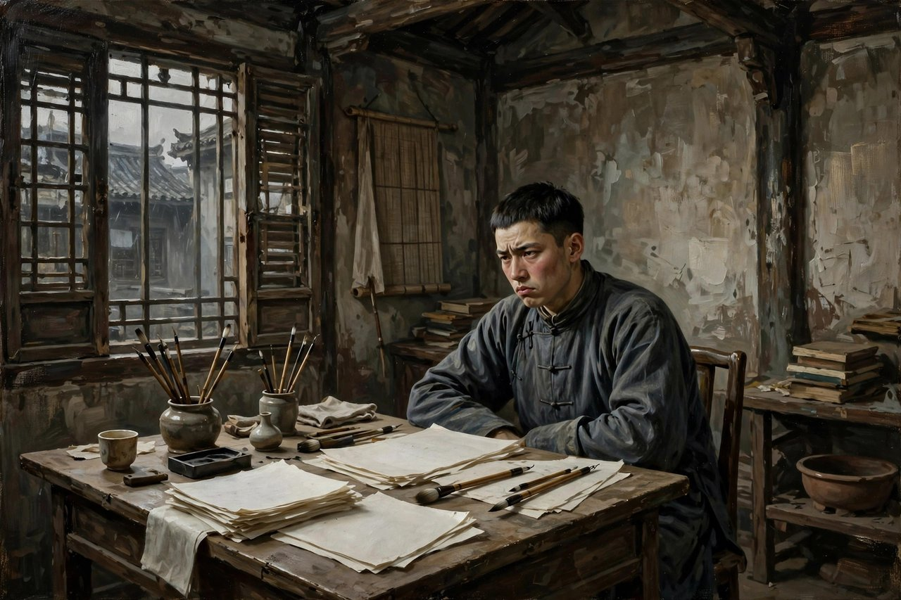
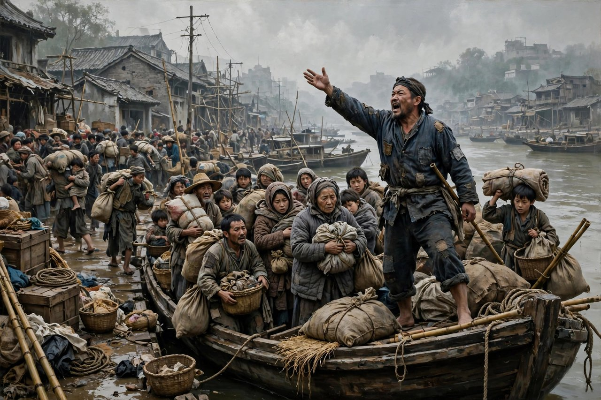

## 战前就很胆小的人

马伯乐这本书，一开篇就把主角的底交出来了，马伯乐在战前就很胆小。这句话，口语化，凝练，又带着诗意，是萧红特有的写法，一句话，就把一个人的魂交出来了。马伯乐是个什么人，是一个人生错位的小人物，是一个亦文亦商、不文不商的文化游民，是一个出身青岛有钱且信洋教家庭的青年，是一个五四运动之后出生的青年，是一个在抗战初期的小知识分子的典型。有人把他比作中产阶级的那个农民，这个比方，不算全对，但抓住了要害，那个农民靠精神胜利法活着，马伯乐靠精神失败法活着，那个农民是赢了也输，输了也赢，马伯乐是还没打就先认输，还没跑就先找退路，还没做事就先想好借口。萧红写这本书，写于一九四零年，在香港写成，一九四一年一月由重庆大时代书局出版，写成的部分，讲的是马伯乐从青岛逃难到上海的生活，讲的是他从上海逃难到汉口的生活，讲的是他在汉口的一场恋爱和失恋，至于他一家从汉口再逃到重庆的故事，萧红本来打算写，可惜没有写完，书就停在了汉口，停在了马伯乐的狼狈里，停在了一个没有写完的逃难路上。

马伯乐在青岛老家的时候，日子是仰仗父亲的，他憎恶父亲操控的家，觉得那个家平庸、沉寂、无生气，觉得年轻人久住在这样的家里是要弄坏了的，要腐烂了的，会要满身起青苔来的。可实际上，他根本离不开父亲，他所希望的，不是独立，不是自由，不是自己谋生，而是取代父亲的位置，任意支配家里的钱。他甚至不如父亲，没有任何谋生的本领，没有一点实干的劲头，只有一脑子的空想，一肚子的牢骚，一嘴的道理。他一时兴起，大张旗鼓地准备以写作救国，买来纸笔，开初买的是金边的，后来买的是普通的，到头来就买些白纸回来，纸越买越便宜，劲头越写越小，到头来功败垂成，什么也没有写出来。这种写作救国，听起来高尚，实际上是空想，是拿写作当借口，逃避谋生，逃避责任，逃避日子。后来，他去上海开书店谋生，结果一本书都没有卖出去，最后落荒而逃。开书店这件事，也是一样的路数，想得大，做得小，干得乱，赔得快，逃得更快。萧红写这些，写得幽默，写得讽刺，写得辛辣，写得让人一边笑一边冒冷汗，因为这种人，不是民国特产，今天的写字楼里、朋友圈里、饭局上、创业圈里，到处都能碰见他的影子，到处都有那种想得大、做得小、说得多、干得少的人。

马伯乐的逃，是天生的，是刻在骨子里的，是他的行为特征。卢沟桥事件一发生，马伯乐就坐着大洋船从青岛的家里，往上海逃来了。一开始，他的逃难，是以逃难为借口，逃离他厌恶的父亲的家，他最希望的，是有钱的太太与他一起出逃，他的苦闷，是没有钱的苦闷。为了使他太太早日到上海，脑子白丸的他，甚至盼望日本马上打青岛。盼望灾难早点来，只为了证明自己说得对，只为了让太太早点来，只为了让自己的预言成真，这种扭曲的心理，萧红写得毫不留情，写得入木三分。日本兵打到上海后，他津津乐道于自己的先见之明，那些焦虑竟一扫而空，这一夜睡得非常舒服，非常安适，好像他并不是睡觉，而是离开了这个苦恼的世界一整夜。这种舒服，是马伯乐式的舒服，是预言成真之后的舒服，是灾难真的来了、自己终于不用再焦虑了的舒服，是把别人的灾难当成自己正确的证明的舒服。今天的人，读到这里，可能会想起朋友圈里那些盼着灾难、盼着崩盘、盼着别人倒霉，好证明自己说得对的人，想起那些把焦虑变成优越感、把别人的疼变成自己的谈资的人，马伯乐这个人物，就是他们的祖师爷，就是他们的镜子。

## 从上海逃到汉口

战火真的烧到上海之后，马伯乐和妻子、儿女才开始真正的逃难生活，才开始真正的羁旅生活。在逃难的现实里，马伯乐开始学着劳动，学着谋生，学着自我约束，他给自己缝了一个大背兜，想着以后说不定还要去打日本，现在先学着点，学着背东西，学着走路，学着吃苦。这种学着点，是马伯乐身上少有的、让人觉得还有一点希望的地方，是萧红没有把他写死、没有把他写成纯粹的坏人的地方。萧红写马伯乐，不把他简单化，不把他写成一个扁平的讽刺工具，她写他的自私，也写他的忧伤，写他的懒惰，也写他的孤独，写他的贪婪，也写他对感情的渴望，写他厌恶满身铜臭气的太太，希望有一种感情上的爱，写他痛恨的事，自己又在做，写他想做好人，又做不好，写他想独立，又离不开父亲，写他想抗日，又只会逃跑。这种复杂，这种分裂，这种人格上的畸形，就是萧红笔下马伯乐最真实的地方，也是最让人心疼的地方，因为这种分裂，今天很多人身上都有，今天很多人也是这样，嘴上痛恨的事，手上又在做，嘴上想要的生活，脚下又走着相反的路。

汉口的一段，是马伯乐在逃难路上的恋爱和失恋，是他在狼狈日子里的一点温柔，也是一点荒唐。他在汉口谈恋爱，谈得认真，谈得投入，谈得像是要重新做人似的，可到头来，还是失恋了，还是回到了原来的样子，还是回到了逃跑的路上。这种恋爱和失恋，写得幽默，写得辛酸，写得让人觉得，马伯乐这个人，连爱都爱得不彻底，连失恋都失得不彻底，他的人生，就是这样半吊子，就是这样不上不下，就是这样想认真又认真不起来，想逃跑又逃不干净。萧红写汉口，写船，写码头，写难民，写船老板，写得尤其精彩。船老板为了掩盖发国难财的目的，面对船上的难民，发起了一场慷慨激昂的爱国演说，说自己为的是大家，为的是国家民族，说有枪的上前线，没枪的在后方工作，说大家在逃难的时候，忍耐着一点，也就过去了，说三道四，于事无补，白起磨擦，那是汉奸的行为。这种演说，听起来爱国，实际上是生意，是发国难财的遮羞布，是把难民的忍耐当成自己赚钱的工具。萧红写这段演说，写得反讽，写得冷幽默，写得让人一边听一边想笑，笑完了又想骂，因为这种演说，今天还在，换了个样子还在，换成了各种口号，各种情怀，各种大爱，各种为了大家好的说辞，背后还是生意，还是利益，还是把别人的忍耐当成自己的本钱。

## 马伯乐这面镜子

马伯乐这面镜子，照见的不只是一个人，照见的是一群人，照见的是抗战初期国统区的混乱和狼狈，照见的是国难当头的时候，一部分人惊慌失措、纷纷逃跑的样子，照见的是庄严和荒淫无耻并存的现实，照见的是有些人嘴上爱国、手上发财、脚下逃跑的三副面孔。萧红写这本书的时候，抗战文艺要求塑造英雄，要求写高大的人物，要求写鼓舞人心的故事，可她偏偏要写反英雄，偏偏要写卑琐、无聊、混乱、慌张、狼狈的抗战生活，偏偏要写江山易改、本性难移的劣根性，偏偏要写一部分民众只求自保、不顾他人的精神状态。这种写法，在当时是不合时宜的，是会被人责备的，是会被人说只关在自己的小圈子里的，可萧红还是写了，还是写得认真，写得辛辣，写得不留情，因为她觉得，抗战不只是英雄的故事，抗战也是普通人的故事，也是胆小鬼的故事，也是逃难者的故事，也是发国难财者的故事，把这些故事写出来，抗战才完整，历史才完整，人性才完整。今天的人，读马伯乐，也该有这种勇气，敢于看自己身上的马伯乐，敢于承认自己有时候也是胆小的，也是自私的，也是爱空谈的，也是只会逃跑的，承认了，才有可能改，才有可能不做马伯乐，才有可能在关键时刻，不逃跑，不空谈，不发国难财，不把别人的忍耐当成自己的本钱。

马伯乐身上最让人熟悉的毛病，是优柔寡断，是自私自利，是耍小聪明，是胆小怕事，是高谈阔论，是对同胞的瞧不起，是动不动就骂同胞，是把自己的前瞻性变成无休无止的焦虑，又把焦虑变成对他人麻木不仁的憎恨，尽管他本人除了看热闹也毫无作为，可总能为自己逃避责任找到一大堆自认为极其充分的理由。为了挤过断桥，为了挤上轮船，他根本不在乎扶老携幼，为了几毛钱，他甚至对眼里更低阶层的车夫拳头相向。这种欺软怕硬，这种对上唯唯诺诺、对下拳脚相加的毛病，今天的人也熟悉，今天的职场里、饭局里、网络上，到处都有这样的人，对领导点头哈腰，对下属颐指气使，对强者不敢说话，对弱者重拳出击。萧红写马伯乐，就是把这种毛病写出来了，写得活灵活现，写得让人觉得，他就在身边，甚至他就是自己。这种照镜子的感觉，是马伯乐这本书最大的价值，是它过了八十多年还让人笑、还让人气、还让人冒冷汗的原因。

马伯乐和那个农民的对比，也值得想一想。那个农民是辛亥革命时期的农民典型，马伯乐是抗战初期小知识分子的典型，那个农民用精神胜利法，把失败说成胜利，把被打说成自己打了别人，马伯乐用精神失败法，把还没有失败说成已经失败，把还没有打就先认输，把逃跑说成是不得已，把自私说成是清醒，把焦虑说成是先见之明。这两种毛病，看起来相反，实际上是一枚硬币的两面，都是不敢面对现实，都是用一种心理把戏，把现实糊弄过去，都是把自己的无能，包装成一种哲学，一种道理，一种优越感。今天的人，身上既有那个农民的毛病，也有马伯乐的毛病，有时候是精神胜利，有时候是精神失败，有时候是赢了也输，有时候是还没打就认输，两种毛病轮换着来，轮换着糊弄自己，轮换着逃避日子。萧红写马伯乐，就是把精神失败法写出来了，写得清楚，写得具体，写得让人没法抵赖，读完了，你会想一想，自己是不是也在用精神失败法，是不是也在还没做就先说做不成，是不是也在用焦虑代替行动，是不是也在用预言代替实干，想清楚了，就有可能改，就有可能不做马伯乐，就有可能在下一次灾难来的时候，不逃跑，不空谈，不发财，不骂同胞，而是做一点实事，哪怕只是一点点，哪怕只是背起一个大背兜，学着走路，学着吃苦，学着做人。

## 对照今天看马伯乐

今天再读马伯乐，很多人会笑，笑马伯乐胆小，笑马伯乐自私，笑马伯乐空谈，笑马伯乐逃跑，笑完了，再想想，自己是不是也在笑自己。今天的朋友圈里，有多少马伯乐，有多少人嘴上全是道理，脚下全是逃跑，有多少人谈起国家大事头头是道，谈起自己的工作、自己的家庭、自己的责任就支支吾吾，有多少人盼着房价跌、盼着股市崩、盼着别人倒霉，好证明自己说得对，有多少人把焦虑当成深刻，把牢骚当成思想，把看热闹当成参与，把转发当成行动。马伯乐这个人物，今天没有死，今天活得好好的，活在写字楼里，活在饭局上，活在网络上，活在创业圈里，活在每一个只说不做、只想不干、只逃不战的人身上。读马伯乐，就是认出这些人，就是认出自己身上的马伯乐，认出来了，才有可能改，才有可能不做那种人，才有可能在关键时刻，站出来，做一点事，说一句真话，负一点责任，背起自己的大背兜，往前走一步，哪怕只是一步，哪怕只是学着点，哪怕只是不逃跑。

今天的逃难，也换了个样子还在。今天的逃难，不再是坐着大洋船从青岛逃到上海、从上海逃到汉口的逃难了，换成了换工作、换城市、换行业、换赛道的逃难，换成了遇到困难就辞职、遇到压力就躺平、遇到责任就甩锅的逃难，换成了把逃跑包装成选择、把躺平包装成清醒、把自私包装成边界感的逃难。逃难本身没有错，人遇到灾难要逃，遇到危险要躲，这是本能，这是权利，可马伯乐式的逃难，是把逃当成常态，把逃当成哲学，把逃当成一辈子的路，逃了一辈子，最后什么都没有留下，只留下一路的狼狈，一路的笑话，一路的借口。今天的人，要分清楚，什么是不得已的逃，什么是习惯性的逃，什么是为了活下去的逃，什么是为了逃避责任的逃，分清楚了，才不会把逃跑当成清醒，才不会把躺平当成深刻，才不会在该坚持的时候逃跑，在该负责的时候甩锅，在该做事的时候空谈。萧红写马伯乐，就是帮我们分清楚这一点，就是把习惯性的逃写出来了，写得幽默，写得辛辣，写得让人笑完之后，心里一紧，想一想，自己是不是也在习惯性地逃。

今天的发国难财，也换了个样子还在。今天的发国难财，不再是船老板在难民船上发表爱国演说、收高价船票的发国难财了，换成了灾难面前涨价、疫情面前囤货、危机面前割韭菜的发国难财，换成了嘴上说着为了大家好、手上收着高价钱的发国难财，换成了用情怀、用爱国、用大爱包装生意的发国难财。船老板的演说，今天听起来依然熟悉，熟悉到让人想笑，笑完了又想骂，因为这种演说，今天还在朋友圈里，还在直播间里，还在各种带货文案里，还在各种情怀营销里，嘴上全是大家，嘴上全是国家民族，手上全是生意，手上全是算计。萧红写船老板，就是把这种演说写出来了，写得反讽，写得冷幽默，写得让人没法抵赖，读完了，你会想一想，自己有没有听过这样的演说，有没有信过这样的演说，有没有为这样的演说买过单，有没有在灾难面前，也动过发一笔小财的念头，想清楚了，就有可能不信，就有可能不买单，就有可能在灾难面前，做一个老实人，做一个不发国难财的人，做一个不把别人的忍耐当成自己本钱的人。

## 讽刺的笔法和温柔的底子

马伯乐的讽刺笔法，是萧红写作里很特别的一笔，是她平时不常用的笔法，也是她用得最狠的一笔。平时，萧红写东西是冷静的，是细腻的，是诗意的，是带着泥土味的，到了马伯乐这里，她的笔突然变得幽默了，变得辛辣了，变得刻薄了，变得像一把刀子，刀刀见血，刀刀见肉，刀刀见骨。她写马伯乐买纸，写得好笑，写马伯乐开书店，写得好笑，写马伯乐逃跑，写得好笑，写马伯乐谈恋爱，写得好笑，写马伯乐盼灾难，写得好笑，可笑完了，心里是酸的，是疼的，是冒冷汗的，因为笑的对象不是别人，是我们自己，是我们身上的毛病，是我们不敢承认的自己。这种幽默和辛辣的结合，是讽刺文学最高的境界，是鲁迅式的讽刺，是萧红式的讽刺，是笑里藏着刀，刀里藏着疼，疼里藏着希望，希望里藏着对人的不放弃。萧红讽刺马伯乐，不是为了把他打死，不是为了把他写成坏人，她讽刺他，是因为她还希望他改，还希望他醒，还希望他背起大背兜，学着走路，学着做人，还希望后来的人，不要做马伯乐，不要做又一个马伯乐。

这种讽刺的底子，是温柔的，是对人的温柔，是对小人物的温柔。萧红没有把马伯乐写成恶魔，没有把他写成汉奸，没有把他写成十恶不赦的人，她把他写成一个胆小鬼，写成一个自私鬼，写成一个空谈家，写成一个逃跑者，可同时，她也写他的忧伤，写他的孤独，写他对感情的渴望，写他想做好人的念头，写他缝大背兜的时候，那种学着点的认真。这种温柔，是讽刺文学里最难得的东西，是骂人不骂死、讽刺人不讽刺绝的东西，是给被讽刺的人留一条活路、留一个改的机会的东西。今天很多讽刺作品，写得太狠，太绝，太把人写死，写完了，读者只剩下骂，只剩下笑，只剩下优越感，什么也没有留下。萧红不这样，她讽刺完了，还留了一点温柔，还留了一点希望，还留了一个大背兜，还留了一句学着点，这种温柔和希望，是马伯乐这本书最动人的地方，也是最值得今天写讽刺的人学的地方。讽刺不是为了骂死人，讽刺是为了让人醒，醒了，才能改，改了，才能活，活了，才算没有白讽刺。

读马伯乐的方法，也很简单，别把它当成历史书，别把它当成政治课本，别把它当成需要背诵的经典。把它当成一面镜子，当成一个笑话集，当成一个逃难者的日记，当成一个胆小鬼的自白，读马伯乐买纸，读马伯乐开书店，读马伯乐逃跑，读马伯乐谈恋爱，读船老板的演说，读大背兜的故事，读完一遍，再读一遍，笑完一遍，再笑一遍，笑完了，想一想，自己是不是也在买金边纸，是不是也在开卖不出去的书店，是不是也在盼着灾难证明自己说得对，是不是也在发表爱国演说、收着高价钱，是不是也在背着大背兜、学着走路，想清楚了，马伯乐就不再是一本民国的书了，就变成了你自己的书，变成了你身边人的书，变成了今天写字楼里、朋友圈里、饭局上的一面镜子，照见胆小，照见自私，照见空谈，照见逃跑，照见了，才有可能不做马伯乐，才有可能在下一次风浪来的时候，不逃跑，不空谈，不发财，而是站稳了，做一点事，负一点责任，活得像个人一点。

## 逃难路上的一盏灯

马伯乐这本书，没有写完，停在了汉口，停在了逃难路上，停在了一个没有结局的地方。这种没有写完，本身就是一种结局，就是一种隐喻，就是告诉读者，马伯乐的人生，是没有结局的，是永远在逃的，是永远在半路上的，是永远在想做又做不成、想逃又逃不干净的状态里的。萧红没有给他一个圆满的结局，没有让他幡然醒悟、改过自新、成为英雄，也没有让他彻底堕落、成为坏人，她就让他停在半路上，停在狼狈里，停在笑话里，让读者自己去想，他后来怎么样了，他到了重庆怎么样了，他后来有没有改，有没有醒，有没有背起大背兜走下去。这种没有结局的结局，比有结局的结局更有力量，因为人生本身就是没有结局的，就是永远在半路上的，就是永远在逃和不逃、做和不做、说和干之间挣扎的。读马伯乐，就是读这种挣扎，就是读这种半路，就是读这种没有写完的人生，就是想一想，自己的人生，是不是也在半路上，是不是也在逃，是不是也在想做又做不成，是不是也该背起大背兜，往前走一步，哪怕只是一步，哪怕只是学着点。

马伯乐留给今天的人，还有一个很实在的提醒，就是别把空谈当成行动，别把焦虑当成深刻，别把预言当成智慧，别把逃跑当成清醒。今天的人，太爱空谈了，太爱在朋友圈里谈国家大事，太爱在饭局上谈人生道理，太爱在网络上谈别人的人生，谈完了，自己的日子还是老样子，自己的工作还是没进展，自己的家庭还是没照顾好，自己的责任还是没负起来。空谈本身没有错，人需要说话，需要表达，需要交流，可空谈代替了行动，就是马伯乐式的毛病，就是萧红要讽刺的毛病。焦虑本身也没有错，人面对未来会焦虑，面对灾难会焦虑，面对压力会焦虑，可焦虑代替了行动，就是马伯乐式的毛病，就是把焦虑变成优越感、变成谈资、变成不做事的借口的毛病。预言本身也没有错，人可以预测，可以分析，可以判断，可预言代替了行动，就是马伯乐式的毛病，就是盼着灾难来证明自己说得对的毛病。逃跑本身也没有错，人遇到危险要逃，遇到灾难要躲，可逃跑代替了坚持，就是马伯乐式的毛病，就是把逃跑当成一辈子的路的毛病。分清楚这些，才有可能不做马伯乐，才有可能在空谈之外，做一点事，在焦虑之外，走一步路，在预言之外，负一点责任，在逃跑之外，站稳一次。

萧红写马伯乐的时候，人已经在香港了，身体已经不好了，日子已经很苦了，可她写出来的讽刺，却一点都不苦，一点都不丧，一点都不绝望，反而带着幽默，带着笑声，带着对人的希望。这种幽默和希望，是萧红留给我们最值钱的东西，是她在最苦的日子里，还能笑出来、还能讽刺、还能希望人改、还能给人留一个大背兜的东西。今天的人，日子比她好过得多，可很多人已经笑不出来了，已经讽刺不出来了，已经希望不起来了，已经把日子过成了马伯乐式的逃跑和空谈。读马伯乐，就是把笑找回来，把讽刺找回来，把希望找回来，把大背兜找回来，背起来，学着走路，学着吃苦，学着做人，学着在风浪里站稳，学着在灾难面前不发财，学着在关键时刻不逃跑，学着把空谈变成行动，把焦虑变成脚步，把预言变成责任，把逃跑变成坚持。做到了，马伯乐就不再是笑话了，马伯乐就成了一个提醒，成了一个镜子，成了一个在逃难路上亮着的灯，亮给后来的人看，亮给今天的人看，亮给每一个还在逃、还在空谈、还在焦虑的人看，告诉他们，别逃了，别空谈了，别焦虑了，背起背兜，往前走，走一步，算一步，走下去了，人生才算没有白逃，日子才算没有白过。

## 写在逃难路边的话

最后再说一句，马伯乐这本书，不适合只读梗概，不适合只看别人讲给你听的版本，梗概能告诉你马伯乐逃到哪里，告诉你他谈了什么恋爱，告诉你船老板说了什么演说，可梗概告诉不了你马伯乐买纸的时候那种从金边到白纸的滑落感，告诉不了你他开书店一本书都卖不出去的那种尴尬感，告诉不了你他盼灾难的时候那种扭曲的舒服感，告诉不了你他缝大背兜的时候那种学着点的认真感。这些感觉，只有慢慢读原文才能读出来，只有跟着萧红的笔，一步一步跟着马伯乐从青岛走到上海、从上海走到汉口，才能读出来。读原文的时候，可能会笑，可能会气，可能会冒冷汗，可能会觉得马伯乐就是自己，可能会觉得马伯乐就是身边的人，笑完了，气完了，冒完冷汗了，心里会多一点东西，多一点对自己的提醒，多一点对空谈的警惕，多一点对逃跑的警惕，多一点对发国难财的警惕，多一点背起背兜往前走的勇气。这本书，今天还在，还在被阅读，还在被讨论，还在让一代又一代的读者笑、气、冒冷汗，还在照见一代又一代的马伯乐，还在提醒一代又一代的人，别做马伯乐，别做又一个马伯乐，别在逃难路上走了一辈子，最后什么都没有留下，只留下一路的笑话和借口。

马伯乐的逃难路，今天还在走，今天的人，还在青岛，还在上海，还在汉口，还在各种各样的城市之间逃，还在各种各样的工作之间逃，还在各种各样的责任之间逃，逃得理直气壮，逃得有理有据，逃得满嘴道理，逃得一身轻松。可萧红提醒我们，逃得了一时，逃不了一世，逃得了一个城市，逃不过自己，逃得了一份工作，逃不过日子，逃得了一次责任，逃不过良心。真正活下去的办法，不是逃，是背起背兜，是学着走路，是学着吃苦，是学着做事，是学着在风浪里站稳，是学着在灾难面前不发财，是学着在关键时刻不空谈。做到了，逃难路就变成了成长路，胆小鬼就变成了普通人，普通人就变成了能负责任的人，能负责任的人，才算真正活过，才算没有白读马伯乐，没有白笑马伯乐，没有白气马伯乐。

马伯乐走了，萧红走了，逃难路还在，船老板的演说还在，大背兜还在，胆小鬼还在，空谈家还在，逃跑者还在，后来的人，还在路上，还在选择，是逃，还是站稳，是空谈，还是做事，是发财，还是老实，是骂同胞，还是帮同胞。选清楚了，人生就不一样了，选不清楚，人生就还是马伯乐的人生，还是逃了一辈子、笑了一辈子、最后什么都没有留下的人生。萧红把这本书留下来了，留给后来的人选，留给今天的人选，选好了，马伯乐就不再是笑话了，马伯乐就成了一个教训，成了一个提醒，成了一个在逃难路边亮着的灯。

读完马伯乐，合上书，想一想，自己今天有没有逃，有没有空谈，有没有焦虑代替行动，有没有预言代替实干，想清楚了，明天就少逃一次，少空谈一次，多做一件事，多负一次责任，多背一次背兜，多走一步路，走下去了，马伯乐就远了，自己就近了，日子就实了，人生就硬了。

马伯乐的逃难路，今天还在走，今天的人，还在各种各样的城市之间逃，还在各种各样的工作之间逃，还在各种各样的责任之间逃，逃得理直气壮，逃得满嘴道理，可萧红提醒我们，逃得了一时，逃不了一世，逃得了一个城市，逃不过自己，逃得了一份工作，逃不过日子。真正活下去的办法，是背起背兜，是学着走路，是学着吃苦，是学着做事，是学着在风浪里站稳，是学着在关键时刻不空谈、不发财、不骂同胞，而是做一点实事，哪怕只是一点点，哪怕只是背起一个大背兜，往前走一步，走一步，算一步，走下去了，人生才算没有白逃，日子才算没有白过，马伯乐才算没有白笑，萧红才算没有白写。

马伯乐这本书，读一遍是笑，读两遍是气，读三遍是冒冷汗，读很多遍，是照镜子，照见自己的胆小，照见自己的自私，照见自己的空谈，照见自己的逃跑，照见自己的焦虑，照见自己的预言，照见自己的船老板演说，照见自己的大背兜。照见了，才有可能改，改一点，是一点，改一步，是一步，改下去了，马伯乐就远了，自己就近了，日子就实了，人生就硬了，萧红的讽刺就没有白写，马伯乐的逃难路就没有白走，大背兜就没有白缝，学着点就没有白说。
