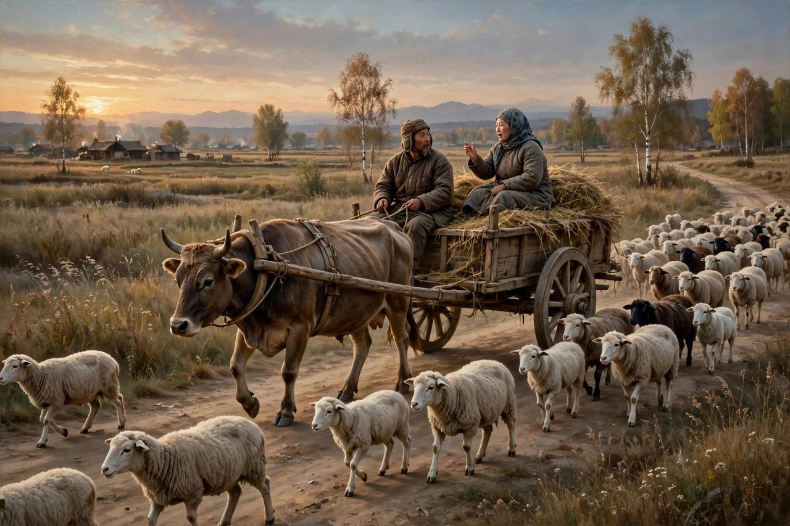
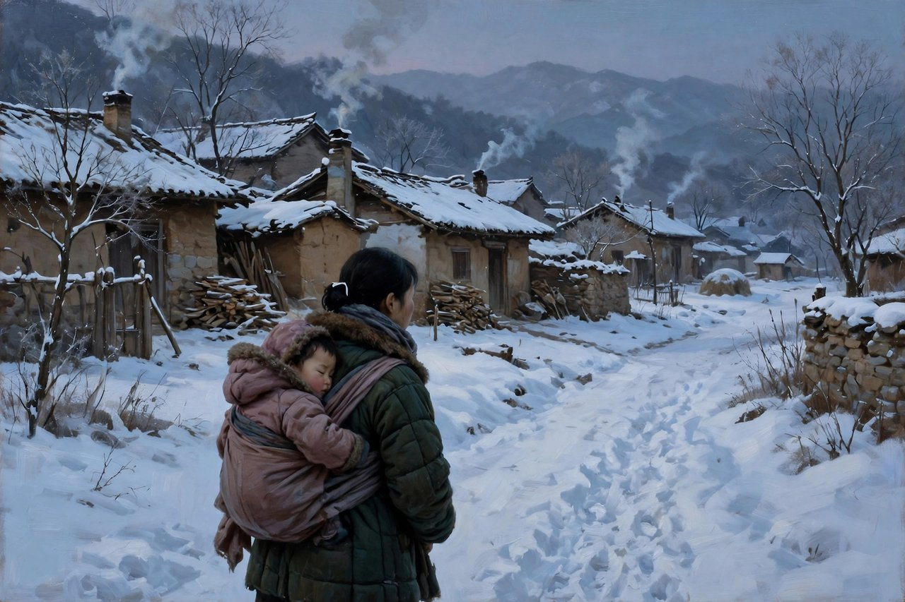

## 一辆牛车上的偶遇

牛车上这个名字，听起来慢，听起来晃，听起来土，听起来像一辆车在野地里慢慢走、慢慢晃、慢慢颠的样子。萧红的短篇小说牛车上，收在她一九三七年五月由上海文化生活出版社出版的小说集牛车上里，那本集子收了牛车上、家族以外的人、红的果园、孤独的生活、王四的故事这些篇目，是巴金主编的文学丛刊中的一本。牛车上这篇小说，篇幅不长，人物不多，情节也不复杂，可就是这样一篇简单的东西，写出了底层人民家破人亡的悲惨命运，写出了两个天涯沦落人在一辆牛车上的偶遇，写出了一个母亲的心事，写出了一个时代的疼，写得让人读完之后，心里久久不能平静。

小说讲故事的人，是书里的我，是一个孩子，是一个跟着牛车走、跟着牛车看、跟着牛车听的孩子。牛车上坐着两个人，一个是车夫，一个是五云嫂。五云嫂是外祖父家的女佣人，是到城里去看她的儿子的，是一个上了年纪的女人，是一个经历过很多事的女人，是一个心里装着很多话、平时没有地方说的女人。车夫是个当过兵的人，是个赶牛车的人，是个在野地里走来走去的人，是个见过世面、也受过伤的人。两个人，本来不认识，本来没有交集，本来只是同坐一辆牛车，往同一个方向走，走着走着，话就说开了，心事就说开了，命运就撞在一起了。萧红写这种偶遇，写得自然，写得真实，写得像生活本身，生活里的偶遇就是这样，两个人坐一辆车，走一段路，说几句话，话说开了，心就近了，命运就连起来了。

五云嫂开口开口讲起的事，是关于梅子汤的，是关于她到城里看儿子的事，是关于她想睡了、喝点梅子汤的事。梅子汤这个细节，听起来小，实际上是五云嫂的生活，是她在车上的一点安慰，是一点酸甜，是一点在野地里走路的时候，能让自己舒服一点的东西。车夫抓了我的辫发，把我向后拉了一下，问她以后有没有信来，她说没有，打开了梅子汤的瓶口，喝了一碗，又喝了一碗。这种喝梅子汤的样子，就是五云嫂的日子，就是一个母亲在牛车上，一边赶路，一边想儿子，一边喝汤，一边说话的样子。今天的人，读到这里，可能会想起自己坐长途车的时候，想起自己在车上喝水、吃东西、和陌生人说话的样子，想起自己在旅途里，话说开了、心事说开了、和陌生人变成朋友的样子。萧红写牛车，写的不只是一辆车，写的是旅途，写的是人在旅途里，是最容易说真话的，是最容易把心事说出来的，是最容易把疼说出来的，因为旅途里的人，都是过客，都是萍水相逢，说出来了，也不用负责，听进去了，也不用记住，这种萍水相逢的真话，有时候比家里人的真话还要真，还要疼，还要动人。

## 五云嫂讲起的丈夫

五云嫂接着讲起的事，是关于她丈夫的事，是关于一个当兵的人失踪的事，是关于一个家庭散了的事。她说，你们这当兵的人，只说三年五载，可是回来，回来个什么呢，回来个魂灵给人看看吧。这种话，听起来是抱怨，实际上是疼，是一个妻子等了丈夫很多年，等不到人，等不到信，等到的只是一个魂灵的影子的疼。她说，音信皆无过了一年多，车夫问，是阵亡了吗，车夫从车上跳下去，拿了鞭子，在空中抽了两下，似乎是什么爆裂的声音。这种鞭子的声音，就是车夫的疼，就是车夫听见五云嫂的话之后，心里被触动的声音，就是一个当过兵的人，听见另一个当兵的人失踪之后，那种兔死狐悲、物伤其类的疼。萧红写这种疼，写得细，写得冷，写得不煽情，写得让人心里一紧，写得让人明白，战争不是抽象的词，战争就是一个丈夫失踪了，一个妻子等不到信了，一个孩子没有爹了，一个家庭散了，一个母亲要背着孩子去城里求官了。

五云嫂又讲起的事，是关于逃兵被枪毙的事，是关于民国十年枪毙逃兵二十多个的那回事，是关于她在十字街口的墙头上，看到一张大纸，人们说是捉逃兵的告示，是关于几天就要送到县城来枪毙的事。车夫听见这件事，把卷起的衣袖在下意识地把它放下来，又用手扶着下颚，这种放下衣袖、扶着下颚的样子，就是车夫的心虚，就是车夫的怕，就是一个当过兵的人，听见逃兵被枪毙之后，那种怕自己也被抓、怕自己也被枪毙、怕自己的命运也和逃兵一样的怕。萧红写这种怕，写得真实，写得具体，写得让人觉得，车夫这个人，不只是一个赶车的人，不只是一个听故事的人，他也是一个有故事的人，也是一个有怕的人，也是一个在战争里受过伤、逃过难、怕过死的人。五云嫂和车夫，两个人的故事，表面上看是不一样的，一个是妻子的故事，一个是当兵的故事，实际上是一样的，都是战争的故事，都是家破人亡的故事，都是底层人民被时代碾过的故事，都是牛车上的两个天涯沦落人，命运撞在一起的故事。

五云嫂讲起的最疼的一件事，是关于她背着秃子去城里的事，是关于她想把秃子放在河边上、自己一跳就下去的事，是关于她拍着小胸脯说睡吧、秃儿的事，是关于她想起还有几吊钱，也放在孩子的胸脯上的事，是关于她正在伸手去放的时候，孩子睁开眼睛了，又加上一只风船转过河湾来，船上的孩子喊妈妈的声音，传过来了，她一听到船上的孩子喊妈妈的声音，就从沙滩上面把秃子抱在怀里了的事。这种想跳河、又抱回来的事，听起来矛盾，实际上是母亲的心，是一个母亲在绝境里，想死，又舍不得孩子，想带着孩子一起死，又听见别的孩子喊妈妈，就舍不得了，就把孩子抱回来了，就说还是背着他回家吧，哪怕讨饭，也是有个亲娘的好。这种还是背着他回家吧、哪怕讨饭也是有个亲娘的好的话，就是五云嫂这篇小说里最动人的一句话，就是一个母亲在绝境里最后的决定，就是一个母亲把死念头放下、把活念头捡起来的决定，就是一个母亲对孩子最后的爱，最后的责任，最后的疼。今天的人，读到这里，可能会哭，可能会想起自己的母亲，想起自己的母亲在最难的时候，也没有扔下自己，也没有跳河，也没有放弃，也是一边哭，一边抱着自己，一边说回家吧，哪怕讨饭，也是有个亲娘的好。这种话，听起来土，听起来旧，听起来像老话，可就是这样一句老话，撑起了五云嫂的一生，撑起了秃子的一生，撑起了牛车上这篇小说的全部，撑起了萧红对母亲、对底层人民、对生命本身的全部理解。

## 车夫的那句我也有家小

车夫听完五云嫂的话之后，说了一句话，我也有家小。这句话，听起来轻，听起来简单，听起来像一句随口的话，可里头藏着整篇小说的魂。车夫的话，像从嘴唇上流了下来似的，好像他对着旷野说的一般，好像他不是对五云嫂说的，是对自己说的，是对野地说，是对风说的，是对自己心里那个家说的。五云嫂的谈话，勾起了车夫对家人的惦念，勾起了车夫对自己家小的想念，勾起了车夫对自己浪迹生活的厌倦，勾起了车夫对回家这件事的想和怕。想回家，是因为有家小，是因为想老婆孩子，是因为想过安稳日子，怕回家，是因为过惯了浪迹的生活，是因为不知道回家之后怎么办，是因为不知道回家之后，日子会不会更难，是因为车夫这个人，也是被时代碾过的人，也是被战争碾过的人，也是家破人亡的人，也是牛车上的天涯沦落人。萧红写车夫的这句话，写得克制，写得真实，写得不煽情，写得让人心里一紧，写得让人明白，牛车上的两个人，不只是一个讲故事、一个听故事，两个人都是有故事的人，两个人都是有家小的人，两个人都是被时代碾过的人，两个人的命运，在牛车上撞在一起了，撞出了火花，撞出了疼，撞出了理解，撞出了同是天涯沦落人的感觉。

五云嫂后来还讲了一件事，是关于她一回身就把一个兵官的皮带抓住，问姜五云呢，他是你的什么人，是我的丈夫，我把秃子可就放在地上啦，接着我就打了那个军官，你们把人消灭到什么地方啦，那些逃兵们就连起声来跺着脚喊的事。这种抓住皮带、打军官、问丈夫下落的事，听起来大胆，实际上是母亲的勇气，是妻子在绝境里的勇气，是一个平时老实巴交的女人，在丈夫失踪、孩子差点没命的时候，突然爆发出来的勇气。这种勇气，不是英雄的勇气，不是喊口号的勇气，是母亲的勇气，是妻子在疼到极点的时候，顾不上怕、顾不上规矩、顾不上自己会不会被抓、会不会被打的勇气。今天的人，读到这里，可能会想起自己的母亲，想起自己的母亲在关键时刻，也曾经这样勇敢过，也曾经抓住过别人的皮带，也曾经大声问过，也曾经打过，也曾经为了孩子、为了丈夫，什么都不怕过。这种勇气，萧红写得真实，写得具体，写得让人服气，写得让人明白，底层人民不是没有勇气，底层人民的勇气，是藏在日子里的，是藏在疼里的，是藏在绝境里的，是平时看不出来，到了关键时刻，才爆发出来的勇气。

小说的结尾，写得也很萧红，写得也很冷，写得也很暖。黄昏的风，却是和二月里的一样，车夫在车尾上打开了外祖父给祖父带来的酒坛，说喝吧，喝吧，两个人喝酒，喝的不是酒，喝的是疼，喝的是理解，喝的是同是天涯沦落人的感觉，喝的是牛车上的偶遇，喝的是野地里的风，喝的是黄昏里的光，喝的是两个人在一辆牛车上，互相讲了心事，互相理解了，互相取暖了，互相成为了朋友的感觉。我们车子的前面正过着一堆羊群，放羊的孩子口里响着用柳条做成的叫子，野地在斜过去的太阳里分不出什么是花，什么是草了，只是混混黄黄的一片。这种混混黄黄的一片，就是小说的结尾，就是萧红留给读者的最后一点东西，就是野地里的光，就是黄昏里的风，就是牛车上的酒，就是两个天涯沦落人互相理解之后，日子还要往前走，牛车还要往前走，羊群还要往前走，太阳还要往下落，日子还要过下去，疼还要疼下去，爱还要爱下去，母亲还要背着孩子回家，车夫还要赶着牛车往前走，走下去了，人生才算没有白走，日子才算没有白过，牛车才算没有白坐。

## 对照今天看牛车上

今天再读牛车上，很多人会觉得，这篇小说写的是民国的牛车，写的是五云嫂，写的是车夫，写的是当兵失踪，写的是逃兵枪毙，写的是背着孩子想跳河，跟今天没有关系。其实关系大得很，只不过换了个样子。今天的牛车，换成了长途车，换成了火车，换成了飞机，换成了网约车，换成了各种各样的交通工具，今天的五云嫂，换成了在外打工的母亲，换成了留守儿童的母亲，换成了在城市里带孩子、在老家想孩子的母亲，换成了丈夫在外打工、音信皆无、自己一个人带孩子的母亲，今天的车夫，换成了司机，换成了快递员，换成了外卖员，换成了各种各样在路上奔波的人，今天的当兵失踪，换成了丈夫失联，换成了亲人失踪，换成了打工的人一年到头回不了家、电话也打不通的失联，今天的逃兵枪毙，换成了各种各样的制度暴力，换成了各种各样的被抓、被罚、被开除、被网暴的怕，今天的背着孩子想跳河，换成了母亲在绝境里想不开、想放弃、想带着孩子一起走的念头，换成了各种各样的产后抑郁，换成了各种各样的生活压力，换成了各种各样的想死又舍不得孩子的疼。换汤不换药，牛车还是牛车，旅途还是旅途，母亲还是母亲，车夫还是车夫，疼还是疼，理解还是理解，同是天涯沦落人的感觉，还是同是天涯沦落人的感觉。萧红写牛车上，写的是民国的牛车，照见的是今天的长途车，照见的是今天千千万万个在路上奔波、在旅途里讲心事、在旅途里互相理解的人。

今天的旅途，也换了个样子还在。今天的旅途，不再是牛车在野地里慢慢走、慢慢晃、慢慢颠的旅途了，换成了高铁在田野里飞快地跑，换成了飞机在天上飞，换成了网约车在城市里穿梭，可旅途里讲心事的习惯，还在，旅途里和陌生人说话的习惯，还在，旅途里把疼说出来的习惯，还在。今天的人，坐长途车，坐火车，坐飞机，也会和陌生人说话，也会讲自己的心事，也会听别人的心事，也会在旅途里，突然觉得陌生人比家里人还理解自己，突然觉得萍水相逢的人，比天天见面的人还贴心。这种旅途里的真话，萧红写出来了，写成了牛车上，写成了五云嫂和车夫的偶遇，写成了两个天涯沦落人在一辆牛车上的理解，写成了后来人心里的一辆牛车。今天的人，读牛车上，就是认出这种旅途里的真话，就是认出这种萍水相逢的理解，就是认出这种在路上讲心事、在路上互相取暖的感觉，认出来了，才会在旅途里，多听一句，多说一句，多理解一句，多暖一句，才不会在旅途里，只顾着刷手机，只顾着戴耳机，只顾着看窗外，只顾着把心事藏起来，把疼藏起来，把理解藏起来。

今天的母亲，也换了个样子还在。今天的母亲，不再是背着秃子去城里、想跳河又抱回来的母亲了，换成了在城市里打工、孩子在老家留守的母亲，换成了产后抑郁、想不开又舍不得孩子的母亲，换成了丈夫失联、自己一个人带孩子的母亲，换成了在职场和家庭之间两头跑、两头疼的母亲。母亲的本质没有变，还是疼孩子，还是舍不得孩子，还是在绝境里想死又舍不得死，还是在疼到极点的时候，抓住皮带问丈夫下落，还是在黄昏里，和陌生人喝一杯酒，讲一讲心事，互相理解一下，互相取暖一下。萧红写五云嫂，就是把这种母亲写出来了，写得真实，写得具体，写得让人心疼，写得让人明白，母亲不是超人，母亲是人，母亲也会疼，也会怕，也会想不开，也会想跳河，也会抓住皮带打军官，也会在听见别的孩子喊妈妈的时候，把自己的孩子抱回来，说回家吧，哪怕讨饭，也是有个亲娘的好。这种母亲，今天还在，还在城市里，还在农村里，还在出租屋里，还在加班的夜里，还在产房里，还在幼儿园门口，还在每一个为孩子操心、为丈夫操心、为日子操心的女人身上。读牛车上，就是认出这些母亲，就是心疼这些母亲，就是给这些母亲递一张纸，说一句暖话，帮一把忙，理解一下，取暖一下。

## 为什么牛车上还值得读

牛车上值得读，原因很实在，原因在它的短，原因在它的深，原因在它的真。小说不长，短篇的篇幅，一口气就能读完，可读完之后，心里会留很久，会想很久，会疼很久。这种短而深的小说，今天特别少，今天的小说要么太长，长到读不完，要么太浅，浅到读完就忘，牛车上不长不浅，刚刚好，刚刚能把一个母亲的一生讲清楚，刚刚能把一个车夫的一生讲清楚，刚刚能把两个天涯沦落人的偶遇讲清楚，讲得不见血，讲得让人连凶手都找不到，讲得让人读完之后，还要想一想，凶手到底是谁，是战争，是当兵，是逃兵枪毙，是制度，是穷，是时代，还是所有这些加在一起。想不出来凶手，才是这篇小说最厉害的地方，因为真正的凶手，从来不是一个人，真正的凶手，是一群人，是一种制度，是一种时代，是一种所有人都参与、所有人都不觉得自己有错的机制。认出这种机制，比认出一个凶手更重要，因为机制不改，五云嫂还会哭，还会有一个又一个的五云嫂，在牛车上讲心事，在长途车上讲心事，在火车上讲心事，在旅途里讲心事，讲完了，日子还是老样子，还是要背着孩子回家，还是要赶着牛车往前走，还是要在黄昏里喝一杯酒，互相理解一下，互相取暖一下。

原因在它的视角，孩子的视角，一个孩子在牛车上看、听、想的视角，这种视角，今天写底层、写母亲、写旅途的时候，依然是最好的视角中的一个。孩子的视角，能看见大人看不见的东西，能听见大人听不见的心事，能问出大人不敢问的问题，能疼出大人已经麻木的疼。孩子看见五云嫂喝梅子汤，觉得好奇，孩子听见五云嫂讲丈夫失踪，觉得疼，孩子看见车夫放下衣袖、扶着下颚，觉得奇怪，孩子看见五云嫂抱回秃子，觉得暖，孩子看见车夫说我也有家小，觉得理解，孩子看见黄昏里的羊群，觉得美。这种孩子的视角，让这篇小说的批判变得不生硬，不说教，不喊口号，批判是藏在孩子的眼睛里的，是藏在孩子的惊奇里的，是读者自己读出来、自己想出来的。今天很多写底层、写母亲、写战争的作品，写得太直白，太说教，太喊口号，读起来像上课，像训话，读者听不进去。萧红不这样，她让孩子看，让孩子听，让孩子疼，读者跟着孩子看，跟着孩子听，跟着孩子疼，批判就自然而然地长出来了，长在了读者心里，忘不掉了。

读牛车上的方法，也很简单，别急着找主题，别急着找思想，别急着划线，别急着写读后感。先慢慢读，读牛车，读五云嫂，读车夫，读梅子汤，读丈夫失踪，读逃兵枪毙，读背着秃子去城里，读想跳河又抱回来，读抓住皮带打军官，读我也有家小，读黄昏里的酒坛，读羊群，读柳条叫子，读混混黄黄的野地，读完一遍，再读一遍，读出母亲的疼来，读出车夫的疼来，读出旅途的疼来，读出自己身边的影子来。读进去了，你会发现，牛车不只是一辆民国的牛车，牛车是每一个旅途，是每一个母亲的旅途，是每一个在路上奔波的人的旅途，是每一个在旅途里讲心事、互相理解、互相取暖的人的旅途。读牛车上，就是读自己，就是读自己身边的母亲，就是读那些没有说出口的话，就是读那些被咽回去的疼，就是读那些被藏在梅子汤里、藏在酒坛里、藏在黄昏里的爱。读完了，你会想对自己说一句，也想对身边的母亲说一句，别像五云嫂那样，一个人背着孩子想跳河，要说出来，要讲出来，要在牛车上讲出来，要在旅途里讲出来，要在黄昏里讲出来，讲出来了，就有人听，听进去了，就有人理解，理解了，就有人取暖，取暖了，日子就还能过下去，牛车就还能往前走，母亲就还能背着孩子回家，回家吧，哪怕讨饭，也是有个亲娘的好。

## 牛车还在野地里走

牛车上读到尾巴上，留在心里的，是牛车的样子，是五云嫂的样子，是车夫的样子，是梅子汤的样子，是酒坛的样子，是羊群的样子，是柳条叫子的声音，是混混黄黄的野地的样子，是黄昏里的风的样子，是我也有家小的声音，是回家吧、哪怕讨饭也是有个亲娘的好的声音。这些样子，拼在一起，就是牛车上，就是萧红，就是一个母亲没有说出口的一生，就是一个车夫没有说出口的一生，就是两个天涯沦落人在一辆牛车上的偶遇，就是后来人心里的一辆牛车。今天的人，读完牛车上，再看自己身边的人，再看自己年轻的时候，再看自己没有说出口的话，心里会多一点疼，多一点想，多一点勇气，多一点为自己、为母亲、为孩子做一点事的念头。这篇小说，就是这样一篇小说，不长，不吵，不喊口号，可就是让人忘不掉，让人读完之后，还想再读一遍，还想把自己的心事讲出来，把自己的疼说出来，把自己的牛车往前赶，把自己的孩子抱回家，把自己的日子，过得暖一点，近一点，像个人一点。

牛车还在野地里走，还在黄昏里走，还在风里走，还在后来人的心里走，走着走着，就会走到家，走到母亲身边，走到孩子身边，走到爱人身边，走到自己的日子里，走到自己的春天里，走到自己的未来里。五云嫂走了，车夫走了，萧红走了，牛车还在，野地还在，黄昏还在，风还在，羊群还在，柳条叫子还在，梅子汤还在，酒坛还在，我也有家小的声音还在，回家吧的声音还在，后来的人，还在牛车上，还在讲心事，还在互相理解，还在互相取暖，还在往前走，走下去了，牛车就到家了，母亲就抱住孩子了，车夫就回到家小身边了，日子就暖了，人生就实了，牛车就没有白坐，心事就没有白讲，疼就没有白疼，爱就没有白爱。

## 给旅途里的人的话

如果五云嫂能对今天旅途里的人说一句话，她大概会说，别把心事藏起来，别把疼咽回去，别一个人背着孩子想跳河，别一个人赶着牛车想回家，要说出来，要讲出来，要在牛车上讲出来，要在长途车上讲出来，要在火车上讲出来，要在黄昏里讲出来，讲出来了，就有人听，听进去了，就有人理解，理解了，就有人取暖，取暖了，日子就还能过下去，牛车就还能往前走，母亲就还能背着孩子回家。她大概会说，车夫的那句我也有家小，不是随口说的，是心里的话，是每一个在路上奔波的人心里的话，是每一个想家、想老婆孩子、想过安稳日子的人心里的话，说出来了，心里就轻了，说出来了，牛车就不再是一辆孤单的车了，牛车就变成了两个人的车，变成了互相理解的车，变成了互相取暖的车。她大概会说，回家吧，哪怕讨饭，也是有个亲娘的好，这句话，不是认命，不是妥协，是母亲最后的决定，是母亲把死念头放下、把活念头捡起来的决定，是母亲对孩子最后的爱，最后的责任，最后的疼。今天的人，读到这句话，可能会哭，可能会想起自己的母亲，可能会想起自己的母亲在最难的时候，也没有扔下自己，也没有放弃，也是一边哭，一边抱着自己，一边说回家吧，回家吧，回家了，就有饭吃，就有觉睡，就有亲娘在，就有家在，就有日子在。

牛车上这篇小说，今天还在，还在被阅读，还在被讨论，还在让一代又一代的读者想起自己的母亲，想起自己的旅途，想起自己在牛车上、在长途车上、在火车上讲过的心事，想起自己在旅途里遇见过的陌生人，想起自己在黄昏里喝过的酒，想起自己说过的我也有家小，想起自己听过的回家吧。这篇小说，就是这样一篇小说，不长，不吵，不喊口号，可就是让人忘不掉，让人读完之后，还想再读一遍，还想把自己的心事讲出来，把自己的疼说出来，把自己的牛车往前赶，把自己的孩子抱回家，把自己的日子，过得暖一点，近一点，像个人一点。读完了，合上书，走出门，看一看自己走的路，看一看自己坐的车，看一看自己爱的人，看一看自己想回家的地方，心里会多一点疼，多一点暖，多一点想把日子过好的念头，多一点把心事讲出来的勇气。

牛车还在走，野地还在，黄昏还在，风还在，羊群还在，柳条叫子还在，梅子汤还在，酒坛还在，五云嫂还在讲，车夫还在听，孩子还在牛车上，母亲还在牛车上，后来的人，还在牛车上，还在讲心事，还在互相理解，还在互相取暖，还在往前走，走下去了，就到家了，到家了，就有饭吃，就有觉睡，就有亲娘在，就有家在，就有日子在，就有未来在，就有希望在，就有爱在。

读完牛车上，合上书，想一想，自己今天有没有心事没有讲，有没有疼没有说，有没有家小没有回去看，有没有母亲没有打电话，有没有孩子没有抱一抱，想清楚了，就讲出来，就说出来，就回去一次，就打一个电话，就抱一抱孩子，就陪母亲吃一顿饭，就把牛车往家赶，赶回家了，日子就暖了，人生就实了，牛车就没有白坐，心事就没有白讲。

五云嫂走了，车夫走了，萧红走了，牛车还在，野地还在，黄昏还在，后来的人，还在牛车上，还在讲，还在听，还在理解，还在取暖，还在往前走，走下去了，就到家了，到家了，就好了，就暖了，就实了，就像个人一样活着了。

牛车还在野地里走，还在黄昏里走，还在风里走，还在后来人的心里走，走着走着，就会走到家，走到母亲身边，走到孩子身边，走到爱人身边，走到自己的日子里。五云嫂讲过的心事，车夫听过的疼，黄昏里喝过的酒，羊群走过的野地，柳条叫子的声音，混混黄黄的太阳，这些东西，今天还在，还在长途车上，还在火车上，还在每一个旅途里，还在每一个母亲心里，还在每一个想家的人心里。读完牛车上，再坐一次长途车，再听一次陌生人的心事，再对陌生人说一句暖话，再给母亲打一个电话，再抱一抱孩子，再把牛车往家赶，赶回家了，日子就暖了，人生就实了，牛车就没有白坐，心事就没有白讲，萧红就没有白写。

牛车上这篇小说，读一遍是疼，读两遍是暖，读三遍是理解，读很多遍，是认出自己，认出自己的母亲，认出自己的旅途，认出自己的车夫，认出自己的梅子汤，认出自己的酒坛，认出自己的黄昏，认出自己的羊群，认出自己的回家路。认出来了，才有可能讲出来，讲出来了，才有人听，听进去了，才有人理解，理解了，才有人取暖，取暖了，日子就还能过下去，牛车就还能往前走，母亲就还能背着孩子回家，回家吧，哪怕讨饭，也是有个亲娘的好，这句话，就还在，牛车就还在，萧红就还在。
